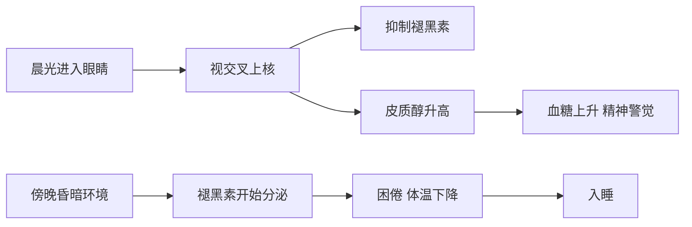
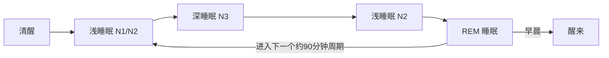
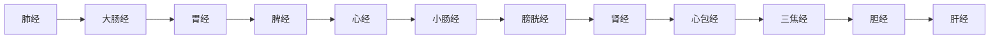
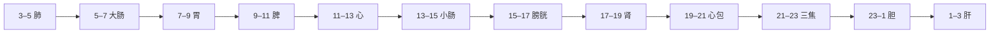

# Concept-Book Run

domain: /home/papagame/projects/digital-duck/cb-meta-health/public/domains/meta_health_ch08/input/graph.yaml
target: personal_daily_rhythm_schedule
started: 2026-11-24T13:19:04

## Teaching order (18 concepts)

- circadian_clock
- yin_yang
- day_night_yin_yang
- cortisol_melatonin_rhythm
- sleep_architecture
- five_phase_correspondences
- sleep_and_metabolic_repair
- twelve_primary_meridians
- chrononutrition
- four_seasons_regimen
- light_entrainment
- organ_clock_ziwu_liuzhu
- exercise_timing
- seasonal_organ_care
- breakfast_in_chenshi
- seasonal_food_and_movement
- sleep_before_zishi
- personal_daily_rhythm_schedule

### circadian_clock (0.7s)

## 生物钟

**定义。** 生物钟(昼夜节律系统)是人体内约 24 小时运转一圈的内部计时机制。它的"总指挥"是下丘脑的**视交叉上核**(SCN),约由两万个神经元组成,位于视交叉上方,直接接收来自视网膜的光信号。除此之外,肝、肾、心脏、脂肪、骨骼肌等几乎所有组织的细胞中也有各自的**外周时钟**。外周时钟靠细胞内的基因反馈环路自行振荡,而视交叉上核通过神经信号、体温和激素(如褪黑素、皮质醇)把它们协调成同一节拍。

在人体中,内源性周期平均约为 24.2 小时,略长于一天。因此,每天清晨的光照会把时钟"拨回"与外界同步。能校准时钟的外部信号称为授时因子,其中光最强,进餐时间、运动和社交活动也有作用。

**例题。** 小林的内源周期为 24.2 小时。如果他长期待在没有任何时间线索的环境中,每天会比外界"晚"多少?30 天后累计偏移多少?

每天偏移:

$$24.2\ \text{h} - 24\ \text{h} = 0.2\ \text{h} = 12\ \text{min}$$

30 天累计:

$$30 \times 12\ \text{min} = 360\ \text{min} = 6\ \text{h}$$

也就是说,没有光照校准时,他的睡眠时段会逐渐后移,一个月后大约晚 6 小时。这解释了为什么盲人有时会出现"非24小时睡眠觉醒障碍":他们的时钟得不到光的校准。

**问题解决应用。** 小王从上海飞往纽约,时差 $-12$ 小时(向西飞)。他的时钟需要"向后拨"。研究显示,向西飞时,体内时钟每天大约能后移 1.5 小时,向东飞则每天只能前移约 1 小时。估算他完全适应所需天数:

$$\frac{12\ \text{h}}{1.5\ \text{h/天}} = 8\ \text{天}$$

若他从纽约飞回上海,同样 12 小时的差距,按每天前移 1 小时估算,则需约 12 天。这与"向东飞比向西飞更难倒时差"的经验一致。(这里的数字是粗略平均值,个体差异较大。)

可操作的策略包括:

| 目的 | 做法 |
|---|---|
| 时钟需要前移(向东飞) | 到达后上午尽早接触明亮的自然光,傍晚避免强光 |
| 时钟需要后移(向西飞) | 傍晚多接触光,早晨可适当避光 |
| 日常维持稳定 | 起床和用餐时间尽量固定,睡前一小时减少手机、电脑等蓝光屏幕 |

**小结。** 视交叉上核负责与外界光照同步,外周时钟负责各器官的节律。两者失调,例如倒班、长期熬夜或跨时区旅行,会带来睡眠紊乱、代谢和情绪方面的问题。调整作息时抓住"光照时机"这一关键,就能更快让整个系统重新同步。

### yin_yang (0.8s)

## 阴阳

**定义。** 阴阳是中医(Traditional Chinese Medicine,TCM)用来描述事物相对性质及其相互关系的一对概念。中医认为,人体和自然界的现象都可以按相对的性质分为两类:阴偏向寒凉、安静、向内、向下、物质性;阳偏向温热、活跃、向外、向上、功能性。要注意,阴阳不是固定的标签,而是相对的:同一事物与不同对象比较,归属可以改变。例如,白天属阳、夜晚属阴;而在白天之中,上午又相对属阳、下午相对属阴。

中医还提出阴阳之间有几种关系:对立制约(如热与寒互相抑制)、互根互用(阴为阳提供物质基础,阳推动阴的化生)、消长变化(此长彼消)、相互转化(极端状态下可向对立面转变)。这些是定性的描述,不能用数值或公式计算,也没有可直接测量的"阴量"或"阳量"。从现代科学角度看,阴阳是一种思维框架和分类语言,而不是已被证实的生理机制;它与体温、心率、激素水平等可测量指标之间并没有经检验的对应关系。

**示例:用阴阳描述一次发热。** 设想一位患者,体温 $39\,^\circ\text{C}$,面红口渴,喜冷饮,脉快,尿黄。中医会这样分析:

| 观察 | 倾向 |
|---|---|
| 发热、面红 | 热,属阳 |
| 口渴喜冷饮 | 热伤津液,津液属阴 |
| 脉快 | 动,属阳 |
| 尿黄、量少 | 阴液不足 |

中医据此判断为"阳盛"(热过盛),治疗原则是清热。若另一位患者怕冷、四肢冰凉、精神萎靡、脉弱、喜热饮,则被归为"阳虚"(温煦不足),治疗原则是温补。两者的区别在于:前者是热的一方过多,后者是热的一方不足。

**问题应用。** 下面三道题练习用阴阳的相对性做分类。

1. *某人白天精神好、夜间畏寒,怎样描述?* 白天属阳,精神好是阳的功能活跃,属正常;夜间畏寒,说明夜间"阳"不足以温煦身体。这是中医的描述方式,并不等于诊断出某种疾病。
2. *在"心"与"肾"中,谁相对属阳?* 在中医的五脏理论中,心位于上,属阳;肾位于下,属阴。这是与对方比较得出的相对结论。
3. *出汗过多后口渴、乏力,如何理解?* 汗是津液,属阴;大量出汗是阴液耗损。

**需要提醒的是**:现代医学对发热、脱水等情况有明确的测量方法和处理规范。体温持续升高、严重脱水或意识改变时,应以体温、血压、化验结果为依据及时就医,而不应只靠阴阳分类来判断病情。学习阴阳的价值,在于读懂中医的语言和推理方式,而不是替代客观检查。

### day_night_yin_yang (0.7s)

## 昼夜阴阳消长

### 定义

中医认为,一天之中人体的阴阳也随昼夜起伏:从子夜到正午,阳气逐渐生长,阴气逐渐减退;从正午到子夜,阴气逐渐生长,阳气逐渐减退。这就是"昼夜阴阳消长"。按这一说法,白天属阳,适合活动、工作和消耗;夜晚属阴,适合安静、睡眠和储存。这是一种用来安排作息的传统框架,不是可以用数字计算的量。

与之相对应的,是现代生理学中真实可测的昼夜节律(生物钟),大约以24小时为周期。例如:

| 指标 | 大致规律 |
|---|---|
| 核心体温 | 清晨最低,傍晚最高,相差约 $0.5\,^\circ\mathrm{C}$ 至 $1\,^\circ\mathrm{C}$ |
| 皮质醇 | 醒后不久达到高峰,夜间降到低谷 |
| 褪黑素 | 天黑后升高,夜间达到高峰 |
| 心率与血压 | 白天较高,睡眠中下降 |

这两套说法的时段划分大体相近,但中医的"阳气""阴气"是传统概念,并不等同于上述任何一项指标。

### 示例

小林是一名学生,作息如下:

- 23:30 入睡,7:00 起床,早餐后上课;
- 12:00 午饭后短暂休息;
- 晚上 20:00 之后做轻松的复习,22:30 关闭屏幕。

按中医的说法,7:00 至 12:00 属阳气渐盛之时,适合安排最费脑力的课程;午后至傍晚阳气渐退,安排练习与运动;入夜后阴气渐盛,应减少兴奋性活动,准备入睡。

用现代生理学解释,这样安排也有道理:早晨皮质醇高、体温上升,警觉性较好;夜间强光会抑制褪黑素分泌,推迟入睡。睡眠时长也可以直接计算:

$$
\text{睡眠时长} = 7{:}00 - 23{:}30 = 7.5\ \text{小时}
$$

处在成年人常被推荐的 7 至 9 小时范围内。

### 问题应用

小王是夜班护士,22:00 上班,6:00 下班,回家后想马上睡觉,但总在中午前后醒来。请分析并提出建议。

**第一步:找出冲突。**中医认为,他在阴气渐盛的夜晚工作,又在阳气渐生的白天睡觉,与昼夜阴阳消长的节奏相反。现代的说法是:白天光照和体温上升会让睡眠变浅、变短,这是昼夜节律与作息错位的表现。

**第二步:提出可操作的措施。**

1. 下班回家路上戴深色墨镜,减少晨光照射;
2. 卧室使用遮光窗帘,保持安静和凉爽;
3. 睡眠分为主睡眠(如 7:30–13:00)和上班前的 20–30 分钟小睡;
4. 上班前半段在明亮环境中工作,临近下班时调暗光线,咖啡因最迟在上班后约 6 小时停用;
5. 休息日也尽量保持相近的睡眠时间,避免节律反复被打乱。

**第三步:评估边界。**长期倒班会增加疲劳和睡眠障碍的风险,这是有研究支持的结论。而"子时必须入睡,否则伤阴"这类具体说法,缺乏可靠的证据。若失眠持续超过数周,或白天严重嗜睡,应就医评估。

**小结:**昼夜阴阳消长提醒人们让作息顺应昼夜的节律。真正用来解决问题的,是对光照、睡眠时长和时间安排的具体调整。

### cortisol_melatonin_rhythm (0.7s)

## 皮质醇与褪黑素节律

**定义。** 人体的昼夜节律由下丘脑视交叉上核这一“主时钟”协调,并受光照校准。其中两种激素的变化最具代表性:**皮质醇**由肾上腺皮质分泌,在醒后约 30–45 分钟达到峰值(称为“皮质醇觉醒反应”),作用是动员能量,包括促进肝脏糖异生、升高血糖、提升警觉性;此后全天逐渐下降,午夜前后降至最低。**褪黑素**由松果体分泌,在黑暗中开始上升(昏暗光线下褪黑素开始分泌的时间,约在入睡前 2 小时),夜间 2–4 点达到高峰,随晨光出现而被抑制。两者大致呈相反的走向:皮质醇白天高、夜间低,褪黑素夜间高、白天几乎检测不到。

| 激素 | 峰值时间 | 谷值时间 | 主要作用 |
|---|---|---|---|
| 皮质醇 | 醒后约 30–45 分钟 | 午夜前后 | 动员能量、维持警觉 |
| 褪黑素 | 凌晨 2–4 点 | 白天 | 向身体传递“夜晚”信号、促进入睡 |

*图:光照信号经视交叉上核调控两种激素的昼夜走向。*

**例题。** 小李平时 7:00 起床、23:00 入睡。(1)他的皮质醇峰值大约出现在何时?(2)褪黑素开始分泌大约在何时?

解:(1)峰值在醒后 30–45 分钟,即约 7:30–7:45。(2)褪黑素开始分泌约在入睡前 2 小时,即约 21:00。

**问题解决应用。** 小李最近晚上 21:00 后仍在明亮灯光下刷手机,常到凌晨 1:00 才睡,早晨又难以清醒。请分析原因并提出调整方案。

分析:明亮光线,尤其是富含蓝光的屏幕光,会抑制并推迟褪黑素的分泌,使“夜晚信号”延后,入睡时间随之后移。睡眠不足时,早晨的皮质醇觉醒反应往往不能顺利衔接,表现为晨起迟钝。

调整方案:
1. **固定起床时间**:每天在同一时间起床,是校准节律最有效的锚点。
2. **晨间光照**:起床后 1 小时内到户外接受自然光,可强化皮质醇的晨间上升,并为约 14–16 小时后的褪黑素分泌“定时”。
3. **傍晚减光**:21:00 后调暗室内灯光,减少屏幕使用,或开启夜间模式并降低亮度。
4. **晚间避免刺激**:睡前不做剧烈运动、不摄入咖啡因,以免推高皮质醇和警觉度。

在上述方案中,最关键的是光照时间的管理,而非额外补充激素。褪黑素补充剂主要用于倒时差等特定情形,长期使用应咨询医生。

**小结。** 皮质醇在晨起后达到高峰以供能,褪黑素在夜间黑暗中升高以促眠,二者由光照和作息共同校准。规律的起床时间、白天的充足光照和夜间的昏暗环境,是维持这一节律的基本做法。

### sleep_architecture (0.5s)

## 睡眠结构

**定义。** 睡眠结构（sleep architecture）指一整夜睡眠中各个睡眠阶段的类型、时长和排列方式。根据脑电图，睡眠分为非快速眼动睡眠（NREM）和快速眼动睡眠（REM）。NREM 又分为：

- **浅睡眠**（N1、N2期）：肌肉放松，体温和心率下降，容易被唤醒。N2期占整夜睡眠的约 45%–55%，是占比最大的阶段。
- **深睡眠**（N3期，又称慢波睡眠）：脑电出现高振幅、低频的慢波，很难被唤醒，与身体修复和记忆巩固有关。
- **REM 睡眠**：脑电活动接近清醒，眼球快速转动，多数梦境发生在此阶段，与情绪处理和记忆整合有关。

这些阶段并非各出现一次，而是按 NREM 到 REM 的顺序循环，每个周期约 90 分钟（个体差异约 70–110 分钟）。一夜通常经历 4–6 个周期。

**关键规律：** 深睡眠集中在前半夜，随周期推进逐渐减少；REM 睡眠则在后半夜逐渐变长。第一个周期的 REM 可能只有约 5–10 分钟，而最后一个周期的 REM 可达 30–60 分钟。

*一个睡眠周期的典型顺序：浅睡眠、深睡眠、再回到浅睡眠，最后进入 REM，然后进入下一周期。*

**例题。** 小李 23:00 入睡，设定 07:00 起床。假设每个周期 90 分钟，他能完成几个周期？

总睡眠时间为 8 小时，即 480 分钟。周期数为：

$$\frac{480\ \text{分钟}}{90\ \text{分钟/周期}} \approx 5.3$$

也就是约 5 个完整周期，加上一个未完成的周期。5 个周期共 450 分钟，结束于 06:30。

**问题解决应用。** 小李平时睡 6 小时（360 分钟），只有 4 个周期。因为深睡眠集中在前半夜，这样缩短后深睡眠损失不大；但 REM 集中在后半夜，所以 REM 损失最明显。他可能觉得情绪调节变差，注意力和记忆下降。

再看闹钟设置。如果小李想在周期结束时醒来，可把起床时间设在入睡后 $n\times 90$ 分钟附近，再加上约 15 分钟的入睡时间。要睡 5 个周期，应在约 23:00 上床后的 $450+15=465$ 分钟，即 06:45 左右起床。在深睡眠中被叫醒，往往会出现睡眠惯性（头昏、迟钝），而在周期末的浅睡眠中醒来则轻松得多。

**注意事项。** 90 分钟只是平均值，各周期长度会变化。酒精会抑制 REM，使睡眠结构被打乱；年龄增长会使深睡眠占比明显下降。因此，不能只看总时长，还要看睡眠是否连续、周期是否完整。

### five_phase_correspondences (0.5s)

## 五行归类

**定义。** 五行归类,是中医(Traditional Chinese Medicine,TCM)用木、火、土、金、水五个类别,把自然现象和人体功能按特征相近的原则分组的方法。中医认为,凡具有生发、舒展特点的事物归"木",具有温热、向上特点的归"火",具有承载、化生特点的归"土",具有清肃、收敛特点的归"金",具有寒凉、闭藏特点的归"水"。这里的"五行"是分类标签,不是数量,更不是公式;归类的依据是功能特征的类比。

**五行对应表。**

| 五行 | 季节 | 方位 | 气候 | 五脏 | 六腑 | 五官 | 情志 | 五味 |
|---|---|---|---|---|---|---|---|---|
| 木 | 春 | 东 | 风 | 肝 | 胆 | 目 | 怒 | 酸 |
| 火 | 夏 | 南 | 暑 | 心 | 小肠 | 舌 | 喜 | 苦 |
| 土 | 长夏 | 中 | 湿 | 脾 | 胃 | 口 | 思 | 甘 |
| 金 | 秋 | 西 | 燥 | 肺 | 大肠 | 鼻 | 悲 | 辛 |
| 水 | 冬 | 北 | 寒 | 肾 | 膀胱 | 耳 | 恐 | 咸 |

需要注意的是"五季":中医把一年分为春、夏、长夏、秋、冬。长夏通常指夏末秋初、湿气最重的时段(大致相当于农历六月),对应"土"。这样一年的季节恰好与五行一一配齐。

**例题。** 一位患者每到梅雨季就觉得身体困重、食欲差、大便偏稀,舌苔厚腻。请用对应表归类。

*步骤:* ①梅雨季湿气重,对应"湿",在表中属"土"(长夏);②"土"对应脾与胃,而食欲差、便稀属消化功能表现;③中医据此认为,这是"湿困脾土"一类的表现,调理思路是祛湿、健脾。

**练习应用。** 另一位患者在秋季反复出现干咳、鼻咽干燥、皮肤干。请自行推理:

1. 秋季气候特点为"燥",归"金";
2. "金"对应肺、大肠、鼻,症状涉及呼吸道和鼻,与肺相符;
3. 中医据此提出"燥邪伤肺"的解释,调理以润燥为主。

注意区分:归类给出的是思路的起点,不能代替诊断。同样是干咳,可能由过敏、哮喘、感染或胃食管反流引起,持续不缓解时应就医检查。

**证据状态与使用提醒。** 五行归类是一套古代的类比分类框架,表中的对应关系(例如"怒"属肝、"恐"属肾)并不是经现代生理学验证的解剖或生理事实。把它当作理解中医术语和辨证思路的"语言",是合理的;但不应据此推断某种食物或情绪必然导致某个器官疾病。

**小结。** 记住表的横向读法:同一行的各项在中医里被视为"同类"。解题时,先找到题目中的已知线索(季节、症状、器官、情绪或味道),定位到所在行,再读出同行的其他项,即可完成归类推理。

### sleep_and_metabolic_repair (0.9s)

## 睡眠与代谢修复

**定义。** 睡眠与代谢修复,指的是人在睡眠中完成组织修复、激素分泌和能量代谢调节的过程。成年人的睡眠按脑电特征分为浅睡眠、深睡眠(慢波睡眠)和快速眼动睡眠,每个周期约 90 分钟。深睡眠集中在前半夜,此时生长激素的分泌脉冲最强,它促进蛋白质合成、肌肉与骨骼修复和脂肪动员。睡眠还参与调节血糖和食欲:睡眠不足时,身体对胰岛素的敏感性下降,血糖更难被清除。同时,抑制食欲的瘦素(leptin)水平降低,促进饥饿感的胃饥饿素(ghrelin)水平升高。

**一个具体例子。** 对健康年轻人的实验研究发现,把睡眠限制为每晚 4 小时、连续 6 晚后,葡萄糖清除速度明显变慢,餐后血糖维持高位的时间更长,部分受试者的指标接近糖耐量受损的水平。另一些研究发现,睡眠受限的人每天会多摄入约 300 kcal,而且更偏好高糖、高脂的食物。

**代谢影响的估算。** 假设某大学生连续几周每晚只睡 5 小时,每天多吃 300 kcal,活动量不变。1 kg 体脂约相当于 7700 kcal,所以:

$$\frac{300\ \text{kcal/天} \times 30\ \text{天}}{7700\ \text{kcal/kg}} \approx 1.2\ \text{kg}$$

按这个粗略估计,一个月可能增加约 1.2 kg 脂肪。这是理想化的上限,实际体重变化还会受到代谢适应等因素影响。

**问题求解应用。** 设想一位备考期间的同学,每晚 1 点睡、6 点起,白天容易犯困,还总想吃甜食。可以按下面几步分析并调整:

1. **找问题:** 睡眠只有 5 小时,处于限制状态,深睡眠和总睡眠都不足,饥饿感增强是激素变化造成的,不能只归结为意志力差。
2. **定目标:** 成年人通常建议每晚睡 7–9 小时。把入睡时间提前到 23 点,保证约 7 小时,前半夜的深睡眠就能完整出现。
3. **减少干扰:** 睡前 3–4 小时避免咖啡因,睡前 1 小时减少强光和屏幕,卧室保持安静、凉爽。
4. **观察结果:** 记录 2 周内的夜间睡眠时长、白天零食摄入量和空腹血糖(如有条件),对比调整前后的变化。

晚上熬夜后用周末补觉,只能部分挽回睡眠债。研究显示,短期的补觉不能完全恢复胰岛素敏感性。比较可靠的办法,是每天保持规律、足量的睡眠。

**要点。** 深睡眠是生长激素分泌和组织修复的主要时段;睡眠不足会削弱血糖调节,提高食欲。把睡眠当作与饮食、运动同等重要的健康管理项目,才能有效保护代谢健康。

### twelve_primary_meridians (0.6s)

## 十二经脉

**定义。** 在中医(Traditional Chinese Medicine,TCM)理论中,经脉是气血运行的通路。中医认为人体有十二条“正经”,左右对称,各自归属一个脏或腑,并分为手三阴、手三阳、足三阴、足三阳四组。需要说明的是,经脉并非解剖学上已被证实的结构,现代解剖学没有发现与之对应的独立管道,因此它是一套用于组织针灸与推拿经验的理论框架,而不是生理学事实。

**分组规则。** 命名由三个信息组成:手或足(循行的肢体)、阴或阳(循行在肢体内侧或外侧)、所属脏腑。

| 分组 | 经脉 |
|---|---|
| 手三阴(上肢内侧) | 手太阴肺经、手厥阴心包经、手少阴心经 |
| 手三阳(上肢外侧) | 手阳明大肠经、手少阳三焦经、手太阳小肠经 |
| 足三阳(下肢外侧及前、后) | 足阳明胃经、足少阳胆经、足太阳膀胱经 |
| 足三阴(下肢内侧) | 足太阴脾经、足厥阴肝经、足少阴肾经 |

**流注顺序。** 中医认为气血按固定顺序依次流经十二条经脉,首尾相接:肺经 → 大肠经 → 胃经 → 脾经 → 心经 → 小肠经 → 膀胱经 → 肾经 → 心包经 → 三焦经 → 胆经 → 肝经,再回到肺经。

*十二经脉的流注顺序:依次相接,由肝经再回到肺经,形成循环。*

**例题 1:由名称读出信息。** “足少阳胆经”表示什么?
- “足”:循行于下肢;
- “少阳”:属阳经,走在肢体外侧(偏侧面);
- “胆”:所属腑为胆。

因此它是下肢外侧的一条阳经,与胆相关。

**例题 2:判断归属。** 某人小腿内侧、靠近内踝处有酸胀感,想知道可能涉及哪些经脉。
1. 下肢内侧属阴经,所以只考虑足三阴;
2. 在小腿下部和内踝附近,足三阴的循行位置由前到后依次是肝经、脾经、肾经(中医的经典描述在小腿下段与上段的前后顺序略有不同);
3. 再结合具体的按压点和其他症状,才能进一步缩小范围。

**应用:学会查表并核对。** 面对一份针灸穴位资料,可按三步检查:先根据名称确定肢体与内外侧;再核对该穴位是否位于对应的内侧或外侧;最后对照流注顺序,理解“某经之后接哪一经”。例如,看到“手阳明大肠经”,你应预期它位于手臂外侧(前缘),并且在流注中紧接在肺经之后。若资料中的位置与此矛盾,就应回头核对来源。

**小结。** 十二经脉是一套命名清晰、规则统一的定位体系。把“肢体、阴阳、脏腑”三要素拆开读,比死记十二个名字更有效。

### chrononutrition (0.7s)

## 时间营养学

**时间营养学**(chrononutrition)研究的不只是"吃什么、吃多少",还包括"什么时候吃"。人体有一套约24小时的昼夜节律,由大脑中的中枢生物钟与肝脏、胰腺、脂肪组织等外周生物钟共同调控。多项研究发现,胰岛素敏感性在早晨和上午较高,到晚上下降:同样一份食物,晚上吃会引起更高、更持久的血糖峰值。同时,夜间褪黑素升高,胰岛素分泌能力也随之减弱。因此,时间营养学的常见建议是**前置进食**:把更多能量放在早餐和午餐,并在睡前约3小时结束进食。

### 例题

小李每天摄入约2000 kcal,但分配很不均衡:

| 餐次 | 时间 | 能量 |
|---|---|---|
| 早餐 | 8:00 | 300 kcal |
| 午餐 | 12:30 | 600 kcal |
| 晚餐 | 21:00 | 800 kcal |
| 夜宵 | 23:30 | 300 kcal |

他通常 0:00 入睡。晚餐和夜宵合计 1100 kcal,占全天能量的:

$$\frac{1100}{2000}\times 100\% = 55\%$$

也就是说,超过一半的能量在胰岛素敏感性较低的时段摄入,而且最后一餐距入睡只有约0.5小时。

### 问题解决:调整方案

**第一步:确定截止时间。** 按睡前至少3小时结束进食,0:00 入睡意味着最晚 21:00 吃完。夜宵应取消。

**第二步:重新分配能量。** 一种常见做法是早餐、午餐、晚餐大致按 30%、40%、30% 分配,即 600、800、600 kcal。这只是便于执行的经验比例,并非严格标准。

**第三步:调整时间。** 晚餐提前到 18:30,早餐可适当增加蛋白质和复合碳水化合物,以维持上午的饱腹感。

**第四步:检验效果。** 如果有条件,可佩戴连续血糖仪,或在家测空腹和餐后2小时血糖,比较调整前后的变化。个体差异较大,以自身数据为准。

### 注意事项

- 证据主要来自短期对照试验和观察性研究,长期减重和降糖的效果尚在研究中。总能量和食物质量仍然是基础,时间安排是在此之上的优化。
- 夜班工作者的生物钟与常规作息不同,应以自己的"生物学白天"来安排进餐,而不是照搬钟表时间。
- 糖尿病患者或正在用降糖药的人调整进餐时间前,应先咨询医生,以免发生低血糖。

**小结:** 时间营养学建议把进食集中在白天的活跃时段,晚餐尽量早,并与睡眠留出至少约3小时的间隔。

### four_seasons_regimen (0.7s)

## 四时养生

**定义。** 四时养生是中医(Traditional Chinese Medicine,TCM)提出的一种生活调养思路:中医认为,人应随季节变化调整作息、活动和饮食。其依据是《黄帝内经》中的"春生夏长秋收冬藏",即春季万物萌发,夏季生长旺盛,秋季收敛成熟,冬季闭藏蓄积。把这一思路落到现代生活中,实际上是在回答一个具体问题:日照、气温和活动量随季节变化时,睡眠、运动与饮食该怎样跟着变?

**各季要点。**

| 季节 | 中医主张 | 可操作的做法 |
|---|---|---|
| 春 | 生发,舒展 | 早起,户外散步、拉伸;饮食清淡,多吃时令蔬菜 |
| 夏 | 长养,外放 | 稍晚睡、早起,避开正午高温运动;多补水,注意防暑 |
| 秋 | 收敛,润燥 | 早睡早起;饮食适当增加润燥食物,如梨、银耳;运动量逐步收敛 |
| 冬 | 闭藏,蓄养 | 早睡晚起,顺应日出时间;保暖,适度增加热量摄入 |

其中,与现代研究相吻合的部分主要是:昼夜节律受光照影响,冬季日照短,多数人睡眠需求略增;冬季气温低,基础代谢的产热需求上升;夏季出汗多,需要补水。至于"某季节吃某食物能调养某脏腑"这类说法,现有证据有限,可当作饮食多样化的参考,不宜当作治疗手段。

**例题。** 小李体重 70 kg,夏季每天慢跑 30 min,消耗约 300 kcal。进入冬季后,他因天冷改为快走 30 min,消耗约 150 kcal,饮食却没有变化,每天摄入 2200 kcal,其中约 2200 kcal 与总消耗持平。问:冬季一个月(30 天)后体重会怎样变化?

按每天少消耗 150 kcal 估算,每天形成约 150 kcal 的盈余,30 天共约 4500 kcal。常用的经验换算是约 7700 kcal 对应 1 kg 体脂,所以:

$$\frac{4500\ \text{kcal}}{7700\ \text{kcal/kg}} \approx 0.58\ \text{kg}$$

体重大约增加 0.6 kg。这只是粗略估计,实际还会受代谢适应等因素影响。

**问题应用。** 把四时养生当作"按季节校准能量和作息"的方法,可以这样做:

1. **算账**:换季时估算活动量的变化,相应调整摄入。冬季若运动减少,不必刻意"进补",热量盈余多半会转为脂肪。
2. **调作息**:冬季天亮得晚,可适当晚起约 30 min,保证 7–9 h 睡眠;夏季早晨光线充足,宜早起,午后可小憩。
3. **改运动**:夏季把运动安排在清晨或傍晚;冬季选择室内或午后阳光较好的时段,避免寒冷时骤然剧烈运动。
4. **看个体**:有心血管疾病、糖尿病等基础病的人,应以医生建议为准,不要单靠季节原则自行调整。

**小结。** 四时养生的合理核心,是让生活节奏随季节的客观变化适度调整。把它落实为可计算的睡眠时长、热量收支和运动时段,比纠缠于抽象说法更有用。

### light_entrainment (0.6s)

## 光照校准生物钟

**定义。** 人体的昼夜节律由下丘脑视交叉上核（SCN）这一"主时钟"调控，其自然周期略长于 24 小时，平均约为 24.2 小时。如果没有外界信号，这个时钟每天都会向后漂移一点。光照校准（光牵引，light entrainment）指的是：视网膜中含有黑视蛋白的感光神经节细胞把光信号传给视交叉上核，使内部时钟与外界昼夜对齐。这类细胞对波长约 480 nm 的蓝光最敏感。

光的作用取决于**什么时候**照到眼睛：

| 光照时间 | 对生物钟的影响 | 实际表现 |
|---|---|---|
| 清晨（起床后） | 提前（相位前移） | 夜里更早困，早晨更易醒 |
| 白天 | 巩固节律，提高夜间褪黑素分泌 | 白天警觉，夜间睡眠更深 |
| 深夜 | 推迟（相位后移），并抑制褪黑素 | 入睡变晚，早晨起床困难 |

**例题。** 小林的内在周期是 24.2 小时，晚上常刷手机到凌晨 1 点，早晨在室内拉着窗帘，7:30 才起床。他发现自己越来越晚睡。

分析：深夜的明亮屏幕光让时钟推迟；早晨又缺少把时钟拉回的强光。两者叠加，每天都在向后漂移。

**解决问题：设计一个调整方案。** 小林想把入睡时间从 1:00 提前到 23:30。可以分三步：

1. **固定起床时间并早晨见光。** 每天 7:00 起床，30 分钟内到户外。晴天室外照度通常在 10000 勒克斯以上，阴天仍有数千勒克斯，而普通室内灯光一般只有 100–500 勒克斯，差距很大。
2. **减少夜间光暴露。** 睡前 1–2 小时调暗灯光，手机开启夜间模式并降低亮度。夜间模式只减少蓝光，不等于不影响节律，亮度和使用时间同样重要。
3. **逐步调整。** 每隔几天把作息提前 15–30 分钟，不要一次提前几个小时，这样时钟更容易跟上。

**检验。** 一两周后，如果小林不用闹钟也能在 7:00 前后自然醒来，并在 23:30 左右出现困意，说明时钟已经被校准。

**注意。** 轮班工作者和跨时区旅行者的问题本质相同：光照时间与内部时钟错位。到达东边的目的地后，早晨光照有助于提前时钟；先在晚上避免强光，再在目的地的清晨接触阳光，通常能更快适应。若长期失眠或节律严重紊乱，应咨询医生，而不是只靠调整光照。

### organ_clock_ziwu_liuzhu (0.6s)

## 子午流注

**定义。** 子午流注(又称"十二时辰脏腑流注")是中医(Traditional Chinese Medicine,TCM)的一种时间模型。中医认为,经络之气在一天中依次流经十二条经脉,每条经脉各"当令"两小时。"子"指夜半,"午"指日中,"流注"形容气血像水流一样依次灌注。对应关系如下:

| 时间 | 经脉 | 时间 | 经脉 |
|---|---|---|---|
| 3–5 时 | 肺 | 15–17 时 | 膀胱 |
| 5–7 时 | 大肠 | 17–19 时 | 肾 |
| 7–9 时 | 胃 | 19–21 时 | 心包 |
| 9–11 时 | 脾 | 21–23 时 | 三焦 |
| 11–13 时 | 心 | 23–1 时 | 胆 |
| 13–15 时 | 小肠 | 1–3 时 | 肝 |

**证据状况。** 现代生理学确实证实了昼夜节律:体温、皮质醇、褪黑素、血压和肠道蠕动都随时间周期性变化。但"某一经脉在某两小时内最旺"这一具体分配,尚无可靠的临床研究支持,不应当作医学依据。

**示例:把模型和真实节律对照。** 中医认为,卯时(5–7 时)大肠经当令,适合排便。现代研究发现,起床后结肠活动明显增强,晨起排便确实常见。两者的结论相近,但解释不同:现代解释是起床和进食引发的胃结肠反射,而非"大肠经当令"。

再看"丑时(1–3 时)肝经当令,应当熟睡"。夜间睡眠对代谢和肝脏的作用有研究支持,但"必须在 1 点前入睡才养肝"这一具体说法没有证据。

**问题解决应用。** 小林长期 0 点后才睡,早晨疲惫。请用这个模型整理一份实用的作息方案,并区分有证据的部分与无证据的部分。

1. **找出有证据的部分。** 成年人每晚需要约 7–9 小时睡眠,睡眠不足与疲劳、情绪波动和代谢问题相关。这一点与子午流注无关,直接来自睡眠医学。
2. **取用模型中合理的提示。** 子午流注鼓励"夜间按时休息、规律进餐"。规律的作息有助于稳定昼夜节律,这个建议本身是合理的。
3. **设定具体目标。** 若 7:00 起床,需要在 23:00 前后入睡才能睡满约 8 小时。这个计算依据的是睡眠时长,不是"胆经当令"。
4. **舍弃无证据的断言。** 不必因为"错过 23 点"而焦虑,也不要认为在某个时辰进食或锻炼会"伤"某个脏腑。

**小结。** 子午流注可以当作一种提醒规律作息的文化框架,但不是诊断或治疗的依据。遇到持续失眠、长期腹痛或胸闷等症状,应当就医,而不是按时辰调养。

*图:十二时辰经脉当令顺序。从 3 时的肺经开始,依次经过十二条经脉,到 3 时回到肺经,构成一个二十四小时的循环。*

### exercise_timing (0.6s)

## 运动时机

**定义。** 运动时机指一天中安排锻炼的时间段。人体的昼夜节律（约24小时的生物钟）主要由光照校准，体温、皮质醇和褪黑素都随这个节律起伏。在中医（Traditional Chinese Medicine，TCM）里，早晨活动被说成"升阳"，傍晚宜安静，睡前不宜剧烈运动。"升阳"是传统的说法，没有可测量的生理对应物。下文的建议依据的是现代睡眠与节律研究。

**为什么时机重要。** 早晨在户外接受日光，同时活动身体，能让生物钟更稳定地对齐，白天更清醒，晚上也更容易按时入睡。剧烈运动会使心率升高、核心体温上升、交感神经兴奋，这些变化需要一段时间才能恢复。若运动结束到上床的间隔太短，入睡就可能推迟。对多数人来说，睡前至少留出1到2小时的缓冲较为稳妥，个体差异很大。轻柔的拉伸、散步、瑜伽则几乎不影响入睡，甚至有助于放松。

**例题。** 小林22:30上床。她习惯在21:30做45分钟高强度间歇训练，运动后心率长时间保持在较高水平，常常到00:00才睡着。

分析：

1. 问题：运动结束时间是22:15，距离上床只有15分钟，缓冲不足。
2. 调整：把高强度训练提前到18:00至18:45，缓冲约3.75小时。
3. 晚间安排：21:30改做15分钟拉伸和缓慢呼吸。
4. 早晨安排：起床后到小区散步10到15分钟，接受日光。

**问题解决应用。** 安排一周计划时，可以按下面的表格选择：

| 时段 | 适合的运动 | 目的 |
|---|---|---|
| 清晨至上午 | 户外快走、慢跑、太极 | 光照加运动，校准生物钟 |
| 下午至傍晚 | 力量训练、高强度间歇训练 | 体温较高，运动表现通常较好 |
| 睡前1到2小时 | 拉伸、散步、瑜伽 | 放松，不推迟入睡 |

使用时有两点要注意。第一，如果你本来就容易入睡，晚间中等强度运动不一定造成影响，应以自己的实际睡眠为准，不必照搬规则。第二，如果入睡困难，可以先记录一周的运动结束时间和入睡时间，找出两者的关系，再决定是否调整。上班族若只能在晚上运动，可以降低强度、缩短时长，并在运动后洗温水澡、调暗灯光，帮助身体降温。

**小结。** 早晨借助日光活动，傍晚安排较强的训练，睡前只做平缓的练习。哪种安排合适，最终看你的睡眠记录。

### seasonal_organ_care (0.6s)

## 四季养五脏

**定义。** 在中医(Traditional Chinese Medicine,TCM)中,"四季养五脏"指的是:根据季节变化,把日常饮食、作息和情志调养的重点,依次放在不同的脏上。中医认为:春养肝,夏养心,长夏养脾,秋养肺,冬养肾(春养肝、夏养心、长夏养脾、秋养肺、冬养肾)。这是一套传统的养生框架,并非经过临床试验验证的医学规程;其中与现代营养学和运动生理学相吻合的部分(如夏季补水、秋季防干燥、冬季保暖),可以直接采用,其余部分宜视为参考。

**对应关系一览**

| 季节 | 重点调养的脏 | 常见的日常做法 |
|---|---|---|
| 春 | 肝 | 早睡早起,适度舒展运动,饮食清淡,少饮酒 |
| 夏 | 心 | 适当午休,补充水分和电解质,避免过度暴晒 |
| 长夏(夏秋之交,湿热多雨) | 脾 | 饮食清淡,少食生冷油腻,注意食物卫生 |
| 秋 | 肺 | 保持室内湿润,多喝水,适量摄入梨、银耳等食物 |
| 冬 | 肾 | 保暖,早睡,适度运动,控制盐的摄入 |

**例题:为一位办公室职员制定秋季调养方案。** 小李在北方城市工作,入秋后经常口干、咳嗽。

1. **识别季节重点。** 秋季对应肺,中医认为肺喜润恶燥,而秋季空气干燥。
2. **把传统说法转成可操作的措施。** 现代视角下,干燥空气会使呼吸道黏膜变干,增加不适感。因此措施是:
   - 室内湿度保持在 40%–60%;
   - 每天饮水约 1500–1700 mL(依体重和活动量调整);
   - 饮食中增加梨、百合、银耳等含水量高的食物;
   - 每天散步或慢跑 30 分钟,选择空气质量好的时段。
3. **设定检验标准。** 记录两周内口干和咳嗽的天数。若症状持续超过两周,或出现发热、胸闷、痰中带血,应就医,而不是继续自行调养。

**问题求解应用。** 面对"某个季节该怎么调养"这类问题,可以按三步处理:

1. **找出该季节的主要环境压力**:春季气温回升、过敏原增多;夏季高温出汗多;长夏湿度大;秋季干燥;冬季寒冷、日照短。
2. **查阅传统对应关系,再对照现代依据**:例如夏季"养心",对应的现代措施是防中暑、补水、保证睡眠,这些确实有利于心血管负荷的控制;而冬季"养肾",实际可落实的是保暖、控制盐和规律运动,这些对血压和肾脏负担有现实意义。
3. **把措施写成可测量的目标**:如"每天饮水 1500 mL""每周运动 150 分钟""晚上 11 点前入睡",并定期检查是否做到。

需要特别注意:这里的"脏"是中医的功能系统概念,与解剖学上的器官并不一一对应。慢性病患者(如高血压、肾病、哮喘)的饮食与运动安排,应以医生的建议为准,不能用季节养生方案替代治疗。

**小结。** 四季养五脏提供了一个按季节安排生活重点的框架。把传统说法落实为具体、可测量的日常措施,并在症状异常时及时就医,是运用它的合理方式。

### breakfast_in_chenshi (0.6s)

## 辰时早餐

**定义。** 辰时指上午 7 点至 9 点。在 TCM 的十二时辰学说中,这段时间对应胃经当令,中医认为此时适合进食、消化最为旺盛。现代时间营养学(chrononutrition)从另一个角度得出相近的建议:人体的昼夜节律使胰岛素敏感性在早晨较高、晚上较低,因此把一天中较大比例的能量放在早晨,血糖更平稳,食欲调节也更好。所谓"真正的早餐",是指能为全天进食定下基调的一餐:有足够的蛋白质、复合碳水和纤维,而不是一杯咖啡或一块甜点。

**要点对照。**

| 角度 | 说法 | 实际含义 |
|---|---|---|
| TCM 脏腑时钟 | 辰时胃经当令 | 早上应正经吃饭 |
| 时间营养学 | 早晨胰岛素敏感性较高 | 同样的食物,早上吃血糖波动更小 |
| 共同结论 | 早餐应成为全天进食的"锚点" | 固定时间、足量、均衡 |

**例题。** 小李每天需要约 2000 kcal 能量。她原来的习惯是:早餐只喝咖啡,午餐 600 kcal,晚餐 1100 kcal,晚上 9 点还吃约 300 kcal 的零食。请重新分配,让早餐成为"锚点"。

一个常用的参考是早、午、晚大致按 30%、40%、30% 分配:

- 早餐:$2000 \times 30\% = 600$ kcal
- 午餐:$2000 \times 40\% = 800$ kcal
- 晚餐:$2000 \times 30\% = 600$ kcal

这个比例只是实用的经验分配,不是严格的定律,可按个人活动量调整。早餐 600 kcal 的一个具体搭配:两个鸡蛋(约 150 kcal,约 12 g 蛋白质)、一碗燕麦粥加一份水果(约 250 kcal)、一杯牛奶(约 150 kcal)、一小把坚果(约 50 kcal)。总计约 600 kcal,蛋白质约 25 g 以上,并含有纤维。

**问题解决应用。** 遇到"早上没胃口"的情况,可以分步处理:

1. **先找原因。** 如果晚餐过晚、过量或有夜宵,早晨自然不饿。先把晚餐提前并减量,食欲通常会逐渐恢复。
2. **从小量开始。** 先吃 200 kcal 左右(一杯酸奶加一个香蕉),一两周后逐步加到目标量。
3. **固定时间。** 尽量在起床后一小时内、辰时范围内进食,让进餐时间规律,节律才能稳定下来。
4. **看结果。** 观察上午 10 点前后是否还会强烈犯困或想吃甜食;若明显减少,说明早餐的量和质量更合适。

需要注意的例外:糖尿病患者、需要空腹抽血或有特殊治疗饮食的人,应遵医嘱安排早餐的内容与时间,不要套用上面的比例。另外,辰时胃经当令是 TCM 的理论框架,而"早晨多吃有利于血糖控制"的证据主要来自时间营养学研究,且个体差异较大;两者相互呼应,但不要把前者当作后者的证明。

**小结。** 辰时早餐的实践要点是:在 7 点至 9 点之间,吃一顿占全天能量约三成、含蛋白质和复合碳水的正餐,并让晚餐和夜宵为它"让路"。

### seasonal_food_and_movement (0.6s)

## 应季饮食与运动

**定义。** 应季饮食与运动,是指根据季节的气温、日照和活动量变化,调整吃什么、怎么动、什么时候动。中医(TCM)认为"天人相应",人应随季节调整起居;这一思路的现代对应是:气温和昼长会实际改变出汗量、能量消耗、食欲和运动风险。夏季的做法是吃清淡、偏凉的食物,在清晨运动;冬季的做法是吃温热、营养充足的食物,运动量减小、时间缩短。中医还主张按季节侧重锻炼相应的脏腑,例如夏季对应心、冬季对应肾,常用练习包括放松的呼吸与八段锦等。这种脏腑对应属于传统理论,现代研究并未证实,但把它当作"夏季重心肺耐力、冬季重保暖与力量"的提醒,有实际用处。

**对比。**

| | 夏季 | 冬季 |
|---|---|---|
| 饮食 | 绿豆汤、冬瓜、黄瓜、西瓜,多补水 | 炖肉、羊肉汤、根茎类蔬菜、热粥 |
| 运动时间 | 清晨或傍晚,避开正午 | 日出后、气温回升时 |
| 运动方式 | 慢跑、游泳、太极 | 快走、力量训练、室内练习 |
| 时长 | 可稍长,但要补水 | 先充分热身,单次稍短 |
| 主要风险 | 中暑、脱水 | 肌肉拉伤、心血管负荷增加 |

**例题。** 小李体重 $70\ \text{kg}$,夏季每天早上慢跑 $45$ 分钟。慢跑的代谢当量约为 $7\ \text{MET}$,估算能量消耗:

$$
E \approx 7 \times 70\ \text{kg} \times 0.75\ \text{h} \approx 368\ \text{kcal}
$$

出汗按每小时 $1\ \text{L}$ 估计,45 分钟约丢失 $0.75\ \text{L}$ 水分,跑前跑后应补水约 $500$ 到 $750\ \text{mL}$。早餐吃一碗小米粥配黄瓜和鸡蛋,既补水也补能量。

**问题应用。** 到了冬季,小李改为每周 3 次、每次 30 分钟的快走,另加 2 次力量训练,运动时间放在 8 点以后。气温低时血管收缩,血压容易升高,所以热身要延长到 10 分钟。冬季出汗少、户外活动少,总能量消耗下降,如果仍按夏季的食量吃,体重会增加。因此晚餐可以用炖菜加一小份主食,而不是额外加肉加油。

解题时按三步走:
1. 先看气温、湿度和日出时间,选定运动时段。
2. 再用 MET 公式估算消耗,决定补水和进食量。
3. 最后检查个人情况,例如高血压、糖尿病或关节问题,必要时咨询医生,不要只按季节规则行事。

季节规则只是起点,真正的依据是你的身体反应、环境条件和健康状况。

### sleep_before_zishi (0.6s)

## 子时之前入睡

**定义。** 子时指每晚 23:00 至次日 1:00。中医认为，这段时间对应胆经当令，随后丑时（1:00–3:00）由肝经当令。《黄帝内经》中有"人卧则血归于肝"（中医认为，人躺下休息时，血液回藏于肝，用于养护和修复）的说法。因此，中医建议在 23:00 之前入睡，让身体在这两个时段里处于睡眠状态。现代睡眠医学没有"胆经、肝经当令"的概念，但同样建议保持规律且较早的就寝时间。需要说明的是，经络当令的说法本身缺乏直接的实验证据。两者的交集在于：固定、较早的作息确实有研究支持。

**与现代研究的对应。** 人在入睡后的前几个小时，深度睡眠（慢波睡眠）占比最高，这一阶段与生长激素分泌、记忆巩固和身体修复有关。深睡主要出现在前半夜，所以睡得太晚会缩短这段"黄金时段"。此外，昼夜节律使体温和褪黑素水平在夜间呈规律变化，作息混乱会削弱睡眠质量。

**例题。** 小李每天要在 6:30 起床。成年人一般需要 7–9 小时睡眠，请为他安排就寝时间。

1. 取最低 7 小时：6:30 往前推 7 小时，得到 23:30。
2. 取 8 小时：6:30 往前推 8 小时，得到 22:30。
3. 入睡通常需要 15–30 分钟，所以上床时间还要再提前约 20 分钟。

结论：想在 23:00 前入睡，并获得 8 小时睡眠，应在 22:10 左右上床。若只按 7 小时算，也应在 23:10 前上床。

**问题解决应用。** 许多学生习惯 24:00 之后才睡，同时又要早起上课。可以按下面的步骤逐步调整：

| 步骤 | 做法 | 理由 |
|---|---|---|
| 1 | 固定起床时间，周末误差不超过 1 小时 | 起床时间是昼夜节律最稳定的"锚点" |
| 2 | 每 3 天把就寝时间提前 15 分钟 | 渐进调整比一次性大幅提前更容易坚持 |
| 3 | 睡前 1 小时关闭手机和电脑屏幕 | 蓝光会抑制褪黑素分泌 |
| 4 | 睡前避免咖啡因和大餐 | 咖啡因的半衰期约 5–6 小时，会推迟入睡 |

假设小李目前 0:30 入睡，目标是 22:30 入睡，需要提前 2 小时，即 120 分钟。每 3 天提前 15 分钟，共需 8 次调整，约 24 天。这样的计划现实、可执行，也不依赖对经络的任何理论判断。

**小结。** 中医用"血归于肝"解释早睡的意义；这一解释目前缺乏实证。较早、规律的就寝时间对睡眠质量和健康的益处，则有现代研究支持。把握起床时间、逐步提前就寝、减少睡前刺激，就能把这条建议落到日常生活中。

### personal_daily_rhythm_schedule (0.6s)

## 个人作息节律计划

**定义。** 个人作息节律计划,是把一天 24 小时的起居、饮食、运动和睡眠按固定的先后顺序排成一张时间表,再随季节微调。其中"时辰"是中国传统的计时法:一天分 12 个时辰,每个时辰两小时,辰时为 7:00–9:00。中医(Traditional Chinese Medicine,TCM)认为,不同时辰与不同脏腑相应,并按春、夏、长夏、秋、冬五个阶段调整作息。这一对应属于中医的理论框架,现代研究并未证实各脏腑有各自的"当令时辰"。但计划里的核心做法有生理学依据:早晨光照、规律进餐、饭后轻度活动、晚间减少光照、固定入睡时间,都有助于稳定昼夜节律和血糖。

**一天的基本骨架。**

| 时段 | 安排 | 理由 |
|---|---|---|
| 6:30–7:00 | 户外晨光,练八段锦 | 早晨光照帮助校准生物钟;动作缓和 |
| 7:00–9:00(辰时) | 吃早餐 | 中医称此时"胃经当令";现代角度看,规律早餐有利于稳定餐后血糖 |
| 12:00 前后 | 一天的主餐 | 白天活动量大,能量利用充分 |
| 饭后 10–15 分钟 | 散步等轻度活动 | 有助于降低餐后血糖峰值 |
| 17:30–18:30 | 清淡早晚餐 | 与入睡间隔 4 小时以上,减轻夜间消化负担 |
| 21:00–22:00 | 调暗灯光,放下屏幕,泡脚、读书 | 减少蓝光,促进褪黑素分泌 |
| 22:30 前 | 上床,23:00 前入睡 | 保证 7–9 小时睡眠 |

**应用示例。** 小李每天需要 7 点 30 分起床上班,想保证 8 小时睡眠。从起床时间倒推,入睡时间应为:

$$
7{:}30 - 8\ \text{小时} = 23{:}30
$$

这已晚于 23:00 的目标。于是他把起床提前到 6:30,入睡就定在 22:30,同时满足两个条件。接着他把晚餐固定在 18:00,与入睡间隔 4.5 小时,晚间加餐的习惯随之消失。

**按季节调整。** 计划是一张可以调整的底稿。中医主张"春夏养阳、秋冬养阴":

- **春(肝):** 晨练可稍早,增加舒展类动作,晚间可略晚入睡,但仍在 23:00 之前。
- **夏(心):** 午间安排 20–30 分钟小憩,避开最热时段运动。
- **长夏(脾):** 饮食清淡少油腻,饭后散步时间稍长。
- **秋(肺):** 早晨增加温水和润燥食物,锻炼强度渐减。
- **冬(肾):** 起床推迟到天亮后,晚间提前入睡,运动以保暖、微微出汗为度。

现在是 11 月下旬,处于秋冬之交。按上面的思路,小李可把起床时间由 6:30 推迟到 7:00,入睡改为 23:00 前,每天仍能睡足 8 小时。

**解题步骤。** 制定自己的计划,可以依次这样做:① 确定必须固定的起床时间;② 倒推入睡时间,保证 7–9 小时睡眠;③ 以主餐为中心排好三餐,晚餐距入睡至少 4 小时;④ 在饭后和早晨插入光照与轻度活动;⑤ 每个季节检查一次,按日出日落时间微调,两周后根据精力和睡眠质量再修正。

**小结。** 计划的价值不在时刻表本身,而在固定的节奏和随季节的灵活调整,这样才能长期坚持。

## Run complete

total: 23.7s
