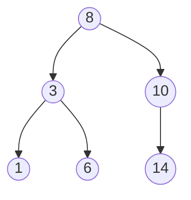
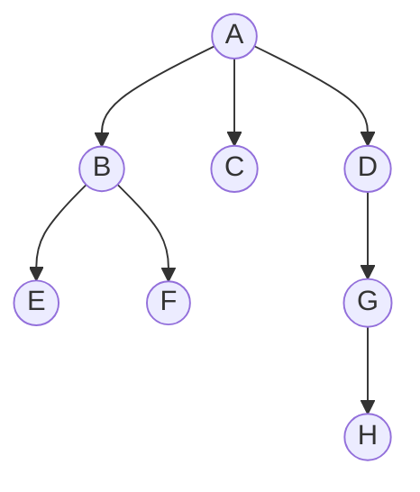
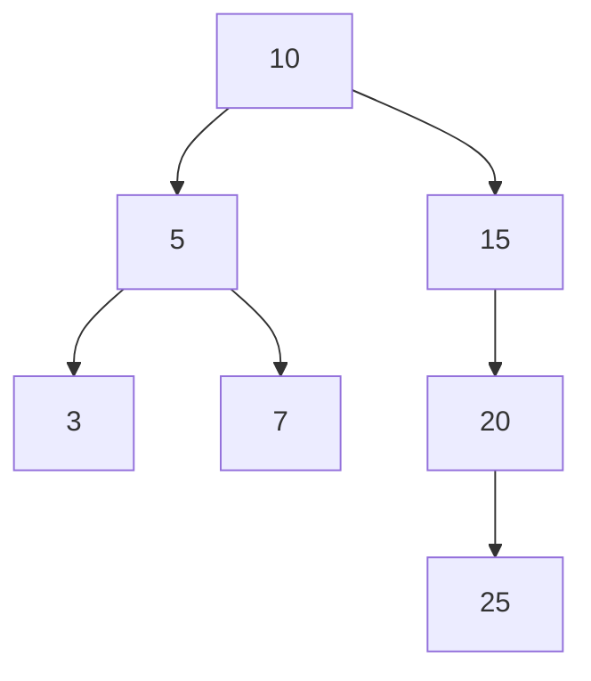
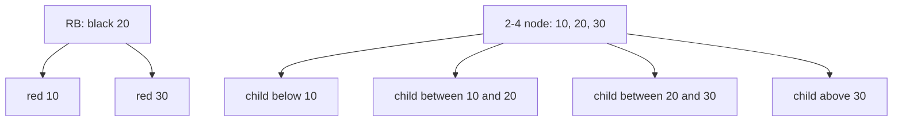

# Concept-Book Run

domain: /home/papagame/projects/digital-duck/cb-data-structure/public/domains/data_structure_ch09/input/graph.yaml
target: red_black_performance
started: 2026-11-24T14:01:55

## Teaching order (16 concepts)

- binary_search_tree
- black_height_property
- no_red_edge_property
- rooted_tree
- tree_height
- 2_4_tree
- red_black_tree
- colour_flip_push_pull
- left_leaning_property
- 2_4_tree_add_leaf
- 2_4_tree_remove_leaf
- amortized_potential_method
- red_black_2_4_correspondence
- red_black_add
- red_black_remove
- red_black_performance

### binary_search_tree (0.5s)

## Binary Search Tree

**Definition.** A *binary search tree* (BST) is a binary tree whose nodes store keys from a total order, such that for every node $x$ with key $k(x)$:

$$
\forall\, y \in \text{left}(x):\; k(y) < k(x), \qquad \forall\, z \in \text{right}(x):\; k(z) > k(x).
$$

The property applies to *entire subtrees*, not just immediate children. Assuming distinct keys, an inorder traversal (left, node, right) visits keys in sorted order, which is the structure's central consequence.

**Search and insertion.** To find key $q$, start at the root. If $q$ equals the node's key, stop. If $q$ is smaller, go left. Otherwise go right. Reaching a null link means $q$ is absent. Insertion follows the same path and attaches a new leaf at the null link where the search ended. Each step discards a whole subtree, so the cost is $O(h)$, where $h$ is the tree's height.

**Worked example.** Insert the keys $8, 3, 10, 1, 6, 14$ into an empty BST, in that order.

- $8$ becomes the root.
- $3 < 8$, so it goes left of $8$.
- $10 > 8$, so it goes right of $8$.
- $1 < 8$, then $1 < 3$, so it goes left of $3$.
- $6 < 8$, then $6 > 3$, so it goes right of $3$.
- $14 > 8$, then $14 > 10$, so it goes right of $10$.


*The BST after inserting 8, 3, 10, 1, 6, 14. Every left subtree holds smaller keys and every right subtree holds larger ones.*

Now search for $6$. Compare with $8$ and go left. Compare with $3$ and go right. Compare with $6$, which matches. That took 3 comparisons, not 6.

**Problem-solving application.** The height $h$ decides performance, and it depends on insertion order. Inserting $1, 3, 6, 8, 10, 14$ in sorted order produces a chain of height $n-1 = 5$, so search degrades to $O(n)$. A balanced tree on $n$ keys has height $\lceil \log_2(n+1)\rceil - 1$, giving $O(\log n)$. For random insertion orders, the expected height is $O(\log n)$. To avoid the worst case, self-balancing variants such as AVL and red-black trees restructure the tree during updates.

**Deletion** has three cases for the node $x$ being removed:

1. *Leaf:* remove it.
2. *One child:* replace $x$ with that child.
3. *Two children:* replace $k(x)$ with its inorder successor, which is the minimum of the right subtree. Then delete that successor, which has at most one child.

For example, deleting the root $8$ above replaces it with $10$, the minimum of its right subtree. The old $10$ node has only a right child, $14$, so $14$ takes its place. The result is still a valid BST.

**Check yourself.** If a tree of $n = 1000$ keys is perfectly balanced, search needs at most about $\lceil\log_2 1001\rceil = 10$ comparisons. If the same keys were inserted in sorted order, search could need up to $1000$. This gap is why balance matters in practice.

### black_height_property (0.5s)

## Black Height Property

**Definition.** A red-black tree is a binary search tree whose nodes are colored red or black. The **black height** of a node $x$, written $bh(x)$, is the number of black nodes on any path from $x$ down to a leaf (NIL), not counting $x$ itself. The **black height property** says this count is well defined: every path from $x$ down to a leaf contains the same number of black nodes. The property is one of the red-black invariants. The others are that the root is black, that every NIL leaf is black, and that a red node has only black children. Together these invariants keep the tree approximately balanced.

**Worked example.** Take a tree with black root $B_{10}$. Its left child is red $R_5$, and its right child is black $B_{15}$. The node $R_5$ has two black NIL children. The node $B_{15}$ also has two black NIL children.

- Path $10 \to 5 \to \text{NIL}$: below the root it contains the NIL leaf, so it has one black node.
- Path $10 \to 15 \to \text{NIL}$: below the root it contains $B_{15}$ and a NIL leaf, so it has two black nodes.

These counts differ, so this coloring violates the property. To repair it, recolor $R_5$ black. Then both paths contain two black nodes below the root, and $bh(10)=2$. The coloring is now valid.

**Why it forces balance.** Two facts combine.

1. *Subtree size.* A subtree rooted at $x$ contains at least $2^{bh(x)}-1$ internal nodes. Induction shows this. A leaf has $bh=0$ and $2^0-1=0$ nodes. Each child of $x$ has black height at least $bh(x)-1$. So
$$n(x) \ge 2\,(2^{bh(x)-1}-1)+1 = 2^{bh(x)}-1.$$

2. *Height bound.* A red node cannot have a red child. So at most half the nodes on any root-to-leaf path are red, which gives $bh(\text{root}) \ge h/2$, where $h$ is the tree height. Combining this with fact 1 gives
$$n \ge 2^{h/2}-1 \quad\Longrightarrow\quad h \le 2\log_2(n+1).$$

Search, insert, and delete therefore all run in $O(\log n)$ time.

**Problem-solving application.** *A red-black tree has black height 4 at the root. What are the minimum and maximum numbers of internal nodes?*

- **Minimum:** the all-black perfect tree gives $2^4-1 = 15$ nodes.
- **Maximum:** the longest paths alternate colors, so the height is at most $2\cdot 4 = 8$. A full tree of height 8 has $2^8-1 = 255$ internal nodes. (Here the root counts toward the black height. This is a valid upper bound, since the extra red layers fit within height 8.)

So $15 \le n \le 255$.

*Applying it to insertion.* A new node is inserted red because this leaves black heights unchanged. If its parent is also red, the red-red violation is fixed by recoloring or rotating. Rotations preserve the black height. Recoloring a black parent with two red children to red, and coloring those children black, also preserves it. Each repair keeps the black count on every path equal, so the fix-up cannot break the invariant.

**Check yourself.** If a node has one child subtree with black height 3, what must be true of its other child subtree? Its black height must also be 3, or the property fails.

### no_red_edge_property (0.5s)

## No Red Edge Property

**Definition.** A red-black tree is a binary search tree whose nodes are colored red or black. The **no red edge property** (also called the *red condition*) states:

> If a node is red, then both of its children are black.

Equivalently, no edge in the tree joins two red nodes, so no root-to-leaf path contains two consecutive red nodes. Null (leaf) children count as black. This property works together with the **black-height property**: every path from a given node to its descendant null leaves contains the same number of black nodes. We write $bh(x)$ for that count, excluding $x$ itself.

**Why it matters.** Let $h$ be the height of a tree with $n$ nodes. Along any root-to-leaf path, red nodes can never be adjacent, so at most half the nodes on the path are red. Hence

$$h \le 2\,bh(\text{root}).$$

A subtree rooted at $x$ contains at least $2^{bh(x)}-1$ internal nodes (induction: the base case is a null leaf with $bh=0$ and $2^0-1=0$ nodes; each child has black-height at least $bh(x)-1$). So $n \ge 2^{bh(\text{root})}-1$, which gives $bh(\text{root}) \le \log_2(n+1)$ and therefore

$$h \le 2\log_2(n+1) = O(\log n).$$

Without the no red edge property, a path could be nearly all red while keeping equal black counts, and this bound would fail.

**Worked example.** Consider the tree with root $B(10)$, left child $R(5)$, right child $R(15)$, and $R(15)$ having a left child $R(12)$.

- Node 15 is red and its child 12 is red, so the property is **violated**.
- Check black-heights anyway: every path to a null leaf from the root passes through exactly one black node (the root). The black-height property holds, but the tree is still invalid.

**Problem-solving application.** Insertion shows how the property is maintained. New nodes are colored red, because that cannot change any black-height. The only possible violation is a red node with a red parent. Let $z$ be the new node, $p$ its parent, and $u$ its uncle:

1. If $p$ is black, nothing is violated. Stop.
2. If $p$ and $u$ are both red, recolor $p$ and $u$ black and the grandparent red. This pushes the possible violation two levels up, so repeat there.
3. If $p$ is red and $u$ is black, perform one or two rotations and recolor. This restores the property locally, and the process ends.

Apply this to the example. Node 12 is a red child of red 15, and its uncle (the null left child of... actually 15's sibling, node 5) is red. This is case 2. Recolor 5 and 15 black, and make 10 red. Since 10 is the root, recolor it black. The result has black-height 2 on every path, and no red node has a red child.

**Key takeaway.** Insertion and deletion fix violations by recoloring and rotating. Each repair step either ends the process or moves the violation up one level. At most $O(\log n)$ steps are needed, so every operation takes $O(\log n)$ time.

### rooted_tree (0.5s)

## Rooted Tree

### Definition

A **rooted tree** is a connected graph with no cycles in which one node, the **root**, has been singled out. Every other node then lies at the end of exactly one simple path from the root. This gives the tree a direction: "downward" means away from the root.

Formally, a tree with $n$ nodes has exactly $n-1$ edges. Removing any edge disconnects it.

The vocabulary below comes from this direction:

- **Parent/child:** if $u$ immediately precedes $v$ on the path from the root, $u$ is the parent of $v$ and $v$ is a child of $u$.
- **Leaf:** a node with no children.
- **Ancestor/descendant:** $u$ is an ancestor of $v$ if $u$ lies on the path from the root to $v$.
- **Depth** of $v$: the number of edges on the path from the root to $v$. The root has depth $0$.
- **Height** of the tree: the maximum depth of any node.
- **Subtree** at $v$: $v$ together with all its descendants. It is itself a rooted tree with root $v$.

The last item gives the structure its recursive character: a rooted tree is a root plus a (possibly empty) collection of smaller rooted trees.


*A rooted tree with root A. Node B is the parent of E and F; E, F, C, and H are leaves; H has depth 3, which is the height of the tree.*

### Worked example

Using the tree above:

- Nodes: $n = 8$, so there must be $n-1 = 7$ edges. Counting gives A–B, A–C, A–D, B–E, B–F, D–G, G–H, which is 7.
- The depth of H is the length of the path A → D → G → H, so $\text{depth}(H)=3$.
- The ancestors of H are G, D, and A.
- The subtree at B contains $\{B, E, F\}$.

### Problem-solving application

**Problem.** Compute the height of a rooted tree recursively.

Let $h(v)$ be the height of the subtree at $v$. A leaf has $h=0$. Otherwise, the height is one more than the tallest child subtree:

$$h(v) = 1 + \max_{c \in \text{children}(v)} h(c).$$

```python
def height(node):
    if not node.children:
        return 0
    return 1 + max(height(c) for c in node.children)
```

Applying this to the example:

- $h(H)=0$, so $h(G)=1$ and $h(D)=2$.
- $h(E)=h(F)=0$, so $h(B)=1$; also $h(C)=0$.
- $h(A) = 1+\max(h(B),h(C),h(D)) = 1+\max(1,0,2) = 3$.

This matches the depth of H.

**Why the recursion works.** Each node's subtree is a smaller rooted tree, so the same rule applies at every level. The function visits each node once and does constant work per child, so its running time is $O(n)$.

**Why height matters.** If every node has at most $k$ children, a tree of height $h$ has at most

$$\sum_{i=0}^{h} k^i = \frac{k^{h+1}-1}{k-1}$$

nodes. For a binary tree ($k=2$) with $n$ nodes, this means $h \ge \lceil \log_2(n+1) \rceil - 1$. A balanced tree can therefore reach any of $n$ items in $O(\log n)$ steps. A degenerate, chain-like tree has $h = n-1$, which is why balance matters in structures such as binary search trees.

### tree_height (0.5s)

## Tree Height

### Definition

The **height** of a tree is the number of edges on the longest path from the root down to a leaf. A tree with only a root has height $0$, and by convention an empty tree has height $-1$. This gives a clean recursive definition:

$$h(T) = \begin{cases} -1 & T = \varnothing \\ 1 + \max\big(h(T_L),\, h(T_R)\big) & \text{otherwise} \end{cases}$$

where $T_L$ and $T_R$ are the left and right subtrees. (Some texts count nodes instead of edges, which adds $1$. Always check which convention is in use.)

Height matters because searching, inserting, and deleting in a binary search tree (BST) each follow a single root-to-leaf path. The worst-case cost is therefore $O(h)$.

### Worked example

Insert the keys $10, 5, 15, 3, 7, 20, 25$ into an empty BST in that order. The resulting structure is:


*A BST built from the keys 10, 5, 15, 3, 7, 20, 25. The longest path is 10 → 15 → 20 → 25.*

Apply the recursion bottom-up:

- Leaves $3$, $7$, $25$: $h = 0$.
- Node $20$: $1 + \max(-1, 0) = 1$.
- Node $5$: $1 + \max(0, 0) = 1$.
- Node $15$: $1 + \max(-1, 1) = 2$.
- Root $10$: $1 + \max(1, 2) = 3$.

So $h = 3$. Searching for $25$ takes $3$ edge-steps, which is the worst case for this tree.

### Problem-solving application

**Bounds on height.** A binary tree with $n$ nodes satisfies

$$\lfloor \log_2 n \rfloor \le h \le n - 1.$$

The lower bound occurs when the tree is as full as possible. A tree of height $h$ holds at most $2^{h+1}-1$ nodes, so $n \le 2^{h+1}-1$, which gives $h \ge \log_2(n+1) - 1$. The upper bound occurs when each node has one child, making the tree a linked list.

**Problem.** A BST receives $1023$ keys. What are the best-case and worst-case search costs?

*Best case:* a perfectly balanced tree has $n = 2^{h+1}-1$, so $1023 = 2^{10}-1$ gives $h = 9$. A search needs at most $9$ edge-steps.

*Worst case:* inserting the keys in sorted order produces a chain, so $h = 1022$. A search may need $1022$ steps.

The same data can therefore cost $O(\log n)$ or $O(n)$ per search, depending only on insertion order. Self-balancing trees such as AVL and red-black trees address this by keeping $h = O(\log n)$ after every update, which guarantees logarithmic worst-case search.

**Implementation:**

```python
def height(node):
    if node is None:
        return -1
    return 1 + max(height(node.left), height(node.right))
```

This visits each node once, so it runs in $O(n)$ time. It uses $O(h)$ stack space for the recursion.

### 2_4_tree (0.7s)

## 2 4 Tree

### Definition

A **2-4 tree** (also called a 2-3-4 tree) is a rooted search tree with two structural rules:

1. **Size property:** every internal node has 2, 3, or 4 children. A node with $c$ children stores $c-1$ keys in sorted order, so a node holds 1, 2, or 3 keys.
2. **Depth property:** all leaves (empty external positions) have the same depth.

Keys obey the search-tree rule. If a node holds keys $k_1<k_2<k_3$, its children's subtrees contain keys in the ranges $(-\infty,k_1)$, $(k_1,k_2)$, $(k_2,k_3)$, and $(k_3,\infty)$.

**Height bound.** Let $n$ be the number of keys and $h$ the height, counting levels of internal nodes. Level $i$ (with the root at level 1) has at least $2^{i-1}$ nodes, because every internal node has at least 2 children. So $n \ge 2^h-1$. At most, each node has 4 children and 3 keys, so $n \le 4^h-1$. Combining the two bounds:

$$\tfrac12\log_2(n+1)\;\le\; h\;\le\;\log_2(n+1)$$

Height is therefore $\Theta(\log n)$, and search takes $O(\log n)$ time, since each node examines at most 3 keys.

### Worked example: insertion

Insertion always adds the key to a leaf-level node. If that node then has 4 keys (5 children), it **overflows**. We fix it by a **split**: the middle key moves up to the parent, and the remaining keys form two nodes.

Insert $1,2,3,4$ into an empty tree.

- After $1,2,3$: one node $[1,2,3]$.
- Insert $4$: the node becomes $[1,2,3,4]$, which overflows. Split it around a middle key. Choosing $2$ as the middle, $2$ moves up to a new root. The children are $[1]$ and $[3,4]$.

The root is $[2]$ with leaf-level children $[1]$ and $[3,4]$. All leaves are still at the same depth. Only a root split increases the height, and it increases all leaf depths by 1 at once, so the depth property is preserved.

### Problem-solving application

**Problem.** Starting from the tree above, insert $5$ and then $6$. Show the result.

*Solution.* Search for $5$: $5>2$, so go to the right child $[3,4]$. Insert to get $[3,4,5]$, which has 3 keys and is legal.

Insert $6$: it again goes to the right child, giving $[3,4,5,6]$, an overflow. Split it with $4$ as the middle key. Key $4$ moves up into the root, and the node becomes $[3]$ and $[5,6]$. The root is now $[2,4]$ with three children $[1]$, $[3]$, $[5,6]$. No further overflow occurs, so we stop.

**Cost analysis.** An insertion descends $O(\log n)$ levels. In the worst case, splits propagate all the way up the tree. Each split takes $O(1)$ time, so the total is $O(\log n)$. Deletion is analogous. When a node underflows, it borrows a key from a sibling (a transfer) or merges with a sibling (a fusion), and merges may also propagate upward. This also costs $O(\log n)$.

**Why it matters.** The 2-4 tree guarantees logarithmic worst-case operations without ever being "rebalanced" by rotation. Its strict depth property is maintained only by splits at the top. Every 2-4 tree can also be represented as a red-black tree, so analyzing 2-4 trees explains why red-black trees have $O(\log n)$ height.

### red_black_tree (0.7s)

## Red Black Tree

### Definition

A **red-black tree** is a binary search tree (BST) in which every node is coloured red or black, and the following properties hold:

1. The root is black.
2. **No-red-edge property:** a red node never has a red child (no two reds in a row on any root-to-leaf path).
3. **Black-height property:** every path from a node down to a missing child (a `null` leaf) passes through the same number of black nodes. This count is the node's black-height, $bh(x)$.

These rules are exactly what is needed to simulate a **2-4 tree**. Each black node, together with any red children it has, forms one 2-4 node:

| 2-4 node | Red-black form |
|---|---|
| 2-node (1 key) | a single black node |
| 3-node (2 keys) | a black node with one red child |
| 4-node (3 keys) | a black node with two red children |

Red edges therefore mean "these keys live in the same 2-4 node." Since a 2-4 tree has all leaves at the same depth, the black-height property follows.

### Height bound

Let $h$ be the height of the tree and $n$ the number of keys. Because no red node has a red child, at least half the nodes on any root-to-leaf path are black, so $bh(\text{root}) \ge h/2$. A subtree rooted at $x$ contains at least $2^{bh(x)}-1$ internal nodes, which can be shown by induction on height. Hence

$$n \ge 2^{h/2}-1 \quad\Longrightarrow\quad h \le 2\log_2(n+1).$$

Search, insertion, and deletion therefore run in $O(\log n)$ time.

### Worked example

Insert keys $10, 20, 30$ into an empty tree. New nodes are coloured red.

- Insert 10: it is the root, so recolour it black.
- Insert 20: it becomes the red right child of 10. No violation.
- Insert 30: it becomes the red right child of 20. Now **red 20 has red child 30**, which violates the no-red-edge property. 20's sibling (the left child of 10) is `null`, i.e. black, so we **rotate**. Rotate left at 10, so 20 becomes the root. Then recolour 20 black and 10 red.

The result is black 20 with red children 10 and 30. This is a 2-4 4-node $[10, 20, 30]$. Every path has black-height 1.

If instead the uncle were red, we would **recolour** (parent and uncle black, grandparent red) and continue checking upward. This corresponds to *splitting* a 4-node in the 2-4 tree.

### Problem-solving application

**Problem.** What is the largest possible height of a red-black tree with $n = 15$ keys?

**Solution.** Use $h \le 2\log_2(n+1) = 2\log_2 16 = 8$. This is an upper bound, and it is the largest height the tree can have. A tree of height 8 would need a root-to-leaf path alternating black and red, while all other paths keep the same black-height of 4. The minimum number of nodes for that is far below 15 only if the shape permits it, so the bound is useful for judging performance: a plain BST with 15 keys could have height 15, but a red-black tree never exceeds roughly twice the ideal height of 4.

**Checking a tree.** To test validity, apply three checks: (a) is the root black, (b) is there any red-red parent-child pair, and (c) do all root-to-`null` paths have equal black counts? Failing any one means the tree is invalid. For example, a black root with a single child that is black, and no other children, fails (c). The path through the missing left child has 1 black node, and the path through the right child has 2.

**Takeaway.** Insertion needs at most 2 rotations, and recolouring is the other fix-up. Both are cheap local operations that keep the tree balanced.

### colour_flip_push_pull (0.5s)

## Colour Flip Push Pull

**Definition.** In a left-leaning or relaxed red-black tree, four local subroutines repair colour violations without changing the black-height $bh(v)$, the number of black nodes on any path from $v$ down to a leaf.

- **push_black($v$)** (colour flip down): if $v$ is black with two red children, recolour $v$ red and both children black. Each path through $v$ keeps the same black count: it loses $v$ but gains a black child.
- **pull_black($v$)** (colour flip up): the inverse. If $v$ is red with two black children, recolour $v$ black and both children red.
- **flip_left($u$)**: let $w=u.\text{right}$. Make $w$ the subtree root, $u$ its left child, and $w$'s old left subtree $u$'s right subtree. Swap the colours of $u$ and $w$.
- **flip_right($u$)**: the mirror image, using $w=u.\text{left}$.

Rotations preserve in-order key order. Swapping colours means the subtree root keeps its original colour. Every root-to-leaf path therefore sees the same number of black nodes as before.

**Worked example.** Take black $v=20$ with red children $10$ and $30$. Let $10$ have a red left child $5$. This is a red-red violation.

Call push_black(20). Now $20$ is red and $10$, $30$ are black. Node $5$ is red under black $10$, so the violation is gone locally. Check black-height: before, any path through $20$ counted $20$ as one black. After, it counts $10$ or $30$ as one black. The count is unchanged. The only new risk is that $20$ is red and its parent might be red.

If instead $10$ is black and $20$'s right child $30$ is red with a red right child, apply flip_left on $20$'s right-leaning link. Let $u=20$ black and $w=30$ red. After rotating, $30$ is the root of the subtree and takes colour black. $20$ becomes red. The subtree's black-height is unchanged, since the root was black before and is black after.

**Problem-solving application.** In insertion fix-up, suppose a new red node $x$ has a red parent $p$ and a red uncle $s$. Decide the case as follows:

1. **Uncle red:** $p$'s parent $g$ is black with two red children. Call push_black($g$). The violation may now sit at $g$ and its parent, so move up and repeat. This takes at most $O(\log n)$ steps since the height is $O(\log n)$.
2. **Uncle black, $x$ an inner child:** rotate $p$ first (flip_left or flip_right) to make $x$ an outer child.
3. **Uncle black, $x$ an outer child:** flip $g$ in the opposite direction. The two colour swaps leave a black subtree root with two red children.

Deletion uses pull_black when a "double black" deficit must be moved up. Pulling blackness from a red parent with two black children makes the parent black and both children red, which moves the extra black one level closer to the root. If the deficit reaches the root, it is simply dropped. Dropping it is valid because every path loses one black node, so all paths still have equal black counts.

**Why correctness holds.** Let $b(P)$ be the black count along path $P$. push_black changes $b(P)$ by $-1+1=0$ on every path through $v$. flip operations only reorder nodes within a subtree and preserve the black node multiset on each path. Hence every operation keeps $b(P)$ equal for all root-to-leaf paths, which is exactly the black-height invariant.

### left_leaning_property (0.5s)

## Left Leaning Property

A **left-leaning red-black tree (LLRB)** is a red-black tree with one extra rule. Recall the standard red-black rules: the root is black, red nodes have no red children, and every root-to-leaf path has the same number of black nodes. The **left-leaning property** adds:

> If a node's left child is black, then its right child must also be black. Equivalently, a red right child is allowed only when the left child is also red.

In an LLRB, a red link is therefore always a *left* link, and a red right child can never appear alone. This restriction matters because a standard red-black tree can represent the same 2-4 tree in several ways. For example, a 3-node $\{a, b\}$ with $a<b$ could be drawn with $b$ as the black parent and $a$ as its red left child, or with $a$ as the black parent and $b$ as its red right child. The left-leaning property rules out the second drawing. Each 2-4 tree then corresponds to **exactly one** LLRB.

**Translation table (2-4 node → LLRB):**

| 2-4 node | LLRB shape |
|---|---|
| 2-node $\{b\}$ | a single black node $b$ |
| 3-node $\{a,b\}$ | black $b$ with a red left child $a$ |
| 4-node $\{a,b,c\}$ | black $b$ with red children $a$ (left) and $c$ (right) |

The 4-node is the one case where a red right child appears. The left red child is present, so the property holds.

### Worked example

Convert this 2-4 tree to an LLRB. The root is the 2-node $\{20\}$. Its left child is the 3-node $\{5, 10\}$. Its right child is the 4-node $\{30, 35, 40\}$.

- Root: black 20.
- Left child: black 10 with red left child 5.
- Right child: black 35 with red left child 30 and red right child 40.

Check the property. Node 20 has a black left child (10) and a black right child (35), so it passes. Node 10 has a red left child, so the property doesn't constrain its right child, and it passes. Node 35 has two red children, so it passes. Every root-to-null path has 2 black nodes, so the black-height rule holds.

### Problem-solving application

**Problem.** Is the tree with black 8, black left child 3, and a red right child 12 under 8 a valid LLRB?

**Solution.** Look at node 8. Its left child, 3, is black, so the left-leaning property requires its right child to be black. Its right child, 12, is red, so the tree is invalid. This is the forbidden right-leaning 3-node.

**Repair.** Do a left rotation at 8. Then 12 becomes the subtree root, with 8 as its left child. Swap colors so that 12 takes 8's old color (black) and 8 becomes red. The result is black 12 with red left child 8, which is a valid 3-node $\{8,12\}$. Black 3 is still the left child of 8, and the black-height is unchanged.

**Why it works in general.** Insertion creates a red node. If a red link ends up on the right, a left rotation moves it to the left. If two red links then appear in a row on the left, a right rotation followed by a color flip splits the temporary 4-node. Each fix restores the left-leaning property locally, so only $O(\log n)$ fixes are needed along the insertion path.

**Key takeaway.** The left-leaning property removes the ambiguity in how a 3-node is drawn. That gives a one-to-one match with 2-4 trees and means there are fewer cases to handle.

### 2_4_tree_add_leaf (0.5s)

## 2 4 Tree Add Leaf

### Definition

A **2-4 tree** is a search tree in which every internal node has 2, 3, or 4 children (so it stores 1, 2, or 3 keys), and all leaves lie at the same depth. Inserting a key is called *adding a leaf*. The procedure is:

1. Search for the key. The search ends at a node $v$ on the second-last level, whose children are leaves.
2. Add a new leaf under $v$, inserting the key in sorted position. Now $v$ has one more child.
3. If $v$ has at most 4 children, stop. Otherwise $v$ is **overfull** (5 children, 4 keys). Split it, and repeat the check on its parent.

**Split rule.** An overfull node $v$ has children $c_1,\dots,c_5$ and keys $k_1<k_2<k_3<k_4$. Replace $v$ with two nodes:

- $v'$ with children $c_1,c_2,c_3$ and keys $k_1,k_2$
- $v''$ with children $c_4,c_5$ and key $k_4$

The middle key $k_3$ moves up into the parent, between the pointers to $v'$ and $v''$. The parent therefore gains one child. If the root splits, create a new root with the single key $k_3$ and two children $v'$ and $v''$. This is the only way the tree grows taller, and it adds one level to every leaf at once, so all leaves stay at equal depth.

### Worked Example

Start with a root holding keys $[10, 20, 30]$ and four leaf children. Add the key $40$.

The new leaf goes under the root, which now has 5 children and keys $[10,20,30,40]$. It is overfull, so split it:

- $v'$ gets keys $[10,20]$ and 3 children.
- $v''$ gets key $[40]$ and 2 children.
- Key $30$ moves up into a new root with children $v'$ and $v''$.

The height has increased by 1, and every node has 2 to 4 children.

### Problem-Solving Application

Suppose the tree has root $R=[50]$ with children $A=[10,20,30]$ and $B=[60]$. Insert $40$ and $25$ in turn.

**Insert 40.** Search goes $R \to A$ (since $40<50$). Add the leaf, so $A=[10,20,30,40]$ with 5 children. This is overfull, so split it. Key $30$ moves up. Now $A'=[10,20]$, $A''=[40]$, and $R=[30,50]$ with 3 children. Since $3\le 4$, we stop.

**Insert 25.** Search goes $R \to A'$ (since $25<30$). Now $A'=[10,20,25]$, which has 4 children. This is legal, so no split happens.

**Cost analysis.** Let $n$ be the number of keys. The height is $h=\Theta(\log n)$, because each internal node has at least 2 children, so $n \ge 2^{h}-1$ gives $h \le \log_2(n+1)$. The search costs $O(\log n)$. Each split takes $O(1)$ time, and a chain of splits can climb at most $h$ levels. Total cost is therefore $O(\log n)$.

**Why the degree property holds.** A split of a node with 5 children yields nodes with 3 and 2 children, both inside $[2,4]$. The parent gains exactly one child, so it either stays legal or becomes overfull itself, and the same fix applies. The root is the only node that may end up with a new parent, and a new root with 2 children is also legal. After the loop ends, no node has more than 4 children, and no node has fewer than 2. The structure is therefore a valid 2-4 tree.

**Check yourself.** Starting from the tree above after both insertions, which key moves up if you insert $22$ and then $27$ into the left subtree? (Hint: $A'$ becomes $[10,20,22,25]$ after the first insert, so the second insert makes it overfull.)

### 2_4_tree_remove_leaf (0.5s)

## 2 4 Tree Remove Leaf

### Definition

A **2-4 tree** is a search tree in which every internal node has 2, 3, or 4 children (holding 1, 2, or 3 keys), and all leaves lie at the same depth. Removing a key from a leaf can break the **degree property**: a node may be left with 0 keys, which is an *underflow* (fewer than 2 children).

The repair procedure for a node $x$ that underflows:

1. **Borrow (rotation):** if an adjacent sibling has at least 2 keys, rotate. The separator key in the parent moves down into $x$. The sibling's nearest key moves up to replace it. Nothing propagates further.
2. **Merge (fusion):** if every adjacent sibling has exactly 1 key, pull the separator key down from the parent. Combine it with $x$ and the sibling. The merged node has at most $1 + 1 = 2$ keys (counting the separator). The parent has lost a key, so it may underflow. Repeat the repair at the parent.
3. If the root ends up with 0 keys, delete it. The merged child becomes the new root, and the height drops by 1.

If the key to delete sits in an internal node, first swap it with its in-order predecessor, which is always in a leaf. Then delete from that leaf.

### Worked example

Consider the tree with root $[20]$, children $A=[10]$ and $B=[30]$, and leaves under $A$: $[5]$, $[15]$, and under $B$: $[25]$, $[35]$.

**Delete 5.** Leaf $[5]$ becomes empty (underflow). Its only sibling $[15]$ has 1 key, so borrowing is impossible. **Merge:** pull separator $10$ down and combine it with $[15]$ to get $[10, 15]$. Now $A$ has 0 keys and 1 child, so it underflows.

**Repair at $A$.** Its sibling $B=[30]$ also has 1 key, so we merge again. Pull the root key $20$ down and form $[20, 30]$ with the children $[10,15]$, $[25]$, $[35]$. The root is now empty, so we delete it. The tree's height drops by 1, and the new root is $[20,30]$.

### Problem-solving application

**Problem.** In the 2-4 tree with root $[20]$, children $[10]$ and $[30,40]$, and leaves $[5]$, $[15]$, $[25]$, $[35]$, $[45]$, delete 5.

**Solution.**
1. Leaf $[5]$ is empty. Its right sibling $[15]$ has only 1 key, so borrowing fails and we merge.
2. Merge: $[10,15]$ replaces the three nodes $[5]$, $10$, and $[15]$. The parent $[10]$ is now empty with one child, so it underflows.
3. Its sibling $[30,40]$ has 2 keys, so **borrow**. Rotate: 20 moves down into the empty node, and 30 moves up to the root. The child $[25]$, which was 30's leftmost child, transfers to the borrower.
4. Result: root $[30]$, left child $[20]$ with children $[10,15]$ and $[25]$, and right child $[40]$ with children $[35]$ and $[45]$. All leaves are at the same depth, and every node has 2–4 children.

**Cost analysis.** Each repair step takes $O(1)$ work. An underflow propagates upward only through merges, and each merge moves one level up the tree. A 2-4 tree with $n$ keys has height $\Theta(\log n)$, so removal costs $O(\log n)$ in the worst case. A borrow always stops the propagation, so at most one borrow occurs per deletion.

**Strategy.** Always try to borrow first, because it is local and stops the repair. Merge only when every adjacent sibling is minimal. Check the root last, because that is the only way the tree can shrink in height.

### amortized_potential_method (0.5s)

## Amortized Potential Method

### Definition

Some operations are occasionally expensive but usually cheap. The **potential method** bounds the *total* cost of a sequence by treating cheap operations as "paying ahead" for later expensive ones.

Choose a **potential function** $\Phi$ mapping each state $D_i$ of the data structure to a real number, with

$$\Phi(D_0)=0 \quad\text{and}\quad \Phi(D_i)\ge 0 \text{ for all } i.$$

The **amortized cost** of the $i$-th operation, whose actual cost is $c_i$, is

$$\hat{c}_i = c_i + \Phi(D_i) - \Phi(D_{i-1}).$$

Summing over $m$ operations, the potential terms telescope:

$$\sum_{i=1}^{m}\hat{c}_i = \sum_{i=1}^{m}c_i + \Phi(D_m) - \Phi(D_0) \;\ge\; \sum_{i=1}^{m}c_i.$$

So the total amortized cost is an upper bound on the total actual cost. If each $\hat{c}_i = O(1)$, the total actual cost is $O(m)$.

### Worked Example: Binary Counter

Let an increment flip bits. If an increment turns $t$ trailing 1s into 0s and one 0 into 1, then $c_i = t+1$. Define $\Phi$ = the number of 1s in the counter. The increment changes $\Phi$ by $1 - t$, so

$$\hat{c}_i = (t+1) + (1-t) = 2.$$

Thus $m$ increments cost at most $2m = O(m)$, even though a single increment can cost $\Theta(\log m)$.

### Problem-Solving Application: Red-Black Tree Fixup

Insertion into a red-black tree adds a red node, then repairs red-red violations. Case 1 (red parent *and* red uncle) recolors parent and uncle black and the grandparent red, then moves the problem two levels up. It can repeat $\Theta(\log n)$ times. Cases 2 and 3 use at most two rotations and end the fixup.

**Step 1: Choose $\Phi$.** Let $\Phi(T)$ be the number of black nodes that have two red children. An empty tree has $\Phi=0$, and $\Phi\ge 0$ always.

**Step 2: Cost of a Case 1 step.** Take actual cost 1. The grandparent was black with two red children (parent and uncle), so it counted toward $\Phi$. After recoloring, it is red, and the parent and uncle are black. So $\Phi$ drops by at least 1 from the grandparent. The great-grandparent *may* become a black node with two red children, raising $\Phi$ by at most 1. Net change $\le 0$, so

$$\hat{c} \le 1 + (-1 + 1) = 1 \;\text{ at most; more carefully, } \hat{c}\le 1 + (-1) + 1.$$

To make repeated steps pay for themselves, use the sharper accounting: each Case 1 step moves the violation up, and the only possible new such node is the one being processed next. Counting the node created by the initial insertion (at most $+1$) gives total $\Phi$ increase $\le 1$ over the whole fixup, while each Case 1 step lowers $\Phi$ by 1 net of the propagated violation. Therefore $k$ Case 1 steps cost $k$ actual but lower $\Phi$ by $k-1$ or more, so $\hat{c}_{\text{Case 1}} \le 1 - 1 = 0$ per step beyond the first.

**Step 3: Terminal cases.** Cases 2 and 3 cost $O(1)$ and change $\Phi$ by $O(1)$, so $\hat{c}=O(1)$.

**Step 4: Conclude.** Every insertion has amortized fixup cost $O(1)$. Since $\Phi(D_0)=0$ and $\Phi\ge0$, $m$ insertions require $O(m)$ total fixup work, which is $O(1)$ amortized per insertion, even though a single insertion may recolor $\Theta(\log n)$ nodes.

**Key habit:** pick $\Phi$ so that expensive steps *release* stored potential equal to their cost. Then verify $\Phi(D_0)=0$, $\Phi\ge 0$, and that every operation has small amortized cost.

### red_black_2_4_correspondence (0.6s)

## Red Black 2 4 Correspondence

### Definition

A **red-black tree** is a binary search tree whose nodes are colored red or black so that:

1. The root is black.
2. No red node has a red child.
3. Every path from a node to its descendant null leaves contains the same number of black nodes (the *black-height*).

A **2-4 tree** is a multiway search tree in which every internal node has 2, 3, or 4 children (holding 1, 2, or 3 keys), and all leaves are at the same depth.

**The transformation.** Take each red node and merge it into its black parent, so the red node's key joins the parent's key in one multiway node. Each black node, together with its red children, becomes one node:

- Black with no red children → a 2-node (1 key).
- Black with one red child → a 3-node (2 keys).
- Black with two red children → a 4-node (3 keys).

Rule 2 forbids red children of red nodes, so a merged group never exceeds three keys (one black plus at most two red children). A black node's children are all black or null, so the groups link up as a valid multiway tree. Rule 3 means every path crosses the same number of black nodes, so all leaves of the 2-4 tree have equal depth. Hence **every red-black tree corresponds to a 2-4 tree**. A 3-node can be drawn in two ways, depending on which key is the black one (the red child may lean left or right), so the correspondence is not one-to-one in that direction.

### Worked example

Take black root $20$ with red children $10$ and $30$. Under $10$'s side is a black node $5$, and under $30$'s side are black nodes $25$ and $40$.

Merging the reds into the root gives one 4-node $[10, 20, 30]$. It has four children: $5$ (between $-\infty$ and $10$), a null child (between $10$ and $20$), $25$ (between $20$ and $30$), and $40$ (above $30$). Every path from the root reaches a black node in one step, matching rule 3.

### Problem-solving application: the height bound

**Claim.** A red-black tree with $n$ keys has height $h \le 2\log_2(n+1)$.

**Proof.** Let $b$ be the black-height of the root, counting black nodes on a root-to-leaf path. The corresponding 2-4 tree has all leaves at depth $b-1$ (counting levels as $b$). A tree with $b$ full levels has at least as many keys as a complete binary tree, since each 2-4 node holds at least one key and has at least two children:

$$n \ge 2^{b}-1 \quad\Rightarrow\quad b \le \log_2(n+1).$$

Within the red-black tree, a root-to-leaf path alternates at worst red, black, red, black, since no two reds are adjacent. So reds number at most $b$, because each red must be followed by a black (or a null leaf), and the height satisfies

$$h \le 2b \le 2\log_2(n+1).$$

**Apply it.** For $n = 10^6$ keys, $\log_2(10^6+1)\approx 19.93$, so $h \le 39.9$, meaning at most 39 comparisons per search. This guarantees that search, insertion, and deletion are $O(\log n)$.

The correspondence also explains the balancing operations. A color flip (black node with two red children, flipped) is a 4-node split, and rotations rearrange how a 3-node is drawn. Reasoning in the 2-4 tree is often easier than reasoning about colors directly.


*A black node with two red children (top) merges into a single 2-4 four-node holding all three keys (bottom).*

### red_black_add (0.6s)

## Red Black Add

### Definition

A **left-leaning red-black (LLRB) tree** is a binary search tree whose links are colored red or black, with these invariants:

1. A red link always leans left (no red right child).
2. No node has two red links touching it (no red-red path).
3. Every path from the root to a null link crosses the same number of black links (**perfect black balance**).

A red link glues a node to its parent into a single 3-node or 4-node of a 2-4 tree (a "2-4 tree" is a B-tree whose nodes hold 1 to 3 keys). The **add** operation has two phases:

- **Insert:** Perform ordinary BST insertion and color the new leaf **red**. A red leaf does not change black height, so invariant 3 survives.
- **Fix up:** Walking back up the recursion, repair any violated invariants with local rotations and color flips.

The fix-up on each node $h$ applies three tests in order:

```python
def add_fixup(h):
    if is_red(h.right) and not is_red(h.left):
        h = rotate_left(h)          # restore left-leaning
    if is_red(h.left) and is_red(h.left.left):
        h = rotate_right(h)         # break red-red chain
    if is_red(h.left) and is_red(h.right):
        flip_colors(h)              # simulate a 2-4 split
    return h
```

`flip_colors` makes both children black and `h` red. In 2-4 terms, a 4-node (a node with a left and right red child) splits: its middle key moves up to the parent, while the two outer keys become separate 2-nodes.

### Worked example

Insert keys $10, 20, 30$ into an empty tree.

- Insert 10: root, recolor it black.
- Insert 20: it goes right of 10 as a red leaf. A red right link violates invariant 1, so `rotate_left` makes 20 the root with red left child 10. Color the root black.
- Insert 30: it goes right of 20 as a red leaf. Now 20 has red children 10 and 30, a 4-node. `flip_colors` makes 10 and 30 black and 20 red. The root is recolored black.

The result is a perfectly balanced three-node tree. In the 2-4 tree, the 4-node $[10,20,30]$ split into a parent holding 20 and two children.

### Problem-solving application

**Problem.** Insert 40 into the tree above, then 50. Describe each fix-up.

*Insert 40:* it goes right of 30 as a red leaf. Node 30 has a red right child and a black left child (null), so `rotate_left` at 30 gives 40 as the subtree root with red left child 30. Back at 20, its children are 10 (black) and 40 (black), so nothing more happens.

*Insert 50:* it goes right of 40 as a red leaf. At 40, children 30 (red) and 50 (red) trigger `flip_colors`: 30 and 50 turn black and 40 turns red. At 20, the right link to 40 is red while the left child 10 is black, so `rotate_left` at 20 makes 40 the root with red left child 20. Root recolored black.

**Cost analysis.** Each node on the search path receives $O(1)$ fix-up work. An LLRB tree with $n$ keys has height at most $2\log_2 n$, because along any path, red links are at most as numerous as black links. Therefore one add costs $O(\log n)$ time.

**Key habit:** always fix up in this order (rotate left, rotate right, flip). Doing so lets the same three lines handle every 2-4 insertion case, including a flip creating a red link that the parent's fix-up then repairs.

### red_black_remove (0.6s)

## Red Black Remove

**Definition.** Deleting from a red-black tree begins like ordinary BST deletion. If the target node $z$ has two children, copy its in-order successor's key into $z$ and delete the successor instead, so the physically removed node $y$ always has **at most one child**. We splice $y$ out by linking its child $x$ (possibly `NIL`) to $y$'s parent.

Colour determines what happens next:

- If $y$ is **red**, no black-height changes. Nothing else is needed.
- If $y$ is **black**, every path through $y$ now has one fewer black node. We say $x$ carries an extra black, or is **double-black**. If $x$ is red, simply recolour it black and finish. Otherwise `remove_fixup` runs.

In the 2-4 tree view, a black node with no red child is a 2-node. Removing it leaves an *underflow*, an empty node. The fix-up either **borrows** a key from a sibling (rotation) or **merges** with a sibling (recolouring, which may push the deficit upward).

**Fix-up cases.** Let $x$ be double-black, $p$ its parent, $s$ its sibling (assume $x$ is a left child; the mirror case is symmetric).

1. **$s$ red.** Rotate left at $p$ and swap colours of $p$ and $s$. This does not fix the problem. It gives $x$ a black sibling, reducing to cases 2–4.
2. **$s$ black, both of $s$'s children black.** Colour $s$ red and move the extra black up: $x \leftarrow p$. This is a 2-4 **merge**. If $p$ was red, the loop ends by colouring $p$ black.
3. **$s$ black, near child red, far child black.** Rotate right at $s$ and swap colours, converting to case 4.
4. **$s$ black, far child red.** Set $s$'s colour to $p$'s colour, colour $p$ and $s$'s far child black, rotate left at $p$. This is a **borrow**, and the loop terminates.

**Worked example.** Suppose black $p=20$ has left child $x=10$ (black leaf, being deleted) and right child $s=30$ (black) with red right child $35$ and `NIL` left child. Delete 10. After splicing, `NIL` is double-black on the left of 20. The sibling $s$ is black and its far (right) child is red, so case 4 applies. Colour $s$ with $p$'s colour (black), colour $p$ and $35$ black, then rotate left at 20. The result has root 30 with children 20 and 35, all black, and every path has the same black count of 2. The 2-4 node $[20,30,35]$ lent a key to the empty node.

**Problem-solving application.** Delete a black leaf whose parent is black and sibling is black with two black children. Case 2 recolours $s$ red and moves the problem to $p$. Repeating it climbs toward the root, where the extra black just disappears and the black height of the whole tree falls by one.

*Cost analysis.* Case 2 is the only case that repeats, and it moves $x$ up one level, so it runs at most $O(\log n)$ times. Cases 1, 3 and 4 occur at most a constant number of times (case 1 leads to a terminating case, and case 3 leads straight to case 4). Rotations total at most 3. So:

$$T_{\text{delete}}(n) = O(\log n), \qquad \text{rotations} \le 3.$$

This is why red-black deletion is cheaper in restructuring than it first appears. Most of the work is recolouring, and only a bounded number of rotations occurs.

### red_black_performance (0.4s)

## Red Black Performance

**Definition.** A red-black tree stores $n$ keys in a binary search tree and colors each node red or black so that (1) the root is black, (2) no red node has a red child, and (3) every root-to-null path contains the same number of black nodes, the *black-height* $b$. The performance result has two parts:

- **Worst case:** `add`, `remove`, and `find` each take $O(\log n)$ time.
- **Amortized:** across a sequence of $m$ updates starting from an empty tree, the total *restructuring* work (rotations and recolorings) is $O(m)$, so $O(1)$ amortized per update. Locating the position still costs $O(\log n)$, so the full operation remains $O(\log n)$.

**Why the height is logarithmic.** By rule (3), every path has at least $b$ black nodes, so the top $b$ levels are completely full. Hence $n \ge 2^b - 1$, which gives $b \le \log_2(n+1)$. By rule (2), red nodes cannot be adjacent, so at most half the nodes on any path are red. This gives a height $h \le 2b$, and therefore

$$h \le 2\log_2(n+1).$$

`find` walks one root-to-leaf path, so it takes $O(h)=O(\log n)$. `add` and `remove` first do the same walk. They then repair violations by moving upward, with at most one step per level, so the repair is also $O(\log n)$ in the worst case.

**Worked example.** Take $n = 1{,}000{,}000$. Then $h \le 2\log_2(1{,}000{,}001) \approx 2(19.93) \approx 39.9$, so no search visits more than about 40 nodes. A plain BST built from sorted input would have height $10^6$. Rebalancing keeps the tree within a factor of 2 of the ideal height $\approx 20$.

**Why updates are $O(1)$ amortized.** Recoloring is the only repair step that moves upward. A rotation is a terminal step: it finishes the repair, and at most two rotations occur per insertion. To count recolorings, let the potential $\Phi$ be the number of black nodes that have two red children. Each recoloring step in an insertion turns such a node red and its children black, so $\Phi$ decreases by 1 per step. A single insertion adds at most $O(1)$ to $\Phi$. The total recoloring over $m$ insertions is therefore at most $O(m)$. Deletion has a similar argument: it uses at most 3 rotations, and its upward recoloring is paid for by the same potential. (This bound counts structural changes only, and it assumes insertions and deletions are charged to the repair phase, not the search.)

**Problem-solving application.** *A system performs $m = 10^6$ inserts into an initially empty red-black tree. Estimate the total work.*

1. Searching: each insert descends at most $\approx 40$ nodes, so at most $\approx 4\times10^7$ comparisons in total (using $h\le 2\log_2(n+1)$ with $n\le 10^6$).
2. Repair: at most $2$ rotations per insert, so at most $2\times10^6$ rotations. The recolorings add only $O(m)$ more, so total repair work is on the order of $10^6$ operations. This is a small constant per insert.

**Conclusion:** the total is $O(m\log n)$, and the search dominates it, not the rebalancing. This is why red-black trees suit workloads with many updates, such as ordered maps and sets. They guarantee a worst-case bound on every single operation, which a structure with only amortized bounds cannot do.

**Check yourself.** If a tree has black-height $b=5$, what are the minimum and maximum numbers of nodes? The minimum is $2^5-1=31$ (all black). The maximum is $2^{10}-1=1023$ (alternating red and black levels with height $2b$).

## Run complete

total: 17.9s
