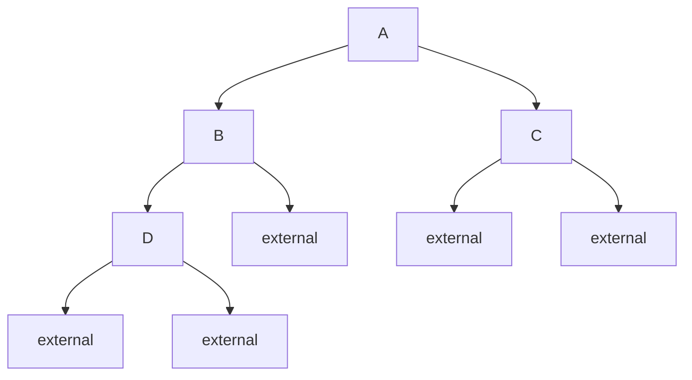
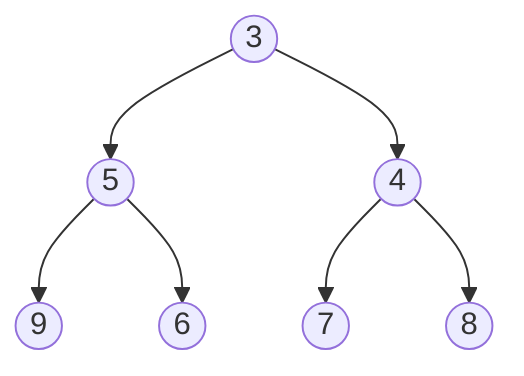
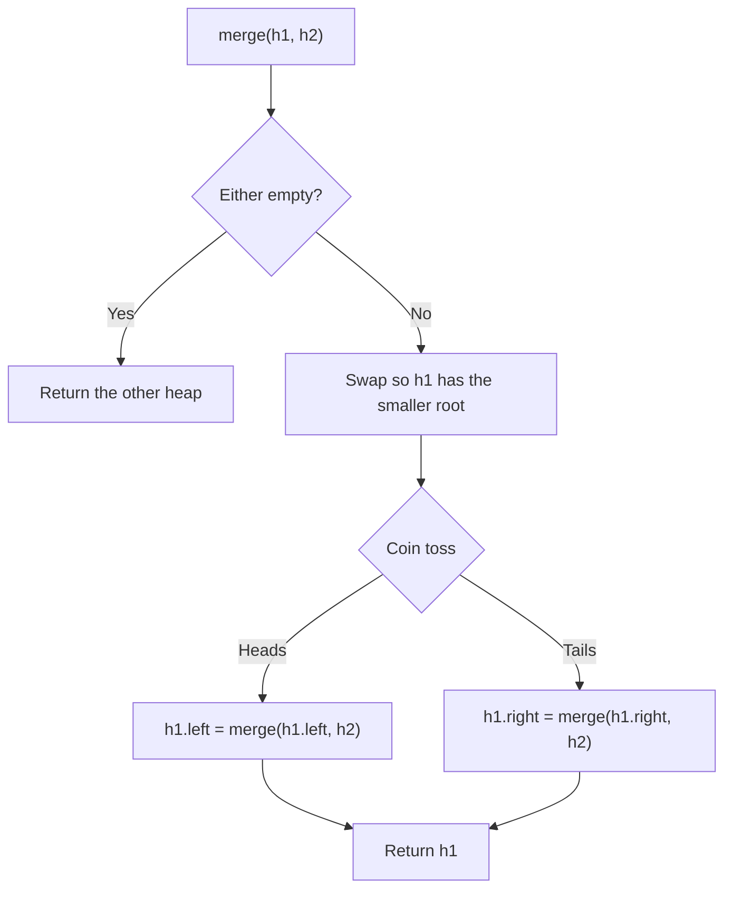

# Concept-Book Run

domain: /home/papagame/projects/digital-duck/cb-data-structure/public/domains/data_structure_ch10/input/graph.yaml
target: absorb_operation
started: 2026-11-24T14:02:30

## Teaching order (7 concepts)

- binary_tree
- heap_order_property
- randomization_coin_toss
- merge_operation
- priority_queue
- meldable_heap
- absorb_operation

### binary_tree (0.5s)

## Binary Tree

A **binary tree** is a rooted tree in which every node has at most two children, designated the **left child** and the **right child**. The two positions are distinguished: a node whose only child is on the left is a different structure from one whose only child is on the right. Any missing child position is filled by an **external node** (a placeholder leaf), while nodes that carry data are called **internal nodes**. Equivalently, a binary tree is either empty (a single external node) or consists of a root together with an ordered pair of binary trees, its left and right subtrees.

**Key measures.** The *depth* of a node is the number of edges from the root to it. The *height* $h$ of a tree is the maximum depth of any internal node. A tree with $n$ internal nodes has exactly $n+1$ external nodes.

*Proof (induction on $n$).* For $n=0$ the tree is one external node, so $0+1=1$. Suppose the claim holds for all smaller trees. A tree with $n$ internal nodes has root subtrees with $n_L$ and $n_R$ internal nodes, where $n_L+n_R=n-1$. By hypothesis, the external node count is $(n_L+1)+(n_R+1)=n+1$. $\blacksquare$

Level $d$ holds at most $2^d$ nodes, so a tree of height $h$ has at most

$$n \le 2^{h+1}-1$$

internal nodes. Rearranging gives $h \ge \lceil \log_2(n+1)\rceil - 1$. Height therefore ranges from about $\log_2 n$ (balanced) to $n-1$ (a chain), and this range governs the running time of tree algorithms.

### Worked example

Consider a tree with root $A$, left child $B$, and right child $C$. Node $B$ has a left child $D$ and no right child. Node $C$ has no children.

- Internal nodes: $A, B, C, D$, so $n=4$.
- External nodes: $B$'s right slot, plus two slots each for $C$ and $D$, giving $1+2+2=5 = n+1$. ✓
- Depths: $A=0$; $B,C=1$; $D=2$. Height $h=2$.
- Bound check: $2^{h+1}-1 = 7 \ge 4$. ✓

A recursive **inorder traversal** (left subtree, node, right subtree) visits $D, B, A, C$.


*The example tree. Squares of missing children are shown as external nodes; $n=4$ internal and $5$ external.*

### Problem-solving application

**Problem.** A binary tree must store $1{,}000{,}000$ keys. What is the smallest possible height, and what is the worst case?

**Solution.** Use $n \le 2^{h+1}-1$, so $2^{h+1} \ge 1{,}000{,}001$. Since $2^{19}=524{,}288$ and $2^{20}=1{,}048{,}576$, we need $h+1 \ge 20$, so $h_{\min}=19$. The worst case is a chain with $h = n-1 = 999{,}999$.

**Why it matters.** A search that follows one root-to-leaf path costs $O(h)$. In the balanced case that is about $20$ steps. In the degenerate case it is nearly a million. This gap is why balanced variants such as AVL and red-black trees exist: they keep $h = O(\log n)$ regardless of insertion order.

**Check yourself.** A binary tree has $15$ external nodes. How many internal nodes does it have? (Answer: $n+1=15$, so $n=14$.)

### heap_order_property (0.5s)

## Heap Order Property

**Definition.** A binary tree has the *heap order property* (here, the min-heap form) if the value stored at every node is not smaller than the value stored at its parent. The root is the only exception, since it has no parent. Writing $key(v)$ for the value at node $v$:

$$key(v) \ge key(parent(v)) \quad \text{for every non-root node } v.$$

The property is local, because it compares only a node with its parent. It still has a global consequence. Every node's value is at least as large as the values of all its ancestors, because the inequality chains upward:

$$key(v) \ge key(parent(v)) \ge key(parent(parent(v))) \ge \cdots \ge key(\text{root}).$$

So **the root holds a minimum value**. Note what the property does *not* say. It does not order siblings, and it does not order nodes in different subtrees. It is much weaker than the binary search tree property.

**Worked example.** Check whether this tree satisfies the property. Nodes are listed level by level, with children written under their parents.

- Root: 3
- Children of 3: 5 and 4
- Children of 5: 9 and 6
- Children of 4: 7 and 8

Compare each non-root node with its parent:

| Node | Parent | Holds? |
|---|---|---|
| 5 | 3 | $5 \ge 3$ ✓ |
| 4 | 3 | $4 \ge 3$ ✓ |
| 9 | 5 | $9 \ge 5$ ✓ |
| 6 | 5 | $6 \ge 5$ ✓ |
| 7 | 4 | $7 \ge 4$ ✓ |
| 8 | 4 | $8 \ge 4$ ✓ |

Every check passes, so the tree is heap-ordered. Siblings 5 and 4 are not in sorted left-to-right order, and that is allowed. Also, 6 sits in the left subtree and is smaller than 7 in the right subtree, which is allowed too.


*A heap-ordered tree: every child's value is at least its parent's value.*

**Problem-solving application.** Two questions can be answered using only the property.

*Problem 1.* Suppose we change the value 6 to 2. Does the property still hold?

1. Only comparisons involving the changed node can change. The node 6 has one parent edge (with 5) and no children, so only that one comparison needs rechecking.
2. Check it: $2 \ge 5$ is false, so the property is violated.
3. Every other comparison in the table is unchanged and still passes. The tree has exactly one violating edge.

*Problem 2.* In the original tree, where can the second-smallest value be?

1. Take any node that is not the root and not a child of the root. Its parent is also not the root, so by the chain above, the node is at least as large as its parent, which is at least as large as the root. That gives two nodes at or below it in the chain, so it cannot be the second smallest.
2. Therefore the second-smallest value must be a child of the root. Here those are 5 and 4, and the second smallest is 4.

The same reasoning shows that the third-smallest value must be a child of the root or a child of the second-smallest node. Heap order narrows where each small value can sit, even though it does not fully sort the tree.

**Key takeaway.** Heap order is a parent-to-child inequality that forces the minimum to the root. It permits many arrangements of the other nodes. After a change to one node, you only need to recheck the comparisons that involve that node.

### randomization_coin_toss (0.5s)

## Randomization Coin Toss

**Definition.** In a randomized meldable heap (a *leftist-free* heap with no rank or balance fields), the operation $\text{merge}(h_1, h_2)$ combines two heap-ordered binary trees. After comparing roots and keeping the smaller root as the new root, the algorithm must merge the other heap into one of that root's two subtrees. The **randomization coin toss** is the choice of which one: a fair random bit $b \in \{0,1\}$ is drawn at each step, sending the recursion left if $b=0$ and right if $b=1$. No stored size, rank, or height is consulted.

```
merge(h1, h2):
    if h1 = nil: return h2
    if h2 = nil: return h1
    if h2.key < h1.key: swap(h1, h2)
    if coin() = 0:  h1.left  = merge(h1.left,  h2)
    else:           h1.right = merge(h1.right, h2)
    return h1
```

**Worked example.** Merge $h_1$ with root 3 (left child 7, no right child) and $h_2$ with root 5 (no children).

1. Compare roots: $3 < 5$, so 3 stays on top.
2. Toss a coin. If heads ($b=0$), recurse into the left subtree: $\text{merge}(7, 5)$. Now $5<7$, so 5 becomes the root of that subtree, and a new toss decides whether 7 hangs to its left or right. The result has depth 3.
3. If tails ($b=1$), recurse into the empty right subtree: $\text{merge}(\text{nil}, 5)=5$, which attaches immediately. The result has depth 2.

Different tosses give different but equally valid heaps.

**Why it works (key result).** Each merge walks one random root-to-nil path in each tree, so the cost is bounded by the sum of the lengths of two random paths.

*Lemma.* In any binary tree with $n$ nodes, a random walk that goes left or right with probability $\tfrac12$ until it falls off the tree has expected length at most $\log_2(n+1)$.

*Proof sketch.* A walk ending at a nil pointer at depth $d$ has probability $2^{-d}$. The tree has $n+1$ nil positions, and $\sum 2^{-d}=1$ (Kraft equality for a full extension). By Jensen's inequality, since $\log$ is concave,
$$E[d]=\sum_i p_i d_i=\sum_i p_i \log_2\frac1{p_i}=H(p)\le \log_2(n+1),$$
where $p_i=2^{-d_i}$ and $H$ is the Shannon entropy over $n+1$ outcomes. $\blacksquare$

So, with $n_1, n_2$ the heap sizes, $E[\text{merge steps}] \le \log_2(n_1+1)+\log_2(n_2+1)=O(\log n)$. Every `insert` and `delete-min` is a merge, so each costs $O(\log n)$ expected time.

**Problem-solving application.** *Estimate the expected cost of merging heaps of sizes 1023 and 511.*

Apply the bound: $\log_2(1024)+\log_2(512)=10+9=19$ expected recursive steps at most. This is the same asymptotic guarantee a leftist or skew heap gives, but without storing ranks and without the amortization argument. A tradeoff: the guarantee is *expected*, so a single merge can be slow (a long path), though long paths occur with exponentially small probability, specifically $\Pr[\text{path length} > c\log_2 n] \le n^{-\Omega(c)}$.

Note also that the coin must be fresh on each step. Reusing one bit, or a predictable pattern, lets an adversary build a tree where the walk is always long, which would destroy the bound.

### merge_operation (0.5s)

## Merge Operation

**Definition.** In a *leftist-free* randomized meldable heap (a min-heap-ordered binary tree with no structural constraint), the operation $\textsf{merge}(h_1, h_2)$ combines two heaps into one. Every other operation reduces to it. The rule is:

1. If $h_1$ is empty, return $h_2$. If $h_2$ is empty, return $h_1$.
2. Otherwise, if $h_1.\text{key} > h_2.\text{key}$, swap $h_1$ and $h_2$. The root of $h_1$ is now the smaller key, so it becomes the root of the result.
3. Flip a fair coin. If heads, set $h_1.\text{left} \leftarrow \textsf{merge}(h_1.\text{left}, h_2)$. If tails, set $h_1.\text{right} \leftarrow \textsf{merge}(h_1.\text{right}, h_2)$.
4. Return $h_1$.

Heap order is preserved because the smaller root stays on top, and the other heap goes into a subtree whose keys are all at least as large as that root.

```python
def merge(a, b):
    if a is None: return b
    if b is None: return a
    if a.key > b.key: a, b = b, a
    if random.random() < 0.5:
        a.left = merge(a.left, b)
    else:
        a.right = merge(a.right, b)
    return a
```

**Worked example.** Let $h_1$ have root 3 with left child 8 and no right child. Let $h_2$ be the single node 5. Then $3 < 5$, so there is no swap. Suppose the coin gives tails. Then $h_1.\text{right} \leftarrow \textsf{merge}(\varnothing, h_2) = h_2$, and 5 becomes the right child of 3. Had the coin given heads, we would call $\textsf{merge}(\text{node } 8, \text{node } 5)$. Since $8 > 5$, we swap, so 5 becomes the root of that subtree. A second coin then decides whether 8 hangs to its left or right. The result is a valid heap either way, but its shape depends on the coin tosses.

**Problem-solving application: expected running time.** The cost is proportional to the length of the random path the recursion follows. This path goes down through $h_1$ and $h_2$ together, so it is at most $\text{depth}_1 + \text{depth}_2$ steps long, where these are the lengths of the random walks taken in each tree.

*Lemma.* In a binary tree with $n$ nodes, a random walk that goes left or right with probability $\tfrac12$ each, stopping at a missing child, has expected length at most $\log_2(n+1)$.

*Proof sketch.* Let $T$ be a tree with $n$ nodes and $E(T)$ the expected walk length. A walk ending at an external (null) position of depth $d$ has probability $2^{-d}$. Using $\mathbb{E}[d] = \sum_{\text{leaves}} 2^{-d}\, d$, Jensen's inequality, and the Kraft equality $\sum 2^{-d} = 1$ over the $n+1$ external positions, we get
$$
\mathbb{E}[d] = \sum 2^{-d}\log_2\!\left(2^{d}\right) \le \log_2\!\sum 2^{-d}\cdot 2^{d} = \log_2(n+1). \qquad\blacksquare
$$

Applying the lemma to both trees gives
$$
\mathbb{E}[\text{steps}] \le \log_2(n_1+1) + \log_2(n_2+1) = O(\log n),
$$
where $n = n_1 + n_2$. So a merge takes expected $O(\log n)$ time.

*Using it.* $\textsf{insert}(x)$ is $\textsf{merge}(h, \text{node}(x))$. $\textsf{deleteMin}$ is $\textsf{merge}(h.\text{left}, h.\text{right})$, which discards the root. Both therefore take expected $O(\log n)$ time. Note that this is an *expected* bound over the coin tosses. It holds for every input, because the adversary cannot predict the coins.


*Control flow of the merge: the smaller root is kept, and the coin toss selects which subtree absorbs the other heap.*

### priority_queue (0.5s)

## Priority Queue

### Definition

A **priority queue** is an abstract data type that stores a collection of comparable values and supports two operations:

- $\text{add}(x)$: insert the value $x$ into the collection.
- $\text{remove}()$: delete and return the **smallest** value currently stored.

Unlike an ordinary queue (first in, first out), the removal order depends on the values, not on arrival time. Duplicates are allowed. If the queue is empty, $\text{remove}()$ is undefined (an implementation typically raises an error). The definition says nothing about how values are stored, and that choice determines the cost of each operation.

### Worked Example

Start with an empty priority queue and apply these operations:

| Operation | Returned | Contents afterward |
|---|---|---|
| add(7) | – | {7} |
| add(3) | – | {3, 7} |
| add(9) | – | {3, 7, 9} |
| remove() | 3 | {7, 9} |
| add(1) | – | {1, 7, 9} |
| remove() | 1 | {7, 9} |
| remove() | 7 | {9} |

The values 7, 3, 9 were added in that order, but 3 came out first. The value 1 was added *after* the others and still came out next, because it was the smallest.

### Implementation Costs

Let $n$ be the number of stored values. Two simple array implementations show the trade-off:

- **Unsorted array:** $\text{add}$ appends in $O(1)$. $\text{remove}$ must scan for the minimum, which takes $\Theta(n)$.
- **Array sorted in descending order:** $\text{remove}$ takes the last element in $O(1)$. $\text{add}$ must find the position and shift elements, which takes $\Theta(n)$.

Either way, one operation is cheap and the other costs $\Theta(n)$. Library implementations do better, and we will assume that both operations cost $O(\log n)$.

### Problem-Solving Application

**Problem.** Given a stream of $N$ numbers, find the $k$ largest using as little memory as possible.

**Solution.** Keep a priority queue that never holds more than $k$ values. Because $\text{remove}()$ returns the smallest value, it always discards the *weakest* of the current candidates.

For each incoming value $x$:
1. $\text{add}(x)$.
2. If the size exceeds $k$, call $\text{remove}()$. The value removed is the smallest, so it cannot be among the $k$ largest.

Trace for $k = 2$ on the stream $5, 1, 8, 3, 9$:

- add 5, add 1 → {1, 5}
- add 8 → {1, 5, 8}, remove 1 → {5, 8}
- add 3 → {3, 5, 8}, remove 3 → {5, 8}
- add 9 → {5, 8, 9}, remove 5 → {8, 9}

The result is {8, 9}, the two largest values.

**Cost.** Each of the $N$ items triggers one $\text{add}$ and at most one $\text{remove}$ on a queue of size at most $k+1$. Each costs $O(\log k)$, so the total time is $O(N \log k)$ using $O(k)$ memory. Sorting the whole stream would cost $O(N \log N)$ time and $O(N)$ memory. When $k \ll N$, the priority queue is much better.

**Key idea:** use a priority queue when you repeatedly need the current minimum while new values keep arriving, as in task scheduling or merging sorted lists.

### meldable_heap (0.5s)

## Meldable Heap

A **meldable heap** is a priority queue stored as a heap-ordered binary tree of *unrestricted shape*. Each node holds a value, and every node's value is no larger than the values of its children (min-heap order). Unlike a binary heap, the tree need not be complete or balanced. Its shape can be lopsided, and its height can be as large as $n$.

All the work is done by one operation, $\text{merge}(h_1, h_2)$, which combines two heaps into one:

- If $h_1$ is empty, return $h_2$. If $h_2$ is empty, return $h_1$.
- Otherwise, swap $h_1$ and $h_2$ if needed so that $h_1.\text{key} \le h_2.\text{key}$. The root of $h_1$ stays the root.
- Flip a fair coin. If heads, set $h_1.\text{left} \leftarrow \text{merge}(h_1.\text{left}, h_2)$. If tails, set $h_1.\text{right} \leftarrow \text{merge}(h_1.\text{right}, h_2)$.
- Return $h_1$.

The other operations follow directly:

- $\text{add}(x)$: create a single-node heap $u$ holding $x$, then set $r \leftarrow \text{merge}(u, r)$.
- $\text{remove}()$ (delete the minimum): save $r.\text{key}$, then set $r \leftarrow \text{merge}(r.\text{left}, r.\text{right})$.

### Worked example

Merge $h_1$ with root 3 and right child 8 (no left child) and $h_2$ with root 5 and no children.

1. $3 \le 5$, so 3 remains the root.
2. Suppose the coin gives heads. We compute $\text{merge}(h_1.\text{left}, h_2) = \text{merge}(\varnothing, h_2) = h_2$, so 5 becomes 3's left child.
3. Suppose instead it gives tails. We compute $\text{merge}(8, 5)$. Since $5 < 8$, 5 becomes the root of that subtree and the coin is flipped again. Eventually 8 is attached below 5.

Either outcome is a valid heap. Heap order is preserved because the smaller root always stays on top.

### Problem-solving application: running time

Merging walks down a single random path in each heap, and it never branches. The walk ends when one of the subtrees it reaches is empty.

**Lemma.** The expected length of a random walk in a binary tree with $n$ nodes, where each step goes left or right with probability $\tfrac12$, is at most $\log(n+1)$.

*Proof sketch (induction on $n$).* For $n=0$ the walk has length $0 = \log 1$. For $n>0$, let the left subtree have size $n_1$ and the right subtree $n_2$, so $n_1+n_2=n-1$. The walk takes one step and then continues into a random child, so

$$E[W] \le 1 + \tfrac12\log(n_1+1) + \tfrac12\log(n_2+1).$$

By concavity of $\log$,

$$E[W] \le 1 + \log\!\left(\tfrac{n_1+n_2+2}{2}\right) = 1 + \log\!\left(\tfrac{n+1}{2}\right) = \log(n+1). \qquad\blacksquare$$

Merging $h_1$ and $h_2$ with $n_1$ and $n_2$ nodes follows one walk in each heap. So the expected number of steps is at most

$$\log(n_1+1) + \log(n_2+1) = O(\log n),$$

where $n = n_1 + n_2$.

**Consequence.** Since $\text{add}$ and $\text{remove}$ each perform one merge, both run in $O(\log n)$ *expected* time. $\text{findMin}$ simply returns the root's key in $O(1)$.

**Practice.** Insert 4, 2, 7 in that order into an empty heap. Insertion merges the new single node with the current heap, and 2 ends up as the root. Now call $\text{remove}()$. The result is $\text{merge}(r.\text{left}, r.\text{right})$, and 4 is returned next. Because coin flips decide the shape, different runs can produce different trees. The expected cost stays logarithmic regardless.

### absorb_operation (0.6s)

## Absorb Operation

### Definition

In a `MeldableHeap`, the **absorb** operation moves every element of a second heap into the calling heap and leaves the source heap empty. It is the "bulk insert" companion to `add`. All of the work is delegated to `merge`:

$$\text{absorb}(h_1, h_2):\quad h_1.\text{root} \leftarrow \text{merge}(h_1.\text{root},\, h_2.\text{root}),\qquad h_2.\text{root} \leftarrow \text{nil}$$

Here $n_1$ and $n_2$ are the sizes of the two heaps. The sizes are updated as $n_1 \leftarrow n_1 + n_2$ and $n_2 \leftarrow 0$. Because a randomized meldable heap's `merge` runs in $O(\log n)$ expected time, where $n = n_1 + n_2$, absorb has the same expected cost. It does not need to touch the elements one at a time.

```java
void absorb(MeldableHeap<T> u) {
    r = merge(u.r, r);   // meld the two heap-ordered trees
    n += u.n;            // combine sizes
    u.r = nil;           // empty the source
    u.n = 0;
}
```

The last two lines matter. If `u.r` were left pointing into the merged tree, two heaps would share nodes, and a later change to either heap would corrupt the other.

### Worked Example

Let $h_1$ have root 3 with children 7 and 9, and let $h_2$ have root 5 with one child 8. Call `h1.absorb(h2)`.

1. `merge(3, 5)`: since $3 < 5$, node 3 stays on top.
2. A fair coin flip picks a child of 3 to merge into. Say it picks the left child, 7. Then `merge(7, 5)` runs. Since $5 < 7$, node 5 becomes the new left child of 3. Node 5's own subtree is then merged with 7.
3. The recursion continues until one argument is `nil`.

The result is a valid heap rooted at 3 containing $\{3,5,7,8,9\}$, so $n_1 = 3 + 2 = 5$. Then $h_2$ is empty with $n_2 = 0$. Different coin flips give different tree shapes, but always a valid heap.

### Problem-Solving Application

**Problem.** You must combine $k$ heaps, each of size about $m$, into one heap. Estimate the expected cost.

**Solution.** Absorb the heaps one at a time into an accumulator. The $i$-th absorb costs $O(\log(im))$ expected time, since the accumulator holds about $im$ elements. The total is

$$\sum_{i=1}^{k} O(\log(im)) \le k \cdot O(\log(km)) = O(k \log(km)).$$

Compare this with inserting all $km$ elements one by one, which costs $O(km \log(km))$. Absorb is better by a factor of about $m$.

**Why the bound holds.** The expected length of a random walk down a meldable heap of $n$ nodes is at most $\log n$ (one extra step per level, at most $2\log n$ in total). `merge` makes one such random walk through each of the two heaps, so its expected cost is $O(\log n_1 + \log n_2) = O(\log n)$. Absorb adds only $O(1)$ bookkeeping.

**Check yourself.** After `h1.absorb(h1)`, what goes wrong? Merging a tree with itself would create cycles. Real implementations must reject self-absorption or check for it first.

## Run complete

total: 9.4s
