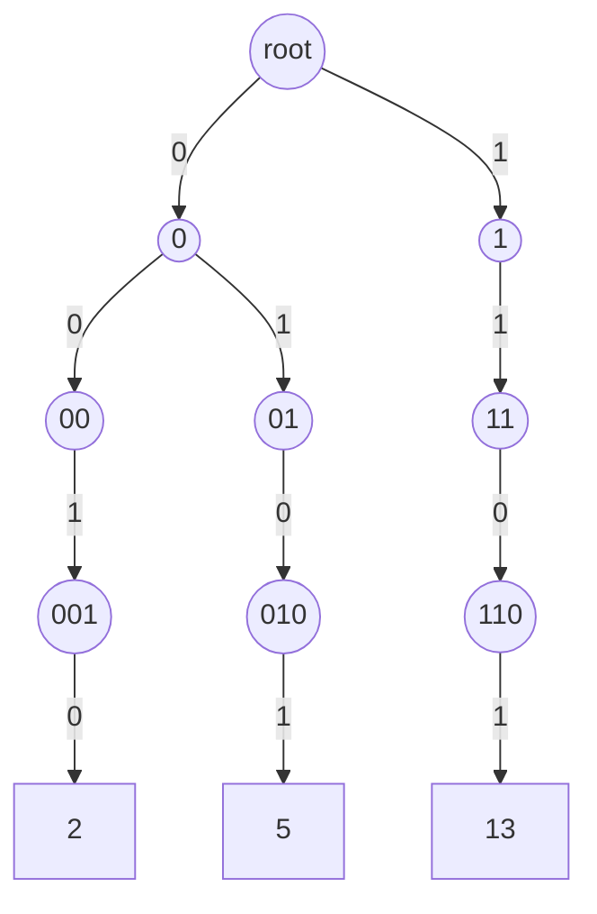
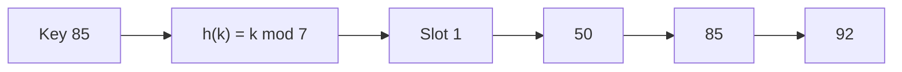
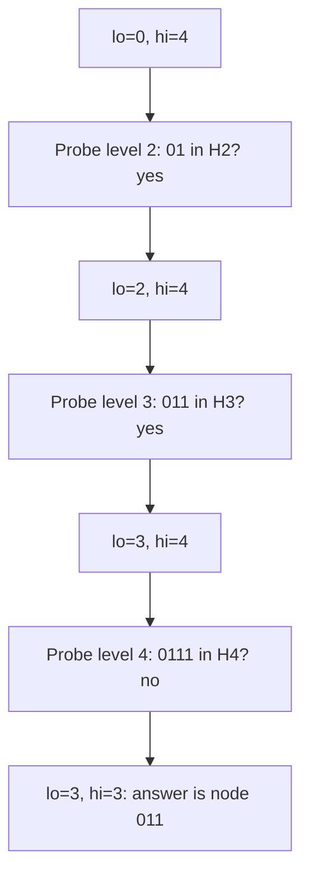

# Concept-Book Run

domain: /home/papagame/projects/digital-duck/cb-data-structure/public/domains/data_structure_ch13/input/graph.yaml
target: yfasttrie
started: 2026-11-24T14:03:25

## Teaching order (12 concepts)

- bit_representation
- sset_interface
- binary_trie
- hash_table
- jump_pointers
- leaf_linked_list
- binary_trie_operations
- level_based_binary_search
- xfasttrie
- probabilistic_sampling
- treap
- yfasttrie

### bit_representation (0.6s)

## Bit Representation

**Definition.** A $w$-bit unsigned integer is stored as a fixed-length string of bits $b_{w-1}b_{w-2}\cdots b_1b_0$, where each $b_i\in\{0,1\}$. Bit $b_i$ carries the place value $2^i$, so the encoded value is

$$
x=\sum_{i=0}^{w-1} b_i\,2^i .
$$

Bit $b_{w-1}$ is the *most significant bit* (MSB) and $b_0$ is the *least significant bit* (LSB). Because there are $w$ positions and two choices per position, exactly $2^w$ distinct values can be represented: $0,1,\dots,2^w-1$.

For signed integers, the common two's-complement encoding gives the MSB the negative weight $-2^{w-1}$:

$$
x=-b_{w-1}2^{w-1}+\sum_{i=0}^{w-2} b_i\,2^i ,
$$

which covers the range $-2^{w-1}$ to $2^{w-1}-1$.

**Worked example.** Let $w=8$ and consider the string $10110101$. Reading from $b_7$ down to $b_0$, the bits equal to 1 are $b_7,b_5,b_4,b_2,b_0$. As an unsigned integer:

$$
x=2^7+2^5+2^4+2^2+2^0=128+32+16+4+1=181 .
$$

As a two's-complement integer, the MSB contributes $-128$ instead of $+128$:

$$
x=-128+32+16+4+1=-75 .
$$

The same bits therefore encode different values depending on the interpretation. Check: $181-256=-75$, consistent with $x_{\text{signed}}=x_{\text{unsigned}}-2^w$ whenever $b_{w-1}=1$.

**Problem-solving application.** *Problem:* Find the 8-bit pattern for $x=-37$ in two's complement, and determine how many bits are needed to store values up to 1000 unsigned.

*Solution, part 1.* Start with $+37=00100101$ (since $37=32+4+1$). Negation in two's complement is "flip all bits, then add 1":

$$
\overline{00100101}=11011010,\qquad 11011010+1=11011011 .
$$

Verify: $-128+64+16+8+2+1=-37$. ✓

*Solution, part 2.* We need $2^w-1\ge 1000$, i.e. $2^w\ge 1001$. Since $2^{9}=512<1001\le 1024=2^{10}$, we need

$$
w=\lceil \log_2(1001)\rceil=10 \text{ bits}.
$$

In general, representing $n$ distinct values requires $w=\lceil\log_2 n\rceil$ bits.

**Useful consequences.**
- Setting or testing the $i$-th bit uses the mask $2^i$: for example, $x \,\&\, (1\ll i)$ tests $b_i$.
- Shifting left by $k$ positions multiplies by $2^k$ (if no bits overflow beyond $w$).
- Arithmetic wraps modulo $2^w$: in 8 bits, $255+1=0$. Overflow is therefore a property of the fixed width, not of the numbers themselves.

When solving problems, first decide the width $w$ and the interpretation (unsigned or signed), because both are needed to turn a bit string into a value.

### sset_interface (0.6s)

## Sset Interface

### Definition

An **SSet** (sorted set) is an abstract data type that stores a collection of elements drawn from a totally ordered universe, meaning any two elements $x, y$ can be compared with $<$, $=$, or $>$. It is defined by three operations on a set $S$:

- **add(x):** insert $x$ into $S$. Return `true` if $x$ was not already present (so $S$ grew), otherwise return `false`. Duplicates are never stored.
- **remove(x):** delete $x$ from $S$. Return the removed element if it was present, otherwise `null`.
- **find(x):** return the *smallest* element $y \in S$ with $y \ge x$, or `null` if no such element exists.

The third operation is what separates an SSet from an ordinary hash-style set. Because `find(x)` is a **successor search**, it works even when $x \notin S$. It answers "what is the next element at or after $x$?" For this reason, SSet structures must keep their elements ordered. Examples include binary search trees, skiplists, and sorted arrays.

### Worked Example

Start with $S = \{3, 8, 12, 20\}$ and apply these operations in order:

| Operation | Result | $S$ afterward |
|---|---|---|
| find(8) | 8 | $\{3, 8, 12, 20\}$ |
| find(9) | 12 | $\{3, 8, 12, 20\}$ |
| add(9) | true | $\{3, 8, 9, 12, 20\}$ |
| add(9) | false | $\{3, 8, 9, 12, 20\}$ |
| find(9) | 9 | $\{3, 8, 9, 12, 20\}$ |
| find(25) | null | $\{3, 8, 9, 12, 20\}$ |
| remove(12) | 12 | $\{3, 8, 9, 20\}$ |
| find(10) | 20 | $\{3, 8, 9, 20\}$ |

Notice that `find(9)` returned $12$ before $9$ was added and returned $9$ afterward. `find` does not report membership. It reports the *successor*, so you test membership by checking whether the returned value equals $x$.

### Problem-Solving Application

**Problem.** Given a set of meeting start times in minutes after midnight, $S=\{540, 600, 780, 900\}$, each meeting lasting 50 minutes, decide whether a new meeting starting at time $t$ would overlap with an existing one. Use only SSet operations.

**Solution.** A new meeting $[t, t+50)$ conflicts with a later meeting if that meeting starts before $t+50$. It conflicts with an earlier meeting if that one started within the last 50 minutes. The key step is to use `find` to get the next start time at or after $t$:

1. Let $y = \text{find}(t)$.
2. If $y \neq \text{null}$ and $y < t + 50$, there is a conflict with a later meeting.
3. Check earlier meetings by calling $z = \text{find}(t-49)$. If $z \neq \text{null}$ and $z < t$, an earlier meeting started within the last 50 minutes, so there is a conflict.

For $t = 570$: $\text{find}(570) = 600$, and $600 < 620$, so there is a conflict. For $t = 650$: $\text{find}(650) = 780 \ge 700$, and $\text{find}(601) = 780 \not< 650$, so there is no conflict. We then call add(650).

Each check costs one or two `find` calls. If the SSet is a balanced search tree, each call runs in $O(\log n)$ time, so scheduling stays efficient as the calendar grows. This is why the interface matters: the ordering guarantee behind `find` lets you answer range-style questions that an unordered set cannot.

### Key Takeaways

- SSet = set of comparable elements with `add`, `remove`, and successor-style `find`.
- `find(x)` returns the smallest element $\ge x$, not just a yes/no answer.
- Membership test: `find(x) == x`.
- The interface says *what* must be supported, not *how*. Implementations differ in cost, commonly $O(\log n)$ per operation.

### binary_trie (0.5s)

## Binary Trie

### Definition

A **binary trie** stores a set $S$ of $w$-bit integers as root-to-leaf paths in a binary tree of height $w$. Write each $x \in S$ as bits $b_1 b_2 \cdots b_w$, with $b_1$ the most significant. Starting at the root, the path for $x$ goes to the left child if $b_i = 0$ and to the right child if $b_i = 1$ at depth $i-1$. The leaf at depth $w$ represents $x$ itself. Nodes are created only along paths of stored values, so internal nodes exist only if some stored key passes through them.

Three properties follow directly:

- The shape depends only on the set $S$, not on insertion order.
- Each operation follows one path of exactly $w$ steps, so `find`, `insert`, and `delete` take $O(w)$ time, independent of $n = |S|$.
- The tree has at most $nw + 1$ nodes, so space is $O(nw)$.

Leaves are usually linked in a doubly linked list in sorted order. Then `successor` queries can finish by following a link.

### Worked example

Let $w = 4$ and $S = \{2, 5, 13\}$. In binary, $2 = 0010$, $5 = 0101$, and $13 = 1101$.

- $2$: left, left, right, left
- $5$: left, right, left, right
- $13$: right, right, left, right

The root has both children, because $2$ and $5$ start with $0$ and $13$ starts with $1$. Under the left child, the keys $0010$ and $0101$ split at the next bit. The paths for $5$ and $13$ share no prefix at all, so they separate at the root. The trie has $1 + 3 \cdot 4 - (\text{shared nodes})$ nodes. The shared nodes are the left child of the root, used by both $2$ and $5$ (one node saved). That gives $1 + 12 - 1 = 12$ nodes.

*Search paths for 2, 5, and 13 in a 4-bit trie. Depth-4 leaves are labeled with the stored value, and internal nodes are labeled with their bit prefix. Intermediate depth-3 and depth-4 nodes are collapsed in this drawing.*

### Problem-solving application: successor query

To find the smallest element of $S$ that is at least $y$, follow the bits of $y$ downward as far as the trie allows.

1. If you reach a leaf at depth $w$, then $y \in S$ and it is its own successor.
2. If you stop at a node $u$ at depth $i$ because the needed child is missing, there are two cases.
   - If the missing child is the left one (the bit of $y$ is $0$), the right subtree contains only larger keys. The successor is the smallest leaf in that subtree.
   - If the missing child is the right one (the bit of $y$ is $1$), every key below $u$ is smaller than $y$. The successor is the leaf after the last leaf under $u$ in the linked list.

Try $y = 6 = 0110$ on the trie above. The path goes $0 \to 01 \to 011$, but node $01$ has only a $0$ child. The bit needed is $1$, so no key below $01$ reaches $y$. The largest leaf under $01$ is $5$, and its list neighbor is $13$. The successor is $13$, found in $O(w)$ time.

**Limitation:** every operation costs $\Theta(w)$ steps, even for tiny sets. This is why structures such as x-fast tries add hashing to search levels by binary search and reach $O(\log w)$ time.

### hash_table (0.4s)

## Hash Table

### Definition

A **hash table** stores a small number $n$ of items drawn from a huge key universe $U$ (with $|U| \gg n$) using an array of $m$ slots, where $m$ is comparable to $n$. A **hash function** $h : U \to \{0, 1, \dots, m-1\}$ maps each key $k$ to a slot index, so the item is stored at position $h(k)$. Lookup, insertion, and deletion all begin by computing $h(k)$ rather than searching.

Because $|U| > m$, the pigeonhole principle guarantees that distinct keys sometimes share a slot. This is a **collision**. In **chaining**, each slot holds a linked list of all keys that hash there. The **load factor** is

$$\alpha = \frac{n}{m}.$$

### Worked example

Let $m = 7$ and $h(k) = k \bmod 7$. Insert the keys $50, 700, 76, 85, 92, 73$.

| Key | $h(k)$ |
|-----|--------|
| 50 | 1 |
| 700 | 0 |
| 76 | 6 |
| 85 | 1 |
| 92 | 1 |
| 73 | 3 |

Slot 1 now holds the chain $50 \to 85 \to 92$, and slots 0, 3, 6 each hold one key. To find $85$, compute $h(85) = 1$, then scan that chain. This takes 2 comparisons, not a scan of all 6 keys.

### Problem-solving application

**Cost analysis.** Assume *simple uniform hashing*: each key is equally likely to land in any slot, independently of the others. A chain then has expected length $\alpha = n/m$. An unsuccessful search computes $h(k)$ and scans a whole chain, so its expected cost is

$$\Theta(1 + \alpha).$$

A successful search has the same asymptotic cost. If we choose $m = \Theta(n)$, then $\alpha = O(1)$ and every operation takes expected $O(1)$ time. Compare this with $O(n)$ for an unsorted list or $O(\log n)$ for a balanced search tree.

**Design problem.** You must store $n = 2000$ student IDs and want an expected unsuccessful-search cost of at most about $3$ comparisons-worth of chain scanning ($\alpha \le 2$). Then

$$m \ge \frac{n}{\alpha} = \frac{2000}{2} = 1000.$$

A prime near this size, such as $m = 1009$, is a good choice. With $h(k) = k \bmod m$, a prime modulus helps spread keys that share common factors, for example IDs that are all multiples of 10.

**Caution.** The $O(1)$ bound depends on $h$ spreading keys evenly. A fixed $h$ can be defeated by an adversary who picks keys that all collide, which forces $\Theta(n)$ time. Practical systems therefore use a randomly chosen hash function from a *universal family*. For such a family, any two distinct keys collide with probability at most $1/m$, which recovers the expected $O(1 + \alpha)$ guarantee for every input set.

**Resizing.** When $\alpha$ exceeds a threshold, allocate a table with about twice as many slots and rehash every key. A single resize costs $O(n)$. Doubling makes the amortized cost per insertion $O(1)$.

*Key 85 hashes to slot 1, where a chain of three colliding keys is scanned until 85 is found.*

### jump_pointers (0.5s)

## Jump Pointers

**Definition.** In a binary trie over $w$-bit keys (such as the x-fast trie), a node at depth $d$ represents a prefix of length $d$ and covers all stored keys sharing that prefix. A node with only one child has a *missing branch*. A **jump pointer** is an auxiliary pointer stored at such a node. If the left child is missing, the pointer goes to the **smallest leaf** in the node's subtree. If the right child is missing, it goes to the **largest leaf** in the subtree. Leaves are also linked in a sorted doubly linked list, so a leaf reached through a jump pointer gives immediate access to its predecessor and successor.

The purpose is to answer $\texttt{find}(x)$, which returns the smallest stored key $\ge x$, without walking down to a leaf one level at a time. The prefixes of $x$ are kept in hash tables, one per level. Binary search over the depth $d \in \{0,\dots,w\}$ finds the *longest prefix* of $x$ that exists in the trie. This takes $O(\log w)$ hash lookups. The node $u$ at that depth must have a missing child on $x$'s path. Otherwise the prefix could be extended, and it would not be the longest one.

**Worked example.** Let $w = 4$ and store $S=\{0001,\,0011,\,1100\}$. Query $x = 0100$.

1. The longest existing prefix of $x$ is $01$? No. Only $0$ exists, since the stored keys $0001$ and $0011$ both start with $0$. So $u$ is the node for prefix $0$.
2. The next bit of $x$ is $1$, so we want the right child of $u$. The node for prefix $01$ does not exist, so the right child is missing.
3. Therefore $u$ stores a jump pointer to the **largest** leaf in its subtree, $0011$.
4. Every key in $u$'s subtree is less than $x$, so $0011$ is the predecessor of $x$. The successor is the next element in the linked list, $1100$. That is the answer to $\texttt{find}(0100)$.

If the missing child had been the left one, the pointer would lead to the smallest leaf $\ell$. Then $\ell$ would itself be the successor, because everything in the subtree is greater than $x$.

**Problem-solving application.** To process $\texttt{find}(x)$:

- Binary search on depth for the deepest existing prefix node $u$. Cost: $O(\log w)$.
- If $u$ is a leaf, then $x$ is stored, so return it.
- Otherwise read $u$'s jump pointer to get leaf $\ell$. If $x$'s next bit is $1$, then $\ell$ is the predecessor, so return $\ell.\text{next}$. If the next bit is $0$, then $\ell$ is the successor, so return $\ell$.

Total time is $O(\log w)$, with no descent below $u$.

The pointers must be maintained. Inserting or deleting a key can change the smallest or largest leaf for up to $w$ ancestors. Each update therefore costs $O(w)$ time. Space is $O(nw)$, because each key contributes up to $w$ prefix nodes.

**Check yourself.** Using the same set $S$, query $x=1000$. The longest prefix is $1$, and its left child $10$ is missing. The jump pointer on $1$ gives the smallest leaf $1100$, which is the successor.

### leaf_linked_list (0.5s)

## Leaf Linked List

### Definition

A **leaf linked list** is a doubly-linked list that threads together every leaf of a binary trie in sorted key order. Recall that in a BinaryTrie storing $w$-bit integers, each key $x$ lives at a leaf at depth $w$, and the path from the root spells out the bits of $x$. Leaves from left to right are therefore already in increasing order. The linked list makes that order *explicit*, so that moving from one leaf to its neighbor costs $O(1)$ instead of a tree traversal.

The list **reuses child pointers**. A leaf has no children, so its `left` and `right` fields are free. We set

- `leaf.left` $=$ the previous leaf (predecessor) in sorted order,
- `leaf.right` $=$ the next leaf (successor) in sorted order.

Non-leaf nodes use `left` and `right` as ordinary children. Because leaves sit at depth $w$, a program always knows which interpretation applies. No extra memory is needed. A dummy node can serve as the head and tail so the list is circular.

Likewise, an internal node with only one child can use its empty pointer as a **jump pointer**: a missing left child points to the smallest leaf in its right subtree, and a missing right child points to the largest leaf in its left subtree.

### Worked example

Let $w = 4$ and store the keys $S = \{2, 5, 9, 12\}$, with binary forms $0010, 0101, 1001, 1100$. The leaf list is

$$\text{dummy} \leftrightarrow 2 \leftrightarrow 5 \leftrightarrow 9 \leftrightarrow 12 \leftrightarrow \text{dummy}.$$

To search for the successor of $x = 6 = 0110$, walk down from the root following bits of $x$ as far as possible. The path $0, 1$ succeeds (prefix $01$ exists, since $0101$ is stored). The next bit is $1$, but node $01$ has no right child. Its right pointer is therefore a jump pointer. Since the right child is missing, it points to the **largest leaf in its left subtree**, which is leaf $5$.

Because $5 < 6$, leaf $5$ is the predecessor, and its list pointer `right` gives the successor: $9$.

### Problem-solving application

**Rule for finding the successor of $x$.** Descend until you can't continue, at node $u$ at depth $i$. Then:

1. If $u$ is a leaf, $x$ is stored, so its successor is `u.right`.
2. If $u$ is internal and its missing child is the *right* one (we wanted bit $1$), `u.right` points to the predecessor leaf $\ell$. Answer: `ℓ.right`.
3. If the missing child is the *left* one (we wanted bit $0$), `u.left` points to the smallest leaf larger than $x$. Answer: that leaf directly.

**Check on the example.** Query $x = 3 = 0011$. Path: $0$, then $0$ (prefix $00$ exists), then $1$ fails at node $001$? Only $0010$ is stored, so $001$ exists. The next bit $1$ requires child $0011$, which is missing. Node $001$ lacks a right child, so its right pointer leads to leaf $2$, the predecessor. Then `2.right` $= 5$, the successor. ✓

**Cost.** The descent can be done by binary search on levels (using hash tables of prefixes, as in an x-fast trie) in $O(\log w)$ time. The list step adds $O(1)$. Without the list, finding the neighbor would require climbing and re-descending, costing $\Theta(w)$.

**Maintenance.** Insert $x$: find its predecessor $p$ using the search above, splice the new leaf between $p$ and $p.\text{right}$ in $O(1)$, then repair jump pointers along the $w$ nodes of its root path, for $O(w)$ total. Deletion mirrors this.

### binary_trie_operations (0.6s)

## Binary Trie Operations

**Definition.** A `BinaryTrie` stores a set $S$ of $n$ distinct $w$-bit integers. Each integer is a root-to-leaf path of length $w$: at depth $i$, bit $i$ of the key (most significant first) selects the left child (0) or right child (1). Leaves are linked in sorted order in a doubly linked list. Each node missing a child holds a **jump pointer** in that slot. The pointer goes to the smallest leaf in its subtree if the right child is missing, or to the largest leaf if the left child is missing. Every operation walks one path of length $w$, so each takes $O(w)$ time.

**Search (find).** To find $x$, walk down following the bits of $x$. If the walk reaches a leaf, $x \in S$. If it stops at a node $u$ at depth $i<w$ because the needed child is missing, the jump pointer there leads to the successor or predecessor leaf of $x$. The jump pointer gives the successor if $x$'s next bit is 1... more precisely, if $x$'s bit is 0, the right child exists and the jump pointer in the left slot points to the *smallest leaf in the right subtree*, which is $\text{succ}(x)$. If $x$'s bit is 1, the pointer in the right slot goes to the largest leaf in the left subtree, which is the predecessor. In that case the successor is the next leaf in the list. Cost: $O(w)$.

**Insert.**
1. Walk toward $x$ until a child is missing, at node $u$ and depth $i$. The jump pointer at $u$ gives the successor or predecessor leaf, so the new leaf's list neighbors are known.
2. Create the new nodes for bits $i,\dots,w-1$ as a chain ending in a leaf, and splice the leaf into the list next to its neighbor.
3. Walk back up the path from the new leaf to the root. At each ancestor, if a child slot is empty, set its jump pointer to $x$ when $x$ is the new smallest (or largest) leaf in that slot's subtree.

**Delete.**
1. Walk to the leaf for $x$ and unlink it from the list.
2. Climb toward the root, deleting each node that has no remaining children.
3. Continue to the root. Any jump pointer that referenced $x$ is redirected to $x$'s list neighbor: its predecessor if it pointed to the largest leaf, its successor if it pointed to the smallest.

**Worked example.** Let $w=3$ and $S=\{1,5\}$ (001, 101). Insert $x=4$ (100). The walk follows bit 1 to the right child of the root, then bit 0 to the left child of that node. That node has a left child, the path to 101, so the walk continues to bit 0. There is no left child at depth 2, so it stops at $u$ (the node for prefix 10). Its jump pointer is the leaf 5, the successor, and 5's list predecessor is 1. Create the leaf for 100 and splice it between 1 and 5. Climb back up. The node for prefix 10 now has left child 100 and right child 101, so its jump pointer is cleared. The ancestors still have both children or no pointer to $x$, so none need updating. Total work: about $2w$ steps.

**Problem-solving application.** Suppose $S=\{3,4,9\}$ with $w=4$, and you must delete 4 and then ask for the successor of 5. Delete: walk 0100, unlink 4 (list becomes 3, 9), and remove nodes with no children: the leaf 0100 and its parent 010, which has no other child. The node for 01 now has a missing left child, so its jump pointer is set to the smallest leaf below it. That subtree is now empty, so 01 is deleted too, and prefix 0 keeps only the child 00 and a right-slot pointer to its largest leaf, 3. Search for 5 (0101): the walk goes root → 0, then the needed child 01 is missing. The pointer there gives leaf 3, the predecessor, so the successor is 3's list neighbor, 9. Every step is a bounded loop of length $w$, which is why each operation runs in $O(w)$ time and the structure uses $O(nw)$ space.

### level_based_binary_search (0.7s)

## Level Based Binary Search

### Definition

Consider a search tree over integer keys of bit length $w$, such as a binary trie or a y-fast-style structure. Every node at depth $\ell$ (the **level**) is labeled by the length-$\ell$ prefix of the keys beneath it. For each level $\ell = 0, 1, \dots, w$, store the labels of all existing nodes at that level in a hash table $H_\ell$.

Given a query integer $x$, its **search path** is the root-to-leaf walk that follows the bits of $x$ for as long as nodes exist. We want the **deepest node on this path**, which is the longest prefix of $x$ that is present in the structure.

The key property is **monotonicity**. If the length-$\ell$ prefix of $x$ is in $H_\ell$, then every shorter prefix is also in its table, because a node's ancestors always exist. So the predicate

$$P(\ell) = \big[\,\text{prefix}_\ell(x) \in H_\ell\,\big]$$

is true for $\ell \le \ell^*$ and false afterward, where $\ell^*$ is the depth we want. This is exactly the structure binary search needs. We search over the $w+1$ levels, not over the keys.

### Worked example

Let $w = 4$ and store the keys $0101$, $0110$, and $1100$. The nonempty prefixes are:

- $H_0=\{\varepsilon\}$
- $H_1=\{0,1\}$
- $H_2=\{01,11\}$
- $H_3=\{010,011,110\}$
- $H_4=\{0101,0110,1100\}$

Query $x = 0111$. Set $lo=0$, $hi=4$.

1. $mid=2$: prefix $01\in H_2$, so $lo=2$.
2. $mid=3$: prefix $011\in H_3$, so $lo=3$.
3. $mid=4$ (using $\lceil (3+4)/2\rceil$): prefix $0111\notin H_4$, so $hi=3$.

Now $lo=hi=3$, so the deepest node on the path is labeled $011$. Each probe is one expected $O(1)$ hash lookup.

### Problem-solving application

**Cost.** Binary search over $w+1$ levels takes $\lceil \log_2(w+1)\rceil$ probes. With expected $O(1)$ time per lookup, the total is

$$T(w) = O(\log w).$$

For $w$-bit integers this beats the $O(w)$ cost of walking down from the root. It is also exponentially better than $O(\log n)$ in the regime where $n$ is large relative to $w$. For example, 64-bit keys need at most 7 probes.

**Procedure.**

1. Set $lo=0$, $hi=w$.
2. While $lo<hi$, let $mid=\lceil (lo+hi)/2\rceil$.
3. If $\text{prefix}_{mid}(x)\in H_{mid}$, set $lo=mid$. Otherwise set $hi=mid-1$.
4. Return the node labeled $\text{prefix}_{lo}(x)$.

**Use.** The deepest node usually leads to the answer to a harder query. In a trie where each node stores pointers to the min and max leaf in its subtree, the deepest node on $x$'s path gives the predecessor or successor of $x$ in one more step. If the path leaves at a missing left child, the answer comes from the node's stored successor-side pointer. If it leaves at a missing right child, it comes from the predecessor-side pointer.

**Common pitfall.** Binary search is valid only because $P(\ell)$ is monotone. If a structure stored only leaf-level labels, or pruned internal nodes, $P$ would not be monotone and the search would fail. Every internal prefix must be inserted in its level's table.

*Binary search over levels for query 0111, using one hash lookup per probe.*

### xfasttrie (0.5s)

## Xfasttrie

### Definition

An **x-fast trie** stores a set $S$ of $n$ integers drawn from $\{0,1,\dots,2^w-1\}$. It is a `BinaryTrie` of height $w$, where each key is a root-to-leaf path of $w$ bits, with two additions:

1. **One hash table per level.** For each level $i = 0,\dots,w$, table $T_i$ holds every trie node at depth $i$. Each node is identified by its length-$i$ bit prefix. Checking whether a prefix exists therefore takes $O(1)$ expected time.
2. **Leaf and jump pointers.** The leaves form a sorted doubly linked list. Each node with only one child has a *jump pointer* to the smallest leaf in its subtree if its right child is missing, or to the largest leaf if its left child is missing.

The key observation is that prefix membership is **monotone**. If a prefix of length $i$ is in the trie, so are all of its shorter prefixes. A binary search over the depth $i$ is therefore valid.

### Worked example

Take $w=4$ and $S=\{2,\,5,\,6\}$, which in binary is $\{0010,\,0101,\,0110\}$. Run $\texttt{find}(7)$, where $7 = 0111$. This returns the smallest element $\ge 7$, or reports that none exists.

Binary search on depth, with $\ell=0$ and $h=4$:

- Try $i=2$. Prefix $01$ is in $T_2$, so $\ell=2$.
- Try $i=3$. Prefix $011$ is in $T_3$, so $\ell=3$.
- Try $i=4$. Prefix $0111$ is absent, so $h=3$ and the search ends.

The deepest matching node is $u = 011$. It has only a left child ($0110$), and $7$ would branch right at the next bit. So $u$'s jump pointer leads to the *largest* leaf below it, which is $6$. That is the predecessor of $7$. The successor is the next leaf in the linked list, which does not exist, so $\texttt{find}(7)$ reports no element.

### Problem-solving application

**Cost of find.** The search makes $\lceil \log_2 (w+1)\rceil$ probes, each an $O(1)$ expected hash lookup. After the search, one jump pointer and at most one list step finish the job. Hence

$$T_{\text{find}}(n) = O(\log w)\ \text{expected}.$$

With $w = 32$ this is about 5 hash probes. A plain binary trie needs $w=32$ steps.

**Cost of add and remove.** `add(x)` must insert up to $w$ nodes, one per level, into the hash tables. It must also repair jump pointers along the path and splice the new leaf into the list. `remove(x)` reverses this work. Both are

$$T_{\text{add}},\,T_{\text{remove}} = O(w).$$

**Space.** Each of the $n$ keys contributes at most $w+1$ nodes, so the space is $O(nw)$.

**Exercise.** For $S=\{1, 9, 12\}$ with $w=4$, find $\texttt{find}(10)$.

*Solution:* $10=1010$. The prefix $10$ exists, because $1001$ is in $S$. Prefix $101$ does not exist, since $9=1001$ and $12=1100$ both lack it, so the binary search stops at $u=10$. This node has only a left child (bit 0, toward $1001$). The query branches right, so the jump pointer gives the largest leaf below $u$, which is $9$. The successor is the next list element, $12$, so $\texttt{find}(10)=12$.

**Takeaway.** The x-fast trie trades slower updates ($O(w)$) and larger space ($O(nw)$) for an exponentially faster search. The $O(w)$ cost of updates is the gap that the y-fast trie later closes.

### probabilistic_sampling (0.7s)

## Probabilistic Sampling

**Definition.** An x-fast trie on $w$-bit keys stores $O(n \log w)$ words when it holds $n$ keys, because every key contributes a root-to-leaf path of $w$ prefixes. That is too much space. *Probabilistic sampling* fixes this by putting only a random subset of the keys into the x-fast trie. Each inserted key is included in the sample independently with probability $1/w$. The unsampled keys live in secondary balanced structures, here treaps, each covering the gap between two consecutive sampled keys. This is the idea behind the y-fast trie.

Let $n$ be the number of inserted keys. Let $X_i$ be the indicator that key $i$ is sampled, so $\Pr[X_i = 1] = 1/w$. By linearity of expectation, the sample size $S = \sum_i X_i$ satisfies
$$\mathbb{E}[S] = \frac{n}{w}.$$
The x-fast trie therefore uses expected space
$$O\!\left(\frac{n}{w}\cdot w\right) = O(n).$$

**Worked example.** Take $w = 32$ and $n = 3200$ keys. The expected sample size is $3200/32 = 100$. Sorted by value, the keys fall into gaps between consecutive sampled keys. The gap length is the number of unsampled keys before the next sampled one. It is geometric with success probability $p = 1/w$, so its mean is
$$\mathbb{E}[\text{gap}] = \frac{1-p}{p} = w - 1 = 31.$$
A typical treap therefore holds about 31 keys. Its depth is $O(\log 31)\approx 5$ levels, which is $O(\log w)$.

**Problem-solving application.** Suppose we want the cost of a predecessor query.

1. Query the x-fast trie for the predecessor among the sampled keys. This takes $O(\log w)$ expected time.
2. Follow that sampled key to its treap and search it. A treap with $m$ keys costs $O(\log m)$.

Step 2 depends on $m$. Since $\log$ is concave, Jensen's inequality gives $\mathbb{E}[\log m] \le \log \mathbb{E}[m]$. The treap that a query lands in is size-biased, because longer gaps are more likely to contain the query. The size of that gap has expectation at most about $2w$, so
$$\mathbb{E}[\log m] \le \log(2w) = O(\log w).$$
The total expected query time is $O(\log w)$. Insertions and deletions have the same bound, plus an $O(1)$ expected cost for deciding whether to sample.

**Why $1/w$?** The sampling probability $p$ trades one cost against the other.

| Choice of $p$ | Trie space | Treap size |
|---|---|---|
| $p = 1$ | $O(nw)$ words | 1 |
| $p = 1/w$ | $O(n)$ words | $\approx w$ |
| $p = 1/w^2$ | $O(n/w)$ words | $\approx w^2$ |

The choice $p = 1/w$ keeps the trie linear in $n$ and keeps treap depth at $O(\log w)$. A smaller $p$ would save space the structure no longer needs, and it would make the secondary searches slower.

**Check yourself.** For $w = 64$ and $n = 10^6$, the expected number of sampled keys is $10^6/64 = 15{,}625$. The expected trie size is about $15{,}625 \times 64 = 10^6$ words, which is linear in $n$.

### treap (0.7s)

## Treap

A **treap** is a binary tree in which every node stores a key $k$ and a randomly assigned priority $p$, and the tree satisfies two properties at once:

- **BST property:** for every node, keys in its left subtree are smaller and keys in its right subtree are larger.
- **Heap property:** every node's priority is larger than its children's priorities (max-heap order).

The name combines *tree* and *heap*. For distinct keys and distinct priorities, these two constraints determine the tree's shape **uniquely**. The node with the highest priority must be the root. Its key splits the remaining keys into a left group and a right group, and the same argument applies recursively to each group. Because the priorities are random, the shape is the same as that of a binary search tree built by inserting the keys in random order. Searching a treap is ordinary BST search, so its cost is the depth of the node being sought.

### Worked example

Take keys and priorities $(k, p)$: $(A,5),\ (C,9),\ (E,3),\ (G,7),\ (J,1)$.

1. The maximum priority is $9$ at $C$, so $C$ is the root.
2. Keys less than $C$: $\{A\}$, so $A$ is the left child.
3. Keys greater than $C$: $\{E, G, J\}$. The highest priority there is $7$ at $G$, so $G$ is the right child of $C$.
4. Under $G$, key $E$ (priority 3) goes left and key $J$ (priority 1) goes right.

The tree has height 2, counted in edges. An in-order traversal gives $A, C, E, G, J$, so the BST property holds. Every parent outranks its children, so the heap property holds.

### Expected depth

The depth of a node equals its number of ancestors. Let $x_i$ be the $i$-th smallest key. Node $x_j$ is an ancestor of $x_i$ exactly when $x_j$ has the highest priority among all keys from $x_i$ to $x_j$ inclusive. If any other key in that range had a higher priority, it would sit above $x_j$ and separate the two nodes. That range contains $|i-j|+1$ keys, and all priority orderings are equally likely, so

$$P(x_j \text{ is an ancestor of } x_i) = \frac{1}{|i-j|+1}.$$

Adding these probabilities over all $j \ne i$ gives the expected depth:

$$E[\text{depth of } x_i] = \sum_{j\ne i}\frac{1}{|i-j|+1}.$$

Each side of $x_i$ contributes a sum of the form $\tfrac12+\tfrac13+\cdots+\tfrac1m$. For large $m$, the sum $1+\tfrac12+\cdots+\tfrac1m$ is approximately $\ln m + 0.58$. Each side therefore contributes $O(\log n)$, so the expected depth is $O(\log n)$ for every node.

### Problem-solving application

**Problem:** In a treap with $n = 1000$ keys, estimate the expected depth of the median key.

Take $i = 500$. The 499 keys to its left contribute $\tfrac12+\cdots+\tfrac1{500}$, and the 500 keys to its right contribute $\tfrac12+\cdots+\tfrac1{501}$. Each sum is about $(\ln 500 + 0.58) - 1 \approx 6.79 - 1 = 5.79$. The total is

$$E[\text{depth}] \approx 2(5.79) \approx 11.6.$$

So a search for the median takes about 12 comparisons on average. That is close to $\log_2 1000 \approx 10$. The balance comes from the random priorities, not from the order in which keys arrive. Even sorted input, which is the worst case for a plain BST, gives a treap whose expected depth is logarithmic.

### yfasttrie (0.6s)

## Yfasttrie

### Definition

A **y-fast trie** is an ordered-set data structure for $w$-bit integer keys that supports `add`, `remove`, and `find` (and predecessor/successor queries) in $O(\log w)$ expected time while using only $O(n)$ space. It repairs the main weakness of the **x-fast trie**, which achieves $O(\log w)$ queries but needs $O(n\,w)$ space because every key stores all $w$ of its prefixes in hash tables.

The idea is to index only a *sample* of the data:

1. Partition the sorted keys into consecutive groups of size $\Theta(w)$.
2. Store each group in a balanced search structure, here a **treap** (a randomized BST), which has depth $O(\log w)$ for a group of size $\Theta(w)$.
3. Put one representative from each group into an x-fast trie. There are $O(n/w)$ representatives.

Space is the x-fast cost on the sample plus the cost of the treaps:

$$
\underbrace{O\!\left(\frac{n}{w}\cdot w\right)}_{\text{x-fast trie}} + \underbrace{O(n)}_{\text{treaps}} = O(n).
$$

### Worked example

Let $w = 4$, so keys lie in $\{0,\dots,15\}$. Suppose the set is $\{1,2,4,5,7,9,10,12,13,15\}$ and groups have about $w=4$ elements:

- Group A: $\{1,2,4,5\}$, representative $2$
- Group B: $\{7,9,10,12\}$, representative $9$
- Group C: $\{13,15\}$, representative $13$

**find(10).** Query the x-fast trie for the predecessor representative of $10$. It returns $9$ in $O(\log w)$ time. Search the treap for group B. It has about $w$ nodes, so the search costs $O(\log w)$. We find $10$. Total: $O(\log w)$.

**add(6).** The predecessor representative is $2$, so $6$ goes into group A's treap, which now holds $\{1,2,4,5,6\}$ and has size $5$. This costs $O(\log w)$.

### Problem-solving application: keeping groups balanced

Insertions and deletions change group sizes. To keep every group's size in $[w/2,\,2w]$:

- **Split.** If a group grows past $2w$, split it into two treaps of about $w$ elements. Treaps split in $O(\log w)$ time. Then insert one new representative into the x-fast trie, which costs $O(w)$ because an x-fast update touches all $w$ prefix levels.
- **Merge.** If a group shrinks below $w/2$, merge it with a neighbor. If the merged group is too big, split it again.

**Amortized analysis.** After a split, each new group has about $w$ elements. At least $\Theta(w)$ updates must therefore happen to a group before it splits or merges again. The $O(w)$ x-fast cost is spread over those $\Theta(w)$ operations, so it adds only $O(1)$ amortized per update:

$$
\frac{O(w)\ \text{(trie update)}}{\Omega(w)\ \text{(operations between rebalances)}} = O(1).
$$

Each `add` or `remove` then costs

$$
\underbrace{O(\log w)}_{\text{x-fast search}} + \underbrace{O(\log w)}_{\text{treap update}} + O(1)_{\text{amortized rebalance}} = O(\log w)\ \text{expected}.
$$

**Exercise.** With $w=64$ and $n=2^{20}$ keys, estimate the number of x-fast representatives and compare the space to a plain x-fast trie.

*Solution sketch:* There are about $n/w = 2^{20}/64 = 16{,}384$ representatives. Each stores about $w=64$ hash entries, giving roughly $10^6$ entries. A plain x-fast trie would store about $2^{20}\cdot 64 \approx 6.7\times10^7$ entries, which is about $64\times$ more. The y-fast trie's total is linear in $n$.

### Takeaway

The y-fast trie is a design pattern: **index a sparse sample with a fast but space-hungry structure, and store the bulk in small balanced structures.** Choosing group size $\Theta(w)$ makes the sample's space overhead cancel out. It also makes the treap depth equal $O(\log w)$, which matches the x-fast search time.

## Run complete

total: 15.1s
