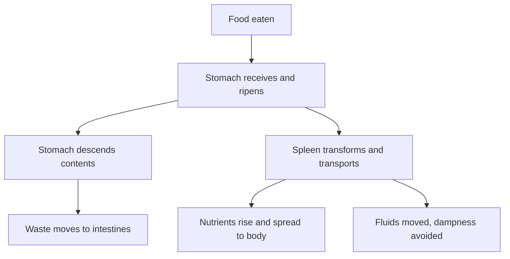
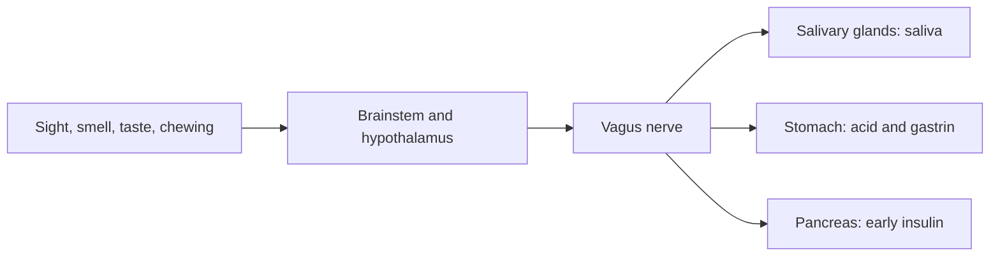
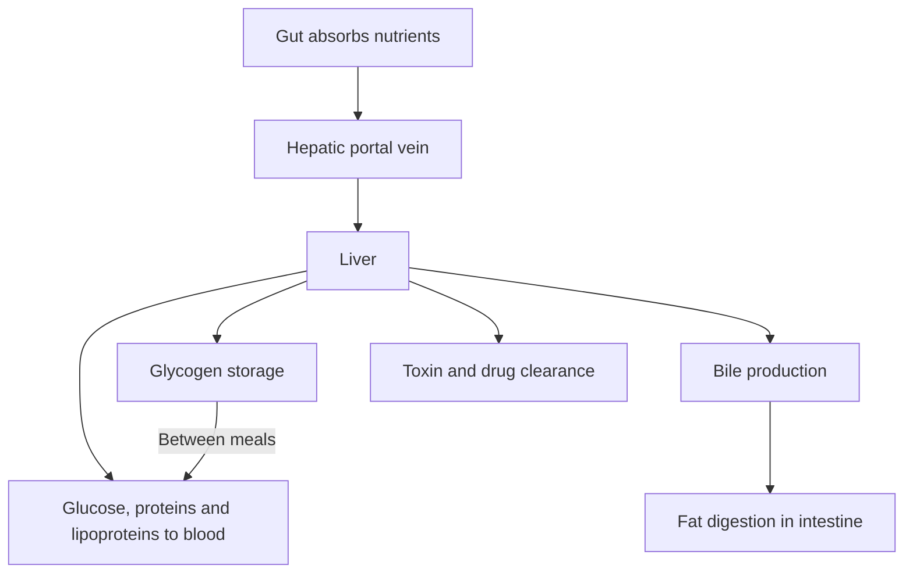
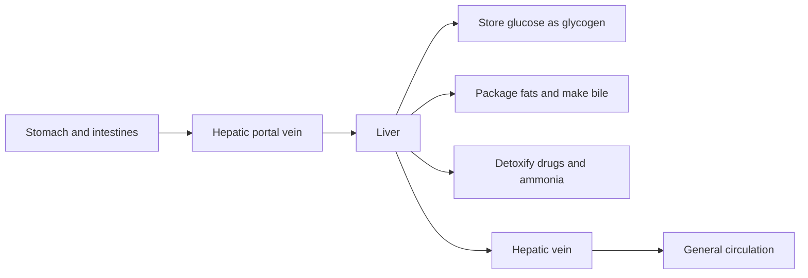

# Concept-Book Run

domain: /home/papagame/projects/digital-duck/cb-meta-health/public/domains/meta_health_ch05/input/graph.yaml
target: mindful_meal_protocol
started: 2026-11-24T14:05:31

## Teaching order (25 concepts)

- gastrointestinal_tract
- sympathetic_parasympathetic_balance
- regional_blood_flow_distribution
- splanchnic_circulation
- spleen_stomach_system
- prenatal_postnatal_qi
- smooth_muscle
- peristalsis_and_motility
- postprandial_hyperemia
- spleen_transformation_transport
- cardiovascular_load_of_digestion
- cephalic_phase_digestion
- liver_metabolic_role
- mastication
- eating_as_internal_exercise
- hepatic_first_pass_processing
- stomach_receiving_ripening
- ascending_clear_descending_turbid
- postprandial_glucose_response
- satiety_signaling
- digestive_load_pacing
- digestive_overtraining
- digestive_warm_up
- post_meal_gentle_movement
- mindful_meal_protocol

### gastrointestinal_tract (0.5s)

## The Gastrointestinal Tract

The **gastrointestinal (GI) tract** is a continuous tube, roughly 7–9 m long in a living adult, that runs from mouth to anus. Its job is to break food into molecules small enough to cross the gut wall (digestion), move those molecules into the blood and lymph (absorption), and expel what is left. The tract itself includes the mouth, esophagus, stomach, small intestine, and large intestine. The liver and pancreas are *accessory organs*: food never passes through them, but they deliver secretions into the tract.

### Organs and their roles

| Region | Main function | Key detail |
|---|---|---|
| Mouth | Chewing; starch digestion begins | Salivary amylase |
| Esophagus | Transport by peristalsis | Wave-like muscle contraction |
| Stomach | Mixing, protein digestion | Acid, pH about 1.5–3.5; pepsin |
| Small intestine | Most digestion and absorption | Duodenum, jejunum, ileum; villi enlarge surface area |
| Large intestine | Water and electrolyte reabsorption; gut bacteria | Forms feces |
| Liver | Makes bile; processes absorbed nutrients | Bile emulsifies fats |
| Pancreas | Secretes digestive enzymes and bicarbonate | Neutralizes stomach acid |

Chemical digestion is largely a division of labor by nutrient. Amylase and other carbohydrases break starch into sugars, proteases (pepsin, trypsin) break proteins into amino acids and short peptides, and lipase, aided by bile, breaks fats into fatty acids and monoglycerides.

### Worked example: following a meal

Take a cheese sandwich. In the mouth, chewing and amylase begin breaking down the bread's starch. The bolus travels down the esophagus in a few seconds. In the stomach, acid and pepsin start on the protein in the cheese, and the churning produces a semi-liquid called chyme. Gastric emptying of a mixed meal typically takes 2–4 hours; fat slows it.

In the duodenum, chyme meets pancreatic enzymes, bicarbonate (which raises pH toward neutral), and bile from the liver (stored in the gallbladder). The fat in the cheese is emulsified and digested here. Most absorption happens in the jejunum and ileum. Glucose and amino acids enter capillaries and travel through the portal vein to the liver, which regulates what reaches the general circulation. The leftover water and fiber enter the large intestine, where water is reabsorbed and bacteria ferment some fiber. Total transit from mouth to exit commonly ranges from 24 to 72 hours.

### Problem-solving application

**Problem:** A patient has had the gallbladder removed and now has greasy, pale stools after high-fat meals. Which step of digestion is affected, and what dietary adjustment helps?

**Reasoning:**
1. Pale, fatty stool signals unabsorbed fat.
2. Fat digestion needs bile to emulsify fat into small droplets so lipase can act on them.
3. Without the gallbladder, the liver still makes bile, but it can no longer be stored and released in a concentrated burst when a fatty meal arrives.
4. Large fat loads therefore overwhelm the available bile.

**Solution:** Eating smaller, lower-fat meals spread through the day matches fat intake to the steadier bile supply. Persistent symptoms warrant medical evaluation, since other causes, such as pancreatic enzyme insufficiency, produce a similar picture.

**Check yourself:** If the pancreas failed to release bicarbonate, which enzymes in the duodenum would work poorly, and why? (Answer: the pancreatic and intestinal enzymes, because they need a near-neutral pH, and unneutralized stomach acid would inactivate them.)

### sympathetic_parasympathetic_balance (0.5s)

## Sympathetic–Parasympathetic Balance

The autonomic nervous system controls involuntary functions such as heart rate, digestion, and pupil size. It has two main branches that often act in opposition. The **sympathetic** branch ("fight-or-flight") mobilizes energy for action. It raises heart rate and blood pressure, dilates airways, releases glucose from the liver, and diverts blood to skeletal muscle. The **parasympathetic** branch ("rest-and-digest") favors recovery. It slows the heart, stimulates digestion, and conserves energy. The two branches are not an on/off pair. Both are active at all times, and the body's state at any moment reflects their relative influence.

The heart shows this clearly. Left alone, the sinoatrial node fires about 100 times per minute. The resting rate of about 60–80 beats per minute is lower because the vagus nerve (parasympathetic) continuously slows it. Strong sympathetic activation can push the rate toward 180–200 beats per minute during hard exercise.

### Worked example

A 20-year-old student has a resting heart rate of 68 beats per minute. They start a run, and after 5 minutes their rate is 150 beats per minute. Cardiac output is heart rate times stroke volume. Take a resting stroke volume of 70 mL and an exercise stroke volume of 100 mL.

- Resting: $68 \times 70\ \text{mL} = 4{,}760\ \text{mL/min} \approx 4.8\ \text{L/min}$
- Running: $150 \times 100\ \text{mL} = 15{,}000\ \text{mL/min} = 15\ \text{L/min}$

Cardiac output roughly tripled. Early in the run, most of the rate increase comes from withdrawing parasympathetic (vagal) slowing. Sympathetic stimulation then adds to it as intensity climbs. After the run, the vagal influence returns and heart rate falls over several minutes.

### Problem-solving application

Heart rate recovery is a practical index of this balance. Suppose an athlete finishes a test with a heart rate of 170 beats per minute. One minute later it is 140 beats per minute, so the drop is 30 beats per minute. Faster recovery generally reflects stronger parasympathetic reactivation. A drop of more than about 12–20 beats in the first minute is typically seen in well-conditioned people, while a smaller drop is associated with lower fitness or higher cardiovascular risk. Interpret a single measurement cautiously, because hydration, caffeine, sleep, and stress all shift the balance.

The same logic applies to daily life.

| Situation | Dominant branch | Typical effects |
|---|---|---|
| Sprinting, exam panic | Sympathetic | Fast pulse, dry mouth, slowed digestion |
| After a meal, quiet reading | Parasympathetic | Slower pulse, active gut, constricted pupils |
| Chronic stress, poor sleep | Persistent sympathetic bias | Elevated resting heart rate, digestive upset |

This explains why slow, controlled breathing can calm a racing pulse. Exhaling raises vagal activity, which slows the heart. In TCM, a similar contrast is described between states of tension and calm, but the physiological account above rests on measurable nerve activity and does not require that framework.

### Check your understanding

A person's resting heart rate falls from 75 to 62 beats per minute after eight weeks of endurance training. Which branch's influence on the sinoatrial node has most likely increased at rest? (Answer: the parasympathetic branch, through stronger vagal slowing.)

### regional_blood_flow_distribution (0.6s)

## Regional Blood-Flow Distribution

**Definition.** Cardiac output is the volume of blood the heart pumps per minute. At any moment it is divided among the organs and tissues, and the division is not fixed. *Regional blood-flow distribution* is the share of cardiac output each organ receives. The body changes these shares to match each tissue's current metabolic demand. The mechanism is vasodilation in the tissues that need more blood and vasoconstriction in those that can wait. Because the total is limited, extra flow to one region usually means less flow to another.

At rest in a healthy adult, cardiac output is about 5 L/min. A typical split is shown below. Values are approximate and vary between people.

| Region | Resting flow (mL/min) | Share |
|---|---|---|
| Digestive organs and liver | 1,400 | 28% |
| Kidneys | 1,100 | 22% |
| Skeletal muscle | 1,000 | 20% |
| Brain | 750 | 15% |
| Skin, heart, other | 750 | 15% |

**Worked example.** During hard cycling, cardiac output rises to about 20 L/min, and about 80% goes to working muscle. Compare muscle flow before and after:

$$
\text{Rest: } 0.20 \times 5000 = 1000 \text{ mL/min}
$$

$$
\text{Exercise: } 0.80 \times 20000 = 16000 \text{ mL/min}
$$

Muscle flow rises 16-fold. The share rose only 4-fold (from 20% to 80%), and total output rose 4-fold. The two increases multiply: $4 \times 4 = 16$.

Now check the other organs. About 20% of output remains for everything else:

$$
0.20 \times 20000 = 4000 \text{ mL/min}
$$

At rest, those organs received $5000 - 1000 = 4000$ mL/min. Their absolute flow is about the same as before. Their *share* fell from 80% to 20%, while their flow was roughly maintained. In practice, gut and kidney flow do drop during hard exercise, and the skin gets a larger share for cooling. The brain's flow is held nearly constant throughout.

**Problem-solving application.** Suppose a person eats a large meal and then runs hard. Digestive flow wants to rise after eating, and working muscle needs most of the output. Both regions compete for a limited supply. Several effects follow:

- Sympathetic nervous activity constricts gut vessels, so digestion slows. This is one reason heavy exercise right after a large meal can cause cramping or nausea.
- Muscle vessels dilate in response to local chemical signals such as rising carbon dioxide, potassium, and falling oxygen. This is called active hyperemia.
- Brain flow stays protected, so dizziness appears only when total output cannot keep up.

To solve problems of this type, follow these steps:

1. Write down total cardiac output for the condition.
2. Convert each region's percentage share to mL/min.
3. Subtract the muscle flow from the total to find what remains for all other organs.
4. Compare with resting values to see which organs lost flow and which merely lost share.

Try it: if a trained athlete reaches 30 L/min with 85% going to muscle, muscle flow is $0.85 \times 30000 = 25500$ mL/min, leaving 4500 mL/min for everything else. That is more than the 4000 mL/min those organs received at rest, so the extra output is large enough to feed the muscles without starving the rest of the body.

### splanchnic_circulation (0.6s)

## The Splanchnic Circulation

The **splanchnic circulation** is the blood supply to the abdominal digestive organs: the stomach, intestines, pancreas, spleen and liver. At rest it receives roughly 25% of cardiac output, even though these organs make up only a small fraction of body mass. After a meal, that share rises substantially.

### Structure

Three arteries branching from the abdominal aorta supply the region: the celiac trunk (stomach, spleen, pancreas, upper liver), the superior mesenteric artery (small intestine and proximal colon) and the inferior mesenteric artery (distal colon). Blood leaving the gut does not return directly to the heart. Instead, the **hepatic portal vein** carries nutrient-rich blood to the liver first. The liver therefore has a dual supply: about 75% of its inflow comes from the portal vein (low oxygen, high nutrient content) and about 25% from the hepatic artery (oxygen-rich). Hepatic veins then drain into the inferior vena cava.

The splanchnic bed is also a major **blood reservoir**. Its highly compliant veins hold roughly 20–25% of total blood volume and can release part of it back into the central circulation when needed.

### Worked example

Suppose a resting adult has a cardiac output of 5.0 L/min.

- Splanchnic flow at 25%: $0.25 \times 5.0 = 1.25$ L/min.
- Portal vein share of liver inflow (about 75% of the liver's total): if total hepatic blood flow is 1.25 L/min, the portal vein delivers about $0.75 \times 1.25 \approx 0.94$ L/min, and the hepatic artery about 0.31 L/min.

After a large meal, splanchnic flow can rise to roughly 30–35% of cardiac output, or about 1.5–1.75 L/min. This supports secretion, motility and absorption.

### Problem-solving application

Consider two situations in which the body must redistribute blood.

**Exercise.** Working muscles need more oxygen. Sympathetic nervous activity constricts splanchnic arterioles and veins. Flow to the gut can fall to roughly 20% or less of its resting value, freeing blood for muscle and skin. Constricting the veins also squeezes stored blood into the circulation. This explains why eating a heavy meal just before hard exercise can cause cramping or nausea: the two systems compete for limited cardiac output.

**Hemorrhage or standing up quickly.** When blood pressure drops, the baroreceptor reflex triggers splanchnic vasoconstriction. This shifts blood toward the brain and heart. It buys time, but prolonged constriction can injure the gut lining. This is one reason severe shock can lead to intestinal ischemia.

**Clinical link.** Because the portal vein routes absorbed substances through the liver first, many orally taken drugs are partly metabolized before reaching the general circulation (the *first-pass effect*). This is why some medications need higher oral doses than intravenous ones.

### Key takeaways

- The splanchnic bed gets about 25% of resting cardiac output, more after eating.
- The liver is fed by both the portal vein (about 75%) and the hepatic artery (about 25%).
- The bed acts as an adjustable blood reservoir, so it is the first place the body borrows from during exercise or blood loss.

### spleen_stomach_system (0.6s)

## The Spleen–Stomach System (脾胃)

**Definition.** In Traditional Chinese Medicine (TCM), the Spleen–Stomach system (脾胃, *pi wei*) is the functional unit of digestion and nutrient distribution. It corresponds to the Earth phase and the middle burner (中焦), the region of the trunk between the diaphragm and the navel. TCM holds that the Stomach "receives and ripens" food, and the Spleen "transforms and transports" the resulting nutrients to the rest of the body. TCM organ names refer to functional systems, not only to anatomical organs. The TCM Spleen therefore covers roles that biomedicine assigns to the pancreas, the small intestine, and part of the circulatory and immune systems.

The two parts work as a pair. The Stomach is described as descending, moving food downward. The Spleen is described as ascending, lifting nutrients upward. In TCM, a disturbance in this pairing shows up as symptoms such as bloating, loose stools, poor appetite, fatigue, and belching or nausea.

**Biomedical counterpart.** The Stomach's role matches gastric function. Food is churned and mixed with hydrochloric acid (pH about 1.5–3.5) and pepsin, and the stomach empties into the small intestine over roughly 2–4 hours after a mixed meal. Absorption of nutrients then takes place mainly in the small intestine. Clinically, most of what TCM calls Spleen–Stomach disharmony overlaps with functional dyspepsia, irritable bowel syndrome, and malabsorption.

**Worked example.** A student eats a large, fatty lunch at 12:30 and by 2:00 pm reports bloating, heaviness, and sleepiness. A TCM practitioner would say the Stomach has been overloaded and the Spleen cannot transform the food fast enough. In physiological terms, fat slows gastric emptying, because fat in the duodenum triggers the hormone cholecystokinin, which delays the stomach from emptying. The meal sits in the stomach longer, and the fullness and drowsiness follow. The two descriptions arrive at the same practical advice: smaller portions and less fat at one sitting.

**Problem-solving application.** Suppose a person has loose stools, low appetite, and afternoon fatigue for several weeks. Work through the case in steps:

1. **Sort the symptoms.** Mark which are digestive (stools, appetite) and which are systemic (fatigue).
2. **Check red flags first.** Unintentional weight loss, blood in the stool, persistent vomiting, or fever need medical evaluation, not self-management.
3. **Review the diet.** Look at meal timing, portion size, fat and sugar load, and cold or highly processed foods.
4. **Test one change at a time.** For example, eat regular, moderate meals for two weeks and log the symptoms.

| TCM pattern | Typical signs | Biomedical reading to consider |
|---|---|---|
| Spleen weakness | Loose stools, fatigue | Malabsorption, IBS, anemia |
| Stomach overload | Bloating, belching | Overeating, slow gastric emptying |
| Stomach rebellion | Nausea, reflux | Gastroesophageal reflux |

TCM's dietary suggestions, such as regular meals and moderate portions, are consistent with ordinary nutrition advice. Claims that specific herbs repair a "weak Spleen" have limited and mixed trial evidence, so persistent symptoms should be evaluated by a physician.

*In TCM, the Stomach receives food and sends it downward, while the Spleen transforms food into nutrients and distributes them upward.*

### prenatal_postnatal_qi (0.6s)

## Prenatal and Postnatal Qi (先天与后天)

**Definition.** TCM divides the body's qi by source. *Prenatal qi* (先天之气) is the constitutional endowment received from one's parents at conception. TCM holds that it is stored mainly in the Kidneys and sets a person's baseline constitution. *Postnatal qi* (后天之气) is what the body makes after birth. The Spleen and Stomach turn food and drink into qi and blood each day, and the Lungs add qi drawn from inhaled air. TCM describes the two as working together. Prenatal qi is a fixed starting reserve that cannot be replaced. Postnatal qi is a daily income that can be improved, and TCM holds that it also protects the reserve from being drawn down too fast. These are TCM explanatory concepts. They do not correspond to a measured physiological quantity. The modern parts of this section rest on ordinary nutrition science.

**Worked example.** Compare two 20-year-olds with the same TCM-described constitution.

| | Student A | Student B |
|---|---|---|
| Meals | Regular, three a day, mixed foods | Skips breakfast, one large late meal, energy drinks |
| Sleep | 8 hours | 4–5 hours |
| Typical pattern | Steady energy, normal appetite | Fatigue after meals, bloating, loose stools |

TCM would say Student A's Spleen and Stomach are producing enough postnatal qi. Student B's daily supply is weak, which is the pattern called Spleen qi deficiency (脾气虚). In TCM, when the daily supply runs short for long enough, the body is thought to start drawing on prenatal reserves, so the problem is expected to worsen with time.

The physiological picture needs no TCM theory. Student B is eating irregularly, sleeping too little, and probably getting too few calories or too little protein in the daytime. Fatigue and digestive upset are expected results of those habits.

**Problem-solving application.** A patient reports afternoon fatigue, poor appetite, and loose stools. How would a TCM practitioner reason, and how can you check it against measurable facts?

1. *Identify which source is failing.* Symptoms that follow meals point to a postnatal (Spleen and Stomach) problem. Slow growth, early frailty, or weak hearing and bones point to prenatal (Kidney) constitution.
2. *Intervene on what can change.* Only postnatal qi can be improved. The usual advice is regular warm meals, enough protein and calories, and adequate sleep.
3. *Test the hypothesis with data.* Estimate energy needs. A woman who needs about 2,000 kcal a day but eats about 1,200 kcal has a deficit of 800 kcal, a more than adequate reason for fatigue. Check for anemia or thyroid problems, since persistent symptoms may have a medical cause that diet cannot fix.

The practical value of the idea is its emphasis on consistent daily nourishment. The claim that a fixed "prenatal reserve" is being depleted has no direct scientific support. Fatigue that persists despite good eating and sleep should be evaluated by a physician, not explained by qi theory alone.

### smooth_muscle (0.8s)

## Smooth Muscle

**Smooth muscle** is involuntary muscle found in the walls of hollow organs: the gut, blood vessels, airways, bladder, and uterus. Unlike skeletal muscle, it is not under conscious control. It is regulated by the autonomic nervous system, hormones, and local chemical signals. Its cells are small and spindle-shaped, each with a single nucleus. They lack the regular banding (striations) seen in skeletal and cardiac muscle. Smooth muscle contracts more slowly than skeletal muscle, but it can hold tension for long periods at low energy cost.

Two features matter most for problem solving:

1. **Rhythmic activity.** In the gut, pacemaker cells generate slow waves of electrical activity. In the small intestine these occur about 12 times per minute. Contraction happens when a slow wave reaches threshold, so the slow-wave rate sets the maximum contraction rate.
2. **Control of flow.** In blood vessels, smooth muscle in the walls sets the vessel's radius. Resistance to flow depends very steeply on radius, as Poiseuille's law shows:

$$R \propto \frac{1}{r^4}$$

### Worked example

A small artery constricts so that its radius falls to 80% of its original value ($r_{\text{new}} = 0.8\,r$). By what factor does its resistance change, assuming length and blood viscosity are unchanged?

$$\frac{R_{\text{new}}}{R} = \frac{1}{(0.8)^4} = \frac{1}{0.4096} \approx 2.44$$

A 20% reduction in radius raises resistance about 2.4-fold. If the pressure difference stays the same, flow through that vessel drops to roughly 41% of its original value, because flow is the pressure difference divided by resistance.

### Problem-solving application

Smooth muscle explains many everyday and clinical observations:

| Situation | Smooth muscle response | Result |
|---|---|---|
| Cold exposure | Skin arterioles constrict | Less blood reaches the skin, so less heat is lost |
| Exercise | Arterioles in working skeletal muscle relax, while those in the gut constrict | Blood is redirected to where oxygen demand is highest |
| Asthma attack | Bronchial smooth muscle contracts | Airways narrow and airflow falls sharply, as the radius relationship above predicts |
| Eating a meal | Rhythmic gut contractions (peristalsis and segmentation) | Food is mixed with digestive juices and moved along |

Drugs often work by targeting smooth muscle. Inhaled bronchodilators such as albuterol relax airway smooth muscle. Many blood pressure medications relax vascular smooth muscle, which lowers resistance. By the fourth-power relationship, even a small increase in vessel radius produces a large drop in resistance.

**Try it:** A bronchiole narrows to 50% of its radius during an asthma attack. By what factor does its resistance to airflow rise? (Answer: $1/(0.5)^4 = 16$.) Airway flow is more complicated than flow in a smooth rigid tube, but this approximation shows why modest narrowing causes severe breathing difficulty.

### peristalsis_and_motility (0.6s)

## Peristalsis and Gut Motility

**Definition.** Gut motility is the movement of the digestive tract's smooth muscle, which mixes food with secretions and propels it from mouth to anus. The gut is roughly 7–9 m long in a living adult. Peristalsis is the main propulsive pattern. The circular muscle behind a bolus of food contracts, and the longitudinal muscle ahead of it contracts and shortens, so the bolus is pushed forward. Segmentation is a second pattern in the small intestine. Rings of contraction form and relax in alternating places, which churns the contents against the lining without moving them far.

Control is layered. The enteric nervous system, embedded in the gut wall, runs the reflex on its own. The parasympathetic system (mainly the vagus nerve) strengthens motility, which is why "rest and digest" is an accurate phrase. Sympathetic activity during stress or fear inhibits it. Blood is diverted away from the gut, and transit slows or becomes erratic. Some people respond to stress with the opposite effect, which is faster transit and urgency.

**Worked example.** Food does not move through every region at the same speed. Typical transit times in healthy adults are:

| Region | Typical transit time |
|---|---|
| Stomach emptying (mixed meal) | 2–4 hours |
| Small intestine | 3–5 hours |
| Colon | 20–60 hours |

Suppose a meal is eaten at 12:00. At the typical times, it has left the stomach by about 15:00 and reached the colon by about 19:00. Most of the remaining time is spent in the colon, so total transit is usually 1–3 days. Peristaltic waves in the small intestine travel at only about 1–2 cm per second. The wave itself is quick. The slow overall transit comes from the many pauses and from segmentation.

**Problem-solving application.** A student has constipation during exam week. They sleep little, skip breakfast, and eat little fibre. Use the mechanisms above to identify the contributing factors and a response for each.

1. *Stress (sympathetic dominance).* Slow, regular breathing and exercise such as a 20–30 minute walk shift balance toward parasympathetic activity.
2. *Skipped breakfast.* Eating, especially a morning meal, triggers the gastrocolic reflex. Stretch in the stomach prompts colonic contractions. Skipping breakfast removes the strongest daily trigger for them.
3. *Low fibre and low fluid.* Fibre adds bulk and holds water in the stool. A larger, softer stool stretches the gut wall more, which stimulates peristalsis. Adults commonly aim for about 25–30 g of fibre per day, increased gradually.
4. *Ignoring the urge.* Repeatedly delaying defecation can blunt the reflex.

In TCM, the Spleen and Stomach are said to govern "transforming and transporting" food, and stress is said to disturb Liver qi and thereby digestion. This is an explanatory framework. The physiological account above is the one supported by measurement.

**Check your understanding.** A person takes an anticholinergic medication, which blocks parasympathetic signalling. Predict the effect on motility and explain your reasoning. (Motility slows, because the parasympathetic input that strengthens peristalsis is reduced. Constipation is a common side effect of these drugs.)

### postprandial_hyperemia (0.5s)

## Postprandial Hyperemia

**Definition.** Postprandial hyperemia (餐后充血) is the rise in blood flow to the digestive tract after eating. Within minutes of a meal, arterioles in the stomach and intestinal wall dilate, driven by local signals (nutrients in the lumen, gut hormones, and metabolic byproducts) and by parasympathetic activity. Flow in the superior mesenteric artery, which supplies most of the small intestine, can roughly double and stay elevated for one to three hours. Cardiac output rises to help supply this demand.

**Worked example.** Fasting superior mesenteric flow is often about 500 mL/min. Suppose it doubles to 1,000 mL/min after a large meal.

The extra gut flow is:

$$\Delta Q = 1000 - 500 = 500 \text{ mL/min}$$

Cardiac output is the product of heart rate and stroke volume:

$$CO = HR \times SV$$

Take a resting person with $HR = 70$ beats/min and $SV = 71$ mL, so $CO \approx 5{,}000$ mL/min. If the heart supplied the whole extra 500 mL/min, cardiac output would need to rise by about 10%. Suppose heart rate rises to 77 beats/min, which is 10% higher, with stroke volume unchanged. Then:

$$CO = 77 \times 71 \approx 5{,}470 \text{ mL/min}$$

That is about 470 mL/min more, close to the extra gut flow. In practice, part of the supply also comes from redistribution. Vasoconstriction in skeletal muscle and skin diverts some blood toward the gut.

**Problem-solving application.** Several practical questions follow from this.

*Exercise after eating.* Muscle and gut compete for the same cardiac output. Hard exercise right after a large meal asks the heart to supply both. Athletes commonly report cramping or nausea in this situation. The mechanism is plausible, but evidence that meal timing causes cramps is mixed. Light activity such as walking is generally well tolerated.

*Postprandial hypotension.* In older adults, and in people with autonomic dysfunction or diabetes, the baroreflex may not compensate for blood pooled in the gut. Blood pressure then falls after meals, causing dizziness or fainting. A common clinical rule of thumb is a systolic drop of 20 mmHg or more within two hours of eating. Practical countermeasures include smaller, lower-carbohydrate meals, drinking water before eating, and sitting or resting after meals.

*Mesenteric ischemia.* In people with narrowed mesenteric arteries, supply cannot rise to meet the post-meal demand. This produces abdominal pain 15 to 60 minutes after eating, often with fear of food and weight loss. The pattern is a diagnostic clue, because pain that scales with meal size points to a flow limit.

**Link to TCM.** In TCM, the advice to rest quietly after eating reflects a similar idea: that digestion needs resources directed to the "spleen and stomach" (脾胃). The physiological account above, not the TCM framework, is what explains why rest helps in cases like postprandial hypotension.

**Check yourself.** If a meal raises mesenteric flow by 600 mL/min and cardiac output rises by only 300 mL/min, where does the remaining 300 mL/min come from? (Answer: redistribution from other vascular beds, such as muscle and skin.)

### spleen_transformation_transport (0.6s)

## The Spleen Transforms and Transports (脾主运化)

**Definition.** In Traditional Chinese Medicine (TCM), the Spleen (脾) is a functional system, not the anatomical organ of the same name. TCM holds that its central job is *transformation and transport* (运化). The Spleen extracts the refined essence (水谷精微) from food and drink, then sends it upward to the Lung and Heart, where it becomes qi and blood. Two tasks are bundled together:

- **Transforming food:** breaking down what is eaten into usable essence and waste.
- **Transforming fluids:** moving water through the body and preventing it from pooling.

In TCM, this work is powered by Spleen yang (脾阳), the warming, activating aspect of the Spleen. When Spleen yang is weak, both tasks slow down.

**Worked example.** A 20-year-old student skips breakfast, lives on iced drinks and cold takeout during exams, and sleeps little. After two weeks they report:

| Symptom | TCM interpretation |
|---|---|
| Bloating after meals, loose stools | Food is not being transformed well |
| Fatigue, pale face | Too little essence reaches qi and blood |
| Heavy limbs, a sticky feeling, mild puffy ankles | Fluids are not being transported and accumulate as "dampness" |
| Cold hands, preference for warm food | Spleen yang is weak |

TCM practitioners would describe this as Spleen qi and yang deficiency. They would suggest warm, cooked, regular meals, with less cold food and drink.

**Problem-solving application.** The skill here is separating the TCM explanation from the physiology you can measure, so you can reason about both.

*Step 1: Map the TCM functions to physiology.* "Transforming food" overlaps with digestion and absorption. For example, a typical adult takes in about 2,000 kcal per day, and the gut absorbs most of it. "Transporting fluids" loosely overlaps with fluid balance, which involves the kidneys, the lymphatics, and the pressure balance across capillary walls.

*Step 2: Screen for conditions that need medical care.* Fatigue, bloating, loose stools, and ankle swelling can also come from anemia, celiac disease, thyroid disease, heart failure, or kidney disease. Persistent or worsening symptoms call for a physician and basic tests, such as blood count, thyroid hormone, and kidney function, before attributing them to a pattern.

*Step 3: Apply the low-risk part.* Regular meals, adequate sleep, and not relying on very cold, highly processed food are reasonable habits on general nutrition grounds. This holds whether or not the Spleen model is correct.

**Evidence note.** The Spleen as a functional system is a TCM framework, and its specific claims, such as Spleen yang powering digestion, have not been established by physiological research. Treat it as a way of organizing symptoms and habits, not as a proven mechanism.

**Check yourself.** A person has loose stools, fatigue, and unintended weight loss over three months. Why is it unwise to treat this only as "Spleen deficiency"? (Hint: weight loss without trying is a warning sign that needs medical evaluation.)

### cardiovascular_load_of_digestion (0.6s)

## The Cardiovascular Load of Digestion

**Definition.** Digestion is metabolic work, and the circulation has to support it. After a meal, blood flow to the stomach and intestines (the splanchnic circulation) rises sharply. Cardiac output, the volume of blood the heart pumps per minute, increases to supply this flow, and heart rate typically rises modestly. The cardiovascular load of digestion is this extra demand on the heart and blood vessels. It is larger after big meals, and especially after meals rich in carbohydrate.

Cardiac output is a standard quantity:

$$CO = HR \times SV$$

where $HR$ is heart rate in beats per minute and $SV$ is stroke volume in millilitres per beat.

**Worked example.** Before lunch, a resting adult has $HR = 65$ beats/min and $SV = 77$ mL, so

$$CO = 65 \times 77 \approx 5000 \text{ mL/min} = 5.0 \text{ L/min}.$$

After a large meal, suppose heart rate rises to 75 beats/min and stroke volume to 80 mL:

$$CO = 75 \times 80 = 6000 \text{ mL/min} = 6.0 \text{ L/min}.$$

That is a 20% increase in cardiac output, even though the person is sitting still. Much of the added flow goes to the gut, which can receive well over a litre of blood per minute at the peak of digestion. The exact values vary with meal size, composition, and the individual.

**Problem-solving application 1: exercise after eating.** Hard exercise also demands a large share of cardiac output, because working muscles need oxygen. The body cannot fully meet both demands. Blood vessels in the gut and the muscles compete, and the heart must work harder to cover both. In practice, a person who runs hard right after a large meal may feel sluggish, cramped, or nauseated, and the heart rate for a given pace is higher than usual. A practical rule is to leave 2–3 hours after a large meal before vigorous exercise, and 30–60 minutes after a small snack. Light walking is generally fine and may even help with glucose control.

**Problem-solving application 2: dizziness after meals.** In healthy people, the nervous system compensates for pooled blood in the gut by narrowing other vessels and raising heart rate, so blood pressure holds steady. In some older adults, and in people with diabetes or Parkinson disease, this reflex is blunted. Blood pressure then falls after eating, a condition called postprandial hypotension, defined clinically as a drop in systolic pressure of at least 20 mmHg within two hours of a meal. Symptoms include dizziness, faintness, and falls.

Suppose an older patient has a systolic pressure of 135 mmHg before lunch and 110 mmHg forty minutes afterward. The drop is $135 - 110 = 25$ mmHg, which meets the definition. Common strategies, which a clinician should confirm for the individual, include:

- eating smaller, more frequent meals;
- limiting rapidly absorbed carbohydrates;
- drinking water before meals;
- sitting or lying down for a while after eating;
- standing up slowly.

**Key idea.** Digestion is not passive. It is a measurable cardiovascular task that adds to whatever else the body is doing.

### cephalic_phase_digestion (0.6s)

## The Cephalic Phase of Digestion

**Definition.** The cephalic phase ("cephalic" means "of the head") is the first stage of digestion. It begins before any food reaches the stomach. The sight, smell, thought, or taste of food, along with the act of chewing, activates the brain. The brain sends signals down the vagus nerve (cranial nerve X) to the salivary glands, stomach, and pancreas. The result is saliva, gastric acid, and a small early release of insulin, all produced in anticipation of a meal.

**How it works.** Sensory input reaches the hypothalamus and brainstem, which activate parasympathetic vagal fibers. At the stomach, the vagus releases acetylcholine and gastrin-releasing peptide. These stimulate parietal cells to secrete hydrochloric acid and G cells to release gastrin, which pushes acid output higher. At the pancreas, vagal input prompts a small early burst of insulin before blood glucose has risen. Experiments with "sham feeding" show the effect. Subjects chew and spit out food without swallowing, and their gastric acid output still reaches about 30–50% of the level seen after a real meal. The cephalic phase is therefore a real physiological response, not just a feeling.

**Worked example.** Suppose a person fasting overnight has a resting gastric acid output of about 2 mmol H⁺ per hour. While smelling and chewing a favorite food (without swallowing), their output rises to 8 mmol per hour. The percentage increase is

$$\frac{8 - 2}{2} \times 100\% = 300\%.$$

Nothing has entered the stomach, so the whole increase comes from vagal signaling. Meanwhile, saliva flow may rise from about 0.5 mL/min at rest to several mL/min during chewing, which brings amylase and lubrication to the mouth ahead of the food.

**Problem-solving application.** Use the concept to answer practical questions.

1. *Why does a vagotomy reduce acid secretion?* Cutting the vagus removes the cephalic signal. Historically, surgeons performed vagotomy to treat duodenal ulcers by lowering acid output.
2. *Why might eating while distracted by a screen cause discomfort or overeating?* Reduced attention to smell, taste, and chewing weakens the cephalic response. Digestion then starts less efficiently, and the satiety signals that follow are blunted. Evidence for the satiety effect is modest, but the mechanism is plausible.
3. *Why can chewing gum before surgery be a concern?* Gum stimulates saliva and some gastric secretion through the same pathway, which is a reason some anesthesia guidelines address it.
4. *Why might a person with an ulcer be advised to avoid the smell and sight of trigger foods when symptomatic?* Anticipatory acid release can aggravate symptoms.

The cephalic phase is followed by the gastric phase, when food stretches the stomach, and then the intestinal phase. Each phase builds on the one before it.

*Sensory cues activate the brain, which signals through the vagus nerve to prepare the mouth, stomach, and pancreas before food arrives.*

### liver_metabolic_role (0.6s)

## The Liver's Metabolic Role

The liver is the body's central chemical processing plant. Blood leaving the stomach and intestines does not go straight to the rest of the body. It first travels through the hepatic portal vein to the liver, which sorts, converts, stores and detoxifies what arrives. Four jobs matter most.

**1. Processing nutrients.** The liver converts absorbed sugars, amino acids and fats into forms the body can use. Fructose and galactose are converted to glucose. Excess amino acids lose their nitrogen, which is turned into urea for excretion by the kidneys. The liver also assembles fats into lipoproteins for transport and makes most blood proteins, such as albumin.

**2. Storing glycogen.** After a meal, the liver links glucose into glycogen. Between meals it breaks glycogen back down and releases glucose, which keeps blood glucose near 70–100 mg/dL. When glycogen runs low, as in prolonged fasting, the liver makes new glucose from amino acids, lactate and glycerol. This process is called gluconeogenesis.

**3. Making bile.** Hepatocytes (liver cells) produce roughly 500–1000 mL of bile per day. Bile salts emulsify dietary fat so that lipase can digest it. Bile also carries away bilirubin, a breakdown product of old red blood cells.

**4. Clearing toxins.** Liver enzymes chemically modify drugs, alcohol, ammonia and hormones so that bile or urine can remove them. Detoxification here means these specific enzyme reactions. Commercial "liver cleanse" products have no demonstrated benefit.

### Worked example

Glycogen storage is limited, and the numbers show why fasting matters. An adult liver holds about 100 g of glycogen. Glycogen yields about 4 kcal per gram, so:

$$100\ \text{g} \times 4\ \frac{\text{kcal}}{\text{g}} = 400\ \text{kcal}$$

The brain uses roughly 120 g of glucose per day. Liver glycogen alone would therefore last only about

$$\frac{100\ \text{g}}{120\ \text{g/day}} \approx 0.8\ \text{day}$$

if the brain were the only consumer. In practice, other tissues use glucose too, and the liver supplies it to the blood at a rate that depends on activity. Liver glycogen is therefore largely depleted within about 12–24 hours of fasting, and gluconeogenesis takes over.

### Problem-solving application

**Problem:** A person finishes an overnight fast of 14 hours with no food. Their blood glucose is still 85 mg/dL. Which liver processes explain this, and what changes if they then eat a carbohydrate meal?

**Solution:**
1. Early in the fast, the liver breaks down glycogen and releases glucose.
2. By 14 hours, glycogen is partly depleted, so gluconeogenesis supplies a growing share of the glucose.
3. After the meal, glucose and fructose arrive through the portal vein. The liver takes up a large fraction of the glucose and stores it as glycogen. It also converts fructose to glucose. This blunts the rise in blood glucose.
4. If glycogen stores are full, the liver converts the excess into fatty acids. This is one route to fatty liver when excess intake is chronic.

Blood glucose stays stable because the liver switches between storing and releasing glucose according to need.

### Diagram

*Nutrients from the gut pass through the liver, which stores, converts, secretes or clears them before they reach the general circulation.*

### mastication (0.6s)

## Chewing (Mastication)

**Mastication** (咀嚼) is the mechanical first stage of digestion. Teeth cut and grind food into small pieces, saliva moistens it, and the tongue shapes it into a soft mass called a *bolus* that can be swallowed safely. Chewing does three jobs at once:

1. **Mechanical breakdown.** Smaller pieces have more surface area, so digestive enzymes can reach more of the food.
2. **Chemical start.** Saliva contains *salivary amylase*, which begins splitting starch into shorter sugars. Saliva also contains lipase and mucus, which lubricates the bolus.
3. **Sensory feedback.** Taste, texture, and the effort of chewing give the brain time to register what is being eaten. Satiety signals, such as rising blood glucose and gut hormones, take roughly 15–20 minutes to build.

### Worked example: why smaller pieces digest faster

Take a cube of food 2 cm on each side. Its surface area is $6 \times 2^2 = 24\ \text{cm}^2$.

Cut it into 8 cubes of 1 cm per side. Each cube has a surface area of $6 \times 1^2 = 6\ \text{cm}^2$. The total is $8 \times 6 = 48\ \text{cm}^2$.

Halving the cube's edge length doubled the exposed surface area. Enzymes act only on surfaces, so this change speeds up digestion considerably. Real chewing reduces food to particles well under 1 mm, so the effect is far larger.

You can also test the starch effect yourself. Chew a plain cracker for 30–60 seconds without swallowing. It begins to taste faintly sweet as amylase converts starch into maltose.

### Problem-solving application: pacing a meal

**Problem.** A person eats a 600 kcal lunch in 8 minutes. They report feeling hungry again within an hour. What could they change?

**Reasoning.**

- Satiety signals take about 15–20 minutes to build. Finishing in 8 minutes means the meal is over before the signals can influence how much is eaten.
- If the person raises the time to 20 minutes, the same 600 kcal is eaten at a slower rate. The rate drops from $\frac{600\ \text{kcal}}{8\ \text{min}} = 75\ \text{kcal/min}$ to $\frac{600\ \text{kcal}}{20\ \text{min}} = 30\ \text{kcal/min}$.
- Practical methods are to put the fork down between bites, chew each bite until it is soft and uniform (often 20–30 chews for firm foods), and choose foods that need more chewing, such as whole vegetables and whole grains.

Studies generally find that slower eating and more chewing modestly reduce how much people eat in a sitting. The effect varies between individuals, so treat it as a useful habit, not a guarantee.

**Safety note.** Poor chewing matters beyond hunger. Large, poorly chewed pieces raise the risk of choking, and people with missing teeth or poorly fitting dentures may need softer foods or dental care.

In TCM, thorough chewing is also recommended to ease the load on the stomach. This fits with the physiological point above: food that is already broken down and mixed with saliva is easier to digest.

### Key takeaways

- Chewing increases surface area, begins starch digestion, and forms a safe bolus.
- Eating too fast outpaces satiety signals.
- Slowing down is a simple, low-cost way to improve digestion and manage intake.

### eating_as_internal_exercise (0.6s)

## Eating as Internal Exercise

**Definition.** Eating as internal exercise (饮食即内脏运动) is the idea that a meal is physical work for the body, not just fuel going in. After you eat, blood flow shifts toward the gut, smooth muscle in the stomach and intestines churns and propels food, and the liver processes the absorbed nutrients. In Traditional Chinese Medicine (TCM), this is described as firing up the Spleen–Stomach "engine." Like any workout, a meal calls for preparation, a sensible load and recovery.

**What the body is doing.** Digestion is measurable work:

- **Circulation.** Blood flow to the intestines rises substantially after a meal. Large meals can raise it to roughly double the fasting level for an hour or more.
- **Smooth muscle.** The stomach mixes food, and the intestines move it along by peristalsis. This effort scales with how much and how coarse the food is.
- **Metabolism.** The thermic effect of food is the energy spent digesting and processing a meal. It is usually about 5–10% of calories for carbohydrate and fat, and about 20–30% for protein.

**Worked example.** Suppose a 700 kcal dinner is 30% protein, 40% carbohydrate and 30% fat by calories.

- Protein: 210 kcal × 0.25 ≈ 52 kcal
- Carbohydrate: 280 kcal × 0.07 ≈ 20 kcal
- Fat: 210 kcal × 0.03 ≈ 6 kcal (using about 3% for fat)

Total digestive "work" ≈ 78 kcal, or about 11% of the meal. That is a real energy cost, comparable to a short brisk walk for many people.

**Problem-solving application.** Apply the workout analogy to three practical decisions:

| Workout principle | Eating equivalent |
|---|---|
| Warm-up | Sit down, slow your pace and chew thoroughly. Chewing reduces the mechanical load on the stomach. |
| Right load | Match portion size to need. A very large meal strains circulation and digestion, and people with heart disease may notice angina or lightheadedness afterward. |
| Recovery | Avoid intense exercise right after a big meal, since muscles and gut compete for blood. A gentle 10–15 minute walk, however, is associated with better post-meal blood glucose. |

*Scenario:* A student eats a very large lunch in five minutes and then feels sleepy and bloated. By the workout framing, the load was too high and the warm-up was missing. A fix is to split the meal into a main portion and a later snack, spend 15–20 minutes eating, and take a short walk afterward.

TCM holds that cold drinks and heavy, greasy meals "damage" the Spleen–Stomach. This is a traditional explanatory framework and is not an established physiological mechanism. The workout analogy itself is physiologically sound, because digestion does demand blood flow, muscle activity and metabolic energy.

**Check yourself.** Estimate the digestive energy cost of a 500 kcal meal that is entirely protein, using 25%. (Answer: about 125 kcal.) Why might such a meal feel "heavier" than a 500 kcal fat-dominant meal?

### hepatic_first_pass_processing (0.7s)

## First-Pass Processing in the Liver

**Definition.** Blood leaving the stomach and intestines does not return directly to the heart. Instead, it drains into the **hepatic portal vein**, which carries absorbed nutrients to the liver first. There the liver screens, stores, converts, and packages them before they reach the general circulation. This routing is called *first-pass processing*. The same route applies to many orally taken drugs, so the liver can reduce a drug's dose before it reaches the rest of the body (the *first-pass effect*).

The liver's main jobs on this first pass:

| Nutrient arriving | Liver's action | Result |
|---|---|---|
| Glucose | Stored as glycogen (about 100 g in the liver) | Blood glucose is buffered after a meal |
| Dietary fat | Repackaged into lipoproteins; cholesterol made into bile | Fats can travel in blood; bile aids fat digestion |
| Amino acids | Used for proteins; excess nitrogen converted to urea | Ammonia is detoxified |
| Toxins, drugs, alcohol | Chemically modified by enzymes | Often less active or easier to excrete |

Note that most digested fat bypasses the portal vein. It enters lymph as chylomicrons and reaches the liver later, via the bloodstream.

**Worked example.** A person eats a meal with 75 g of carbohydrate, and about 60 g of it is absorbed as glucose. Suppose the liver takes up roughly one-third on the first pass.

$$60\ \text{g} \times \frac{1}{3} = 20\ \text{g glucose stored}$$

Carbohydrate yields about 4 kcal/g, so this is

$$20\ \text{g} \times 4\ \frac{\text{kcal}}{\text{g}} = 80\ \text{kcal}$$

stored as glycogen. The remaining 40 g enters general circulation, where muscle and other tissues take it up. Without this buffering, blood glucose would spike much higher after the meal.

**Problem-solving application.** Consider a drug with an oral dose of 100 mg. Assume 80% is absorbed from the gut, and the liver then removes 50% of that on the first pass. How much reaches the systemic circulation?

1. Absorbed: $100\ \text{mg} \times 0.80 = 80\ \text{mg}$
2. Survives the liver: $80\ \text{mg} \times (1 - 0.50) = 40\ \text{mg}$

Bioavailability is therefore

$$F = \frac{40\ \text{mg}}{100\ \text{mg}} = 0.40 = 40\%$$

This explains why some drugs are given by routes that bypass the portal vein. Nitroglycerin is placed under the tongue, and some medications are given by injection or patch. Those routes reach the heart before the liver, so smaller doses work.

The same logic explains why liver disease matters clinically. If the liver's capacity falls, as in cirrhosis, blood can shunt around it. Glucose regulation worsens, ammonia accumulates, and oral drugs become more potent than expected, so doses often need adjusting.

*Nutrient-rich blood from the gut passes through the liver before entering general circulation.*

### stomach_receiving_ripening (0.6s)

## The Stomach Receives and Ripens (胃主受纳)

**Definition.** In Traditional Chinese Medicine (TCM), the Stomach (胃) is described as the organ that receives food and drink (受纳) and "rots and ripens" it (腐熟), turning it into a partly broken-down, soupy mass that the Spleen can then transport onward. TCM holds that this is the first stage of digestion. Modern physiology agrees on the sequence, though not on the framework. The stomach stores a meal, churns it, and mixes it with hydrochloric acid and the enzyme pepsin. The result is called chyme, and the stomach releases it into the small intestine in small portions.

**Mapping the two descriptions.**

| TCM term | Plain meaning | Physiological counterpart |
|---|---|---|
| Receiving (受纳) | Taking in and holding food | Stomach relaxes to accommodate a meal (about 1 to 1.5 L at normal fullness) |
| Rotting and ripening (腐熟) | Breaking food down | Gastric acid (pH about 1.5 to 3.5), pepsin, and muscular churning |
| Descending (和降) | Sending contents downward | Gastric emptying through the pylorus |

In TCM, a Stomach that fails at these tasks is said to cause fullness, belching, nausea, or poor appetite. The words are different, but these are also the symptoms of delayed gastric emptying in modern medicine.

**Worked example.** A student eats a 600 kcal lunch of rice, chicken, and vegetables. Gastric emptying of a mixed solid meal proceeds at roughly 1 to 4 kcal per minute. This rate is set by the small intestine's feedback signals, which slow emptying when the incoming chyme is rich in fat or acidity. Take the midpoint, 2.5 kcal per minute:

$$t = \frac{600\ \text{kcal}}{2.5\ \text{kcal/min}} = 240\ \text{min} = 4\ \text{h}$$

So the stomach releases the meal over about 4 hours. The result agrees with the typical 3 to 5 hour range for a mixed meal. The same calculation at 1 kcal per minute (a fatty meal) gives 10 hours, which is too long to be realistic. This tells you that fat does not simply slow the rate in proportion. It also shows why a simple linear model is only a rough estimate.

**Problem-solving application.** Suppose a patient reports bloating and early fullness about 2 hours after a high-fat dinner, and wants to know whether this fits slow emptying. Use these steps:

1. **Estimate the load.** A 900 kcal high-fat meal empties more slowly, perhaps 1.5 to 2 kcal per minute.
2. **Compute the time.** $\frac{900}{2}= 450$ min, or about 7.5 hours. This is an overestimate, but it correctly predicts that food is still in the stomach at 2 hours.
3. **Decide what is expected.** Fullness at 2 hours is normal after such a meal, so it does not by itself indicate disease.
4. **Look for red flags.** Persistent fullness after small meals, repeated vomiting of undigested food, or weight loss should prompt a medical evaluation for gastroparesis or an obstruction.

In TCM practice, dietary advice for a "weak" Stomach (smaller meals, warm cooked food, avoiding greasy meals) overlaps with standard advice for slow emptying. The overlap in advice is practical. The TCM explanation of why it works, however, is not supported by physiological evidence.

### ascending_clear_descending_turbid (0.7s)

## Ascending the Clear, Descending the Turbid (升清降浊)

**Definition.** In Traditional Chinese Medicine (TCM), digestion is described as two coordinated directions of movement. The Spleen is said to lift the "clear" (清), meaning the refined nutrients extracted from food, upward toward the Lung and Heart, where they are distributed through the body. The Stomach is said to send the "turbid" (浊), meaning the food residue left after extraction, downward to the intestines for excretion. This pairing is called 升清降浊. TCM holds that when either direction fails or reverses, symptoms follow. The Spleen failing to lift is linked to fatigue, loose stools, and a heavy head. The Stomach failing to descend is linked to fullness, belching, nausea, or acid reflux.

The framework is a descriptive model, not a measured mechanism. The qualities it points to are real, though: gastric emptying, intestinal motility, and nutrient absorption. Its main use for a student is as a symptom-organizing scheme.

**Worked example.** A 20-year-old student eats a large, greasy late-night meal before an exam. Over the next hour they report:

| Symptom | Direction implicated (TCM) |
|---|---|
| Upper-abdominal fullness, frequent belching | Stomach qi not descending |
| Sour taste rising in the throat | Stomach qi rebelling upward |
| Sluggish thinking, heavy limbs next morning | Spleen failing to lift the clear |

In physiological terms, a high-fat meal slows gastric emptying, and lying down soon afterward promotes reflux. This matches the "failure to descend" pattern closely.

**Problem-solving application.** Suppose a classmate says, "I'm bloated after every lunch and feel drowsy by 2 p.m." Work through three steps:

1. **Sort the symptoms by direction.** Bloating and belching point to a descending problem. Drowsiness and heaviness point to a lifting problem.
2. **Look for habits that interfere with each direction.** Large portions, fast eating, and eating while stressed are commonly linked to poor gastric emptying. Heavy, greasy, or very sweet meals are linked to postprandial sleepiness.
3. **Test a change.** Halve the portion, add a 10–15 minute walk after eating, and keep a two-week symptom log. Walking has some support for speeding gastric emptying, so the change is low-risk and can be checked.

Be careful at the boundary. Persistent reflux, unintended weight loss, trouble swallowing, vomiting, or blood in the stool are not matters for lifestyle experiments. They need medical evaluation, because they can signal ulcers, gallbladder disease, or other conditions. The TCM scheme can organize what you notice, but it cannot replace a diagnosis.

**Key takeaway.** 升清降浊 describes digestion as two opposite movements, upward for nutrients and downward for waste. Upper-abdominal bloating and belching suggest a failure to descend. Heaviness and fatigue suggest a failure to lift. Treat the pattern as a way to structure observation, then test simple changes and escalate warning signs.

### postprandial_glucose_response (0.7s)

## The Post-Meal Glucose Response

After you eat, carbohydrates are digested into glucose, which enters the blood and raises blood glucose. The pancreas releases insulin, and tissues, especially muscle and liver, take up the glucose, so levels drift back toward baseline. This rise-and-fall pattern is the **post-meal (postprandial) glucose response**. In a healthy adult, fasting glucose is roughly 70–99 mg/dL, and it typically peaks 30–60 minutes after a meal, usually staying below about 140 mg/dL, before returning to baseline within 2–3 hours.

Four factors shape the curve:

| Factor | Effect on the curve |
|---|---|
| Meal composition | Refined carbohydrates are absorbed quickly and give a taller, earlier peak. Fiber, protein and fat slow absorption and flatten the peak. |
| Eating speed | Fast eating delivers glucose in a concentrated burst. Slower eating spreads it out. |
| Gastric emptying | The stomach releases food into the small intestine gradually. Slower emptying (as with fatty or fibrous meals) delays and lowers the peak. |
| Muscle activity | Contracting muscle takes up glucose largely without needing insulin, so even a short walk lowers the peak. |

### Worked example

A student's glucose is 90 mg/dL before eating. A continuous glucose monitor records two experiments with the same 60 g of carbohydrate.

- **Meal A:** white rice and juice, eaten in 8 minutes. Glucose peaks at 165 mg/dL after 40 minutes.
- **Meal B:** the same rice, eaten with beans, vegetables and chicken over 25 minutes, followed by a 10-minute walk. Glucose peaks at 125 mg/dL after 60 minutes.

The size of each spike is the peak minus baseline:

$$\Delta G_A = 165 - 90 = 75 \text{ mg/dL}, \qquad \Delta G_B = 125 - 90 = 35 \text{ mg/dL}$$

Meal B's spike is $\frac{35}{75} \approx 47\%$ of Meal A's, even though the carbohydrate load was identical. Fiber and protein, slower eating and the walk all contributed. The data cannot say how much each factor contributed, because they were changed together.

### Problem-solving application

Suppose you want to find which habit helps you most. Treat it as a controlled comparison:

1. Pick one reference meal and repeat it on separate days, at the same time of day and after a similar fasting period.
2. Change **one** variable per trial (for example, add a 10-minute walk, or eat the vegetables first).
3. Record baseline, peak, and time to return to baseline.
4. Compare spike sizes ($\Delta G$) across trials.

Sleep, stress and the previous day's exercise also shift glucose, so repeat each trial a few times before drawing conclusions.

This matters because large, repeated spikes are linked to metabolic strain. Frequent high peaks demand more insulin, and over years this is associated with insulin resistance and a higher risk of type 2 diabetes. A single spike after a celebratory meal is normal and not harmful. The concern is the pattern. People with diabetes or prediabetes should work with a clinician, since their thresholds and medication needs differ.

### satiety_signaling (0.7s)

## Satiety Signaling

**Satiety signaling** is the process by which the digestive tract tells the brain that enough food has been eaten. Two kinds of signals are involved:

- **Mechanical signals.** Stretch receptors in the stomach wall fire as the stomach fills and send the information to the brainstem through the vagus nerve.
- **Chemical signals.** Nutrients reaching the small intestine trigger the release of gut hormones. Cholecystokinin (CCK) is released in response to fat and protein. Glucagon-like peptide-1 (GLP-1) and peptide YY (PYY) are released by cells in the lower small intestine and colon. All three act on the hypothalamus and brainstem to reduce hunger and end the meal.

These signals take time to build. Fullness registers roughly 15–20 minutes after eating begins, so it lags behind the eating itself. A person who eats quickly can swallow far more food during that lag than the body would have asked for.

### Worked example

Two students, Ana and Ben, each eat a meal of the same food. Ana finishes in 10 minutes and Ben takes 30. Assume both eat at a constant rate and that fullness registers 20 minutes after they start.

Ben eats at 1,000 kcal per 30 min, which is about 33 kcal/min.

- Fullness registers at minute 20. By then Ben has eaten $33 \times 20 \approx 667$ kcal, and he can stop or slow down with the signal arriving in time.
- Ana eats the same 1,000 kcal in 10 minutes, about 100 kcal/min. She has finished before any signal arrives.

Fullness reaches Ana only after the plate is empty. If she is still hungry, she may take a second serving. At the same pace she could eat another 1,000 kcal in the next 10 minutes, and the total would be 2,000 kcal before her signals catch up.

Ben's slower pace gives his body the chance to stop him partway through.

### Problem-solving application

Suppose you want to eat until comfortably satisfied without overshooting. Use the lag as a design constraint:

1. **Estimate the lag.** Use about 20 minutes as a working figure.
2. **Pace the meal to it.** Stretch a meal over at least 20 minutes. Put the fork down between bites, drink water, and talk.
3. **Check before seconds.** Wait 15–20 minutes after finishing the first serving. If you are still hungry then, take more.
4. **Choose foods that engage the signals.** Protein and fat trigger CCK. Fiber and water-rich foods such as soup, vegetables, and fruit add volume and stretch the stomach. Both help fullness register on a modest number of calories.

Satiety signaling can also be disrupted. Sleep loss, distracted eating, and very fast eating all weaken or delay the signal. Some medications used for weight loss (GLP-1 receptor agonists) work by mimicking one of these hormones, which shows how strongly it affects appetite.

**Check yourself:** A friend eats 900 kcal in 8 minutes and then asks for dessert. Using the lag, explain why waiting before dessert is reasonable.

### digestive_load_pacing (0.7s)

## Pacing the Digestive Load (七分饱)

**Definition.** Pacing the digestive load means controlling how fast you eat and when you stop, so that the body's fullness signals can register before you overeat. The traditional rule is 七分饱 (qī fēn bǎo, "seven-tenths full"), close to the Japanese *hara hachi bu*, "belly 80% full." In Traditional Chinese Medicine (TCM), the Spleen–Stomach system is responsible for transforming food, and overloading it is held to cause bloating, fatigue, and sluggish digestion. The physiological side is easier to measure. Stretch receptors in the stomach and gut hormones such as cholecystokinin, GLP-1, and peptide YY signal fullness to the brain. This takes roughly 15–20 minutes to build. Fast eating outruns the signal, so you pass the point of comfortable fullness before you notice it. Your sense of "70–80% full" is a subjective cue, not a measured quantity. It means you are no longer hungry and could still eat more.

**Worked example.** Suppose a meal is 800 kcal and you eat it in 8 minutes. If fullness signals take about 15 minutes to build, then for roughly the first 15 minutes you have no reliable sense of satiety. At a steady eating rate you would finish the whole meal within the lag, and you would likely want more. You might add a 300 kcal dessert before the signal arrives.

Now stretch the same meal to 25 minutes:

| Strategy | Time | Likely result |
|---|---|---|
| Fast, finish plate | 8 min | Fullness arrives after the meal ends, so you feel overfull and may add dessert |
| Paced, stop at about 75% | 25 min | Signals arrive while food remains, so you can stop with some left |

If you stop with about a quarter of the meal left, you eat roughly 600 kcal rather than 800 kcal. Several small studies find that slower eaters report greater fullness and eat somewhat less. The evidence is modest, and results vary between people.

**Problem-solving application.** Use these tactics when you want to apply the rule:

1. **Set a floor on meal time.** Aim for at least 20 minutes. Put the fork down between bites, and chew each mouthful until it is soft.
2. **Serve a smaller portion first.** Wait 10 minutes before deciding on seconds. If you are still hungry, eat more. A real appetite will not disappear in that time.
3. **Check your cue mid-meal.** Ask whether you are no longer hungry or whether you are comfortably full. Stop at the first answer, not the second.
4. **Reduce distractions.** Eating while using a screen has been linked to eating more, because attention to satiety cues drops.

*Check yourself.* A friend finishes lunch in 6 minutes and then feels sleepy and bloated 30 minutes later. Using the lag between eating and fullness, explain what likely happened, and propose a change. (Answer: the meal outran the satiety signal, so the portion was larger than needed. Slow the pace to 20 minutes or more, and stop at about 75% full.)

Note that 七分饱 is a habit, not a calorie target. People with high energy needs, such as athletes, or with a medical condition that affects appetite should follow their own dietitian's guidance rather than a fixed fullness rule.

### digestive_overtraining (0.6s)

## Digestive Overtraining

**Definition.** Digestive overtraining is the habit of pushing the gut past what it can comfortably process: eating far more than needed at one sitting, bolting food without chewing, or eating a heavy meal shortly before sleep. An athlete who adds too much load too fast develops sore, injured muscle. The digestive system responds to overload in a similar way, with symptoms that appear when demand exceeds capacity.

In Traditional Chinese Medicine (TCM), this pattern is called food stagnation (积食). TCM holds that the Spleen, a functional system in TCM rather than the anatomical organ, governs transforming food into usable nourishment. Overloading it is said to leave food undigested, causing bloating, belching, sour breath and poor appetite. In physiology, the same overload shows up as reflux, a sluggish stomach and large swings in blood glucose.

**Worked example.** Consider a 70 kg student who eats a 1,400 kcal dinner of pasta, cream sauce and dessert at 10:45 p.m., then lies down at 11:15 p.m.

| Factor | Effect |
|---|---|
| Large volume | The stomach stretches, and pressure on the lower esophageal sphincter rises |
| Lying down | Gravity no longer keeps acid in the stomach, so reflux is likely |
| Fats and large portion | Gastric emptying slows, which causes fullness and sluggishness |
| Refined carbohydrate load | Blood glucose spikes, then often drops sharply |

By morning the student feels heavy, has little appetite and may have a sour taste. In TCM terms, this is food stagnation, and its mildest remedy is simply eating less.

**Problem-solving application.** To diagnose and fix an overloaded pattern, treat it like a training log.

1. **Record the load.** Note meal size in kcal, eating speed, and the gap between the last meal and bedtime. Suppose the typical dinner is 1,400 kcal, eaten in 8 minutes, 30 minutes before bed.
2. **Compare with capacity.** A person with a daily need near 2,200 kcal who eats 1,400 kcal in one meal has consumed about 64% of the day's energy at once. That is a spike, not a steady load.
3. **Reduce the load gradually.** Aim for dinner near 700 to 800 kcal, stretch eating to 20 minutes or more, and finish at least 2 to 3 hours before lying down. Move the remaining energy to earlier meals or a small snack.
4. **Reassess symptoms.** Track reflux, morning appetite and afternoon energy for a week. As with training, you judge the change by the response.

A common mistake is "making up" for a skipped meal with one huge meal. Spreading the same total energy across regular meals avoids the spike while keeping intake the same. In TCM practice, a light, warm meal and a short walk afterward are the usual advice for early stagnation. Lighter meals, slower eating and an earlier dinner fit physiology as well. Persistent reflux, vomiting or pain needs medical evaluation rather than self-management.

### digestive_warm_up (0.6s)

## The Digestive Warm-Up

**Definition.** The digestive warm-up is a short routine before and at the start of a meal. Take a few slow breaths, relax your shoulders and jaw, and start eating without rushing. Then chew each bite thoroughly. The routine works because digestion begins before food reaches the stomach. Physiologists call this the **cephalic phase**. The sight, smell, thought, and taste of food activate the vagus nerve, part of the parasympathetic ("rest-and-digest") branch of the autonomic nervous system. This signal increases salivation, starts gastric acid and enzyme secretion, and prepares the gut to move food along. Stress does the opposite. Sympathetic ("fight-or-flight") activation diverts blood flow and reduces digestive activity. The warm-up is like stretching before a workout: it moves the body into the right state before the demand begins.

**Worked example.** Compare two lunches of the same 600 kcal meal.

*Lunch A:* You eat at your desk in 8 minutes while answering email, taking about 8 chews per bite.

*Lunch B:* You step away from the screen and take five slow breaths, about 6 breaths per minute, which takes roughly 50 seconds. You notice the smell of the food, then eat for 20 minutes, chewing each bite about 20 to 30 times.

In Lunch B, the vagal signal has had time to raise saliva flow, and salivary amylase begins breaking down starch in the mouth. Thorough chewing also produces smaller food particles. Smaller particles give stomach acid and enzymes more surface to work on. Slower eating also gives satiety signals, which take roughly 15 to 20 minutes to build, time to register. Studies of slowed eating and increased chewing generally find that people eat somewhat less at a meal and report greater fullness. The effects on digestion itself are modest and vary between studies. The routine is low-cost and low-risk, but it is not a treatment for digestive disease.

**Problem-solving application.** Suppose you often feel bloated and drowsy after rushed lunches. Use the warm-up as a small experiment:

1. **Set a baseline.** For three days, eat as usual. Record meal duration and a 0 to 10 score for fullness and bloating two hours later.
2. **Change one variable at a time.** Next, add only the breathing step for three days. Then add the chewing target, such as 20 chews per bite.
3. **Compare.** If bloating or overeating falls, keep the habit. If nothing changes, the cause may lie elsewhere, such as meal composition, food intolerance, or an underlying condition.

Persistent pain, weight loss, blood in the stool, or trouble swallowing are not problems for a breathing routine. They call for a medical evaluation.

**Takeaway.** Digestion starts in the brain and mouth. A minute of calm and thorough chewing prepares the digestive system and gives your body time to signal when it has had enough.

### post_meal_gentle_movement (0.9s)

## Gentle Movement After Meals

**Definition.** Gentle movement after meals means light activity, such as an easy walk, light housework, or slow exercise forms like Baduanjin (Eight Pieces of Brocade) forms 3 and 4, started roughly 10–40 minutes after eating. In Chinese folk advice this is 饭后百步走 ("take a hundred steps after a meal"). In TCM terms, the movement aids the spleen and stomach in "transformation" (运化), the digestion of food. Physiology gives a more measurable account. Muscles contracting at low intensity take up glucose from the blood with little insulin needed, so the post-meal glucose peak is lower and shorter.

**Why timing matters.** Blood glucose after a mixed meal usually peaks about 30–60 minutes after the first bites. Movement that begins inside the 10–40 minute window acts while glucose is still rising, so it blunts the peak. Waiting two hours misses most of the effect. Vigorous exercise is a different case. Right after eating, blood is directed to the gut, and hard effort can cause cramps, reflux, or nausea, so intense workouts should wait about 1–2 hours.

**Worked example.** A student checks their glucose with a continuous monitor after a dinner of rice, chicken, and vegetables (about 700 kcal). Sitting afterward, the reading rises from 90 mg/dL to a peak of 165 mg/dL at 50 minutes. On another night, the same meal is followed by a 15-minute easy walk beginning 15 minutes after eating (about 3.5 km/h, roughly 3 kcal per minute above resting, so about 45 kcal). The peak is 138 mg/dL.

The rise above baseline in each case:

- Seated: $165 - 90 = 75$ mg/dL
- Walked: $138 - 90 = 48$ mg/dL

The reduction is $\frac{75 - 48}{75} = 0.36$, or 36%. Single measurements vary from night to night, so the student should repeat the comparison several times before drawing conclusions. Studies of short post-meal walks in people with and without type 2 diabetes generally report lower glucose peaks than sitting.

**Problem-solving application.** Suppose you have a 1-hour lecture 20 minutes after lunch and a basketball game 90 minutes after lunch. Use the timing rules to plan:

1. Between lunch and lecture, take a 10-minute easy walk. It is within the window and requires no change of clothes.
2. Save the basketball game for the 90-minute mark or later, when the stomach has emptied enough for vigorous effort.
3. If a walk is not possible, stand, do slow stretches, or practice Baduanjin forms 3 and 4. The forms are slow and low in impact, and standing activity still engages large leg muscles.

Pace is the check: you should be able to speak in full sentences without strain. If you feel stitch pain or reflux, slow down. People taking insulin or glucose-lowering medications should ask their clinician before changing post-meal routines, since added muscle glucose uptake can interact with dosing.

**Takeaway.** The advice to walk after eating is supported by measurable physiology: light activity soon after a meal lowers the glucose peak, while hard exercise should wait.

### mindful_meal_protocol (0.6s)

## The Mindful-Meal Protocol

The **mindful-meal protocol** is a three-phase routine for eating: a short preparation *before* the meal, deliberate technique *during* it, and a brief recovery *after* it. The approach treats a meal like a well-coached workout, with a warm-up, a controlled main set and a cool-down. Its aim is to improve digestion, fullness signaling and portion control without counting anything.

**Before (2–3 minutes).** Put screens away and take five slow breaths, with exhalations longer than inhalations. Slow breathing shifts the nervous system toward the "rest-and-digest" state, in which saliva and gastric secretion increase. Looking at and smelling the food also begins the cephalic phase of digestion, the body's preparation that starts before the first bite.

**During (about 20 minutes or more).** Chew each mouthful until it is soft and no longer has distinct texture, often 15–30 chews depending on the food. Put the utensil down between bites. Pause midway and rate your fullness from 0 (starving) to 10 (painfully stuffed). Stop at about 7–8, which is the "70–80% full" target. Fullness hormones such as cholecystokinin, along with stretch signals from the stomach, take roughly 15–20 minutes to register in the brain. Eating slowly gives them time to arrive before you overeat.

**After (10–15 minutes).** Sit quietly for a few minutes, then take an easy walk. Gentle movement is supported by evidence: even a 10-minute walk after eating lowers the post-meal blood glucose rise in many people. Vigorous exercise right after a large meal can cause discomfort, so keep the effort light.

### Worked example

A student eats a 700 kcal lunch in 8 minutes while scrolling a phone. She finishes at fullness 9, feels sluggish and snacks again at 4 p.m.

Next day she applies the protocol:

| Phase | Action | Time |
|---|---|---|
| Before | Phone away, 5 slow breaths | 2 min |
| During | Chew thoroughly, fork down between bites, fullness check at the halfway point | 22 min |
| After | Sit 3 min, then walk | 12 min |

At the midpoint she rates her fullness at 5. She finishes at 7–8, leaving about a quarter of the meal. She wraps it for later and does not snack in the afternoon. The main change is pacing, not willpower. Spreading the same intake over 22 minutes instead of 8 lets satiety signals catch up while she is still eating.

### Problem-solving application

**Problem:** A person eats dinner in 10 minutes and routinely feels overfull. Design a protocol adjustment using only measurable behaviors.

1. **Identify the bottleneck.** The meal is shorter than the roughly 15–20 minutes satiety signals need, so the stop decision comes too late.
2. **Set a time floor.** Target at least 20 minutes, using a timer if needed.
3. **Add a checkpoint.** Place a fullness check at the 10-minute mark. If it is 6 or higher, slow down further. If it is 7 or higher, stop.
4. **Track one outcome.** For one week, record fullness at meal's end and whether you felt sluggish 1–2 hours later.

If the end-of-meal rating drops from 9 to 7–8 and the sluggishness fades, the adjustment is working. If not, change one variable at a time, such as meal composition or portion size, instead of abandoning the whole routine.

**Note:** Evidence for slower eating reducing intake is moderate and varies between individuals. The protocol is a low-risk experiment to run on yourself, not a guaranteed result. People with a history of disordered eating should do fullness tracking with professional guidance.

## Run complete

total: 30.5s
