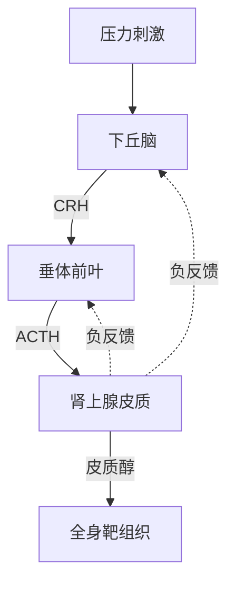
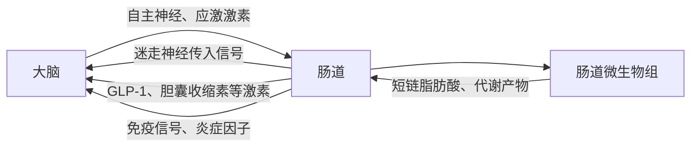

# Concept-Book Run

domain: /home/papagame/projects/digital-duck/cb-meta-health/public/domains/meta_health_ch07/input/graph.yaml
target: stress_resilience_routine
started: 2026-11-24T14:11:00

## Teaching order (24 concepts)

- five_phase_correspondences
- hpa_axis
- sympathetic_parasympathetic_balance
- acute_vs_chronic_stress
- seven_emotions_qiqing
- five_emotions_five_organs
- qi_stagnation_blood_stasis
- vagal_tone_and_hrv
- liver_free_flow_shuxie
- postprandial_hyperemia
- liver_qi_stagnation
- stress_and_digestion
- diaphragmatic_breathing
- liver_spleen_relationship
- allostatic_load
- breath_as_bridge
- gut_brain_axis
- liver_opening_movements
- wood_overacting_on_earth
- emotional_eating
- hrv_self_monitoring
- mind_regulation_tiaoxin
- releasing_liver_qi_through_movement
- stress_resilience_routine

### five_phase_correspondences (1.0s)

## 五行归类

**定义。** 五行归类是 TCM 的一种分类方法:它按功能和属性的相似性,把自然界与人体的许多事物分别归入木、火、土、金、水五类。这是一种分类的"索引表",用来帮助记忆和推理,并不是测量出来的物理量。下表是教材中最常用的一组对应。

| 五行 | 五脏 | 五腑 | 五官 | 五志(情志) | 五季 | 五味 | 五色 |
|---|---|---|---|---|---|---|---|
| 木 | 肝 | 胆 | 目 | 怒 | 春 | 酸 | 青 |
| 火 | 心 | 小肠 | 舌 | 喜 | 夏 | 苦 | 赤 |
| 土 | 脾 | 胃 | 口 | 思 | 长夏 | 甘 | 黄 |
| 金 | 肺 | 大肠 | 鼻 | 悲(忧) | 秋 | 辛 | 白 |
| 水 | 肾 | 膀胱 | 耳 | 恐(惊) | 冬 | 咸 | 黑 |

其中"五志"即五种情志:怒、喜、思、悲、恐。中医认为,过度或持续的某种情绪会先影响与之同类的脏。

**例题。** 一位学生考试前连续两周焦虑、反复思虑,近来食欲差、腹胀、大便偏稀。请用上表分析。

1. 找情志:反复思虑属"思",对应"土"。
2. 找脏腑:土对应脾与胃。
3. 对照症状:食欲差、腹胀、便溏属消化功能的表现,与"脾胃"一类相符。
4. 得出的 TCM 解释:思虑过度,影响脾的运化功能。

**问题求解应用。** 归类的用处是把零散信息按类别归并,再提出下一步的问题。再看一个案例:一人每到秋季就口鼻干燥、干咳,并常觉情绪低落。

- 秋 → 金 → 肺、鼻、大肠、悲(忧)。
- 这几项在表中同属一列,因此中医会把它们放在一起考虑,并询问:是否还有皮肤干燥、大便干结等同属"金"类的表现?

不过要分清两点。第一,这个表是归类工具,不是诊断结论。秋季干咳在现代医学中可能由过敏、哮喘、感染等引起,需要检查来区分。第二,就证据而言,情绪确实会影响消化、呼吸和心血管等功能,例如压力可引起胃肠不适,但"某种情绪对应某一个脏"的具体配对,并没有被现代生理学研究证实。因此,可以把它当作理解中医术语和文献的钥匙,但不能据此判断疾病,也不要因为情绪归类而推迟就医。

**练习。** 请只用上表回答:(1)"恐"对应哪一行、哪一脏?(2)"咸味"所属的五行,其对应的五官是什么?(答案:水、肾;耳。)

### hpa_axis (0.7s)

## HPA 轴（下丘脑-垂体-肾上腺轴）

### 定义

HPA 轴是人体应对压力的核心内分泌系统，由三个器官依次传递信号：**下丘脑**、**垂体**和**肾上腺**。它的最终产物是糖皮质激素，人类体内主要是**皮质醇**。

信号链如下：

1. 下丘脑感知到压力（如危险、疼痛、低血糖、情绪紧张），分泌促肾上腺皮质激素释放激素（CRH）。
2. CRH 刺激垂体前叶释放促肾上腺皮质激素（ACTH）。
3. ACTH 经血液到达肾上腺皮质，促使其合成并释放皮质醇。
4. 皮质醇作用于全身，同时反过来抑制下丘脑和垂体，这就是**负反馈**。

皮质醇的主要作用是升高血糖、动员能量，并抑制暂时不急需的功能，如免疫反应和消化。HPA 轴还有明显的昼夜节律：皮质醇在清晨醒后约 30 分钟达到高峰，夜间降至最低。

*图：HPA 轴的信号传递。实线表示促进，虚线表示皮质醇对下丘脑和垂体的负反馈抑制。*

### 例题

某人早晨 8:00 抽血，血清皮质醇为 $15\ \mu\text{g/dL}$。晚上 23:00 再测，为 $3\ \mu\text{g/dL}$。这是否异常？

**分析：** 成人清晨皮质醇的常见参考范围约为 $5\text{–}25\ \mu\text{g/dL}$，深夜则明显更低，通常低于 $5\ \mu\text{g/dL}$。两次结果都在预期范围内，并且早高晚低，说明昼夜节律正常。降幅为：

$$\frac{15-3}{15}\times 100\% = 80\%$$

一天内降低约 80%，符合正常的昼夜节律。

### 问题解决应用

**情境：** 患者长期服用大剂量泼尼松（一种合成糖皮质激素），突然自行停药后出现乏力、低血压和恶心。应如何解释？

**推理步骤：**

1. 外源性糖皮质激素在血液中持续存在，通过负反馈长期抑制下丘脑的 CRH 和垂体的 ACTH。
2. ACTH 长期缺乏，肾上腺皮质逐渐萎缩，自身合成皮质醇的能力下降。
3. 突然停药后，外源激素消失，而肾上腺一时无法恢复分泌，体内皮质醇不足。
4. 皮质醇不足导致血糖和血压难以维持，于是出现上述症状。

**结论：** 这是医源性的肾上腺功能抑制。临床上需在医生指导下**逐步减量**，让 HPA 轴有时间恢复。

**另一个应用：** 长期慢性压力下，HPA 轴持续被激活，皮质醇长期偏高，与血糖升高、睡眠紊乱、腹部脂肪增加和免疫功能下降等风险相关。因此，规律睡眠、运动和压力管理对维持 HPA 轴的正常节律有实际意义。

### sympathetic_parasympathetic_balance (0.5s)

## 交感与副交感神经平衡

**定义。** 自主神经系统分为两个主要分支:交感神经和副交感神经。交感神经主导"战斗或逃跑"反应,使心率加快、支气管扩张、瞳孔放大、肝脏释放葡萄糖,同时抑制消化。副交感神经(主要经迷走神经)主导"休息与消化"状态,使心率减慢、胃肠蠕动增强、唾液分泌增加。两者对多数内脏器官同时施加作用,方向相反,所以器官的实际状态取决于二者当时的相对活跃程度。这种动态的相对优势称为自主神经平衡。它不是静止的"五五开",而是随情境不断调整。

**心率是最直观的窗口。** 心脏自身的窦房结若不受神经支配,会以约 100 次/分的固有频率搏动。静息时,迷走神经的"刹车"占优势,使心率降到约 60–80 次/分。运动时,迷走神经张力撤退,交感神经加强,心率才大幅上升。

心输出量是常用的计算量:

$$CO = HR \times SV$$

其中 $CO$ 为心输出量(mL/min),$HR$ 为心率(次/分),$SV$ 为每搏输出量(mL/次)。

**例题。** 某人静息时 $HR = 65$ 次/分,$SV = 75$ mL;快走时交感神经兴奋,$HR = 100$ 次/分,$SV = 80$ mL。求两种状态下的心输出量。

静息:$CO = 65 \times 75 = 4875$ mL/min,约 4.9 L/min。

快走:$CO = 100 \times 80 = 8000$ mL/min,即 8.0 L/min。

心输出量增加约 64%,其中大部分来自心率上升,这正是交感神经活动增强的结果。

**问题解决应用。** 静息心率是判断副交感(迷走)张力的实用指标。假设一名学生准备考试期间长期睡眠不足,晨起静息心率由 60 次/分升到 72 次/分。可以这样分析:

1. 心率上升说明迷走张力下降或交感活动增强,即平衡偏向交感。
2. 同时可能出现入睡困难、食欲下降、便秘,因为交感占优时消化功能被抑制。
3. 干预方向是恢复副交感活动:规律睡眠、有氧运动、缓慢深呼吸(如每分钟约 6 次)。研究显示,缓慢呼吸可提高迷走活动,常用心率变异性(HRV)衡量。
4. 用连续数日的晨起静息心率作为反馈,心率回落说明调整有效。

需要注意:单次心率偏高也可能由咖啡因、发热、脱水或甲状腺疾病引起。若静息心率长期超过 100 次/分,或伴胸痛、晕厥,应就医,而不是自行调整。

**小结。** 健康并不是让某一分支"赢",而是让两者能根据需要灵活切换:需要行动时交感迅速启动,任务结束后副交感能把身体拉回恢复状态。

### acute_vs_chronic_stress (0.6s)

## 急性压力与慢性压力

**定义。** 急性压力是短时间的应激反应:危险或挑战出现后,交感神经兴奋,肾上腺素迅速释放,下丘脑—垂体—肾上腺轴随后促使皮质醇上升。心率加快,肝脏释放葡萄糖,血液流向肌肉,身体因此获得应对所需的能量。威胁解除后,负反馈使皮质醇回落,副交感神经重新占优势,身体恢复平静。慢性压力则是应激反应长期不关闭:压力源持续存在,或者大脑反复把日常事务当作威胁。结果是皮质醇和交感神经张力长时间偏高,恢复期被压缩甚至消失。

两者的区别主要在持续时间和能否恢复,不在压力的"强度"。一次剧烈但短暂的冲击,可能比长期低水平的烦扰损害更小。

**例题。** 一名学生上台答辩前,静息心率为 $65$ 次/分,上台时升到 $110$ 次/分,答辩结束后 $20$ 分钟回到 $68$ 次/分。另一名学生连续三个月备考,每天熬夜,晨起静息心率稳定在 $82$ 次/分,晚上也难以降到 $75$ 次/分以下。

请判断两人的压力类型,并说明依据。

分析:

1. 第一名学生的心率先升后降,约 $20$ 分钟恢复到基线附近,说明反应开启后能够关闭,属于急性压力。升高的心率是在为任务供能。
2. 第二名学生的静息心率比第一名的基线高约 $17$ 次/分($82-65=17$),而且全天不下降,说明交感神经张力持续偏高,符合慢性压力的特征。
3. 慢性压力下,皮质醇的正常昼夜节律常被打乱,表现为晨间高峰不明显、夜间仍偏高,常伴随入睡困难。

**问题求解应用。** 在实际判断中,可依次问四个问题:

| 问题 | 偏向急性 | 偏向慢性 |
|---|---|---|
| 压力源持续多久? | 数分钟至数小时 | 数周至数月 |
| 事后能否恢复? | 能,静息指标回到基线 | 不能,基线抬高 |
| 睡眠与食欲如何? | 基本正常 | 入睡困难、早醒,或食欲明显改变 |
| 是否反复感冒、血压偏高? | 通常没有 | 较常出现 |

针对不同类型,对策也不同。急性压力一般不需要消除,可以利用它,例如考前做几次慢呼吸来控制紧张。慢性压力则要打断持续的激活:规律睡眠、每周数次中等强度运动、减少可调整的压力源,必要时寻求心理咨询。

长期皮质醇偏高与血压升高、内脏脂肪堆积、血糖调节变差、免疫功能下降以及情绪问题相关。因此慢性压力是值得认真对待的健康风险,不是意志力不足的表现。如果你的静息心率连续数周比平时高出 $10$ 次/分以上,并伴有睡眠问题,可以把它当作一个提示,考虑调整生活节奏或咨询医生。

在 TCM 中,类似现象常被归入"肝气郁结"等说法,强调情志长期不舒对身体的影响。这是一种传统的解释框架,与现代的应激轴机制并不对应。

### seven_emotions_qiqing (0.6s)

## 七情

**定义。** 七情指喜、怒、忧、思、悲、恐、惊七种情志活动。中医认为,七情是人对外界刺激的正常反应,本身并不是病因。只有当某种情绪过于强烈或持续过久,超出个人的调节能力时,才会成为致病因素,称为"内伤七情"。

中医对各情绪的经典对应如下(本表只是中医的归纳,不是测量值):

| 情志 | 中医认为主要影响的脏 | 常描述的表现 |
|---|---|---|
| 喜 | 心 | 过度兴奋、心神不宁、失眠 |
| 怒 | 肝 | 头痛、面红、易怒 |
| 忧、悲 | 肺 | 气短、乏力、叹息 |
| 思 | 脾 | 食欲减退、腹胀 |
| 恐、惊 | 肾 | 心悸、二便失控、坐立不安 |

其中"强度"与"持续时间"两项是判断是否致病的关键。

**与现代生理的对照。** 现代医学并不使用"气"的概念,但已证实长期心理压力会使交感神经与下丘脑—垂体—肾上腺轴持续激活,导致血压升高、睡眠变差、消化功能紊乱。例如,急性惊恐时心率可从静息的约 $70$ 次/分升至 $120$ 次/分以上,这是正常的应激反应;若这种状态长期持续,则增加心血管疾病风险。这一对照说明七情理论的核心观察——情绪可影响躯体——有生理学依据;但"某情绪对应某脏"的具体配属,缺乏严格的临床证据支持。

**例题。** 一位学生备考三个月,长期焦虑、反复思虑,近来食欲下降、饭后腹胀、入睡困难。请分析。

*步骤 1:判断情绪类型。* 反复思虑、担忧,对应"思"和"忧"。

*步骤 2:判断强度与时间。* 情绪持续三个月,属于"过久",而非一过性反应。

*步骤 3:对应症状。* 中医认为思虑过度影响脾,故见食欲下降、腹胀;心神不安则入睡困难。

*步骤 4:提出处理。* 先排除器质性疾病(如胃炎、甲状腺功能异常),再从源头调节:制订分段的复习计划,保证每日规律运动(如每周至少 $150$ 分钟中等强度活动),固定作息,必要时向学校心理咨询师求助。

**问题求解应用。** 遇到类似案例,可按"四问"处理:

1. 是哪种情绪?
2. 强度大不大、持续多久?
3. 是否伴有躯体症状,并先排除器质性病因?
4. 能否改变诱因或提高调节能力?

若出现持续两周以上的情绪低落、兴趣丧失,或有自伤念头,这已超出日常调节范围,应及时就医,按抑郁症等精神疾病评估,而不应只当作"情志不畅"自行调养。

### five_emotions_five_organs (0.8s)

## 五志与五脏

**定义。** 在中医(Traditional Chinese Medicine,TCM)理论中,"五志"指怒、喜、思、悲、恐五种情志活动,分别对应肝、心、脾、肺、肾五脏。TCM 认为,情志是脏腑功能的外在表现;当某种情绪过于强烈或持续过久,就会反过来损伤相应的脏。经典说法是:怒伤肝,喜伤心,思伤脾,悲伤肺,恐伤肾(《黄帝内经》)。

| 情志 | 所伤之脏 | TCM 所述的典型表现 |
|---|---|---|
| 怒 | 肝 | 头胀、面红、胁肋胀痛 |
| 喜(过度) | 心 | 心神不宁、心悸、失眠 |
| 思(过度) | 脾 | 食欲差、腹胀、乏力 |
| 悲 | 肺 | 气短、声低、易疲倦 |
| 恐 | 肾 | 二便失控、腰膝酸软 |

这里的"脏"是功能系统的概念,不完全等同于解剖学上的器官。

**例题。** 一位备考的大学生连续三周每天只睡约5小时,总担心成绩,反复思虑。近来他食欲下降,饭后腹胀,白天疲乏。

按 TCM 的辨证思路:
1. 找主要情志:长期忧思、反复思虑。
2. 对应脏:思伤脾。
3. 对照症状:食欲差、腹胀、乏力,与"脾失健运"的描述相符。
4. 提出调护方向:减少持续思虑、规律作息和三餐,必要时请中医师辨证。

**问题求解应用。** 判断某个案例时,可分三步:先看情绪是否"过度或持续"(偶尔的怒不等于伤肝);再看症状是否与对应脏的功能描述吻合;最后排除其他原因。

练习:某人突遭噩耗,数日来哭泣、气短、说话声音低微。
- 情志:悲。
- 对应脏:肺(悲伤肺)。
- 症状:气短、声低,符合 TCM 对"肺气耗伤"的描述。
- 调护:倾诉、适度运动、充足休息。

再比如,一个人长期易怒,同时血压偏高。TCM 会归入"肝"的范畴;但现代医学要求先测血压、查明病因,不能只靠情志解释。

**证据状况。** 现代研究确实发现,长期压力、焦虑、抑郁与高血压、心血管疾病、消化功能紊乱和睡眠障碍相关,说明情绪影响身体是有依据的。但"某种情绪专门损伤某个特定的脏"这种一一对应关系,并没有得到现代生理学的证实,应视为 TCM 的理论模型,而非已验证的因果规律。出现持续的身体症状或情绪问题时,应首先寻求规范的医学评估。

### qi_stagnation_blood_stasis (0.6s)

## 气滞血瘀

**定义。** 中医认为,人体的气负责推动血液运行,血液畅行则各组织得到滋养。若气的运行受阻,称为"气滞";气滞日久,血行也随之迟缓、不畅,甚至瘀积,称为"血瘀"。因此,中医常说二者先后相继、互相影响,合称"气滞血瘀"。需要说明的是,"气"和"血瘀"是中医的理论概念,并不能直接对应某一种可测量的生理指标;现代研究多把"血瘀证"与血液黏稠度升高、微循环障碍、血小板活化等指标做关联性探讨,但结论尚不统一,证据质量参差不齐。

**典型表现。** 中医辨证时常关注以下几类线索:

| 阶段 | 常见表现(中医描述) |
|---|---|
| 气滞 | 胸胁或腹部胀闷、疼痛位置不固定、情绪抑郁时加重、常叹气 |
| 血瘀 | 疼痛固定、多为刺痛、夜间加重;舌质紫暗或有瘀点;唇色偏暗 |
| 气滞血瘀 | 上述两类表现并见,如胀痛逐渐转为固定刺痛 |

**例题。** 一位办公室职员,38岁,每天连续坐 $9$ 小时以上,近三个月常感右侧胁肋胀痛,压力大时更明显;近两周疼痛变为固定一处的刺痛,夜间加重,舌质偏暗、有瘀点。请判断其所处阶段。

分析步骤:

1. **看疼痛性质的变化。** 起初为"胀痛、压力大时加重",符合气滞的特点;
2. **看疼痛是否固定。** 近两周转为固定、刺痛、夜间加重,符合血瘀的特点;
3. **看舌象。** 舌质偏暗有瘀点,支持血瘀;
4. **综合判断。** 两类表现并存,且有"由胀到刺、由游走到固定"的演变,中医会辨为气滞血瘀。

**问题解决应用。** 辨证的价值在于指导生活与就医决策,而不是自行诊断。请按下列思路处理:

- **先排除危险信号。** 胸痛伴出汗、呼吸困难,或单侧小腿肿胀疼痛,可能是心肌梗死、肺栓塞或深静脉血栓,这类情况必须立即就医,不能用"气滞血瘀"来解释或拖延。
- **再看可调整的因素。** 久坐、持续精神紧张、缺乏运动都是现代医学同样认可的不良因素。常规建议是每坐 $45\sim60$ 分钟起身活动几分钟,每周进行不少于 $150$ 分钟的中等强度有氧运动(这是世界卫生组织对成年人的通用建议),并学习放松和减压。
- **中医治法。** 中医的治疗原则是"行气活血",常用方法有中药、针灸、推拿等。中药中的活血类药物可能影响凝血,与抗凝药(如华法林)、抗血小板药合用时有出血风险,应在医生指导下使用。

对例题中的职员,合理做法是:先由西医排查肝胆、肋间神经等器质性原因;确认无急症后,再调整久坐与压力,并可在正规中医师指导下辅以调理。

**小结。** 气滞血瘀是中医的辨证概念,描述从"功能性受阻(胀)"到"局部瘀滞(刺、固定)"的演变。它可以帮助整理症状线索,但不能替代对严重疾病的医学排查。

### vagal_tone_and_hrv (0.7s)

## 迷走神经张力与心率变异性

**定义。** 迷走神经是副交感神经系统的主要通路,它释放乙酰胆碱,作用于窦房结,使心率减慢。**迷走神经张力**指迷走神经在静息时对心脏持续施加的抑制作用强度。**心率变异性**(HRV)则是相邻心跳间隔(RR 间期)逐拍变化的程度。迷走神经张力越高,心脏对呼吸、体位和情绪变化的调节越灵活,HRV 通常也越大。因此,HRV 是一种无创、间接反映迷走神经张力的指标。

常用的时域指标有两个:

- **SDNN**:全部 RR 间期的标准差,反映总体变异。
- **RMSSD**:相邻 RR 间期之差的均方根,主要反映迷走神经的短时调节,是运动和恢复监测中最常用的指标。

$$\text{RMSSD}=\sqrt{\frac{1}{N-1}\sum_{i=1}^{N-1}\left(RR_{i+1}-RR_i\right)^2}$$

其中 $RR_i$ 是第 $i$ 个 RR 间期(单位 ms),$N$ 是间期总数。

**例题。** 一位同学晨起静息时记录到 6 个连续 RR 间期(ms):

$$1000,\ 1040,\ 980,\ 1020,\ 960,\ 1000$$

相邻差值依次为 $+40,\,-60,\,+40,\,-60,\,+40$,平方后为 $1600,\,3600,\,1600,\,3600,\,1600$,总和为 12000。这里 $N-1=5$,所以:

$$\text{RMSSD}=\sqrt{\frac{12000}{5}}=\sqrt{2400}\approx 49\ \text{ms}$$

该同学平均 RR 间期为 1000 ms,对应平均心率 $\frac{60000}{1000}=60$ 次/分。

**问题解决应用。** 假设这位同学连续三周每天晨起测量,结果如下:

| 阶段 | 平均静息心率 | 晨起 RMSSD |
|---|---|---|
| 基线周 | 60 次/分 | 49 ms |
| 高强度训练周 | 66 次/分 | 31 ms |
| 减量恢复周 | 58 次/分 | 56 ms |

分析时可按三步进行:

1. **比较个人基线。** HRV 个体差异很大,不同人之间的绝对值没有可比性,应与自己的长期趋势比较。
2. **看方向是否一致。** 训练周内心率上升、RMSSD 下降,说明迷走神经张力暂时降低,身体仍处于疲劳状态。恢复周则相反,说明适应良好。
3. **结合主观感受决定训练安排。** 若 RMSSD 连续数日明显低于个人基线,同时伴有睡眠差、疲劳感重,可考虑降低强度。单日的小幅波动不足以作为依据。

**注意事项。** 测量条件要保持一致(同一时间、同一体位、同一设备),并避免在饮酒、咖啡因摄入或生病时直接与基线比较。呼吸频率也会显著影响 HRV,因此测量时最好保持自然呼吸。HRV 是趋势性指标,不能单独用来诊断疾病。

### liver_free_flow_shuxie (0.7s)

## 肝主疏泄

**定义。** 中医认为,肝主疏泄,指肝具有疏通、畅达全身气机的功能。"疏"是疏通,"泄"是发散、宣泄。气机,即气的升降出入运动。中医认为,气机畅通,则情志舒畅、脾胃运化正常、女子月经按时来潮;气机不畅,即"肝气郁结",则可能出现情绪低落、胁肋胀痛、食欲不振、月经不调等表现。

肝主疏泄的作用,通常归纳为三个方面:

| 方面 | 中医的解释 | 气机不畅时的常见表现 |
|---|---|---|
| 调畅情志 | 气行顺畅,情绪平和 | 抑郁、善太息、易怒 |
| 促进消化 | 助脾升清、胃降浊,并助胆汁分泌排泄 | 腹胀、嗳气、大便时干时稀 |
| 调节月经 | 气行则血行,经血按时而下 | 经前乳房胀痛、痛经、周期紊乱 |

**示例。** 小李是一名大学生,期末考试前连续三周熬夜复习,压力很大。她逐渐出现情绪烦闷、总爱叹气、两侧胁肋胀满、吃一点就腹胀的情况,月经也推迟了一周。中医会这样分析:长期精神压力使肝气不得舒展,即"肝失疏泄";肝气横逆,影响脾胃运化,故腹胀纳差;气滞则血行不畅,故月经推迟。

**问题解决应用。** 面对一组症状,可按以下步骤辨析:

1. **找共同诱因。** 症状是否随情绪波动而加重或缓解?小李的症状在考试压力下出现,提示与情志相关。
2. **分清"不及"与"太过"。** 疏泄不及,表现为抑郁、闷闷不乐、叹气;疏泄太过,表现为急躁易怒、头晕头胀、面红目赤。小李偏于前者。
3. **看波及的部位。** 影响脾胃则腹胀、食少;影响胞宫则月经异常;影响两胁则胀痛。
4. **确定调理方向。** 中医的思路是"疏肝解郁",常见的调摄方法包括规律作息、适度运动、与人倾诉、减轻压力源。出现持续的情绪低落、月经长期紊乱或明显消化症状时,应先到正规医疗机构检查,排除甲状腺疾病、抑郁症、妇科疾病、消化道疾病等,不应仅凭这一理论自行判断或用药。

**需要注意的是**,"肝"在中医里是一个功能系统的概念,并不等同于现代解剖学中的肝脏。现代研究确实发现,长期精神压力与胃肠功能紊乱、月经周期改变有关,但"气机"并无可直接测量的对应物,"肝主疏泄"目前主要是一个用于解释和归纳临床表现的理论框架。

**小结。** 肝主疏泄可用一句话概括:中医认为肝使气机通畅,从而影响情志、消化与月经。学习时,重点是学会从"情绪—消化—月经"之间的关联中找线索,并清楚区分理论解释与医学诊断。

### postprandial_hyperemia (0.7s)

## 餐后充血

**定义。** 餐后充血(postprandial hyperemia)是指进食后,胃肠道,尤其是小肠和肠系膜区的血流量显著增加的生理现象。食物进入消化道后,消化、吸收和分泌活动加强,局部组织耗氧量上升。同时,食物成分和胃肠激素会引起肠系膜血管舒张。血流因此向腹腔内脏分配得更多。

主要机制有三个:
- **局部代谢产物**:腺苷等物质积聚,使小动脉扩张。
- **营养物质的直接作用**:葡萄糖、脂肪酸和氨基酸可引起局部血管舒张。其中脂肪的作用往往更持久。
- **神经与激素调节**:胃肠激素(如胆囊收缩素)和肠神经系统参与调节。

**典型数据。** 空腹时,内脏循环约占心输出量的 20%~25%。进食后,肠系膜上动脉血流可增加 50%~100%,持续 1~3 小时,其间的具体数值取决于进食量和食物成分。心输出量的计算公式为:

$$CO = HR \times SV$$

其中 $CO$ 为心输出量,$HR$ 为心率,$SV$ 为每搏输出量。

**例题。** 一名成年人静息时心率为 70 次/分,每搏输出量为 70 mL。假设空腹时内脏血流占心输出量的 25%,餐后增加到空腹时的 1.8 倍。估算餐后内脏血流量。

1. 空腹心输出量:
$$CO = 70 \times 70 = 4900\ \text{mL/min}$$
2. 空腹内脏血流量:
$$4900 \times 0.25 = 1225\ \text{mL/min}$$
3. 餐后内脏血流量:
$$1225 \times 1.8 = 2205\ \text{mL/min}$$

餐后内脏血流量约增加 980 mL/min。这部分血液必须由其他部位提供,或由心输出量的增加来补偿。

**问题解决应用。** 健康人通过代偿维持血压稳定。代偿方式包括心率加快、每搏输出量增加,以及骨骼肌和皮肤血管收缩。若餐后心率升至 78 次/分,每搏输出量升至 75 mL,则:

$$CO = 78 \times 75 = 5850\ \text{mL/min}$$

心输出量比空腹时多出 950 mL/min,大致抵消了内脏多得的血流,因此其他器官的血供不会明显减少。

老年人、糖尿病自主神经病变患者或服用降压药的人,代偿能力较弱,可能出现餐后低血压。典型表现是进食后 1~2 小时内收缩压下降 20 mmHg 以上,并伴有头晕或晕厥。常用的预防办法有:少量多餐、减少精制碳水化合物、餐前适量饮水,以及餐后避免立即剧烈运动或突然站起。

**常见误解。** 中医认为"饱食后气血集中于脾胃",这一说法与餐后充血的现象表面相似。但它是一种经验性解释,并未提供可检验的血流数据。判断餐后血流变化,应以多普勒超声等测量结果为依据。

### liver_qi_stagnation (0.7s)

## 肝气郁结

**定义。** 肝气郁结(肝郁气滞)是中医(TCM)的一个证候概念。中医认为,肝主疏泄,负责调畅全身气的运行与情志的舒展。当长期的挫折、压抑或愤懑得不到表达时,肝的疏泄功能失常,气机运行不畅,便称为"肝气郁结"。它是一种中医的解释框架,并非现代医学的诊断名称;现代研究多把相关表现与慢性心理压力、焦虑和抑郁情绪、自主神经功能紊乱联系起来,但"气"本身尚无可测量的生理实体。

**典型表现。** 中医常把症状按部位和性质归纳如下:

| 表现 | 对应的描述 |
|---|---|
| 情志 | 易怒、烦躁、情绪低落,常因小事而心烦 |
| 胸胁 | 两胁胀满或窜痛,胸闷,常叹气以求缓解 |
| 咽喉 | 如有异物梗阻,吐之不出、咽之不下(中医称"梅核气") |
| 女性月经 | 经前乳房胀痛,经期不规律 |
| 脉象 | 脉弦 |

特点是症状常随情绪波动而加重或减轻。

**工作示例。** 小李,28岁,项目上线前连续两个月加班。他不愿与上司争执,把不满压在心里。近来出现:下午频繁叹气、两侧肋下发胀、一点小事就发火,同时觉得喉咙里"卡着东西",但耳鼻喉科检查未见器质性病变。周末休息、与朋友聊天后,症状明显减轻。

中医的分析步骤如下:
1. 识别诱因:长期情绪压抑。
2. 归纳表现:叹气、胁胀、易怒、咽部异物感。
3. 注意"随情绪变化"这一特征。
4. 辨为肝气郁结。

**问题解决应用。** 辨证的关键是区分相近情况。

*例题:* 下面哪个更像肝气郁结?甲:胁肋刺痛固定、夜间加重、舌质紫暗;乙:胁胀走窜、叹气后稍舒、遇事不顺则加重。

*解答:* 乙。中医认为,疼痛固定、刺痛、舌紫暗提示血瘀,而走窜胀痛且与情绪相关才是气滞的特点。需注意,若胁痛伴发热、黄疸、持续剧痛或体重下降,不能简单归为"情绪问题",应尽快就医排除肝胆疾病;咽部异物感持续不退或吞咽困难,也应先做器质性检查。

*中医的调理思路*是疏肝理气,常用方剂如逍遥散、柴胡疏肝散,这些方剂的疗效证据有限、质量参差,不宜自行替代正规治疗。与此同时,有较好证据支持的做法是:规律运动、保证睡眠、倾诉与表达情绪、学习压力管理,必要时寻求心理咨询。若情绪低落持续两周以上并影响生活,应及时就诊心理或精神科。

### stress_and_digestion (1.0s)

## 压力与消化

**定义。** 压力与消化的关系,是指心理或生理压力引发的"战斗或逃跑"反应(交感神经兴奋、肾上腺素和皮质醇释放)如何抑制胃肠功能。在这种状态下,身体把血液和能量优先分配给骨骼肌、心脏和大脑,而消化系统被"降级"。具体表现为三点:

1. **血流重新分配**:内脏血管收缩,胃肠得到的血液减少。
2. **蠕动减慢**:胃排空延迟,肠道推进节律紊乱。
3. **分泌减少**:唾液、胃酸和消化酶的分泌下降。

需要说明的是,压力对肠道的影响并不总是"变慢"。部分人在紧张时反而出现腹泻,因为肠道的蠕动在压力下可能变得紊乱,而不是单纯减弱。

**例题。** 小林下午两点有一场重要答辩,她在十二点半匆忙吃了一份约 $700\ \text{kcal}$ 的午餐,之后一直心跳加快、手心出汗。答辩结束后她感到胃胀、反酸。

分析步骤:

- 答辩前她处于交感神经兴奋状态,胃肠血流下降、胃酸和消化酶分泌减少、胃排空变慢。
- 食物在胃里停留更久,又缺乏足够的消化液,所以出现胀满;胃内容物更容易反流,表现为反酸。
- 这 $700\ \text{kcal}$ 的能量在当时并没有被高效利用,身体"边紧张边消化",两边都做不好。

**问题解决应用。** 想象你计划下午 $17{:}00$ 进行一次力量训练,运动本身也需要充足的能量和血液供应。如果你在训练前一小时处于高压状态(赶截止日期、与人争执)并匆忙进食,就会遇到"双重挤压":压力使消化吸收变差,训练前的能量补充没有真正到位,训练开始时又要把血液调往肌肉。结果是训练中容易腹胀、乏力,"内部的这场训练"从一开始就供给不足。

可行的处理办法:

| 情境 | 做法 |
|---|---|
| 进食前明显紧张 | 先做 $2$ 到 $5$ 分钟缓慢深呼吸(如吸气 $4$ 秒、呼气 $6$ 秒),再开始吃 |
| 时间紧、压力大 | 选择体积小、易消化的食物(如香蕉、酸奶),避免高脂、大份量 |
| 进餐过程 | 放慢速度,充分咀嚼,不边工作边吃 |
| 训练安排 | 压力高峰期适当降低训练强度,或把进食提前,留出更长的消化时间 |

**小结。** 压力会让身体进入"优先保命"模式,消化功能被压低。因此,吃什么固然重要,在什么状态下吃同样重要。进餐前先让身体从紧张转入放松,是提高消化吸收效果的简单而有效的手段。

### diaphragmatic_breathing (0.6s)

## 腹式呼吸

**定义。** 腹式呼吸(又称膈式呼吸)是以膈肌为主要动力的呼吸方式。吸气时膈肌收缩、下移,胸腔纵向扩大,肺内压下降,空气进入肺的下部,腹部随之轻微隆起;呼气时膈肌放松、上升,腹部回落。与之相对的胸式呼吸主要依靠肋间肌和颈部辅助肌,呼吸较浅,肺底部通气相对不足。

在中医(TCM)的养生实践中,类似的方法常被称为"腹式呼吸"或"丹田呼吸",强调"气沉丹田"。这是一种传统说法,现代生理学对应的机制主要是膈肌运动和迷走神经张力的变化。

**基本做法。** 仰卧或坐位,一只手放在胸前,另一只手放在肚脐上方。用鼻缓慢吸气,使腹部手被顶起而胸前手基本不动;再用嘴或鼻缓慢呼气,腹部回落。

**例题。** 某人静息时潮气量为 $500\ \text{mL}$,呼吸频率为每分钟 $16$ 次。已知解剖无效腔约为 $150\ \text{mL}$。分钟通气量与肺泡通气量分别是多少?

分钟通气量:

$$\dot V_E = V_T \times f = 500 \times 16 = 8000\ \text{mL/min}$$

肺泡通气量:

$$\dot V_A = (V_T - V_D)\times f = (500-150)\times 16 = 5600\ \text{mL/min}$$

**问题应用。** 比较两种呼吸方式,总通气量都保持约 $8000\ \text{mL/min}$:

| 方式 | 潮气量 | 频率 | 肺泡通气量 |
|---|---|---|---|
| 浅快胸式 | $300\ \text{mL}$ | 26 次/分 | $(300-150)\times 26 = 3900\ \text{mL/min}$ |
| 深慢腹式 | $800\ \text{mL}$ | 10 次/分 | $(800-150)\times 10 = 6500\ \text{mL/min}$ |

两者分钟通气量相近(约 $7800$ 与 $8000\ \text{mL/min}$),但深慢呼吸的肺泡通气量更高,因为每次呼吸中无效腔所占比例更小。这说明:真正参与气体交换的是肺泡通气量,而不是单纯的呼吸总量。

此外,每分钟约 6 次的缓慢腹式呼吸常用于放松训练。研究显示它可使心率变异性增加、静息心率和主观紧张感略有下降,但效果因人而异,不能替代对高血压或焦虑障碍的规范治疗。

**练习建议。** 

1. 每天 5–10 分钟,从每分钟 10 次开始,逐步放慢。
2. 呼气时间略长于吸气(如吸 4 秒、呼 6 秒)。
3. 出现头晕、手麻时立即恢复自然呼吸,这是过度通气的表现。
4. 患有严重慢性阻塞性肺疾病或心血管疾病者,应先咨询医生再练习。

**小结。** 腹式呼吸通过增加膈肌参与度提高潮气量,在同样的分钟通气量下提升肺泡通气量。解决相关问题时,先区分分钟通气量与肺泡通气量,再代入无效腔进行计算。

### liver_spleen_relationship (0.6s)

## 肝脾关系

**定义。** 肝脾关系是中医藏象理论中描述肝与脾相互作用的一组说法。中医认为,肝主疏泄,即调畅气机、促进消化液的分泌与排布;脾主运化,即负责饮食的消化、吸收与输布。五行中肝属木、脾属土,"木克土"指肝对脾有正常的制约与疏通作用。若肝的疏泄太过或不及,就会影响脾的运化,称为"木旺乘土"或"肝木克脾土";若脾虚在先,反过来使肝失所养,则称为"土虚木乘"。这是一套解释临床表现的框架,不是解剖学或生理学意义上的因果机制,其疗效评价需要靠临床研究来检验。

肝与脾的主要关系可以用下表概括:

| 状态 | 中医的描述 | 常见表现 |
|---|---|---|
| 协调 | 肝疏泄正常,脾运化顺畅 | 食欲正常,大便规律,情绪平稳 |
| 肝郁乘脾 | 情志不畅,肝失疏泄,影响脾运化 | 胸胁胀闷、易怒、腹痛即泻、泻后痛减 |
| 脾虚肝郁 | 脾虚气血不足,肝失所养而郁滞 | 乏力、食少、腹胀、情绪低落 |

**例题。** 某大学生期末考试周压力很大,连续三天出现腹痛、肠鸣,每次情绪紧张时就想排便,大便偏稀,排便后腹痛减轻,平时食欲尚可,舌苔薄白,脉弦。

分析步骤:

1. **找诱因。** 症状与情绪紧张同步出现,提示与"情志"有关,先考虑肝的疏泄失常。
2. **看受累脏腑。** 出现腹痛、便稀,属消化功能异常,对应脾的运化受影响。
3. **辨关系类型。** 诱因在先(肝郁)、消化症状在后(脾失健运),且平时食欲尚可、没有明显乏力,所以辨为"肝郁乘脾",而不是"脾虚肝郁"。
4. **确定思路。** TCM 治法为"抑肝扶脾",常用方剂如痛泻要方(白术、白芍、陈皮、防风)。

现代医学对这类表现有对应的解释:心理压力可通过脑肠轴改变肠道运动和敏感性,这与肠易激综合征的发病机制有关。因此,上述症状首先应当排除感染、乳糜泻、炎症性肠病等器质性疾病,再考虑功能性问题。

**问题求解应用。** 比较两位患者:

- 甲:反复生气后腹胀、嗳气,大便时干时稀,体力尚可。
- 乙:长期食少、乏力、面色萎黄,近来因此心情低落,胸闷叹气。

甲的因果顺序是"情绪在先,消化在后",属肝郁乘脾,治疗重点在疏肝;乙是"脾虚在先,情绪在后",属土虚木乘或脾虚肝郁,治疗重点在健脾,兼顾疏肝。判断的要点是**先出现的是哪一类问题**,这决定了用药的主次。

在实际应用中还要注意:持续腹痛、便血、体重下降或夜间腹泻属于警示症状,应及时就医检查,不能仅用肝脾关系来解释。

**练习。** 一位上班族饭后腹胀、大便溏薄、容易疲倦,近期工作不顺后又出现烦躁、胁肋胀痛。请判断哪一类问题先出现,并说明属于哪种肝脾关系,以及判断依据是什么。

### allostatic_load (0.7s)

## 稳态负荷

**定义。** 稳态负荷(allostatic load)指身体为应对反复或长期的压力,在血压、代谢、睡眠和免疫等系统上累积的"磨损"。短期压力时,身体通过"应变稳态"(allostasis)调整心率、血压、血糖和激素水平来适应。若这种调整频繁启动、迟迟不能关闭,或恢复不充分,代价就会逐渐累积。这个概念由 McEwen 和 Stellar 在 1993 年提出。

稳态负荷不是单一指标,而是多个系统的综合状态。研究中常用的生物标志物包括:

| 系统 | 常用指标 | 偏高/偏低时的提示 |
|---|---|---|
| 心血管 | 收缩压、舒张压、静息心率 | 血压持续偏高 |
| 代谢 | 糖化血红蛋白、腰臀比、总胆固醇/HDL | 血糖和脂代谢失衡 |
| 炎症与免疫 | C 反应蛋白、白介素-6 | 慢性低度炎症 |
| 应激激素 | 皮质醇、肾上腺素 | 昼夜节律紊乱 |

**计分方法。** 研究中常用"超阈值计数"法:对每项指标设定风险阈值(例如取人群最不利的四分之一),超过阈值记 1 分,否则记 0 分,总分即稳态负荷得分。该方法只是把已测得的指标计数,不涉及复杂公式。

**例题。** 小李是一名 32 岁的研究生,备考期间连续 3 个月每晚睡 5 小时。体检结果与阈值对比如下:

| 指标 | 小李 | 阈值 | 是否超标 |
|---|---|---|---|
| 收缩压 | 138 mmHg | ≥ 130 mmHg | 是 |
| 静息心率 | 88 次/分 | ≥ 85 次/分 | 是 |
| 糖化血红蛋白 | 5.4% | ≥ 5.7% | 否 |
| C 反应蛋白 | 4.2 mg/L | ≥ 3 mg/L | 是 |
| 腰臀比 | 0.86 | ≥ 0.90 | 否 |

超标项为 3 项,共 5 项指标,因此得分为 3/5。这说明他的心血管和炎症系统已经显示出压力累积的迹象,而代谢系统暂时还正常。

**问题解决应用。** 以下是针对小李的分析步骤:

1. **找出压力来源与持续时间。** 睡眠不足加上考试压力,持续了 3 个月,属于慢性而非急性压力。
2. **找出受累系统。** 血压、心率和 C 反应蛋白同时偏高,符合"交感神经长期兴奋加低度炎症"的模式。
3. **选择可检验的干预。** 睡眠是调节血压和炎症的关键环节。可以先把睡眠延长到 7 小时,每周进行 150 分钟中等强度运动,再用同样的指标复查。
4. **用数据评估效果。** 8~12 周后若得分降到 1/5 或 0/5,说明负荷是可逆的。若指标仍然偏高,应就医排查高血压等独立疾病。

**注意事项。** 稳态负荷在研究中是一个预测框架,不同研究选用的指标和阈值并不统一,因此得分只能在同一研究内部比较,不能当作诊断。它也不意味着所有压力都有害:短暂、可控、能够恢复的压力反而可能增强适应能力。关键在于压力之后是否有足够的恢复。

### breath_as_bridge (0.7s)

## 呼吸是桥梁

**定义。** 呼吸是唯一既自动运行、又可随意控制的自主神经相关功能。心跳、消化、瞳孔大小都不能直接"下命令"调节,呼吸却可以。这使呼吸成为通向自主神经系统的一座"桥梁":我们能用有意识的动作,间接改变交感神经与副交感神经的相对活跃程度。

其生理基础是呼吸性窦性心律不齐:吸气时心率略升,呼气时心率略降,呼气阶段主要由迷走神经(副交感)介导。当呼吸频率放慢到每分钟约 6 次(每次约 10 秒)时,呼吸节律与血压的压力反射节律(约 0.1 Hz)发生共振,心率变异性(HRV)明显增大,迷走神经张力随之上升。普通成人静息时每分钟呼吸约 12–20 次,所以 6 次/分钟相当于放慢到原来的一半甚至更低。

**例题。** 一位学生考试前心跳加快,静息心率 95 次/分钟,呼吸 18 次/分钟。他改用"吸气 4 秒、呼气 6 秒"的节奏。

1. 每次呼吸周期:$4 + 6 = 10$ 秒。
2. 每分钟呼吸次数:$\frac{60}{10} = 6$ 次/分钟。
3. 与原来相比,每分钟吸气次数由 18 次降到 6 次,减少为原来的 $\frac{1}{3}$。
4. 呼气(6 秒)比吸气(4 秒)长,有意延长了迷走神经占优势的阶段。

练习几分钟后,他可能测得心率降到 80 次/分钟左右。这只是示例数值,个体差异很大。

**问题解决应用。** 面对不同情境,可按下列思路选择呼吸方案:

| 情境 | 目标 | 做法 |
|---|---|---|
| 考前紧张、心跳过快 | 快速降低唤醒 | 6 次/分钟,呼气略长于吸气,持续 3–5 分钟 |
| 睡前难以入睡 | 进入副交感状态 | 同上,用腹式呼吸,时间可延长到 10 分钟 |
| 需要提神 | 提高警觉 | 不适合慢呼吸,可先用正常节律并保持坐姿 |

操作要点:

- 用腹部而非胸部呼吸,让膈肌下降。
- 鼻吸鼻呼,动作柔和,不要憋气或用力过猛。
- 若出现头晕、手脚发麻,说明过度换气,应立即恢复自然呼吸。
- 有哮喘、严重心肺疾病或正在服药者,应先咨询医生。

在传统养生中,中医认为调息可以"安神",TCM 的吐纳、导引也常强调呼吸缓慢深长。现代研究支持的是上述生理机制:慢呼吸可提高 HRV、降低静息心率和主观焦虑,效应多为短期且幅度中等,它是辅助的自我调节手段,不能替代对焦虑症、高血压等疾病的治疗。

**小结。** 呼吸是我们能主动操控自主神经的少数入口。把呼吸放慢到每分钟约 6 次,并让呼气稍长,就是从交感"战斗或逃跑"状态转向副交感"休息与消化"状态最快捷、最易学的方法之一。

### gut_brain_axis (0.6s)

## 肠脑轴

**肠脑轴**(gut–brain axis)是肠道与大脑之间的双向通信网络。它不是单一的"线路",而是四条相互交织的通道:

1. **迷走神经**:连接脑干与消化道的主要神经,约 80% 的纤维是由肠道向大脑传递信号的传入纤维。
2. **激素通路**:进食后,肠道内分泌细胞释放胰高血糖素样肽-1(GLP-1)、胆囊收缩素、胃饥饿素(ghrelin)等激素,作用于下丘脑,调节食欲与饱腹感。
3. **免疫信号**:肠道含有人体大部分免疫细胞;炎症因子可进入血液,影响脑内的炎症状态与情绪。
4. **肠道微生物组**:肠道菌群发酵膳食纤维,产生短链脂肪酸(如丁酸),并影响色氨酸代谢。人体约 90% 的血清素由肠道的肠嗜铬细胞合成,但它基本不能穿过血脑屏障,因此不能简单理解为"肠道血清素直接决定情绪"。

反方向上,大脑通过自主神经和应激激素(如皮质醇)改变肠道的蠕动、分泌和通透性。这就是为什么考试前会腹泻或胃痛。

*肠脑轴的双向通信:神经、激素、免疫与微生物四条通道共同连接肠道与大脑。*

### worked example:进餐后的饱腹信号

小李吃了一份约 600 kcal 的午餐。食物进入小肠后,发生下列事件:

- 肠壁受到牵拉,迷走神经传入纤维兴奋;
- L 细胞分泌 GLP-1,胆囊收缩素同时升高;
- 这些信号抵达下丘脑,抑制饥饿感,于是小李在大约 3–4 小时内不想再进食。

这一过程由神经和激素共同完成,并不是"意志力"的结果。GLP-1 受体激动剂类减重药物(如司美格鲁肽)正是模拟这条通路发挥作用。

### 问题求解应用

**情境**:一名学生在考试周连续两周出现腹胀、排便不规律,睡眠也变差。他想知道怎样改善。

**分析步骤**:

1. **识别方向**:压力(脑→肠)使肠道蠕动紊乱;肠道不适和睡眠差(肠→脑)又加重焦虑,形成恶性循环。
2. **找可干预的环节**:
   - 规律作息、运动和放松训练(如深呼吸、慢速腹式呼吸)可降低交感神经兴奋,并增强迷走神经张力;
   - 每日摄入约 25–30 g 膳食纤维(蔬菜、全谷物、豆类),为产短链脂肪酸的菌群提供原料,应逐步增加以免加重胀气;
   - 限制咖啡因和酒精,二者都会刺激肠道。
3. **设定预期**:改变饮食和作息通常需要数周才能见效。如果出现便血、体重明显下降、持续腹痛或夜间症状,应就医排查器质性疾病,而不是自行归因于压力。

**证据说明**:肠脑轴在动物实验中证据较强;在人体中,益生菌或"心理益生菌"对抑郁、焦虑的疗效结果尚不一致,目前不宜把它们当作精神疾病的替代治疗。

**小结**:肠脑轴说明消化与情绪相互影响。理解方向和通道,才能针对具体环节采取有依据的措施。

### liver_opening_movements (0.6s)

## 疏肝动作

**定义。** 疏肝动作是中医(TCM)养生中用来"疏泄肝气"的两类练习:扇肋和八段锦第七式"攒拳怒目增气力"。中医认为,肝主疏泄,情绪郁结时会表现为胸胁胀闷、叹气、烦躁。这些动作的共同点是:展开胸胁、配合呼吸、并有节奏地用力后放松。从现代生理学看,可以确认的是它们属于低到中等强度的躯干与上肢活动,能牵伸肋间肌、促进深呼吸、缓解紧张;"疏肝"本身是中医的说法,尚无直接的临床证据证明其对肝脏功能有作用。

**动作要领。**

| 动作 | 起始姿势 | 核心步骤 | 呼吸 |
|---|---|---|---|
| 扇肋 | 坐或站立,双手叉腰或置于两侧肋下 | 吸气时双手向外、向上轻推肋骨,使胸廓侧向扩张;呼气时手随肋骨回落 | 吸 4 秒、呼 6 秒 |
| 攒拳怒目 | 马步,双拳抱于腰侧,拳心向上 | 左拳缓缓向前冲出,拳心渐转向下,同时睁大双眼、目视拳方向;收回时拳心转向上 | 出拳时呼气,收拳时吸气 |

**示例。** 一位学生考试周伏案久坐,常觉胸闷、爱叹气。安排如下:

1. 每学习 50 分钟,做扇肋 8 次。每次呼吸周期共 $4 + 6 = 10$ 秒,8 次约 80 秒。
2. 每晚做攒拳怒目左右各 8 次。设每次出拳与收拳共约 6 秒,则总时长为 $16 \times 6 = 96$ 秒,加上前后准备约 3 分钟。
3. 每天共做 4 轮扇肋,总计 $4 \times 80 = 320$ 秒,约 5 分 20 秒。

按这个安排,每天额外投入约 8 分钟,不需要器械,也不占用专门的场地。

**问题解决:如何调整与判断。**

- *呼吸频率。* 扇肋每个周期 10 秒,换算为每分钟 $\frac{60}{10} = 6$ 次,属于缓慢深呼吸,通常比静息时的每分钟 12–20 次更慢。若练习中出现头晕或手麻,说明呼吸过深过快,应缩短吸气时间,改为吸 3 秒、呼 5 秒。
- *攒拳怒目的强度。* 马步越低,下肢负荷越大。血压偏高或膝关节不适者应取高位马步,出拳时保持自然呼吸,避免憋气用力。
- *"怒目"的作用。* 它只是睁大眼睛、集中视线,配合出拳发力,并不要求真的生气。练习者可以把注意力放在拳的方向,而不是情绪上。
- *何时停止。* 若练习中出现胸痛、明显气短或肋骨处锐痛,应立即停止并就医。肋骨骨折、近期胸腹部手术者不宜做扇肋。

**小结。** 扇肋以呼吸带动胸廓侧向展开,攒拳怒目以马步、冲拳和视线配合发力。两者都应缓慢、可控,并根据个人体能调整强度。把它们嵌入学习或工作的间隙,是一种简便的放松练习。

### wood_overacting_on_earth (0.6s)

## 肝木克脾土

**定义。** 中医认为,肝主疏泄,即肝气负责调畅全身气机,情志舒畅与否与它密切相关;脾主运化,胃主受纳,二者共同负责饮食的消化与吸收。在五行的相克关系中,木克土,因此肝与脾胃的关系被称为"肝木克脾土"。当情绪压抑、焦虑或长期紧张导致肝气郁结时,中医认为郁结的肝气会横逆犯脾胃,使脾胃的运化功能失常,这种状态称为"肝脾不调"或"肝气犯胃"。

这个概念大致对应现代生理学中的"压力抑制消化":应激时交感神经兴奋、皮质醇和肾上腺素升高,胃肠血流减少、蠕动与分泌紊乱,可出现腹胀、食欲下降或腹泻。需要说明的是,中医的"肝""脾"是功能系统,并不等同于解剖学上的肝脏和脾脏,"肝木克脾土"也是解释性的理论模型,而非经过验证的病理机制。

**典型表现。**

| 方面 | 常见表现 |
|---|---|
| 情绪 | 易怒、烦躁、叹气、胸胁胀闷 |
| 消化 | 腹胀、食欲差、嗳气、大便时干时稀 |
| 规律 | 症状随情绪波动而加重或缓解 |
| 舌脉 | 舌淡红、苔薄白,脉弦(中医的诊察描述) |

**例题。** 小林是备考研究生的学生,近三个月压力很大。她每到考试周就胃胀、没胃口,吃一点就觉得堵;紧张时腹痛,排便后稍缓解;平时爱叹气,情绪低落时症状更重。放假回家后,症状明显减轻。

*分析:*

1. 症状与情绪高度相关,压力一减轻就缓解,符合"肝郁"的特点。
2. 表现为腹胀、食欲差、便溏,是"脾胃运化失常"。
3. 症状由情绪触发并随之波动,所以中医辨为"肝脾不调",而不是单纯的脾虚(单纯脾虚的症状与情绪关系较弱,多伴乏力、面色萎黄)。

**应用:问题解决。** 中医的调理思路是"疏肝健脾",即两头兼顾。治疗上,中医常用逍遥散、痛泻要方等方剂,但药物应由执业中医师根据具体情况开具,不宜自行服用。

对小林而言,可以按以下步骤处理:

1. **处理诱因:** 安排规律的作息和运动,如散步、八段锦,把压力降下来。
2. **调整饮食:** 少量多餐,避免辛辣、油腻和大量咖啡,考试周也要按时进食。
3. **观察变化:** 记录一两周的症状日记,看腹胀、腹泻与压力事件是否同步。
4. **排除器质性疾病:** 如果出现体重下降、黑便或便血、持续呕吐、夜间腹痛等"警示症状",或症状持续数周不缓解,应先就医检查,排除胃溃疡、炎症性肠病、乳糜泻等疾病,不要简单归因于"肝气不舒"。

*判断要点:* 症状是否随情绪起伏,是辨别"肝脾不调"与单纯饮食不当或其他消化疾病的关键线索。但就证据而言,这类压力相关的功能性消化不良和肠易激综合征,现代医学的处理重点同样是减压、规律饮食和必要时的心理干预,与上述生活调理的方向相近。

### emotional_eating (0.7s)

## 情绪化进食

**定义。** 情绪化进食是指进食的动力来自情绪(压力、焦虑、无聊、孤独,甚至喜悦),而不是身体的能量需求。它的关键特征是**压过了饱足信号**:胃已经饱了,人仍然继续吃。现代研究常用“奖赏驱动的进食”来解释:高糖、高脂食物会激活大脑的奖赏回路,短时间内缓解不适,这种“吃了就舒服”的经验被反复强化,便成了习惯。中医(TCM)则认为“思虑伤脾”:过度思虑、忧愁会影响脾的运化功能,表现为食欲紊乱、腹胀、乏力,或者没胃口,或者暴食。这是 TCM 的解释框架,而奖赏回路的机制有较充分的实验研究支持。

**区分生理性饥饿与情绪性饥饿**

| 特征 | 生理性饥饿 | 情绪性饥饿 |
|---|---|---|
| 出现速度 | 逐渐出现 | 突然出现 |
| 想吃什么 | 接受多种食物 | 渴望特定的甜食、油炸食物 |
| 饱了之后 | 能够停下 | 常常吃到不适 |
| 吃完之后 | 满足 | 内疚、自责 |

**例题。** 小林是大学生,基础代谢加日常活动,每天需要约 2200 kcal。考试周的晚上 10 点,他刚吃完晚饭 2 小时,却因焦虑吃掉一袋薯片(约 540 kcal)和一杯奶茶(约 300 kcal)。

计算额外摄入:540 + 300 = 840 kcal。
若考试周的 7 天里每天如此,额外摄入共 840 × 7 = 5880 kcal。按经验估算,约 7700 kcal 对应 1 kg 体脂,这相当于约 0.76 kg 的潜在增重(5880 ÷ 7700 ≈ 0.76)。这是粗略估计,实际变化还受活动量和其他饮食影响。

**问题解决:四步应对法**

1. **暂停并评分。** 想吃之前先等 10 分钟,给饥饿程度打分(1 分为极饿,10 分为极撑)。若刚吃过饭,分数在 6 分以上,多半不是生理饥饿。
2. **命名情绪。** 问自己:“我现在是焦虑、无聊,还是疲惫?”能说出名字,就削弱了“吃”这个自动反应。
3. **替换行为。** 针对情绪选择不同的出口:焦虑时散步 10 分钟或做深呼吸;无聊时换个环境、联系朋友;疲惫时小睡或早睡。
4. **调整环境。** 把高糖零食放在不易拿到的地方,准备水果、酸奶、坚果等替代品,并控制份量。

**应用练习。** 如果小林把每晚的零食热量减半(至 420 kcal),一周可少摄入多少?
原来每周 5880 kcal,减半后为 2940 kcal,少摄入 2940 kcal,约相当于 0.38 kg 的体脂变化量。

**要点。** 情绪化进食不是“意志力差”,而是情绪调节方式的问题。如果出现失控性暴食、事后催吐或长期痛苦,应及时寻求医生或心理专业人员的帮助。

### hrv_self_monitoring (0.8s)

## 用心率变异性监测压力

**定义。** 心率变异性(HRV)描述相邻两次心跳间隔(RR 间期)的逐次波动。间隔越不规则、变化越大,通常说明副交感神经(迷走神经)的调节作用较强,身体恢复能力较好。压力、睡眠不足、疾病、酒精和过度训练往往使 HRV 下降、静息心率上升。可穿戴设备最常报告的指标是 RMSSD,即相邻 RR 间期之差的均方根:

$$\mathrm{RMSSD}=\sqrt{\frac{1}{N-1}\sum_{i=1}^{N-1}\left(RR_{i+1}-RR_i\right)^2}$$

其中 $RR_i$ 是第 $i$ 个间期(单位 ms),$N$ 是间期个数。

**关键原则:看趋势,不看单次数值。** HRV 个体差异很大,年龄、性别、基因都有影响,所以别人的数字没有参考价值。更有用的做法是先用 2～4 周建立自己的基线,再看每天的读数偏离基线多少。不同品牌的算法不同,不要混用多台设备的数据。

**工作示例。** 小林连续记录了晨起时的数据,基线(前三周平均)为:静息心率 58 次/分,RMSSD 52 ms。

| 日期 | 静息心率(次/分) | RMSSD(ms) | 睡眠(小时) | 心情(1–5) |
|---|---|---|---|---|
| 周一 | 58 | 51 | 7.5 | 4 |
| 周二 | 59 | 49 | 7.0 | 4 |
| 周三 | 62 | 42 | 5.5 | 3 |
| 周四 | 64 | 38 | 5.0 | 2 |

计算周四相对基线的变化:

$$\frac{38-52}{52}\approx -27\%$$

静息心率比基线高 6 次/分。这几项指标同时朝"负荷高、恢复差"的方向变化,而且与睡眠缩短、心情下降相互印证。

**问题解决应用。** 可以用"三步法"把数据变成决定:

1. **看多项是否同向。** 只有 HRV 一项偏低,可能只是前晚饮酒或测量姿势不同;HRV 下降、静息心率升高、睡眠变差、心情低落同时出现,才说明累积负荷较高。
2. **看持续时间。** 单日异常很常见;连续 3 天以上偏离基线(例如 HRV 低于基线约 10%～20%,或静息心率高出 5 次/分以上),才值得调整。具体阈值因人而异,这里只是起点。
3. **选择小幅调整。** 小林应当降低当天的训练强度,提前 1 小时上床,减少晚间咖啡因,并在两三天后复查是否回到基线。

**局限。** 手腕光学传感器在运动和睡眠翻身时误差较大,HRV 并不能诊断焦虑或疾病。若静息心率长期明显偏高、伴有胸闷、心悸或头晕,应就医,而不是继续依赖手环的数据。

### mind_regulation_tiaoxin (0.7s)

## 调心

**调心**(tiáoxīn)是气功三要素"调身、调息、调心"中的心理部分。中医认为,心神散乱会影响气的运行,因此练习时要把注意力收束到一个固定对象上。常见的对象有两种:一是呼吸(数息或观息),二是下腹部的**丹田**(意守丹田)。意守不是用力"想",而是轻轻地把注意放在那里,走神了再温和地带回来。

现代研究把这类练习归入"专注式正念/注意力训练"。规律的呼吸专注练习有助于降低主观压力感,但效果大小因研究设计而异,不能当作疾病的治疗手段。

正念进食(mindful eating)用的是同一种注意力技术,只是对象换成了食物:留意气味、口感、咀嚼次数和饱腹感信号。

### 例题:数息练习

**步骤:**
1. 坐姿放松,双眼微闭,自然呼吸。
2. 每次呼气时在心里默数,从1数到10,然后回到1。
3. 一旦发现自己走神(想到别的事),不批评自己,从1重新开始。

**记录示例:** 小明练习5分钟,记录到走神5次。

练习时长为5分钟,即300秒。平均每次走神之间的间隔为:

$$\frac{300\ \text{s}}{5}=60\ \text{s}$$

下一周他练习同样的时长,走神3次,平均间隔变为:

$$\frac{300\ \text{s}}{3}=100\ \text{s}$$

这说明他保持专注的时间变长了。注意,"发现走神"本身就是练习的一部分,而不是失败。

### 应用:把调心用到正念进食

**情境:** 你要吃一顿午餐,常见情况是边看手机边吃,约10分钟吃完,几乎没有感觉到饱。

**做法:**
1. 放下手机,先做3次深呼吸。
2. 每一口都留意气味、温度和口感,咀嚼后再放下餐具。
3. 吃到一半时停一下,给自己的饱腹感打分(0表示极饿,10表示极撑)。
4. 分数达到6至7时,可以考虑停下。

饱腹信号从胃部传到大脑通常需要约20分钟,所以放慢速度能让你更早感觉到"够了"。以每分钟吃一口计,把用餐时间从10分钟延长到20分钟,就是把进食速度放慢一半。

### 常见问题

| 问题 | 原因 | 处理办法 |
|---|---|---|
| 一直走神 | 初学者很正常 | 缩短到3分钟,每天固定时间练 |
| 意守丹田时腹部发紧 | 用力过度 | 放松注意力,改回观察自然呼吸 |
| 头晕、焦虑加重 | 过度专注或本身有焦虑症等情况 | 停止练习,必要时咨询医生 |

**要点:** 调心的核心是"选定一个对象、保持轻柔注意、走神即带回"。用走神次数或间隔来记录进步,比追求"完全不走神"更实际。

### releasing_liver_qi_through_movement (0.7s)

## 以动作疏解肝气

**定义。** 中医认为,肝主疏泄,情绪郁闷、压力积聚时会出现"肝气郁结",表现为胁肋胀闷、叹气、烦躁、乳房或腹部胀满。"以动作疏解肝气"是指通过拉伸两胁、扩展肋骨、握拳怒目等动作,为这种"郁滞"提供一个出口。从生理学角度看,这些动作的作用比较朴素:拉长躯干侧面肌群(肋间肌、腹斜肌、背阔肌),活动肋骨关节,加深呼吸,并让紧张时绷紧的肌肉得到释放。"肝气"本身无法用仪器测量,但肌肉紧张度、呼吸深度和主观放松感是可以观察的。

**三个常用动作。**

| 动作 | 做法 | 身体上的作用 |
|---|---|---|
| 两胁侧拉 | 站立,单手上举,身体向对侧弯,感到胁肋被拉长 | 拉伸肋间肌、腹斜肌、背阔肌 |
| 扇动肋骨 | 双手扶两侧肋弓,吸气时让肋骨向两侧展开,呼气时回收 | 增加胸廓侧向活动,促进腹式与侧向呼吸 |
| 怒目冲拳 | 马步,握拳,拧腰送肩,出拳时睁大眼并呼气发声 | 躯干旋转发力,肩颈及面部紧张随发力一并释放 |

**示例。** 小林连续三天备考,晚上感到胸胁发闷、肩颈僵硬,总想叹气。他可以这样做:

1. 两胁侧拉:每侧保持 20 秒,重复 3 次,拉伸时缓慢呼气。
2. 扇动肋骨:做 8 次深呼吸,每次吸气约 4 秒、呼气约 6 秒。
3. 怒目冲拳:每侧 10 次,出拳时短促呼气。

全程约 5 分钟。做完后,他留意到肩颈松了一些,呼吸变深,心里的压迫感减轻。按中医的说法,这是"气机得以舒展";按生理学的说法,是肌肉紧张下降、呼吸加深、身体活动带来情绪调节的综合结果。这两种说法描述的是同一种体验,但只有后一种有较充分的研究支持。

**问题解决应用。** 如何根据症状选择动作?可以按下面的思路判断:

- 若主要感觉是**胁肋紧、呼吸浅**:先做两胁侧拉和扇动肋骨,配合缓慢呼气。
- 若主要感觉是**烦躁、肩颈绷紧、想发泄**:增加怒目冲拳,但出拳时要放松手腕与肩,不要靠蛮力。
- 若**拉伸时疼痛**,或胸胁疼痛反复出现、伴有发热、呼吸困难、胸闷心悸:应停止练习并就医。这些症状可能来自肋骨损伤、心肺疾病或胆囊疾病,不能当作"肝气不舒"自行处理。

**注意事项。** 动作幅度以"有牵拉感但不疼痛"为界,每天 1~2 次即可。做动作不能代替对压力来源的处理:若长期情绪低落、失眠或焦虑明显,应寻求专业的心理或医疗帮助。

**小结。** 疏解肝气的动作,实质上是一组躯干拉伸、呼吸训练和有节奏的发力练习。把它们当作缓解身体紧张、调整呼吸的方法使用,效果最容易被自己观察和验证。

### stress_resilience_routine (0.7s)

## 每日抗压练习

**定义。** 每日抗压练习是一套固定、简短、可重复的日常安排，目的是在压力积累之前就打断它，并保护消化功能。它由四个部分组成：

1. **餐前三次慢呼吸**：进食前用鼻吸气约4秒、缓慢呼气约6秒，重复三次。
2. **紧张时的舒肝动作**：在肩颈或胁肋部紧绷时，做侧向伸展、扩胸或缓慢扭转，每次2到3分钟。
3. **傍晚的放松流程**：睡前一小时调暗灯光、放下屏幕，做轻柔拉伸或安静阅读。
4. **反馈记录**：用心率变异性（HRV）或情绪日记检查练习是否有效。

中医认为，情志不畅会使“肝木”过度，克伐“脾土”，称为“木旺乘土”，表现为紧张时胃胀、食欲忽高忽低、大便不规律。现代生理学对应的解释是：压力使交感神经活跃，减慢胃排空，并扰乱肠道运动。缓慢呼气能增强迷走神经的活动，这有可靠的实验支持。“肝气”“木乘土”本身是中医的理论框架，不是已被检验的解剖机制。

**例题。** 小林是一名程序员，常在午饭时因赶项目而紧张，饭后胃胀。她从周一开始执行这套练习，并在每晚睡前用手环测量静息心率变异性（常用指标为RMSSD，单位为毫秒）。

- 基线一周：RMSSD平均为 $28\ \text{ms}$，每周约有4天饭后胃胀。
- 练习第三周：RMSSD平均为 $34\ \text{ms}$，每周饭后胃胀减少到1天。

变化幅度为：

$$\frac{34-28}{28}\times 100\% \approx 21\%$$

HRV上升与迷走神经活动增强的方向一致，胃胀天数也减少。但手环的测量误差、工作量的变化、睡眠和咖啡摄入都会影响结果，所以这只是一个相关的信号，不能证明因果。

**问题解决应用。** 练习没有效果时，按下面的步骤排查：

| 现象 | 可能原因 | 调整 |
|---|---|---|
| 做了呼吸但仍然胃胀 | 吃得太快，或餐中仍在看工作消息 | 把第一口之前的停顿延长到30秒，并收起手机 |
| HRV没有变化 | 测量时间不固定，或睡前饮酒 | 每天同一时间测量，至少记录两周再比较 |
| 舒肝动作很难坚持 | 触发信号太模糊 | 设定具体提示，例如每次开会结束后做一次 |
| 日记中“紧张”和胀气同时出现 | 压力确实在影响消化 | 保留餐前呼吸，并减少高脂、辛辣的快餐 |

**需要注意。** 如果胃胀伴有体重下降、黑便、持续呕吐或夜间腹痛，要先就医检查，不能用放松练习代替诊断。

**小结。** 先把三次慢呼吸固定在每一餐之前，因为它最短、最容易坚持。两周后看记录，再决定是否加入其他步骤。

## Run complete

total: 30.2s
