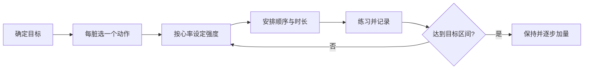

# Concept-Book Run

domain: /home/papagame/projects/digital-duck/cb-meta-health/public/domains/meta_health_ch09/input/graph.yaml
target: daily_meta_health_protocol
started: 2026-11-24T14:11:57

## Teaching order (19 concepts)

- eating_as_internal_exercise
- daily_baduanjin_practice_plan
- harmony_as_health
- stress_resilience_routine
- five_organ_routine_design
- five_phase_meal_design
- organ_training_principles
- personal_daily_rhythm_schedule
- dual_lens_translation
- five_phase_integration_matrix
- mindful_meal_protocol
- evidence_quality
- internal_external_cultivation
- evidence_and_safety_lens
- habit_formation
- mind_body_digestive_loop
- personalization
- self_observation_feedback
- daily_meta_health_protocol

### eating_as_internal_exercise (0.7s)

## 饮食即内脏运动

**定义。** 吃饭常被看作"补充能量",但从生理学角度看,进食同时是一次持续数小时的内脏运动。咀嚼、吞咽、胃的研磨与排空、小肠的节律性收缩、胆汁与胰液的分泌、肝脏的代谢加工,都需要消耗能量并调动血流。这部分额外耗能称为食物热效应(饮食诱导产热):蛋白质约为其所含能量的 20%–30%,碳水化合物约 5%–10%,脂肪约 0%–3%,混合膳食平均约 10%。

**例题。** 小李某餐摄入 800 kcal 的混合膳食,热效应按 10% 估算:

$$
800\ \text{kcal} \times 10\% = 80\ \text{kcal}
$$

也就是说,这一餐净获得约 720 kcal。若同样 800 kcal 全部来自蛋白质(热效应取 25%),消耗为 200 kcal,净获得 600 kcal。热效应在餐后 1–4 小时达到高峰,此时心输出量和内脏血流也会明显增加,所以饱餐后人容易犯困,也不适合立刻剧烈运动。

**问题解决应用。** 这一视角能帮助我们解释和处理几个常见问题:

1. **餐后困倦与胃肠不适。** 内脏血流增加,加上大量进食使胃扩张,会加重"负担"。把一餐分成适量的两餐,可以降低单次的内脏负荷。
2. **控制体重。** 热效应只占总能量消耗的约 10%,不能当作"吃得越多烧得越多"的理由。高蛋白、高纤维的食物热效应更高、饱腹感更强,对控制总摄入有一些帮助,但效果有限,总能量平衡仍是决定因素。
3. **安排运动时间。** 大量进食后,血液需要同时供应消化道和骨骼肌,剧烈运动容易引起腹痛、反流。通常建议饱餐后休息 1–2 小时再进行中高强度运动。

**与传统观点的对照。** 中医认为"脾胃为后天之本",强调饮食有节、不可过饱,所谓"饮食自倍,肠胃乃伤"(《黄帝内经》)。这与现代生理学的结论一致:过量进食会增加消化器官的负担,并伴随胃排空延缓、反流等表现。不过,"饮食自倍"是一个定性的提醒,没有给出具体的量。具体吃多少,应由个人的能量需求来决定。

**练习。** 小王每天摄入 2400 kcal,其中约 20% 来自蛋白质,热效应按蛋白质 25%、其余营养素 8% 估算。请计算他一天的食物热效应,并说明这笔消耗占摄入量的百分之几。(提示:先分别算出蛋白质和其余部分的摄入量。)

*参考答案:蛋白质 480 kcal,热效应 120 kcal;其余 1920 kcal,热效应约 154 kcal;合计约 274 kcal,占摄入量约 11%。*

### daily_baduanjin_practice_plan (0.7s)

## 每日八段锦练习计划

**定义。** 每日八段锦练习计划,是把八段锦(一套由八个动作组成的传统导引功法)按固定的时间、次数和强度安排进日常生活的方案。计划的关键不在动作本身,而在可持续:练习的时间点固定、总时长可估算、强度可随身体反应调整。

**运动强度的估算。** 八段锦属于低到中等强度的有氧加肌肉耐力活动。运动医学常用代谢当量(MET)衡量强度,1 MET 约等于静坐时的耗能。已发表的研究通常把八段锦估为约 2.5~3.5 MET,属于轻到中等强度。能量消耗可用常见估算式:

$$
\text{能量消耗(kcal)} \approx \text{MET} \times \text{体重(kg)} \times \text{时间(h)}
$$

**示例。** 小李体重 60 kg,每次练习一整套约 20 分钟,取 3 MET:

$$
3 \times 60 \times \frac{20}{60} = 60\ \text{kcal}
$$

每天一次,一周约 420 kcal。这个数字不大,八段锦的价值主要在规律性、柔韧性、平衡和放松,而不是减重。

**问题解决:为自己设计一份四周计划。** 假设你是久坐的大学生,每天学习超过 8 小时,目标是缓解颈肩僵硬并养成习惯。可以这样安排:

| 周次 | 每天时长 | 内容 | 自我检查 |
|---|---|---|---|
| 第 1 周 | 10 分钟 | 只练前四段,动作放慢 | 练完是否轻微发热、呼吸平稳 |
| 第 2 周 | 15 分钟 | 练完整八段,每段重复 4 次 | 能否不憋气、不弯腰驼背 |
| 第 3 周 | 20 分钟 | 完整一遍,每段重复 6 次 | 次日是否有过度酸痛 |
| 第 4 周 | 20 分钟 | 固定在晚饭前或睡前 | 一周内完成几天 |

设计时可遵循四条原则:

1. **固定时间点。** 把练习绑定到已有习惯上,例如起床后或睡前,比"有空就练"更容易坚持。
2. **循序渐进。** 每周增加的时长不超过原来的约一半,避免关节和肌肉不适应。
3. **用感受监控强度。** 可用"谈话测试":练习时仍能轻松说完整句话,说明强度合适。若心率明显加快、头晕或胸闷,应立即停下休息。
4. **个体化调整。** 有高血压、关节疾病或孕期的人,开始前应咨询医生,必要时降低下蹲幅度,并避免长时间憋气或低头。

**关于证据。** 在中医(TCM)中,八段锦被认为可以"调理脏腑"。现有临床研究更多支持的是它对颈肩痛、睡眠质量、平衡能力和情绪的改善作用,而不是治疗疾病,不应替代正规治疗。

**小结。** 好的练习计划应当具体、可量化、能复盘:先定时间和时长,再估算强度,最后用一周完成天数和身体感受来调整。

### harmony_as_health (0.8s)

## 阴平阳秘：以平衡为健康

**定义。** 中医认为，健康不是某个指标"正常"的静止状态，而是机体在不断变化的环境中持续自我调节、保持协调的动态过程。《黄帝内经》以"阴平阳秘，精神乃治"概括这一观点：阴（偏于滋润、内守、抑制的一面）与阳（偏于温煦、外发、推动的一面）彼此制约、相互配合，不偏盛也不偏衰，人就处于健康状态。这里的"平"不是两者"相等"，而是"协调适度"。这是中医的理论框架，它不是可以测量的量，不能写成等式。

现代生理学有一个可以对照的概念：稳态（homeostasis）。它同样把健康理解为动态调节，而不是固定不变。二者说法不同，不应把中医的阴阳与具体生理指标一一对应。

**工作示例：体温与血糖的"动态平衡"。** 人的核心体温大约在 36.5–37.5 °C 之间波动，一天内可相差约 1 °C。天热时，皮肤血管扩张、出汗增加；天冷时，血管收缩、产生寒战。这些反应的目的，是让体温回到适宜范围。

血糖也是如此。健康成年人空腹血糖通常为 3.9–6.1 mmol/L。进餐后血糖上升，胰岛素分泌增加，促使组织摄取葡萄糖，血糖在 2 小时内回落到 7.8 mmol/L 以下。健康的标志不是血糖"始终不变"，而是"波动之后能回到范围内"。

**问题求解应用。** 下面用"平衡"的思路分析一个常见情境。

> 小李连续一周熬夜赶项目，白天靠咖啡提神，晚上难以入睡，还常觉口干、心烦。

1. **找出偏离。** 睡眠不足、咖啡因过量、进食不规律，使身体长期处于"高消耗、低恢复"的状态。
2. **用中医语言描述。** 中医可能把口干、心烦、难入睡归为"阴不制阳"，即内守与滋养的一面不足，偏于亢奋的一面相对突出。这是描述性的说法，并非诊断。
3. **用现代知识对照。** 睡眠不足会升高应激激素水平，并影响血糖调节。咖啡因的半衰期约 5–6 小时，下午 4 点喝下的咖啡，到晚上 10 点仍有约一半留在体内。
4. **制定调整方案。** 把咖啡截止时间提前到中午；固定就寝时间，保证 7–9 小时睡眠；晚餐不过晚、不过饱；加入适度运动。

**证据说明。** 上述调整措施（规律睡眠、限制咖啡因、适度运动）有充分的现代研究支持；而"阴阳"本身是一种解释框架，尚未得到现代医学检验。若症状持续数周，或伴有体重明显变化、心悸、情绪低落，应就医检查，而不是仅靠自我调节。

**小结。** 以平衡为健康，实用的要点是：关注整体趋势而非单一数值，关注偏离后能否恢复，并在偏离出现早期就调整生活方式。

### stress_resilience_routine (0.6s)

## 每日抗压练习

**定义。** 每日抗压练习是一套每天固定时间、短时长、可重复的小动作组合，目的是让身体的应激反应在压力来临之前就得到调节，并在压力之后更快恢复。它不是应急手段，而是像刷牙一样的日常习惯。一套典型的练习包含三个部分：呼吸调节、轻度运动和睡前放松。

**为什么有效。** 压力出现时，交感神经兴奋，心率加快、血压上升、皮质醇分泌增加。缓慢呼吸（每分钟约 6 次）会增强迷走神经的活动，使心率下降。有氧运动长期坚持，可以降低静息心率，并改善情绪。规律的睡眠则帮助身体完成夜间的恢复。在 TCM 中，类似的调息、导引（如八段锦）也常被用于调节情志，目前这些方法的证据主要来自小型研究，效果因人而异。

**练习方案（共约 30 分钟）。**

| 时段 | 内容 | 时长 | 要点 |
|---|---|---|---|
| 早晨 | 缓慢腹式呼吸 | 5 分钟 | 吸气 4 秒，呼气 6 秒 |
| 白天 | 快走或八段锦 | 20 分钟 | 微微出汗，仍能交谈 |
| 睡前 | 关闭屏幕，伸展与深呼吸 | 5 分钟 | 光线调暗，固定入睡时间 |

**示例。** 小林是大二学生，期末周前心率常在静息时达到每分钟 88 次，夜里难以入睡。她按上表坚持练习。早晨呼吸练习时，她用手机计时：吸气 4 秒、呼气 6 秒，一个周期 10 秒，每分钟 6 次，5 分钟共 30 次。白天快走 20 分钟。这样做了四周后，她的静息心率降到每分钟 80 次，入睡所需时间也缩短。这里的数字只是个例，不代表每个人都会有同样幅度的变化。

**问题解决：如何设计并调整你自己的练习。**

1. **找出压力高峰。** 先记录一周：什么时候最紧张（早上赶课、晚上赶作业）？把练习放在高峰之前，而不是之后。
2. **选择能坚持的最小量。** 若 30 分钟太长，可先从 10 分钟开始（3 分钟呼吸、5 分钟走路、2 分钟睡前放松）。坚持比强度重要。
3. **用可测量的指标跟踪。** 每天早晨起床后、起身前测量静息心率，记录入睡时间和睡眠时长。以两到四周为一个观察期，而不是只看某一天。
4. **按结果调整。** 如果睡眠没有改善，先检查睡前是否仍在使用屏幕或摄入咖啡因，再考虑调整运动时间（避免临睡前剧烈运动）。

**注意。** 如果长期出现持续的情绪低落、焦虑难以控制、胸闷心悸或严重失眠，这套练习不能替代专业评估，应及时就医或寻求心理咨询。

**小结。** 每日抗压练习的核心是：固定时间、短时长、可测量、可调整。先从最容易做到的一小步开始，再根据自己的记录逐步优化。

### five_organ_routine_design (0.6s)

## 设计你的五脏操练习

**定义。** 五脏操练习是把一组动作按固定顺序排成日常训练的方法。设计这样的练习，就是回答四个问题：练什么、练多久、练多强、怎样安排顺序。中医认为，五脏（肝、心、脾、肺、肾）各有对应的调养方式；现代运动科学则用可测量的量来评估效果，比如心率、时长和主观用力程度。设计时可以把两者分开：传统的分类决定动作的搭配，可测量的指标决定强度和安全。传统说法本身缺少足够的临床证据，所以练习的效果要靠你自己记录的数据来判断。

**设计的四个要素。**

1. **目标：** 想改善什么，比如久坐后的僵硬、爬楼梯时气短，或睡前的紧张。
2. **动作选择：** 每个"脏"选一个动作，总共五个。
3. **强度：** 用心率或自觉用力程度（1～10 分）控制。中等强度的常用参考是最大心率的 $64\%\sim76\%$，最大心率可粗略估算为 $220-\text{年龄}$。
4. **时间与顺序：** 总时长 15～20 分钟，先热身，再主体，最后放松。

**例题。** 小林今年 20 岁，每天伏案学习 8 小时，想设计一套 15 分钟的晨练。

- 最大心率约为 $220-20=200$ 次/分。
- 中等强度区间约为 $200\times0.64=128$ 到 $200\times0.76=152$ 次/分。
- 动作安排如下：

| 脏 | 动作 | 时间 | 强度 |
|---|---|---|---|
| 肝 | 站姿侧身拉伸（舒展两胁） | 3 分钟 | 低，3 分 |
| 心 | 原地踏步加摆臂 | 4 分钟 | 中，5～6 分 |
| 脾 | 腹部按摩加转腰 | 3 分钟 | 低，3 分 |
| 肺 | 扩胸加深呼吸 | 3 分钟 | 低，3 分 |
| 肾 | 双手搓腰加屈膝下蹲 | 2 分钟 | 中低，4 分 |

小林的做法是把需要明显提高心率的"心"动作放在中间，前后用低强度动作热身和放松。

**问题解决应用。** 练了两周后，小林发现踏步时心率到了 165 次/分，超出了目标区间，而且有些头晕。可以按下面的步骤调整：

1. 找原因：是踏步太快，还是前一晚没睡好？
2. 先改变量：把踏步时间减为 3 分钟，速度放慢，并把省下的 1 分钟加到呼吸放松上。
3. 重新测量：下一次练习后，再记录心率和自觉用力程度。

如果调整后仍然头晕，或有胸闷、胸痛，就应停止练习并去看医生。个人设计的练习不能代替诊断和治疗。

*设计流程图：从确定目标到记录和调整，形成可以反复修正的循环。*

**小结。** 好的个人练习要有明确的目标，有清楚的动作和顺序，并用心率等可测量的量来检验。如果检验不合格，就改动作或强度，再测一次。

### five_phase_meal_design (0.7s)

## 五行膳食设计

**定义。** 五行膳食设计是中医(TCM)中一种安排饮食的方法。TCM 认为,食物的"五味"(酸、苦、甘、辛、咸)分别与五脏(肝、心、脾、肺、肾)相联系,因此可以按体质、季节和身体状况来搭配食物。需要说明的是,"五味对应五脏"属于传统理论的框架,并没有被现代营养学或生理学证实。现代饮食指南的依据是能量、宏量营养素和微量营养素的摄入量。因此,较稳妥的做法是把五行当作"多样化搭配的提示",再用营养学数据检验菜单是否合格。

**五味与常见食物对照**

| 五味 | 对应脏腑(TCM) | 常见食物 | 营养学角度的主要贡献 |
|---|---|---|---|
| 酸 | 肝 | 柠檬、山楂、醋 | 维生素 C、有机酸 |
| 苦 | 心 | 苦瓜、茶、芥蓝 | 多酚、膳食纤维 |
| 甘 | 脾 | 米饭、南瓜、红薯 | 碳水化合物、能量 |
| 辛 | 肺 | 姜、葱、白萝卜 | 挥发性香味物质 |
| 咸 | 肾 | 海带、紫菜、少量酱油 | 碘、钠 |

**工作流程。** 先用文字确定当天的"主题"(例如秋季偏干燥,TCM 主张多吃润肺的食物),再按五味各选一种食材,最后核对营养。

**示例。** 一位体重 60 kg、轻体力活动的大学生,每天约需 2000 kcal 能量。秋季午餐设计如下:

- 酸:凉拌山楂木耳(少量山楂)
- 苦:清炒芥蓝
- 甘:杂粮饭 150 g(熟重),约 170 kcal
- 辛:白萝卜炖排骨
- 咸:紫菜蛋花汤(盐控制在少量)

午餐大约占全天能量的 35%,即

$$2000 \times 0.35 = 700\ \text{kcal}$$

粗略估算:杂粮饭约 170 kcal、排骨萝卜汤约 250 kcal、芥蓝约 60 kcal、山楂木耳约 50 kcal、紫菜蛋花汤约 70 kcal,合计约 600 kcal,距目标还差约 100 kcal,可加一份水果或增加 50 g 米饭补足。

**解题应用。** 设计菜单时按以下步骤检验:

1. 用五味清单检查是否有明显缺失。若一周内几乎没有"苦"味,说明深色蔬菜和茶类偏少,应补充。
2. 用营养数据检查能量和蛋白质是否达标。
3. 检查钠摄入。成人每日食盐宜控制在 5 g 以内,而"咸"味的酱油、腌制品很容易超标。若五行清单要求"补咸",应选海带、紫菜等低钠来源,而不是多加盐。
4. 若有慢性病(如高血压、糖尿病),以医生和营养师的建议为准,不能用五行搭配替代治疗。

**小结。** 五行膳食设计的实际价值在于促使人们食材多样、色味丰富;其理论解释不能当作疾病防治的依据。把它与能量和营养素的核算结合起来,才是安全、可验证的做法。

### organ_training_principles (1.0s)

## 脏腑训练原则

**定义。** 脏腑训练原则是指把"训练而不过载"的思路,同样用于肌肉、消化器官和神经系统的一套通用方法。这些系统都有一个共同特点:适度的刺激会让它们变强,过量的刺激则会造成损伤。原则有五条:**热身**、**适当负荷**、**循序渐进**、**恢复**和**持之以恒**。

- **热身**:先用低强度刺激唤起功能。例如运动前慢跑5分钟,或进食前先喝几口温水。
- **适当负荷**:刺激要略高于现有能力,但不能超出承受范围。
- **循序渐进**:每次只小幅增加负荷。运动训练中常用的经验做法是每周增幅不超过约10%。
- **恢复**:适应发生在休息期间,不发生在刺激期间。肌肉需要24–48小时修复,睡眠则是神经系统恢复的主要时段。
- **持之以恒**:规律的中等刺激,效果好过偶尔一次的极端刺激。

**例题。** 小林想从零开始跑步,目前每周跑 10 公里,目标是半程马拉松(约 21 公里)。如果每周增加 10%,他需要多少周才能达到每周 21 公里?

每周总量 $d_n = 10 \times 1.1^{\,n}$。令 $d_n \ge 21$,得

$$1.1^{\,n} \ge 2.1,\qquad n \ge \frac{\ln 2.1}{\ln 1.1} \approx 7.8$$

所以约需 8 周。这个结果说明:循序渐进看起来慢,却是安全的路径。若他第一周就直接跑 21 公里,增幅达110%,肌肉和肌腱很可能受伤,之后的休养反而要花更长时间。

**问题解决应用。** 同样的思路也适用于消化系统和神经系统。

*场景一:消化。* 一个人长期吃得清淡,突然参加聚餐,吃了大量高脂食物,随后腹胀、腹泻。胆汁和消化酶的分泌能力会随饮食适应,骤增的脂肪量超过了当时的"负荷"。改进办法:先从少量开始(热身),逐步增加种类和分量(渐进),两餐之间留出间隔(恢复)。

*场景二:神经系统。* 一名学生连续三晚只睡4小时备考,第四天注意力和记忆明显下降。大脑的学习巩固发生在睡眠中,缺少恢复,继续加大学习量只会让效率下降。更好的安排是学习50分钟、休息10分钟,并保证每晚7–9小时睡眠。

*通用检查表:* 遇到症状时,依次问自己五个问题。(1)开始前有没有热身?(2)今天的负荷比上次高出多少?(3)增幅是否过快?(4)恢复是否足够?(5)是否坚持规律?多数过载问题,都能在其中某一项找到原因。

需要注意:如果出现持续疼痛、反复呕吐、长期失眠等症状,说明问题可能已超出训练调整的范围,应当就医,而不是继续"加练"。

### personal_daily_rhythm_schedule (0.7s)

## 个人作息节律计划

**定义。** 个人作息节律计划,是根据自己的昼夜节律(约24小时的生物钟周期)、睡眠需求、进食、运动和学习工作安排,制订的一份每日时间表。它的目标是让每天的起床、进餐、活动和入睡时间尽量固定,使生物钟与外界时间保持同步。光照是生物钟最强的校准信号,其次是进餐和运动的时间。

TCM(中医)也主张作息顺应昼夜变化,并有“子午流注”等十二时辰的说法。这类时间对应的脏腑理论缺乏可靠的临床证据。本节的计划以现代睡眠医学与时间生物学的结论为依据。

**制订步骤。**

1. 确定固定的起床时间。成年人通常需要 7–9 小时睡眠,起床时间是整个计划的锚点。
2. 往前推算入睡时间:入睡时间 = 起床时间 − 睡眠时长 − 入睡所需时间(约 15–20 分钟)。
3. 起床后 1 小时内接触户外光,晚上睡前 1 小时减少强光和屏幕。
4. 按固定间隔安排三餐,咖啡因在睡前 8 小时以前停用,较剧烈的运动避开睡前 2 小时内。

**例题。** 小李是大学生,周一至周五早上 8:00 有课,需要 8 小时睡眠,平时入睡约需 20 分钟。周末他习惯睡到 11:00,周日晚上常常失眠。请为他制订计划。

*解:* 取起床时间 6:50(给通勤和早餐留出时间),则入睡时间为 6:50 − 8 小时 − 20 分钟,即前一天 22:30 上床。他的计划如下:

| 时间 | 安排 |
|---|---|
| 6:50 | 起床,拉开窗帘或到户外 |
| 7:30 | 早餐 |
| 12:30 | 午餐 |
| 16:30–17:30 | 运动 |
| 18:30 | 晚餐 |
| 14:00 前 | 最后一杯咖啡(睡前 8 小时,即 14:30 以前) |
| 21:30 | 调暗灯光,放下手机 |
| 22:30 | 上床 |

**问题应用。** 小李周末睡到 11:00,比工作日晚起约 4 小时,相当于每周往返一次“跨时区旅行”,这种现象称为社会性时差。周日晚上的失眠正是生物钟被推迟的结果。解决办法是把周末起床时间限制在工作日后 1 小时以内,例如 7:50 左右起床。若周末确实欠觉,可在午后小睡不超过 30 分钟,不要用晚起来补。

**调整原则。** 若要改变作息,每 2–3 天提前或推后 15–30 分钟,比一次性大幅调整更容易坚持。坚持记录 1–2 周的实际入睡和起床时间,再对照白天的精神状态修订计划。若调整后仍长期失眠或白天严重困倦,应当咨询医生,排查睡眠呼吸暂停等疾病。

### dual_lens_translation (0.7s)

## 双重视角：中医与生理学的互译

**定义。** 双重视角，是指在面对同一个身体现象时，同时使用中医（Traditional Chinese Medicine，TCM）的语言和现代生理学的语言去描述，并在两者之间建立可检验的对应关系。互译不等于"等同"。中医认为"脾主运化"，这是一种功能性的归纳；生理学则讲胃排空、消化酶分泌和小肠吸收。两套语言的分类单位不同，因此翻译时应当问三个问题：它描述的是什么可观察的现象？生理学中有哪些可测量的指标与之相关？这种对应有没有证据支持？

**一个可靠的翻译步骤：**

1. 抓住现象：把中医术语还原为患者可报告或可测量的表现。
2. 寻找指标：选出生理学中对应的量，如心率、血压、血糖、体温。
3. 标明边界：说明哪些部分有研究支持，哪些尚无证据，哪些已被证伪。

**例题。** 一位同学考试前连续三晚睡眠不足，白天心慌、手心出汗、口干。中医可能称之为"心火亢盛"或"心神不宁"。如何翻译？

- 现象：心慌、出汗、口干。
- 生理学解释：睡眠不足和考试压力会激活交感神经，使肾上腺素分泌增多，心率上升，唾液分泌减少。
- 可测指标：静息心率。假设他平时为 $65$ 次/分钟，此刻为 $95$ 次/分钟，则增加了 $95-65=30$ 次/分钟，约为平时的 $\frac{30}{65}\approx 46\%$。
- 心输出量按定义为 $CO = HR \times SV$。若每搏输出量 $SV$ 近似不变，仅因心率上升，心输出量就会按相同比例增加。

这样，"心火亢盛"这个说法就被还原成了一组可以记录的数据：睡眠时长、静息心率、主观症状评分。

**问题求解应用。** 假设另一位同学说自己"脾虚"，表现为饭后腹胀、乏力、大便偏稀。用双重视角处理时，不应直接断言"脾虚等于某种病"，而应列出生理学上的几种可能：

| 中医描述 | 可能的生理学解释 | 可检验的做法 |
|---|---|---|
| 饭后腹胀 | 进食过快、乳糖不耐受、胃排空偏慢 | 记录饮食日志，排除乳糖食物 |
| 乏力 | 铁摄入不足、睡眠不足、能量摄入过低 | 评估每日能量（kcal）、必要时检测血红蛋白 |
| 大便偏稀 | 肠道感染、膳食纤维或糖醇摄入变化 | 观察持续时间，持续不缓解则就医 |

这张表的用途是把一个笼统的标签拆成可以逐项排查的问题。其中若出现持续体重下降、便血、发热等警示信号，应优先就医，不应只靠中医标签自行调理。

**小结。** 双重视角的价值，在于让传统术语成为"提问的起点"，让生理学指标成为"回答的依据"。当两者吻合时，可以相互补充；当中医的说法缺乏证据或可能延误治疗时，应明确以可靠的生理学证据为准。

### five_phase_integration_matrix (0.7s)

## 五行整合总表

**定义。** 五行整合总表把全书分散的内容放进同一张表：每一行对应一个"行"，同时列出脏腑、五脏运动、八段锦招式、五味与食物、情志、脏腑时辰和季节。TCM 认为，这些条目属于同一套归类体系，所以同一行里的内容可以放在一起安排。这是一种便于记忆和编排日常作息的索引，不是可以计算的公式。

| 行 | 脏腑 | 五脏运动 | 八段锦 | 五味与食物 | 情志 | 时辰 | 季节 |
|---|---|---|---|---|---|---|---|
| 木 | 肝 | 舒展、拉伸 | 第六式"两手攀足固肾腰"之外的伸展类动作，如第三式"调理脾胃须单举"的对拉拔伸 | 酸：醋、山楂 | 怒 | 丑时（1–3 时） | 春 |
| 火 | 心 | 有节律的有氧活动 | 第七式"攒拳怒目增气力"的发力与呼吸配合 | 苦：苦瓜、茶 | 喜 | 午时（11–13 时） | 夏 |
| 土 | 脾 | 腹式呼吸、核心稳定 | 第三式"调理脾胃须单举" | 甘：谷物、山药 | 思 | 巳时（9–11 时） | 长夏 |
| 金 | 肺 | 扩胸、深呼吸 | 第二式"左右开弓似射雕" | 辛：葱、姜 | 悲 | 寅时（3–5 时） | 秋 |
| 水 | 肾 | 腰背屈伸、下肢力量 | 第六式"两手攀足固肾腰" | 咸：海带、少量盐 | 恐 | 酉时（17–19 时） | 冬 |

表中的招式与脏腑对应取自八段锦的常见教学说法，不同流派略有差异，请以所学版本为准。

**证据说明。** 八段锦作为温和运动，对平衡、柔韧和血压有一定研究支持。脏腑时辰、五味入五脏、情志配五行则属于 TCM 的理论归类，缺乏可检验的生理证据，只宜当作记忆框架使用。

**例题。** 小李每年秋季容易觉得胸闷、情绪低落，想用本表安排一周练习。

1. 先找行：按表中的秋季，对应金行，即肺、悲、辛味、寅时。
2. 再选动作：金行对应第二式"左右开弓似射雕"，配合扩胸和深呼吸。寅时是凌晨，不必为此早起，他可以改在傍晚固定时间练习，每次 10 分钟。
3. 最后配饮食：多加入葱、姜等辛味食材，但肠胃敏感时要适量。

**问题解决应用。** 这张表真正的用处，是在你的生活节奏和练习之间建立固定的联系。

- **按季节排练习重点：** 春季多做拉伸类动作，冬季加入腰背和下肢训练。
- **按情绪选择调节方式：** 烦躁时先做舒展类动作和缓慢呼吸，再判断需要何种调整。
- **识别局限：** 若胸闷持续、伴有呼吸困难或心悸，应就医检查，不能只靠表中的"金行"练习来处理。肺部、心脏疾病的诊断依赖体检和影像、心电图等检查，不依赖五行归类。

**小结。** 五行整合总表是全书的一页索引：它把动作、饮食、作息和情绪的练习安排放在同一个框架下，帮助你持续练习。把它当作规划工具，而不是诊断工具。

### mindful_meal_protocol (0.7s)

## 正念用餐方案

**定义。** 正念用餐方案是一套把注意力有意识地放回进食过程的结构化做法。它的目标很实际:放慢进食速度,更清楚地察觉饥饿感和饱足感,从而减少不自觉的过量进食。方案不规定吃什么,也不要求计算热量,它改变的是"怎么吃"。

**基本步骤。** 一次完整的正念用餐通常包括五步:

| 步骤 | 做法 | 目的 |
|---|---|---|
| 1. 餐前评估 | 用 1–10 分给饥饿程度打分(1 = 极饿,10 = 极撑) | 区分生理饥饿与习惯性进食 |
| 2. 排除干扰 | 关闭电视和手机,坐下,把食物放在桌上 | 让注意力集中在食物上 |
| 3. 慢速进食 | 每口咀嚼约 15–20 次,口中有食物时放下餐具 | 拉长进食时间 |
| 4. 中途检查 | 吃到一半暂停,重新打分 | 捕捉饱足信号 |
| 5. 适时停止 | 到达 6–7 分(舒适、不撑)即可停下 | 以身体信号而非餐盘是否见底来决定 |

**为什么慢下来有用。** 饱足信号需要时间才能传到大脑,通常认为大约要 20 分钟。吃得很快时,信号还没到,食物已经吃过量了。一些研究发现,放慢进食速度可使单餐摄入量略有下降,但效果因人而异,不应期待它单独带来大幅减重。

**例题。** 小林午餐习惯边看视频边吃,10 分钟吃完一份约 800 kcal 的盖饭,吃完常觉得过饱。她改用正念用餐方案:

1. 餐前打分为 3 分(明显饥饿),关掉视频,坐下开始吃。
2. 每口多嚼几次,口中有饭时放下筷子。吃了约 12 分钟时暂停,打分为 6 分(已经舒服,但还想继续吃)。
3. 她决定再吃几口,到 7 分时停下,剩下约四分之一的饭,大约少摄入 200 kcal。
4. 她记录下:全程用时 25 分钟,餐后无胀感,下午没有犯困。

**问题解决应用。** 方案遇到困难时,可以这样调整:

- **只有 15 分钟午休:** 不必强求 25 分钟,保留"餐前打分"和"中途检查"两步即可,这两步几乎不占时间。
- **总是在中途检查时忘记打分:** 用外部提示,例如吃到餐盘的一半、或放下一次餐具时就打分。
- **情绪性进食(压力大时想吃零食):** 先打分。若饥饿程度在 5 分以上,说明可能不是生理饥饿,可先喝水或离开座位 10 分钟,再评估一次。
- **与家人聚餐:** 无法控制用餐速度时,以"每吃几口就放下餐具聊天"来自然放慢。

**小结。** 正念用餐方案的核心是用简单的打分和暂停,把"自动进食"变成"有觉察的进食"。它是一种可练习的习惯训练,效果通过自己的记录来检验:比较实施前后的用餐时间、餐后感受和摄入量,再决定如何调整。

### evidence_quality (0.8s)

## 证据质量的判断

**定义。** 证据质量,是指一项研究结论在多大程度上值得相信。它取决于研究设计、样本规模、偏倚控制和结果能否被重复。常见的证据来源,从强到弱大致如下:

| 证据类型 | 特点 | 主要局限 |
|---|---|---|
| 系统综述与荟萃分析 | 汇总多项试验 | 受纳入研究质量限制 |
| 随机对照试验 | 随机分组,能检验因果 | 费用高,随访时间有限 |
| 队列与病例对照研究 | 观察真实人群 | 混杂因素难以排除 |
| 病例报告、专家意见 | 提供线索 | 无对照,易受偏倚影响 |
| 传统经验 | 长期使用 | 使用久不等于有效 |

在中医中,传统经验同样要经过这一检验。TCM 的某个方剂或疗法用了上千年,只说明它被长期使用,不能证明它有效。

**例题。** 一项观察性研究追踪了 2 万人,发现每天喝绿茶的人心血管病发生率更低。这是否说明喝绿茶能保护心脏?

分析如下:

1. 研究设计是观察性的,没有随机分组,只能说明二者相关。
2. 找混杂因素。喝绿茶的人可能更常运动、吸烟更少、收入更高,这些因素本身就影响心脏健康。
3. 看效应大小和剂量关系。如果每天喝得越多,风险越低,因果的可能性会增大,但仍不能确证。
4. 结论:这是有提示意义的线索,证据等级为中低,需要随机试验来验证。

**问题解决应用。** 面对一条健康声明,可以按下面四步判断。

1. **查来源。** 它来自试验、观察研究,还是个人经验或广告?
2. **查设计。** 有没有对照组?是否随机、盲法?样本是否足够大?
3. **查效应。** 用具体数字衡量。例如某疗法使血压平均下降 $2\,\text{mmHg}$,统计上显著,但临床意义很小。降低 $10\,\text{mmHg}$ 才对降低中风风险有实际价值。
4. **查一致性。** 多项独立研究的结果是否一致?只有一项阳性结果的,应保持谨慎。

再看一个例子。一种草药宣称能改善失眠,依据是几十位使用者的好评。按上面四步:来源是个人经验,没有对照,样本小,没有可量化的结果。它只能算作假设。如果后来有一项随机、双盲、安慰剂对照的试验,纳入 300 人,并用睡眠时长(分钟)和失眠量表评分作为结果,结论的可信度就大幅提高。若多项试验的结果一致,这一结论才可以写进实践建议。

**小结。** 证据质量不是非黑即白,而是一个从弱到强的连续过程。好的判断者不会因为一项研究就全盘相信,也不会因为一种疗法出身传统就一概否定。他们先看设计,再看数据,最后看这个结论能否被重复。当证据不足时,应坦率承认不确定,而不是用传统或权威来填补空白。

### internal_external_cultivation (0.7s)

## 内外兼修

### 定义

内外兼修是一种把“外在运动”和“内在饮食”当作同一套健康实践的两个部分来安排的思路。在中医(Traditional Chinese Medicine,TCM)中,外修指通过太极、八段锦、散步等运动,使气血在经络中运行通畅;内修指通过专注、有节制的进食来调养脏腑。TCM 认为二者缺一不可:只运动不注意饮食,或只讲究饮食而久坐不动,都不完整。

用现代生理学的语言看,这两部分对应两类可以测量的过程:运动影响心率、心输出量和肌肉对血糖的摄取;进食影响总能量摄入、餐后血糖和消化负荷。“气血”“经络”属于中医的解释框架,本节用它们转述传统说法,不当作可测量的量。

### 例题

小李每天久坐办公,晚饭常常匆忙吃完,再瘫坐在沙发上。她想按内外兼修的思路调整一周的安排:

**外修部分**:每天饭后 30 分钟快走 20 分钟。中等强度快走大约每分钟消耗 4 到 5 kcal,所以 20 分钟约消耗 80 到 100 kcal。

**内修部分**:晚饭放慢速度,每口咀嚼到细碎再咽下,吃饭时不看手机,吃到七分饱就停。用餐时间从 8 分钟延长到 20 分钟。

| 项目 | 调整前 | 调整后 |
|---|---|---|
| 晚餐用时 | 8 分钟 | 20 分钟 |
| 饭后活动 | 无 | 快走 20 分钟 |
| 每日额外消耗 | 0 kcal | 约 80 到 100 kcal |

### 问题解决应用

**问题**:小李两周后发现体重几乎没变,怎么办?

**分析步骤**:

1. **先分清两部分各自的作用。** 快走每天只多消耗 80 到 100 kcal。一个中等大小的甜点就可能抵消它。运动的主要收益是改善餐后血糖和心肺功能,不能只看体重。
2. **检查内修是否真正落实。** 放慢进食的价值在于给饱腹信号留出时间,这个信号通常要进食约 20 分钟后才明显。如果小李仍在 10 分钟内吃完,内修就没有做到位。
3. **用可测量的指标评估。** 记录晚餐用时、饭后步行时长、餐后两小时血糖(如有条件)和静息心率。两周内静息心率下降、餐后血糖波动变小,说明调整有效,即使体重暂时没动。
4. **再调整。** 只改变一个变量,例如把快走延长到 30 分钟,或把晚餐主食减少四分之一,然后再观察两周。

**要点**:内外兼修的实用价值在于“两部分同时做、分别记录”。外修常见的证据是运动对血糖、血压和心肺功能的益处;内修中细嚼慢咽、专注进食对饱腹感的帮助也有研究支持。至于气血沿经络运行这一机制,现代医学尚未证实。

### evidence_and_safety_lens (0.7s)

## 证据与安全视角

**定义。** 证据与安全视角是一种在面对任何健康建议时都先问两个问题的习惯：第一，这个说法有多少可靠证据支持？第二，它对我自己是否安全？根据证据强度，健康说法大致分为三类：

| 类别 | 含义 | 例子 |
|---|---|---|
| 证据确凿 | 多项对照研究结果一致 | 餐后散步可降低血糖；八段锦可改善平衡能力 |
| 合理但未证实 | 机制说得通，研究少或质量有限 | 某些呼吸放松练习有助于缓解压力 |
| 传统隐喻 | 属于传统理论的语言，并非可检验的生理机制 | 中医认为"气血不通"导致不适 |

这三类并无高下之分，只是回答的问题不同。隐喻可以帮助人理解和记忆，但不能当作诊断依据。

**例题。** 小李的父亲 58 岁，患 2 型糖尿病，正在服用降糖药。小李在网上看到"饭后散步 15 分钟能降血糖"，还看到"按压某穴位可以代替降糖药"。

逐条判断：

1. 饭后散步：多项研究发现，餐后轻度活动能让血糖峰值下降。这属于证据确凿，风险也低，可以尝试。
2. 穴位代替降糖药：没有可靠证据表明穴位按压能替代药物控制血糖。擅自停药可能使血糖失控，这一说法属于有害，应明确拒绝。

**问题求解：四步检查法。**

1. **归类**：这个说法属于确凿、合理还是隐喻？
2. **查风险人群**：我是否属于糖尿病、心脏病、孕期或正在服药的人群？这些人群往往需要调整强度或时间。
3. **看红旗症状**：出现以下情况应立即就医，不要等待"调理"：胸痛或胸闷、呼吸困难、晕厥、持续剧烈头痛、孕期出血或明显腹痛、血糖过低（心慌、出冷汗、意识模糊）。
4. **不自行改药**：任何运动或传统疗法都只能作为补充，调整药物必须由医生决定。

**应用。** 回到小李的父亲。他服用降糖药，饭后散步时若出现头晕、出冷汗、手抖，可能是低血糖，应立即停下并补充糖分，之后告知医生。他还可以在散步前后测血糖，把数据带给医生，由医生判断药量是否需要调整。

再看一个情境：一位孕妇想练八段锦。八段锦对健康成年人的平衡能力有证据支持，但孕期的研究较少，且部分动作涉及大幅度弯腰、下蹲。较稳妥的做法是先咨询产科医生，再选择幅度较小的动作。

**小结。** 先归类，再查风险，识别红旗症状，不擅自改药。证据决定一件事值不值得做，安全决定它适不适合此刻的你做。

### habit_formation (0.9s)

## 习惯养成

**定义。** 习惯养成是指把一个小而具体的行为,绑定到已经稳定存在的日常节点上,重复到它几乎不需要意志力就能发生的过程。研究习惯的心理学家称这个已有节点为"触发线索"。线索越固定、动作越小,行为就越容易持续。吃饭、起床、刷牙、通勤都是现成的线索,因为它们每天都会发生,无需另行记忆。

**为什么小剂量更持久。** 雄心勃勃的计划(例如"每天跑步一小时")依赖当天的精力、时间和心情,任何一天出现波动就会中断,中断之后又容易全盘放弃。小剂量的做法把门槛降到几乎总能完成的程度,所以连续执行的天数更长,这种重复本身才是形成习惯的关键。研究中常被引用的数字是:一项针对志愿者的研究发现,新行为变得自动化平均需要约66天,个体差异很大,从18天到254天不等。

**例子。** 下面比较两个目标相同的方案,目标都是增加每天的活动量。

| 方案 | 内容 | 触发线索 | 门槛 |
|---|---|---|---|
| 甲 | 每天早晨健身一小时 | 无固定线索,靠"有空就做" | 高 |
| 乙 | 每天快走10分钟 | 午饭后立即出门 | 低 |

假设甲方案在一个月里因加班、疲劳等原因只完成了10天,累计 $10\times 60=600$ 分钟;乙方案完成了28天,累计 $28\times 10=280$ 分钟。再看坚持情况:甲方案的重复次数只有10次,远低于形成自动化所需的数量;乙方案有28次,并且还在继续。一般来说,第二个月甲方案很可能归零,乙方案则可以顺势延长到15分钟。

另一个例子是进食前的"一次呼吸":每顿饭开始前,先做一次缓慢的深呼吸,再拿起筷子。这个动作只需几秒钟,线索是"看到饭菜",几乎没有失败的机会。它能让进食速度略微放慢,也为之后增加咀嚼次数、留意饱腹感打下基础。

**问题解决应用。** 设计自己的习惯时,可以按四步操作:

1. **选线索**:挑一个每天必然发生的事件,如"起床后喝水""晚饭后"。
2. **缩动作**:把目标缩到在最糟糕的一天也能完成,比如2分钟拉伸、5个深蹲。
3. **写成句子**:"在【线索】之后,我就【小动作】。"明确的句子比"我要多运动"更容易执行。
4. **逐步加量**:连续两周几乎不漏之后,再把时间或次数增加一小步。

如果某天漏掉了,不必补做,也不必自责,第二天照常接上即可。单次漏做对结果影响很小,真正的风险是因此放弃整个计划。

**小结。** 习惯养成的重点不在于单次做得多好,而在于是否每天都能重复。把小动作挂在吃饭、起床这类固定线索上,是让健康行为长期留存的实用做法。

### mind_body_digestive_loop (0.7s)

## 身心与消化的循环

**定义。** 身心与消化的循环,是指心理状态与消化功能之间相互影响、可以形成良性或恶性反馈的一条链:心理状态 → 专注进食 → 餐后休息 → 轻柔的引导性活动 → 更好的心理状态。消化道有丰富的神经分布,与大脑通过自主神经(迷走神经与交感神经)双向联系,因此情绪会改变胃肠功能,胃肠状态也会反过来影响情绪。

这条链上的每一环都有生理依据:

| 环节 | 做法 | 生理作用 |
|---|---|---|
| 心理状态 | 进食前先平静下来 | 副交感神经占优,唾液与胃液分泌正常 |
| 专注进食 | 细嚼慢咽,不看屏幕 | 咀嚼充分,饱腹信号(如胃扩张、激素变化)有时间传到大脑 |
| 餐后休息 | 静坐或放松约10–20分钟 | 血流优先供应胃肠 |
| 轻柔活动 | 散步10–15分钟 | 促进胃排空,稳定餐后血糖 |

中医认为"脾胃为后天之本",并主张饭后缓行、情志调和;这些说法与现代研究中"餐后轻度活动有助于血糖控制"的结论方向一致。

**工作示例。** 小林是备考的大学生,午餐常常在刷题时十分钟吃完,随后立刻继续学习,下午总觉得胃胀、犯困。他把流程改成:

1. 进食前深呼吸一分钟,放下手机;
2. 用20分钟吃完,每口多咀嚼几次;
3. 餐后静坐5分钟;
4. 慢走15分钟再回到书桌。

两周后,他记录到:胃胀的天数从每周5天降到2天,下午的困倦感明显减轻。这与上述链条一致:进食速度放慢,减少了吞入空气和过量进食;餐后轻度活动则有助于胃排空。注意,这只是个人记录,不是对照实验,但它展示了如何把这个循环转化为可检验的日常做法。

**问题解决应用。** 这条链的关键特点是:压力在第一环就会使它断裂。压力下交感神经兴奋,消化液分泌与胃肠蠕动受到抑制,人也更容易吃得快、吃得多或干脆不吃,后面三环便无从谈起。因此,当你发现自己饭后总是不舒服时,应当从前往后排查:

- 进餐前是否处于紧张、赶时间的状态?如果是,先用1–2分钟缓慢呼吸(每次呼气比吸气更长)再动筷。
- 进餐时能否不看屏幕?
- 餐后是否久坐?如果是,安排一次短时间散步。

如果压力无法在进餐前缓解,可以降低期望:至少完成后面两环(餐后静坐、散步),它们仍有独立的益处。若胃部不适持续数周、伴随体重下降或黑便,则不应归因于"心情",须就医检查。

*身心与消化的循环:四个环节首尾相接,压力首先破坏心理状态这一环。*

### personalization (0.7s)

## 个性化调整

**定义。** 个性化调整是指:不给所有人开同一张"通用处方",而是根据个人的体质(体质)、年龄、体能水平、慢性疾病和文化饮食背景,修改框架中的具体参数。框架本身(例如"规律运动、均衡饮食、充足睡眠")保持不变,变化的是强度、频率、食物选择和禁忌。

中医(Traditional Chinese Medicine,TCM)把个体差异称为"体质",常见分类有平和质、气虚质、阳虚质、痰湿质等。需要说明的是,体质分类是一种经验性的归纳工具,其各类型的科学效度仍缺乏充分的临床证据。相比之下,年龄、体能、血糖、血压等指标有明确的测量方法,应当优先作为调整依据。

**例题。** 某健康指南建议成年人每周进行 150 分钟中等强度有氧运动。比较两位使用者:

| 项目 | 小李 | 张阿姨 |
|---|---|---|
| 年龄 | 20 岁 | 62 岁 |
| 健康状况 | 无慢性病 | 高血压(已服药) |
| 运动基础 | 经常跑步 | 几乎不运动 |

最大心率的常用估算公式为:

$$HR_{\max} \approx 220 - \text{年龄}$$

中等强度通常取最大心率的 $64\%$ 至 $76\%$。

- 小李:$HR_{\max} \approx 200$ 次/分,目标区间约 $128$ 至 $152$ 次/分。
- 张阿姨:$HR_{\max} \approx 158$ 次/分,目标区间约 $101$ 至 $120$ 次/分。

此外,张阿姨应先咨询医生:部分降压药(如 β 受体阻滞剂)会压低心率,此时用心率区间会失准,改用自觉用力程度(能说话但不能唱歌)更合适。她也不必一开始就做满 150 分钟,可从每天 10 分钟快走起步,逐周增加。

**问题求解应用。** 遇到具体情形时,可按四步处理:

1. **先筛查风险**:有无慢性病、用药、怀孕等需要医生参与的情况。
2. **再调参数**:根据年龄和体能调整强度与时长,而不是调整目标本身。
3. **结合文化与习惯**:例如乳糖不耐受者可用豆制品补钙;偏好温热饮食的人,在不影响营养的前提下,可保留这一习惯以提高坚持度。
4. **定期复查**:每 4 至 8 周依据体重、血压、血糖或主观感受重新评估。

练习:一位 45 岁、空腹血糖偏高、平时久坐的上班族,想开始运动。请估算其最大心率与中等强度区间,并列出你会先问的三个问题。(参考:$HR_{\max}\approx175$,区间约 $112$ 至 $133$ 次/分;可问用药情况、有无胸闷或头晕史、膝关节是否健康。)

个性化不等于随意。它要求调整有依据,并且随着身体状况的变化持续修正。

### self_observation_feedback (0.8s)

## 自我观察与反馈

**定义。** 自我观察与反馈,是指把自己的身体状态当作一组可以持续记录的数据,定期回看,再据此调整饮食、运动和作息,方式很像教练根据训练表现调整训练计划。要点有三个:记录要简单,足够坚持;观察要连续,单次数据意义有限;调整要小步,一次只改一个变量。

**常见观察项目。**

| 项目 | 记录方式 | 说明 |
|---|---|---|
| 精力 | 每天早、午、晚各打 1–5 分 | 午后是否明显下滑 |
| 食欲 | 饥饿程度与进食时间 | 是否暴饮暴食或毫无食欲 |
| 消化与大便 | 频率、形态(可参照布里斯托大便分类)、有无腹胀 | 3 次/天至 3 次/周都属常见范围,重点看自己的变化 |
| 睡眠 | 入睡时间、起床时间、夜醒次数 | 手环数据只作参考 |
| 情绪 | 当天主要情绪,1–5 分 | 与压力事件一并记录 |
| 舌象 | 晨起自然光下拍照:舌色、舌苔厚薄 | 中医认为舌象可反映脾胃状态,但它不是诊断工具,易受食物染色和刷舌影响 |
| 可选:心率变异性 | 晨起静息测量 | 同一设备、同一时段比较 |
| 可选:血糖 | 空腹及餐后 2 小时 | 需合规的血糖仪;有糖尿病者应遵医嘱 |

**例题。** 小林想改善午后困倦。基线一周:早餐为白面包加甜饮料,午后精力平均 2.0 分,晚上 11:30 入睡。第一步只改一个变量:早餐换成鸡蛋、燕麦和一份水果,其他不变。再记录一周,午后精力平均上升到 3.4 分。

变化量为 $3.4 - 2.0 = 1.4$ 分。小林有血糖仪,餐后 2 小时血糖由 8.1 mmol/L 降到 6.4 mmol/L,与主观感受一致,支持"早餐影响午后状态"的判断。

**问题解决应用。** 按以下循环操作:

1. **建立基线**:不改变任何习惯,记录 7–14 天。
2. **提出假设**:例如"高糖早餐导致午后困倦"。
3. **单变量干预**:只改一件事,持续 1–2 周。
4. **比较与判断**:对照基线看趋势。变化小于日常波动(比如精力评分本来就在 2–4 分之间摇摆)时,不要下结论。
5. **保留或回退**:有效则保留,无效就换下一个假设。

**注意事项。**

- 样本很小:一两周的记录只能提示方向,不能证明因果。睡眠不足、月经周期、天气、考试压力都会同时影响数据。
- 避免过度监测:如果记录引发焦虑,或你开始为一个数值反复纠结,就应减少项目,只保留精力和睡眠两项。
- 危险信号不能靠自我调整处理:持续便血或黑便、不明原因体重下降、持续低落或有自伤念头、反复晕厥等,应及时就医。

**小结。** 自我观察不是追求完美的数据,而是用少量、连续、可比较的记录,让每一次调整都有依据。

### daily_meta_health_protocol (0.6s)

## 日常元健康方案

**定义。** 日常元健康方案是把运动、饮食、情绪和作息看作一个整体来安排的24小时实践。这里的"元"取"整体大于部分之和"之意,与"代谢健康"无关。它不是一张必须照做的清单,而是一份起点蓝图:先按下面的框架执行,再根据自己的观察逐步调整。

**一天的骨架**

| 时段 | 做法 | 理由 |
|---|---|---|
| 清晨 | 晨光照射10~15分钟,再练八段锦 | 早晨光线有助于校准生物钟;八段锦是低强度的全身活动 |
| 每餐前 | 做3~5次缓慢的腹式呼吸 | 放慢节奏,让进食从匆忙状态切换出来 |
| 用餐 | 细嚼慢咽,吃到七八分饱 | 饱腹信号通常滞后约20分钟,慢食更容易及时察觉 |
| 餐后30~40分钟 | 散步或轻柔活动10~15分钟 | 餐后轻度活动可以降低餐后血糖峰值 |
| 白天 | 每工作约90分钟做一次1~2分钟的放松 | 打断持续紧张,例如伸展、深呼吸、望远 |
| 傍晚 | 早而清淡的晚餐 | 睡前留出消化时间,减轻夜间胃部负担 |
| 夜间 | 子时(23:00~1:00)之前入睡 | 保证足够的睡眠时长,并保持规律 |

中医认为,八段锦和子时前入睡有助于调和气机。这一说法属于传统理论框架,在此只作解释,不作为方案的依据。方案中有现代研究支持的部分,主要是晨光与生物钟、规律作息、餐后活动和睡眠充足。

**例题。** 小林早餐常常一边看手机一边吃,每天午餐后立刻坐回工位,晚上11:40才睡。他一餐摄入约700 kcal,吃得很快,常常撑得难受。请为他设计一周的调整计划。

*分析:* 一次只改一两项,否则难以坚持。

1. 第1周:午餐前呼吸3次,放下手机,把一餐的用时从10分钟延长到20分钟。吃到七八分饱就停,多数人这样做会少吃约10%~20%,即约70~140 kcal,不必刻意计算。
2. 第2周:午餐后30~40分钟起身走10分钟。
3. 第3周:把入睡时间每三天提前15分钟,目标是23:00前。

每周记录三项:餐后是否撑胀、下午是否困倦、早晨起床时的精神状态。如果某一项加重,就退回上一步,不要硬撑。

**问题解决要点。**

- **个体差异。** 糖尿病患者、孕妇、有胃肠疾病或正在用药的人,饮食量、餐后活动和睡眠安排应先咨询医生。
- **轮班工作者。** 无法在子时前入睡时,保持固定的睡眠时长和规律,比死守具体钟点更重要。
- **观察与调整。** 每两周回顾一次记录,保留有效的做法,去掉做不到的部分。方案的价值在于长期坚持,而不在于第一天做得多完美。

**小结。** 日常元健康方案把一天当作一个整体来安排:晨光与八段锦启动,饭前呼吸、七八分饱和餐后轻动稳住中段,白天适时放松,早而清淡的晚餐和规律的睡眠收尾。每个人都应在这个框架上,根据自己的观察逐步调整。

## Run complete

total: 27.5s
