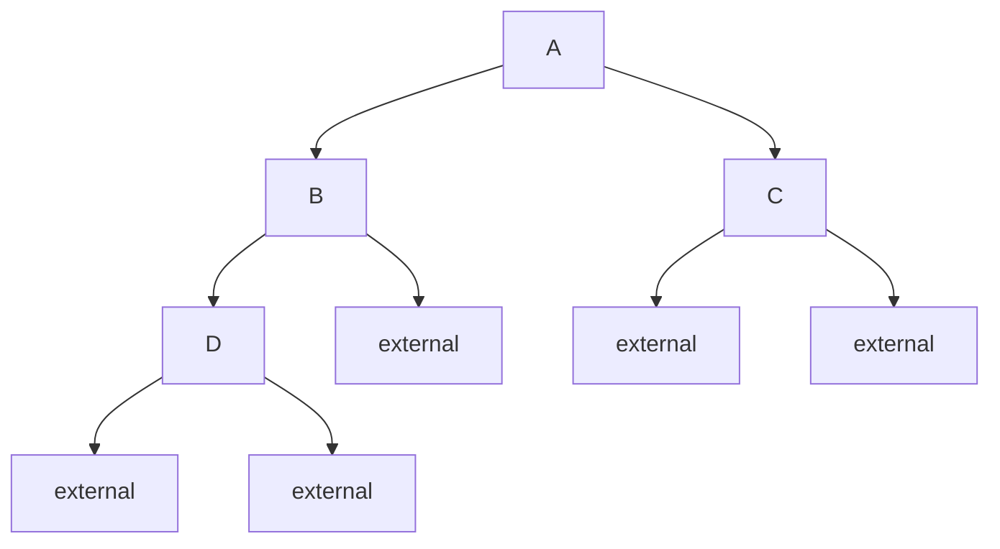
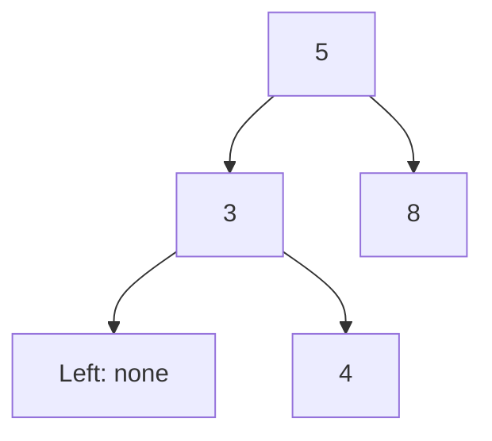
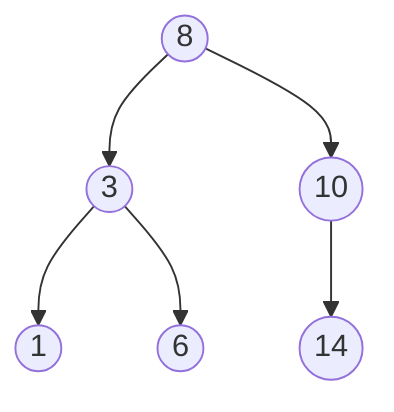
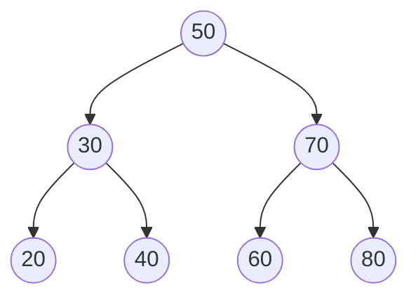
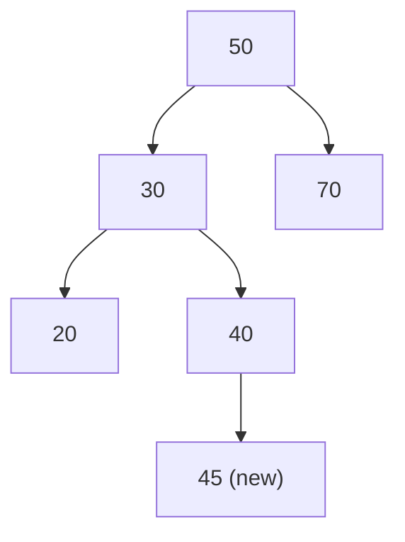
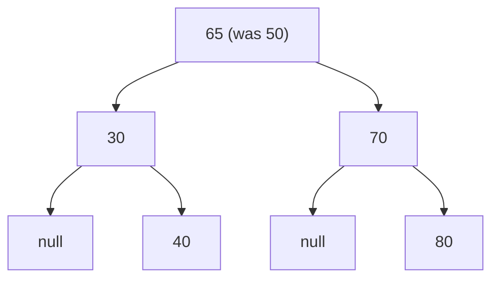
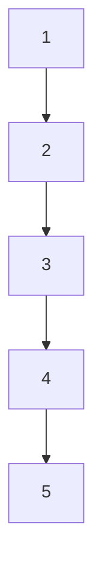

# Concept-Book Run

domain: /home/papagame/projects/digital-duck/cb-data-structure/public/domains/data_structure_ch06/input/graph.yaml
target: tree_balancing_strategies
started: 2026-11-24T14:25:27

## Teaching order (8 concepts)

- binary_tree
- total_order
- binary_search_tree
- bst_search
- bst_addition
- bst_removal
- unbalanced_bst_performance
- tree_balancing_strategies

### binary_tree (0.7s)

## Binary Tree

A **binary tree** is a rooted tree in which every node has at most two children, designated the **left child** and the **right child**. The two positions are distinguished: a node whose only child is on the left is a different structure from one whose only child is on the right. Any missing child position is filled by an **external node** (a placeholder leaf), while nodes that carry data are called **internal nodes**. Equivalently, a binary tree is either empty (a single external node) or consists of a root together with an ordered pair of binary trees, its left and right subtrees.

**Key measures.** The *depth* of a node is the number of edges from the root to it. The *height* $h$ of a tree is the maximum depth of any internal node. A tree with $n$ internal nodes has exactly $n+1$ external nodes.

*Proof (induction on $n$).* For $n=0$ the tree is one external node, so $0+1=1$. Suppose the claim holds for all smaller trees. A tree with $n$ internal nodes has root subtrees with $n_L$ and $n_R$ internal nodes, where $n_L+n_R=n-1$. By hypothesis, the external node count is $(n_L+1)+(n_R+1)=n+1$. $\blacksquare$

Level $d$ holds at most $2^d$ nodes, so a tree of height $h$ has at most

$$n \le 2^{h+1}-1$$

internal nodes. Rearranging gives $h \ge \lceil \log_2(n+1)\rceil - 1$. Height therefore ranges from about $\log_2 n$ (balanced) to $n-1$ (a chain), and this range governs the running time of tree algorithms.

### Worked example

Consider a tree with root $A$, left child $B$, and right child $C$. Node $B$ has a left child $D$ and no right child. Node $C$ has no children.

- Internal nodes: $A, B, C, D$, so $n=4$.
- External nodes: $B$'s right slot, plus two slots each for $C$ and $D$, giving $1+2+2=5 = n+1$. ✓
- Depths: $A=0$; $B,C=1$; $D=2$. Height $h=2$.
- Bound check: $2^{h+1}-1 = 7 \ge 4$. ✓

A recursive **inorder traversal** (left subtree, node, right subtree) visits $D, B, A, C$.


*The example tree. Squares of missing children are shown as external nodes; $n=4$ internal and $5$ external.*

### Problem-solving application

**Problem.** A binary tree must store $1{,}000{,}000$ keys. What is the smallest possible height, and what is the worst case?

**Solution.** Use $n \le 2^{h+1}-1$, so $2^{h+1} \ge 1{,}000{,}001$. Since $2^{19}=524{,}288$ and $2^{20}=1{,}048{,}576$, we need $h+1 \ge 20$, so $h_{\min}=19$. The worst case is a chain with $h = n-1 = 999{,}999$.

**Why it matters.** A search that follows one root-to-leaf path costs $O(h)$. In the balanced case that is about $20$ steps. In the degenerate case it is nearly a million. This gap is why balanced variants such as AVL and red-black trees exist: they keep $h = O(\log n)$ regardless of insertion order.

**Check yourself.** A binary tree has $15$ external nodes. How many internal nodes does it have? (Answer: $n+1=15$, so $n=14$.)

### total_order (0.7s)

## Total Order

**Definition.** A *total order* on a set $S$ is a relation $\le$ that, for all $a, b, c \in S$, satisfies four properties:

1. **Reflexive:** $a \le a$.
2. **Antisymmetric:** if $a \le b$ and $b \le a$, then $a = b$.
3. **Transitive:** if $a \le b$ and $b \le c$, then $a \le c$.
4. **Total (comparable):** either $a \le b$ or $b \le a$ (or both).

The first three properties define a *partial order*. The fourth is what makes the order *total*: no two elements are left incomparable. The integers, the reals, and strings under dictionary order are all totally ordered. Subsets of a set under $\subseteq$ are not. For example, $\{1\}$ and $\{2\}$ are incomparable.

**Why it matters for binary search trees.** A binary search tree (BST) keeps every key in a node's left subtree smaller than the node's key and every key in its right subtree larger. This rule only makes sense if any two keys can be compared and the comparisons agree with each other. Totality guarantees that a comparison always has an answer. Transitivity guarantees that if a key is less than the root, it is also less than everything the root is greater than. This is why a search can safely discard an entire subtree after one comparison.

**Worked example.** Insert the keys $5, 3, 8, 4$ into an empty BST, and then search for $4$.

- $5$ becomes the root.
- $3 \le 5$ and $3 \ne 5$, so $3$ goes left of $5$.
- $8 > 5$, so $8$ goes right of $5$.
- $4 < 5$ goes left. Then $4 > 3$ goes right of $3$.

To search for $4$, compare with $5$ (go left), then with $3$ (go right), then find $4$. That took 3 comparisons, not a scan of all keys. Transitivity is what justifies skipping the right subtree, since $4 < 5 < 8$ implies $4 < 8$.

**Problem-solving application.** Suppose you store points $(x, y)$ in a BST and define $p \preceq q$ iff $x_p \le x_q$ *and* $y_p \le y_q$. Is this a valid ordering for the tree?

Check totality. Take $p = (1, 5)$ and $q = (2, 3)$. Then $x_p \le x_q$ but $y_p > y_q$, so neither $p \preceq q$ nor $q \preceq p$. The relation is only a partial order, and a search could not decide which way to go.

*Fix:* use **lexicographic order**: $p \prec q$ if $x_p < x_q$, or if $x_p = x_q$ and $y_p < y_q$. This is a total order, since the $x$-coordinates decide first and the $y$-coordinates break ties. Now $(1,5) \prec (2,3)$, and every pair has a definite answer.

**Practical check.** When you define a custom comparison for a BST, test three things:
- Does it return an answer for every pair?
- Is it consistent, so that $a<b$ and $b<c$ imply $a<c$?
- Does it treat equal keys the same way every time?

For floating-point values, $\text{NaN}$ breaks totality, because $\text{NaN} \le x$ is false for every $x$, including itself. A tree that stores $\text{NaN}$ without special handling can silently lose keys.


*The BST built from inserting 5, 3, 8, 4. Each left descendant is less than its ancestor, and each right descendant is greater, which is only well-defined because the keys are totally ordered.*

### binary_search_tree (0.8s)

## Binary Search Tree

**Definition.** A *binary search tree* (BST) is a binary tree whose nodes store keys from a total order, such that for every node $x$ with key $k(x)$:

$$
\forall\, y \in \text{left}(x):\; k(y) < k(x), \qquad \forall\, z \in \text{right}(x):\; k(z) > k(x).
$$

The property applies to *entire subtrees*, not just immediate children. Assuming distinct keys, an inorder traversal (left, node, right) visits keys in sorted order, which is the structure's central consequence.

**Search and insertion.** To find key $q$, start at the root. If $q$ equals the node's key, stop. If $q$ is smaller, go left. Otherwise go right. Reaching a null link means $q$ is absent. Insertion follows the same path and attaches a new leaf at the null link where the search ended. Each step discards a whole subtree, so the cost is $O(h)$, where $h$ is the tree's height.

**Worked example.** Insert the keys $8, 3, 10, 1, 6, 14$ into an empty BST, in that order.

- $8$ becomes the root.
- $3 < 8$, so it goes left of $8$.
- $10 > 8$, so it goes right of $8$.
- $1 < 8$, then $1 < 3$, so it goes left of $3$.
- $6 < 8$, then $6 > 3$, so it goes right of $3$.
- $14 > 8$, then $14 > 10$, so it goes right of $10$.


*The BST after inserting 8, 3, 10, 1, 6, 14. Every left subtree holds smaller keys and every right subtree holds larger ones.*

Now search for $6$. Compare with $8$ and go left. Compare with $3$ and go right. Compare with $6$, which matches. That took 3 comparisons, not 6.

**Problem-solving application.** The height $h$ decides performance, and it depends on insertion order. Inserting $1, 3, 6, 8, 10, 14$ in sorted order produces a chain of height $n-1 = 5$, so search degrades to $O(n)$. A balanced tree on $n$ keys has height $\lceil \log_2(n+1)\rceil - 1$, giving $O(\log n)$. For random insertion orders, the expected height is $O(\log n)$. To avoid the worst case, self-balancing variants such as AVL and red-black trees restructure the tree during updates.

**Deletion** has three cases for the node $x$ being removed:

1. *Leaf:* remove it.
2. *One child:* replace $x$ with that child.
3. *Two children:* replace $k(x)$ with its inorder successor, which is the minimum of the right subtree. Then delete that successor, which has at most one child.

For example, deleting the root $8$ above replaces it with $10$, the minimum of its right subtree. The old $10$ node has only a right child, $14$, so $14$ takes its place. The result is still a valid BST.

**Check yourself.** If a tree of $n = 1000$ keys is perfectly balanced, search needs at most about $\lceil\log_2 1001\rceil = 10$ comparisons. If the same keys were inserted in sorted order, search could need up to $1000$. This gap is why balance matters in practice.

### bst_search (0.8s)

## Bst Search

### Definition

A **binary search tree (BST)** is a binary tree in which every node with key $k$ satisfies the **BST property**: all keys in its left subtree are less than $k$, and all keys in its right subtree are greater than $k$. **BST search** exploits this property to locate a value $x$ starting at the root. At each node, compare $x$ to the node's key $k$:

- If $x = k$, the search succeeds.
- If $x < k$, continue in the left subtree.
- If $x > k$, continue in the right subtree.
- If the subtree to move into is empty (null), the search fails: $x$ is not in the tree.

Each comparison discards an entire subtree, so the search follows a single root-to-node (or root-to-null) path.

```python
def bst_search(node, x):
    while node is not None:
        if x == node.key:
            return node
        node = node.left if x < node.key else node.right
    return None
```

### Worked example

Consider the BST with root 50, whose left child is 30 (children 20 and 40) and whose right child is 70 (children 60 and 80).


*A BST with seven keys. Searching for 60 follows the path 50, 70, 60.*

**Search for 60:**
1. Compare with 50: $60 > 50$, go right.
2. Compare with 70: $60 < 70$, go left.
3. Compare with 60: equal, found. This took 3 comparisons.

**Search for 45:**
1. $45 < 50$, go left.
2. $45 > 30$, go right.
3. $45 > 40$, go right to a null child, so the search fails after 3 comparisons.

### Problem-solving application: cost analysis

The work done is proportional to the number of nodes on the path, which is at most $h + 1$, where $h$ is the tree's height (the number of edges on the longest root-to-leaf path). Therefore search runs in $O(h)$ time. Because the height depends on the tree's shape, two cases matter:

- **Balanced tree** with $n$ nodes: each step roughly halves the remaining nodes, so $h = \lfloor \log_2 n \rfloor$ and search takes $O(\log n)$. For $n = 1{,}000{,}000$, that is about 20 comparisons.
- **Degenerate tree:** inserting keys in sorted order ($1, 2, 3, \dots, n$) produces a chain with $h = n - 1$, so search takes $O(n)$, no better than a linked list.

**Practice problem.** Which of the sequences below could be the keys examined while searching for 45 in the tree above?
(a) 50, 30, 40, 45  (b) 50, 70, 40, 45

Sequence (a) is valid: it makes the correct moves (left at 50, right at 30, right at 40). Sequence (b) is impossible. After $45 < 50$ the search must go left, so 70 can never be visited, and 40 is not a child of 70. A useful check is that every examined key must fall within the interval set by earlier turns. After going left at 50 and right at 30, all later keys must lie strictly between 30 and 50.

**Key takeaway:** BST search is only as fast as the tree is short. Self-balancing variants (AVL, red-black trees) keep $h = O(\log n)$ to guarantee fast search.

### bst_addition (0.7s)

## Bst Addition

**Definition.** A binary search tree (BST) satisfies the ordering property: for every node with key $k$, all keys in its left subtree are less than $k$, and all keys in its right subtree are greater than $k$. *BST addition* inserts a new key $x$ by searching for $x$ exactly as in a lookup. When the search falls off the tree (it would move to an empty child), $x$ is attached there as a new leaf. The new node always becomes a leaf, so no existing node is moved or restructured, and the ordering property is preserved.

The procedure, starting at the root $r$:

1. If the tree is empty, make $x$ the root.
2. If $x < \text{key}(r)$, move to the left child. If $x > \text{key}(r)$, move to the right child.
3. Repeat until the chosen child is empty. Attach a new node holding $x$ there.
4. If $x = \text{key}(r)$ at any step, the key is a duplicate. Standard sets ignore it (or follow a stated duplicate policy).

```python
def insert(node, x):
    if node is None:
        return Node(x)
    if x < node.key:
        node.left = insert(node.left, x)
    elif x > node.key:
        node.right = insert(node.right, x)
    return node
```

**Worked example.** Insert $45$ into the tree with root $50$, where $50$ has children $30$ and $70$, and $30$ has children $20$ and $40$.

- Compare with $50$: $45 < 50$, go left to $30$.
- Compare with $30$: $45 > 30$, go right to $40$.
- Compare with $40$: $45 > 40$, go right. The right child of $40$ is empty.
- Attach $45$ as the right child of $40$.

The last node examined was $40$, and $45$ became its leaf child. An in-order traversal now gives $20, 30, 40, 45, 50, 70$, which is still sorted.


*Inserting 45 follows the path 50, 30, 40 and attaches the new key as the right child of 40.*

**Problem-solving application.** The cost of an insertion is proportional to the length of the search path, so it is $O(h)$, where $h$ is the tree height. The shape of the tree depends on the insertion order, and this matters in practice.

*Problem:* Compare the height after inserting $1,2,3,4,5$ in that order with the height after inserting $3,2,4,1,5$.

*Solution:* In the first order, each key is larger than everything already present, so each goes to the right of the previous one. The result is a chain of height $4$, and the last insertion makes $5$ comparisons against existing nodes, which is $\Theta(n)$ behavior. In the second order, $3$ is the root, $2$ and $4$ are its children, and $1$ and $5$ are leaves below them. The height is $2$.

In general, $n$ keys inserted in sorted order give $h = n-1$, so $n$ insertions cost
$$\sum_{i=0}^{n-1} i = \frac{n(n-1)}{2} = \Theta(n^2).$$
A balanced tree has $h = \lfloor \log_2 n \rfloor$ and gives $\Theta(n \log n)$ total. For random insertion orders, the expected height is $O(\log n)$. This gap is the reason self-balancing trees such as AVL and red-black trees exist. They add rotations after the same leaf insertion to keep $h$ logarithmic.

### bst_removal (0.6s)

## Bst Removal

**Definition.** Removing a value $k$ from a binary search tree (BST) means deleting the node that stores $k$ while preserving the BST invariant: for every node $x$, all keys in its left subtree are less than $x.\text{key}$ and all keys in its right subtree are greater. After a search locates the node $z$ holding $k$, exactly one of three cases applies:

1. **Leaf (no children):** splice $z$ out by setting its parent's pointer to null.
2. **One child:** splice $z$ out by linking its parent directly to $z$'s only child. The child's subtree already lies on the correct side of the parent.
3. **Two children:** do not remove $z$ structurally. Find its **in-order successor** $s$, the minimum of $z$'s right subtree. Copy $s.\text{key}$ into $z$, then remove $s$ from the right subtree. Since $s$ is the leftmost node there, it has no left child, so its removal is case 1 or 2.

The successor works because $s.\text{key}$ is larger than everything in $z$'s left subtree and no larger than anything else in $z$'s right subtree. Overwriting $z$'s key with it keeps the invariant intact.

**Worked example.** Insert 50, 30, 70, 20, 40, 60, 80, 65 into an empty BST. Node 70 has left child 60 (which has right child 65) and right child 80.

- *Remove 20 (leaf):* node 30's left pointer becomes null.
- *Remove 60 (one child, 65):* node 70's left pointer now points to 65.
- *Remove 50 (two children):* the minimum of the right subtree is found by starting at 70 and going left until there is no left child. That gives 65 (after the previous step). Copy 65 into the root, then splice out the original 65 node, a leaf.

The root now holds 65, with left subtree $\{30, 40\}$ and right subtree $\{70, 80\}$. An in-order traversal gives $30, 40, 65, 70, 80$, which is sorted, so the invariant holds.


*The tree after removing 20, 60, then 50. The root's key was replaced by its successor 65, whose original node was spliced out.*

**Problem-solving application.** Suppose a BST has height $h$. The search costs $O(h)$. In case 3, finding the successor costs at most the remaining height below $z$, and the final splice costs $O(1)$. Together the descent is a single root-to-leaf path, so

$$T_{\text{remove}}(h) = O(h).$$

This is $O(\log n)$ for a balanced tree but $O(n)$ for a degenerate one. Inserting $1,2,\dots,n$ in sorted order produces a chain.

To solve removal problems, follow this checklist:

1. Search for $k$, tracking the parent.
2. Count the children of the found node.
3. For 0 or 1 children, redirect the parent's pointer. Handle the case where $z$ is the root, because then the root pointer itself changes.
4. For 2 children, find the successor, copy its key, and recursively delete the successor from the right subtree.

A compact recursive implementation:

```python
def remove(node, k):
    if node is None: return None
    if k < node.key:   node.left  = remove(node.left, k)
    elif k > node.key: node.right = remove(node.right, k)
    else:
        if node.left is None:  return node.right
        if node.right is None: return node.left
        s = node.right
        while s.left: s = s.left
        node.key = s.key
        node.right = remove(node.right, s.key)
    return node
```

Returning the (possibly changed) subtree root at each level handles the root case automatically. A common error is forgetting that the successor may have a right child. In that case it must be spliced to its parent, not simply dropped. The recursive call handles this correctly.

### unbalanced_bst_performance (0.8s)

## Unbalanced Bst Performance

**Definition.** In a binary search tree (BST), every operation (`find(x)`, `add(x)`, `remove(x)`) begins at the root and follows a single root-to-node path, going left or right by comparing $x$ with each node's key. The work done at each node is constant, so the running time is proportional to the length of the path followed. That length is bounded by the tree's **height** $h$, the number of edges on the longest root-to-leaf path. Therefore each operation takes $O(h)$ time.

A plain BST does nothing to control $h$. Its shape depends only on the order in which keys were inserted. For $n$ keys, the height satisfies

$$\lfloor \log_2 n \rfloor \;\le\; h \;\le\; n-1.$$

The lower bound is reached by a perfectly full tree. The upper bound is reached when the tree **degenerates** into a chain, where every node has at most one child. Substituting $h = n-1$ gives the worst case:

$$T_{\text{find}}(n),\; T_{\text{add}}(n),\; T_{\text{remove}}(n) \in O(n).$$

**Worked example.** Insert the keys $1, 2, 3, 4, 5$ into an empty BST in that order.

- $1$ becomes the root.
- $2 > 1$, so it becomes the right child of $1$.
- $3 > 1$ and $3 > 2$, so it becomes the right child of $2$.
- Keys $4$ and $5$ continue the same pattern.

The result is a right-leaning chain of height $h = 4 = n-1$. Now call `find(5)`. The search compares $5$ with $1, 2, 3, 4$ and finally $5$, which is $n = 5$ comparisons. Searching for a missing key such as $6$ takes the same path and also makes $n$ comparisons. For $n = 10^6$ sorted insertions, a single lookup could need about a million comparisons. A balanced tree would need about $\log_2 10^6 \approx 20$.

The chain also makes `add` expensive. Inserting $6$ must walk the whole chain before attaching a new node. Building the whole chain by inserting $n$ sorted keys costs

$$\sum_{i=0}^{n-1} i = \frac{n(n-1)}{2} \in \Theta(n^2).$$

**Problem-solving application.** Suppose a program loads a sorted file of $20{,}000$ records into a BST, one record at a time.

1. *Is the input adversarial for a plain BST?* Yes. Sorted order produces a chain, so $h = 19{,}999$.
2. *Estimate the build cost.* About $\tfrac{1}{2}(20{,}000)^2 = 2\times 10^8$ comparisons.
3. *Estimate a balanced alternative.* About $n\log_2 n \approx 20{,}000 \times 14.3 \approx 2.9\times 10^5$ comparisons, roughly $700$ times fewer.

Two practical lessons follow. First, $O(n)$ is a worst-case bound that depends on the insertion order and does not describe every input. Randomly ordered keys produce an expected height of $O(\log n)$. Second, when the input order cannot be trusted (sorted, nearly sorted, or chosen by a user), use a self-balancing tree such as an AVL tree or red-black tree, or shuffle the keys before inserting. Either approach keeps $h = O(\log n)$ and so keeps all three operations at $O(\log n)$.


*A BST built by inserting 1 through 5 in sorted order is a right-leaning chain of height 4, so `find(5)` must visit all five nodes.*

### tree_balancing_strategies (0.5s)

## Tree Balancing Strategies

### Definition

A binary search tree (BST) supports search, insert, and delete in $O(h)$ time, where $h$ is the tree's height. For $n$ keys, $h$ ranges from $\lceil \log_2(n+1)\rceil - 1$ (balanced) to $n-1$ (a linked list produced by inserting sorted keys). A **balancing strategy** is any method that keeps $h = O(\log n)$, either always (worst case) or in expectation or amortized terms. Three families are common:

1. **Randomization.** Randomness in the structure prevents adversarial input from forcing a bad shape. A *treap* gives each key a random priority and maintains BST order on keys and heap order on priorities. The result is the same tree you would get by inserting keys in priority order, which is a random-order insertion. Its expected height is $O(\log n)$.
2. **Partial rebuilding.** Allow imbalance, then rebuild a subtree when it gets too lopsided. A *scapegoat tree* stores no balance data. After an insertion at depth greater than $\log_{3/2} n$, it finds an ancestor (the scapegoat) with $\text{size}(\text{child}) > \tfrac{2}{3}\,\text{size}(\text{node})$ and rebuilds that subtree perfectly. Rebuilding costs $O(\text{size})$, but it happens rarely, so insertion is $O(\log n)$ amortized.
3. **Simulated non-binary trees.** Represent a multiway tree as a binary one. A *2-3-4 tree* has nodes with 1–3 keys and all leaves at equal depth, so it is perfectly balanced by construction. A *red-black tree* encodes it in binary form, with red links joining keys that share a multiway node. Rotations and recolorings repair violations, which guarantees $h \le 2\log_2(n+1)$.

### Worked Example

Insert priorities into a treap. Keys $A<B<C<D$ arrive in sorted order with random priorities $A{:}\,7,\ B{:}\,2,\ C{:}\,9,\ D{:}\,4$ (higher priority is closer to the root). Heap order puts $C$ (9) at the root. $A$ and $B$ lie to its left, and $A$ has the higher priority, so $A$ is the left child and $B$ is $A$'s right child. $D$ is $C$'s right child. The height is 2, not the 3 a plain BST would give for sorted input.

### Problem-Solving Application

**Problem.** A scapegoat tree with $n = 100$ nodes accepts an insertion at depth 12. Is a rebuild triggered?

**Solution.** The depth threshold is $\log_{3/2}(101) = \dfrac{\ln 101}{\ln 1.5} \approx \dfrac{4.615}{0.405} \approx 11.4$. Since $12 > 11.4$, the tree is too deep, so we climb from the new node to find the first ancestor that violates the $\tfrac23$ rule. Say the ancestor has size 30 and its child has size 21. Then $21/30 = 0.7 > 0.667$, so this ancestor is the scapegoat. We rebuild its 30-node subtree into a perfectly balanced shape in $O(30)$ time.

**Why amortization works.** After a rebuild, the subtree is perfectly balanced. For it to become $\tfrac23$-unbalanced again, many insertions must hit one side, which is $\Omega(\text{size})$ of them. Spreading the $O(\text{size})$ rebuild cost over those insertions adds only $O(1)$ per insertion per ancestor level, giving $O(\log n)$ amortized overall.

**Choosing a strategy.**

| Strategy | Guarantee | Extra data per node |
|---|---|---|
| Treap | Expected $O(\log n)$ | Random priority |
| Scapegoat | Amortized $O(\log n)$ | None |
| Red-black | Worst-case $O(\log n)$ | 1 color bit |

Use randomization when simplicity matters, partial rebuilding when memory is tight, and simulated multiway trees when strict worst-case latency is required.

## Run complete

total: 12.8s
