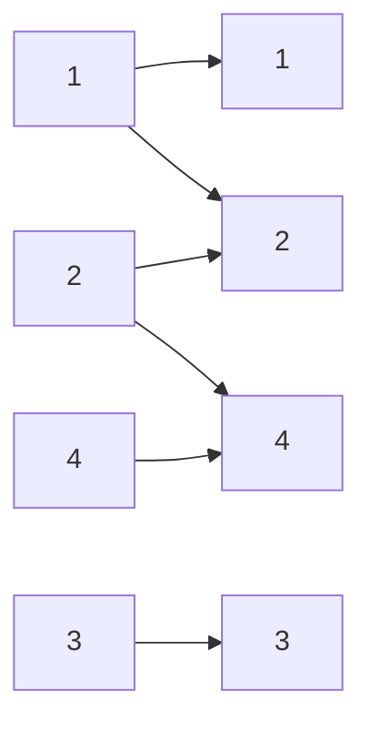
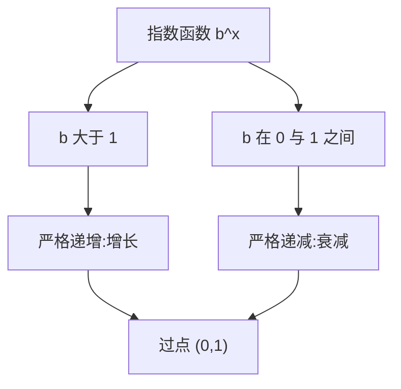

# Concept-Book Run

domain: /home/papagame/projects/digital-duck/cb-calculus/public/domains/calculus_ch01/input/graph.yaml
target: richter_scale_application
started: 2026-11-24T14:25:47

## Teaching order (7 concepts)

- relation
- function
- one_to_one_function
- exponential_function
- inverse_function
- logarithmic_function
- richter_scale_application

### relation (1.3s)

## 关系

**定义。** 设 $A$、$B$ 是两个集合。从 $A$ 到 $B$ 的**关系** $R$ 是笛卡尔积 $A\times B$ 的任意子集：

$$R\subseteq A\times B=\{(x,y)\mid x\in A,\ y\in B\}.$$

若 $(x,y)\in R$，记作 $xRy$，读作"$x$ 与 $y$ 有关系 $R$"。$A$ 称为**定义域所在集合**，$B$ 称为**陪域**。实际取到的第一分量集合 $\operatorname{dom}R=\{x\mid \exists y,\ (x,y)\in R\}$ 称为**定义域**，实际取到的第二分量集合 $\operatorname{ran}R=\{y\mid \exists x,\ (x,y)\in R\}$ 称为**值域**。若 $A=B$，称 $R$ 为 $A$ 上的关系。

注意：关系对"配对方式"没有任何限制。一个 $x$ 可以对应多个 $y$，也可以不对应任何 $y$。当每个 $x\in A$ 恰好对应一个 $y$ 时，关系才成为**函数**，所以函数是一种特殊的关系。

**例题。** 设 $A=\{1,2,3,4\}$，定义 $A$ 上的关系 $R=\{(x,y)\mid x\text{ 整除 }y\}$。

列出所有满足条件的有序对：

$$R=\{(1,1),(1,2),(1,3),(1,4),(2,2),(2,4),(3,3),(4,4)\}.$$

共 $8$ 个有序对，而 $|A\times A|=16$，所以 $R$ 是 $A\times A$ 的真子集。

读出性质：
- $\operatorname{dom}R=\{1,2,3,4\}$，$\operatorname{ran}R=\{1,2,3,4\}$。
- $1$ 对应 4 个 $y$，所以 $R$ **不是**函数。
- 对每个 $x$ 都有 $(x,x)\in R$（自反性）；$(1,2)\in R$ 但 $(2,1)\notin R$（非对称）。

**问题求解应用。** 

*问题：* 某课程中，$A=\{\text{小明},\text{小红},\text{小刚}\}$ 为学生集合，$B=\{\text{数学},\text{物理},\text{化学}\}$ 为课程集合。已知选课关系为
$$R=\{(\text{小明},\text{数学}),(\text{小明},\text{物理}),(\text{小红},\text{物理}),(\text{小刚},\text{化学})\}.$$
问：(1) 选修物理的学生有哪些？(2) $R$ 是否为从 $A$ 到 $B$ 的函数？(3) 若要使 $R$ 成为函数，最少需要删除几个有序对？

*解：*
1. 找出第二分量为"物理"的有序对：$(\text{小明},\text{物理})$ 与 $(\text{小红},\text{物理})$，所以是小明和小红。
2. 小明出现在两个有序对中，对应两门课，违反"每个 $x$ 恰好一个 $y$"，所以 $R$ 不是函数。
3. 其余学生都只对应一门课，只有小明重复。删除 $(\text{小明},\text{数学})$ 或 $(\text{小明},\text{物理})$ 中的任意一个即可，最少删除 $1$ 个。

**小结。** 判断一个集合是不是关系，只需检查它的元素是否都是 $A\times B$ 中的有序对。要判断它是否为函数，再检查每个 $x$ 是否恰有一个 $y$。把关系写成有序对列表，是后续研究自反、对称、传递等性质的起点。

*图示：集合 $\{1,2,3,4\}$ 上"整除"关系的部分箭头图（左列为 $x$，右列为 $y$），一个 $x$ 可指向多个 $y$。*

### function (1.1s)

## 函数

**定义。** 函数是一种规则:它把输入集合(**定义域**)中的每一个元素,恰好对应到输出集合中的一个元素。若输出集合记为 $Y$,实际取到的所有输出值构成**值域**。记作

$$f: X \to Y,\qquad x \mapsto f(x).$$

关键在于“恰好一个”:同一个输入不能同时得到两个不同的输出,但不同的输入可以得到相同的输出。

**判断是否为函数。** 
- 学号 $\to$ 学生姓名:每个学号对应唯一学生,是函数。 
- 关系 $x = y^2$(把 $x$ 看作输入):当 $x=4$ 时,$y=2$ 或 $y=-2$,输出不唯一,所以不是函数。 
- 竖直线检验:任意竖直线与图像至多相交一点,则该图像表示函数。

**例题。** 设 $f(x)=\dfrac{\sqrt{x-1}}{x-3}$,求定义域,并计算 $f(5)$。

*解:* 根号要求 $x-1\ge 0$,即 $x\ge 1$;分母要求 $x\ne 3$。因此定义域为

$$\{x\in\mathbb{R}\mid x\ge 1,\ x\ne 3\}=[1,3)\cup(3,+\infty).$$

代入 $x=5$:

$$f(5)=\frac{\sqrt{4}}{2}=1.$$

**问题求解应用。** 一家出租车公司起步价 8 元(含 3 公里),超出部分每公里 2 元。设行驶距离为 $d$ 公里,车费为 $C(d)$。

1. 写出规则(分段函数):

$$C(d)=\begin{cases}8, & 0<d\le 3,\\[2pt] 8+2(d-3), & d>3.\end{cases}$$

2. 每个距离 $d$ 只对应一个车费,所以 $C$ 是函数,定义域为 $(0,+\infty)$,值域为 $[8,+\infty)$。
3. 计算 $C(10)=8+2\times 7=22$ 元。
4. 反向提问:车费为 20 元时行驶了多远?解 $8+2(d-3)=20$,得 $d=9$ 公里。因为在 $d>3$ 的部分,不同距离对应不同车费,这样的反问才有唯一答案;但 $C(1)=C(2)=8$,所以“车费 8 元”无法确定具体距离。这说明:**函数保证由输入得到唯一输出,却不保证由输出能唯一还原输入**(后者需要函数是一一对应的,即可逆)。

**解题要点。** 面对一个函数问题,依次问三件事:(1)定义域是什么(分母不为零、偶次根号下非负、对数真数为正);(2)规则是否对每个输入给出唯一输出;(3)值域是什么、能否反推输入。

*图:函数把定义域中的每个输入经过规则 $f$ 变为唯一的输出,所有输出构成值域。*

### one_to_one_function (22.0s)

## One To One Function

**定义**

设函数 $f$ 的定义域为 $D$。若对定义域中任意两个不同的输入 $x_1 \neq x_2$，都有 $f(x_1) \neq f(x_2)$，则称 $f$ 是**一一函数**（injective function，单射）。等价地，用逆否命题表述更便于验证：若 $f(x_1) = f(x_2)$，则必有 $x_1 = x_2$。这个性质保证了每一个输出值只对应唯一一个输入值——反过来查找"谁映射到这个输出"时答案是唯一确定的。这正是函数能够拥有反函数的必要条件：若 $f$ 不是一一的,就会有两个不同的 $x$ 争夺同一个输出,反函数就不知道该把这个输出送回哪个 $x$。

**判别方法：水平线检验与代数验证**

几何上,一一函数的图像与任意水平线 $y=k$ 至多相交一次（水平线检验,horizontal line test）。例如 $f(x)=x^3$ 是一一函数,因为它严格递增,任何水平线只穿过图像一次;而 $f(x)=x^2$（定义域为全体实数)不是一一函数,因为 $f(2)=f(-2)=4$,水平线 $y=4$ 与图像相交两次。

代数验证时,假设 $f(x_1)=f(x_2)$,通过代数运算推导是否必然得到 $x_1=x_2$。例如证明 $f(x)=3x-5$ 是一一函数:

$$3x_1 - 5 = 3x_2 - 5 \implies 3x_1 = 3x_2 \implies x_1 = x_2$$

推导成立,故 $f$ 是一一的。

**问题求解应用**

一一性在实际问题中常用于判断某个过程是否"可逆"。例如,给定分段函数

$$f(x) = \begin{cases} x+1, & x < 0 \\ x^2, & x \geq 0 \end{cases}$$

检验时需分三种情况:两输入都在同一分段内,或分别落在不同分段。在 $x<0$ 段,$f$ 是一一的（线性递增)；在 $x\geq 0$ 段，$f(x)=x^2$ 在非负区间上也是一一的（递增)。但需检查跨段是否冲突:当 $x<0$ 时 $f(x)<1$，当 $x\geq 0$ 时 $f(x)\geq 0$，两段值域在 $[0,1)$ 处可能重叠,需逐一核实是否存在 $x_1<0,\ x_2\geq 0$ 使得 $x_1+1=x_2^2$。此类分析正是限制函数定义域以构造反函数（如三角函数的反函数)时的标准操作。

### exponential_function (0.7s)

## 指数函数

**定义。** 形如
$$f(x)=b^{x},\qquad b>0,\ b\neq 1$$
的函数称为**指数函数**,其中底数 $b$ 是常数,自变量 $x$ 位于指数位置。这与幂函数 $x^{2}$ 不同:幂函数是底数变化、指数固定;指数函数则是底数固定、指数变化。

要求 $b>0$ 是为了使 $b^x$ 对所有实数 $x$ 都有定义(例如 $(-2)^{1/2}$ 不是实数);要求 $b\neq 1$ 是因为 $1^x=1$ 只是常数函数,不具备指数增长的特征。

**基本性质。**

- 定义域为 $\mathbb{R}$,值域为 $(0,\infty)$,图像恒过点 $(0,1)$,且以 $x$ 轴为水平渐近线。
- 当 $b>1$ 时函数严格递增(增长);当 $0<b<1$ 时严格递减(衰减)。
- 指数律:$b^{x+y}=b^x b^y$,$\ b^{-x}=\dfrac{1}{b^x}$,$\ (b^x)^y=b^{xy}$。

*图:底数 $b$ 的取值决定指数函数是增长还是衰减,但两种情形的图像都经过点 $(0,1)$。*

**例题 1(求值与比较)。** 设 $f(x)=2^x$。则 $f(3)=8$,$f(-2)=\tfrac14$,$f(0)=1$。再看增长速度:$x$ 每增加 1,函数值乘以 2,即
$$\frac{f(x+1)}{f(x)}=\frac{2^{x+1}}{2^x}=2.$$
这说明指数函数的本质特征是:**自变量每增加固定的量,函数值乘以固定的倍数**。

**例题 2(复利问题)。** 本金 $10\,000$ 元,年利率 $5\%$,按年复利。$t$ 年后的本金与利息之和为
$$A(t)=10000\cdot 1.05^{\,t}.$$
问:多少年后资金翻倍?令 $1.05^{t}=2$,两边取对数:
$$t=\frac{\ln 2}{\ln 1.05}\approx\frac{0.6931}{0.04879}\approx 14.2\ \text{年}.$$

**例题 3(衰减问题)。** 某放射性样品半衰期为 $5$ 天,初始质量 $80$ g,则
$$m(t)=80\cdot\left(\tfrac12\right)^{t/5}.$$
此时 $b=\tfrac12<1$,为衰减型。$15$ 天后 $m(15)=80\cdot\left(\tfrac12\right)^{3}=10$ g。

**解题要点。**

1. 识别模型 $y=a\cdot b^{t/k}$:$a$ 为初始值,$b$ 为每个周期 $k$ 的变化倍数。
2. 已知结果求时间(指数在未知数位置)时,两边取对数,利用 $\ln(b^x)=x\ln b$ 把指数"拉下来"。
3. 判断 $b>1$ 还是 $b<1$,即可预判增长或衰减,用以检验答案是否合理。

在实际建模中,常取 $b=e\approx 2.718$,写作 $f(x)=e^x$,称为**自然指数函数**,它在微积分中具有 $\dfrac{d}{dx}e^x=e^x$ 的独特性质。

### inverse_function (17.0s)

## 逆函数

设 $f$ 是一个一一对应函数（one-to-one，即单射），也就是说，不同的输入永远产生不同的输出。这样的函数存在一个"逆函数" $f^{-1}$，它的作用恰好是把 $f$ 的输出还原为原来的输入。形式上，逆函数满足两个条件：

$$f^{-1}(f(x)) = x \quad \text{（对定义域中所有 } x\text{）}$$
$$f(f^{-1}(y)) = y \quad \text{（对值域中所有 } y\text{）}$$

直观地说，如果 $f$ 把 $x$ "送到" $y$，那么 $f^{-1}$ 就把 $y$ "送回" $x$。这就是为什么逆函数的图像是原函数图像关于直线 $y = x$ 的镜像——因为求逆函数本质上是把 $(x, y)$ 这对坐标互换成 $(y, x)$。

**为什么必须是一一对应？** 如果 $f$ 不是一一对应的（例如 $f(x) = x^2$，因为 $f(2) = f(-2) = 4$），那么给定输出 $4$，我们无法唯一确定输入究竟是 $2$ 还是 $-2$。逆函数要求每个输出唯一对应一个输入，否则 $f^{-1}$ 根本不是一个合法的函数。

**求解示例：** 设 $f(x) = 3x + 5$。要求 $f^{-1}$，标准步骤是：
1. 把 $f(x)$ 写成 $y = 3x + 5$；
2. 交换 $x$ 与 $y$：$x = 3y + 5$；
3. 解出 $y$：$y = \dfrac{x - 5}{3}$。

于是 $f^{-1}(x) = \dfrac{x-5}{3}$。验证：$f^{-1}(f(x)) = f^{-1}(3x+5) = \dfrac{(3x+5)-5}{3} = x$，条件成立。

**应用实例：** 逆函数在实际问题中常用于"反推输入"。例如，华氏温度转摄氏度的函数 $C(F) = \dfrac{5}{9}(F - 32)$，其逆函数 $C^{-1}(C) = \dfrac{9}{5}C + 32$ 可以把摄氏温度还原为华氏温度。在密码学、数据压缩、以及求解方程 $f(x) = k$（即寻找使函数等于某特定值的 $x$）时，逆函数都是核心工具：只要能显式求出 $f^{-1}$，方程的解就直接是 $x = f^{-1}(k)$，无需逐一试验。

### logarithmic_function (16.4s)

## Logarithmic Function

指数函数 $b^x$（其中 $b>0$ 且 $b \neq 1$）将每个实数 $x$ 映射到一个正实数。由于这个映射是一一对应（单调且连续），它存在反函数——这就是**对数函数**，记作 $\log_b(x)$，定义为：
$$\log_b(x) = y \iff b^y = x$$
直观地说，$\log_b(x)$ 回答的问题是："$b$ 要自乘多少次才能得到 $x$？" 定义域要求 $x > 0$（因为 $b^y$ 永远是正数），值域是全体实数。

**换底公式**是对数运算的核心工具，因为计算器通常只内置 $\ln$（自然对数，底为 $e$）和 $\log_{10}$：
$$\log_b(x) = \frac{\ln(x)}{\ln(b)}$$

**例 1**：求 $\log_2(32)$。设 $y = \log_2(32)$，则 $2^y = 32 = 2^5$，由指数相等得 $y = 5$。

**例 2**：求 $\log_5(12)$（不是整数次幂）。用换底公式：
$$\log_5(12) = \frac{\ln(12)}{\ln(5)} \approx \frac{2.4849}{1.6094} \approx 1.544$$

**问题求解应用**：对数最强大的用途是把乘除运算降级为加减运算，把指数运算降级为乘法——这源于三条性质：
$$\log_b(mn) = \log_b(m) + \log_b(n), \quad \log_b\!\left(\frac{m}{n}\right) = \log_b(m) - \log_b(n), \quad \log_b(m^k) = k\log_b(m)$$

**实际问题**：某细菌种群以 $P(t) = P_0 \cdot 2^{t/3}$ 增长（每 3 小时翻倍），问多久种群达到初始值的 100 倍？

设 $P(t)/P_0 = 100$，即 $2^{t/3} = 100$。两边取对数：
$$\frac{t}{3}\ln 2 = \ln 100 \implies t = \frac{3\ln 100}{\ln 2} \approx \frac{3 \times 4.6052}{0.6931} \approx 19.93 \text{ 小时}$$

这正是对数在科学与工程中无处不在的原因——pH 值、地震震级（里氏震级）、分贝、半衰期计算，本质上都是在求解"指数方程中的未知指数"，而对数正是解开这个未知量的钥匙。

### richter_scale_application (22.1s)

## Richter Scale Application

**定义**

里氏震级（Richter Scale）是一种以10为底的对数标度，用来比较地震释放能量的相对强度。地震仪记录到的地震波振幅 $A$ 与一个标准参考振幅 $A_0$（对应极微弱震动）之比，经过对数变换后得到震级：

$$
M = \log_{10}\left(\frac{A}{A_0}\right)
$$

之所以采用对数而非线性标度，是因为地震释放的能量跨越了极大的数量级范围——从几乎无法察觉的微震到摧毁城市的大震，线性标度无法在一张图表或一个简单数字上同时呈现如此悬殊的差异。对数把乘法关系转换成加法关系，使得数字更易读、易比较。

**关键结论：每增加1级，振幅增大10倍**

由对数的定义可直接推出：若 $M_2 - M_1 = 1$，则

$$
\frac{A_2}{A_1} = 10^{(M_2-M_1)} = 10^1 = 10
$$

即震级每上升1级，地震波的振幅是原来的10倍。但振幅不等于能量。地震学中能量 $E$（单位：焦耳）与震级的经验关系式为：

$$
\log_{10} E = 4.8 + 1.5M
$$

于是震级相差1级时，能量比为

$$
\frac{E_2}{E_1} = 10^{1.5(M_2-M_1)} = 10^{1.5} \approx 31.6
$$

也就是说，7级地震释放的能量大约是6级地震的31.6倍，而不是10倍。

**问题求解应用**

例：已知某地震的振幅是参考振幅的 $3.16\times 10^6$ 倍，求其震级。

$$
M = \log_{10}(3.16\times 10^6) \approx 6.5
$$

再例：若8.0级地震比6.0级地震释放的能量大多少倍？两级相差2，故能量比为

$$
10^{1.5\times 2} = 10^{3} = 1000
$$

即8.0级地震释放的能量是6.0级的1000倍。这类计算训练学生把"级数差"转换为"倍数差"的对数思维，是理解对数标度（如分贝、pH值）的通用技能。

## Run complete

total: 109.9s
