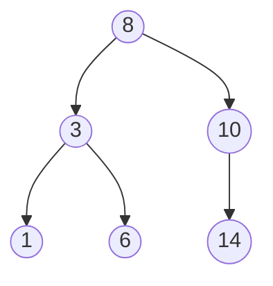
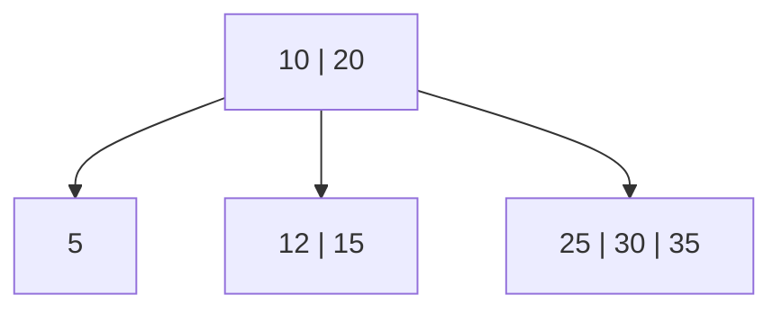
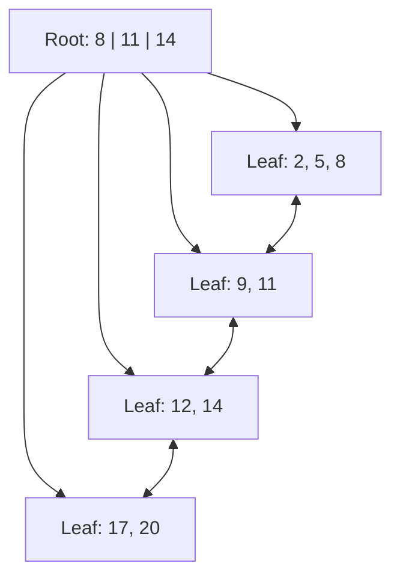

# Concept-Book Run

domain: /home/papagame/projects/digital-duck/cb-data-structure/public/domains/data_structure_ch14/input/graph.yaml
target: b_plus_tree
started: 2026-11-24T14:29:00

## Teaching order (5 concepts)

- binary_search_tree
- block_store
- external_memory_model
- b_tree
- b_plus_tree

### binary_search_tree (0.7s)

## Binary Search Tree

**Definition.** A *binary search tree* (BST) is a binary tree whose nodes store keys from a total order, such that for every node $x$ with key $k(x)$:

$$
\forall\, y \in \text{left}(x):\; k(y) < k(x), \qquad \forall\, z \in \text{right}(x):\; k(z) > k(x).
$$

The property applies to *entire subtrees*, not just immediate children. Assuming distinct keys, an inorder traversal (left, node, right) visits keys in sorted order, which is the structure's central consequence.

**Search and insertion.** To find key $q$, start at the root. If $q$ equals the node's key, stop. If $q$ is smaller, go left. Otherwise go right. Reaching a null link means $q$ is absent. Insertion follows the same path and attaches a new leaf at the null link where the search ended. Each step discards a whole subtree, so the cost is $O(h)$, where $h$ is the tree's height.

**Worked example.** Insert the keys $8, 3, 10, 1, 6, 14$ into an empty BST, in that order.

- $8$ becomes the root.
- $3 < 8$, so it goes left of $8$.
- $10 > 8$, so it goes right of $8$.
- $1 < 8$, then $1 < 3$, so it goes left of $3$.
- $6 < 8$, then $6 > 3$, so it goes right of $3$.
- $14 > 8$, then $14 > 10$, so it goes right of $10$.


*The BST after inserting 8, 3, 10, 1, 6, 14. Every left subtree holds smaller keys and every right subtree holds larger ones.*

Now search for $6$. Compare with $8$ and go left. Compare with $3$ and go right. Compare with $6$, which matches. That took 3 comparisons, not 6.

**Problem-solving application.** The height $h$ decides performance, and it depends on insertion order. Inserting $1, 3, 6, 8, 10, 14$ in sorted order produces a chain of height $n-1 = 5$, so search degrades to $O(n)$. A balanced tree on $n$ keys has height $\lceil \log_2(n+1)\rceil - 1$, giving $O(\log n)$. For random insertion orders, the expected height is $O(\log n)$. To avoid the worst case, self-balancing variants such as AVL and red-black trees restructure the tree during updates.

**Deletion** has three cases for the node $x$ being removed:

1. *Leaf:* remove it.
2. *One child:* replace $x$ with that child.
3. *Two children:* replace $k(x)$ with its inorder successor, which is the minimum of the right subtree. Then delete that successor, which has at most one child.

For example, deleting the root $8$ above replaces it with $10$, the minimum of its right subtree. The old $10$ node has only a right child, $14$, so $14$ takes its place. The result is still a valid BST.

**Check yourself.** If a tree of $n = 1000$ keys is perfectly balanced, search needs at most about $\lceil\log_2 1001\rceil = 10$ comparisons. If the same keys were inserted in sorted order, search could need up to $1000$. This gap is why balance matters in practice.

### block_store (0.7s)

## Block Store

A **block store** models external memory (a disk or SSD) as an array of fixed-size blocks of $B$ bytes, each named by an integer index. A program cannot touch individual bytes on the device. It moves a whole block at a time between external memory and main memory. This matches real hardware, where one access costs far more than the computation on the data it brings in.

The interface has four operations:

| Operation | Effect |
|---|---|
| `read_block(i)` | Copy block $i$ into main memory and return it. |
| `write_block(i, data)` | Overwrite block $i$ with `data` (exactly $B$ bytes). |
| `place_block(data)` | Store `data` in a free block and return its new index. |
| `free_block(i)` | Mark block $i$ reusable. |

In the I/O model, cost is the number of block transfers (reads and writes). Computation in main memory is free. Reading $N$ contiguous bytes therefore costs $\lceil N/B \rceil$ transfers, not $N$.

### Worked example

Take $B = 4096$ bytes and store an array of $N = 1{,}000{,}000$ four-byte integers. Each block holds $4096/4 = 1024$ integers, so the array needs
$$\left\lceil \frac{10^6}{1024} \right\rceil = 977 \text{ blocks.}$$

A sequential scan reads blocks $0,1,\dots,976$ and costs 977 I/Os. Now suppose we want only element $k$. Its block index is $\lfloor k/1024 \rfloor$ and its offset inside the block is $k \bmod 1024$. One `read_block` call is enough:

```python
def get(store, k, per_block=1024):
    block = store.read_block(k // per_block)   # 1 I/O
    return block[k % per_block]
```

A minimal in-memory simulation keeps a free list and a counter:

```python
class BlockStore:
    def __init__(self, B):
        self.B, self.disk, self.free, self.io = B, {}, [], 0
    def read_block(self, i):
        self.io += 1; return self.disk[i]
    def write_block(self, i, data):
        assert len(data) == self.B; self.io += 1; self.disk[i] = data
    def place_block(self, data):
        i = self.free.pop() if self.free else len(self.disk)
        self.write_block(i, data); return i
    def free_block(self, i):
        self.free.append(i)       # no transfer needed
```

### Problem-solving application

**Problem.** Compare finding the maximum of $N = 10^6$ integers when the data are stored contiguously with when each integer sits in its own block (for example, scattered through linked nodes).

**Solution.** Contiguous storage costs $\lceil N/(B/4) \rceil = 977$ I/Os. Scattered storage costs one read per element, or $10^6$ I/Os. That is about $1000\times$ more, even though both programs do the same computation.

The general rule is that a scan of $N$ items costs
$$\text{scan}(N) = \Theta\!\left(\frac{N}{B}\right)$$
I/Os. An algorithm designed for a block store should therefore use **locality**. It should place related items in the same block, and it should use every byte it reads. A balanced search tree whose nodes each fill one block reaches a key in $O(\log_B N)$ reads. A binary tree with one key per node needs $O(\log_2 N)$. For $N=10^6$ and $B$ holding 1024 keys, that is about 2 reads against about 20.

**Check yourself.** What is the I/O cost of `place_block` when it reuses a freed index? *(Answer: one write, so 1 I/O. `free_block` only updates bookkeeping and costs none.)*

### external_memory_model (0.7s)

## External Memory Model

When a data set is too large for main memory, the cost of an algorithm is dominated not by arithmetic but by moving data between disk and RAM. A disk read takes on the order of milliseconds, while a CPU instruction takes nanoseconds. The **external memory model** (also called the I/O model or disk access model) captures this by counting only block transfers.

### Definition

The model has two levels of storage:

- an internal memory holding $M$ items,
- an unbounded external memory (disk), organized into blocks of $B$ consecutive items, where $B \le M/2$.

One **I/O** transfers a single block of $B$ items between disk and memory. The cost of an algorithm is the number of I/Os; in-memory computation is free. Three standard bounds, for $N$ items, are:

$$\text{scan}(N) = \Theta\!\left(\frac{N}{B}\right), \qquad \text{sort}(N) = \Theta\!\left(\frac{N}{B}\log_{M/B}\frac{N}{B}\right), \qquad \text{search}(N) = \Theta(\log_B N).$$

The last is achieved by a B-tree, whose nodes have fan-out $\Theta(B)$ so that each node fits in one block.

### Worked example: scanning versus random access

Let $N = 10^9$ items, $B = 10^3$ items per block. Summing all items sequentially reads each block once:

$$\frac{N}{B} = \frac{10^9}{10^3} = 10^6 \text{ I/Os}.$$

If the same items are visited in random order, each access may load a fresh block, which costs up to $N = 10^9$ I/Os. The ratio is $B = 1000$. Both programs do the same $N$ additions, but the model correctly says that one is a thousand times more expensive. Good external algorithms therefore use **locality**: every block loaded should be fully used before it is evicted.

### Problem-solving application: external merge sort

*Problem.* Sort $N = 10^{9}$ items with $M = 10^{6}$ and $B = 10^{3}$. How many I/Os are needed?

*Solution.*

1. **Run formation.** Read $M$ items at a time, sort them in memory, and write them back. This yields $N/M = 10^3$ sorted runs. Each item is read and written once, so the cost is $2N/B = 2\times 10^6$ I/Os.
2. **Merge.** Memory holds $M/B = 10^3$ blocks. Use one block as the output buffer and the rest as input buffers, so we can merge $k = M/B - 1 \approx 10^3$ runs at once. Since there are exactly about $10^3$ runs, a single merge pass finishes the job, costing another $2N/B = 2\times10^6$ I/Os.

Total: about $4\times 10^6$ I/Os. This agrees with $\text{sort}(N)$, because $\log_{M/B}(N/B) = \log_{10^3}10^6 = 2$, giving $\frac{N}{B}\cdot 2 = 2\times 10^6$ up to the constant factor of 2 for reading and writing.

Compare this with running ordinary binary merge sort as if the data were in RAM: it has $\log_2 (N/M)\approx 10$ merge levels, each costing $2N/B$ I/Os, for roughly $2\times10^7$. The wider merge reduces the number of passes by the factor $\log_2(M/B)\approx 10$.

### Key takeaway

To design or analyze an algorithm in this model, first identify how often each block is touched. Then restructure the computation so that each block is loaded once, and use $M/B$ as the merge or branching factor wherever possible.

### b_tree (0.6s)

## B Tree

A **B-tree** of minimum degree $B \ge 2$ is a search tree designed for data stored on slow, block-oriented media (disks, SSDs, database pages). It satisfies four rules:

1. All leaves are at the same depth.
2. Every non-root internal node has between $B$ and $2B$ children.
3. The root has at least 2 children (unless it is a leaf).
4. A node with $c$ children stores $c-1$ keys in a **sorted array** $k_1 < k_2 < \dots < k_{c-1}$. Subtree $i$ holds exactly the keys between $k_{i-1}$ and $k_i$.

Because each node holds many keys, the tree is very shallow. Reading one node costs one disk access, so a shallow tree means few disk accesses.

### Height bound

With $n$ keys, the minimum fan-out of $B$ gives at least $2B^{h-1}$ nodes at depth $h$ (the root has at least 2 children, and every other internal node has at least $B$). Counting the keys in all nodes gives

$$
n \;\ge\; 2B^{h}-1 \quad\Longrightarrow\quad h \;\le\; \log_B\!\frac{n+1}{2}.
$$

So search, insertion, and deletion each touch $O(\log_B n)$ nodes. With $B=500$ and $n = 10^9$, the height is at most 4.

### Worked example: search and insert

Take $B=2$, so nodes have 2 to 4 children and hold 1 to 3 keys. Suppose the root holds $[20]$ with children $[5, 10, 15]$ and $[25, 30, 35]$.

**Search for 30.** In the root, $30 > 20$, so go to the second child. Scan that sorted array (or binary-search it) and find 30. Two nodes were read.

**Insert 12.** Descend by the same search: $12 < 20$, so go to the leaf $[5,10,15]$, which has room for no more than 3 keys. Inserting 12 gives $[5,10,12,15]$, which is one key too many. **Split** it at the median: $10$ moves up into the parent, leaving $[5]$ and $[12,15]$. The root becomes $[10,20]$ with three children. Splits propagate upward only while parents overflow. If the root splits, a new root is created and the tree grows by one level. This is the only way height increases, so all leaves stay at equal depth.

### Problem-solving application

*How many disk reads does a lookup need in a database index of 50 million keys with $B=100$?*

Use the bound: $h \le \log_{100}\frac{5\times10^7+1}{2} \approx \log_{100}(2.5\times 10^7) \approx 3.7$, so $h\le 3$ levels below the root, i.e. at most 4 node reads. A balanced binary tree would need about $\log_2(5\times10^7)\approx 26$ reads. Each B-tree read pulls in a whole sorted array that fits in one page, which is why databases and file systems use B-trees (or variants) for indexes.


*The B-tree after inserting 12: all leaves are at the same depth, and each node's sorted keys separate its children's key ranges.*

### b_plus_tree (0.7s)

## B Plus Tree

### Definition

A **B⁺ tree** is a balanced search tree designed for data that lives on disk or in large blocks. It differs from an ordinary B-tree in two ways:

1. **All records live in the leaves.** Internal nodes hold only *separator keys* that guide the search.
2. **The leaves are linked in sorted order**, usually as a doubly-linked list.

Each internal node of order $m$ has at most $m$ children and (except the root) at least $\lceil m/2 \rceil$. All leaves sit at the same depth. For $n$ keys, the height is

$$h = O(\log_{\lceil m/2\rceil} n).$$

Because $m$ is large (often hundreds, so one node fills one disk page), $h$ is tiny: a billion keys fit in about 4 levels. Each level costs one disk read, so a point lookup costs $O(\log_m n)$ page reads.

The overlying index stores, for each leaf, its largest key (a separator). To find key $k$, follow the first child whose separator is $\ge k$.

### Worked example

Let $m = 4$ (at most 3 keys per leaf) and store keys $\{2, 5, 8, 11, 14, 17, 20\}$. One valid layout:

- Leaves: $[2,5,8]\leftrightarrow[11,14]\leftrightarrow[17,20]$
- Root separators: $8, 14$ (largest key of the first two leaves)

**Point search for 14.** At the root, $14 > 8$ and $14 \le 14$, so go to the second leaf. Scan it and find 14. Cost: 2 page reads.

**Insert 9.** Route to leaf $[2,5,8]$ (since $9 > 8$ and $9 \le 14$, it actually belongs in $[11,14]$). Insert gives $[9,11,14]$, which fits (3 keys). No split is needed. Now insert 12: the leaf would become $[9,11,12,14]$, which overflows, so it **splits** into $[9,11]$ and $[12,14]$. The separator 11 is copied up to the parent. Unlike a B-tree, the key 11 *stays* in the leaf because leaves must hold every key.

### Problem-solving application: range queries

**Problem.** Retrieve all keys in $[6, 15]$ from the tree above (after inserting 9 and 12).

**Solution.**
1. Search for the lower bound 6 as for a point lookup. It lands in leaf $[2,5,8]$.
2. Scan that leaf from 8 onward: output 8.
3. Follow the next-leaf pointer to $[9,11]$, output 9, 11; then to $[12,14]$, output 12, 14.
4. Follow the pointer to $[17,20]$. The first key, 17, exceeds 15, so stop.

Output: $8, 9, 11, 12, 14$. The cost is one root-to-leaf descent plus a sequential walk:

$$T_{\text{range}} = O(\log_m n + \lceil r/m \rceil)$$

where $r$ is the number of results. A plain B-tree would instead need repeated up-and-down traversals through internal nodes, costing roughly $O(r \log_m n)$ in the worst case. This is why databases and file systems (e.g., most SQL indexes, NTFS, ext4 directory indexes) favor B⁺ trees: sorted scans, `BETWEEN` queries, and `ORDER BY` become sequential reads.


*A B⁺ tree after the insertions: the root holds separators (largest key per leaf, except the last), and the doubly-linked leaf chain lets a range query walk sequentially after one descent.*

**Check your understanding.** Why must the separator be *copied* up rather than moved up during a leaf split? (Hint: what would happen to a range scan if key 11 left the leaf?)

## Run complete

total: 7.9s
