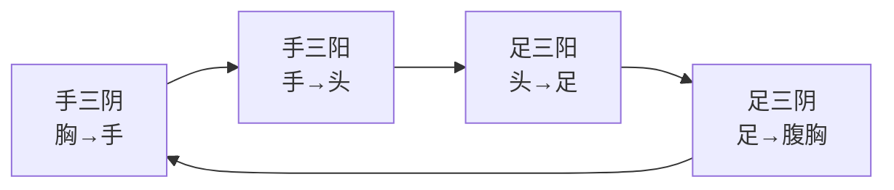
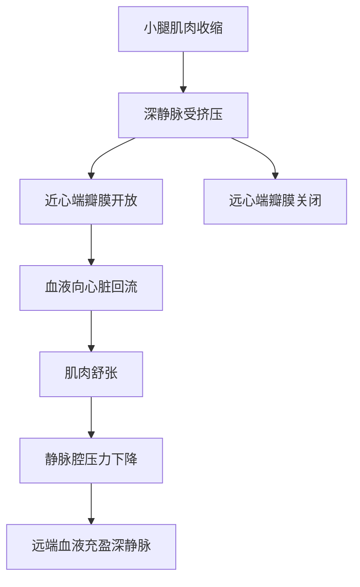
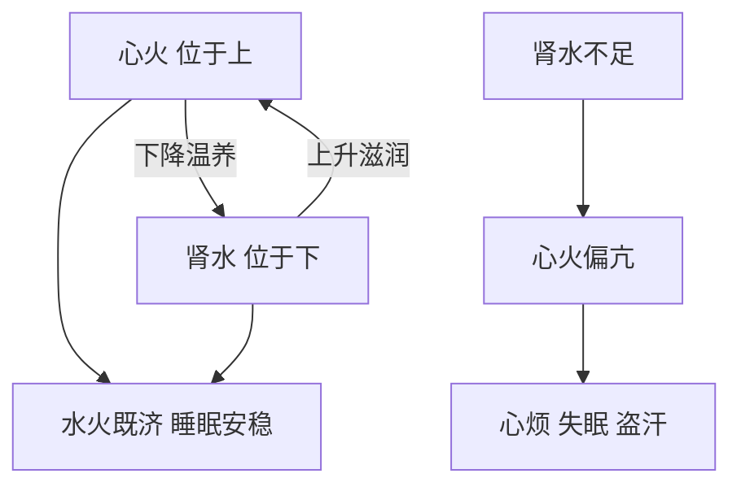
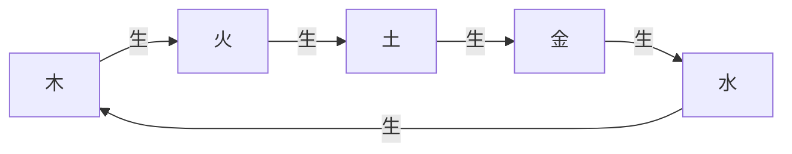

# Concept-Book Run

domain: /home/papagame/projects/digital-duck/cb-meta-health/public/domains/meta_health_ch03/input/graph.yaml
target: five_organ_routine_design
started: 2026-11-24T14:59:34

## Teaching order (24 concepts)

- five_phase_correspondences
- twelve_primary_meridians
- myofascial_lines
- skeletal_muscle_pump
- thoracic_mobility
- yongquan_point
- body_lifting_tishen
- diaphragmatic_breathing
- heart_kidney_interaction
- intra_abdominal_pressure
- squat_mechanics
- chest_expansion_kuoxiong
- deep_squat_shendun
- rib_fanning_shanlei
- torso_twist_niuzhuan
- five_organ_movement_matrix
- dantian
- generating_cycle_xiangsheng
- breath_first_sequence
- generating_cycle_sequence
- safe_practice_and_modification
- sealing_finish
- top_to_bottom_sequence
- five_organ_routine_design

### five_phase_correspondences (0.5s)

## 五行归类

**定义。** 五行归类是中医(Traditional Chinese Medicine,TCM)用来整理人体与自然现象的一套分类表。TCM 认为,木、火、土、金、水五种"行"各自对应一组事物。这些事物包括脏腑、季节、情志、五味和所主的身体组织。归入同一行的事物,被认为彼此关联。归类的依据是功能和性质上的类比,例如木"曲直、生发",火"炎上、温热"。它不是实验测得的因果关系。

下表是最常用的对应关系:

| 五行 | 五脏 | 季节 | 情志 | 五味 | 所主组织 |
|---|---|---|---|---|---|
| 木 | 肝 | 春 | 怒 | 酸 | 筋 |
| 火 | 心 | 夏 | 喜 | 苦 | 脉 |
| 土 | 脾 | 长夏 | 思 | 甘 | 肌肉 |
| 金 | 肺 | 秋 | 悲(忧) | 辛 | 皮毛 |
| 水 | 肾 | 冬 | 恐 | 咸 | 骨 |

读表时按行读,也就是一行对应一整组事物。例如"木"这一行包含肝、春、怒、酸和筋。

**例题。** 小李每到秋天就容易皮肤干燥、咳嗽,心情也低落。请用五行归类解释这三个现象的归属。

*解:*
1. 秋属金。
2. 金所对应的脏是肺,所主组织是皮毛,情志是悲(忧)。
3. 所以 TCM 把皮肤干燥、咳嗽和低落情绪,都放在"秋—金—肺"这一组里解释。

这是 TCM 的解释框架。从现代生理学看,秋季空气干燥会刺激皮肤和呼吸道,这是更直接的原因。

**问题解决应用。** 归类表可以反过来使用:已知一个线索,查出同一行的其他项目,再推断相关的问题。

*题目:* 一位患者长期易怒,筋脉拘紧,爱吃酸味食物,春天症状加重。请找出这些线索共同指向哪一行。

*解:*
1. 逐项查表:怒属木,筋属木,酸属木,春属木。
2. 四条线索都落在"木"这一行。
3. 木对应肝,所以 TCM 会把"肝"作为首先考虑的脏。

*检验:* 如果线索分属不同的行,例如易怒(木)加咳嗽(金),就不能只归入一行。此时要考虑多个脏腑同时受累,并结合其他表现一起判断。

**使用时的提醒。** 五行归类是一套记忆和推理的工具。它不能代替检查和诊断。表中的对应关系,例如"怒伤肝""悲伤肺",没有被现代医学证实为确定的因果规律。持续咳嗽、长期情绪低落或肌肉僵紧,应当先做规范的医学检查。

### twelve_primary_meridians (1.2s)

## 十二经脉

**定义。** 十二经脉(十二经脉)是 TCM(中医)理论中最主要的"经络"通路。中医认为,气血沿这些通路在体内运行,并把脏腑与四肢、体表联系起来。它们按所属脏腑分为十二条:手三阴(肺、心包、心)、手三阳(大肠、三焦、小肠)、足三阴(脾、肝、肾)、足三阳(胃、胆、膀胱)。需要说明的是,现代解剖学尚未发现与经脉对应的独立结构,它是一套用于归纳症状与指导针灸取穴的传统模型。

**走向规律。** 经脉的命名和走向有三条规则,记住它们比死记十二条路线更有效:

1. **阴阳定位**:阴经走四肢内侧(屈侧),阳经走四肢外侧(伸侧)。
2. **手足定走向**:手三阴从胸走向手;手三阳从手走向头;足三阳从头走向足;足三阴从足走向腹胸。
3. **前、中、后排列**:在上肢内侧,由前到后依次为肺、心包、心;在上肢外侧,由前到后依次为大肠、三焦、小肠。下肢外侧,由前到后为胃、胆、膀胱。

| 类别 | 经脉 | 四肢分布 | 走向 |
|---|---|---|---|
| 手三阴 | 肺、心包、心 | 上肢内侧 | 胸 → 手 |
| 手三阳 | 大肠、三焦、小肠 | 上肢外侧 | 手 → 头 |
| 足三阳 | 胃、胆、膀胱 | 下肢外侧(胃偏前) | 头 → 足 |
| 足三阴 | 脾、肝、肾 | 下肢内侧 | 足 → 腹胸 |

**例题。** 某人拇指侧的前臂内侧(靠近桡侧)有酸胀感,问它位于哪条经脉的循行区域?

解:先判断"内侧",所以是阴经;再判断"上肢",所以是手三阴;内侧最前缘对应的是肺经。肺经起于胸部,沿上臂和前臂内侧前缘下行,止于拇指桡侧端(少商穴)。因此该区域属手太阴肺经。

**应用练习。** 针灸中常见"合谷穴"(手背第一、二掌骨之间)用于头面部不适的说法。请用上面的规律推断它属于哪类经脉。

思路:合谷在手背,是上肢外侧,故为阳经;手阳经从手走向头,与"头面部"的取穴用途在方向上一致。位于外侧最前缘的是大肠经,所以合谷属手阳明大肠经。这个推断过程说明:只要掌握"内外侧定阴阳、手足定方向、前中后定脏腑"三步,就能从体表位置反推经脉归属。

*图:十二经脉按手三阴、手三阳、足三阳、足三阴的顺序首尾相接、循环流注的示意。*

**小结。** 十二经脉是一套以"位置—归属"为核心的体表定位体系。用它来记忆穴位位置和针灸教学是有效的;但经脉作为"气血通道"的实体存在,尚缺乏现代解剖学证据。

### myofascial_lines (0.8s)

## 肌筋膜链

**定义。** 肌筋膜链(myofascial lines)是一种解剖学描述框架:它把相邻的肌肉、肌腱和包裹它们的筋膜,看作沿身体走向连续相接的"带状"结构。最常被引用的是 Thomas Myers 在《解剖列车》中提出的模型,其中包括:

| 肌筋膜链 | 大致走向 | 主要功能 |
|---|---|---|
| 浅背线 | 足底筋膜→小腿后侧→腘绳肌→骶骨→竖脊肌→头皮 | 维持直立、伸展躯干 |
| 体侧线 | 足外侧→小腿外侧→髂胫束→躯干侧面→颈部 | 侧向稳定、限制侧屈 |
| 螺旋线 | 头部→对侧肩→环绕躯干→同侧髋→胫骨前→足弓 | 躯干旋转、骨盆与足的协调 |

需要说明的是,这是一种有启发性的整理方式,而不是已被证实的"独立功能链"。解剖学研究在部分连接(如腘绳肌与骶结节韧带、胸腰筋膜与臀大肌)上有支持,但对"力可以沿整条链远距离传递"这一点,证据仍有限。

**例题。** 一位跑者长期足底不适,同时腘绳肌紧绷。试用浅背线的思路分析。

- 第一步:确认两处症状是否都位于浅背线上。足底筋膜与腘绳肌确实属于同一条线。
- 第二步:提出可检验的假设。在站立前屈测试中,若先对小腿后侧和足底做放松,再次测试时指尖离地距离缩短,说明该线上的组织张力可能相互影响。
- 第三步:设计对照。同一天分别只放松手臂、只放松足底,各自测量前屈距离。如果只有放松足底(或小腿)才有明显改善,假设得到支持。

假设初测指尖距地 $12\ \text{cm}$,放松足底后为 $8\ \text{cm}$,放松手臂后为 $11.5\ \text{cm}$。足底干预使距离缩短 $12-8=4\ \text{cm}$,手臂干预仅缩短 $0.5\ \text{cm}$,差异提示局部与远端组织存在关联。不过,这类即时改善也可能来自牵伸耐受度提高(神经系统对牵拉感的适应),并不一定说明筋膜发生了结构变化。

**问题解决应用。** 面对"体侧线"问题,可按以下流程思考:

1. **观察姿势:** 单腿站立时,骨盆是否明显下沉或躯干向一侧倾斜?
2. **定位线上的薄弱环节:** 体侧线上的臀中肌、阔筋膜张肌和腹斜肌,哪一处力量不足或过紧?
3. **选择干预:** 侧桥、侧向抬腿等训练,同时练习髋、躯干、肩的协同;而不是只孤立地牵伸髂胫束。
4. **复测:** 记录单腿站立 30 秒内的晃动或骨盆下沉情况,训练 4 周后比较。

同理,螺旋线可用于分析高尔夫挥杆、投掷等旋转动作:受伤时不只检查疼痛部位,也检查整条线上相邻关节的活动度与力量。

**小结。** 肌筋膜链提供了一种"从整体链条找原因"的思路,适合用来提出假设、设计检验;但应以实际测量的改善为准,而不是默认链条一定传递了力量。

### skeletal_muscle_pump (0.9s)

## 骨骼肌泵

**定义。** 骨骼肌泵是指行走、站立踮脚等活动时,腿部(尤其是小腿)骨骼肌的收缩与舒张挤压深静脉,把静脉血推向心脏的机制。它之所以必要,是因为静脉系统几乎没有自身的"心脏":站立时,足部静脉要对抗重力,血液容易积聚在下肢。

**工作原理。** 它依赖两个结构:

1. **肌肉收缩**:小腿肌肉(腓肠肌、比目鱼肌)收缩时,挤压肌肉之间的深静脉,使静脉内压力升高。
2. **静脉瓣膜**:瓣膜只允许血液向心流动。因此收缩时血液被推向上方,舒张时瓣膜关闭,血液不会倒流。

肌肉舒张后,深静脉腔内压力下降,浅静脉和远端血液随之被"吸"入,为下一次收缩做好准备。

*图:骨骼肌泵的一个周期。收缩时血液被推向心脏,舒张时瓣膜防止倒流,并让新的血液充盈。*

**例题。** 一名健康成人安静站立时,每搏输出量约为 $70\ \text{mL}$,心率为 $70\ \text{次/分}$。心输出量为

$$CO = SV \times HR = 70\ \text{mL} \times 70\ \text{次/分} = 4900\ \text{mL/分}$$

这些血液最终都必须经静脉回到心脏。假设每次踮脚时小腿肌肉泵出约 $40\ \text{mL}$ 血液,每分钟踮脚 $30$ 次,则每分钟经小腿泵送的血量为 $40 \times 30 = 1200\ \text{mL}$,约占心输出量的

$$\frac{1200}{4900} \approx 24\%$$

这个数字是为说明数量级而设的估算值,实际泵出量因人和活动强度而异。

**问题应用。** 

*情境一:长途飞行。* 乘客久坐数小时,小腿肌肉几乎不收缩,血液在下肢淤积,静脉压升高,可出现脚踝肿胀,并增加深静脉血栓的风险。对策是定时起身走动,或坐着做踝泵运动(勾脚、绷脚),人为启动骨骼肌泵。

*情境二:长时间站立的职业。* 教师、售货员若长时间站立不动,同样会出现下肢沉重、肿胀。适度踮脚、交替移动重心,可以让小腿肌肉持续工作。

*情境三:瓣膜受损。* 若静脉瓣膜功能不全,收缩时一部分血液会倒流,骨骼肌泵效率下降,这是下肢静脉曲张的重要机制之一。此时医生常建议穿戴医用弹力袜,通过外部加压帮助静脉血回流。

**小结。** 骨骼肌泵靠"肌肉挤压加瓣膜单向"两个条件起作用,缺一不可。判断某种情境是否会影响静脉回流,可以先问两个问题:小腿肌肉是否在有节律地收缩?静脉瓣膜是否完好?

### thoracic_mobility (0.8s)

## 胸椎与胸廓灵活性

**定义。** 胸椎与胸廓灵活性,是指上背部(12 节胸椎)和与之相连的肋骨、胸骨构成的胸廓,在三个方向上活动的能力:**伸展**(向后仰,增大胸椎后凸的反方向弧度)、**旋转**(躯干绕纵轴转动)和**侧屈**(向身体一侧弯)。与腰椎相比,胸椎因有肋骨连接、椎间盘较薄、关节突朝向特殊,天然更"硬",但它的活动度又是肩、颈、腰能否正常工作的基础。

**为什么重要。** 胸椎活动受限时,身体会向相邻关节"借"活动度:举臂过头时,腰椎代偿性过度后弯;转身时,颈椎或腰椎被迫多转。常见情形是长期伏案导致胸椎僵硬、圆肩,进而与肩上举受限、颈部紧张和下背不适相关。呼吸也受影响,因为吸气时肋骨需要上抬并向外展开。

**典型参考范围。** 文献中,成人胸腰段合计旋转约 $30^\circ$–$40^\circ$(单侧),其中胸椎约占大部分;个体差异很大,应以左右对称和无代偿为判断重点,而不是追求某个固定数值。

**工作示例:坐位旋转测试。**
1. 坐在椅子上,双脚平放,双臂交叉抱胸,骨盆保持正对前方。
2. 向右转动躯干至尽可能远,记录胸骨指向的方向,再向左重复。
3. 观察:右转时胸骨约指向 $60^\circ$,左转时仅约 $35^\circ$。

解读:左右相差 $25^\circ$,明显不对称,且左转时常伴随骨盆扭动或肩部耸起,说明左转受限并有代偿。

**问题解决应用。** 小林每次做过头推举时,下背有压迫感。分析步骤如下:

| 步骤 | 做法 | 结论 |
|---|---|---|
| 1. 检查肩上举 | 靠墙站立,腰背贴墙,双臂上举 | 手臂无法贴墙,腰部离墙 |
| 2. 判断代偿 | 腰部离墙 = 腰椎代偿性后弯 | 胸椎伸展不足 |
| 3. 选择练习 | 泡沫轴胸椎伸展、"开书式"侧卧旋转、猫牛式 | 针对伸展与旋转 |
| 4. 再评估 | 练习 2–4 周后重复靠墙测试 | 腰部离墙减少,说明有改善 |

练习要点:动作在胸椎段完成,而非腰椎;配合呼气放松,每个动作保持 5–10 次缓慢重复;若出现麻木、放射痛或胸痛,应停止并就医。

**小结。** 评估胸椎灵活性时,看三件事:三个方向的活动是否足够、左右是否对称、相邻关节是否在代偿。找出受限方向后,选择对应的针对性练习,并用同一测试前后对照,是最实用的解决思路。

### yongquan_point (0.8s)

## 涌泉穴

**定义。** 涌泉穴(KI-1)位于足底,约在足掌前部凹陷处,即第2、3趾缝纹头端与足跟后缘连线的前三分之一处。蜷趾时,此处出现一个明显的凹陷。穴名“涌泉”意为“涌出的泉水”。中医认为,肾经从此处起始,经气如泉水自下而上涌出,因此该穴被用于调养肾气。本书首次介绍的“中医”即传统中医学(Traditional Chinese Medicine,TCM)。现代研究尚未证实刺激该穴能“补肾”,但足底按摩确实能带来放松感,这一点有生理学依据。

**与解剖的对应。** 足底有丰富的皮肤感受器和足底筋膜。踮脚、落地、按压时,这些结构受到机械刺激,信号经胫神经传入中枢。所以“刺激涌泉”在生理上主要是足底的触压觉与本体感觉输入,以及小腿和足部肌肉的收缩。

**示例:踮脚落跟练习。**

| 步骤 | 动作 | 要点 |
|---|---|---|
| 1 | 双脚与肩同宽站立,扶墙或椅背 | 保持身体稳定 |
| 2 | 缓慢踮起脚尖,停留 2 秒 | 小腿腓肠肌、比目鱼肌收缩 |
| 3 | 脚跟轻轻落地 | 不要重重砸地 |
| 4 | 重复 15 次为一组,做 2 组 | 每天 1~2 次 |

这个动作在中医里被说成“踮足刺激涌泉”。从运动学看,它是标准的提踵训练,能增强小腿力量并促进下肢静脉回流。

**问题应用。** 一位 60 kg 的人想用提踵练习增加能量消耗并保护关节。我们用一个常用的估算方法来算:

$$
\text{能量消耗(kcal)} = \text{MET} \times \text{体重(kg)} \times \text{时间(h)}
$$

提踵属于轻度抗阻活动,取 MET 约为 3.5。若连续练习 10 分钟,即 $\frac{1}{6}$ 小时:

$$
3.5 \times 60 \times \frac{1}{6} = 35 \ \text{kcal}
$$

因此,这个练习的能量消耗很有限,不能当作减脂的主要手段,它的价值在于增强小腿力量和平衡能力。

**注意事项。**
- 落地时避免用力砸脚跟:反复冲击可能给膝、髋和腰椎带来不必要的负荷。
- 骨质疏松、足跟痛、严重高血压或平衡障碍者,应降低幅度或坐姿完成。
- 糖尿病合并足部神经病变者不宜强力按压足底,以免造成皮肤损伤而不自知。
- 若足底持续疼痛,应就医排查足底筋膜炎等问题,不要只靠按揉穴位处理。

**小结。** 涌泉穴是中医所说的肾经起点,位置可按“前三分之一凹陷处”确认。踮脚落跟的实际效果可以用现代运动生理学来解释:它锻炼小腿肌肉,并刺激足底感受器。练习时动作要缓、落地要轻,把它当作温和的下肢训练,而不是治疗肾脏疾病的方法。

### body_lifting_tishen (0.8s)

## 提身

**提身**(body lifting)是一个动作:双臂向上伸展,同时脚跟抬起、身体立于前脚掌。从生理学看,这个动作主要调动后侧链,即小腿三头肌(腓肠肌与比目鱼肌)、腘绳肌、臀大肌和竖脊肌,同时拉长身体前侧和两侧。中医认为,这一动作拉伸背部的足太阳膀胱经,并刺激位于足底前部凹陷处的涌泉穴。涌泉是肾经的起始穴,而肾在五行中属水。这属于中医的理论框架,并不等于已被现代研究证实的疗效。

### 动作要点与生理作用

1. 双脚与肩同宽站立,重心落在足弓上。
2. 吸气,双臂从体侧上举过头,同时脚跟缓慢抬起。
3. 在最高处停留 2 秒,感到腿后侧和脊柱被拉长。
4. 呼气,脚跟缓慢落下,双臂放回体侧。

脚跟抬起时,小腿肌肉反复收缩,挤压深部静脉,把血液推回心脏,这称为小腿肌肉泵。肌肉泵能促进静脉回流。回心血量增加,每搏输出量随之增加,心输出量的计算式为:

$$CO = HR \times SV$$

其中 $CO$ 是心输出量(L/min),$HR$ 是心率(次/分),$SV$ 是每搏输出量(mL/次)。

### 例题

一位学生久坐后站起,静息心率为 $72$ 次/分,每搏输出量为 $70\ \text{mL}$。

$$CO = 72 \times 70 = 5040\ \text{mL/min} \approx 5.0\ \text{L/min}$$

做 20 次提身后,心率升至 $78$ 次/分,每搏输出量升至 $75\ \text{mL}$:

$$CO = 78 \times 75 = 5850\ \text{mL/min} \approx 5.9\ \text{L/min}$$

心输出量增加约 $0.8\ \text{L/min}$。这个数字是为演示计算而设的假设值,不是实测结果。

### 问题应用

**情境:** 一位办公室职员每天坐 8 小时,傍晚常觉小腿发胀。请设计一个简单的提身方案,并说明理由。

**分析:**

- 久坐时小腿肌肉几乎不收缩,静脉回流依赖重力和肌肉泵,血液容易积在下肢,因此傍晚会发胀。
- 方案:每工作 60 分钟做 1 组,每组 10 次提身,每次上举 2 秒、下降 3 秒。下降放慢,是为了让小腿肌肉离心控制,多做功。
- 若有头晕、平衡不稳、严重静脉曲张或足踝损伤,应扶墙完成动作,或先咨询医生。

**检验:** 每天 8 组、每组 10 次,共 $8 \times 10 = 80$ 次。按每次 5 秒计算,总用时约 $80 \times 5 = 400$ 秒,不到 7 分钟,很容易分散到工作日里完成。

### 小结

提身把上肢上举与足跟抬起结合起来。它既能利用小腿肌肉泵促进静脉回流、拉伸后侧链,也是中医理论中联系涌泉、肾经与背部经络的一种导引动作。

### diaphragmatic_breathing (0.8s)

## 腹式呼吸

**定义。** 腹式呼吸(又称膈肌呼吸)是以膈肌为主要动力的呼吸方式。吸气时膈肌收缩、下降,胸腔纵向扩大,肺内压低于大气压,空气进入肺底部,腹部随之自然隆起;呼气时膈肌放松上抬,腹部回落。相对地,胸式呼吸主要依靠肋间肌和颈肩部辅助肌,幅度浅、位置偏上。

**与副交感神经的关系。** 缓慢而深的呼吸能增加迷走神经的传出活动,使心率降低。生理学上有一个可观察的现象:呼吸性窦性心律不齐——吸气时心率略升,呼气时略降。呼气延长、呼吸变慢(约每分钟 6 次)时,这种心率随呼吸的波动幅度增大,心率变异性随之上升,常被用作副交感活动增强的指标。此外,深而慢的呼吸会刺激肺牵张感受器和压力感受器,进一步抑制交感兴奋。证据表明,这类练习能在短期内降低静息心率和主观紧张感,但对长期疾病的疗效因人群而异,应结合具体研究判断。

在 TCM 中,类似的练习被称为“腹式吐纳”或“气沉丹田”,强调呼吸深长、意念下沉;这里只需把它理解为一种呼吸训练的传统说法,具体机制以上述生理学解释为准。

**练习步骤。**
1. 仰卧或端坐,一手放胸前,一手放肚脐上方。
2. 用鼻缓慢吸气约 4 秒,使腹部手被顶起,胸前的手基本不动。
3. 用口或鼻缓慢呼气约 6 秒,腹部回落。
4. 连续做 5 至 10 分钟。

**例题。** 某同学静息时每分钟呼吸 15 次,改为腹式呼吸后,每次吸气 4 秒、呼气 6 秒。求:(1)新的呼吸频率;(2)若每次潮气量为 $500\ \text{mL}$,每分通气量是多少?

解:(1)每个呼吸周期为 $4+6=10$ 秒,所以每分钟的呼吸次数为
$$\frac{60\ \text{s}}{10\ \text{s}} = 6\ \text{次/分}$$
(2)每分通气量等于潮气量乘以呼吸频率:
$$500\ \text{mL} \times 6 = 3000\ \text{mL/min}$$
原来是 $500 \times 15 = 7500\ \text{mL/min}$。通气量下降,是因为潮气量不变而频率降低;实际练习中,腹式呼吸往往使潮气量增大,因此通气量不会降得这样多,也不应出现头晕。

**应用题。** 一名学生考前心跳加快,静息心率为 96 次/分。他练习腹式呼吸 5 分钟后,心率降为 84 次/分。

(a)心率下降了多少?
$$\frac{96-84}{96}\times 100\% = 12.5\%$$
(b)判断:这一变化与副交感神经活动增强的方向一致。但单次测量还受姿势、情绪、咖啡因等因素影响,要下结论,应在相同条件下重复测量并取平均。

**注意事项。** 若练习中出现头晕、手脚发麻,说明可能过度换气,应恢复自然呼吸;有严重心肺疾病者应先咨询医生。

### heart_kidney_interaction (0.8s)

## 心肾相交

**定义。** 在中医(TCM)理论中,心属火、位居上焦,肾属水、位居下焦。中医认为,正常状态下,心火下降以温暖肾水,使肾水不至于过寒;肾水上升以滋养心火,使心火不至于过亢。这种上下相济、水火互通的关系称为"心肾相交"。若失调,则称"心肾不交",常见表现为心烦、失眠多梦、心悸、腰膝酸软、夜间盗汗等。

这是一套传统的解释框架,而不是现代生理学的解剖结论。现代医学中并没有与"心火下降、肾水上升"一一对应的机制。不过,心与肾在现代生理中确实相互影响:心脏的泵血功能决定肾脏的血流灌注,肾脏则通过调节水盐和血压反过来影响心脏负荷。这两套语言描述的对象不同,不宜直接等同。

**对照表:相交与不交**

| 状态 | 心(火) | 肾(水) | 典型表现 |
|---|---|---|---|
| 心肾相交 | 火能下降,不亢 | 水能上升,不寒 | 入睡顺利,精力平稳 |
| 心肾不交(阴虚火旺型) | 火亢于上 | 水亏于下 | 心烦失眠、口干、盗汗、腰酸 |

*图:心肾相交的双向关系(上),以及肾水不足导致心火偏亢、出现失眠等表现的路径(下)。*

**例题。** 一位 22 岁的备考学生,连续两个月每晚 1 点后才入睡,入睡困难、多梦,伴有口干、手心发热、腰酸。请用心肾相交的框架分析,并给出生活调整建议。

**解析:**

1. 归类症状:心烦、失眠、多梦属"心火偏亢"一侧;口干、手心热、腰酸属"肾水(阴)不足"一侧。
2. TCM 的判断:长期熬夜被认为耗伤肾阴,肾水不能上济心火,火亢于上,于是出现入睡困难。这属于"心肾不交"的阴虚火旺型。
3. 排除其他原因:这套解释并不能取代鉴别诊断。若同时有体重明显下降、心率持续偏快(静息心率常超过 100 次/分)、怕热多汗,应先检查甲状腺功能,因为甲亢可以产生几乎相同的表现。若有明显焦虑或抑郁,也应评估。
4. 可操作的调整:固定就寝时间(例如 23:00 前)、睡前 1 小时远离屏幕、下午 2 点后避免咖啡因(咖啡因半衰期约 5 小时,下午 3 点喝一杯,到晚上 8 点仍约剩一半)。这些措施的作用在睡眠医学中有较充分的证据,不依赖心肾理论。

**问题应用。**

1. 某人症状为畏寒、下肢水肿、夜尿多、心悸。这更像"心肾不交"还是别的问题?应提示什么检查?(提示:这些表现可能与心功能或肾功能异常有关,应做心电图、肾功能和尿常规,而不是自行按"火水失衡"处理。)
2. 判断:"心肾不交的人应该多吃寒凉之物来降心火。"这种说法为什么不可靠?(提示:该理论中的失调主要是肾阴不足,寒凉饮食可能加重不适,而且饮食不能替代对原发疾病的诊治。)

**小结。** 心肾相交是 TCM 用"水火上下相济"解释睡眠与情绪的框架,分析时可用来归类症状、安排作息;但出现持续心悸、水肿、体重变化等表现时,应优先用现代医学检查排除器质性疾病。

### intra_abdominal_pressure (0.8s)

## 腹内压

**定义。** 腹内压(intra-abdominal pressure,IAP)是腹腔内部的压力,由腹壁肌肉、膈肌、骨盆底肌和腹腔内容物(脏器、液体、气体)共同形成。临床上通常以膀胱内压间接测量,单位为 mmHg。安静仰卧时正常值约为 5–7 mmHg;咳嗽、用力排便或举重时,可瞬间升至数十甚至上百 mmHg。

腹腔可以看作一个"充满液体和脏器的封闭腔体",四周的壁决定了它的压力:

| 结构 | 位置 | 对腹内压的作用 |
|---|---|---|
| 膈肌 | 顶部 | 收缩下移,腔体容积变小,压力升高 |
| 腹横肌、腹斜肌、腹直肌 | 前侧壁 | 收缩使腹壁内收,压力升高 |
| 盆底肌 | 底部 | 收缩上托,压力升高,并防止内容物下压 |
| 多裂肌、腰背部肌群 | 后壁 | 收缩使后壁变硬,压力升高 |

**呼吸与躯干运动的影响。** 吸气时膈肌下降,腹腔容积略减,腹内压轻微上升;呼气时膈肌上升,压力回落。若在吸气后屏住呼吸(声门关闭),同时收紧腹壁肌肉,这一动作称为瓦尔萨尔瓦动作(Valsalva maneuver)。此时胸腔与腹腔都成为"加压的密闭腔",腹内压可显著升高,对腰椎起到支撑作用,减少腰椎承受的部分压缩负荷。躯干前屈、下蹲等动作同样会改变腹腔形状与压力。

**例题。** 一位 70 kg 的训练者做深蹲,测得安静站立时腹内压约 6 mmHg,吸气屏息、收紧腹壁后升至约 90 mmHg。问:压力变化了多少?这对循环系统有什么影响?

解:变化量为 90 − 6 = 84 mmHg,约为静息值的 15 倍。腹内压过高会压迫腹腔内的静脉(如下腔静脉),使静脉回心血量暂时减少;同时胸内压也升高,血压在屏息期间可能剧烈波动。屏息结束后血压骤变,有人会感到头晕。

**问题求解应用。** 判断某个动作是否适合某人,可以按三步考虑:

1. **看目标。** 举起大重量时,短暂提高腹内压有助于稳定躯干,是常见做法。
2. **看风险。** 高血压、心血管疾病、疝气、孕期、腹部手术后的人,持续高腹内压可能加重病情,应避免长时间屏息用力,并遵从医嘱。
3. **看替代。** 中小重量训练时,可在用力阶段呼气,不必完全屏息。

例如,一位有腹股沟疝的人搬重物,宜先寻求医生建议。若必须搬,应避免屏息硬撑,并尽量借助工具或他人协助,以免反复的高腹内压使疝囊加重突出。

**小结。** 腹内压由膈肌、腹壁肌、盆底肌和脊柱周围肌群共同调节。呼吸、屏息和躯干姿势都会改变它。适度升高有助于稳定脊柱,过高或持续升高则会增加循环系统和腹壁的负担,应根据个人健康状况合理控制。

### squat_mechanics (0.8s)

## 深蹲力学

### 定义

深蹲力学是指在下蹲与站起过程中,髋、膝、踝三个关节协调屈伸,同时躯干保持稳定的运动模式。下蹲时,髋关节屈曲、膝关节屈曲、踝关节背屈(小腿向前倾);站起时,三者同步伸展。躯干通过腹部与竖脊肌的共同收缩维持中立脊柱,把地面产生的力有效传递到杠铃或身体重心。

力学上的核心是**力矩**。外力(体重或杠铃重力)作用线与某个关节中心之间的水平距离称为力臂,力矩为:

$$M = F \times d$$

其中 $F$ 为力的大小(N),$d$ 为力臂(m),$M$ 的单位为 N·m。躯干前倾越多,髋的力臂越大,髋部负担越重;膝前移越多,膝的力臂越大,膝部负担越重。因此,不同的下蹲姿势只是在髋、膝之间重新分配负荷,并不存在对所有人都"唯一正确"的姿势。

### 示例

一名体重 $80\ \text{kg}$ 的学生,肩扛 $60\ \text{kg}$ 杠铃,系统总质量 $140\ \text{kg}$。取 $g = 9.8\ \text{m/s}^2$,总重力为:

$$F = 140 \times 9.8 = 1372\ \text{N}$$

假设该重力作用线通过足中部,下蹲到底部时,它与髋关节中心的水平距离为 $0.20\ \text{m}$。为简化起见,这里把全部重力都算在髋以上,实际上腿部自身的重量并不作用在髋的力矩上,所以这只是粗略估算:

$$M_{\text{髋}} = 1372 \times 0.20 \approx 274\ \text{N·m}$$

如果该学生躯干更直立,力臂缩短到 $0.15\ \text{m}$,则:

$$M_{\text{髋}} = 1372 \times 0.15 \approx 206\ \text{N·m}$$

髋部力矩下降约 25%,但此时膝关节通常需要更多前移,膝部力矩会相应增加。

### 问题解决应用

**情境:** 某人下蹲到底部时脚跟抬起、躯干过度前倾。如何诊断与调整?

1. **找出限制因素。** 脚跟抬起通常提示踝背屈活动度不足。可做靠墙膝触墙测试:脚尖离墙约 $10\ \text{cm}$ 以上仍能让膝盖触墙,通常说明踝活动度基本够用。
2. **判断是活动度还是控制问题。** 若徒手深蹲时脚跟不再抬起,问题多半在负重时的躯干控制和核心稳定;若徒手也抬跟,则优先改善踝活动度或使用小垫片(如举重鞋)。
3. **调整变量。** 适当加宽站距、让脚尖外展约 $15^\circ$–$30^\circ$,可以减少髋部的受限;高脚杯式深蹲把重量放在身体前方,有助于躯干保持直立。
4. **检查躯干。** 全程保持脊柱中立,下蹲前先吸气并收紧腹部,形成腹内压支撑,避免骨盆在底部后卷。

**常见错误对照:**

| 现象 | 可能原因 | 调整方向 |
|---|---|---|
| 膝盖内扣 | 臀中肌控制不足 | 弹力带辅助、降低负重 |
| 脚跟抬起 | 踝背屈受限 | 踝活动度训练、垫片 |
| 底部骨盆后卷 | 髋屈曲受限或蹲得过深 | 限制深度、改善髋活动度 |
| 重心前移至脚尖 | 躯干控制不足 | 高脚杯深蹲、减轻重量 |

总之,分析深蹲时先看重心是否稳定落在足中部,再依次检查踝、膝、髋的活动与躯干姿势,逐一定位限制环节。

### chest_expansion_kuoxiong (0.7s)

## 扩胸

**定义。** 扩胸是指双臂向两侧或向后展开、打开胸廓前侧的动作。从生理上看,它牵拉胸大肌、胸小肌和肋间肌,使胸椎略微伸展、肋骨抬高外展,从而增大胸腔容积。中医认为,这一动作能打开上胸部的肺经循行区域,"吸入清气",与五行中的"肺—金"相对应。这是中医的说法;下文的计算和练习都基于可测量的呼吸生理。

**生理基础。** 吸气时,膈肌收缩下降,肋骨向上向外运动,胸腔容积增大,肺内压低于大气压,空气因此流入。久坐、含胸驼背会使胸肌缩短、肋骨活动受限。扩胸能改善胸廓活动度,但它并不会增加肺本身的大小。

每分通气量的标准公式为:

$$\dot V_E = V_T \times f$$

其中 $V_T$ 为潮气量(mL),$f$ 为呼吸频率(次/分)。

**例题。** 某同学安静时潮气量为 500 mL,呼吸频率为 14 次/分。做完 5 分钟扩胸练习并配合深呼吸后,他在放松状态下的潮气量为 600 mL,呼吸频率为 12 次/分。比较两种状态的每分通气量。

安静时:

$$\dot V_E = 500 \times 14 = 7000\ \text{mL/min}$$

练习后:

$$\dot V_E = 600 \times 12 = 7200\ \text{mL/min}$$

每分通气量只增加了约 3%,但呼吸更深、更慢。解剖无效腔约为 150 mL,因此肺泡通气量不同:

- 安静时:$(500-150)\times 14 = 4900$ mL/min
- 练习后:$(600-150)\times 12 = 5400$ mL/min

肺泡通气量增加约 10%。这说明,呼吸"深而慢"比"浅而快"的气体交换效率更高,即使总通气量几乎不变。

**问题解决应用。** 下面给出一套可操作的练习方案:

1. **站姿准备**:双脚与肩同宽,背部挺直,双臂在胸前屈肘平举。
2. **扩胸动作**:吸气时双臂向两侧打开、肩胛骨向脊柱靠拢,感到胸前有牵拉感;呼气时双臂回收。
3. **节奏**:每次动作配合 4 秒吸气、4 秒呼气,即约 7.5 次/分,做 10 次。
4. **自我检查**:若出现头晕、肩部或胸部锐痛,应立即停止。肩袖损伤、近期胸部或肋骨受伤者,应先咨询医生或康复师。

**小结。** 在生理上,扩胸的好处来自胸廓活动度和姿势的改善,以及随之而来的更深的呼吸。至于"引入清气"和"疏通肺经",属于中医的解释框架,不能当作可测量的效果。练习时应关注动作幅度、呼吸节奏和身体的反应。

### deep_squat_shendun (0.7s)

## 深蹲

**定义。** 深蹲是髋、膝、踝三个关节同时屈伸的复合动作:下蹲时髋膝弯曲,起身时臀大肌、股四头肌、腘绳肌等人体最大的肌群共同发力。大肌群同时收缩,耗能多,所以心率明显上升;肌肉收缩还会挤压静脉,把血液送回心脏,这称为静脉回流。在 TCM 中,深蹲与"引火归元"相关:中医认为心属火,肾属水,下半身用力、重心下沉,可以引导上浮的心火下行,与肾水相交。这是中医理论的解释,不是生理学已证实的机制。

**生理量化。** 运动强度常用最大心率的百分比衡量。常用估算公式为:

$$HR_{\max} \approx 220 - \text{年龄}$$

心输出量等于心率乘以每搏输出量:

$$CO = HR \times SV$$

深蹲时,腿部肌肉泵促进静脉回流,每搏输出量随之增加;运动强度升高后,心率也会上升,所以心输出量增加。

**例题。** 一名 20 岁学生做自重深蹲。静息心率为 70 次/分,每搏输出量为 70 mL。做 2 分钟后,心率升到 130 次/分,每搏输出量升到 90 mL。求运动前后的心输出量,以及运动强度占最大心率的百分比。

解:
- 静息:$CO = 70 \times 70 = 4900\ \text{mL/min} \approx 4.9\ \text{L/min}$
- 运动时:$CO = 130 \times 90 = 11700\ \text{mL/min} \approx 11.7\ \text{L/min}$
- 最大心率:$HR_{\max} \approx 220 - 20 = 200$ 次/分
- 强度:$\dfrac{130}{200} = 65\%$

心输出量增加到静息时的约 2.4 倍,强度属于中等。

**问题解决应用。** 假设要设计一份安全的深蹲训练:目标强度为最大心率的 60%~70%,训练者为 40 岁。

1. $HR_{\max} \approx 220 - 40 = 180$ 次/分。
2. 目标区间为 $0.60 \times 180 = 108$ 到 $0.70 \times 180 = 126$ 次/分。
3. 每组结束后数 15 秒脉搏再乘以 4。若超过 126 次/分,就延长休息或减少次数;若低于 108 次/分,可增加次数或负重。

**注意事项。** 动作要领是膝盖与脚尖方向一致,背部保持中立,下蹲深度以能控制为准。有高血压、心脏病或膝关节损伤的人,开始前应咨询医生。深蹲时憋气用力会使胸腔内压骤升,血压波动大,所以应当"下蹲吸气、起身呼气"。

至于"引火归元",这一说法目前没有可检验的生理指标。把深蹲当作运动处方时,依据应是心率、心输出量和肌肉负荷这些可测量的量。

### rib_fanning_shanlei (0.8s)

## 扇肋

**定义。** 扇肋是一种侧屈并展开肋廓的伸展动作:站立或坐位,一侧手臂上举过头,躯干向对侧侧屈,同时吸气,把肋骨向侧方、向后方"撑开",像折扇一样展开。从解剖上看,它牵拉躯干外侧的肌筋膜链,主要包括肋间肌、腹外斜肌、腹内斜肌、前锯肌、背阔肌和腰方肌。中医认为,两胁(季肋部)是肝经循行之处,扇肋可疏通胁肋,缓解肝气郁结(情志不畅、胁肋胀闷)。就证据而言,伸展改善活动度和主观放松感有研究支持;"疏通肝经"则属于中医的理论解释,尚缺乏直接的实验验证。

**动作步骤。**

1. 双脚与肩同宽站立,膝微屈,骨盆保持中立。
2. 右臂上举,掌心向内,左手叉在左侧腰间。
3. 吸气,把肋骨向两侧撑开;呼气时向左侧屈,感到右侧肋间被拉长。
4. 保持 3~5 次呼吸,吸气时让右侧肋廓向外、向上扩张。
5. 吸气回正,换另一侧。

**例题。** 小林长期伏案,常觉右胁胀闷、深吸气时不畅。她每侧做扇肋 4 次呼吸。已知她安静呼吸频率约为每分钟 15 次,请估算每侧保持的时间,以及一组(左右各一次)的总时长。

解:每次呼吸用时为

$$\frac{60\ \text{s}}{15} = 4\ \text{s}$$

每侧 4 次呼吸,用时 $4 \times 4 = 16\ \text{s}$。左右各一次,共 $2 \times 16 = 32\ \text{s}$。若每天做 3 组,累计约 $3 \times 32 = 96\ \text{s}$,不到 2 分钟,说明这个练习易于嵌入工间休息。

**问题解决应用。** 练习中常见三类问题,可按下表处理:

| 现象 | 可能原因 | 调整方法 |
|---|---|---|
| 向前倾而非侧屈 | 躯干旋转代偿 | 背靠墙,保持肩、髋在同一平面 |
| 腰部压缩感、肋侧无牵拉感 | 只在腰椎侧屈 | 先吸气把肋廓撑开,再屈 |
| 耸肩 | 斜方肌上部过度发力 | 沉肩,手臂只需舒适上举 |

判断做得是否到位,可看两点:牵拉感是否集中在肋间与侧腹,而不是腰部;吸气时被拉长一侧的肋廓是否明显外扩。若伴有肋骨骨折史、急性胁肋疼痛、骨质疏松或近期腹部手术,应先咨询医生。胁肋持续疼痛也可能由胆囊、肝脏或心肺疾病引起,不应只靠伸展处理,更不能用"肝气郁结"替代检查。

**小结。** 扇肋以呼吸配合侧屈,伸展躯干外侧的肌筋膜与肋间肌。它能改善胸廓活动度,并带来放松感;中医则把它与疏通肝经胁肋联系起来。

### torso_twist_niuzhuan (0.7s)

## 扭转

**定义。** 扭转是指躯干绕脊柱纵轴做的旋转动作:骨盆大体保持稳定,胸廓和肩带向一侧转动,再回到中立位或转向另一侧。从解剖上看,这一动作主要来自胸椎的旋转,腰椎旋转幅度很小,同时调动腹斜肌、多裂肌和胸腰筋膜。动作进行时,腹腔一侧受压、另一侧被拉开,左右交替,腹内压和腹壁张力随之起伏。

在 TCM 中,扭转与脾(五行属土)相对应。TCM 认为,脾主运化,即把饮食转化为可用的精微并加以输布。躯干旋转被认为能"拧"中焦(脘腹部),帮助脾的运化。从现代角度看,这一机制合理但研究很少:交替的腹壁挤压可能轻微刺激胃肠蠕动,但目前缺乏高质量的临床证据,不宜把它当作治疗消化病的手段。

**示例:坐姿扭转练习。** 坐在椅子上,双脚平放,脊柱挺直。

1. 吸气时把脊柱向上拉长。
2. 呼气时向右转动胸廓,右手扶椅背,目光随之转向右后方,约 3 秒。
3. 吸气回到中立位,再呼气向左转。
4. 左右各 1 次记为 1 组,做 8 到 10 组,全程约 2 分钟。

动作要点是"转胸不转髋",骨盆始终贴住座面。如果腰部先转动,力量就会集中在腰椎小关节和椎间盘上,既不安全,效果也差。

**问题应用。** 假设某人久坐办公,午饭后常觉脘腹胀满,想用扭转来缓解,应该怎么安排?

- **时机:** 饱餐后立即做大幅度扭转,会在胃充盈时压迫腹部,容易引起反流或不适。较稳妥的做法是饭后休息约 30 分钟,再做幅度小、速度慢的旋转。
- **幅度:** 以胸椎带动,转到感觉腹壁有轻微拉伸即可,不必追求最大幅度。
- **禁忌:** 有急性腰痛、椎间盘突出伴下肢放射痛、骨质疏松、孕期或近期腹部手术者,应先咨询医生或康复专业人员,再决定是否做以及怎么做。
- **预期:** 这类练习可以改善胸椎活动度、缓解久坐带来的僵硬,这些益处有依据。至于胀满是否减轻,可以自己观察记录。如果胀满持续、体重下降或有便血,应尽快就医,而不是依赖练习。

**小结。** 扭转的确切好处是活动胸椎、调动躯干肌肉和筋膜;对消化的益处只是合理的推测。练习时转胸不转髋,避开饱腹,并根据自身情况调整幅度。

### five_organ_movement_matrix (0.9s)

## 五脏操对照表

**定义。** 五脏操对照表,是把五个动作放在同一张表里比较:每个动作的主要身体动作、对应的目标脏器、所属的"五行"阶段,以及它依据的经络或生理机制。这里的对应关系属于中医(Traditional Chinese Medicine,TCM)的说法;表中"生理机制"一列则是现代运动生理学能解释的部分,两者分开读,不要混为一谈。

| 动作 | 主要身体动作 | 目标脏器 | 五行阶段 | 经络(中医说法) | 生理机制(现代解释) |
|---|---|---|---|---|---|
| 第一式 | 双臂上举、扩胸深吸气 | 肺 | 金 | 手太阴肺经 | 胸廓扩张,增加呼吸肌活动和潮气量 |
| 第二式 | 躯干前屈、后伸 | 肾 | 水 | 足少阴肾经、腰背部 | 腰背肌与核心肌群收缩,脊柱活动度增加 |
| 第三式 | 躯干侧旋、侧屈 | 肝 | 木 | 足厥阴肝经、胆经 | 腹斜肌参与,拉伸胸胁部软组织 |
| 第四式 | 双臂摆动、原地踏步 | 心 | 火 | 手少阴心经 | 大肌群参与,心率上升,心输出量增加 |
| 第五式 | 腹式呼吸、按摩腹部 | 脾 | 土 | 足太阴脾经 | 膈肌下降,腹压变化,有助于肠道蠕动 |

*说明:此表为示意性编排,各流派的动作顺序和命名不尽相同。*

**示例。** 以第四式为例,查表可知它属于"心—火",动作为踏步摆臂。用现代数据检验:一位 20 岁学生静息心率约 70 次/分,每搏输出量约 70 mL,则心输出量为

$$
CO = HR \times SV = 70 \times 70\ \text{mL} = 4900\ \text{mL/min} \approx 4.9\ \text{L/min}
$$

踏步 5 分钟后,心率升到 100 次/分,每搏输出量升到 80 mL:

$$
CO = 100 \times 80 = 8000\ \text{mL/min} = 8.0\ \text{L/min}
$$

心输出量增加约 63%。这说明该式的实际效果是有氧运动对循环系统的作用。至于"补心火"或"手少阴心经"的说法,TCM 中有此对应,但无法通过心输出量这类指标检验。

**问题应用。** 

*问题 1:* 一位久坐的办公室人员说自己"胸闷、呼吸浅",想选一式缓解。

- 步骤一:症状与呼吸有关,查表,对应第一式(肺)。
- 步骤二:看生理机制列:扩胸与深吸气可活动胸廓、增加通气。
- 步骤三:结论:先练第一式较合理。若胸闷伴随胸痛或气促,应先就医,不应只靠体操。

*问题 2:* 若时间只够做两式,想兼顾心肺耐力与腰背灵活性,怎么选?

- 步骤一:心肺耐力需要大肌群持续运动,选第四式。
- 步骤二:腰背灵活性对应第二式的前屈后伸。
- 步骤三:选第四式与第二式。

**要点。** 读这张表时,按"动作→脏器→机制"的顺序查找;选择动作时,以"生理机制"列的效果为实际依据,"五行"和"经络"列则作为理解 TCM 框架的参照。

### dantian (0.7s)

## 丹田

**定义。** 丹田(dāntián)是中国气功与内丹传统中的一个概念。中医认为,人体有上、中、下三个丹田,其中最常被提及的是**下丹田**,位置约在脐下三寸(同身寸)、腹腔深处。在气功练习中,它是安放呼吸与注意力的“中心”。需要说明的是,丹田不是解剖学结构:现代解剖中,该处并没有一个独立的器官或腺体。它是一种练习用的定位坐标,而不是组织名称。

**三个丹田的传统划分。**

| 名称 | 大致位置 | 练习中的常见用途 |
|---|---|---|
| 上丹田 | 两眉之间或头部深处 | 专注、观想 |
| 中丹田 | 胸部正中,膻中附近 | 调节情绪、放松胸廓 |
| 下丹田 | 脐下约三寸,腹内 | 呼吸与注意力的落点 |

**与现代生理的对应。** 虽然丹田本身没有解剖实体,但练习时的体验有可观察的生理基础。所谓“气沉丹田”,实际做法是腹式呼吸:吸气时膈肌下降,腹壁轻微隆起;呼气时腹壁回收。注意力放在下腹,有助于放慢呼吸、减少胸式浅呼吸。研究表明,缓慢深呼吸可增强迷走神经活动,使心率降低、情绪趋于平稳。“气”是否在体内流动,目前缺乏可靠的客观证据。

**例题。** 一位学生平静时每分钟呼吸 16 次,每次潮气量约 $0.5\ \text{L}$。练习丹田呼吸后,呼吸频率降为每分钟 6 次,潮气量增至 $0.8\ \text{L}$。比较两种状态下的每分通气量。

每分通气量等于呼吸频率乘以潮气量:

$$\dot V_E = f \times V_T$$

练习前:$\dot V_E = 16 \times 0.5 = 8.0\ \text{L/min}$。

练习后:$\dot V_E = 6 \times 0.8 = 4.8\ \text{L/min}$。

可见每分通气量下降了 $\frac{8.0-4.8}{8.0} = 40\%$,但每次呼吸更深。考虑到解剖死腔约 $0.15\ \text{L}$,再比较肺泡通气量 $\dot V_A = f \times (V_T - V_D)$:

- 练习前:$16 \times (0.5-0.15) = 5.6\ \text{L/min}$
- 练习后:$6 \times (0.8-0.15) = 3.9\ \text{L/min}$

这说明慢而深的呼吸并不一定增加通气总量,它的特点是每次呼吸的死腔占比更小(由 $30\%$ 降到约 $19\%$),气体交换效率更高,同时呼吸节律更慢。

**问题应用。** 学习丹田呼吸时,可按以下步骤操作:

1. **定位:** 坐或站立,一手掌放在脐下,另一手放在胸口。
2. **观察:** 吸气时,下腹的手应先被轻轻顶起,胸口的手几乎不动。
3. **计时:** 用计时器数一分钟的呼吸次数,目标为每分钟 6 至 10 次。
4. **控制力度:** 腹部只需自然起伏,不要刻意憋气或用力顶腹。

**注意事项。** 有高血压、疝气、孕期或腹部手术史者,不宜长时间用力收缩腹部或憋气;若出现头晕、手脚麻木,应立即恢复自然呼吸。把丹田理解为“放松、放慢呼吸的注意力锚点”,既贴近练习的实际效果,也不必依赖无法验证的解剖说法。

### generating_cycle_xiangsheng (0.6s)

## 五行相生

**定义。** 五行相生是指五行之间依次“滋生、促进”的关系。中医认为,木生火,火生土,土生金,金生水,水再生木,首尾相接,循环不息。每一行都有“生我”和“我生”两个方向,传统上分别称为“母”和“子”:生我者为母,我生者为子。例如对火而言,木是母,土是子。

相生的名称来自古人对自然现象的类比:木材燃烧生火;火燃尽成灰,灰归于土;矿物蕴藏在土中,故土生金;金属表面遇冷凝结水珠,故金生水;水滋养草木,故水生木。这些类比是理解该模型的助记方式,并不是对物质变化的科学解释。

*五行相生循环:箭头方向表示“生”,水又回到木,形成闭环。*

**对应关系。** 在中医的脏腑配属中,五行与五脏相对应,如下表。

| 五行 | 木 | 火 | 土 | 金 | 水 |
|---|---|---|---|---|---|
| 五脏 | 肝 | 心 | 脾 | 肺 | 肾 |

**例题。** 某人长期熬夜,中医辨证为“肾水不足,不能滋养肝木”,表现为头晕、眼睛干涩、易烦躁。请用相生关系说明治疗思路。

*解析:*
1. 定位关系:水生木,肾(水)为母,肝(木)为子。肾不足,则“母不养子”。
2. 确定原则:中医称之为“滋水涵木”,即通过补益肾阴来帮助肝。
3. 对比思路:若直接只治肝,属治“子”;相生思路则强调“虚则补其母”,从母脏入手。

**应用练习。** 若某人脾胃虚弱(土),又伴有咳嗽气短(肺,金),按相生关系应如何考虑?

*思路:* 土生金,脾为肺之母。中医提出“培土生金”,即先调理脾胃,以增强肺的功能。反过来,肺病日久也可能影响脾,这属于“子病犯母”或“子盗母气”的说法。

**使用提示。** 相生只描述一个方向的促进关系,并不说明“过度”或“制约”;后者需要结合相克来理解。此外,这套对应是中医的理论框架,临床上的判断仍需依据具体症状和现代医学检查,不能仅凭五行推算来判断疾病或决定用药。

### breath_first_sequence (0.8s)

## 呼吸优先顺序

**定义。** 呼吸优先顺序是某些流行教学视频采用的五脏练习排序:先做扩胸(对应肺),再依次进入其他动作。中医认为肺主气、司呼吸,所以这一顺序以"肺"开头。它与相生顺序(木、火、土、金、水)只差一处:把肺和肝互换了位置。

这样排序的理由是生理学上的。呼吸是少数既能随意控制、又由自主神经系统调节的功能。你可以主动放慢呼吸;呼吸放慢后,心率和紧张程度往往随之下降。因此,从呼吸入手,是从"主动控制"过渡到"自主调节"最容易的一步。

需要说明的是:这是教学上的编排选择,不是经典规定;该顺序是否带来额外的健康效益,目前没有直接的研究证据。慢呼吸本身对放松的作用,则有生理学研究支持。

**对比。**

| 位置 | 相生顺序 | 呼吸优先顺序 |
|---|---|---|
| 1 | 肝 | 肺 |
| 2 | 心 | 心 |
| 3 | 脾 | 脾 |
| 4 | 肺 | 肝 |
| 5 | 肾 | 肾 |

(此处按"肝、心、脾、肺、肾"的相生次序列出;两者仅第 1 位与第 4 位互换。)

**例题。** 小林静息时每分钟呼吸 16 次,每次潮气量约 $500\ \text{mL}$。他练习扩胸时把呼吸放慢到每分钟 6 次,每次约 $800\ \text{mL}$。比较两种情况的每分通气量:

$$\dot V_E = f \times V_T$$

其中 $f$ 是呼吸频率,$V_T$ 是潮气量。

- 静息:$\dot V_E = 16 \times 500 = 8000\ \text{mL/min}$
- 慢呼吸:$\dot V_E = 6 \times 800 = 4800\ \text{mL/min}$

慢而深的呼吸使总通气量下降,但每次吸入的气体更多地到达肺泡,而不是停留在无效腔中。若无效腔约 $150\ \text{mL}$,则肺泡通气量为 $(V_T - 150) \times f$:

- 静息:$(500-150)\times 16 = 5600\ \text{mL/min}$
- 慢呼吸:$(800-150)\times 6 = 3900\ \text{mL/min}$

**问题应用。** 假设你要为初学者设计一套五脏练习,并选择顺序。请按下面三步判断:

1. **目标是什么?** 若目标是让初学者尽快安静下来,可选呼吸优先顺序,先用扩胸加慢呼吸建立节奏。
2. **学习者是否熟悉相生顺序?** 若课程其他部分都按相生顺序讲解,保留原顺序可减少记忆负担。
3. **是否有人不适?** 若练习者在慢呼吸中出现头晕或手脚发麻(可能是过度通气或憋气所致),应恢复自然呼吸,并缩短这一环节。

小结:两种顺序只在肺与肝的位置上不同。选哪一种,取决于教学目标和学习者的熟悉程度,而不是哪一种"更正确"。

### generating_cycle_sequence (0.8s)

## 相生顺序

**定义。** 相生顺序是五行练功动作的一种排列方式。在中医(TCM)的五行学说中,木生火、火生土、土生金、金生水、水生木,每一行"滋养"下一行。按这一次序编排动作,就是让每个动作为下一个动作做准备。本节的顺序是:扩肋(木)→ 深蹲(火)→ 转体(土)→ 扩胸(金)→ 提身(水)。这里的"相生"是编排的思路,不是可测量的生理定律;它的实用价值,要看这套动作的先后衔接在运动学上是否合理。

**五个动作的衔接。**

| 顺序 | 动作 | 五行 | 身体做了什么 | 为下一步准备了什么 |
|---|---|---|---|---|
| 1 | 扩肋 | 木 | 侧向伸展肋间肌、活动胸廓 | 呼吸加深,躯干松开 |
| 2 | 深蹲 | 火 | 髋、膝、踝大幅屈伸,心率上升 | 下肢发热,重心稳定 |
| 3 | 转体 | 土 | 以脊柱和腰腹带动旋转 | 躯干灵活,核心被激活 |
| 4 | 扩胸 | 金 | 肩胛后收,胸廓打开 | 呼吸量增大,准备放松 |
| 5 | 提身 | 水 | 提踵、上举、拉长脊柱 | 心率回落,收束整套练习 |

**例题。** 小李每天练 10 分钟,想检验这个顺序是否"顺"。他的做法是逐项检查相邻两个动作的衔接。

1. 扩肋之后做深蹲:先打开胸廓、加深呼吸,再做耗能较大的下肢动作,呼吸跟得上,衔接合理。
2. 深蹲之后做转体:下肢已热,腰髋活动度提高,转体幅度更大、更安全。
3. 转体之后做扩胸:旋转后脊柱松动,再做肩胛后收,不易代偿耸肩。
4. 扩胸之后做提身:胸廓打开后上举拉伸,整体由强到缓,心率逐步下降。

结论:这个顺序符合"先活动、再发力、后放松"的一般训练规律。

**问题应用。** 有位练习者膝盖不适,不能做深蹲,应怎样调整?

- 先判断原则:保留顺序和每一步的作用,只替换受限的动作。
- 将深蹲改为扶椅半蹲,或原地踏步配合摆臂,同样能让心率适度上升、下肢发热。
- 再检查衔接:转体仍紧随其后,前后关系不变。
- 若出现持续疼痛、肿胀或既往有关节损伤,应先请医生或康复师评估,不要为了"凑顺序"硬做动作。

这个例子说明:相生顺序适合作为每日练习的编排框架,但判断动作安排是否合适,要以身体反应和运动学常识为准。五行对应只是一种记忆和归类的方式,目前没有证据表明它本身能带来额外的健康效果;动作带来的益处,来自规律的活动量与合理的衔接。

### safe_practice_and_modification (0.9s)

## 安全练习与动作调整

**定义。** 安全练习是指在运动前、运动中根据自身身体状况,主动选择动作幅度、支撑方式和呼吸方式,使练习刺激适度而不造成损伤。常见的调整原则有五条:

1. **无痛范围**:只在不引起疼痛的活动范围内练习。肌肉的轻微牵拉感或酸胀可以接受;关节内的尖锐痛、刺痛、放射痛或麻木则是停止的信号。
2. **膝盖对位与半蹲**:下蹲时膝盖方向与脚尖一致,不向内扣或外翻。膝关节不适者可只蹲到大腿接近水平之上的浅蹲(半蹲)。
3. **扶椅或靠墙**:平衡较差、下肢无力或头晕者,可一手扶椅背或墙面,降低跌倒风险。
4. **轻柔转体**:腰背痛或椎间盘突出者,转体幅度要小、速度要慢,从胸椎和髋部带动,避免用力扭腰,也避免同时大幅弯腰加转体。
5. **不憋气**:高血压患者用力时憋气(瓦氏动作)会使胸腔内压升高、血压骤升,应保持自然呼吸,用力时呼气。

**例题。** 62岁的张阿姨有轻度膝关节退行性变,安静血压约 $150/92\ \text{mmHg}$。她做深蹲时,膝盖下蹲到底时前侧疼痛,膝盖略向内扣,并且习惯在起身时屏住呼吸。

调整步骤如下:

| 问题 | 调整办法 |
|---|---|
| 深蹲到底时疼痛 | 把下蹲深度限制在刚好无痛的位置,约膝关节弯曲 $45^\circ$ 到 $60^\circ$ |
| 膝盖内扣 | 让膝盖对准第二、三脚趾;内扣不能纠正时,再减小深度 |
| 平衡不稳 | 面对椅背站立,双手轻扶 |
| 起身憋气 | 下蹲时吸气,起身时缓慢呼气,可以边做边数数 |

**问题解决应用。** 遇到新动作时,可以按下面的顺序自查:

1. **先试一次轻动作**:幅度小、速度慢,观察有无疼痛。
2. **判断疼痛性质**:酸胀可继续;尖锐痛或麻木立即停止,并缩小幅度或换动作。
3. **检查对位和支撑**:膝盖是否跟脚尖同向?身体是否晃动?必要时加扶椅或靠墙。
4. **检查呼吸**:能否边做边说短句?说不出话或脸涨红,说明在憋气或强度过高。
5. **效果评估**:同一动作做完后及第二天,疼痛是否加重?若加重,应继续缩小幅度或减少次数。

**练习:** 一位有腰椎间盘突出史的男士想做坐姿转体,转到右侧时,右腿出现麻木感。请写出两项调整,并说明何时应停止练习就医。

*参考思路:* 缩小转体幅度到麻木消失的位置,放慢速度,并让胸部和髋部一起转动。如果转体后麻木持续不消失,或出现腿无力、大小便异常,应停止练习并及时就医。

高血压者的运动安全还有一个提示:若安静时血压明显偏高(例如收缩压 $\geq 180\ \text{mmHg}$)或服药后仍控制不佳,应先由医生评估,再决定是否开始练习。

### sealing_finish (0.7s)

## 收势

**定义。** 收势是一套功法(如太极拳、八段锦、站桩)结束时的收尾动作:练习者不是突然停下,而是缓慢收回动作,身体随之微微上提,双手叠放于下丹田(脐下小腹处),静立片刻后再收脚、放松。中医认为,练功时气机被调动,收势能让气“归元”,即“安定并收藏”于下丹田。需要说明的是,“气”“丹田”是中医概念,现代生理学并未证实气的流动;但收势在生理上的作用是可以用心率、呼吸等指标观察的。

**生理学解释。** 运动时心率升高、血液集中在肌肉。若立刻停下,下肢血管仍处于扩张状态,静脉回心血量骤减,可能引起头晕、眼前发黑,这在运动医学中称为“运动后低血压”。缓慢收势相当于一次小型整理活动:动作变慢、呼吸变深,心率逐步回落,同时手放小腹、意念内收,有助于注意力从“动”转向“静”。

**示例。** 一位同学打完一遍24式太极拳(约6分钟),停止瞬间测得心率为 $96$ 次/分。他随后做了约1分钟的收势:两臂缓缓上抬再下按,双手叠于小腹,深呼吸6次,静立。1分钟后心率降到 $78$ 次/分。心率下降幅度为:

$$96-78=18\ \text{次/分}$$

平均每分钟下降 $18$ 次。对比之下,若他打完立即坐下玩手机,往往会因为缺少过渡而感到心悸或发晕。

**问题求解应用。** 请判断以下三种情况应如何处理:

| 情况 | 问题 | 建议 |
|---|---|---|
| 练完后立即转身去拿水,感到头晕 | 缺少过渡,血压波动 | 先做收势,站定约1分钟再活动 |
| 收势时屏气、用力下压小腹 | 过度用力,反而升高血压 | 呼吸自然,双手轻放即可 |
| 收势只有2秒,草草放手 | 形式化,心率未回落 | 以呼吸为准:待呼吸平稳、心率接近安静水平再结束 |

判断标准可以简化为三步:①动作逐渐放慢;②呼吸由快变深长;③自觉身体温热、心神安定后再收脚。若1分钟后心率仍比平时安静心率高出很多(例如超过安静值约20次/分),应延长静立时间。

**小结。** 收势的实用价值在于“缓慢过渡”:让心率、呼吸和注意力平稳回落。至于“气归丹田”的说法,可视为对这种内收、安定感受的传统描述,不必当作可测量的生理事实。

### top_to_bottom_sequence (0.8s)

## 自上而下顺序

**定义。** 自上而下顺序,是指在做热身、热敷、拉伸或按摩时,按"胸 → 肋 → 腰 → 腿 → 足"的次序,由躯干上部逐步向下推进,每个部位完成后再转入下一个。从生理角度看,这样安排的好处是:上半身的胸廓和肩带活动先带动呼吸与循环,心率和体温逐步上升,血液随之流向下肢,较大的负重关节(腰、髋、膝、踝)在身体"热起来"之后再承担更大的动作幅度。中医认为,人体阳气易上浮,自上而下可以引阳气回归下焦之"根"。这属于中医的理论解释,现代研究并未证实"引阳归根"的说法;热身顺序的生理依据,主要在于循环与肌肉温度的变化。

**示例。** 小李晚上准备慢跑 5 公里,静息心率约 70 次/分钟。他用 8 分钟完成热身:

| 步骤 | 部位 | 动作 | 时间 |
|---|---|---|---|
| 1 | 胸 | 扩胸、深呼吸 | 1.5 分钟 |
| 2 | 肋 | 侧弯、转体 | 1.5 分钟 |
| 3 | 腰 | 骨盆画圈、猫牛式 | 1.5 分钟 |
| 4 | 腿 | 髋膝摆动、弓步 | 2 分钟 |
| 5 | 足 | 踝关节环绕、踮脚 | 1.5 分钟 |

热身结束时,他的心率升到约 100 次/分钟,微微出汗,说明全身血流已经增加。若他先拉伸小腿、后活动胸腰,则下肢肌肉在尚未"热起来"时就被牵拉,受伤风险更高。

**问题求解应用。** 常用的估算方法是:热身的目标强度约为最大心率的 50%~60%。最大心率可用 $220-\text{年龄}$ 估算。设小李 20 岁:

$$220-20=200\ \text{次/分钟}$$

目标心率约为 $200\times 0.5=100$ 到 $200\times 0.6=120$ 次/分钟。他热身后的 100 次/分钟刚好落在区间下限,可再延长腿部动作 1~2 分钟,把心率推到 110 次/分钟左右。

再看一个场景:一位 60 岁、膝关节僵硬的人晨起想活动。可按如下思路判断:

1. 先做胸、肋的呼吸与轻柔转体,让心率缓慢上升,约 3 分钟;
2. 再活动腰和髋,约 3 分钟;
3. 膝、踝最后进行,幅度由小到大;
4. 若某关节出现尖锐疼痛(而非酸胀),应停止该动作,不要硬撑。

**要点。** 顺序不是越严格越好:若运动本身以下肢为主(如跑步),应保证腿足部位有足够的专项热身;若以上肢为主(如投掷),则可适当加长胸肩部分。自上而下是一个便于记忆、覆盖全身的流程,真正的评判标准是心率、体温和关节活动度是否已准备好。

### five_organ_routine_design (0.7s)

## 设计你的五脏操练习

**定义。** 五脏操的练习设计,是把五组动作(对应肝、心、脾、肺、肾)编排成一套 5–10 分钟的个人流程。它包含四个决定:按什么顺序练、每个动作配什么呼吸、怎样收功,以及动作幅度如何适配自己的身体。中医认为五脏各有所主,但这只是传统的解释框架;本节把它当作编排动作的线索,不当作疗效承诺。

**一、选择顺序逻辑。** 常见有三种:

| 逻辑 | 顺序 | 适合 |
|---|---|---|
| 相生顺序 | 肝→心→脾→肺→肾 | 通用,晨起或日间 |
| 由动到静 | 先练幅度大的(如肝、肺的伸展),后练幅度小的(如肾的低位动作) | 睡前,目标是放松 |
| 由静到动 | 先练肾、脾的稳定动作,再练伸展 | 晨起、需要“唤醒”身体时 |

顺序主要决定身体感受:大幅度动作会提高心率,睡前放在最后会让人更清醒。

**二、动作配呼吸。** 通用规则是:身体打开、上举时吸气;身体收拢、下沉时呼气;呼气略长于吸气。例如,上举手臂用 4 秒吸气,放下用 5–6 秒呼气。呼吸节奏决定动作速度,不是动作决定呼吸。

**三、收功。** 每套操以“收势”结束:双手叠放于下腹,自然呼吸 6–8 次,待心率平稳。这一步的实际作用是让心率和呼吸从练习状态回落,避免突然停止后头晕。

**四、按身体缩放。** 动作幅度以“能保持呼吸顺畅”为界。膝盖不适者减小下蹲幅度或改为坐姿;肩部活动受限者把手臂举到肩高即可;血压偏高或有心血管疾病者,避免长时间低头和憋气,并先咨询医生。

**例题。** 小林是上班族,希望睡前 8 分钟放松。请设计流程。

1. 选“由动到静”顺序。
2. 时间分配:肝(伸展)1.5 分钟、肺(扩胸)1.5 分钟、心(舒缓摆臂)1.5 分钟、脾(转躯)1.5 分钟、肾(低位、慢速)1 分钟,共 7 分钟。
3. 呼吸:每个动作约 10 次呼吸,每次约 8–9 秒;越往后越慢。
4. 收势 1 分钟,总计 8 分钟。
5. 缩放:小林膝盖不好,肾的动作改为坐姿前倾。

检查:$1.5\times4+1+1=8$ 分钟,符合目标。

**练习。** 小周想在早上 6 分钟内唤醒身体。请选顺序,并用同样的方法分配时间。参考思路:选“由静到动”,五个动作各约 1 分钟,收势 1 分钟,共 6 分钟;前两个动作用小幅度、自然呼吸,后三个动作逐步加大幅度。

**要点回顾:** 先定目标与时段,再定顺序;让呼吸决定速度;用收势让身体回到平稳;幅度以自己舒适为准。设计好后连续练习一周,记录练后的感受,再微调顺序与时长。

## Run complete

total: 33.7s
