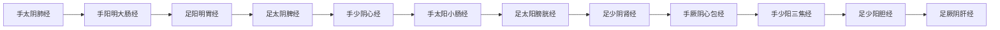
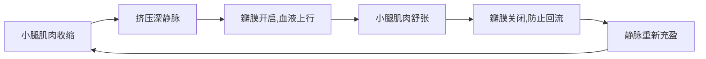

# Concept-Book Run

domain: /home/papagame/projects/digital-duck/cb-meta-health/public/domains/meta_health_ch04/input/graph.yaml
target: daily_baduanjin_practice_plan
started: 2026-11-24T15:00:09

## Teaching order (27 concepts)

- daoyin_tradition
- baduanjin_overview
- diaphragmatic_breathing
- twelve_primary_meridians
- three_regulations
- triple_burner_sanjiao
- yongquan_point
- form8_heel_bounce
- heart_kidney_interaction
- breath_movement_coordination
- dantian
- evidence_quality
- five_organ_movement_matrix
- form1_hold_up_heavens
- form2_draw_the_bow
- form3_single_arm_raise
- form4_look_back
- form5_sway_head_and_tail
- form6_touch_toes
- form7_clench_fists_glare
- tension_relaxation_cycling
- baduanjin_evidence_base
- baduanjin_five_organ_mapping
- closing_form_shougong
- practice_dose
- tension_release_rhythm
- daily_baduanjin_practice_plan

### daoyin_tradition (0.7s)

## 导引传统

**定义。** 导引(导引术)是中国古代把肢体伸展、呼吸调节和意念集中结合起来、用于养生保健的一类练习。"导"指引导气息,"引"指牵引肢体。最早的实物与图像证据包括湖南马王堆汉墓出土的帛画《导引图》(约公元前168年下葬),画面上有四十多个人形姿势,部分附有病名或动物名称。汉代华佗相传创编"五禽戏",模仿虎、鹿、熊、猿、鸟的动作。八段锦是导引的后世分支,宋代文献已有记载,明清时期逐渐定型为现在常见的八个动作。中医认为,这类练习可以疏通气血、调和脏腑;现代研究则更多从运动量、呼吸模式和放松效应来评估它。

**导引的三个组成要素**

| 要素 | 具体做法 | 现代对应的可观察指标 |
|---|---|---|
| 调身 | 缓慢伸展、转体、屈伸 | 关节活动度、柔韧性、平衡能力 |
| 调息 | 深长、均匀的腹式呼吸 | 呼吸频率、静息心率 |
| 调神 | 注意力集中于动作与呼吸 | 主观压力感、焦虑量表得分 |

**例题。** 一位同学练习八段锦一整套,约需12分钟。已知该同学体重 $60\ \text{kg}$,这类低强度练习的代谢当量约为 $3\ \text{METs}$。估算这次练习的能量消耗。

常用估算公式为:

$$
\text{能量消耗(kcal)} \approx \text{METs} \times \text{体重(kg)} \times \text{时间(h)}
$$

代入数据,12分钟等于 $0.2\ \text{h}$:

$$
3 \times 60 \times 0.2 = 36\ \text{kcal}
$$

因此一次练习只消耗约36 kcal,相当于一小片面包的热量。

**问题解决应用。** 假设有人想用导引改善久坐造成的肩颈僵硬,并问它能否"减肥"。分三步分析:

1. **明确目标。** 若目标是减脂,36 kcal 的消耗太小。每周练习5次,总计约180 kcal,远低于一次30分钟慢跑的消耗。
2. **匹配强项。** 导引的优势在柔韧性、平衡和放松。针对肩颈,可选"双手托天理三焦"和"五劳七伤往后瞧"两式,每天练习一到两遍。
3. **设定观察指标。** 练习前后记录静息心率、肩部活动范围(如双手能否在背后相扣)以及主观僵硬程度,连续记录四周,用数据判断是否有效。

**注意事项。** 老年人和平衡能力较差者,做下蹲、单腿站立等动作时应扶稳支撑物。有严重心血管疾病或骨质疏松的人,练习前应先咨询医生。需要明确的是,导引不能替代对疾病的规范治疗,"导引治愈某种病"之类的说法缺乏可靠证据。

**小结。** 导引是历史悠久的身心练习传统,八段锦是其中最流行的后代。它适合作为低强度、易坚持的日常活动,但评价它的效果,应当落到热量、柔韧性、心率和主观感受这些可测量的指标上。

### baduanjin_overview (0.8s)

## 八段锦概述

**定义。** 八段锦是一套站立式的传统导引功法,由八个连续动作组成,动作舒缓、配合呼吸。它最早见于宋代文献;2003年,国家体育总局将其定为"健身气功"的标准功法之一(健身气功·八段锦),动作名称、顺序和要领因此统一。完整练一遍约10至12分钟,不需要器械,场地只要能站直、双臂能展开即可。

八个动作依次是:

| 序号 | 动作名称 | 主要活动部位 |
|---|---|---|
| 1 | 双手托天理三焦 | 上举、伸展躯干 |
| 2 | 左右开弓似射雕 | 马步、扩胸、肩背 |
| 3 | 调理脾胃须单举 | 一手上托、一手下按,躯干侧拉 |
| 4 | 五劳七伤往后瞧 | 转头、转肩 |
| 5 | 摇头摆尾去心火 | 骑马步、躯干摆动 |
| 6 | 两手攀足固肾腰 | 前屈、后伸 |
| 7 | 攒拳怒目增气力 | 马步冲拳 |
| 8 | 背后七颠百病消 | 提踵、轻震 |

名称中的"三焦""心火""固肾"等说法属于中医术语。中医认为这些动作与相应脏腑功能有关;但从现代运动角度看,最可靠的描述是:这套动作综合了拉伸、下肢力量、平衡与呼吸控制。研究提示规律练习可能改善平衡和柔韧性,效果的大小仍需更多高质量试验确认。

**例题:估算一次练习的运动量。** 小李按标准速度练习一遍,用时11分钟。他戴着心率表,平均心率为95次/分。若静息心率为70次/分,估算他的心率比静息时增加了多少?

解:
增加量为 95 − 70 = 25 次/分,约为静息值的 36%。这一强度明显低于中等强度有氧运动(通常指最大心率的64%至76%)。若他的年龄为40岁,按常用估算式,最大心率约为 220 − 40 = 180 次/分,则 95 次/分约为最大心率的53%,属于低强度。

**问题解决应用。** 现有三位练习者,需要判断八段锦能否满足其目标:

1. **久坐的办公室职员**,想缓解肩颈僵硬、增加每日活动。第1、4动作针对上举与转头,10分钟即可完成,门槛低,适合作为工间练习。
2. **有膝关节不适的中老年人**,可把第2、5、7动作的马步抬高(半蹲浅一些),降低膝部负荷,量力而行。
3. **以提高心肺耐力为目标的青年**,按标准速度练习强度偏低,仅靠八段锦很难达到推荐的每周150分钟中等强度有氧运动。他应把八段锦作为热身或恢复,另加快走、慢跑等运动。

由此可见,应用时的思路是:先明确目标,再用心率、时长这类可测量的数据判断强度,最后调整动作幅度或搭配其他运动。有头晕、血压控制不佳或骨关节疾病者,开始前应咨询医生。

### diaphragmatic_breathing (0.8s)

## 腹式呼吸

**定义。** 腹式呼吸(又称膈式呼吸)是以膈肌为主要动力的呼吸方式。吸气时膈肌收缩、下移,胸腔纵向扩大,肺内压下降,空气进入肺的下部,腹部随之轻微隆起;呼气时膈肌放松、上升,腹部回落。与之相对的胸式呼吸主要依靠肋间肌和颈部辅助肌,呼吸较浅,肺底部通气相对不足。

在中医(TCM)的养生实践中,类似的方法常被称为"腹式呼吸"或"丹田呼吸",强调"气沉丹田"。这是一种传统说法,现代生理学对应的机制主要是膈肌运动和迷走神经张力的变化。

**基本做法。** 仰卧或坐位,一只手放在胸前,另一只手放在肚脐上方。用鼻缓慢吸气,使腹部手被顶起而胸前手基本不动;再用嘴或鼻缓慢呼气,腹部回落。

**例题。** 某人静息时潮气量为 $500\ \text{mL}$,呼吸频率为每分钟 $16$ 次。已知解剖无效腔约为 $150\ \text{mL}$。分钟通气量与肺泡通气量分别是多少?

分钟通气量:

$$\dot V_E = V_T \times f = 500 \times 16 = 8000\ \text{mL/min}$$

肺泡通气量:

$$\dot V_A = (V_T - V_D)\times f = (500-150)\times 16 = 5600\ \text{mL/min}$$

**问题应用。** 比较两种呼吸方式,总通气量都保持约 $8000\ \text{mL/min}$:

| 方式 | 潮气量 | 频率 | 肺泡通气量 |
|---|---|---|---|
| 浅快胸式 | $300\ \text{mL}$ | 26 次/分 | $(300-150)\times 26 = 3900\ \text{mL/min}$ |
| 深慢腹式 | $800\ \text{mL}$ | 10 次/分 | $(800-150)\times 10 = 6500\ \text{mL/min}$ |

两者分钟通气量相近(约 $7800$ 与 $8000\ \text{mL/min}$),但深慢呼吸的肺泡通气量更高,因为每次呼吸中无效腔所占比例更小。这说明:真正参与气体交换的是肺泡通气量,而不是单纯的呼吸总量。

此外,每分钟约 6 次的缓慢腹式呼吸常用于放松训练。研究显示它可使心率变异性增加、静息心率和主观紧张感略有下降,但效果因人而异,不能替代对高血压或焦虑障碍的规范治疗。

**练习建议。** 

1. 每天 5–10 分钟,从每分钟 10 次开始,逐步放慢。
2. 呼气时间略长于吸气(如吸 4 秒、呼 6 秒)。
3. 出现头晕、手麻时立即恢复自然呼吸,这是过度通气的表现。
4. 患有严重慢性阻塞性肺疾病或心血管疾病者,应先咨询医生再练习。

**小结。** 腹式呼吸通过增加膈肌参与度提高潮气量,在同样的分钟通气量下提升肺泡通气量。解决相关问题时,先区分分钟通气量与肺泡通气量,再代入无效腔进行计算。

### twelve_primary_meridians (0.8s)

## 十二经脉

**定义。** 中医认为,人体内有一套运行气血的通道系统,称为经络。其中最主要的是十二条"正经",即十二经脉。它们按所属脏腑分为两大类:**阴经**属脏,**阳经**属腑。每条经脉再按循行的肢体部位,分为手经与足经。

因此十二经脉的命名由三部分组成:手或足、阴或阳(含太阴、少阴、厥阴、太阳、阳明、少阳)、所属脏腑。例如"手太阴肺经",意思是循行于上肢、属肺的阴经。

**分布规律。** 下表按上下肢和阴阳归纳:

| 类别 | 手三阴(上肢内侧) | 手三阳(上肢外侧) | 足三阳(下肢外侧或躯干前后) | 足三阴(下肢内侧) |
|---|---|---|---|---|
| 经脉 | 肺经、心包经、心经 | 大肠经、三焦经、小肠经 | 胃经、胆经、膀胱经 | 脾经、肝经、肾经 |

在四肢上,三条阴经按前、中、后排列,依次是太阴、厥阴、少阴(下肢内踝上八寸以下,肝经与脾经位置略有不同)。三条阳经依次是阳明、少阳、太阳。

**循行与表里关系。** 中医认为,气血按固定顺序在十二经脉中流注,形成首尾相接的循环,从手太阴肺经开始,到足厥阴肝经结束,再回到肺经。流注顺序如下:

*图:十二经脉的流注顺序。肝经之后再回到肺经,形成循环。*

此外,互为表里的一阴一阳两条经脉相互配对,如肺经与大肠经、脾经与胃经。

**例题一:读懂经脉名称。** 问:"足少阳胆经"循行于何处,属阴还是阳?解:"足"表示循行于下肢;"少阳"属阳;"胆"为六腑之一,与阳经属腑相符。所以它是循行于下肢外侧中线附近的阳经,与足厥阴肝经互为表里。

**例题二:用规律推断位置。** 问:手上的某穴位在前臂内侧偏小指一侧,可能属于哪条经脉?解:前臂内侧为手三阴,其中偏后(靠小指侧)的是手少阴心经。因此它很可能是心经穴位。

**问题应用。** 假设某人手臂外侧靠拇指一侧有酸痛。按上述规律,外侧属阳经,靠拇指一侧(前缘)为阳明,所以对应手阳明大肠经。中医会据此在该经脉上选穴。需要注意的是,经脉并非现代解剖学中已被证实的结构,针灸的疗效证据因病症而异:对部分慢性疼痛有一定的临床研究支持,但经脉循行本身尚无明确的解剖学依据。

**小结。** 十二经脉的学习重点是三个规律:名称含义、肢体分布的前中后排列、以及流注顺序与表里配对。掌握这些规律后,便可以由名称推断位置,也可以由位置反推经脉。

### three_regulations (0.8s)

## 三调：调身、调息、调心

**定义。** 在气功练习中,“三调”指三个同时进行的调节环节:调身(调整姿势与身体放松程度)、调息(调整呼吸的节律、深度与速度)、调心(调整注意力,使其集中、平稳)。中医认为这三者须相互配合,这也是气功区别于一般体操的地方:体操以肌肉用力与动作幅度为主要目标,而气功把姿势、呼吸和注意力三项一并作为练习内容。

**三个环节的具体要求。**

| 环节 | 练习要点 | 可观察的指标 |
|---|---|---|
| 调身 | 站、坐或卧姿,脊柱自然伸直,肩、颈、腹部放松,关节不僵硬 | 肩部是否耸起,肌肉是否紧绷 |
| 调息 | 自然、均匀、缓慢,常用腹式呼吸 | 呼吸频率(次/分钟) |
| 调心 | 把注意力放在呼吸、某个部位或动作上,杂念出现时再带回 | 能持续专注的时间(分钟) |

成年人安静时的呼吸频率一般为 12–20 次/分钟。气功练习中常把它放慢到约 6–10 次/分钟。现代研究发现,每分钟约 6 次的慢呼吸与心率变异性的变化有关,但这类研究多数规模较小,尚不足以下定论。

**例题。** 小李安静坐着,数得 1 分钟呼吸 16 次。他练习调息后,每次吸气 4 秒、呼气 6 秒,中间不停顿。求新的呼吸频率,并说明它是否落在上述范围内。

解:一次完整呼吸用时 $4+6=10$ 秒,所以每分钟呼吸次数为

$$\frac{60}{10}=6\ \text{次/分钟}$$

比原来的 16 次/分钟减少了 10 次,刚好落在 6–10 次/分钟的区间下限。

**应用:诊断“缺了哪一调”。** 把三调当作检查清单,能帮助判断练习为什么没有效果。

- 小王练习时肩膀发酸、呼吸时胸口发紧。原因多半在调身:肩颈没有放松,限制了腹部的起伏。应先放松肩颈,再继续调息。
- 小张姿势正确,但总是憋气数秒,再猛地吸气。这是调息出了问题:他在“控制”呼吸,而不是顺其自然。应缩短呼吸时间,回到舒适的节律。
- 小赵姿势和呼吸都没问题,但 10 分钟内脑中不断出现工作的事。这属于调心的问题。可以每次呼气时默数一次,数到 10 后重新开始;走神就从 1 重数,这样能记录自己的专注程度。

三者互相影响:身体紧张会使呼吸变浅,呼吸急促会使注意力难以集中,注意力分散又会让肩颈重新绷紧。因此初学者通常按“身、息、心”的顺序逐步入手,先把姿势放松,再让呼吸平稳,最后集中注意力。

**小结。** 三调是气功练习的三个同时进行的环节。判断练习是否到位,可以分别看姿势是否放松、呼吸是否缓慢均匀、注意力能否保持,并据此找出需要先调整的一项。

### triple_burner_sanjiao (0.7s)

## 三焦

**定义。** 三焦(sānjiāo,又称"三焦腑")是中医理论中的一个功能性概念。中医认为,三焦是气和津液运行、升降出入的通道,并按部位分为三段:

| 分部 | 大致范围 | 中医所述的主要功能 | 常用比喻 |
|---|---|---|---|
| 上焦 | 横膈以上(心、肺) | 宣发气,输布津液 | "如雾" |
| 中焦 | 横膈至脐(脾、胃) | 消化饮食,化生气血 | "如沤" |
| 下焦 | 脐以下(肝肾、膀胱、肠) | 排泄水液与糟粕 | "如渎" |

要注意,三焦并不对应某个解剖器官。它是对全身水液代谢与气化过程的功能性划分,也是后世"三焦辨证"(用于外感热病)的基础。

**例题:把一个症状归到哪一焦。** 一位患者近几天有如下表现:咳嗽、咽痛、轻微发热,没有明显的腹胀或排尿异常。

分析步骤:
1. 找出症状出现的部位:咳嗽、咽痛属于胸部与上呼吸道。
2. 对照分部:胸部在横膈以上,属于上焦(肺所在之处)。
3. 判断范围:没有消化症状(中焦)和排尿症状(下焦),因此病变局限于上焦。

结论:这是上焦的表现。三焦辨证据此认为,此时病位较浅,治法重在宣散肺气。

**问题解决应用。** 现在换一个情境:一位患者饭后腹胀、食欲差、大便溏稀,同时小便不畅,下肢水肿。

1. 先把症状分组:饭后腹胀、食欲差、便溏,涉及消化,属中焦;小便不畅、下肢水肿,涉及水液排泄,属下焦。
2. 找关联:中医认为中焦脾胃负责把水谷化为精微,脾运化失常则水湿停聚,水湿下注,又加重下焦的水液排泄障碍。
3. 得出思路:病变涉及中、下两焦,以中焦为先。治疗思路是先健脾化湿,再兼顾下焦利水,而不是只处理水肿。

这个例子说明,三焦分部的实际用途是**定位和排序**:先判断病变在哪一段,再判断哪一段是起因,从而安排处理的先后。

**需要明确的证据状况。** 现代解剖学和生理学中没有"三焦"这个结构,也没有证据表明存在一条独立的"三焦通道"。它与现代医学概念之间的对应(例如把它类比为体腔内的筋膜间隙或水液代谢网络)仍属推测。因此,学习三焦时应把它当作中医的分类框架,而不是已被证实的解剖或生理实体。

**练习。** 某人口渴、尿频,同时有腹胀、便秘。请按上、中、下三焦分别归类其症状,并说明你认为应先处理哪一段,理由是什么。

### yongquan_point (0.8s)

## 涌泉穴

**定义。** 涌泉(KI-1)位于足底前部凹陷处,约在足底第2、3趾缝纹头端与足跟连线的前三分之一处,卷足时最凹陷的地方。按 TCM 的经络理论,涌泉是足少阴肾经的起点,"涌泉"意为经气如泉水涌出。现代研究并未证实经络或"经气"的存在,这里所说的是 TCM 的解释框架。从解剖上看,该处皮肤厚,分布有足底内、外侧神经的末梢,并有足底腱膜和趾短屈肌等结构,所以它既是传统穴位,也是一个触觉与压觉敏感的区域。

**常见用法。** TCM 常把涌泉用于按摩、热水泡脚和艾灸,用来调养睡眠、缓解疲劳。目前有一些小规模研究报告了足部按摩对放松和睡眠质量的帮助,但样本小、设计不严,不能当作确定的疗效。足浴使人放松,主要可以用温热让血管扩张、让人安静下来来解释,并不必借助穴位理论。

**例题:定位与操作。**

某同学想按压自己的涌泉穴,请按步骤完成。

1. 坐下,把一只脚放在对侧膝上,使足底朝上。
2. 找到足底中线,从第2、3趾缝纹头端向足跟画一条线。
3. 将这条线分成三等份,靠近趾端的一份与中间一份的交界附近就是涌泉。
4. 用拇指指腹按压,力度以酸胀但不疼痛为宜,每次按 1 至 2 分钟,每分钟约 60 次按揉。

于是,按揉 2 分钟的总次数为

$$2 \times 60 = 120 \text{ 次}$$

**问题应用。** 

*情景一:* 一位同学睡前泡脚加按涌泉,想知道水温是否合适。足浴水温一般建议 38 至 42 ℃。若水温为 45 ℃,持续 20 分钟,则有烫伤风险,尤其对感觉迟钝者。

*情景二:* 糖尿病患者常有周围神经病变,足部感觉减退,又容易发生皮肤破损和感染。请判断他们能否用热水泡脚、用力按压足底。

*分析:* 他们对温度和疼痛不敏感,可能在没有察觉时就已烫伤或擦伤,而伤口愈合慢、易感染。因此这类人群应先用手腕内侧或温度计测水温,避免长时间泡脚,按压要轻,并先咨询医生。

| 情况 | 建议 |
|---|---|
| 健康成人 | 水温 38–42 ℃,泡 15–20 分钟,轻中度按压 |
| 糖尿病或足部感觉减退 | 先测水温,缩短时间,轻按,先咨询医生 |
| 足底有伤口、感染或水疱 | 避免按压和热敷 |
| 孕妇 | 先咨询医生,避免强刺激 |

**小结。** 涌泉的位置可以靠足底的三等分来确定。它在 TCM 中是肾经的起点,按摩和泡脚可以帮助放松,但不能替代对睡眠障碍、高血压或糖尿病等疾病的规范诊疗。实际操作中,安全问题,即水温和按压力度,比位置是否精确更重要。

### form8_heel_bounce (0.9s)

## 第八式：背后七颠百病消

**定义。** 背后七颠是八段锦的收式动作。双脚并拢站立,脚跟缓缓提起,身体向上拔伸,稍停后让脚跟轻轻落地,使身体受到一次轻微的震动,如此重复七次。中医认为,此式与肾(五行属水)相应,脚底的涌泉穴受到震动,有助于"固肾"。这一说法属于中医理论的解释,目前缺乏直接的临床证据;而它在生理学上的作用则可以清楚说明:

1. **小腿肌肉泵**:提踵时腓肠肌和比目鱼肌收缩,挤压深静脉,在静脉瓣的配合下把血液推向心脏,减少下肢血液淤积。
2. **轻微的冲击负荷**:脚跟落地产生的震动沿骨骼向上传导,对骨骼是一种温和的力学刺激,有助于维持骨密度。
3. **平衡与本体感觉**:踮脚站立需要踝部和足部肌肉持续微调,可以训练平衡能力。

**动作要领。**
- 双脚并拢,头顶上领,下颌微收,双手自然下垂。
- 吸气,脚跟提起,足趾抓地,保持背部挺直。
- 稍停约一秒,呼气,脚跟轻落,距地面约 1–2 厘米后着地,不要砸地。
- 连续做七次,最后自然站稳,收功。

**例题。** 一位办公室职员每天坐 8 小时,傍晚常觉小腿发胀。他在每小时的休息间隙做一组背后七颠,每次提踵加落地约需 3 秒。

问:一组需要多少时间?一天工作中做 8 组,累计多少时间?

解:一组用时为

$$7 \times 3\ \text{s} = 21\ \text{s}$$

8 组累计

$$8 \times 21\ \text{s} = 168\ \text{s} \approx 2.8\ \text{min}$$

结论:每天只花不到 3 分钟,就能让小腿肌肉泵在久坐期间被反复激活,代价极小。

**问题解决应用。** 下面几种情形需要调整动作:

| 情形 | 问题 | 调整方法 |
|---|---|---|
| 站立不稳,容易晃动 | 平衡能力不足 | 一只手扶墙或椅背,再做练习 |
| 骨质疏松较严重 | 落地冲击可能带来风险 | 只提踵、缓慢下放,不做震动落地 |
| 足跟、踝部疼痛 | 冲击加重不适 | 减小落地高度,或暂停并咨询医生 |
| 头晕、血压偏低 | 起落时可能一时供血不足 | 放慢节奏,身旁留有支撑 |

**练习题。** 某同学做完一组七次后,感到脚跟有明显的刺痛。请根据上表判断可能的原因,并写出两条改进措施。

参考思路:原因多为落地过重,冲击集中在足跟。改进措施:(1)落地时脚跟只下降 1–2 厘米,控制下放速度;(2)穿有缓冲的鞋或在软垫上练习,疼痛持续则应就医。

**小结。** 背后七颠的价值体现在小腿肌肉泵、温和的骨骼刺激和平衡训练上。"百病消"是对其保健作用的夸张说法,它不能治疗疾病,但作为收式,它能让全身在一系列动作之后放松下来。

### heart_kidney_interaction (0.6s)

## 心肾相交

**定义。** 心肾相交(又称水火既济)是中医(TCM)用来描述心与肾之间相互协调的说法。中医认为,心位于上,属火,主神志;肾位于下,属水,主藏精。心火应下降以温养肾水,肾水应上升以滋润心火,二者上下交通,人才能入睡安稳、精神充沛。若这种交通失常,称为"心肾不交",典型表现为失眠、多梦、心悸、心烦、五心烦热、腰膝酸软、盗汗等。需要说明的是,这是一种以症状归纳为基础的传统理论框架,"心火""肾水"并不对应现代解剖学上的单一结构;它的现代对应关系目前缺乏确证。

**现代生理学中可以量化的相关联系。** 心脏与肾脏之间确实存在已被充分证实的相互作用,称为"心肾综合征"。心脏每搏输出量下降会使肾灌注减少;肾功能下降则导致水钠潴留,增加心脏负荷。常用的量化关系是:

$$CO = HR \times SV$$

其中 $CO$ 为心输出量,$HR$ 为心率,$SV$ 为每搏输出量。肾脏约接受心输出量的 $20\%$ 至 $25\%$。

**例题。** 某患者静息心率 $HR = 70$ 次/分,每搏输出量 $SV = 70\ \text{mL}$。若肾血流占心输出量的 $20\%$,求肾血流量。

解:
$$CO = 70 \times 70 = 4900\ \text{mL/min}$$
$$\text{肾血流量} = 4900 \times 0.20 = 980\ \text{mL/min}$$

若心力衰竭使 $SV$ 降为 $50\ \text{mL}$,而心率代偿上升到 $80$ 次/分,则 $CO = 80 \times 50 = 4000\ \text{mL/min}$,肾血流约为 $800\ \text{mL/min}$,下降约 $18\%$。肾灌注不足会激活肾素—血管紧张素—醛固酮系统,使水钠潴留、血容量上升,进一步加重心脏负担,形成恶性循环。

**问题解决应用。** 下面把两种视角对照使用:

| 情境 | 中医的解释 | 现代生理学的思路 |
|---|---|---|
| 长期熬夜后心烦、失眠、腰酸 | 心肾不交 | 先排查睡眠不足、焦虑、甲状腺功能亢进、贫血等原因 |
| 下肢水肿、气短、夜尿增多 | 心肾阳虚(中医用语) | 需检查心功能、肾功能(肌酐、估算肾小球滤过率)及电解质 |

实际应用时应注意:失眠、心悸属于常见症状,多数由生活方式或焦虑引起;但若同时出现水肿、气短、尿量明显变化,应及时就医做心电图、心脏超声和肾功能检查,而不应仅凭"心肾不交"的概念自行调理。心肾相交可作为理解身心症状的一种传统描述,但诊断和治疗决策应以现代检查结果为依据。

**小结。** 心肾相交在中医中指心火下降、肾水上升的协调状态;而在现代医学中,心输出量与肾灌注之间的双向影响是可测量、可干预的。两者不可互相替代。

### breath_movement_coordination (0.8s)

## 呼吸与动作的配合

**定义。** 呼吸与动作的配合,是指让每一次呼气或吸气对应动作的一个方向:身体上升、展开、打开时吸气;身体下沉、收拢、闭合时呼气;整个过程中不憋气,呼吸保持连续、均匀。在太极拳、八段锦、瑜伽和力量训练中,这都是常见的基本要求。

**为什么这样配合。** 这一规律有生理上的依据。吸气时胸廓扩张、脊柱略微伸展,打开胸部、抬起手臂的动作因此更顺手;呼气时腹部收紧、胸廓回落,身体前屈、下蹲或收拢时更容易发力和稳定。中医认为(TCM)这一配合有助于"气"的运行,这属于传统的解释框架;现代研究能够确认的是:有节律的呼吸有助于放松,也能减少动作中不自觉的屏气。

**不憋气为何重要。** 用力时憋住呼吸并屏气用力(瓦尔萨尔瓦动作),会使胸腔内压升高,静脉回心血量下降,随后血压会明显波动。对高血压、心脏病患者尤其不宜。因此,即使动作吃力,也应保持呼吸不中断。

**例题。** 以八段锦"两手托天理三焦"为例,一套动作用时约 8 秒:
- 双手从腹前上托至头顶(约 4 秒):缓慢吸气;
- 双手下落回到腹前(约 4 秒):缓慢呼气。

若平静呼吸频率为每分钟 15 次,则每次呼吸约 $\frac{60}{15}=4$ 秒。动作每 8 秒完成一轮,正好对应一吸一呼,每分钟约 $\frac{60}{8}=7.5$ 轮,呼吸频率降到每分钟 7.5 次,比平静时更慢、更深。

**问题应用。** 

*问题 1:* 做深蹲时,下蹲和站起各应怎样呼吸?
答:通常是下蹲(身体下沉)时吸气,站起用力时呼气;若负重较大,可在站起时缓缓呼气,不要屏住。

*问题 2:* 动作需要 3 秒,你的一次吸气却要 4 秒,怎么办?
答:不要为了凑动作硬憋或猛吸。应放慢动作,使其与呼吸长度匹配,或把动作拆成两段、分两次短吸;原则是**让动作迁就呼吸**,而不是让呼吸迁就动作。

*问题 3:* 练习中出现头晕、胸闷,应怎么办?
答:很可能是呼吸过深过快或不自觉屏气。应先停下来,恢复自然呼吸,之后降低动作幅度和速度,以动作舒适、呼吸不费力为标准。若症状反复出现,应就医评估。

**小结。** 打开、上升时吸,收拢、下沉时呼,全程不屏气;当动作与呼吸冲突时,优先保证呼吸顺畅。

### dantian (0.7s)

## 丹田

**定义。** 丹田(dāntián)是中医(Traditional Chinese Medicine,TCM)和气功、内丹传统中的一个概念,字面意思是“炼丹之田”。TCM 认为,丹田是人体储藏和转化“气”的部位,常说的有上、中、下三个丹田。本章讨论的是**下丹田**,通常指脐下约三指(约 1.5 至 3 寸)、位于腹部深处的区域,相当于关元穴、气海穴附近。需要说明:丹田不是解剖学结构,腹部没有一个能被手术或影像发现的“丹田器官”。它是一个用于定位、训练和描述体感的概念。

**对应的真实解剖。** 下丹田所在的位置,在解剖学上包括小肠、膀胱、子宫或前列腺等脏器,以及腹横肌、盆底肌、腹直肌、膈肌等核心肌群。重心(人体质量中心)在直立时大约位于第二骶椎前方,也在这一区域附近。因此,练习者说的“气沉丹田”,在可检验的层面上,更接近下面这些生理动作:

| 传统说法 | 可观察的生理对应 |
|---|---|
| 气沉丹田 | 腹式呼吸:吸气时膈肌下降,腹部向外扩张 |
| 意守丹田 | 把注意力集中在下腹,有助于放松和调节呼吸节律 |
| 丹田有力 | 腹横肌与盆底肌的核心稳定性 |

腹式呼吸、放松训练对降低心率和缓解紧张有一定的研究支持;但“气”在丹田中积聚、运行这一说法,目前没有可测量的客观证据。

**例题。** 一位练习者静坐时每分钟呼吸 16 次,每次潮气量约 $0.5\ \text{L}$。改为腹式慢呼吸后,每分钟 6 次,潮气量增至 $1.0\ \text{L}$。比较每分钟通气量,并考虑死腔的影响。

每分钟通气量等于呼吸频率乘以潮气量:

$$
\dot V_E = f \times V_T
$$

练习前:$16 \times 0.5 = 8.0\ \text{L/min}$;练习后:$6 \times 1.0 = 6.0\ \text{L/min}$。

设解剖死腔约 $0.15\ \text{L}$,则肺泡通气量为 $f \times (V_T - V_D)$:

- 练习前:$16 \times (0.5 - 0.15) = 5.6\ \text{L/min}$
- 练习后:$6 \times (1.0 - 0.15) = 5.1\ \text{L/min}$

**问题解决应用。** 总通气量下降了 25%,而肺泡通气量只下降约 9%。这说明深慢呼吸让每一口气中更大比例用于气体交换,效率更高。因此,练习者可以用更少的呼吸次数,维持接近的肺泡通气。

实际练习时,可以这样检验自己的“丹田呼吸”:

1. 一手放在肚脐下方,另一手放在胸口。
2. 吸气时,下腹的手应先被推起,胸口的手几乎不动。
3. 数 1 分钟的呼吸次数,目标为 6 至 8 次。
4. 若出现头晕、手麻,说明过度通气,应立即恢复自然呼吸。

**小结。** 丹田是 TCM 与气功中定位下腹的概念,而不是解剖结构。它的实用价值体现在可以验证的部分:腹式呼吸、核心稳定与放松。把传统术语翻译成可观察的动作,既能保留训练方法,也避免把无法检验的说法当作生理事实。

### evidence_quality (0.8s)

## 证据质量的判断

**定义。** 证据质量指一项研究的结论在多大程度上可信、能推广到真实患者身上。判断时不看结论多诱人,而看研究设计能否排除其他解释。常见证据按可靠性由低到高大致排列如下:

| 证据类型 | 做了什么 | 主要弱点 |
|---|---|---|
| 病例报告 | 描述个别患者的经过 | 无对照,无法区分疗效与自然好转 |
| 观察性研究 | 比较自行选择了不同做法的人群 | 混杂因素(如爱运动的人也更少吸烟) |
| 随机对照试验(RCT) | 随机分组,比较干预与对照 | 样本量小、未设盲时易偏倚 |
| 荟萃分析 | 汇总多项同类研究 | 受纳入研究质量与发表偏倚限制 |

随机分组的意义在于:让已知和未知的混杂因素在两组间大致均衡。盲法(受试者和评估者都不知道分组)则防止期望影响主观症状的报告和评分。

**为什么小型或未设盲的试验会夸大疗效。** 样本小时,偶然的组间差异很大,"阳性"结果更容易出现,也更容易被发表。未设盲时,知道自己在用新疗法的人往往更乐观,评估者也可能无意中打出更高的分数。方法学综述发现,未充分隐藏分组或未设盲的试验,报告的疗效平均高于严谨试验。

**例题。** 某保健品的两项试验用疼痛评分(0–10分)作结局:

- 试验A:24人,未设盲,服用组平均下降2.5分,对照组下降1.0分。
- 试验B:400人,随机、双盲,服用组下降1.6分,对照组下降1.4分。

先算差值。试验A为 $2.5-1.0=1.5$ 分,试验B为 $1.6-1.4=0.2$ 分。

再看是否可信。A的样本小且未设盲,差值很可能混入安慰剂效应和评估者偏倚。B的对照组同样改善了1.4分,说明大部分改善来自安慰剂效应和自然病程。0.2分的差异也远小于通常认为有临床意义的变化(常取约1分)。更合理的结论是:该保健品的真实效果很小或没有。

**问题解决:四步检查清单。**

1. **设计**:有对照吗?随机吗?设盲了吗?
2. **规模**:样本量多大?结果是否只来自一次小试验?
3. **结局**:看的是疼痛评分这类替代指标,还是死亡、骨折这类真正重要的结局?差值有没有临床意义,而不只是"统计学显著"?
4. **一致性**:其他独立研究能重复吗?荟萃分析是否纳入了阴性结果?

应用示例:报道称"一位患者服用某草药后肿瘤缩小"。这是病例报告,不能证明疗效,因为肿瘤可能自发消退,或同时接受了其他治疗。它至多是提出假设,要检验必须做设计良好的对照试验。

需要注意,等级只是起点。设计糟糕的RCT可能不如一项严谨的大型观察性研究。在吸烟与肺癌这类无法或不宜随机分组的问题上,多项一致的观察性研究也能给出可靠结论。

### five_organ_movement_matrix (0.8s)

## 五脏操对照表

**五脏操对照表**把五个动作(扩胸、扇肋、提身、扭转、深蹲)与中医(TCM)所说的五脏逐一对应,并列出每个动作的身体着力点、呼吸配合和常见错误。使用它的目的,是让练习者在每次练习前,能快速核对"做什么、怎么呼吸、哪里发力"。

需要先说明:五脏对应属于 TCM 的理论框架,"练某动作即养某脏"没有现代生理学证据支持。下表中"现代生理学视角"一列,描述的是能够测量或观察的实际效应。

### 对照表

| 动作 | TCM 对应脏 | 主要活动部位 | 呼吸配合 | 现代生理学视角 |
|---|---|---|---|---|
| 扩胸 | 肺 | 胸大肌、菱形肌、胸廓 | 展臂吸气,合臂呼气 | 增加胸廓活动度,改善肩背姿势 |
| 扇肋 | 肝 | 肋间肌、腹斜肌 | 侧屈时呼气,回正时吸气 | 拉伸体侧,增加侧向呼吸幅度 |
| 提身 | 脾 | 腹直肌、核心、髋屈肌 | 上提时呼气 | 训练核心稳定,轻度提高心率 |
| 扭转 | 肾 | 腰部旋转肌群、竖脊肌 | 转体时呼气 | 增加脊柱旋转活动度 |
| 深蹲 | 心 | 股四头肌、臀大肌、腘绳肌 | 下蹲吸气,起身呼气 | 大肌群参与,心率上升最明显 |

### 例题:估算一组练习的强度

小林,30 岁,每个动作做 12 次,全套 5 个动作,每个动作约 60 秒,共约 5 分钟。她想知道深蹲时心率是否进入适度强度区间。

常用估算公式为最大心率:

$$HR_{\max} = 220 - \text{年龄}$$

小林的 $HR_{\max} = 220 - 30 = 190$ 次/分。适度强度通常取最大心率的 $50\%\sim70\%$,即 $95\sim133$ 次/分。她测得深蹲结束时心率为 120 次/分,落在该区间内,说明强度适中。该公式只是群体平均的粗略估计,个体差异可达每分钟 10 次以上。

### 问题应用:按目标选动作

**情景一**:长时间伏案,肩背僵硬、胸口发闷。应优先选择扩胸和扇肋,它们直接针对胸廓和体侧的活动受限。每个动作可多做 1 组,并让呼吸与动作节奏一致。

**情景二**:想把整套练习的时间压缩到 3 分钟。可保留深蹲(大肌群、效益最高)和扭转(脊柱活动度),各 90 秒。这样取舍的依据是动作的实际身体效应,而不是五脏顺序。

**情景三**:膝关节不适。深蹲应减小下蹲幅度(如只蹲到大腿约 45° 角),或扶椅背完成;若下蹲时疼痛加重,应停止并咨询医生。

### 小结

使用此表时,把"TCM 对应脏"当作记忆和分类的线索,把"主要活动部位"和"呼吸配合"当作实际操作的依据。选动作时,以自己的身体状况和目标为准,而不是按照脏腑名称。

### form1_hold_up_heavens (0.8s)

## 第一式：两手托天理三焦

### 定义

第一式"两手托天理三焦"是八段锦的起势动作：双手在小腹前十指交叉，翻掌向上托举过头，同时双脚踩实、脚跟上提，使整个躯干纵向拉长；随后松手、两臂从体侧下落还原。中医认为（Traditional Chinese Medicine，TCM），三焦是上焦（胸）、中焦（上腹）、下焦（下腹）的合称，主管气与水液的通行。这一式的目的是用一个大幅度的上举动作，让整个躯干都参与伸展，因此常被称作后续各式的"总开关"。

从现代解剖和运动学看，这一动作的实际效果是可以测量的：它拉伸背阔肌、胸大肌、腹直肌和肋间肌，增大胸廓的上下径，并训练站姿的直立控制。"三焦"是否对应某种可检验的结构，现代医学并无证据，本节只把它当作动作的传统说明来介绍。

### 动作要领

1. **预备**：两脚与肩同宽，膝微屈，两手自然下垂。
2. **上托**：十指交叉于小腹前，掌心向上，沿身体中线上提；到胸前时翻掌，掌心向上托过头顶，同时缓缓吸气，脚跟微提。
3. **停顿**：肘伸直，下颌微收，保持 2–3 秒，感觉从脚底到指尖被"拉长"。
4. **还原**：松开十指，两臂从两侧画弧下落，同时呼气，脚跟轻落。

### 例题

**例：** 一名学员以每分钟 4 次的节奏练习本式，一次完整动作（吸—停—呼）约 15 s，其中上托吸气约 6 s。他练习 5 min，问共做几次？吸气的总时长是多少？

**解：**

$$\text{次数}=\frac{5\times 60\ \text{s}}{15\ \text{s}}=20\ \text{次}$$

$$\text{吸气总时长}=20\times 6\ \text{s}=120\ \text{s}=2\ \text{min}$$

注意：每分钟 4 次与 15 s 一次是同一节奏（$60\div15=4$），数据自洽。可见，本式的时间主要花在缓慢的吸气上托，这正是胸廓被充分打开的阶段。

### 问题应用：常见错误的诊断

| 现象 | 可能原因 | 调整方法 |
|---|---|---|
| 托举时腰明显前凸 | 肋骨外翻、腹部松弛 | 收小腹，肋下缘向内收，只上提不后仰 |
| 肩膀耸向耳朵 | 斜方肌上部代偿 | 先沉肩再上托，想象手心推向天花板 |
| 肘无法伸直 | 胸大肌、背阔肌紧张 | 双手稍分开，幅度以不痛为界，逐日增加 |
| 提脚跟时站不稳 | 重心偏移、踝力弱 | 目视前方一点，先扶墙练习 |

**练习：** 若某人长时间伏案，肩前侧紧、肘伸不直，应先采取表中哪一项调整？为什么？（参考答案：分开双手并降低幅度。因为紧张的胸大肌限制了肩关节上举，强行对掌会引发腰部代偿性后仰，增加腰椎负担。）

有心血管疾病、严重高血压或肩部损伤者，应在医生指导下减小幅度、避免长时间憋气。

### form2_draw_the_bow (0.9s)

## 第二式：左右开弓似射雕

**定义。** 第二式“左右开弓似射雕”是八段锦的第二个动作。练习者先站成马步(两脚分开约为肩宽的两倍,屈膝下蹲,大腿接近水平),再模仿拉弓:一臂向侧方推出,食指与拇指撑开成“八字”,另一臂屈肘向侧拉开,像拉满弓弦,头转向推出手的方向,目视前方。左右交替进行。中医认为,这个动作能牵拉手太阴肺经和手阳明大肠经(两者循行于上肢的前侧和外侧),并扩展胸廓,因此被视为呼吸练习的自然搭档。从现代生理学看,可以明确说的是:动作使肩胛骨后收,拉伸胸大肌和胸小肌,训练菱形肌、斜方肌中下部和股四头肌。

**动作要领。**
1. 开步下蹲:两脚分开,屈膝,膝盖对准脚尖,不内扣。
2. 交叉上提:双手在胸前交叉,右手在外,目视前方。
3. 开弓:左手八字掌向左推出,右手屈肘向右拉至胸侧,头转向左。
4. 吸气与呼气:拉弓展胸时吸气,收势还原时呼气;换边重复。

**例题。** 小李身高 $1.70\ \mathrm{m}$,体重 $65\ \mathrm{kg}$。她做马步时屈膝,每条腿大约承担体重的一半。若每条腿负荷约等于 $\frac{1}{2}\times 65\ \mathrm{kg}$,则每条腿承担约多少重力?取 $g = 9.8\ \mathrm{m/s^2}$。

解:每条腿承担的质量约为 $32.5\ \mathrm{kg}$,重力为

$$F = mg = 32.5 \times 9.8 \approx 318.5\ \mathrm{N}$$

这只是静态的重力。屈膝越深,股四头肌需要的力就越大,所以膝关节实际承受的力远高于此值。这说明初学者应循序渐进地降低重心。

**问题解决应用。** 

*情境一:练习量的计算。* 一遍完整动作左右各一次,每侧保持3秒,再用3秒还原,共需 $2\times(3+3)=12$ 秒。若一次练习做6遍,马步总时长是多少?每侧保持3秒,共 $6\times 2\times 3=36$ 秒,每遍都在马步中完成。累计的下肢负荷时间比总用时更值得关注:计划练习时,应以该时长为起点,逐周增加,而不是一开始就追求深蹲。

*情境二:常见错误诊断。*

| 现象 | 可能原因 | 调整方法 |
|---|---|---|
| 膝盖内扣、膝前疼痛 | 屈膝过深或臀部力量不足 | 抬高重心,膝盖对准脚尖 |
| 耸肩、颈部紧张 | 肩部代偿 | 沉肩,肩胛骨向脊柱靠拢 |
| 含胸、胸部不展 | 背部肌肉力量不足 | 想象夹住一支笔于两肩胛骨之间 |

*注意事项。* 有膝关节损伤、严重高血压或肩袖损伤者,应减小下蹲幅度,必要时咨询医生。关于经络的说法,目前缺少解剖学证据;但动作对姿势和下肢力量的益处,可以由肌肉训练原理解释。

**小结。** 此式的核心是“下肢稳、胸廓开、肩胛收”。先站稳,再拉弓,按自己的力量决定下蹲深度,才能安全受益。

### form3_single_arm_raise (0.9s)

## 第三式：调理脾胃须单举

### 定义

“调理脾胃须单举”是八段锦的第三式。动作要点是：一只手掌心向上、沿身体中线上举过头，另一只手掌心向下、按在身体侧下方，上下对拉，使腹部两侧交替被拉长。中医（TCM）认为，脾主运化、胃主受纳，脾气主升、胃气主降。中焦（上腹部，对应脾胃）负责“升清降浊”：精微物质上升，糟粕下降。单举的对拉动作，正是用来配合这一升一降的意象。

需要说明的是，“升清降浊”是中医的理论概念，没有可测量的对应指标。这一式经过验证的作用是力学层面的：牵拉躯干侧面和腹部，活动胸腰段脊柱，并配合缓慢呼吸。它不能替代消化系统疾病的诊治。

### 动作分解（示例）

以左手上举为例：

| 步骤 | 动作 | 呼吸 |
|---|---|---|
| 1 | 双脚与肩同宽，双手在小腹前，掌心向上 | 自然呼吸 |
| 2 | 左掌上托，经胸前翻掌，掌心向上、指尖朝右，举过头顶；右掌同时下按，掌心向下、指尖朝前 | 吸气 |
| 3 | 保持对拉约 2～3 秒，感到左侧腰腹被拉长 | 屏息或缓慢吸气 |
| 4 | 双掌松开，回到小腹前 | 呼气 |
| 5 | 换右手上举，重复 | 同上 |

### 问题解决应用

**情境一：节奏安排。** 八段锦每式通常做 6 遍（左右各 3 遍）。设每遍约 10 秒（吸气 4 秒、保持 2 秒、呼气 4 秒），则单侧每遍用时：

$$4 + 2 + 4 = 10\ \text{秒}$$

整式共 6 遍，所需时间为：

$$6 \times 10 = 60\ \text{秒}$$

也就是约 1 分钟。可据此把八段锦整套练习纳入固定的时间安排。

**情境二：常见错误的判断与纠正。**

- 若上举时耸肩、腰部塌向一侧：说明用手臂力量代替了躯干拉伸。纠正：先把头顶向上“顶”，肩下沉，再让手掌上托。
- 若下按的手没有向下用力，只是垂着：腹部两侧拉伸不均。纠正：想象下方手掌按着桌面，指尖朝前。
- 若饭后立即练习，出现胀满或反酸：这是动作牵拉腹部、增加腹压的结果。纠正：饭后至少间隔约 30～60 分钟再练，幅度放小。

**情境三：适用性判断。** 若练习者有明显腰痛、严重高血压或近期腹部手术史，应先咨询医生，再决定是否练习，并缩小上举幅度、放慢速度。

### 小结

单举的要点是“上托下按、对拉拉长、呼吸配合”。中医以“升清降浊”解释其意义；实际可检验的收获，则是躯干侧面的柔韧性与平稳的呼吸节奏。

### form4_look_back (0.7s)

## 第四式：五劳七伤往后瞧

### 定义

第四式"五劳七伤往后瞧"是八段锦中以**转头加躯干扭转**为主的动作。练习者双脚站稳,双臂伸直,掌心向外,缓缓向左或向右转头,同时上胸段和肩带随之旋转,目光尽量看向身后,再回到正中,左右交替。

"五劳七伤"是中医对多种慢性虚损和过度劳累状态的统称。中医认为,这类状态与脾(五行属土)的运化功能有关。这一说法属于传统理论,现代医学并没有一个与之对应的疾病。这个动作的实际作用,可以从解剖学和生理学角度来理解:

- **颈椎**:有7节,其中寰枢关节(C1–C2)负责大约一半的颈部旋转。正常成年人颈部单侧旋转范围约为 $70^\circ$ 至 $90^\circ$。
- **胸椎**:有12节,单侧旋转范围约为 $30^\circ$ 至 $35^\circ$,但久坐的人常常明显受限。
- **腰椎**:旋转范围很小,约 $5^\circ$,不是这个动作的主要发力部位。

### 例题

**问题**:一位办公室职员向右看身后时,颈部能转 $60^\circ$,胸腰段能转 $20^\circ$。如果他想让视线转到身后 $\ 90^\circ$,还差多少?这个差距主要应该由哪里补足?

**解**:整体旋转角度约等于各段旋转角度之和:

$$
60^\circ + 20^\circ = 80^\circ
$$

还差 $90^\circ - 80^\circ = 10^\circ$。

如果靠用力拧脖子来补足,会增加颈椎负担。较为合理的做法是改善胸椎的活动度。久坐的人胸椎常常偏僵硬,让胸椎多转 $10^\circ$ 到 $15^\circ$,就能自然补足这个差距,颈部也不必再勉强。

### 问题解决应用

**场景**:长时间看屏幕后,你想看身后的人,却发现需要整个身体转过去。

**练习步骤**:

1. 站立,双脚与肩同宽,膝盖微屈,骨盆保持正对前方。
2. 双臂向后展开,掌心向外,肩胛骨轻轻向中间靠拢,打开胸廓。
3. 先转胸,再转头,目光顺着一侧肩膀向身后看。
4. 在最远处停留 1 到 2 秒,正常呼吸,不要憋气。
5. 回到正中,换另一侧。每侧做 6 到 8 次,每次约 4 到 6 秒。

**自查要点**:

| 现象 | 可能原因 | 调整方法 |
|---|---|---|
| 只有脖子在转 | 胸椎活动不足 | 先转胸,再转头,幅度宜小 |
| 骨盆跟着扭 | 腰椎代偿 | 双脚踩稳,收紧臀部,保持骨盆朝前 |
| 转头时头晕 | 颈部动脉受压或血压问题 | 立即停止,放慢速度,必要时就医 |
| 两侧幅度不同 | 一侧肌肉较紧 | 紧的一侧多做几次,不要硬拉 |

**注意**:颈椎病、严重骨质疏松或经常头晕的人,应缩小幅度,并在医生或康复师指导下练习。动作以舒适为界,不必追求转到最大。

**小结**:这一式的重点是让胸椎承担更多旋转,颈椎只负责最后的一小段。判断做得对不对,可以看胸廓是否先转、骨盆是否保持稳定、转动过程是否轻松自然。

### form5_sway_head_and_tail (0.7s)

## 第五式：摇头摆尾去心火

**定义。** 第五式是八段锦中的“马步加躯干环转”:双脚分开约为肩宽的两倍,屈膝下蹲成马步,双手扶于大腿上方,然后上身以髋为轴,带动头与尾骨向左、向右划圆摆动。它是深蹲动作的复合形式:先降低重心,再在低位做环转。中医认为,心属火,心火过旺可表现为心烦、口舌生疮、失眠等;此式取“引火下行”之意。从现代生理学看,它的实际作用是下肢力量与髋、脊柱灵活性的训练,以及缓慢呼吸带来的放松。至于对“心火”症状的效果,目前缺乏可靠的临床证据。

**动作要点。**
- 马步:膝盖与脚尖同向,大腿尽量接近水平,膝不超过脚尖太多。
- 环转:先侧倾,再前俯,再向另一侧划弧,头与尾骨方向相反,像钟摆一样。
- 呼吸:每圈约4至6秒,缓慢均匀。

**例题。** 一位体重 $60\ \text{kg}$ 的练习者,从站立到马步下蹲,重心下降约 $0.25\ \text{m}$。克服重力所做的功是多少?

重力势能的变化用标准公式计算:

$$\Delta E = mg\Delta h$$

下降时重心降低,重力做功为正,肌肉以离心收缩“刹车”,吸收的能量大小为:

$$|\Delta E| = 60 \times 9.8 \times 0.25 = 147\ \text{J}$$

换算成热量,$147\ \text{J} \approx 0.035\ \text{kcal}$。可见单次下蹲的机械能很小。保持马步的消耗主要来自肌肉的等长收缩(持续发力而不产生位移),而不是位移做功。

**问题应用。** 练习者想判断此式是否达到“中等强度”。已知静息心率为 $70\ \text{次/分}$,年龄 $20$ 岁,常用估算最大心率为:

$$HR_{\max} = 220 - \text{年龄} = 200\ \text{次/分}$$

中等强度大致对应最大心率的 $50\%$ 至 $70\%$,即 $100$ 至 $140\ \text{次/分}$。练习 6 圈后测得心率为 $95\ \text{次/分}$,低于该范围,属于轻度活动。

处理方法:
1. **想提高强度**:将马步加深,或延长每圈时间,延长股四头肌的持续收缩。
2. **膝痛或初学者**:采用高马步,膝关节弯曲角度约 $120^\circ$ 以内,并避免膝内扣。
3. **有高血压或头晕史**:动作放慢,避免头部过低,摆动幅度减小,出现不适立即站起。

**小结。** 第五式的可验证价值在于下肢力量、髋脊活动度和呼吸节律;“去心火”是中医的说法,不宜当作治疗手段。有明显心烦失眠等症状时,应寻求医生评估。

### form6_touch_toes (0.8s)

## 第六式：两手攀足固肾腰

### 定义

第六式“两手攀足固肾腰”是八段锦中的前屈动作：先双手上举，再从髋关节处折叠身体向前俯身，双手沿腿后侧从大腿、小腿一路下滑至脚面，随后手掌贴着腿后侧向上回到起始位置。中医认为，腰为肾之府，足太阳膀胱经与足少阴肾经循行于背侧与下肢后侧，此式能牵拉这些经脉，故称“固肾腰”。从现代解剖学看，它主要牵伸**后链**：竖脊肌、臀大肌、腘绳肌和小腿三头肌。

### worked example：一次规范的动作拆解

以身高 170 cm 的练习者为例：

1. **起始**：双脚与肩同宽，双手上举，掌心相对，身体略向上伸展。
2. **屈髋**：双臂内旋，掌心向下，沿胸前下落至锁骨处，再翻转，掌心朝内，从腋下沿脊柱两侧向下摩运至臀部、腿后侧。
3. **下探**：以髋关节为轴向前折叠，膝盖保持微直而不僵硬，双手滑至脚踝或脚面。若手只能到小腿中部，也属正常，不要靠弓背硬够。
4. **起身**：双手握住脚后跟附近，抬头、伸展脊柱，手臂带动上身慢慢直起。

常见错误是**弓背代替屈髋**：腰椎过度圆弯，腘绳肌却没有被有效牵伸。检查办法是：下探时让胸口朝向大腿，而不是朝向地面。

### 问题解决应用

**问题一：手指离地面 20 cm，怎么办？**
这通常是腘绳肌紧张所致，而不是动作失败。可以在膝盖微屈（约 15°–20°）的情况下做，保持骨盆前倾；每次下探停留 15–30 秒，每天 2 到 3 组，几周内通常可以逐步改善。

**问题二：久坐的上班族腰部发紧。**
久坐会使髋屈肌缩短、腘绳肌和竖脊肌持续紧张。每坐 45–60 分钟，可做 5–8 次本式，既活动髋关节，也促进腰背部血液循环。

**问题三：哪些人需要调整？**
- 高血压控制不佳者：不要头部低于心脏位置过久，下探后缓慢起身，避免体位性头晕。
- 腰椎间盘突出急性期、严重骨质疏松者：前屈会增加椎间盘前部压力，应缩小幅度，必要时先咨询医生或康复治疗师。
- 孕晚期：应减少下探幅度，双脚略分开。

**呼吸配合**：下探时呼气，起身时吸气，动作与呼吸保持缓慢均匀，一般每次 6–8 遍。

### 小结

本式的实质是**以髋为轴的前屈与后链牵伸**：动作质量取决于屈髋而不是弓背，幅度取决于自身柔韧性而不是手能否碰到脚。至于“固肾”之说，是中医的理论表述，目前缺乏直接的现代证据证明它能改善肾脏功能；可以确认的获益是提高后链柔韧性、缓解久坐引起的腰背僵硬。

### form7_clench_fists_glare (0.8s)

## 第七式：攒拳怒目增气力

**定义。** 攒拳怒目增气力是八段锦的第七式。练习者先成马步，双手握拳置于腰侧，然后交替向前冲拳，同时睁大双眼、目光凶猛地平视前方。中医认为（Traditional Chinese Medicine，TCM，即中医）肝属木、主疏泄，"开窍于目"，所以怒目被看作疏泄肝气的配合动作。需要说明：这是中医的理论解释，没有现代实验证明怒目能"疏肝"。可以确认的是，这一式的运动效应来自马步下肢负荷、冲拳时的上肢与核心发力，以及节律性的呼吸配合。

**动作要领。**

| 步骤 | 要点 |
|---|---|
| 1. 预备 | 马步，大腿接近水平，膝不超过脚尖，双拳抱于腰侧，拳心向上 |
| 2. 冲拳 | 左拳向前旋臂冲出，拳心转向下，同时怒目、呼气 |
| 3. 回收 | 拳回腰侧，目光放松，自然吸气 |
| 4. 换侧 | 右拳重复，左右交替，共做若干次 |

**例题。** 体重 60 kg 的练习者做一组 8 次冲拳，每次约 3 秒，中间无休息，总共 24 秒。中等强度的传统健身功法大约相当于 3 至 4 个代谢当量（MET）。能量消耗的常用估算公式是：

$$
\text{能量（kcal）}=\text{MET}\times\text{体重（kg）}\times\text{时间（h）}
$$

取 MET 为 3.5，时间为 $\frac{24}{3600}\ \text{h}$，则

$$
3.5\times 60\times\frac{24}{3600}=1.4\ \text{kcal}
$$

这一组耗能很小。如果整套八段锦约 12 分钟（0.2 h），且平均 MET 取 3.0，则总消耗为 $3.0\times 60\times 0.2=36\ \text{kcal}$。可见这一式的价值不在于热量，而在于下肢耐力与动作控制训练。

**问题应用。**

*情境一：* 一位久坐的办公室职员练习时，马步坚持 1 分钟后膝盖前侧疼痛。原因通常是马步过低、膝内扣或膝超过脚尖。调整办法：把马步升高，使大腿与地面夹角大于 45°，膝对准脚尖方向，以后每周逐渐加深。

*情境二：* 一位高血压患者想练习这一式。长时间深蹲式静力支撑和憋气用力会使血压短暂升高。因此应采用较高的马步，冲拳时配合呼气，不要憋气，也不要把怒目理解成"用力瞪眼"，保持面部放松的专注即可。患者在开始新的运动之前，应先咨询医生。

*情境三：* 判断自己是否做对。检查三点：背是否挺直，拳是否沿水平线冲出，呼气是否与冲拳同步。有一项一眼就能发现的错误：耸肩。出现耸肩说明肩部过度紧张，应放松后再做。

**小结。** 本式的可靠收益来自可测量的身体负荷：下肢力量、上肢协调和呼吸节律。"怒目疏肝"属于中医的理论说法，可以作为专注和情绪释放的练习提示，但不要把它当作治疗肝脏疾病的依据。

### tension_relaxation_cycling (0.8s)

## 松紧交替

**定义。** 松紧交替是指肌肉有节律地收缩(紧)与舒张(松)轮流出现。它对循环有实际的泵作用:静脉血压力低,又要逆重力回流,主要靠这种交替来推动。小腿的比目鱼肌和腓肠肌收缩时挤压深静脉,血液被推向心脏。静脉内有单向瓣膜,血液只能向上走,不会回流。肌肉放松后,静脉重新充盈,血液从浅静脉和远端补入。这套机制称为骨骼肌泵,也常被称为“外周心脏”。

**与持续紧张的区别。** 肌肉持续紧绷时,血管被一直压着,血流受阻。肌肉完全不动时,静脉没有外力推动,血液容易淤积在下肢。只有“紧、松、紧、松”的交替,才能把血一段一段往上送。

**例题。** 一个人站立不动,足部静脉压约为 $80\ \text{mmHg}$。步行时,小腿肌肉泵的作用使足部静脉压降到约 $25\ \text{mmHg}$。降幅为多少?

$$80 - 25 = 55\ \text{mmHg}$$

降低的静脉压减轻了毛细血管的滤出,所以长时间站立后脚会肿,走动后会消退。每次收缩的射血量也可以估算。设小腿肌肉泵每次收缩挤出约 $20\ \text{mL}$ 血液,步频为每分钟 $60$ 步,则每条腿每分钟推送的血量为:

$$20\ \text{mL} \times 60 = 1200\ \text{mL}$$

这个数是示意值,实际射血量因人而异,但它说明了为什么坚持走动对回心血量很重要。

**问题应用。**

*情境一:长途飞行。* 乘客坐了 $6$ 小时,小腿几乎不动,血液容易淤积,深静脉血栓的风险上升。对策是每隔约 $1$ 到 $2$ 小时起身走动。座位上也可以做踝泵:脚尖用力上勾 $5$ 秒,再放松,然后下压 $5$ 秒,再放松,反复 $10$ 到 $15$ 次。这个动作主动制造“紧、松”,让小腿肌肉泵持续工作。

*情境二:久坐办公。* 持续坐着时,可以每小时站起活动 $2$ 到 $3$ 分钟,做提踵(踮脚再放下)$15$ 到 $20$ 次。重点是节律:紧和松都要完整,不能只紧不松。

*情境三:训练后整理。* 剧烈运动后突然停止,肌肉泵随之停下,血液可能积在下肢,有头晕的风险。所以运动后应缓慢走动几分钟,让肌肉泵逐步减速。

**要点。** 松紧交替之所以有效,是因为肌肉泵和静脉瓣膜配合,把低压静脉血逐段送回心脏。它不能代替心脏的泵血,只是辅助回流。下肢静脉曲张、已有血栓或水肿明显的人,应先咨询医生,再决定运动方式。

*图:松紧交替驱动小腿肌肉泵的一个循环。收缩时血液被推向心脏,舒张时瓣膜阻止回流并让静脉重新充盈。*

### baduanjin_evidence_base (0.9s)

## 八段锦的研究证据

**定义。** 八段锦是一套由八个动作组成的传统保健功法,动作缓慢、配合呼吸,强度属于低到中等。所谓"研究证据",是指用随机对照试验(RCT)和汇总多项试验的荟萃分析,检验它能否改善可测量的指标。这些指标包括平衡能力(如单腿站立时间)、柔韧性(如坐位体前屈距离)、血压(mmHg)、睡眠质量(如匹兹堡睡眠质量指数)、情绪量表得分和生活质量问卷得分。

**已有结果。** 随机试验和荟萃分析报告,规律练习八段锦可在以下方面带来改善,老年人的研究尤其多:

| 结局 | 常用测量 | 研究中的大致方向 |
|---|---|---|
| 平衡与柔韧 | 单腿站立、坐位体前屈 | 改善 |
| 血压 | 收缩压、舒张压(mmHg) | 小幅下降 |
| 睡眠 | 匹兹堡睡眠质量指数 | 评分改善 |
| 情绪 | 焦虑、抑郁量表 | 症状减轻 |
| 生活质量 | 健康调查问卷 | 评分提高 |

同时要注意局限:不少试验样本量小、随访期短,而且练习者很难被"盲法"(无法让参与者不知道自己在练功),主观量表(睡眠、情绪)容易受期望影响。中医认为八段锦能分别调理脏腑,例如"调理脾胃须单举",但这类按脏腑划分的说法,目前主要来自传统理论,缺乏高质量试验的直接验证。

**例题:读懂一项试验。** 某试验把 60 名 65 岁以上的老人随机分为两组,练习组每周练习 5 次,每次 30 分钟,持续 12 周。对照组保持日常活动。结果如下:

- 练习组单腿闭眼站立时间从 8 秒增至 14 秒,增加 6 秒;
- 对照组从 8 秒增至 9 秒,增加 1 秒。

组间差值为 $6-1=5$ 秒。判断这一结果可信度时,应当问三个问题:样本量是否足够(每组仅 30 人,估计值不稳定)?测量者是否知道分组(单腿站立由人计时,可能有偏差)?效果能否持续(12 周后是否还保持)?

**应用:评估一条宣传。** 假设某宣传称"八段锦可替代降压药"。请逐步检验:

1. 找证据:荟萃分析多显示血压的平均降幅较小,且多为轻度高血压人群。
2. 比较对象:试验中对照多为"不干预",很少与降压药直接比较。
3. 判断:证据支持把八段锦作为运动辅助手段,不支持用它替代药物。高血压患者应在医生指导下调整治疗。

**小结。** 对平衡、血压、睡眠和情绪,现有证据提示八段锦有益,但可信度受试验质量限制;对"某式练某脏"这类脏腑专属说法,应视为传统观点,而非已被证实的结论。

### baduanjin_five_organ_mapping (1.0s)

## 八段锦与五脏操的对应

**定义。** 八段锦是一套由八个动作组成的传统导引套路,每一式都是复合动作:同时调动躯干、四肢、呼吸和注意力。五脏操则把练习拆成五个单一的基础动作,分别是肋部扇动、深蹲、躯干扭转、扩胸和身体提升。在 TCM 的框架中,这五个动作依次对应肝(木)、心(火)、脾(土)、肺(金)、肾(水)。本节把五脏操当作"分解训练":先单独练好一个基础动作,再回到八段锦的整体套路中使用它。

**对应关系如下表所示:**

| 五行/脏 | 五脏操动作 | 主要对应的八段锦式 | 共同的身体要点 |
|---|---|---|---|
| 木/肝 | 肋部扇动 | 第7式(攥拳怒目增气力) | 肋间与躯干侧面发力,核心稳定 |
| 火/心 | 深蹲 | 第5式(摇头摆尾去心火) | 髋、膝、踝屈伸,下肢承重 |
| 土/脾 | 躯干扭转 | 第4式(五劳七伤往后瞧),兼第3式 | 脊柱旋转,腹部与背部协调 |
| 金/肺 | 扩胸 | 第2式(左右开弓似射雕),兼第1、3式 | 肩胛后收,胸廓打开 |
| 水/肾 | 身体提升 | 第8式(背后七颠百病消),兼第6式 | 提踵、伸展脊柱,小腿发力 |

第1式(双手托天理三焦)不对应单个动作,在这套对应中被视为整体的调节式:它同时伸展躯干、牵拉两侧并配合呼吸,可以放在其他动作之前或之后使用。

**例题。** 一位练习者做第5式时总觉得下蹲不稳,膝盖向内扣。

*分析:* 第5式的难点主要在马步下蹲的姿势和重心转移,而不在摇头摆尾本身。查表可知,它对应的分解动作是深蹲。

*做法:* 先单独做深蹲:双脚略宽于肩,脚尖朝前,下蹲时让膝盖朝向脚尖方向,每组8次,共2~3组。待动作稳定后,再加入马步和上身的摆动。若单独深蹲时膝盖已不再内扣,但回到第5式又出现,说明问题来自上身摆动对重心的干扰,而不是下肢力量不足。

**问题应用。** 如果练习者在第4式回头后看时脊柱转动不足,可以先做躯干扭转,再回到套路。如果第2式开弓时肩部紧张、胸廓打不开,则先练扩胸。这种"先隔离、后整合"的诊断顺序适用于所有的复合动作:

1. 找出出问题的那一式;
2. 在表中查到对应的基础动作;
3. 单独练习该动作,直到质量达标;
4. 回到套路,检查问题是否消失。

**需要注意的限度。** 这张对应表是一种教学上的组织方式,它说明的是每一式主要用到哪类动作。至于某一式是否真的"调理"某个脏腑,这是 TCM 的说法,现有研究并没有证实。把五脏操用作动作分解训练,不需要接受这一说法。

### closing_form_shougong (0.7s)

## 收功

**定义。** 收功是一套练功(如站桩、八段锦、太极拳)结束时的收尾动作:练完后不立刻坐下或拿起手机,而是原地站定,双手叠放在小腹的下丹田位置(约脐下三指处),缓慢呼吸三到五次。中医认为,练功时被调动的“气”在此时应当“收回”并“储存”于下丹田。需要说明的是,“气”的储存目前没有现代生理学证据;但收功在生理上的作用是可以观察和验证的:它是一段让身体从运动状态平稳过渡到安静状态的缓冲。

**生理上发生了什么。** 练功时心率、呼吸频率和肌肉血流都高于静息水平。如果骤然坐下,下肢血管扩张、血液易淤积在腿部,回心血量下降,可能引起头晕;立刻看手机,则又把注意力和交感神经兴奋带回外界刺激。站立缓呼吸,则让心率和呼吸逐步回落。

**操作步骤。**
1. 动作结束后双脚与肩同宽站定,膝微屈。
2. 双手叠放于下腹部,男性多左手在内,女性多右手在内(这是流派习惯,不是生理要求)。
3. 鼻吸鼻呼,每次吸气约4秒、呼气约6秒,共3至5次。
4. 双手搓热,轻按面部,再缓慢睁眼、活动脚踝,然后才坐下或离开。

**例题。** 小李练完一套八段锦,约12分钟,练功末段心率约为110次/分,他的静息心率为70次/分。他按上述节奏做5次呼吸,每次呼吸周期10秒,共用时50秒。结束时用手指测脉搏15秒,数到21次,问心率是否已接近静息值?

解:15秒脉搏数乘以4,得
$$21\times 4=84\ \text{次/分}$$
84次/分比练功末段下降了26次/分,但仍比静息值高14次/分。这说明50秒的收功已使心率明显回落,而完全回到静息水平还需要再安静几分钟。

**应用题。** 小王练完功后马上坐下刷手机,1分钟后测心率为96次/分。若他改为收功50秒,结果是否更低?要比较两种做法,应在相同练功强度、相同间隔时间下多次测量,取平均值,因为单次测量受情绪、咖啡因和室温影响。判断方法是:若收功组的平均恢复心率稳定地低于刷手机组,就说明收功确实帮助了恢复;若没有差别,也不必否定它的价值,因为它至少是一个固定的“结束信号”,有助于养成规律的练习习惯。

**小结。** 收功是一个简单的缓冲环节:“储存气”属于中医的说法,而降低心率、避免头晕、让注意力平稳收回,则是可以用脉搏测量验证的实际效果。

### practice_dose (0.8s)

## 练习的剂量

**定义。** 练习的剂量，是指一次练习持续多长时间、一天练几次，以及练到什么强度为止。这和用药一样：剂量太小，身体得不到足够的活动；剂量太大，反而造成疲劳。本节采用的推荐剂量是：每轮约 10 分钟（一到两轮），每天一到两次，强度以"活动开身体、但不疲劳、不大汗淋漓"为限。中医认为大汗会"耗气"。这是中医的说法，并不是可以直接测量的生理指标。我们可以用更客观的指标来把握强度：能够正常交谈、微微发热、心率只是略有升高。

**两个时段的不同目的。** 中医认为，清晨阳气初升，适合用练习来"升阳"。实际体验就是唤醒身体、提神。傍晚或睡前的一轮，则以放松肌肉、释放一天积累的紧张为主，动作应当更慢、幅度更柔和。

| 时段 | 时长 | 目的 | 节奏 |
|---|---|---|---|
| 早晨 | 约 10 分钟 | 唤醒身体、提神 | 稍明快，幅度舒展 |
| 晚间 | 约 10 分钟 | 放松紧张、利于入睡 | 缓慢，呼吸放长 |

**例题。** 小林白天久坐，想把练习排进日程。方案一：早上 10 分钟一轮，晚上 10 分钟一轮，每天共 20 分钟。方案二：只在早上练一轮，每轮 10 分钟。

这两个方案每周的总量是多少？

- 方案一：$10 \times 2 \times 7 = 140$ 分钟。
- 方案二：$10 \times 1 \times 7 = 70$ 分钟。

两个方案都不算多。方案一的 140 分钟接近常见推荐的每周中等强度活动量 150 分钟，而且是在日常活动之外额外增加的。小林可以先从方案二开始，适应一两周后，再加晚间一轮。

**问题解决应用。** 剂量不是固定不变的，要根据身体的反馈来调整。可以按下面的步骤自查：

1. **练习中**：能否轻松说完整句话？如果气喘到说不出话，说明强度过大，应放慢速度或缩小动作幅度。
2. **练习后**：身体微热、轻松舒畅，属于合适。如果大汗淋漓、心悸，或第二天明显疲乏、肌肉酸痛，说明剂量偏大，应缩短时长或减为每天一次。
3. **睡眠**：如果晚间练习后反而更清醒，就把晚间一轮提前，或把动作放得更缓慢。
4. **调整幅度**：每次只改变一个变量（时长、次数或强度），观察一周后再决定下一步。

例如，小张刚开始练，一轮 10 分钟就觉得腰酸。他可以先把每轮缩短到 5 分钟，保持每天两次，两周后再逐渐延长。这样总量不变，负担却更小。

**小结。** 练习的剂量以"约 10 分钟、每天一到两次、微热不大汗"为基本框架。具体练多少，由你的主观感受和睡眠、第二天的精力来校准，目标是持之以恒，而不是一次练到筋疲力尽。身体有慢性疾病或不适者，应先咨询医生再确定练习量。

### tension_release_rhythm (0.8s)

## 松紧结合

**松紧结合**指的是在每一式动作的末尾，先做一个短暂的"紧"（向上托举、拉弓、握拳等），随即立刻放松（"松"），再进入下一式。其要点有两个：紧的时间很短，通常约 1 至 2 秒；松要及时、彻底，不能带着僵硬进入下一式。

从生理学看，这种节律与肌肉泵作用相吻合。肌肉收缩时会挤压其间的静脉，静脉内的瓣膜只允许血液向心回流，所以血液被推向心脏。肌肉放松时，静脉重新充盈，血液又从毛细血管流入。如果紧而不松，持续收缩会压住血管，反而妨碍血流；如果只松不紧，肌肉泵就没有动力。可见，"泵"的效果来自收缩与放松的交替，而不是其中任何一半。

### 例题

以八段锦中的"双手托天理三焦"为例。

1. 两掌上托，伸展手臂，到最高处时用力撑住，保持约 1 秒（紧）。
2. 立刻松开手指，让双臂自然下落，肩、肘、腕全部放松（松）。
3. 随后进入下一次托举。

假设你做 8 次，每次紧 1 秒、松 3 秒。一轮的总用时与"紧"所占的比例如下：

$$
8\times(1+3)=32\ \text{秒},\qquad \frac{1}{1+3}=25\%
$$

这里的比例只是用来说明时间的分配，并不是该功法的规定数值。若把"紧"拉长到 4 秒，比例升至 $\frac{4}{4+3}\approx 57\%$，持续收缩的时间就占了一半以上，容易憋气、面红，也会升高血压。血压偏高或有心血管疾病的人尤其要避免长时间用力。

### 问题应用

**情境：** 小李练"左右开弓似射雕"时，每次拉弓后都要停 5 秒再放，练完感到手臂酸胀、胸口发闷。请分析原因并给出调整办法。

**分析：**

1. 停 5 秒属于持续收缩，肌肉长时间压迫血管，血液回流受阻，所以酸胀。
2. 为了坚持下去，人容易不自觉地憋气，因此胸闷。
3. 问题出在"紧"过长，也可能是"松"不够，比如放松时肩膀仍然耸着。

**调整办法：**

- 把拉弓末端的"紧"缩短到约 1 至 2 秒，随即松手、沉肩、放下手臂。
- 保持自然呼吸，不要憋气；一般的做法是拉弓时呼气，回收时吸气。
- 用身体感觉来检验："紧"时手臂有力但不发抖，"松"时手指和肩膀能明显感到变软、变沉。

**自查清单：**

| 检查项 | 合格表现 | 需要调整 |
|---|---|---|
| 紧的时长 | 约 1 至 2 秒 | 超过 3 秒，面红、憋气 |
| 松的程度 | 肩、肘、腕全部松开 | 肩膀仍耸起、手指仍绷着 |
| 呼吸 | 自然、不中断 | 用力时屏气 |

松紧结合的价值，在于借助肌肉泵作用，让血液在动作的节奏中被推动。需要提醒的是，这一节律是对功法动作的生理学解释，不等于它能治疗具体疾病；有基础疾病的人应根据自身情况调整力度，必要时咨询医生。

### daily_baduanjin_practice_plan (0.9s)

## 每日八段锦练习计划

**定义。** 每日八段锦练习计划,是把八段锦的完整一套动作、呼吸配合、"紧—松"交替、针对性加练和收功,按固定时间与顺序编排成可长期执行的个人方案。八段锦是一套约 12 到 15 分钟的传统导引功法,每式重复 6 到 8 遍。中医认为,各式动作分别作用于不同脏腑(如"调理脾胃须单举""五劳七伤往后瞧"),这是该功法的传统说法,并非已被证实的生理机制。

**一天的结构(约 25 分钟)**

| 阶段 | 时长 | 内容 |
|---|---|---|
| 预备 | 2 分钟 | 站桩,双脚与肩同宽,放松肩颈,自然呼吸 |
| 全套八式 | 13 分钟 | 每式 6 遍,吸气时伸展、紧张,呼气时下沉、放松 |
| 针对性加练 | 5 分钟 | 选 1 到 2 式,多做 6 遍 |
| 收功 | 3 分钟 | 双手叠放腹部,缓慢呼吸,搓手、擦面、慢走 |

呼吸与"紧—松"的配合很具体。以"两手托天理三焦"为例:吸气,双手上托,全身适度绷紧;呼气,手臂落下,肩、背、腹逐步放松。每一遍用时约 6 到 8 秒,呼吸频率约 $8$ 到 $10$ 次/分钟,比静息时的 $12$ 到 $20$ 次/分钟更慢。

**例题。** 小林是久坐的办公室职员,常觉颈肩僵硬、饭后胀气。请为他设计每日计划。

1. 全套八式作为基础,每天早晨或午休完成。
2. 针对颈肩僵硬,加练"五劳七伤往后瞧"和"摇头摆尾去心火"。
3. 针对饭后胀气,在中医"脾胃"对应的"调理脾胃须单举"上加练 6 遍。注意,这只是传统搭配;真正有依据的好处,是轻度活动与放松本身。
4. 合计时间:$2+13+5+3=23$ 分钟。
5. 每周练 5 天以上,另外 2 天可以休息或只做半套。

**问题解决:调整计划。** 若时间只有 10 分钟,保留预备、八式各做 3 遍和收功,舍弃加练。若有膝痛,降低下蹲深度,不要硬撑;若有高血压或头晕,动作放慢,避免过快低头和憋气。若练习中疼痛加重,应停止并就医。

**对效果的合理预期。** 研究(主要是随机对照试验和荟萃分析)提示,规律练习 8 到 12 周,可能轻度改善平衡、柔韧、睡眠质量、情绪和部分心血管危险因素(如血压、血脂)。但许多研究样本小、质量参差,效果属于中等强度运动的一般水平,不能替代药物或正规治疗。"调理某个脏腑"的具体说法,目前缺乏可靠证据。

**小结。** 好计划的关键是可坚持:固定时间、完整一套、呼吸与动作同步、认真收功,并以 8 到 12 周为周期,用睡眠、血压、柔韧度等可测量指标评估自己的进展。

## Run complete

total: 38.3s
