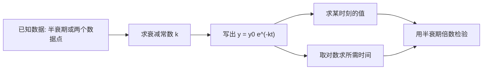

# Concept-Book Run

domain: /home/papagame/projects/digital-duck/cb-calculus/public/domains/calculus_ch06/input/graph.yaml
target: exponential_decay_model
started: 2026-11-25T03:44:23

## Teaching order (3 concepts)

- natural_logarithm_integral_def
- exponential_function_def
- exponential_decay_model

### natural_logarithm_integral_def (0.5s)

## 自然对数的积分定义

### 定义

对 $x>0$,**自然对数**定义为曲线 $y=\dfrac1t$ 下从 $1$ 到 $x$ 的(有向)面积:

$$\ln x=\int_1^x\frac{1}{t}\,dt .$$

约定:当 $x<1$ 时,积分上下限颠倒,结果为负;$\ln 1=\int_1^1\frac1t\,dt=0$。

由微积分基本定理,$\dfrac{d}{dx}\ln x=\dfrac1x$($x>0$)。因为 $\dfrac1x>0$,所以 $\ln x$ 严格递增,从而存在反函数,即指数函数 $e^x$。数 $e$ 恰好由 $\ln e=1$ 定义:即 $\int_1^e \frac1t\,dt=1$。

### 关键性质:乘法变加法

**定理**:对 $a,b>0$,$\ln(ab)=\ln a+\ln b$。

**证明**:固定 $a$,令 $f(x)=\ln(ax)-\ln x$。则
$$f'(x)=\frac{1}{ax}\cdot a-\frac1x=0,$$
所以 $f(x)$ 为常数。取 $x=1$:$f(1)=\ln a-0=\ln a$。故 $\ln(ax)=\ln a+\ln x$。令 $x=b$ 即得结论。$\blacksquare$

由此可推出 $\ln\dfrac1x=-\ln x$,以及 $\ln x^r=r\ln x$(对有理数 $r$)。

### 例题:数值估算 $\ln 2$

$\ln 2=\int_1^2\frac1t\,dt$。用 $n=4$ 的梯形法则,$h=0.25$,节点 $t=1,\,1.25,\,1.5,\,1.75,\,2$,函数值 $1,\,0.8,\,0.6667,\,0.5714,\,0.5$:

$$\ln 2\approx\frac{0.25}{2}\big[1+2(0.8+0.6667+0.5714)+0.5\big]=0.125\times 5.5762\approx 0.697 .$$

真实值 $0.6931\ldots$,误差约 $0.004$。因为 $1/t$ 是凸函数,梯形法则总是高估,与结果一致。

### 问题求解应用

**问题**:不查表,证明 $\ln 2>\tfrac12$。

**解**:在 $[1,2]$ 上,$\dfrac1t\ge\dfrac12$,所以
$$\ln 2=\int_1^2\frac1t\,dt\ge\int_1^2\frac12\,dt=\frac12 .$$

**进一步**:由 $\ln 2^n=n\ln2>\tfrac n2$,可知 $\ln x$ 无上界(当 $x\to\infty$ 时 $\ln x\to\infty$),即调和型面积 $\int_1^\infty\frac1t\,dt$ 发散。同理 $\ln 2^{-n}<-\tfrac n2$,故 $x\to0^+$ 时 $\ln x\to-\infty$。因此 $\ln$ 的值域为全体实数,定义域 $(0,\infty)$ 与 $e^x$ 的值域完全对应。

### 小结

- 积分定义使 $\ln x$ 成为"面积函数",无需先有指数函数。
- 导数 $\frac1x$ 与乘法法则都可由定义直接推出。
- 利用面积比较与数值积分,可以估算并约束对数的值。

### exponential_function_def (0.5s)

## 指数函数的定义

### 定义

对数函数 $\ln x=\int_1^x \frac{1}{t}\,dt$（$x>0$）在 $(0,\infty)$ 上严格单调递增，值域为全体实数 $\mathbb{R}$，因此存在反函数。**指数函数**就定义为自然对数的反函数：

$$
y=e^x \iff x=\ln y,\qquad x\in\mathbb{R},\ y>0 .
$$

于是有两条基本恒等式：

$$
\ln(e^x)=x\ (x\in\mathbb{R}),\qquad e^{\ln y}=y\ (y>0).
$$

数 $e$ 由 $\ln e=1$ 确定，即 $e=e^1\approx 2.71828$。

这个定义把"乘方"推广到了所有实数指数：对有理数 $r=p/q$，$e^{r}$ 与通常的根式乘方一致；对无理数 $x$（如 $\sqrt2$），$e^x$ 也有了确切含义，不再依赖"极限逼近"的模糊说法。对任意 $a>0$，进一步定义 $a^x=e^{x\ln a}$。

### 性质的推导

由 $\ln(uv)=\ln u+\ln v$，令 $u=e^{a},\ v=e^{b}$，得
$$
\ln(e^a e^b)=a+b\ \Rightarrow\ e^{a}e^{b}=e^{a+b}.
$$
再由反函数求导法则，设 $y=e^x$，则 $\dfrac{dx}{dy}=\dfrac1y$，所以
$$
\frac{d}{dx}e^x=y=e^x .
$$
这说明 $e^x$ 的导数就是它自身，这也是它在微积分中如此重要的原因。

### 例题

**例 1** 解方程 $e^{2x-1}=5$。

两边取 $\ln$：$2x-1=\ln 5$，所以 $x=\dfrac{1+\ln 5}{2}\approx 1.305$。

**例 2** 化简 $\ln\!\left(e^{3x}\cdot e^{-x}\right)$。

由指数律，$e^{3x}e^{-x}=e^{2x}$，故结果为 $2x$。

### 问题求解应用

**问题** 某放射性样品的质量满足 $m(t)=m_0e^{-kt}$，已知 $10$ 小时后剩余 $60\%$，求半衰期。

1. 由 $e^{-10k}=0.6$ 得 $k=-\dfrac{\ln 0.6}{10}\approx 0.0511\ \text{h}^{-1}$。
2. 半衰期满足 $e^{-kT}=\tfrac12$，所以 $T=\dfrac{\ln 2}{k}=\dfrac{10\ln 2}{-\ln 0.6}\approx 13.57$ 小时。

**解题要点**：遇到未知量在指数上，先用 $\ln$ "取下"指数；遇到含 $\ln$ 的方程，则用 $e^{(\cdot)}$ 还原。两者互为反函数，正是该定义的直接应用。

*图示：指数函数与自然对数互为反函数，定义域与值域相互对调（$\mathbb{R}\leftrightarrow(0,\infty)$）。*

### exponential_decay_model (0.7s)

## 指数衰减模型

### 定义

若某个量 $y$ 的减少速率与其当前值成正比，即

$$\frac{dy}{dt} = -k\,y,\qquad k>0,$$

则在初始条件 $y(0)=y_0$ 下，其解为**指数衰减模型**：

$$y(t) = y_0\,e^{-kt}.$$

其中 $y_0$ 是初始值，$k$ 是**衰减常数**（单位为时间的倒数）。常用的两个派生量是：

- **半衰期** $t_{1/2}$：使 $y$ 降为一半所需的时间。令 $e^{-kt_{1/2}}=\tfrac12$，得
$$t_{1/2}=\frac{\ln 2}{k}.$$
- **时间常数** $\tau = 1/k$：此时 $y$ 降为初值的 $e^{-1}\approx 36.8\%$。

半衰期与 $y_0$ 无关：无论从多少开始，每过一个 $t_{1/2}$，数量都减半。这是指数衰减最典型的特征。

### 推导要点

分离变量：$\dfrac{dy}{y}=-k\,dt$，两边积分得 $\ln y = -kt + C$，即 $y=e^{C}e^{-kt}$。代入 $t=0$ 可得 $e^{C}=y_0$。

### 例题

某放射性同位素的半衰期为 $5$ 天，初始质量为 $80\ \text{g}$。求 $12$ 天后剩余的质量。

**第一步：求 $k$。**
$$k=\frac{\ln 2}{5}\approx 0.1386\ \text{天}^{-1}.$$

**第二步：代入模型。**
$$y(12)=80\,e^{-0.1386\times 12}=80\,e^{-1.664}\approx 80\times 0.189\approx 15.1\ \text{g}.$$

**检验：** $12$ 天约为 $2.4$ 个半衰期，$80\times 2^{-2.4}\approx 15.1\ \text{g}$，结果一致。

### 问题求解应用：冷却问题

牛顿冷却定律指出，物体与环境的温差 $D=T-T_{\text{env}}$ 按指数规律衰减，$D(t)=D_0e^{-kt}$。

一杯 $90^\circ\text{C}$ 的咖啡放在 $20^\circ\text{C}$ 的房间里，$10$ 分钟后降至 $60^\circ\text{C}$。问何时降到 $30^\circ\text{C}$？

1. 初始温差 $D_0=70$，$10$ 分钟后 $D=40$，所以
$$e^{-10k}=\frac{40}{70}\ \Rightarrow\ k=\frac{1}{10}\ln\frac{7}{4}\approx 0.0560\ \text{分}^{-1}.$$
2. 目标温差 $D=10$：
$$70e^{-kt}=10\ \Rightarrow\ t=\frac{\ln 7}{k}\approx\frac{1.946}{0.0560}\approx 34.8\ \text{分钟}.$$

**易错点：** 衰减的是*温差*，而不是温度本身。若直接对温度套用 $y_0e^{-kt}$，咖啡会被预测冷却到 $0^\circ\text{C}$，这显然不合理。

### 解题策略

1. 确认衰减的量是什么（质量、温差、浓度……）。
2. 用已知的两个数据点，或半衰期，求出 $k$。
3. 代入 $y=y_0e^{-kt}$，必要时取对数求 $t$。
4. 用半衰期倍数做合理性检验。

*图：应用指数衰减模型解题的基本流程。*

## Run complete

total: 6.0s
