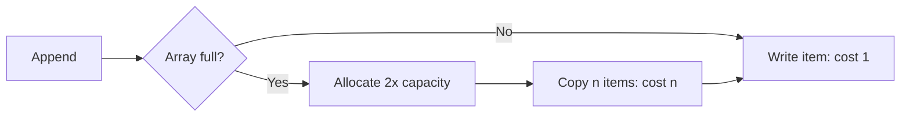
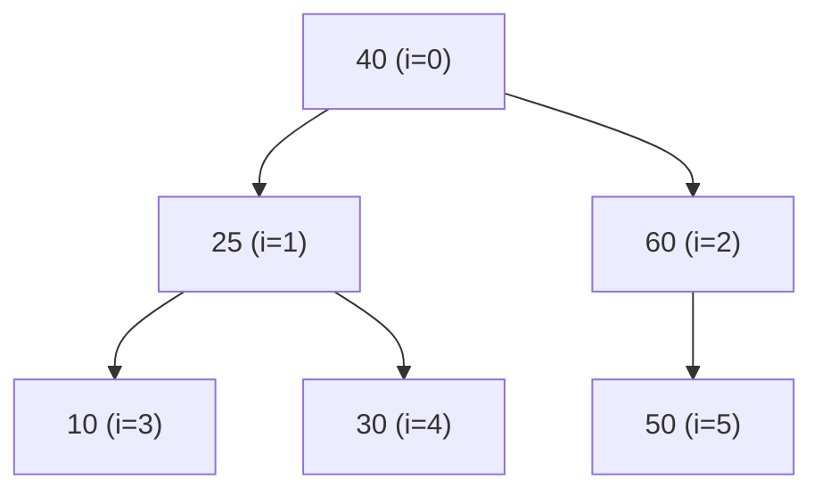
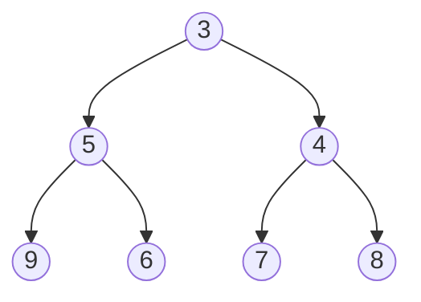
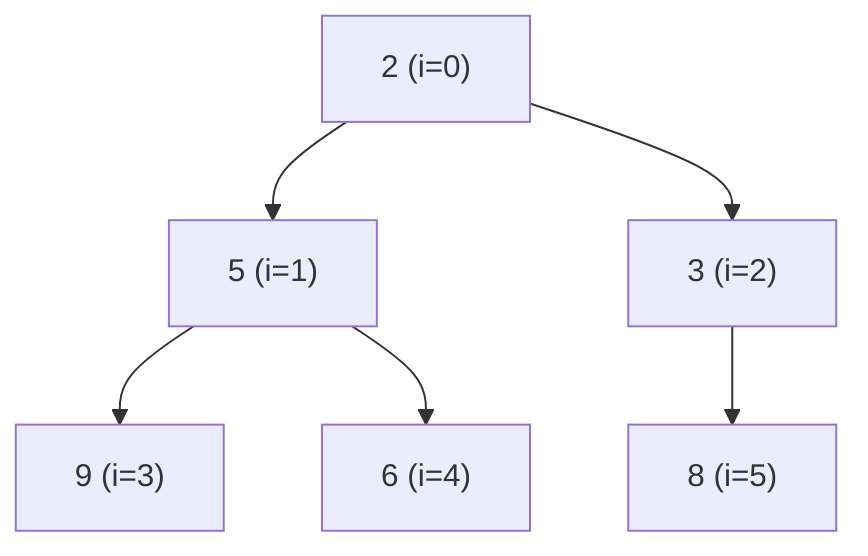

# Concept-Book Run

domain: /home/papagame/projects/digital-duck/cb-data-structure/public/domains/data_structure_ch10/input/graph.yaml
target: heapsort
started: 2026-11-25T03:46:54

## Teaching order (7 concepts)

- complete_binary_tree
- array_resizing_amortization
- eytzinger_method
- heap_order_property
- priority_queue
- binary_heap
- heapsort

### complete_binary_tree (0.5s)

## Complete Binary Tree

### Definition

A **complete binary tree** is a binary tree in which every level is completely filled except possibly the last, and the last level is filled from left to right with no gaps. Every node has either 0, 1, or 2 children, and at most one node has exactly one child (a left child only).

Do not confuse this with a *full* binary tree (every node has 0 or 2 children) or a *perfect* binary tree (all leaves on the same level). A perfect tree is always complete, but the reverse is not true.

### Height and size

Let a complete binary tree have $n$ nodes and height $h$ (the number of edges from the root to the deepest leaf). Levels $0$ through $h-1$ are full, holding $2^h - 1$ nodes. The last level holds between $1$ and $2^h$ nodes. Therefore

$$2^h \le n \le 2^{h+1} - 1,$$

and taking base-2 logarithms gives

$$h = \lfloor \log_2 n \rfloor.$$

So the height is $\Theta(\log n)$, which is why operations that walk from root to leaf are efficient.

### Array representation

Completeness means there are no gaps, so the tree can be stored in an array with no wasted space. Using 1-based indexing, the node at index $i$ has

- left child at $2i$,
- right child at $2i+1$,
- parent at $\lfloor i/2 \rfloor$.

(With 0-based indexing, the children are $2i+1$ and $2i+2$, and the parent is $\lfloor (i-1)/2 \rfloor$.) This is the basis of the binary heap.


*A complete binary tree with 6 nodes. Index labels in parentheses show array positions; the last level is filled left to right.*

### Worked example

Is the tree above complete? Levels 0 and 1 are full (1 and 2 nodes). Level 2 holds D, E, F in the leftmost three positions, with the single missing slot at the far right. So yes, it is complete. Its array is $[A, B, C, D, E, F]$. Check: B is at index 2, so its children are at indices 4 and 5 (D and E). C is at index 3, so its left child is at index 6 (F) and its right child would be at index 7, which is beyond $n = 6$, so C has no right child.

By contrast, if F were C's *right* child and C had no left child, the tree would not be complete, because the last level would have a gap before F.

### Problem-solving application

**Problem.** A heap stored as a complete binary tree has 100 nodes. (a) What is its height? (b) How many leaves does it have?

**Solution.**
(a) $h = \lfloor \log_2 100 \rfloor = 6$, since $2^6 = 64 \le 100 < 128$.

(b) Leaves are exactly the nodes with no children, meaning those at index $i$ where $2i > n$. The last internal node is at index $\lfloor n/2 \rfloor = 50$, so nodes $51$ through $100$ are leaves: $100 - 50 = 50$ leaves. In general, a complete tree has $\lceil n/2 \rceil$ leaves.

**Testing completeness.** To check whether a tree is complete, run a level-order (breadth-first) traversal that enqueues children left to right, including empty children. Once you encounter the first empty slot, every remaining item in the queue must also be empty. If any real node appears after an empty slot, the tree is not complete. This runs in $O(n)$ time.

### array_resizing_amortization (0.5s)

## Array Resizing Amortization

### Definition

A **dynamic array** stores its elements in a fixed-capacity block of memory. When an append finds the block full, the array allocates a new block of larger capacity, copies every element over, and frees the old block. A single resize costs $\Theta(n)$ for $n$ stored elements, yet it happens rarely. **Amortized analysis** averages cost over a whole sequence: if any sequence of $m$ operations costs $T(m)$ in total, the amortized cost per operation is $T(m)/m$.

With a **geometric growth policy** (multiply capacity by a constant factor, typically $2$), the total cost of $m$ appends is $O(m)$. So each append is $O(1)$ amortized, even though an individual append can cost $\Theta(m)$.

### Worked example

Start with capacity $1$ and append $m = 2^k$ items. Count one unit per element written and one unit per element copied.

A resize happens when the array holds $1, 2, 4, \dots, 2^{k-1}$ elements, and it copies that many items. Total copying cost:

$$\sum_{i=0}^{k-1} 2^i = 2^k - 1 < m.$$

Adding the $m$ writes gives

$$T(m) < m + m = 2m = O(m).$$

The amortized cost per append is below $2$.

**Accounting (banking) view.** Charge each append $3$ units. One unit pays for writing the item. The other two go into a bank. When the array doubles from capacity $c$ to $2c$, the $c/2$ items added since the last resize have banked $2 \cdot (c/2) = c$ units. That is exactly enough to copy all $c$ elements. The bank never goes negative, so the amortized cost is $3 = O(1)$.

### Problem-solving application

**Problem.** A dynamic array grows by a *fixed increment* of $10$ slots instead of doubling. Find the total cost of $m$ appends.

**Solution.** Resizes occur at sizes $10, 20, 30, \dots$, so there are about $m/10$ of them. The $j$-th resize copies $10j$ elements:

$$\sum_{j=1}^{m/10} 10j = 10\cdot\frac{(m/10)(m/10+1)}{2} = \Theta(m^2).$$

The amortized cost per append is $\Theta(m)$. Additive growth fails. Geometric growth succeeds.

**Generalization.** For any growth factor $\alpha > 1$, resize copies form a geometric series bounded by

$$\sum_{i} \alpha^i \le \frac{m}{\alpha - 1} \cdot \alpha = O(m).$$

A larger $\alpha$ means fewer copies but more wasted space.

**Shrinking.** Do not halve the array as soon as it is half full. Suppose the array has just doubled and is exactly full. An append and a delete, repeated, would then trigger a resize on every operation, which costs $\Theta(n)$ each time. The standard fix is to shrink by half only when the load falls to $1/4$ of capacity. After any resize the array is then half full. At least $n/2$ further operations must happen before the next resize, which pays for the $\Theta(n)$ copy. Mixed appends and deletes therefore also cost $O(m)$ in total.


*Most appends cost $1$. A full array triggers a rare doubling that costs $n$ copies. Banked credit from earlier appends pays for it.*

### eytzinger_method (0.9s)

## Eytzinger Method

**Definition.** The Eytzinger method stores a complete binary tree in a plain array by listing its nodes in breadth-first (level-by-level, left-to-right) order. With 0-based indexing, the node at index $i$ has

$$\text{left}(i) = 2i+1,\qquad \text{right}(i) = 2i+2,\qquad \text{parent}(i) = \left\lfloor \frac{i-1}{2} \right\rfloor \ (i>0).$$

No pointers are stored; the tree's shape is encoded entirely in the index arithmetic. Because the tree is *complete* (every level full except possibly the last, which fills from the left), the array has no gaps. Level $d$ (root is $d=0$) occupies indices $2^d-1$ through $2^{d+1}-2$, so a tree with $n$ nodes has height $\lfloor \log_2 n \rfloor$.

**Why the formulas hold.** Level $d$ begins at index $2^d-1$. The node at offset $k$ in that level has index $i = 2^d - 1 + k$. Its left child is at offset $2k$ in level $d+1$, so its index is $2^{d+1}-1+2k = 2(2^d-1+k)+1 = 2i+1$. The right child is one position later, $2i+2$. Inverting gives the parent formula: if $i = 2p+1$ or $i=2p+2$, then $p=\lfloor (i-1)/2\rfloor$.

**Worked example.** Store the tree with root 40, children 25 and 60, and grandchildren 10, 30, 50 (left to right):

| index | 0 | 1 | 2 | 3 | 4 | 5 |
|---|---|---|---|---|---|---|
| value | 40 | 25 | 60 | 10 | 30 | 50 |

The node 25 is at $i=1$. Its children are at $2(1)+1=3$ and $2(1)+2=4$, which hold 10 and 30. The node 50 is at $i=5$, so its parent is at $\lfloor (5-1)/2\rfloor = 2$, which holds 60. Both agree with the picture. Index 6 would be 60's right child, but $6 \ge n$, so the child is absent.


*The same six-node tree, with each node labeled by its array index. Indices increase level by level, left to right.*

**Problem-solving application.** *Search a binary search tree (BST) stored in Eytzinger order, for target 30.*

Start at $i=0$. Repeat: if $i \ge n$, the target is absent. If $a[i]$ equals the target, stop. If the target is smaller, set $i \leftarrow 2i+1$. Otherwise set $i \leftarrow 2i+2$.

- $i=0$: $a[0]=40$, and $30<40$, so $i=1$.
- $i=1$: $a[1]=25$, and $30>25$, so $i=4$.
- $i=4$: $a[4]=30$. Found.

This took 3 steps, which is at most the height plus one, so a search costs $O(\log n)$. A heap uses this same layout, which is why heap insertion and deletion move only along parent and child indices ("sift up" and "sift down"). The layout also has a performance benefit. The top levels of the tree sit together at the start of the array, so they stay in cache. For large sorted arrays, an Eytzinger-ordered binary search often beats the standard sorted-array version for this reason.

**Caveat.** The method wastes space on sparse trees. A degenerate chain of $n$ nodes needs an array of size $2^n-1$, since each right-only step doubles the index. Use it only when the tree is complete or nearly so.

### heap_order_property (0.7s)

## Heap Order Property

**Definition.** A binary tree has the *heap order property* (here, the min-heap form) if the value stored at every node is not smaller than the value stored at its parent. The root is the only exception, since it has no parent. Writing $key(v)$ for the value at node $v$:

$$key(v) \ge key(parent(v)) \quad \text{for every non-root node } v.$$

The property is local, because it compares only a node with its parent. It still has a global consequence. Every node's value is at least as large as the values of all its ancestors, because the inequality chains upward:

$$key(v) \ge key(parent(v)) \ge key(parent(parent(v))) \ge \cdots \ge key(\text{root}).$$

So **the root holds a minimum value**. Note what the property does *not* say. It does not order siblings, and it does not order nodes in different subtrees. It is much weaker than the binary search tree property.

**Worked example.** Check whether this tree satisfies the property. Nodes are listed level by level, with children written under their parents.

- Root: 3
- Children of 3: 5 and 4
- Children of 5: 9 and 6
- Children of 4: 7 and 8

Compare each non-root node with its parent:

| Node | Parent | Holds? |
|---|---|---|
| 5 | 3 | $5 \ge 3$ ✓ |
| 4 | 3 | $4 \ge 3$ ✓ |
| 9 | 5 | $9 \ge 5$ ✓ |
| 6 | 5 | $6 \ge 5$ ✓ |
| 7 | 4 | $7 \ge 4$ ✓ |
| 8 | 4 | $8 \ge 4$ ✓ |

Every check passes, so the tree is heap-ordered. Siblings 5 and 4 are not in sorted left-to-right order, and that is allowed. Also, 6 sits in the left subtree and is smaller than 7 in the right subtree, which is allowed too.


*A heap-ordered tree: every child's value is at least its parent's value.*

**Problem-solving application.** Two questions can be answered using only the property.

*Problem 1.* Suppose we change the value 6 to 2. Does the property still hold?

1. Only comparisons involving the changed node can change. The node 6 has one parent edge (with 5) and no children, so only that one comparison needs rechecking.
2. Check it: $2 \ge 5$ is false, so the property is violated.
3. Every other comparison in the table is unchanged and still passes. The tree has exactly one violating edge.

*Problem 2.* In the original tree, where can the second-smallest value be?

1. Take any node that is not the root and not a child of the root. Its parent is also not the root, so by the chain above, the node is at least as large as its parent, which is at least as large as the root. That gives two nodes at or below it in the chain, so it cannot be the second smallest.
2. Therefore the second-smallest value must be a child of the root. Here those are 5 and 4, and the second smallest is 4.

The same reasoning shows that the third-smallest value must be a child of the root or a child of the second-smallest node. Heap order narrows where each small value can sit, even though it does not fully sort the tree.

**Key takeaway.** Heap order is a parent-to-child inequality that forces the minimum to the root. It permits many arrangements of the other nodes. After a change to one node, you only need to recheck the comparisons that involve that node.

### priority_queue (0.5s)

## Priority Queue

### Definition

A **priority queue** is an abstract data type that stores a collection of comparable values and supports two operations:

- $\text{add}(x)$: insert the value $x$ into the collection.
- $\text{remove}()$: delete and return the **smallest** value currently stored.

Unlike an ordinary queue (first in, first out), the removal order depends on the values, not on arrival time. Duplicates are allowed. If the queue is empty, $\text{remove}()$ is undefined (an implementation typically raises an error). The definition says nothing about how values are stored, and that choice determines the cost of each operation.

### Worked Example

Start with an empty priority queue and apply these operations:

| Operation | Returned | Contents afterward |
|---|---|---|
| add(7) | – | {7} |
| add(3) | – | {3, 7} |
| add(9) | – | {3, 7, 9} |
| remove() | 3 | {7, 9} |
| add(1) | – | {1, 7, 9} |
| remove() | 1 | {7, 9} |
| remove() | 7 | {9} |

The values 7, 3, 9 were added in that order, but 3 came out first. The value 1 was added *after* the others and still came out next, because it was the smallest.

### Implementation Costs

Let $n$ be the number of stored values. Two simple array implementations show the trade-off:

- **Unsorted array:** $\text{add}$ appends in $O(1)$. $\text{remove}$ must scan for the minimum, which takes $\Theta(n)$.
- **Array sorted in descending order:** $\text{remove}$ takes the last element in $O(1)$. $\text{add}$ must find the position and shift elements, which takes $\Theta(n)$.

Either way, one operation is cheap and the other costs $\Theta(n)$. Library implementations do better, and we will assume that both operations cost $O(\log n)$.

### Problem-Solving Application

**Problem.** Given a stream of $N$ numbers, find the $k$ largest using as little memory as possible.

**Solution.** Keep a priority queue that never holds more than $k$ values. Because $\text{remove}()$ returns the smallest value, it always discards the *weakest* of the current candidates.

For each incoming value $x$:
1. $\text{add}(x)$.
2. If the size exceeds $k$, call $\text{remove}()$. The value removed is the smallest, so it cannot be among the $k$ largest.

Trace for $k = 2$ on the stream $5, 1, 8, 3, 9$:

- add 5, add 1 → {1, 5}
- add 8 → {1, 5, 8}, remove 1 → {5, 8}
- add 3 → {3, 5, 8}, remove 3 → {5, 8}
- add 9 → {5, 8, 9}, remove 5 → {8, 9}

The result is {8, 9}, the two largest values.

**Cost.** Each of the $N$ items triggers one $\text{add}$ and at most one $\text{remove}$ on a queue of size at most $k+1$. Each costs $O(\log k)$, so the total time is $O(N \log k)$ using $O(k)$ memory. Sorting the whole stream would cost $O(N \log N)$ time and $O(N)$ memory. When $k \ll N$, the priority queue is much better.

**Key idea:** use a priority queue when you repeatedly need the current minimum while new values keep arriving, as in task scheduling or merging sorted lists.

### binary_heap (0.5s)

## Binary Heap

A **binary heap** is a priority queue built on a *complete* binary tree that satisfies the **heap-order property**. In a min-heap, every node's key is no larger than its children's keys, so the minimum always sits at the root. Because the tree is complete (every level is full except possibly the last, which fills left to right), it can be stored implicitly in an array using **Eytzinger's method**, with no pointers. With 0-based indexing, the node at index $i$ has:

$$\text{parent}(i)=\left\lfloor \frac{i-1}{2}\right\rfloor,\qquad \text{left}(i)=2i+1,\qquad \text{right}(i)=2i+2.$$

A complete tree with $n$ nodes has height $\lfloor \log_2 n\rfloor$. Both core operations follow one root-to-leaf or leaf-to-root path, so each costs $O(\log n)$.

- **peek**: return $A[0]$ in $O(1)$.
- **insert(x)**: append $x$ at index $n$, then *sift up*: while $x$ is smaller than its parent, swap them.
- **extract-min**: save $A[0]$, move the last element to index 0, shrink the array, then *sift down*: swap with the smaller child until neither child is smaller.


*The heap $[2,5,3,9,6,8]$ drawn as a tree. Level-by-level reading gives the array order.*

### Worked example

Insert $1$ into $A=[2,5,3,9,6,8]$. Append it at index 6, giving $[2,5,3,9,6,8,1]$. Its parent is $\lfloor 5/2\rfloor=2$, which holds $3>1$, so swap: $[2,5,1,9,6,8,3]$. Now the parent is index 0, which holds $2>1$, so swap again: $[1,5,2,9,6,8,3]$. The element is at the root, so we stop after $2$ swaps, which is at most the height $\lfloor\log_2 7\rfloor=2$.

Now extract-min. Return $1$, move the last element $3$ to the root: $[3,5,2,9,6,8]$. The children of index 0 are $5$ and $2$. The smaller is $2$, so swap: $[2,5,3,9,6,8]$. Index 2 has child index 5 (value $8$), and $3<8$, so stop.

### Problem-solving application

**Building a heap.** Given $n$ arbitrary keys, calling insert $n$ times costs $O(n\log n)$. A better method, *heapify*, sifts down every internal node from index $\lfloor n/2\rfloor-1$ back to $0$. A node at height $h$ moves down at most $h$ levels, and at most $\lceil n/2^{h+1}\rceil$ nodes have height $h$. The total work is therefore bounded by

$$\sum_{h=0}^{\lfloor\log_2 n\rfloor}\left\lceil\frac{n}{2^{h+1}}\right\rceil h \le n\sum_{h=0}^{\infty}\frac{h}{2^{h+1}}\cdot 1 + O(n)= O(n),$$

because $\sum_{h\ge 0} h/2^{h+1}=1$. Most nodes sit near the bottom, where sifting is cheap.

**Heapsort.** Heapify the array in $O(n)$, then perform $n$ extract-mins, placing each result in the slot the shrinking heap vacates. The total is $O(n\log n)$ time and $O(1)$ extra space.

**Check yourself.** For $A=[4,7,6,9]$, which index is the parent of index 3, and does the array satisfy min-heap order? (Answer: $\lfloor 2/2\rfloor=1$; yes, since $7\le 9$, $4\le 7$, and $4\le 6$.)

### heapsort (0.7s)

## Heapsort

**Heapsort** is a comparison-based sorting algorithm that uses a binary heap to repeatedly extract the largest remaining element. It sorts in place and runs in $O(n \log n)$ time in the worst case, which is asymptotically optimal for comparison sorts. Its guaranteed bound makes it one of the fastest general-purpose sorts known.

### Definition

A **max-heap** is an array $A[1..n]$ representing a nearly complete binary tree in which every node is at least as large as its children:

$$A[\lfloor i/2 \rfloor] \ge A[i] \quad \text{for all } 2 \le i \le n.$$

The children of index $i$ are $2i$ and $2i+1$. The root $A[1]$ is therefore the maximum.

Heapsort has two phases:

1. **Build** a max-heap from the unsorted array.
2. **Extract**: swap the root with the last heap element, shrink the heap by one, and restore the heap property by sifting the new root down. Repeat until the heap is empty.

The key helper is `sift_down` (often called *max-heapify*). It swaps a node with its larger child until the node is no smaller than both children.

```python
def sift_down(A, i, n):          # 0-indexed; heap is A[0:n]
    while True:
        l, r, big = 2*i + 1, 2*i + 2, i
        if l < n and A[l] > A[big]: big = l
        if r < n and A[r] > A[big]: big = r
        if big == i: return
        A[i], A[big] = A[big], A[i]
        i = big

def heapsort(A):
    n = len(A)
    for i in range(n//2 - 1, -1, -1):   # build heap
        sift_down(A, i, n)
    for end in range(n - 1, 0, -1):     # extract
        A[0], A[end] = A[end], A[0]
        sift_down(A, 0, end)
```

### Worked example

Sort $A = [4, 10, 3, 5, 1]$.

**Build.** Start at index $n/2-1 = 1$. Node $10$ is larger than its children ($5$, $1$), so nothing moves. At index $0$, node $4$ has children $10$ and $3$. Swap $4$ with $10$, giving $[10, 4, 3, 5, 1]$. Now $4$ has child $5$, so swap again: $[10, 5, 3, 4, 1]$. This is a max-heap.

**Extract.**
- Swap $10$ with the last element: $[1, 5, 3, 4 \mid 10]$. Sift down: $[5, 4, 3, 1 \mid 10]$.
- Swap $5$ to the end: $[1, 4, 3 \mid 5, 10]$. Sift down: $[4, 1, 3 \mid 5, 10]$.
- Swap $4$ to the end: $[3, 1 \mid 4, 5, 10]$. No sift is needed.
- Swap $3$ to the end: $[1, 3, 4, 5, 10]$. The array is sorted.

### Problem-solving application: complexity

**Claim.** Heapsort runs in $O(n \log n)$ time.

*Extract phase.* A heap of $k$ nodes has height $\lfloor \log_2 k \rfloor$, so each `sift_down` costs $O(\log n)$. There are $n-1$ extractions, so the phase costs $O(n \log n)$.

*Build phase.* A cruder bound gives $O(n \log n)$, but the true cost is $O(n)$. A node at height $h$ sifts down at most $h$ levels, and at most $\lceil n/2^{h+1} \rceil$ nodes have height $h$. The total work is therefore

$$\sum_{h=0}^{\lfloor \log_2 n \rfloor} \left\lceil \frac{n}{2^{h+1}} \right\rceil h \;\le\; n \sum_{h=0}^{\infty} \frac{h}{2^{h}} = 2n = O(n),$$

using $\sum_{h\ge 0} h x^h = x/(1-x)^2$ at $x = 1/2$.

The total is $O(n) + O(n \log n) = O(n \log n)$. This holds in the best, average, and worst cases. Space use is $O(1)$ extra, but heapsort is **not stable**: equal keys may change relative order.

**Practice.** For $n = 1{,}000$, estimate the extract-phase comparisons. Each sift-down makes at most $2\log_2 n \approx 20$ comparisons, so the phase makes at most about $20{,}000$. Compare this with the roughly $500{,}000$ comparisons of a quadratic sort.

## Run complete

total: 10.4s
