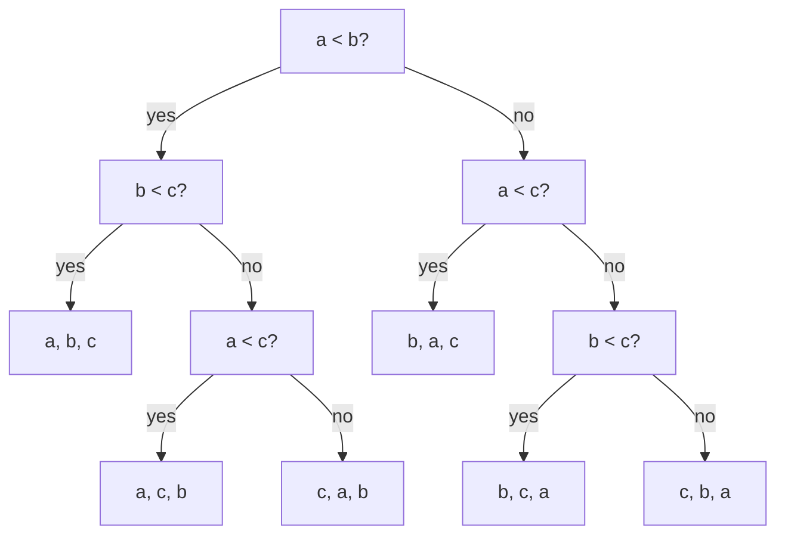
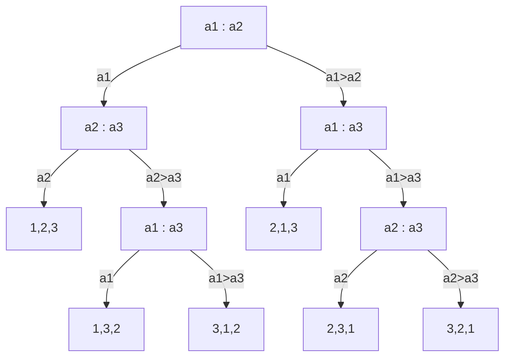

# Concept-Book Run

domain: /home/papagame/projects/digital-duck/cb-data-structure/public/domains/data_structure_ch11/input/graph.yaml
target: integer_sorting_via_indexing
started: 2026-11-25T03:47:17

## Teaching order (9 concepts)

- compare_operation
- comparison_based_sorting
- comparison_tree
- comparison_sorting_lower_bound
- non_comparison_sorting
- stable_sorting
- counting_sort
- radix_sort
- integer_sorting_via_indexing

### compare_operation (0.6s)

## Compare Operation

A **compare operation** is a primitive method, `compare(a, b)`, that takes two items and reports their relative order using the *sign* of an integer:

$$
\text{compare}(a,b)\;\begin{cases} <0 & \text{if } a < b\\ =0 & \text{if } a = b\\ >0 & \text{if } a > b\end{cases}
$$

Only the sign matters. A return value of $-1$ and one of $-500$ both mean "$a$ comes first." This three-way result carries more information than a true/false test such as $a<b$: one call distinguishes all three cases. Sorting algorithms, binary search, and balanced trees are usually written so that `compare` is the *only* way they inspect the data. Any type that supplies a consistent `compare` can then be sorted or searched.

For the results to be meaningful, `compare` must behave like a total order:

- **Antisymmetry:** $\text{sign}(\text{compare}(a,b)) = -\text{sign}(\text{compare}(b,a))$
- **Transitivity:** if $a \le b$ and $b \le c$, then $a \le c$
- **Consistency:** $\text{compare}(a,b)=0$ exactly when $a$ and $b$ are equivalent

### Worked Example

Compare two strings by length, breaking ties alphabetically:

```python
def compare(a, b):
    if len(a) != len(b):
        return len(a) - len(b)
    if a < b:  return -1
    if a > b:  return  1
    return 0
```

- `compare("fig", "apple")` returns $3-5=-2$, so `"fig"` precedes `"apple"`.
- `compare("kiwi", "plum")` has equal lengths, so it falls to the alphabetical test. Since `"kiwi" < "plum"`, it returns $-1$.
- `compare("plum", "plum")` returns $0$.

One caution: returning `a - b` for numbers is tempting, but with fixed-width integers it can overflow. In 32-bit arithmetic, $2{,}000{,}000{,}000 - (-2{,}000{,}000{,}000)$ wraps to a negative number, which wrongly reports $a<b$. Explicit comparisons avoid this.

### Problem-Solving Application

**Problem:** Binary search over a sorted list of $n$ items uses `compare` to decide which half to keep. How many calls are needed in the worst case for $n = 1000$?

**Solution:** Each call to `compare(target, mid)` has three outcomes. If it returns $0$, the search stops. If it is negative, the search continues in the left half. If it is positive, it continues in the right half. Each call therefore at least halves the remaining range:

$$
n \to \tfrac{n}{2} \to \tfrac{n}{4} \to \cdots \to 1
$$

The worst case needs $\lfloor \log_2 n \rfloor + 1$ calls. For $n=1000$, $\log_2 1000 \approx 9.97$, so $\lfloor 9.97\rfloor + 1 = 10$ calls.

Comparison sorts show why this matters. Each `compare` call has at most three outcomes, but a sort can only use the "less/greater" splits to order $n!$ possible permutations. Any such sort therefore needs $\Omega(n \log n)$ calls in the worst case. Counting `compare` calls is the standard way to measure these algorithms' cost.

**Takeaway:** The sign of `compare(a, b)` is a complete, reusable description of order. A correct implementation must be antisymmetric, transitive, and consistent, and it must avoid overflow tricks.

### comparison_based_sorting (0.5s)

## Comparison Based Sorting

### Definition

A **comparison-based sorting algorithm** orders a sequence using only one primitive operation: a call to $\text{compare}(a, b)$, which reports whether $a \le b$ (or $a < b$). The algorithm never looks at the elements' internal form, such as digits, bits, or characters. It learns about the input only through the answers to these comparisons. Merge sort, quicksort, heapsort, insertion sort, and bubble sort all belong to this class. Counting sort and radix sort do not, because they inspect the keys directly.

This restriction is useful because the algorithm works for any data type that has a consistent ordering. The restriction also limits how fast the algorithm can be.

### Worked example: the decision tree

Sort three distinct values $a, b, c$. Each comparison has two outcomes, so any algorithm can be drawn as a binary **decision tree**. Each internal node is a comparison, and each leaf is one final ordering.


*A decision tree for sorting three elements. Every path from the root to a leaf is one run of the algorithm. The six leaves are the $3! = 6$ possible orderings.*

The longest path has 3 comparisons. Could a cleverer algorithm always finish in 2? The next section shows why it could not.

### Lower bound: $\Omega(n \log n)$

**Theorem.** Every comparison-based sort needs $\Omega(n \log n)$ comparisons in the worst case.

*Proof.* For $n$ distinct elements there are $n!$ possible input orderings. The algorithm must be able to output each one, so its decision tree needs at least $n!$ leaves. A binary tree of height $h$ has at most $2^h$ leaves, so
$$2^h \ge n! \implies h \ge \log_2(n!).$$
Since $n! \ge (n/2)^{n/2}$, because at least $n/2$ of the factors are at least $n/2$,
$$h \ge \frac{n}{2}\log_2\frac{n}{2} = \Omega(n\log n). \qquad\blacksquare$$

The worst-case number of comparisons equals the tree height $h$.

### Problem-solving application

**Problem.** What is the fewest comparisons that could guarantee sorting 5 elements?

**Solution.** We need $2^h \ge 5! = 120$. Since $2^6 = 64 < 120 \le 128 = 2^7$, the bound gives $h \ge 7$. So no algorithm can guarantee sorting 5 elements in fewer than 7 comparisons. (Sorting 3 elements gives $\lceil\log_2 6\rceil = 3$, which matches the tree above. Careful algorithms such as merge-insertion sort do reach 7 for $n=5$.)

**Using the result.** The theorem tells you when to stop optimizing. Merge sort and heapsort run in $O(n\log n)$ time, so they are asymptotically optimal among comparison sorts. To beat $n \log n$, you must leave the model and use extra knowledge about the keys. For example, if keys are integers in $\{0,\dots,k\}$, counting sort runs in $O(n+k)$ time.

### comparison_tree (0.5s)

## Comparison Tree

A **comparison tree** (or decision tree) models every possible execution of a comparison-based sorting algorithm on inputs of a fixed size $n$. It is a rooted binary tree in which:

- each **internal node** is a comparison of two input elements, written $a_i : a_j$ (or "$a_i \le a_j$?");
- the two **branches** from a node are the outcomes "yes" and "no";
- each **leaf** is a finished run, labeled with the output permutation the algorithm announces.

Running the algorithm on a specific input traces one root-to-leaf path. The number of comparisons used equals the length of that path, so the **worst-case number of comparisons equals the height $h$ of the tree**. The tree depends on the algorithm and on $n$, but it exists for any algorithm that gains information only by comparing elements.

### Worked example: $n=3$

Take distinct elements $a_1, a_2, a_3$. One valid algorithm compares $a_1:a_2$ first, then compares the larger or smaller one against $a_3$, and so on.


*Comparison tree for sorting three elements. Leaves list the sorted order as indices. The tree has 6 leaves and height 3.*

Each of the $3! = 6$ orderings appears as exactly one leaf. If a permutation were missing, the algorithm would fail on inputs requiring it. If two different permutations shared a leaf, the algorithm would give the same output for inputs that need different outputs. So a correct algorithm needs **at least $n!$ leaves**.

### Problem-solving application: a lower bound

A binary tree of height $h$ has at most $2^h$ leaves. Combining this with the requirement of at least $n!$ leaves:

$$2^h \ge n! \quad\Longrightarrow\quad h \ge \log_2(n!).$$

This holds for every comparison sort, so $\log_2(n!)$ is a lower bound on worst-case comparisons.

**Check with $n=3$:** $\log_2 6 \approx 2.58$, so $h \ge \lceil 2.58 \rceil = 3$. The tree above achieves exactly 3, so it is optimal in the worst case.

**Check with $n=4$:** $\log_2 24 \approx 4.58$, so at least $5$ comparisons are needed in the worst case. No algorithm can do it in 4.

**Asymptotic form.** Since $n! \ge (n/2)^{n/2}$ (the top $n/2$ factors are each at least $n/2$),

$$h \ge \log_2\!\left(\tfrac{n}{2}\right)^{n/2} = \tfrac{n}{2}\log_2\tfrac{n}{2} = \Omega(n\log n).$$

Therefore no comparison-based sort, whether merge sort, heapsort, or one not yet invented, can beat $n \log n$ in the worst case. Merge sort and heapsort are therefore asymptotically optimal.

**Practice:** An algorithm claims to sort 5 distinct numbers in at most 6 comparisons. Is that possible? Since $5! = 120$ and $2^6 = 64 < 120$, a height-6 tree has too few leaves. The claim is impossible. The minimum is $\lceil\log_2 120\rceil = 7$.

### comparison_sorting_lower_bound (0.6s)

## Comparison Sorting Lower Bound

**Definition.** A *comparison sort* learns about its input only by asking questions of the form "is $a_i < a_j$?" Merge sort, heapsort, and quicksort all work this way. The **comparison sorting lower bound** says that every such algorithm, deterministic or randomized, needs $\Omega(n \log n)$ comparisons. More precisely, for inputs of $n$ distinct keys, the worst-case number of comparisons is at least $\lceil \log_2 (n!) \rceil = n\log_2 n - O(n)$.

**Decision-tree model.** Fix a deterministic algorithm and a input size $n$. Its behavior is a binary *decision tree*. Each internal node is a comparison $a_i : a_j$, and the two children correspond to the answers "yes" and "no." Each leaf is an output, which is a permutation of the input. The number of comparisons on a given input is the depth of the leaf it reaches. The worst case is the height $h$ of the tree.

**Theorem.** Any comparison sort on $n$ distinct keys has worst-case comparison count at least $\log_2(n!)$.

*Proof.* There are $n!$ possible orderings of the input. If two different orderings reached the same leaf, the algorithm would output the same permutation for both, which would be wrong for at least one of them. So a correct algorithm needs at least $n!$ leaves. A binary tree of height $h$ has at most $2^h$ leaves, so
$$2^h \ge n! \quad\Longrightarrow\quad h \ge \log_2(n!).$$

**Evaluating $\log_2(n!)$.** Since $n! \ge (n/2)^{n/2}$, we get $\log_2(n!) \ge \tfrac{n}{2}\log_2(n/2) = \Omega(n\log n)$. Stirling's approximation, $n! \approx \sqrt{2\pi n}\,(n/e)^n$, gives the sharper form
$$\log_2(n!) = n\log_2 n - n\log_2 e + O(\log n) = n\log_2 n - O(n).$$

**Worked example.** For $n=3$, there are $3! = 6$ orderings, so $h \ge \lceil\log_2 6\rceil = 3$. Three comparisons suffice, so the bound is tight here. For $n=5$, $5! = 120$ and $\lceil\log_2 120\rceil = 7$. Binary insertion sort sorts 5 items in 8 comparisons, but a carefully designed algorithm (merge insertion) achieves the 7-comparison bound.

**Randomized algorithms.** A randomized algorithm is a probability distribution over deterministic decision trees. Take a tree with at least $n!$ leaves. Its average leaf depth over a uniformly random input is at least $\log_2(n!)$. This is because a binary tree with $L$ leaves has average leaf depth at least $\log_2 L$. By Yao's principle, the *expected* number of comparisons of any randomized algorithm on its worst input is therefore also at least $\log_2(n!)$.

**Problem-solving application.** Suppose a company claims a comparison-based method that sorts $n = 10^6$ records in at most $15\times 10^6$ comparisons in the worst case. Is this plausible? Since $\log_2(n!) \approx n\log_2 n - 1.443\,n$, we have
$$\log_2(10^6!) \approx 10^6(19.93) - 1.44\times 10^6 \approx 18.5\times 10^6.$$
Every comparison sort needs at least about $18.5\times10^6$ comparisons, so the claim is impossible. The only way around the bound is to leave the comparison model. Counting sort and radix sort inspect key digits directly and run in $O(n)$ time for bounded integer keys. They are not comparison sorts, so the theorem does not apply to them.

**Key takeaway.** Counting the possible answers ($n!$ leaves) and the information each binary question can give (one bit) gives a bound that holds for *every* algorithm. It also shows that merge sort and heapsort are asymptotically optimal among comparison sorts.

### non_comparison_sorting (0.7s)

## Non Comparison Sorting

**Definition.** Any algorithm that sorts by comparing pairs of elements (merge sort, quicksort, heapsort) needs $\Omega(n \log n)$ comparisons in the worst case. This follows from a decision-tree argument. The tree must have at least $n!$ leaves, one for each possible ordering. A binary tree with $n!$ leaves has height at least $\log_2(n!) = \Theta(n \log n)$.

**Non-comparison sorts** avoid this bound by never asking "is $a < b$?". Instead, they use an element's *value* as an array index. The lower bound only covers algorithms that learn about the input through pairwise comparisons, so these algorithms are not subject to it. The cost is an assumption about the input: the keys must be integers in a known, small range $0,\dots,k-1$.

**Counting sort.** Given $n$ keys in $\{0,\dots,k-1\}$:

1. Count how many times each value occurs in an array $C[0..k-1]$.
2. Replace $C$ with prefix sums, so $C[v]$ is the number of keys $\le v$. This is the index just past the last slot for value $v$.
3. Scan the input from right to left. Place each key $x$ at position $C[x]-1$ of the output, then decrement $C[x]$.

The right-to-left scan makes the sort *stable*: equal keys keep their original relative order. The running time is $\Theta(n+k)$, which is linear when $k = O(n)$.

**Worked example.** Sort $A = [2,5,3,0,2,3,0,3]$ with $k=6$.

- Counts: $C = [2,0,2,3,0,1]$ for values $0$ through $5$.
- Prefix sums: $C = [2,2,4,7,7,8]$.
- Scan from the right. The last element, $3$, goes to index $C[3]-1 = 6$, and $C[3]$ becomes $6$. The next element, $0$, goes to index $1$. Continuing gives $[0,0,2,2,3,3,3,5]$.

**Radix sort.** Counting sort becomes inefficient when $k$ is large, for example $k = n^2$. Radix sort handles this by sorting on one digit at a time, from least significant to most significant. Each pass uses a stable sort, usually counting sort. If keys have $d$ digits in base $b$, the total time is $\Theta(d(n+b))$. Stability is essential here. It preserves the order produced by earlier, lower-order digit passes.

**Problem-solving application.** Suppose you must sort $n = 10^6$ integers in $[0, 10^9)$.

- Counting sort directly needs $k = 10^9$, which is far too much memory.
- Choose base $b = 1000$, giving $d = 3$ digits. The cost is about $3(10^6 + 10^3) \approx 3\times10^6$ operations.
- A comparison sort needs about $n\log_2 n \approx 2\times 10^7$ comparisons.

In general, choosing $b \approx n$ gives $d = \lceil \log_n M \rceil$ for keys below $M$. If $M = n^{O(1)}$, then $d = O(1)$ and the sort runs in $\Theta(n)$ time.

**Limits.** These methods require integer keys, or keys that can be mapped to integers, with a bounded range. If $k$ is much larger than $n$, or the keys are arbitrary objects, counting sort wastes time and memory. A comparison sort is then the better choice.

### stable_sorting (0.5s)

## Stable Sorting

### Definition

A sorting algorithm is **stable** if, whenever two elements compare as equal under the sort key, they appear in the output in the same relative order as in the input. Formally, if records $a_i$ and $a_j$ satisfy $\text{key}(a_i) = \text{key}(a_j)$ and $i < j$ in the input, then $a_i$ appears before $a_j$ in the output.

Stability only matters when the sort key does not uniquely identify each record. Sorting bare integers gives the same output whether or not the sort is stable. Sorting *records* by one field (say, students by grade) is where it matters.

Merge sort, insertion sort, bubble sort, and counting sort are stable (when implemented carefully). Selection sort, heapsort, and quicksort (in its standard in-place form) are not.

### Worked Example

Sort these (name, grade) pairs by grade, ascending:

$$(\text{Ana},3),\ (\text{Ben},1),\ (\text{Cy},3),\ (\text{Di},1)$$

A **stable** sort outputs:

$$(\text{Ben},1),\ (\text{Di},1),\ (\text{Ana},3),\ (\text{Cy},3)$$

Ben still precedes Di, and Ana still precedes Cy.

Now consider selection sort on the same input. Pass 1 finds the minimum grade (Ben, index 1) and swaps it with index 0:

$$(\text{Ben},1),\ (\text{Ana},3),\ (\text{Cy},3),\ (\text{Di},1)$$

Pass 2 finds the next minimum (Di) and swaps it with index 1:

$$(\text{Ben},1),\ (\text{Di},1),\ (\text{Cy},3),\ (\text{Ana},3)$$

Ana and Cy have swapped relative order, because the long-distance swap in pass 1 moved Ana past Cy. The algorithm is therefore **unstable**.

### Problem-Solving Application: Multi-Key Sorting

Suppose you must sort a class roster by grade, with names alphabetical *within* each grade. Stability gives a simple method: **sort by the secondary key first, then by the primary key using a stable sort.**

1. Sort by name: Ana, Ben, Cy, Di.
2. Stable-sort by grade: the grade-1 group $\{\text{Ben}, \text{Di}\}$ and grade-3 group $\{\text{Ana}, \text{Cy}\}$ each keep their alphabetical order.

Result: $(\text{Ben},1),(\text{Di},1),(\text{Ana},3),(\text{Cy},3)$.

If step 2 used an unstable sort, the alphabetical order inside each group could be scrambled. This same principle underlies **radix sort**, which stably sorts by each digit from least to most significant. Its correctness *depends* on stability.

In Python, `sorted()` and `list.sort()` are guaranteed stable, so:

```python
records.sort(key=lambda r: r.name)   # secondary key first
records.sort(key=lambda r: r.grade)  # primary key, stable
```

### Making Any Sort Stable

An unstable algorithm can be made stable by attaching each record's original index $i$ and comparing the pair $(\text{key}, i)$ lexicographically. Ties on the key are then broken by original position. The cost is $O(n)$ extra memory.

### Check Your Understanding

Merge sort is stable if, when merging, the algorithm takes from the **left** subarray whenever the two front elements are equal. Why does taking from the right instead break stability?

*Answer:* Every element in the left subarray originally came before every element in the right one. Taking the right element first on a tie would place a later-positioned equal element ahead of an earlier one.

### counting_sort (0.5s)

## Counting Sort

**Counting sort** sorts $n$ integers drawn from $\{0,1,\dots,k-1\}$ without ever comparing two elements to each other. Instead, it counts how many times each value occurs, converts those counts into running sums that give each value's final positions, and then places every element directly into an output array. It runs in $\Theta(n+k)$ time and is **stable**: equal keys appear in the output in the same order as in the input. That stability is why it serves as the inner routine of radix sort.

**Algorithm.** For input array $A[0..n-1]$:

1. Let $C[0..k-1]$ be zeros. For each $j$, do $C[A[j]]\mathrel{+}=1$. Now $C[v]$ is the number of occurrences of $v$.
2. For $v=1,\dots,k-1$, do $C[v]\mathrel{+}=C[v-1]$. Now $C[v]$ is the number of elements $\le v$, so the last copy of $v$ belongs at index $C[v]-1$.
3. For $j=n-1$ down to $0$: set $C[A[j]]\mathrel{-}=1$, then $B[C[A[j]]]=A[j]$.

Scanning right to left in step 3 places later duplicates in later slots, which preserves stability.

**Worked example.** Sort $A=[2,5,3,0,2,3,0,3]$ with $k=6$.

- Counts: $C=[2,0,2,3,0,1]$.
- Running sums: $C=[2,2,4,7,7,8]$.
- Scan from the right:
  - $A[7]=3$: $C[3]=6$, so $B[6]=3$.
  - $A[6]=0$: $C[0]=1$, so $B[1]=0$.
  - $A[5]=3$: $C[3]=5$, so $B[5]=3$.
  - $A[4]=2$: $C[2]=3$, so $B[3]=2$.
  - Continuing gives $B=[0,0,2,2,3,3,3,5]$.

**Running time.** Step 1 costs $\Theta(n)$, step 2 costs $\Theta(k)$, and step 3 costs $\Theta(n)$. The total is

$$T(n,k)=\Theta(n)+\Theta(k)+\Theta(n)=\Theta(n+k).$$

Space is $\Theta(n+k)$ for $B$ and $C$. When $k=O(n)$, the sort is linear. This does not contradict the $\Omega(n\log n)$ lower bound for comparison sorts, because that bound applies only to algorithms that learn about order solely through comparisons. Counting sort uses the key values as array indices.

**Problem-solving application.** *Sort $10^6$ exam scores, each an integer from 0 to 100.* Here $k=101$, so counting sort takes about $10^6+101$ steps. A comparison sort needs roughly $n\log_2 n\approx 2\times10^7$ comparisons. Counting sort wins by about a factor of 20.

*Sort $n=1000$ integers that range up to $10^9$.* Now $k=10^9\gg n$. The $\Theta(k)$ term dominates, and counting sort is far worse than $\Theta(n\log n)\approx 10^4$ operations. Use a comparison sort, or radix sort with a smaller base.

*Sort records by a small integer key, such as students by grade level.* Stability guarantees that students sharing a grade keep their original order, for example alphabetical. To sort by two keys, sort by the secondary key first, then by the primary key with a stable sort.

**Rule of thumb:** use counting sort when the key range satisfies $k=O(n)$. Otherwise, a comparison sort or radix sort is usually better.

### radix_sort (0.7s)

## Radix Sort

**Radix sort** is a non-comparison sorting algorithm for $w$-bit integers. It splits each key into $w/d$ digits of $d$ bits each, then performs one stable counting sort per digit, starting with the least significant digit (LSD) and ending with the most significant. Each digit takes values in $\{0,1,\dots,2^d-1\}$, so the digit range is $k = 2^d$.

Two facts make the algorithm work:

1. **Stability.** Counting sort preserves the relative order of equal digits. Because of this, the order established by earlier (less significant) passes survives as a tie-breaker in later passes.
2. **Correctness by induction.** After pass $i$, the array is sorted by the lowest $i$ digits. Pass $i+1$ sorts by digit $i+1$. Keys that tie on that digit stay in their previous order, which was already correct for the lower digits. So after the final pass the array is fully sorted.

**Running time.** Each counting-sort pass costs $\Theta(n + 2^d)$, and there are $w/d$ passes:

$$T(n) = O\!\left(\frac{w}{d}\,(n + 2^d)\right).$$

Space is $O(n + 2^d)$ for the output array and the count array.

### Worked example

Sort $[170, 45, 75, 90, 802, 24, 2, 66]$ with decimal digits ($d$ corresponds to base 10).

- **Ones digit:** $[170, 90, 802, 2, 24, 45, 75, 66]$
- **Tens digit:** $[802, 2, 24, 45, 66, 170, 75, 90]$
- **Hundreds digit:** $[2, 24, 45, 66, 75, 90, 170, 802]$

In the tens pass, $802$ stays ahead of $2$ because both have tens digit $0$ and $802$ came first. The ones pass had already placed them in that order.

### Problem-solving application: choosing $d$

Suppose you must sort $n = 10^6$ keys with $w = 32$ bits. Compare choices of $d$:

| $d$ | passes $w/d$ | cost per pass $\approx n+2^d$ | total |
|---|---|---|---|
| 1 | 32 | $1.000\times10^6$ | $3.2\times10^7$ |
| 8 | 4 | $1.000256\times10^6$ | $\approx 4.0\times10^6$ |
| 16 | 2 | $1.065\times10^6$ | $\approx 2.1\times10^6$ |
| 24 | “ | $1.7\times10^7$ | $\approx 2.3\times10^7$ |

(For $d=24$, $\lceil 32/24\rceil = 2$ passes at about $1.7\times10^7$ each, so the total is about $3.4\times10^7$. Once $2^d$ exceeds $n$, it dominates.)

The best choice is roughly $d \approx \log_2 n$, which keeps $2^d = O(n)$ while minimizing the number of passes. With $d = \log_2 n$:

$$T(n) = O\!\left(\frac{w\,n}{\log n}\right).$$

If $w = O(\log n)$, which holds when keys are integers in the range $0$ to $n^c$ for a constant $c$, then $w/d = O(c)$ and radix sort runs in $O(n)$ time. This is faster than the $\Omega(n\log n)$ lower bound for comparison sorts, which does not apply here because radix sort never compares two keys directly.

**When not to use it:** radix sort pays off when keys are fixed-width integers (or can be mapped to them) and $w$ is not much larger than $\log n$. For very long keys or small $n$, a comparison sort can be faster. Radix sort also needs $O(n)$ extra memory, which an in-place sort avoids.

```python
def radix_sort(a, d=8, w=32):
    mask = (1 << d) - 1
    for shift in range(0, w, d):
        count = [0] * ((1 << d) + 1)
        for x in a:
            count[((x >> shift) & mask) + 1] += 1
        for i in range(1 << d):
            count[i + 1] += count[i]
        out = [0] * len(a)
        for x in a:                      # forward scan keeps stability
            b = (x >> shift) & mask
            out[count[b]] = x
            count[b] += 1
        a = out
    return a
```

### integer_sorting_via_indexing (0.6s)

## Integer Sorting Via Indexing

### Definition

A **comparison sort** must use $\Omega(n \log n)$ comparisons in the worst case. That bound applies only to algorithms that learn about the input solely by comparing pairs of keys. If the keys are integers, an algorithm can instead use a key as an **array index**, which gives it far more information in one step than a comparison does.

**Counting sort** takes $n$ integers from $\{0,\dots,k-1\}$. It builds an array $C[0..k-1]$ in which $C[v]$ counts the keys equal to $v$. It then takes prefix sums, so $C[v]$ becomes the number of keys $\le v$. Finally, it scans the input from right to left and places each key $x$ at position $C[x]-1$, then decrements $C[x]$. The running time is $\Theta(n+k)$. The sort is **stable**: equal keys keep their input order.

**Radix sort** handles large ranges. Write each key in base $b$ with $d$ digits. Run a stable sort on each digit, starting with the least significant. After pass $i$, the keys are sorted by their lowest $i$ digits. Stability is what makes this work, because it preserves the order that earlier passes established. With counting sort on each digit, the cost is $\Theta(d(n+b))$.

### Worked Example

Sort $A=[3,1,3,0,2,1]$ with $k=4$.

- Counts: $C=[1,2,1,2]$.
- Prefix sums: $C=[1,3,4,6]$.
- Scan right to left. The last key, $1$, goes to index $C[1]-1=2$, and $C[1]$ becomes $2$. The next key, $2$, goes to index $3$. Continuing this way gives $[0,1,1,2,3,3]$.

No two keys were ever compared.

### Problem-Solving Application

**Problem.** Sort $n$ integers in $\{0,\dots,n^c-1\}$, where $c$ is a constant, in $O(cn)$ time.

A single counting sort needs $k=n^c$ buckets, which costs $\Theta(n^c)$ and is too slow when $c>1$. Instead, choose the base $b=n$.

1. Every key $x<n^c$ has at most $c$ digits in base $n$, so $d=c$. The digits are $x \bmod n$, then $\lfloor x/n\rfloor \bmod n$, and so on.
2. Each digit lies in $\{0,\dots,n-1\}$. A counting sort on one digit therefore takes $\Theta(n+n)=\Theta(n)$ time.
3. Radix sort makes $c$ passes, so the total time is
$$T(n)=c\cdot\Theta(n)=O(cn).$$

**Correctness (by induction on the pass number).** Suppose that after pass $i$ the keys are sorted by their lowest $i$ digits. In pass $i+1$, two keys with different digit $i+1$ are ordered correctly by that digit. Two keys with equal digit $i+1$ keep their relative order because the sort is stable, and that order is already correct by their lower digits. So the keys are sorted by their lowest $i+1$ digits. After $c$ passes, the whole array is sorted.

**Concrete case.** Take $n=1000$ and $c=2$, so the keys lie in $\{0,\dots,999{,}999\}$. Radix sort makes two passes with 1000 buckets each, which is about $2(1000+1000)=4000$ basic steps plus bookkeeping. A comparison sort needs about $n\log_2 n\approx 10{,}000$ comparisons. The gap widens as $n$ grows.

**Caveats.**
- The method requires $c=O(1)$, or at least $c \ll \log n$, to beat $n\log n$.
- Keys must be integers (or be encodable as integers) that can be used as array indices.
- The method uses $\Theta(n)$ extra memory.
- The $O(cn)$ bound assumes that extracting a digit and indexing an array each take constant time, as in the word-RAM model.

## Run complete

total: 11.7s
