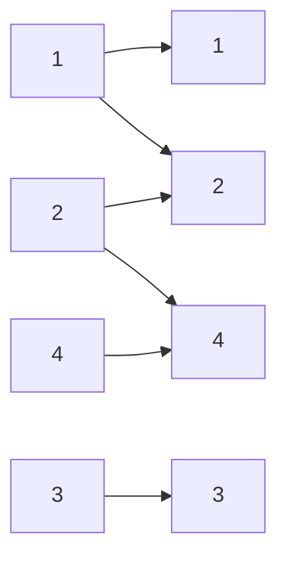
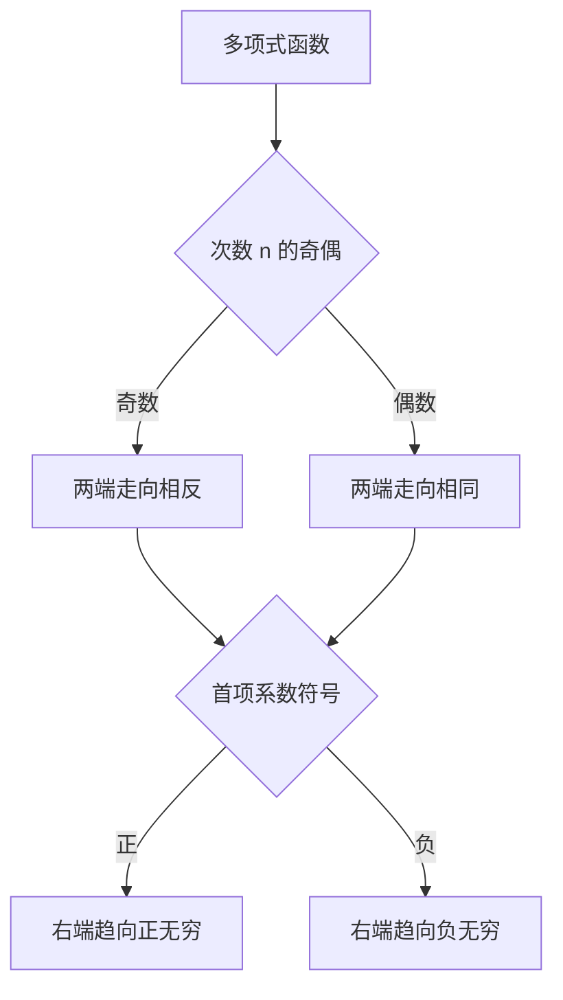
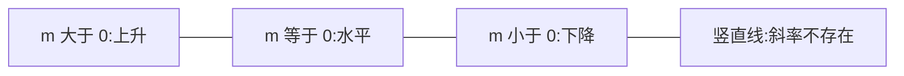
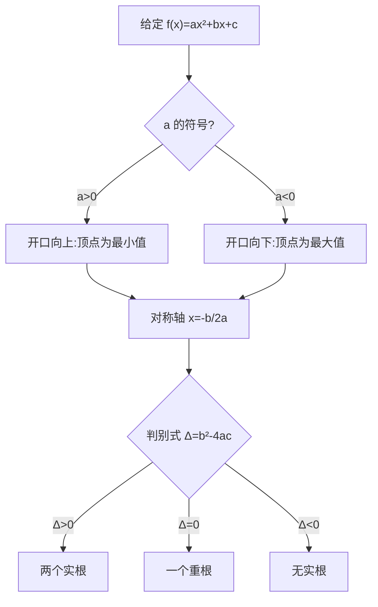

# Concept-Book Run

domain: /home/papagame/projects/digital-duck/cb-calculus/public/domains/calculus_ch01/input/graph.yaml
target: mathematical_model
started: 2026-11-25T03:53:07

## Teaching order (7 concepts)

- relation
- function
- polynomial_function
- slope
- linear_function
- quadratic_function
- mathematical_model

### relation (0.5s)

## 关系

**定义。** 设 $A$、$B$ 是两个集合。从 $A$ 到 $B$ 的**关系** $R$ 是笛卡尔积 $A\times B$ 的任意子集：

$$R\subseteq A\times B=\{(x,y)\mid x\in A,\ y\in B\}.$$

若 $(x,y)\in R$，记作 $xRy$，读作"$x$ 与 $y$ 有关系 $R$"。$A$ 称为**定义域所在集合**，$B$ 称为**陪域**。实际取到的第一分量集合 $\operatorname{dom}R=\{x\mid \exists y,\ (x,y)\in R\}$ 称为**定义域**，实际取到的第二分量集合 $\operatorname{ran}R=\{y\mid \exists x,\ (x,y)\in R\}$ 称为**值域**。若 $A=B$，称 $R$ 为 $A$ 上的关系。

注意：关系对"配对方式"没有任何限制。一个 $x$ 可以对应多个 $y$，也可以不对应任何 $y$。当每个 $x\in A$ 恰好对应一个 $y$ 时，关系才成为**函数**，所以函数是一种特殊的关系。

**例题。** 设 $A=\{1,2,3,4\}$，定义 $A$ 上的关系 $R=\{(x,y)\mid x\text{ 整除 }y\}$。

列出所有满足条件的有序对：

$$R=\{(1,1),(1,2),(1,3),(1,4),(2,2),(2,4),(3,3),(4,4)\}.$$

共 $8$ 个有序对，而 $|A\times A|=16$，所以 $R$ 是 $A\times A$ 的真子集。

读出性质：
- $\operatorname{dom}R=\{1,2,3,4\}$，$\operatorname{ran}R=\{1,2,3,4\}$。
- $1$ 对应 4 个 $y$，所以 $R$ **不是**函数。
- 对每个 $x$ 都有 $(x,x)\in R$（自反性）；$(1,2)\in R$ 但 $(2,1)\notin R$（非对称）。

**问题求解应用。** 

*问题：* 某课程中，$A=\{\text{小明},\text{小红},\text{小刚}\}$ 为学生集合，$B=\{\text{数学},\text{物理},\text{化学}\}$ 为课程集合。已知选课关系为
$$R=\{(\text{小明},\text{数学}),(\text{小明},\text{物理}),(\text{小红},\text{物理}),(\text{小刚},\text{化学})\}.$$
问：(1) 选修物理的学生有哪些？(2) $R$ 是否为从 $A$ 到 $B$ 的函数？(3) 若要使 $R$ 成为函数，最少需要删除几个有序对？

*解：*
1. 找出第二分量为"物理"的有序对：$(\text{小明},\text{物理})$ 与 $(\text{小红},\text{物理})$，所以是小明和小红。
2. 小明出现在两个有序对中，对应两门课，违反"每个 $x$ 恰好一个 $y$"，所以 $R$ 不是函数。
3. 其余学生都只对应一门课，只有小明重复。删除 $(\text{小明},\text{数学})$ 或 $(\text{小明},\text{物理})$ 中的任意一个即可，最少删除 $1$ 个。

**小结。** 判断一个集合是不是关系，只需检查它的元素是否都是 $A\times B$ 中的有序对。要判断它是否为函数，再检查每个 $x$ 是否恰有一个 $y$。把关系写成有序对列表，是后续研究自反、对称、传递等性质的起点。

*图示：集合 $\{1,2,3,4\}$ 上"整除"关系的部分箭头图（左列为 $x$，右列为 $y$），一个 $x$ 可指向多个 $y$。*

### function (0.7s)

## 函数

**定义。** 函数是一种规则:它把输入集合(**定义域**)中的每一个元素,恰好对应到输出集合中的一个元素。若输出集合记为 $Y$,实际取到的所有输出值构成**值域**。记作

$$f: X \to Y,\qquad x \mapsto f(x).$$

关键在于“恰好一个”:同一个输入不能同时得到两个不同的输出,但不同的输入可以得到相同的输出。

**判断是否为函数。** 
- 学号 $\to$ 学生姓名:每个学号对应唯一学生,是函数。 
- 关系 $x = y^2$(把 $x$ 看作输入):当 $x=4$ 时,$y=2$ 或 $y=-2$,输出不唯一,所以不是函数。 
- 竖直线检验:任意竖直线与图像至多相交一点,则该图像表示函数。

**例题。** 设 $f(x)=\dfrac{\sqrt{x-1}}{x-3}$,求定义域,并计算 $f(5)$。

*解:* 根号要求 $x-1\ge 0$,即 $x\ge 1$;分母要求 $x\ne 3$。因此定义域为

$$\{x\in\mathbb{R}\mid x\ge 1,\ x\ne 3\}=[1,3)\cup(3,+\infty).$$

代入 $x=5$:

$$f(5)=\frac{\sqrt{4}}{2}=1.$$

**问题求解应用。** 一家出租车公司起步价 8 元(含 3 公里),超出部分每公里 2 元。设行驶距离为 $d$ 公里,车费为 $C(d)$。

1. 写出规则(分段函数):

$$C(d)=\begin{cases}8, & 0<d\le 3,\\[2pt] 8+2(d-3), & d>3.\end{cases}$$

2. 每个距离 $d$ 只对应一个车费,所以 $C$ 是函数,定义域为 $(0,+\infty)$,值域为 $[8,+\infty)$。
3. 计算 $C(10)=8+2\times 7=22$ 元。
4. 反向提问:车费为 20 元时行驶了多远?解 $8+2(d-3)=20$,得 $d=9$ 公里。因为在 $d>3$ 的部分,不同距离对应不同车费,这样的反问才有唯一答案;但 $C(1)=C(2)=8$,所以“车费 8 元”无法确定具体距离。这说明:**函数保证由输入得到唯一输出,却不保证由输出能唯一还原输入**(后者需要函数是一一对应的,即可逆)。

**解题要点。** 面对一个函数问题,依次问三件事:(1)定义域是什么(分母不为零、偶次根号下非负、对数真数为正);(2)规则是否对每个输入给出唯一输出;(3)值域是什么、能否反推输入。

*图:函数把定义域中的每个输入经过规则 $f$ 变为唯一的输出,所有输出构成值域。*

### polynomial_function (0.7s)

## 多项式函数

**定义。** 形如
$$f(x)=a_n x^n+a_{n-1}x^{n-1}+\cdots+a_1x+a_0$$
的函数称为**多项式函数**,其中 $n$ 为非负整数,$a_0,a_1,\dots,a_n$ 为常数(称为**系数**)。当 $a_n\neq 0$ 时,$n$ 称为该多项式的**次数**,$a_n$ 称为**首项系数**,$a_0$ 称为**常数项**。例如:常数函数 $f(x)=5$ 次数为 $0$;线性函数 $f(x)=2x-1$ 次数为 $1$;二次函数 $f(x)=x^2-4x+3$ 次数为 $2$。

注意,$\sqrt{x}$、$1/x$、$2^x$ 都**不是**多项式函数,因为 $x$ 的指数必须是非负整数,且 $x$ 不能出现在分母或指数位置。

**例题。** 设 $f(x)=2x^3-3x^2-11x+6$。

1. *判断次数与端点行为:* 次数为 $3$(奇数),首项系数 $2>0$,所以当 $x\to+\infty$ 时 $f(x)\to+\infty$,当 $x\to-\infty$ 时 $f(x)\to-\infty$。
2. *求零点:* 试 $x=3$:$f(3)=54-27-33+6=0$,故 $x=3$ 是零点。用综合除法(或长除法)得
$$f(x)=(x-3)(2x^2+3x-2)=(x-3)(2x-1)(x+2).$$
3. 因此零点为 $x=3,\ \tfrac12,\ -2$。

**问题求解应用。** 一个无盖盒子由 $30\text{ cm}\times 20\text{ cm}$ 的纸板在四角各剪去边长为 $x$ 的正方形后折成,求体积函数并判断其合理定义域。

体积为
$$V(x)=x(30-2x)(20-2x)=4x^3-100x^2+600x.$$
这是一个三次多项式函数。因为边长必须为正,且 $20-2x>0$,所以定义域为 $0<x<10$。

令 $V(x)=0$:$4x(x-10)(x-15)=0$,零点为 $0,10,15$。在 $(0,10)$ 内 $V>0$,且 $V(0)=V(10)=0$,所以体积在区间内部必有最大值。求导得 $V'(x)=12x^2-200x+600=0$,即 $3x^2-50x+150=0$,解得
$$x=\frac{50\pm\sqrt{2500-1800}}{6}=\frac{50\pm 26.46}{6},$$
取落在定义域内的 $x\approx 3.92$ cm,此时 $V\approx 1056\ \text{cm}^3$。

**要点归纳。**
- 次数决定函数的整体形状:次数为 $n$ 的多项式最多有 $n$ 个实零点,图像最多有 $n-1$ 个转折点。
- 奇数次与偶数次的端点行为不同:奇数次两端走向相反,偶数次两端走向相同,符号由首项系数决定。
- 多项式函数处处连续、可导,这使得我们可以用零点分析和导数来求解实际优化问题。

*图:根据次数奇偶与首项系数符号判断多项式函数端点行为的流程。*

### slope (0.6s)

## 斜率

**定义。** 斜率(slope)衡量一条直线的陡峭程度与倾斜方向。对直线上任意两个不同的点 $(x_1, y_1)$ 与 $(x_2, y_2)$,斜率定义为纵坐标的变化量与横坐标的变化量之比:

$$m = \frac{\Delta y}{\Delta x} = \frac{y_2 - y_1}{x_2 - x_1}, \quad x_2 \neq x_1.$$

直观地说,斜率表示"$x$ 每增加 1 个单位,$y$ 改变多少"。

- $m > 0$:直线从左向右上升;
- $m < 0$:直线从左向右下降;
- $m = 0$:水平线;
- 竖直线的 $\Delta x = 0$,斜率**不存在**(未定义)。

$|m|$ 越大,直线越陡。对于直线,任取哪两个点,所得斜率都相同,这正是直线"变化率恒定"的含义。

**例题。** 求经过点 $A(1, 2)$ 和 $B(4, 8)$ 的直线的斜率。

$$m = \frac{8 - 2}{4 - 1} = \frac{6}{3} = 2.$$

斜率为 $2$,表示每向右移动 1 个单位,图像上升 2 个单位。若交换两点的顺序,则 $m = \frac{2-8}{1-4} = \frac{-6}{-3} = 2$,结果不变。但要注意分子、分母必须采用**相同的点顺序**,否则符号会出错。

**问题解决中的应用。**

*问题:* 某出租车的收费由起步价加里程费组成。行驶 2 km 时费用为 11 元,行驶 6 km 时费用为 23 元。求每公里的单价,并预测行驶 10 km 的费用。

*解:* 把(里程,费用)看作点 $(2, 11)$ 与 $(6, 23)$。此时斜率就是单价:

$$m = \frac{23 - 11}{6 - 2} = \frac{12}{4} = 3 \text{ (元/km)}.$$

由于收费随里程线性变化,斜率恒定,所以从 6 km 到 10 km 增加 $4$ km,费用增加 $3 \times 4 = 12$ 元,即

$$23 + 12 = 35 \text{ 元}.$$

*检验:* 起步价为 $11 - 3 \times 2 = 5$ 元,故费用函数为 $y = 3x + 5$;当 $x = 10$ 时,$y = 35$,与上面一致。

**要点。** 在应用题中,斜率的**单位**是"$y$ 的单位 / $x$ 的单位"(这里是元/km),它给出了实际意义:速度、单价、增长率等都是斜率。再看另一个判断:若两条直线斜率相等($m_1 = m_2$),则它们平行;若 $m_1 m_2 = -1$,则它们互相垂直。这两条结论常用于几何证明与求直线方程。

*斜率符号与直线方向的对应关系。*

### linear_function (0.5s)

## 线性函数

**定义。** 形如
$$f(x) = ax + b \quad (a, b \in \mathbb{R})$$
的函数称为**线性函数**(一次函数)。它的图像是一条直线:$a$ 是**斜率**,表示 $x$ 每增加 1 个单位,函数值改变 $a$ 个单位;$b$ 是 **$y$ 轴截距**,即直线与 $y$ 轴交于点 $(0, b)$。

斜率可由直线上任意两点 $(x_1, y_1)$、$(x_2, y_2)$($x_1 \ne x_2$)计算:
$$a = \frac{y_2 - y_1}{x_2 - x_1}.$$

- $a > 0$:函数递增;$a < 0$:函数递减;$a = 0$:常数函数(水平线)。
- $|a|$ 越大,直线越陡。
- 零点(与 $x$ 轴的交点)为 $x = -\dfrac{b}{a}$($a \neq 0$)。

**为什么斜率处处相同?** 对任意 $x$ 与增量 $h$,
$$f(x+h) - f(x) = a(x+h) + b - (ax + b) = ah,$$
变化量只取决于 $h$,与 $x$ 无关。这就是"线性"的本质:**恒定的变化率**。

**例题。** 已知直线经过点 $(1, 5)$ 和 $(3, 11)$,求其解析式,并求 $f(10)$。

1. 求斜率:$a = \dfrac{11-5}{3-1} = 3$。
2. 代入点 $(1,5)$:$5 = 3\cdot 1 + b$,得 $b = 2$。
3. 所以 $f(x) = 3x + 2$。
4. 验证点 $(3,11)$:$3\cdot 3 + 2 = 11$ ✓。
5. $f(10) = 3\cdot 10 + 2 = 32$。

**应用:出租车计费。** 某出租车起步价 8 元,之后每公里 2.5 元。设行驶 $x$ 公里(在起步里程之外),费用为
$$C(x) = 2.5x + 8.$$
这里斜率 $a = 2.5$ 是"每公里的边际费用",截距 $b = 8$ 是固定的起步费。

问题:预算 33 元,最多能行驶多远?

解方程 $2.5x + 8 = 33$,得 $2.5x = 25$,$x = 10$ 公里。

再比较另一家公司 $D(x) = 2x + 12$。何时两家费用相同?令 $2.5x + 8 = 2x + 12$,得 $0.5x = 4$,$x = 8$。因此行驶少于 8 公里时第一家更便宜,超过 8 公里则第二家更划算。几何上,这正是两条直线的交点 $(8, 28)$。

**解题要点。**
1. 从题目中识别"固定量"($b$)与"每单位变化量"($a$)。
2. 已知两点时,先求斜率,再代入一点求截距。
3. 求交点或比较大小时,把问题化为一次方程或一次不等式。
4. 求出结果后,用原始数据验证。

### quadratic_function (0.5s)

## 二次函数

**定义。** 形如
$$f(x)=ax^2+bx+c\qquad(a\neq 0)$$
的函数称为**二次函数**,其图像是一条**抛物线**。系数 $a$ 决定开口方向与宽窄:$a>0$ 开口向上,$a<0$ 开口向下,$|a|$ 越大抛物线越"瘦"。$c$ 是图像与 $y$ 轴的交点纵坐标 $f(0)$。

**配方与顶点式。** 对 $ax^2+bx+c$ 配方,得
$$f(x)=a\left(x+\frac{b}{2a}\right)^2+\frac{4ac-b^2}{4a}.$$
由此可知:

- 对称轴:$x=-\dfrac{b}{2a}$;
- 顶点:$\left(-\dfrac{b}{2a},\ \dfrac{4ac-b^2}{4a}\right)$,当 $a>0$ 时为最小值点,当 $a<0$ 时为最大值点。

**求根与判别式。** 方程 $ax^2+bx+c=0$ 的解为
$$x=\frac{-b\pm\sqrt{\Delta}}{2a},\qquad \Delta=b^2-4ac.$$
$\Delta>0$ 时有两个不同实根(图像与 $x$ 轴交于两点);$\Delta=0$ 时有一个重根(顶点落在 $x$ 轴上);$\Delta<0$ 时无实根(图像与 $x$ 轴不相交)。

**例题。** 分析 $f(x)=x^2-4x+3$。
这里 $a=1,\ b=-4,\ c=3$。对称轴为 $x=-\dfrac{-4}{2}=2$,顶点纵坐标 $f(2)=4-8+3=-1$,故顶点为 $(2,-1)$,且为最小值点。判别式 $\Delta=16-12=4>0$,根为 $x=\dfrac{4\pm2}{2}$,即 $x=1$ 或 $x=3$。因此 $f(x)=(x-1)(x-3)$,图像开口向上,与 $y$ 轴交于 $(0,3)$。

**应用题。** 用 $40\ \text{m}$ 长的栅栏围一个一面靠墙的矩形菜地,问如何围才能使面积最大?

设垂直于墙的边长为 $x$,则平行于墙的边长为 $40-2x$,面积
$$S(x)=x(40-2x)=-2x^2+40x,\qquad 0<x<20.$$
这是 $a=-2<0$ 的二次函数,开口向下,最大值在顶点处取得:
$$x=-\frac{40}{2\times(-2)}=10,\qquad S(10)=-200+400=200.$$
所以当垂直于墙的边长为 $10\ \text{m}$、平行于墙的边长为 $20\ \text{m}$ 时,面积最大,为 $200\ \text{m}^2$。注意 $x=10$ 在定义域 $(0,20)$ 内,结果有效。

**解题要点。** 遇到"最大/最小"问题时,先建立二次函数模型,再检查 $a$ 的符号判断最值类型,用 $x=-\dfrac{b}{2a}$ 求最值点,最后核对该点是否落在实际定义域内。

*分析二次函数的流程:先由 $a$ 判断开口方向,再求对称轴与顶点,最后用判别式判断根的个数。*

### mathematical_model (0.5s)

## 数学模型

**定义。** 数学模型（mathematical model）是用数学语言（方程、函数、不等式等）来描述现实情境中变量之间关系的方法。我们先根据数据选择函数类型（线性、二次、指数等），再通过拟合确定参数，最后用模型进行**模拟**与**预测**。建模的基本循环是：提出问题 → 选择函数形式 → 拟合参数 → 检验 → 预测与修正。

常见的两类模型：

- 线性模型：$y = mx + b$，变化率恒定；
- 二次模型：$y = ax^2 + bx + c$，变化率本身在变化，图像为抛物线。

**例题。** 某同学用手机记录一个盆栽的高度（单位：cm）：

| 周数 $x$ | 0 | 2 | 4 | 6 |
|---|---|---|---|---|
| 高度 $y$ | 10 | 14 | 18.5 | 22 |

观察数据：每两周大约增加 $4$ cm，增量基本恒定，因此选择线性模型。取首尾两点求斜率：

$$m = \frac{22-10}{6-0} = 2,\qquad b = 10,$$

得到模型 $y = 2x + 10$。检验：当 $x=4$ 时，模型值为 $18$，实测 $18.5$，残差（实际值 − 预测值）为 $0.5$ cm，误差很小，模型可以接受。

**问题解决应用。** 一个球被竖直向上抛出，测得高度数据：

| 时间 $t$（s） | 0 | 1 | 2 | 3 |
|---|---|---|---|---|
| 高度 $h$（m） | 2 | 17 | 22 | 17 |

一阶差分为 $15,\,5,\,-5$，不是常数；二阶差分为 $-10,\,-10$，是常数，因此应选二次模型 $h = at^2 + bt + c$。

由 $t=0$ 得 $c=2$。代入 $t=1$：$a+b+2=17$，即 $a+b=15$；代入 $t=2$：$4a+2b+2=22$，即 $2a+b=10$。解得 $a=-5,\ b=20$：

$$h(t) = -5t^2 + 20t + 2.$$

检验 $t=3$：$-45+60+2=17$，与数据吻合。

用模型回答问题：

1. 最高点在顶点 $t = -\dfrac{b}{2a} = 2$ s，最大高度 $h(2)=22$ m；
2. 落地时 $h=0$：$-5t^2+20t+2=0$，解得 $t = 2+\sqrt{4.4}\approx 4.1$ s（取正根）。

**注意事项。**

- **内插与外推**：在数据范围内预测（内插）通常可靠；超出范围（外推）风险很大。例如盆栽不会永远以每周 $1$ cm 的速度长高。
- **模型选择**：先看散点图或差分，再选函数类型；一阶差分近似恒定 → 线性，二阶差分近似恒定 → 二次。
- **定义域限制**：球的模型只在 $0 \le t \le 4.1$ 内有物理意义。

模型总是现实的简化：好的模型不是"绝对正确"，而是在明确的适用范围内"足够准确且有用"。

## Run complete

total: 10.5s
