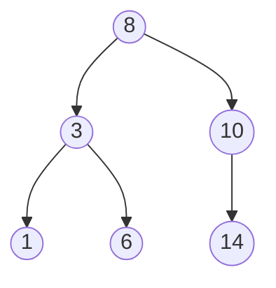
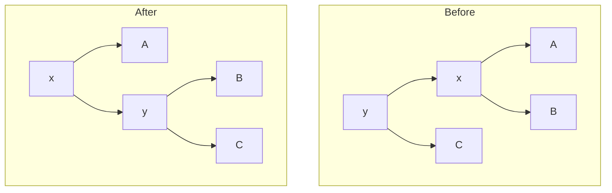

# Concept-Book Run

domain: /home/papagame/projects/digital-duck/cb-data-structure/public/domains/data_structure_ch07/input/graph.yaml
target: martinez_roura_rbst
started: 2026-11-25T03:56:01

## Teaching order (10 concepts)

- binary_search_tree
- random_permutation
- heap_property
- random_binary_search_tree
- sset_interface
- rotation
- treap
- treap_add
- treap_remove
- martinez_roura_rbst

### binary_search_tree (0.7s)

## Binary Search Tree

**Definition.** A *binary search tree* (BST) is a binary tree whose nodes store keys from a total order, such that for every node $x$ with key $k(x)$:

$$
\forall\, y \in \text{left}(x):\; k(y) < k(x), \qquad \forall\, z \in \text{right}(x):\; k(z) > k(x).
$$

The property applies to *entire subtrees*, not just immediate children. Assuming distinct keys, an inorder traversal (left, node, right) visits keys in sorted order, which is the structure's central consequence.

**Search and insertion.** To find key $q$, start at the root. If $q$ equals the node's key, stop. If $q$ is smaller, go left. Otherwise go right. Reaching a null link means $q$ is absent. Insertion follows the same path and attaches a new leaf at the null link where the search ended. Each step discards a whole subtree, so the cost is $O(h)$, where $h$ is the tree's height.

**Worked example.** Insert the keys $8, 3, 10, 1, 6, 14$ into an empty BST, in that order.

- $8$ becomes the root.
- $3 < 8$, so it goes left of $8$.
- $10 > 8$, so it goes right of $8$.
- $1 < 8$, then $1 < 3$, so it goes left of $3$.
- $6 < 8$, then $6 > 3$, so it goes right of $3$.
- $14 > 8$, then $14 > 10$, so it goes right of $10$.


*The BST after inserting 8, 3, 10, 1, 6, 14. Every left subtree holds smaller keys and every right subtree holds larger ones.*

Now search for $6$. Compare with $8$ and go left. Compare with $3$ and go right. Compare with $6$, which matches. That took 3 comparisons, not 6.

**Problem-solving application.** The height $h$ decides performance, and it depends on insertion order. Inserting $1, 3, 6, 8, 10, 14$ in sorted order produces a chain of height $n-1 = 5$, so search degrades to $O(n)$. A balanced tree on $n$ keys has height $\lceil \log_2(n+1)\rceil - 1$, giving $O(\log n)$. For random insertion orders, the expected height is $O(\log n)$. To avoid the worst case, self-balancing variants such as AVL and red-black trees restructure the tree during updates.

**Deletion** has three cases for the node $x$ being removed:

1. *Leaf:* remove it.
2. *One child:* replace $x$ with that child.
3. *Two children:* replace $k(x)$ with its inorder successor, which is the minimum of the right subtree. Then delete that successor, which has at most one child.

For example, deleting the root $8$ above replaces it with $10$, the minimum of its right subtree. The old $10$ node has only a right child, $14$, so $14$ takes its place. The result is still a valid BST.

**Check yourself.** If a tree of $n = 1000$ keys is perfectly balanced, search needs at most about $\lceil\log_2 1001\rceil = 10$ comparisons. If the same keys were inserted in sorted order, search could need up to $1000$. This gap is why balance matters in practice.

### random_permutation (0.6s)

## Random Permutation

### Definition

A **random permutation** of $n$ distinct elements is an ordering chosen so that each of the $n!$ possible orderings occurs with equal probability:

$$P(\pi) = \frac{1}{n!} \quad \text{for every permutation } \pi \text{ of } \{1,\dots,n\}.$$

This is the uniform distribution on the symmetric group $S_n$. Uniformity is the whole point. An ordering that is merely "scrambled" is not a random permutation unless every arrangement is exactly equally likely. As a consequence, each element is equally likely to land in each position, with probability $1/n$.

### Worked example

For $n=3$ there are $3! = 6$ orderings of $\{a,b,c\}$, so each has probability $1/6$:

$$abc,\ acb,\ bac,\ bca,\ cab,\ cba.$$

Roll a fair die and map each outcome to one ordering. Each ordering then has probability $1/6$, and the element $a$ is first in $abc$ and $acb$. So $P(a \text{ first}) = 2/6 = 1/3 = 1/n$, as expected.

### Generating one: the Fisher–Yates shuffle

Build the permutation one position at a time. Choose position $n$'s element uniformly from all $n$ elements, position $n-1$'s from the remaining $n-1$, and so on:

```python
import random

def shuffle(a):
    for i in range(len(a) - 1, 0, -1):
        j = random.randint(0, i)   # uniform in 0..i inclusive
        a[i], a[j] = a[j], a[i]
    return a
```

**Why it is uniform.** Any particular final ordering requires one specific choice at each step. The step probabilities are $\frac1n,\frac1{n-1},\dots,\frac12$ (the final step, $i=0$, has only one option). Because the choices are independent, 

$$P(\pi)=\frac1n\cdot\frac1{n-1}\cdots\frac12\cdot 1=\frac1{n!}.$$

Each ordering arises from exactly one sequence of choices, so every ordering has the same probability.

### Problem-solving application

**Problem 1.** A naive shuffle swaps each position $i$ with a random index from $0$ to $n-1$ (all positions). Is it uniform for $n=3$?

*Solution.* This procedure makes $n^n = 27$ equally likely choice sequences. Every ordering has the same probability only if $6$ divides $27$, which it does not. Since $27/6$ is not an integer, the orderings cannot all receive the same number of sequences, so the shuffle is biased. The correct method produces $3\cdot 2\cdot 1 = 6$ sequences, one per ordering.

**Problem 2.** In a random permutation of $n$ items, what is the expected number of fixed points (items in their original position)?

*Solution.* Let $X_i=1$ if item $i$ is in position $i$. Then $P(X_i=1)=\frac{(n-1)!}{n!}=\frac1n$. By linearity of expectation,

$$E\left[\sum_{i=1}^n X_i\right]=n\cdot\frac1n=1.$$

The answer is $1$ for every $n$, which is a surprising result that follows directly from uniformity.

**Key takeaway:** To check whether a shuffle is uniform, count the equally likely random-choice sequences. If the count is not divisible by $n!$, the shuffle cannot be uniform.

### heap_property (0.7s)

## Heap Property

### Definition

A **heap** is a tree whose nodes carry priorities and satisfy the **heap property**: every node's priority is smaller than the priorities of its children. Formally, for every node $v$ with child $c$,

$$p(v) < p(c).$$

(Many texts use $\le$ to allow ties. Reversing the inequality gives a *max-heap*. The version above is a *min-heap*.) The property is local: it compares only parent and child, never siblings or cousins. It is transitive, though. Each node is smaller than its children, which are smaller than their children, and so on. So **the root holds the minimum priority of the whole tree**. This is why heaps work well as priority queues.

Heaps are usually also *complete* binary trees, meaning every level is full except possibly the last, which fills left to right. This lets us store the tree in an array, with node $i$ (1-indexed) having children $2i$ and $2i+1$ and parent $\lfloor i/2 \rfloor$. In array form the property reads

$$A[\lfloor i/2 \rfloor] \le A[i] \quad \text{for all } i \ge 2.$$

### Worked example

Test whether $A = [2, 5, 3, 9, 6, 4, 8]$ is a min-heap.

| $i$ | $A[i]$ | parent index | $A[\text{parent}]$ | OK? |
|---|---|---|---|---|
| 2 | 5 | 1 | 2 | yes |
| 3 | 3 | 1 | 2 | yes |
| 4 | 9 | 2 | 5 | yes |
| 5 | 6 | 2 | 5 | yes |
| 6 | 4 | 3 | 3 | yes |
| 7 | 8 | 3 | 3 | yes |

Every node passes, so $A$ is a heap. Notice that $9$ and $4$ sit at different levels but have no required relationship. The property constrains only parent-child pairs.

Now change $A[3]$ from $3$ to $7$, giving $[2,5,7,9,6,4,8]$. The pair at $i=6$ now fails, because $A[3]=7 > A[6]=4$. This is a violation.

### Problem-solving application

Heap operations work by **restoring the property locally**.

*Insert* $1$ into the original heap. Place it at the next open position, $i=8$, so $A=[2,5,3,9,6,4,8,1]$. Its parent is $A[4]=9$, which violates the property. Swap them, then compare with the new parent $A[2]=5$ and swap again, then compare with $A[1]=2$ and swap again. The result is $[1,2,3,5,6,4,8,9]$. This is called *sift-up*.

*Extract-min* works in the other direction. Remove the root, move the last element to the root, and swap it downward with its **smaller** child until the property holds (*sift-down*). Choosing the smaller child matters. Swapping with the larger one would leave the new parent bigger than its other child, which is a new violation.

**Cost.** A complete tree with $n$ nodes has height $\lfloor \log_2 n \rfloor$. Each swap moves one level, so insert and extract-min both take $O(\log n)$ time, and reading the minimum takes $O(1)$.

**Check yourself:** Is $[1,3,2,4,5,\,2.5,\,6]$ a min-heap? Check each node against its parent. Position 6 holds $2.5$ with parent $A[3]=2$, which is fine. Every other pair also passes, so yes.

### random_binary_search_tree (0.6s)

## Random Binary Search Tree

### Definition

A **binary search tree (BST)** stores keys so that, for every node, all keys in its left subtree are smaller and all keys in its right subtree are larger. Its shape depends entirely on insertion order. Inserting $1,2,\dots,n$ in sorted order produces a path of height $n-1$. Other orders can produce much shorter trees.

A **random binary search tree** is the BST built by inserting the keys of a uniformly random permutation of $\{1,\dots,n\}$ one at a time, using standard insertion with no rebalancing. All $n!$ orderings are equally likely, so the shape is random. We study its expected behavior.

### Worked example

Take $n=3$ and the six permutations of $\{1,2,3\}$:

- $(2,1,3)$ and $(2,3,1)$ both give root 2 with children 1 and 3, a balanced tree of height 1.
- $(1,2,3)$, $(1,3,2)$, $(3,1,2)$ and $(3,2,1)$ each give a different path of height 2.

There are 5 distinct tree shapes but 6 permutations, so the shapes are *not* equally likely. The balanced tree has probability $2/6=1/3$. Each of the four paths has probability $1/6$. Balanced trees are favored because the first key inserted, which becomes the root, is equally likely to be any key. Middle keys split the remaining keys more evenly.

### Problem-solving application: expected depth

**Goal.** Find the expected number of comparisons to search for the key of rank $j$, which is its depth $D_j$.

**Step 1: when is $i$ an ancestor of $j$?** Consider the keys with ranks between $i$ and $j$ inclusive. The first one inserted from this group ends up as an ancestor of all the others, because no earlier key separates them. So $i$ is an ancestor of $j$ exactly when $i$ is first among these keys. The group has $|i-j|+1$ keys, and each is equally likely to come first, so

$$\Pr[i \text{ is an ancestor of } j]=\frac{1}{|i-j|+1}.$$

**Step 2: add up the ancestors.** The depth of $j$ is its number of ancestors. By linearity of expectation,

$$\mathbb{E}[D_j]=\sum_{i\ne j}\frac{1}{|i-j|+1}\le 2\sum_{k=2}^{n}\frac1k\le 2\ln n.$$

The last step uses the standard bound $\sum_{k=2}^{n} 1/k\le \ln n$. The factor 2 counts the keys on each side of $j$.

**Check with $n=3$, $j=2$.** The formula gives $\tfrac12+\tfrac12=1$. In the balanced tree, key 2 has depth 0. In each path, its depth is 1 or 2. So the expected depth is $\tfrac13(0)+\tfrac23\cdot$(average of the path depths for key 2), which should equal 1. The path trees $(1,2,3)$ and $(3,2,1)$ give depth 1. The trees $(1,3,2)$ and $(3,1,2)$ give depth 2. The average over all six permutations is $(0+0+1+1+2+2)/6=1$, so the check works.

**Conclusion.** Every node has expected depth at most $2\ln n$, so a search in a random BST costs $O(\log n)$ comparisons on average. This holds with no rebalancing. In the worst case, such as sorted insertion, the cost is $\Theta(n)$.

### Takeaway

Randomizing the insertion order turns the worst case into an average case. The proof only needs the rule that the first inserted key in a range is an ancestor of the rest of that range.

### sset_interface (0.7s)

## Sset Interface

### Definition

An **SSet** (sorted set) is an abstract data type that stores a collection of elements drawn from a totally ordered universe, meaning any two elements $x, y$ can be compared with $<$, $=$, or $>$. It is defined by three operations on a set $S$:

- **add(x):** insert $x$ into $S$. Return `true` if $x$ was not already present (so $S$ grew), otherwise return `false`. Duplicates are never stored.
- **remove(x):** delete $x$ from $S$. Return the removed element if it was present, otherwise `null`.
- **find(x):** return the *smallest* element $y \in S$ with $y \ge x$, or `null` if no such element exists.

The third operation is what separates an SSet from an ordinary hash-style set. Because `find(x)` is a **successor search**, it works even when $x \notin S$. It answers "what is the next element at or after $x$?" For this reason, SSet structures must keep their elements ordered. Examples include binary search trees, skiplists, and sorted arrays.

### Worked Example

Start with $S = \{3, 8, 12, 20\}$ and apply these operations in order:

| Operation | Result | $S$ afterward |
|---|---|---|
| find(8) | 8 | $\{3, 8, 12, 20\}$ |
| find(9) | 12 | $\{3, 8, 12, 20\}$ |
| add(9) | true | $\{3, 8, 9, 12, 20\}$ |
| add(9) | false | $\{3, 8, 9, 12, 20\}$ |
| find(9) | 9 | $\{3, 8, 9, 12, 20\}$ |
| find(25) | null | $\{3, 8, 9, 12, 20\}$ |
| remove(12) | 12 | $\{3, 8, 9, 20\}$ |
| find(10) | 20 | $\{3, 8, 9, 20\}$ |

Notice that `find(9)` returned $12$ before $9$ was added and returned $9$ afterward. `find` does not report membership. It reports the *successor*, so you test membership by checking whether the returned value equals $x$.

### Problem-Solving Application

**Problem.** Given a set of meeting start times in minutes after midnight, $S=\{540, 600, 780, 900\}$, each meeting lasting 50 minutes, decide whether a new meeting starting at time $t$ would overlap with an existing one. Use only SSet operations.

**Solution.** A new meeting $[t, t+50)$ conflicts with a later meeting if that meeting starts before $t+50$. It conflicts with an earlier meeting if that one started within the last 50 minutes. The key step is to use `find` to get the next start time at or after $t$:

1. Let $y = \text{find}(t)$.
2. If $y \neq \text{null}$ and $y < t + 50$, there is a conflict with a later meeting.
3. Check earlier meetings by calling $z = \text{find}(t-49)$. If $z \neq \text{null}$ and $z < t$, an earlier meeting started within the last 50 minutes, so there is a conflict.

For $t = 570$: $\text{find}(570) = 600$, and $600 < 620$, so there is a conflict. For $t = 650$: $\text{find}(650) = 780 \ge 700$, and $\text{find}(601) = 780 \not< 650$, so there is no conflict. We then call add(650).

Each check costs one or two `find` calls. If the SSet is a balanced search tree, each call runs in $O(\log n)$ time, so scheduling stays efficient as the calendar grows. This is why the interface matters: the ordering guarantee behind `find` lets you answer range-style questions that an unordered set cannot.

### Key Takeaways

- SSet = set of comparable elements with `add`, `remove`, and successor-style `find`.
- `find(x)` returns the smallest element $\ge x$, not just a yes/no answer.
- Membership test: `find(x) == x`.
- The interface says *what* must be supported, not *how*. Implementations differ in cost, commonly $O(\log n)$ per operation.

### rotation (0.5s)

## Rotation

**Definition.** A *rotation* is a local restructuring of a binary search tree (BST) that changes which of two adjacent nodes is the parent, while keeping the in-order sequence of keys unchanged. Because in-order order is preserved, the BST property still holds afterward. Rotations take $O(1)$ time, since only a constant number of pointers change. Self-balancing trees such as AVL trees and red-black trees use them to reduce height.

There are two mirror-image forms. Let $x$ be the left child of $y$.

- **Right rotation at $y$:** $x$ becomes the parent of $y$. $y$ becomes the right child of $x$.
- **Left rotation at $x$:** the exact inverse. $y$ becomes the parent of $x$, and $x$ becomes the left child of $y$.

The only subtree that changes parents is the one between the two nodes. In a right rotation at $y$, this is $x$'s right subtree $B$. It must move because $x$'s right child slot is now taken by $y$. Since every key in $B$ satisfies $x < B < y$, $B$ fits exactly into $y$'s vacated left slot.


*A right rotation at $y$ lifts $x$ above $y$. Subtree $B$ moves from $x$'s right to $y$'s left, and $A$ and $C$ stay with their original parents.*

**Worked example.** Suppose $y = 30$ has left child $x = 20$. Let $A = \{10\}$, $B = \{25\}$ (the right child of 20), and $C = \{40\}$. The in-order sequence is $10, 20, 25, 30, 40$.

Rotate right at 30:
1. Set $30$'s left child to $B$, which is $25$.
2. Set $20$'s right child to $30$.
3. Replace $30$ with $20$ in $30$'s former parent (or make $20$ the root).

The new in-order traversal is still $10, 20, 25, 30, 40$. The height of the subtree went from 3 to 3 here, but if $A$ had been taller than $B$ and $C$, the rotation would lower the overall height.

**Problem-solving application.** Suppose you insert $1, 2, 3$ in order into an empty BST. You get a right-leaning chain $1 \to 2 \to 3$, with height 2. To fix this:

1. Identify the imbalance. Node $1$ has a right subtree of height 1 and an empty left subtree.
2. Apply a left rotation at $1$, so $2$ becomes the parent.
3. Check the result. $2$ is the root with children $1$ and $3$, and the height drops to 1.

For a general strategy, when a path leans in one direction, rotate toward the opposite side at the top of the heavy path. When the heavy path zigzags, for example a left child whose heavy child is on the right, first rotate the child to straighten the path. This is a double rotation. Then rotate at the top. Check each step by listing the in-order keys, which should never change.

**Cost.** A rotation changes at most three pointers, so $T(n) = O(1)$. Balanced trees use $O(\log n)$ rotations in the worst case per insertion or deletion.

### treap (0.6s)

## Treap

A **treap** is a binary tree in which every node stores a key $k$ and a randomly assigned priority $p$, and the tree satisfies two properties at once:

- **BST property:** for every node, keys in its left subtree are smaller and keys in its right subtree are larger.
- **Heap property:** every node's priority is larger than its children's priorities (max-heap order).

The name combines *tree* and *heap*. For distinct keys and distinct priorities, these two constraints determine the tree's shape **uniquely**. The node with the highest priority must be the root. Its key splits the remaining keys into a left group and a right group, and the same argument applies recursively to each group. Because the priorities are random, the shape is the same as that of a binary search tree built by inserting the keys in random order. Searching a treap is ordinary BST search, so its cost is the depth of the node being sought.

### Worked example

Take keys and priorities $(k, p)$: $(A,5),\ (C,9),\ (E,3),\ (G,7),\ (J,1)$.

1. The maximum priority is $9$ at $C$, so $C$ is the root.
2. Keys less than $C$: $\{A\}$, so $A$ is the left child.
3. Keys greater than $C$: $\{E, G, J\}$. The highest priority there is $7$ at $G$, so $G$ is the right child of $C$.
4. Under $G$, key $E$ (priority 3) goes left and key $J$ (priority 1) goes right.

The tree has height 2, counted in edges. An in-order traversal gives $A, C, E, G, J$, so the BST property holds. Every parent outranks its children, so the heap property holds.

### Expected depth

The depth of a node equals its number of ancestors. Let $x_i$ be the $i$-th smallest key. Node $x_j$ is an ancestor of $x_i$ exactly when $x_j$ has the highest priority among all keys from $x_i$ to $x_j$ inclusive. If any other key in that range had a higher priority, it would sit above $x_j$ and separate the two nodes. That range contains $|i-j|+1$ keys, and all priority orderings are equally likely, so

$$P(x_j \text{ is an ancestor of } x_i) = \frac{1}{|i-j|+1}.$$

Adding these probabilities over all $j \ne i$ gives the expected depth:

$$E[\text{depth of } x_i] = \sum_{j\ne i}\frac{1}{|i-j|+1}.$$

Each side of $x_i$ contributes a sum of the form $\tfrac12+\tfrac13+\cdots+\tfrac1m$. For large $m$, the sum $1+\tfrac12+\cdots+\tfrac1m$ is approximately $\ln m + 0.58$. Each side therefore contributes $O(\log n)$, so the expected depth is $O(\log n)$ for every node.

### Problem-solving application

**Problem:** In a treap with $n = 1000$ keys, estimate the expected depth of the median key.

Take $i = 500$. The 499 keys to its left contribute $\tfrac12+\cdots+\tfrac1{500}$, and the 500 keys to its right contribute $\tfrac12+\cdots+\tfrac1{501}$. Each sum is about $(\ln 500 + 0.58) - 1 \approx 6.79 - 1 = 5.79$. The total is

$$E[\text{depth}] \approx 2(5.79) \approx 11.6.$$

So a search for the median takes about 12 comparisons on average. That is close to $\log_2 1000 \approx 10$. The balance comes from the random priorities, not from the order in which keys arrive. Even sorted input, which is the worst case for a plain BST, gives a treap whose expected depth is logarithmic.

### treap_add (0.6s)

## Treap Add

A **treap** is a binary tree in which every node holds a key and a random priority. It is a binary search tree (BST) on keys and a max-heap on priorities. For every node $v$ with parent $p$, $\text{key}(\text{left}(v)) < \text{key}(v) < \text{key}(\text{right}(v))$ and $\text{pri}(v) \le \text{pri}(p)$. Because priorities are random, the tree's shape matches that of a BST built by inserting keys in random order, so its expected height is $O(\log n)$.

**Treap add** places a new key $k$ in three steps:

1. Draw a random priority $p$, for example uniformly from $[0,1)$.
2. Insert $(k, p)$ as a leaf using the ordinary BST rule: go left if $k < \text{key}(v)$, right otherwise.
3. While the new node $x$ has a parent with smaller priority, rotate $x$ above its parent.

A **rotation** preserves the BST order and moves $x$ one level up. If $x$ is a left child of $y$, a right rotation at $y$ makes $y$ the right child of $x$, and $x$'s old right subtree becomes $y$'s left subtree. A right child uses the mirror image.

### Worked example

Start with a treap written as (key, priority): root $(50, 0.9)$ with left child $(30, 0.6)$ and right child $(70, 0.4)$. Insert key $60$ with priority $0.8$.

- **Step 1, BST insert.** $60 > 50$, so go right. $60 < 70$, so go left. The new node becomes the left child of $(70, 0.4)$.
- **Step 2, first check.** $0.8 > 0.4$, so the heap property is violated. Rotate $60$ above $70$ with a right rotation. Now $60$ is the right child of $50$, and $70$ is the right child of $60$.
- **Step 3, second check.** $0.8 < 0.9$, so the heap property holds and we stop.

One rotation was enough. Had the priority been $0.95$, a second rotation, this time a left rotation at $50$, would have made $60$ the root.

### Problem-solving application: cost of an insertion

**Problem.** Show that inserting into a treap of $n$ keys takes $O(\log n)$ expected time.

**Solution.** Split the work into the two phases of the algorithm.

*Search phase.* The new node ends step 2 as a leaf, so the walk down visits at most height$+1$ nodes. A treap has the shape of a random BST, so its expected height is $O(\log n)$. This phase costs $O(\log n)$ in expectation.

*Rotation phase.* Each rotation moves $x$ up exactly one level, and $x$ can never rise above the root. If the leaf sits at depth $d$, then

$$
\text{rotations} \le d \le \text{height}.
$$

Each rotation takes constant time, so this phase also costs $O(\log n)$ in expectation. In the example above, the leaf started at depth 2 and made 1 rotation. With priority $0.95$ it made 2, which is the maximum possible.

Adding the two phases gives $O(\log n) + O(\log n) = O(\log n)$.

**Takeaway.** Random priorities keep the tree balanced in expectation, and each rotation only repairs one local heap violation. The cost of an add is therefore bounded by the length of one root-to-leaf path.

### treap_remove (0.6s)

## Treap Remove

**Definition.** A treap stores each node with a key $x$ and a random priority $p(x)$. It is a binary search tree on keys and a min-heap on priorities, so every parent has a smaller priority than its children. The operation `remove(x)` deletes the node $u$ holding $x$ and restores both properties. Removal rotates $u$ *down* until it has at most one child, and then splices it out. A rotation swaps a node with one of its children while preserving the in-order sequence of keys. It is the only structural tool this section uses.

**Algorithm.**
1. Find $u$ by ordinary BST search. If $x$ is absent, stop.
2. While $u$ has two children, rotate $u$ with the child that has the *smaller* priority. That child becomes $u$'s parent. Its priority is lower than that of $u$'s other child, so the heap property holds at the new root of the subtree.
3. Once $u$ has at most one child, splice it out. Its parent points directly to $u$'s only child, or to nothing if $u$ is a leaf.

Rotations preserve the in-order sequence, so the BST property is never broken. Each rotation lowers $u$ by one level, and the heap property holds again once $u$ is gone.

**Worked example.** Take the treap with (key, priority) pairs: root $(5,\,1)$, left child $(3,\,4)$, right child $(8,\,2)$. Node $(8,2)$ has children $(7,\,6)$ and $(9,\,3)$. Remove $x=8$.

- Node $8$ has two children with priorities $6$ and $3$. Rotate with the smaller one, $(9,3)$. This is a left rotation, so $9$ moves up and $8$ becomes its left child. Node $8$ now has one child, $(7,6)$.
- Node $8$ has only one child, so splice it out. Node $9$'s left pointer now points to $7$.

The result is $5$ with children $3$ and $9$, and $9$ has left child $7$. Every parent's priority is smaller than its children's: $1<4$, $1<2$ is replaced by $1<3$, $3<6$. The in-order keys $3,5,7,9$ are still sorted.

**Why it is $O(\log n)$.** Search costs the depth of $u$. Trickle-down costs at most the height of $u$'s subtree. Together the work is at most the length of the longest root-to-leaf path through $u$, which is bounded by the treap height. Because priorities are random, the treap has the same shape distribution as a random BST built by inserting keys in priority order. Its expected height is $O(\log n)$. Therefore

$$E[\text{cost of remove}] = O(\log n).$$

**Problem-solving application.** *Question:* You remove a node whose subtree has height $h=3$ and which sits at depth $d=4$. What is the maximum number of rotations, and what is the maximum number of nodes on the path the operation touches?

*Solution:* Each rotation lowers $u$ by one level, and $u$ can drop at most $h=3$ levels before it becomes a leaf, so there are at most $3$ rotations. Search visits $d+1=5$ nodes. Trickle-down moves through at most $3$ more levels, so the work is at most $d+h=7$ steps past the root, plus $O(1)$ for the final splice. Both quantities are bounded by the treap height, so the cost stays logarithmic in expectation.

**Common pitfall.** Rotate with the child of *smaller* priority. Choosing the larger one puts a high-priority node above a low-priority one and breaks the heap property.

### martinez_roura_rbst (0.7s)

## Martinez Roura Rbst

### Definition

A **Martínez–Roura randomized binary search tree (RBST)** is a binary search tree in which every node stores its **subtree size** $n(v)$ instead of a random priority. Randomness is injected only at update time, with probabilities computed from sizes, so that for every $n$ the tree has exactly the distribution of a BST built by inserting a uniformly random permutation of $n$ keys.

**Insertion** of key $x$ into a tree $T$ of size $n$: with probability $\frac{1}{n+1}$, insert $x$ *at the root* (split $T$ by $x$ into $L$ and $R$, which become the children of $x$). Otherwise, recurse into the appropriate child, and increment sizes along the way.

**Deletion** of key $x$: find $x$'s node, with subtrees $L$ and $R$ of sizes $m$ and $k$. Replace the node by $\text{join}(L,R)$, where the root of the result is the root of $L$ with probability $\frac{m}{m+k}$, and the root of $R$ with probability $\frac{k}{m+k}$. The chosen root keeps its own subtree on one side, and the other side is formed by recursively joining.

The key invariant is that a subtree's root is uniform among its keys: for size $n$, each key is the root with probability $\frac1n$. This is why the expected height is $O(\log n)$.

### Worked example

Tree $T$ has root $20$ with left child $10$ and right child $30$ ($n=3$). Insert $25$.

- At the root, insert-at-root happens with probability $\frac{1}{3+1}=\frac14$. Then split $T$ by $25$: $L=\{10,20\}$, $R=\{30\}$, and $25$ becomes the root.
- With probability $\frac34$, go right and increase the root's size to $4$. At node $30$ (size $1$), the root probability is $\frac{1}{1+1}=\frac12$. Then $25$ becomes the parent of $30$ (as its left child, since $25<30$ and $30$ has no left subtree to split). Otherwise, $25$ goes below $30$ as its left leaf.

Check that $25$ is the root with probability $\frac14$, exactly what a random permutation of $\{10,20,25,30\}$ gives, since each of the $4$ keys is equally likely to come first.

### Problem-solving application

**Problem.** Delete $20$ from the tree above (children $10$ and $30$). What is the result?

Here $m=k=1$, so $\text{join}(\{10\},\{30\})$ makes $10$ the root with probability $\frac{1}{2}$ (and $30$ as its right child), or $30$ the root with probability $\frac12$ (and $10$ as its left child). Both trees are equally likely, matching the distribution of a random BST on $\{10,30\}$.

**Cost analysis.** Insertion and deletion follow one root-to-leaf path, and the splits and joins also traverse a single path each. Because the tree is a random BST, the expected depth satisfies
$$E[\text{depth}] = 2H_n - O(1) \approx 2\ln n,$$
so each operation takes expected $O(\log n)$ time, independent of the order of insertions.

**Why it works (sketch).** Suppose $T$ is a random BST of size $n$. Inserting $x$ at the root with probability $\frac1{n+1}$ makes $x$ the root with the correct probability. Otherwise the existing root remains root with probability $\frac{n}{n+1}$ and the new key lands in a subtree that, by induction, is again random. Deletion is symmetric: choosing the root of $L$ with probability $\frac{m}{m+k}$ weights each key by its subtree's share of the total, so each of the $m+k$ keys is equally likely to be the new root.

**Tradeoff.** Unlike a treap, no priorities are stored and no random number is needed per node. Randomness is drawn on each update, and sizes must be maintained, which also gives rank and select queries in $O(\log n)$ expected time.

## Run complete

total: 15.0s
