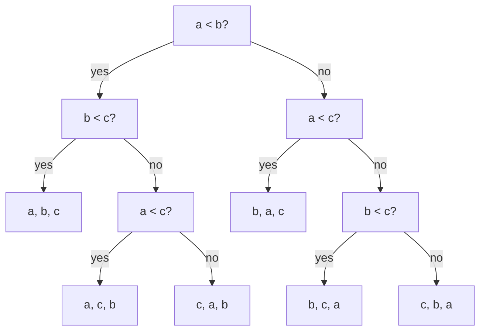
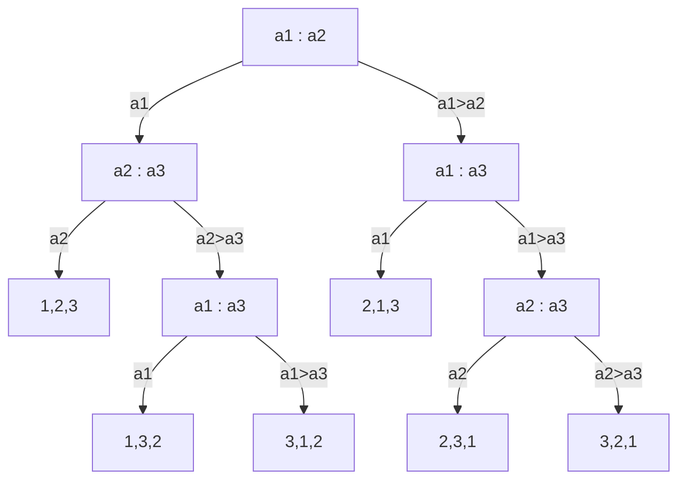

# Concept-Book Run

domain: /home/papagame/projects/digital-duck/cb-data-structure/public/domains/data_structure_ch11/input/graph.yaml
target: integer_sorting_via_indexing
started: 2026-11-25T03:57:51

## Teaching order (9 concepts)

- compare_operation
- comparison_based_sorting
- comparison_tree
- comparison_sorting_lower_bound
- non_comparison_sorting
- stable_sorting
- counting_sort
- radix_sort
- integer_sorting_via_indexing

### compare_operation (0.7s)

## Compare Operation

A **compare operation** is a primitive method, `compare(a, b)`, that takes two items and reports their relative order using the *sign* of an integer:

$$
\text{compare}(a,b)\;\begin{cases} <0 & \text{if } a < b\\ =0 & \text{if } a = b\\ >0 & \text{if } a > b\end{cases}
$$

Only the sign matters. A return value of $-1$ and one of $-500$ both mean "$a$ comes first." This three-way result carries more information than a true/false test such as $a<b$: one call distinguishes all three cases. Sorting algorithms, binary search, and balanced trees are usually written so that `compare` is the *only* way they inspect the data. Any type that supplies a consistent `compare` can then be sorted or searched.

For the results to be meaningful, `compare` must behave like a total order:

- **Antisymmetry:** $\text{sign}(\text{compare}(a,b)) = -\text{sign}(\text{compare}(b,a))$
- **Transitivity:** if $a \le b$ and $b \le c$, then $a \le c$
- **Consistency:** $\text{compare}(a,b)=0$ exactly when $a$ and $b$ are equivalent

### Worked Example

Compare two strings by length, breaking ties alphabetically:

```python
def compare(a, b):
    if len(a) != len(b):
        return len(a) - len(b)
    if a < b:  return -1
    if a > b:  return  1
    return 0
```

- `compare("fig", "apple")` returns $3-5=-2$, so `"fig"` precedes `"apple"`.
- `compare("kiwi", "plum")` has equal lengths, so it falls to the alphabetical test. Since `"kiwi" < "plum"`, it returns $-1$.
- `compare("plum", "plum")` returns $0$.

One caution: returning `a - b` for numbers is tempting, but with fixed-width integers it can overflow. In 32-bit arithmetic, $2{,}000{,}000{,}000 - (-2{,}000{,}000{,}000)$ wraps to a negative number, which wrongly reports $a<b$. Explicit comparisons avoid this.

### Problem-Solving Application

**Problem:** Binary search over a sorted list of $n$ items uses `compare` to decide which half to keep. How many calls are needed in the worst case for $n = 1000$?

**Solution:** Each call to `compare(target, mid)` has three outcomes. If it returns $0$, the search stops. If it is negative, the search continues in the left half. If it is positive, it continues in the right half. Each call therefore at least halves the remaining range:

$$
n \to \tfrac{n}{2} \to \tfrac{n}{4} \to \cdots \to 1
$$

The worst case needs $\lfloor \log_2 n \rfloor + 1$ calls. For $n=1000$, $\log_2 1000 \approx 9.97$, so $\lfloor 9.97\rfloor + 1 = 10$ calls.

Comparison sorts show why this matters. Each `compare` call has at most three outcomes, but a sort can only use the "less/greater" splits to order $n!$ possible permutations. Any such sort therefore needs $\Omega(n \log n)$ calls in the worst case. Counting `compare` calls is the standard way to measure these algorithms' cost.

**Takeaway:** The sign of `compare(a, b)` is a complete, reusable description of order. A correct implementation must be antisymmetric, transitive, and consistent, and it must avoid overflow tricks.

### comparison_based_sorting (0.5s)

## Comparison Based Sorting

### Definition

A **comparison-based sorting algorithm** orders a sequence using only one primitive operation: a call to $\text{compare}(a, b)$, which reports whether $a \le b$ (or $a < b$). The algorithm never looks at the elements' internal form, such as digits, bits, or characters. It learns about the input only through the answers to these comparisons. Merge sort, quicksort, heapsort, insertion sort, and bubble sort all belong to this class. Counting sort and radix sort do not, because they inspect the keys directly.

This restriction is useful because the algorithm works for any data type that has a consistent ordering. The restriction also limits how fast the algorithm can be.

### Worked example: the decision tree

Sort three distinct values $a, b, c$. Each comparison has two outcomes, so any algorithm can be drawn as a binary **decision tree**. Each internal node is a comparison, and each leaf is one final ordering.


*A decision tree for sorting three elements. Every path from the root to a leaf is one run of the algorithm. The six leaves are the $3! = 6$ possible orderings.*

The longest path has 3 comparisons. Could a cleverer algorithm always finish in 2? The next section shows why it could not.

### Lower bound: $\Omega(n \log n)$

**Theorem.** Every comparison-based sort needs $\Omega(n \log n)$ comparisons in the worst case.

*Proof.* For $n$ distinct elements there are $n!$ possible input orderings. The algorithm must be able to output each one, so its decision tree needs at least $n!$ leaves. A binary tree of height $h$ has at most $2^h$ leaves, so
$$2^h \ge n! \implies h \ge \log_2(n!).$$
Since $n! \ge (n/2)^{n/2}$, because at least $n/2$ of the factors are at least $n/2$,
$$h \ge \frac{n}{2}\log_2\frac{n}{2} = \Omega(n\log n). \qquad\blacksquare$$

The worst-case number of comparisons equals the tree height $h$.

### Problem-solving application

**Problem.** What is the fewest comparisons that could guarantee sorting 5 elements?

**Solution.** We need $2^h \ge 5! = 120$. Since $2^6 = 64 < 120 \le 128 = 2^7$, the bound gives $h \ge 7$. So no algorithm can guarantee sorting 5 elements in fewer than 7 comparisons. (Sorting 3 elements gives $\lceil\log_2 6\rceil = 3$, which matches the tree above. Careful algorithms such as merge-insertion sort do reach 7 for $n=5$.)

**Using the result.** The theorem tells you when to stop optimizing. Merge sort and heapsort run in $O(n\log n)$ time, so they are asymptotically optimal among comparison sorts. To beat $n \log n$, you must leave the model and use extra knowledge about the keys. For example, if keys are integers in $\{0,\dots,k\}$, counting sort runs in $O(n+k)$ time.

### comparison_tree (0.9s)

## Comparison Tree

A **comparison tree** (or decision tree) models every possible execution of a comparison-based sorting algorithm on inputs of a fixed size $n$. It is a rooted binary tree in which:

- each **internal node** is a comparison of two input elements, written $a_i : a_j$ (or "$a_i \le a_j$?");
- the two **branches** from a node are the outcomes "yes" and "no";
- each **leaf** is a finished run, labeled with the output permutation the algorithm announces.

Running the algorithm on a specific input traces one root-to-leaf path. The number of comparisons used equals the length of that path, so the **worst-case number of comparisons equals the height $h$ of the tree**. The tree depends on the algorithm and on $n$, but it exists for any algorithm that gains information only by comparing elements.

### Worked example: $n=3$

Take distinct elements $a_1, a_2, a_3$. One valid algorithm compares $a_1:a_2$ first, then compares the larger or smaller one against $a_3$, and so on.


*Comparison tree for sorting three elements. Leaves list the sorted order as indices. The tree has 6 leaves and height 3.*

Each of the $3! = 6$ orderings appears as exactly one leaf. If a permutation were missing, the algorithm would fail on inputs requiring it. If two different permutations shared a leaf, the algorithm would give the same output for inputs that need different outputs. So a correct algorithm needs **at least $n!$ leaves**.

### Problem-solving application: a lower bound

A binary tree of height $h$ has at most $2^h$ leaves. Combining this with the requirement of at least $n!$ leaves:

$$2^h \ge n! \quad\Longrightarrow\quad h \ge \log_2(n!).$$

This holds for every comparison sort, so $\log_2(n!)$ is a lower bound on worst-case comparisons.

**Check with $n=3$:** $\log_2 6 \approx 2.58$, so $h \ge \lceil 2.58 \rceil = 3$. The tree above achieves exactly 3, so it is optimal in the worst case.

**Check with $n=4$:** $\log_2 24 \approx 4.58$, so at least $5$ comparisons are needed in the worst case. No algorithm can do it in 4.

**Asymptotic form.** Since $n! \ge (n/2)^{n/2}$ (the top $n/2$ factors are each at least $n/2$),

$$h \ge \log_2\!\left(\tfrac{n}{2}\right)^{n/2} = \tfrac{n}{2}\log_2\tfrac{n}{2} = \Omega(n\log n).$$

Therefore no comparison-based sort, whether merge sort, heapsort, or one not yet invented, can beat $n \log n$ in the worst case. Merge sort and heapsort are therefore asymptotically optimal.

**Practice:** An algorithm claims to sort 5 distinct numbers in at most 6 comparisons. Is that possible? Since $5! = 120$ and $2^6 = 64 < 120$, a height-6 tree has too few leaves. The claim is impossible. The minimum is $\lceil\log_2 120\rceil = 7$.

### comparison_sorting_lower_bound (0.7s)

## Comparison Sorting Lower Bound

**Definition.** A *comparison sort* learns about its input only by asking questions of the form "is $a_i < a_j$?" Merge sort, heapsort, and quicksort all work this way. The **comparison sorting lower bound** says that every such algorithm, deterministic or randomized, needs $\Omega(n \log n)$ comparisons. More precisely, for inputs of $n$ distinct keys, the worst-case number of comparisons is at least $\lceil \log_2 (n!) \rceil = n\log_2 n - O(n)$.

**Decision-tree model.** Fix a deterministic algorithm and a input size $n$. Its behavior is a binary *decision tree*. Each internal node is a comparison $a_i : a_j$, and the two children correspond to the answers "yes" and "no." Each leaf is an output, which is a permutation of the input. The number of comparisons on a given input is the depth of the leaf it reaches. The worst case is the height $h$ of the tree.

**Theorem.** Any comparison sort on $n$ distinct keys has worst-case comparison count at least $\log_2(n!)$.

*Proof.* There are $n!$ possible orderings of the input. If two different orderings reached the same leaf, the algorithm would output the same permutation for both, which would be wrong for at least one of them. So a correct algorithm needs at least $n!$ leaves. A binary tree of height $h$ has at most $2^h$ leaves, so
$$2^h \ge n! \quad\Longrightarrow\quad h \ge \log_2(n!).$$

**Evaluating $\log_2(n!)$.** Since $n! \ge (n/2)^{n/2}$, we get $\log_2(n!) \ge \tfrac{n}{2}\log_2(n/2) = \Omega(n\log n)$. Stirling's approximation, $n! \approx \sqrt{2\pi n}\,(n/e)^n$, gives the sharper form
$$\log_2(n!) = n\log_2 n - n\log_2 e + O(\log n) = n\log_2 n - O(n).$$

**Worked example.** For $n=3$, there are $3! = 6$ orderings, so $h \ge \lceil\log_2 6\rceil = 3$. Three comparisons suffice, so the bound is tight here. For $n=5$, $5! = 120$ and $\lceil\log_2 120\rceil = 7$. Binary insertion sort sorts 5 items in 8 comparisons, but a carefully designed algorithm (merge insertion) achieves the 7-comparison bound.

**Randomized algorithms.** A randomized algorithm is a probability distribution over deterministic decision trees. Take a tree with at least $n!$ leaves. Its average leaf depth over a uniformly random input is at least $\log_2(n!)$. This is because a binary tree with $L$ leaves has average leaf depth at least $\log_2 L$. By Yao's principle, the *expected* number of comparisons of any randomized algorithm on its worst input is therefore also at least $\log_2(n!)$.

**Problem-solving application.** Suppose a company claims a comparison-based method that sorts $n = 10^6$ records in at most $15\times 10^6$ comparisons in the worst case. Is this plausible? Since $\log_2(n!) \approx n\log_2 n - 1.443\,n$, we have
$$\log_2(10^6!) \approx 10^6(19.93) - 1.44\times 10^6 \approx 18.5\times 10^6.$$
Every comparison sort needs at least about $18.5\times10^6$ comparisons, so the claim is impossible. The only way around the bound is to leave the comparison model. Counting sort and radix sort inspect key digits directly and run in $O(n)$ time for bounded integer keys. They are not comparison sorts, so the theorem does not apply to them.

**Key takeaway.** Counting the possible answers ($n!$ leaves) and the information each binary question can give (one bit) gives a bound that holds for *every* algorithm. It also shows that merge sort and heapsort are asymptotically optimal among comparison sorts.

### non_comparison_sorting (0.6s)

## Non Comparison Sorting

**Definition.** Any algorithm that sorts by comparing pairs of elements (merge sort, quicksort, heapsort) needs $\Omega(n \log n)$ comparisons in the worst case. This follows from a decision-tree argument. The tree must have at least $n!$ leaves, one for each possible ordering. A binary tree with $n!$ leaves has height at least $\log_2(n!) = \Theta(n \log n)$.

**Non-comparison sorts** avoid this bound by never asking "is $a < b$?". Instead, they use an element's *value* as an array index. The lower bound only covers algorithms that learn about the input through pairwise comparisons, so these algorithms are not subject to it. The cost is an assumption about the input: the keys must be integers in a known, small range $0,\dots,k-1$.

**Counting sort.** Given $n$ keys in $\{0,\dots,k-1\}$:

1. Count how many times each value occurs in an array $C[0..k-1]$.
2. Replace $C$ with prefix sums, so $C[v]$ is the number of keys $\le v$. This is the index just past the last slot for value $v$.
3. Scan the input from right to left. Place each key $x$ at position $C[x]-1$ of the output, then decrement $C[x]$.

The right-to-left scan makes the sort *stable*: equal keys keep their original relative order. The running time is $\Theta(n+k)$, which is linear when $k = O(n)$.

**Worked example.** Sort $A = [2,5,3,0,2,3,0,3]$ with $k=6$.

- Counts: $C = [2,0,2,3,0,1]$ for values $0$ through $5$.
- Prefix sums: $C = [2,2,4,7,7,8]$.
- Scan from the right. The last element, $3$, goes to index $C[3]-1 = 6$, and $C[3]$ becomes $6$. The next element, $0$, goes to index $1$. Continuing gives $[0,0,2,2,3,3,3,5]$.

**Radix sort.** Counting sort becomes inefficient when $k$ is large, for example $k = n^2$. Radix sort handles this by sorting on one digit at a time, from least significant to most significant. Each pass uses a stable sort, usually counting sort. If keys have $d$ digits in base $b$, the total time is $\Theta(d(n+b))$. Stability is essential here. It preserves the order produced by earlier, lower-order digit passes.

**Problem-solving application.** Suppose you must sort $n = 10^6$ integers in $[0, 10^9)$.

- Counting sort directly needs $k = 10^9$, which is far too much memory.
- Choose base $b = 1000$, giving $d = 3$ digits. The cost is about $3(10^6 + 10^3) \approx 3\times10^6$ operations.
- A comparison sort needs about $n\log_2 n \approx 2\times 10^7$ comparisons.

In general, choosing $b \approx n$ gives $d = \lceil \log_n M \rceil$ for keys below $M$. If $M = n^{O(1)}$, then $d = O(1)$ and the sort runs in $\Theta(n)$ time.

**Limits.** These methods require integer keys, or keys that can be mapped to integers, with a bounded range. If $k$ is much larger than $n$, or the keys are arbitrary objects, counting sort wastes time and memory. A comparison sort is then the better choice.

