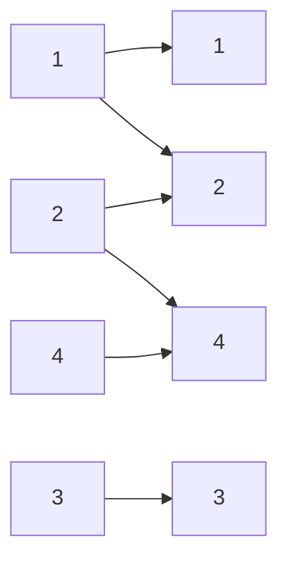
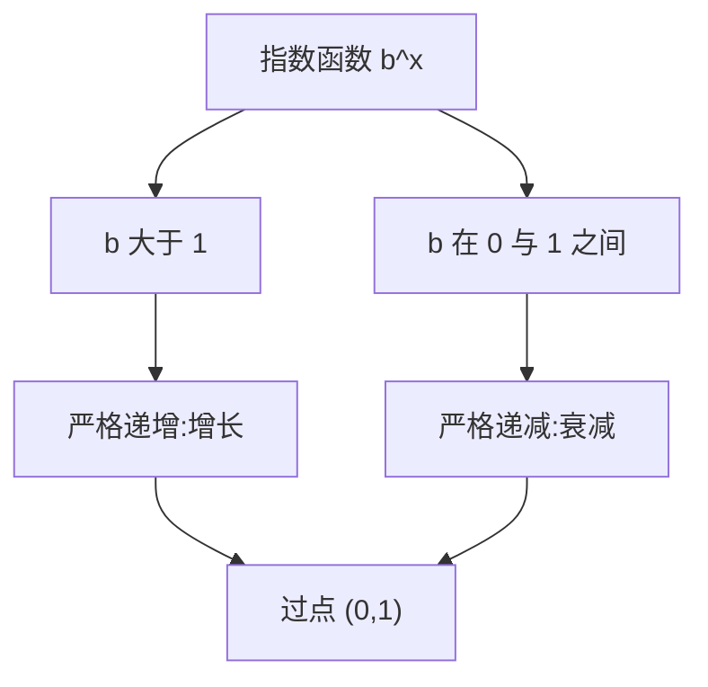
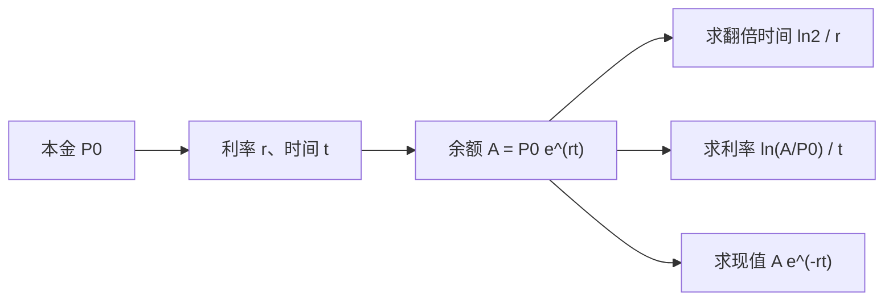

# Concept-Book Run

domain: /home/papagame/projects/digital-duck/cb-calculus/public/domains/calculus_ch01/input/graph.yaml
target: compound_interest_application
started: 2026-11-25T04:01:08

## Teaching order (6 concepts)

- relation
- function
- exponential_function
- number_e
- natural_exponential_function
- compound_interest_application

### relation (0.7s)

## 关系

**定义。** 设 $A$、$B$ 是两个集合。从 $A$ 到 $B$ 的**关系** $R$ 是笛卡尔积 $A\times B$ 的任意子集：

$$R\subseteq A\times B=\{(x,y)\mid x\in A,\ y\in B\}.$$

若 $(x,y)\in R$，记作 $xRy$，读作"$x$ 与 $y$ 有关系 $R$"。$A$ 称为**定义域所在集合**，$B$ 称为**陪域**。实际取到的第一分量集合 $\operatorname{dom}R=\{x\mid \exists y,\ (x,y)\in R\}$ 称为**定义域**，实际取到的第二分量集合 $\operatorname{ran}R=\{y\mid \exists x,\ (x,y)\in R\}$ 称为**值域**。若 $A=B$，称 $R$ 为 $A$ 上的关系。

注意：关系对"配对方式"没有任何限制。一个 $x$ 可以对应多个 $y$，也可以不对应任何 $y$。当每个 $x\in A$ 恰好对应一个 $y$ 时，关系才成为**函数**，所以函数是一种特殊的关系。

**例题。** 设 $A=\{1,2,3,4\}$，定义 $A$ 上的关系 $R=\{(x,y)\mid x\text{ 整除 }y\}$。

列出所有满足条件的有序对：

$$R=\{(1,1),(1,2),(1,3),(1,4),(2,2),(2,4),(3,3),(4,4)\}.$$

共 $8$ 个有序对，而 $|A\times A|=16$，所以 $R$ 是 $A\times A$ 的真子集。

读出性质：
- $\operatorname{dom}R=\{1,2,3,4\}$，$\operatorname{ran}R=\{1,2,3,4\}$。
- $1$ 对应 4 个 $y$，所以 $R$ **不是**函数。
- 对每个 $x$ 都有 $(x,x)\in R$（自反性）；$(1,2)\in R$ 但 $(2,1)\notin R$（非对称）。

**问题求解应用。** 

*问题：* 某课程中，$A=\{\text{小明},\text{小红},\text{小刚}\}$ 为学生集合，$B=\{\text{数学},\text{物理},\text{化学}\}$ 为课程集合。已知选课关系为
$$R=\{(\text{小明},\text{数学}),(\text{小明},\text{物理}),(\text{小红},\text{物理}),(\text{小刚},\text{化学})\}.$$
问：(1) 选修物理的学生有哪些？(2) $R$ 是否为从 $A$ 到 $B$ 的函数？(3) 若要使 $R$ 成为函数，最少需要删除几个有序对？

*解：*
1. 找出第二分量为"物理"的有序对：$(\text{小明},\text{物理})$ 与 $(\text{小红},\text{物理})$，所以是小明和小红。
2. 小明出现在两个有序对中，对应两门课，违反"每个 $x$ 恰好一个 $y$"，所以 $R$ 不是函数。
3. 其余学生都只对应一门课，只有小明重复。删除 $(\text{小明},\text{数学})$ 或 $(\text{小明},\text{物理})$ 中的任意一个即可，最少删除 $1$ 个。

**小结。** 判断一个集合是不是关系，只需检查它的元素是否都是 $A\times B$ 中的有序对。要判断它是否为函数，再检查每个 $x$ 是否恰有一个 $y$。把关系写成有序对列表，是后续研究自反、对称、传递等性质的起点。

*图示：集合 $\{1,2,3,4\}$ 上"整除"关系的部分箭头图（左列为 $x$，右列为 $y$），一个 $x$ 可指向多个 $y$。*

### function (0.8s)

## 函数

**定义。** 函数是一种规则:它把输入集合(**定义域**)中的每一个元素,恰好对应到输出集合中的一个元素。若输出集合记为 $Y$,实际取到的所有输出值构成**值域**。记作

$$f: X \to Y,\qquad x \mapsto f(x).$$

关键在于“恰好一个”:同一个输入不能同时得到两个不同的输出,但不同的输入可以得到相同的输出。

**判断是否为函数。** 
- 学号 $\to$ 学生姓名:每个学号对应唯一学生,是函数。 
- 关系 $x = y^2$(把 $x$ 看作输入):当 $x=4$ 时,$y=2$ 或 $y=-2$,输出不唯一,所以不是函数。 
- 竖直线检验:任意竖直线与图像至多相交一点,则该图像表示函数。

**例题。** 设 $f(x)=\dfrac{\sqrt{x-1}}{x-3}$,求定义域,并计算 $f(5)$。

*解:* 根号要求 $x-1\ge 0$,即 $x\ge 1$;分母要求 $x\ne 3$。因此定义域为

$$\{x\in\mathbb{R}\mid x\ge 1,\ x\ne 3\}=[1,3)\cup(3,+\infty).$$

代入 $x=5$:

$$f(5)=\frac{\sqrt{4}}{2}=1.$$

**问题求解应用。** 一家出租车公司起步价 8 元(含 3 公里),超出部分每公里 2 元。设行驶距离为 $d$ 公里,车费为 $C(d)$。

1. 写出规则(分段函数):

$$C(d)=\begin{cases}8, & 0<d\le 3,\\[2pt] 8+2(d-3), & d>3.\end{cases}$$

2. 每个距离 $d$ 只对应一个车费,所以 $C$ 是函数,定义域为 $(0,+\infty)$,值域为 $[8,+\infty)$。
3. 计算 $C(10)=8+2\times 7=22$ 元。
4. 反向提问:车费为 20 元时行驶了多远?解 $8+2(d-3)=20$,得 $d=9$ 公里。因为在 $d>3$ 的部分,不同距离对应不同车费,这样的反问才有唯一答案;但 $C(1)=C(2)=8$,所以“车费 8 元”无法确定具体距离。这说明:**函数保证由输入得到唯一输出,却不保证由输出能唯一还原输入**(后者需要函数是一一对应的,即可逆)。

**解题要点。** 面对一个函数问题,依次问三件事:(1)定义域是什么(分母不为零、偶次根号下非负、对数真数为正);(2)规则是否对每个输入给出唯一输出;(3)值域是什么、能否反推输入。

*图:函数把定义域中的每个输入经过规则 $f$ 变为唯一的输出,所有输出构成值域。*

### exponential_function (1.0s)

## 指数函数

**定义。** 形如
$$f(x)=b^{x},\qquad b>0,\ b\neq 1$$
的函数称为**指数函数**,其中底数 $b$ 是常数,自变量 $x$ 位于指数位置。这与幂函数 $x^{2}$ 不同:幂函数是底数变化、指数固定;指数函数则是底数固定、指数变化。

要求 $b>0$ 是为了使 $b^x$ 对所有实数 $x$ 都有定义(例如 $(-2)^{1/2}$ 不是实数);要求 $b\neq 1$ 是因为 $1^x=1$ 只是常数函数,不具备指数增长的特征。

**基本性质。**

- 定义域为 $\mathbb{R}$,值域为 $(0,\infty)$,图像恒过点 $(0,1)$,且以 $x$ 轴为水平渐近线。
- 当 $b>1$ 时函数严格递增(增长);当 $0<b<1$ 时严格递减(衰减)。
- 指数律:$b^{x+y}=b^x b^y$,$\ b^{-x}=\dfrac{1}{b^x}$,$\ (b^x)^y=b^{xy}$。

*图:底数 $b$ 的取值决定指数函数是增长还是衰减,但两种情形的图像都经过点 $(0,1)$。*

**例题 1(求值与比较)。** 设 $f(x)=2^x$。则 $f(3)=8$,$f(-2)=\tfrac14$,$f(0)=1$。再看增长速度:$x$ 每增加 1,函数值乘以 2,即
$$\frac{f(x+1)}{f(x)}=\frac{2^{x+1}}{2^x}=2.$$
这说明指数函数的本质特征是:**自变量每增加固定的量,函数值乘以固定的倍数**。

**例题 2(复利问题)。** 本金 $10\,000$ 元,年利率 $5\%$,按年复利。$t$ 年后的本金与利息之和为
$$A(t)=10000\cdot 1.05^{\,t}.$$
问:多少年后资金翻倍?令 $1.05^{t}=2$,两边取对数:
$$t=\frac{\ln 2}{\ln 1.05}\approx\frac{0.6931}{0.04879}\approx 14.2\ \text{年}.$$

**例题 3(衰减问题)。** 某放射性样品半衰期为 $5$ 天,初始质量 $80$ g,则
$$m(t)=80\cdot\left(\tfrac12\right)^{t/5}.$$
此时 $b=\tfrac12<1$,为衰减型。$15$ 天后 $m(15)=80\cdot\left(\tfrac12\right)^{3}=10$ g。

**解题要点。**

1. 识别模型 $y=a\cdot b^{t/k}$:$a$ 为初始值,$b$ 为每个周期 $k$ 的变化倍数。
2. 已知结果求时间(指数在未知数位置)时,两边取对数,利用 $\ln(b^x)=x\ln b$ 把指数"拉下来"。
3. 判断 $b>1$ 还是 $b<1$,即可预判增长或衰减,用以检验答案是否合理。

在实际建模中,常取 $b=e\approx 2.718$,写作 $f(x)=e^x$,称为**自然指数函数**,它在微积分中具有 $\dfrac{d}{dx}e^x=e^x$ 的独特性质。

### number_e (0.7s)

## 自然常数 e

### 定义

自然常数 $e$ 是下列极限所定义的实数:

$$e=\lim_{m\to\infty}\left(1+\frac1m\right)^m\approx 2.718282.$$

它是自然指数函数 $e^x$ 的底数。该函数有一个独特的性质:$\dfrac{d}{dx}e^x=e^x$,即函数在每一点的变化率等于它自身的值。此外,$e$ 还可以用级数表示:

$$e=\sum_{n=0}^{\infty}\frac1{n!}=1+1+\frac12+\frac16+\frac1{24}+\cdots$$

### 为什么极限存在:连续复利

设本金 1 元,年利率 100%,一年内把利息分成 $m$ 期复利,则年末本息和为 $\left(1+\frac1m\right)^m$。

| $m$ | $\left(1+\frac1m\right)^m$ |
|---|---|
| 1 | 2.000000 |
| 2 | 2.250000 |
| 12 | 2.613035 |
| 365 | 2.714567 |
| 10000 | 2.718146 |

数列单调递增且有上界(由二项式展开可得,它不超过 $\sum 1/n!<3$),因此由单调有界定理,极限存在。复利次数越多,收益增长越慢,最终趋向于 $e$,而不会无限增大。

### 例题

**例 1** 用级数估算 $e$,要求误差小于 $10^{-4}$。

取前 8 项($n=0$ 到 $7$):

$$1+1+0.5+0.166667+0.041667+0.008333+0.001389+0.000198=2.718254.$$

余项满足 $\sum_{n\ge 8}\frac1{n!}<\frac{1}{8!}\cdot\frac{1}{1-1/9}\approx 0.0000279<10^{-4}$,因此 $e\approx 2.7183$ 符合要求。

### 问题求解应用

**例 2** 某账户本金 $P=5000$ 元,年利率 $r=6\%$,连续复利,问 10 年后的金额。

由 $\left(1+\frac{r}{m}\right)^{mt}\to e^{rt}$(令 $m\to\infty$),得

$$A=Pe^{rt}=5000\,e^{0.6}\approx 5000\times1.8221=9110.6\ \text{元}.$$

**例 3** 放射性衰变与增长模型。若某量满足 $\dfrac{dN}{dt}=kN$,则 $N(t)=N_0e^{kt}$。设某同位素半衰期为 5 年,求 $k$:

$$\tfrac12=e^{5k}\ \Rightarrow\ k=\frac{\ln(1/2)}{5}\approx-0.1386\ \text{年}^{-1}.$$

### 小结

- $e=\lim_{m\to\infty}(1+1/m)^m=\sum_{n\ge0}1/n!$。
- $e^x$ 是唯一满足 $f'=f$ 且 $f(0)=1$ 的函数。
- 连续增长或衰减的问题,通常都可写成 $N_0e^{kt}$ 的形式,再用 $\ln$ 求解参数。

### natural_exponential_function (0.6s)

## 自然指数函数

**定义。** 自然指数函数是 $f(x)=e^x$,其中 $e\approx 2.71828$ 是一个特殊的底数,由下面的性质唯一确定:曲线 $y=e^x$ 在 $x=0$ 处的切线斜率恰好为 $1$,即

$$
f'(0)=\lim_{h\to 0}\frac{e^h-1}{h}=1.
$$

这一条件为何重要?对任意底数 $a>0$,利用 $a^{x+h}=a^x\cdot a^h$ 可得

$$
\frac{d}{dx}a^x=a^x\cdot\lim_{h\to 0}\frac{a^h-1}{h}=a^x\cdot f_a'(0).
$$

也就是说,指数函数的导数总是"自身乘以一个常数",该常数就是它在 $x=0$ 处的斜率。当底数取 $e$ 时,常数为 $1$,于是得到最简洁的结论:

$$
\boxed{\frac{d}{dx}e^x=e^x}
$$

它的反函数是自然对数 $\ln x$,二者满足 $e^{\ln x}=x\ (x>0)$ 与 $\ln(e^x)=x$。

**数值验证。** 取 $h=0.001$:$\dfrac{e^{0.001}-1}{0.001}\approx\dfrac{1.0010005-1}{0.001}=1.0005$,非常接近 $1$。作为对比,底数 $2$ 给出 $\dfrac{2^{0.001}-1}{0.001}\approx 0.693$,底数 $3$ 给出约 $1.099$,二者都不等于 $1$。底数 $e$ 恰好介于 $2$ 与 $3$ 之间。

**例题 1(切线)。** 求 $y=e^x$ 在 $x=2$ 处的切线方程。

解:$f(2)=e^2$,$f'(2)=e^2$。切线为
$$
y-e^2=e^2(x-2)\ \Longrightarrow\ y=e^2(x-1).
$$
该切线与 $x$ 轴交于 $x=1$。事实上,曲线上任意点 $(t,e^t)$ 处的切线都交 $x$ 轴于 $x=t-1$,即次切距恒为 $1$。

**例题 2(链式法则)。** 求 $g(x)=e^{-3x^2}$ 的导数。

解:令 $u=-3x^2$,则 $g'(x)=e^{u}\cdot u'=-6x\,e^{-3x^2}$。令 $g'(x)=0$ 得 $x=0$,又 $g'$ 在 $x<0$ 时为正、在 $x>0$ 时为负,故 $x=0$ 为最大值点,最大值 $g(0)=1$。这正是钟形(高斯)曲线的形状。

**问题求解应用(增长模型)。** 若某量的变化率与自身成正比,$\dfrac{dy}{dt}=ky$,则 $y=y_0e^{kt}$。验证:$\dfrac{d}{dt}(y_0e^{kt})=k\,y_0e^{kt}=ky$。

例如,某细菌培养物初始为 $500$ 个,$2$ 小时后增至 $800$ 个,问 $5$ 小时后约有多少个?

由 $800=500e^{2k}$ 得 $k=\tfrac12\ln1.6\approx0.235$。于是
$$
y(5)=500e^{5k}=500\cdot1.6^{2.5}\approx 500\times3.238\approx1619.
$$

**小结。** $e^x$ 是唯一在每一点处"斜率等于函数值"且过 $(0,1)$ 的函数,因此它是描述连续增长、衰减与微分方程 $y'=ky$ 的天然语言。

### compound_interest_application (0.6s)

## 复利应用

### 定义

设本金为 $P_0$,年利率为 $r$(小数形式)。若利息**连续复利**,即把一年分成 $n$ 期并令 $n\to\infty$,则

$$
\lim_{n\to\infty}P_0\left(1+\frac{r}{n}\right)^{nt}=P_0\,e^{rt}.
$$

其中 $t$ 为时间(年),账户余额为 $A(t)=P_0e^{rt}$。该函数满足微分方程

$$
\frac{dA}{dt}=rA,\qquad A(0)=P_0,
$$

即余额的瞬时增长率与当前余额成正比。这正是自然指数函数的本质特征:$\dfrac{d}{dt}e^{rt}=re^{rt}$。

与离散复利相比,连续复利是 $n$ 取极限的情形。例如 $r=0.05$ 时,年复利的实际年收益率为 $5\%$,而连续复利为 $e^{0.05}-1\approx5.127\%$。

### 例题

存入 $P_0=5000$ 元,年利率 $6\%$,连续复利。求 8 年后的余额。

$$
A(8)=5000\,e^{0.06\times 8}=5000\,e^{0.48}\approx5000\times1.6161\approx8080.6\ \text{元}.
$$

作为对比,按年复利:$5000(1.06)^8\approx7969.2$ 元。连续复利多出约 $111$ 元,差距来自"利滚利"的频率提高。

### 问题求解应用

**问题 1(求翻倍时间)。** 令 $A(t)=2P_0$:

$$
P_0e^{rt}=2P_0\;\Rightarrow\;e^{rt}=2\;\Rightarrow\;t=\frac{\ln 2}{r}\approx\frac{0.693}{r}.
$$

当 $r=6\%$ 时,$t\approx11.55$ 年。这就是"70 法则"(翻倍年数 $\approx 70/$ 利率百分数)的来源。注意结果与本金 $P_0$ 无关。

**问题 2(求所需利率)。** 想在 10 年内把 $20000$ 元变为 $30000$ 元,求 $r$:

$$
30000=20000\,e^{10r}\;\Rightarrow\;r=\frac{1}{10}\ln\frac{3}{2}\approx0.0405,
$$

即约 $4.05\%$。

**问题 3(现值)。** 要在 5 年后得到 $10000$ 元,年利率 $4\%$,今天需存入多少?

$$
P_0=10000\,e^{-0.04\times5}=10000\,e^{-0.2}\approx8187.3\ \text{元}.
$$

**解题要点:**

1. 未知量在指数上时,两边取自然对数:$\ln(e^{x})=x$。
2. 先写出 $A=P_0e^{rt}$,代入已知量,再求未知量。
3. 利率 $r$ 必须化为小数,时间 $t$ 的单位须与 $r$ 的周期一致(年利率配以年)。
4. 用 $e^{r}-1$ 把连续复利换算成等效的年实际收益率,便于与其他产品比较。

*图:由同一个连续复利公式出发,可以求解翻倍时间、所需利率与现值三类问题。*

## Run complete

total: 10.1s
