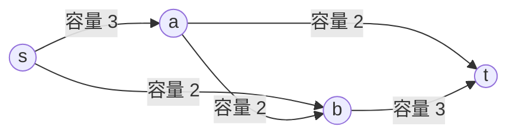
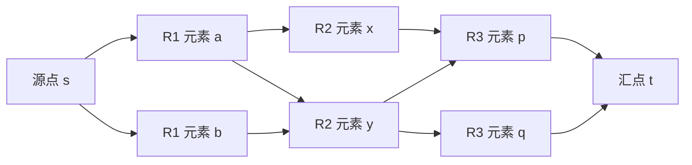

# Concept-Book Run

domain: /home/papagame/projects/digital-duck/cb-algorithms/public/domains/algorithms_ch12/input/graph.yaml
target: exam_scheduling
started: 2026-11-25T04:18:58

## Teaching order (3 concepts)

- maximum_flow
- tuple_selection
- exam_scheduling

### maximum_flow (0.6s)

## 最大流

**定义。** 设有向图 $G=(V,E)$ 中,每条边 $(u,v)$ 有容量 $c(u,v)\ge 0$,并指定源点 $s$ 与汇点 $t$。**流** $f$ 是满足下列两条约束的函数:

- 容量约束:$0\le f(u,v)\le c(u,v)$;
- 流量守恒:对每个 $v\notin\{s,t\}$,有 $\sum_{u} f(u,v)=\sum_{w} f(v,w)$。

流的**值**为 $|f|=\sum_{v} f(s,v)-\sum_{v} f(v,s)$。**最大流**就是使 $|f|$ 最大的流。

**割与最大流最小割定理。** 一个 $s$–$t$ 割 $(S,T)$ 把顶点分成 $s\in S$、$t\in T$ 两部分,其容量为 $c(S,T)=\sum_{u\in S,\,v\in T}c(u,v)$。任何流的值都不超过任何割的容量,因此 $|f|\le c(S,T)$。更强的结论是:

$$\max_f |f| = \min_{(S,T)} c(S,T).$$

**增广路算法(Ford–Fulkerson)。** 给定当前流 $f$,定义**残量网络** $G_f$,边 $(u,v)$ 的残量容量为 $c(u,v)-f(u,v)$,并添加反向边,其容量为 $f(u,v)$。只要 $G_f$ 中存在 $s\to t$ 的路径(**增广路**),就沿该路径推送其瓶颈容量。若路径选取为最短路(Edmonds–Karp),则复杂度为 $O(VE^2)$。更先进的算法,如 Orlin 算法,可达到 $O(VE)$。

### 流程示意

*一个五节点网络:图中的边标注了容量,最大流为 5。*

**例题。** 对上图求最大流。

1. 沿 $s\to a\to t$ 推送 $2$ 单位(瓶颈为 $a\to t$ 的容量 $2$)。
2. 沿 $s\to b\to t$ 推送 $2$ 单位(瓶颈为 $s\to b$ 的容量 $2$)。
3. 沿 $s\to a\to b\to t$ 推送 $1$ 单位。此时 $s\to a$ 剩余 $3-2=1$,$a\to b$ 剩余 $2$,$b\to t$ 剩余 $3-2=1$,瓶颈为 $1$。
4. 此后 $s$ 的出边中 $s\to a$ 已用完($2+1=3$),$s\to b$ 也已用完($2$),残量网络中再无增广路。

总流值为 $2+2+1=5$。**验证:** 取割 $S=\{s\}$,$T=\{a,b,t\}$,其容量为 $3+2=5$。流值等于割容量,所以由最大流最小割定理可知,$5$ 即为最大流。

**问题求解应用。** 许多看似无关的问题都能归约为最大流:

- **二分图最大匹配**:加入源点连向左侧所有顶点、右侧所有顶点连向汇点,所有边容量取 $1$,最大流的值即最大匹配数。
- **边不相交路径**:令每条边容量为 $1$,最大流的值等于 $s$ 到 $t$ 的最大边不相交路径数(Menger 定理)。
- **网络瓶颈识别**:算法终止后,从 $s$ 在残量网络中可达的顶点集合即为 $S$,所对应的最小割给出了系统中最脆弱的一组边。

解题要点是:先确定"什么是容量、什么要守恒",再建图,最后用割来验证答案。

### tuple_selection (0.9s)

## 元组选择(Tuple Selection)

**定义。** 给定 $d$ 个有序资源集合 $R_1, R_2, \dots, R_d$,一个 **$d$-元组** 是 $(r_1, r_2, \dots, r_d)$,其中 $r_i \in R_i$。**元组选择问题**要求:在满足下列约束的前提下,选出尽可能多的元组。

- **单元素容量**:每个元素 $v$ 至多被用于 $c(v)$ 个所选元组;
- **相邻对容量**:对相邻集合 $R_i$ 与 $R_{i+1}$,每一对 $(u,v)$ 至多被用于 $c(u,v)$ 个所选元组。

由于约束只作用于单个元素和相邻对,问题具有"链式"结构,可以归约为**最大流**。

**归约构造。** 将每个元素 $v$ 拆成入点 $v^{in}$ 与出点 $v^{out}$,连边 $v^{in}\to v^{out}$,容量为 $c(v)$。对相邻层的每一对 $(u,v)$,连边 $u^{out}\to v^{in}$,容量为 $c(u,v)$。再加源点 $s$ 连向 $R_1$ 的所有入点,$R_d$ 的所有出点连向汇点 $t$,容量均为无穷大(或对应元素容量)。一个 $d$-元组就对应一条 $s\to t$ 的路径,**最大流的值等于最多可选的元组数**。

*三层资源($d=3$)归约后的流网络:每条 $s\to t$ 路径对应一个 3-元组;每个元素节点内部还有容量为 $c(v)$ 的拆点边(图中省略)。*

**例题。** 设 $d=2$,$R_1=\{a,b\}$,$R_2=\{x,y\}$。元素容量:$c(a)=2,\ c(b)=1,\ c(x)=1,\ c(y)=2$。相邻对容量:$c(a,x)=1,\ c(a,y)=1,\ c(b,y)=1$,$c(b,x)=0$。求最多能选几个二元组?

建网络后寻找增广路径:

1. $s\to a\to x\to t$,流量 1(用尽 $x$ 的容量);
2. $s\to a\to y\to t$,流量 1(用尽 $a$ 的容量 2 与 $(a,y)$);
3. $s\to b\to y\to t$,流量 1(用尽 $b$ 的容量 1,此时 $y$ 已用 2)。

此时 $s$ 出发已无增广路,最大流为 $3$。可由割验证:割 $\{c(x)+c(y)\}=1+2=3$,与流值相等,故最优解为 $3$ 个元组:$(a,x),(a,y),(b,y)$。

**问题求解应用。** 解题步骤可概括为:

1. **建模**:识别各层集合与两类容量;
2. **拆点**:用 $v^{in}\to v^{out}$ 表示元素容量;
3. **求流**:用 Dinic 或 Edmonds–Karp 求最大流;
4. **还原**:沿流分解出的每条路径读出一个元组。

**复杂度。** 网络有 $O(\sum_i |R_i|)$ 个节点、$O(\sum_i |R_i||R_{i+1}|)$ 条边。用 Dinic 算法时,总时间为多项式级别,远优于枚举全部 $\prod_i |R_i|$ 个候选元组。

**注意。** 该归约依赖"约束只涉及相邻层"这一前提。若约束涉及非相邻层的组合(例如 $R_1$ 与 $R_3$ 的配对容量),流模型不再适用,问题通常会变成 NP 难。判断一个问题能否用此方法,关键就是检查约束是否具有链式结构。

### exam_scheduling (0.7s)

## 考试安排

### 定义

**考试安排**问题要求为每场期末考试同时分配四种资源:班级(课程)、教室、时间段和监考老师。这是一个**元组选择**问题:我们要从所有可能的组合中选出一组互不冲突的四元组 $(c, r, t, p)$,使尽可能多的考试得到安排。

约束条件是:每个班级只考一次;同一时间段内,一间教室只能容纳一场考试,一位监考老师也只能监考一场。

### 建模为最大流

四类资源按"层"串联成一个网络:

$$
s \to \text{班级} \to \text{教室} \to \text{时间段} \to \text{监考老师} \to t
$$

- 每条边的容量为 $1$ 表示"可用"(不可用则不连边)。
- 为保证每个资源最多使用一次,把每个中间节点拆成入点和出点,中间连一条容量为 $1$ 的边。
- 从 $s$ 到 $t$ 的一条流量为 $1$ 的路径,对应一个合法的四元组。

**整数流定理**保证:当所有容量都是整数时,存在整数最大流。因此最大流值 $|f|$ 恰好等于能安排的考试场数,每条增广路径读出一个四元组。

> 注意:严格来说,四层以上的"多维匹配"一般是 NP 难的。上述链式网络只刻画相邻两层之间的相容性,所以只有当"可行性只依赖相邻资源"时,它才给出精确解。否则,它给出的是一个松弛的上界。

### 例题

有两个班级 $C_1, C_2$,一间教室 $R$,两个时间段 $T_1, T_2$,两位监考老师 $P_1, P_2$。

可用关系如下:
- $C_1, C_2$ 都可使用 $R$;
- $R$ 在 $T_1, T_2$ 都可用;
- $P_1$ 只能在 $T_1$ 监考,$P_2$ 只能在 $T_2$ 监考。

教室 $R$ 的容量为 $1$,而两场考试都要经过它,于是最大流不超过 $1$。但这里的教室应当按"教室–时间段"配对拆分:把 $(R,T_1)$ 与 $(R,T_2)$ 当作两个独立节点,各自容量为 $1$。这样流量路径为:

$$
s \to C_1 \to (R,T_1) \to P_1 \to t,\qquad s \to C_2 \to (R,T_2) \to P_2 \to t
$$

最大流 $|f| = 2$,两场考试都被安排:$C_1$ 在 $T_1$、$C_2$ 在 $T_2$,都在教室 $R$。

### 问题求解应用

**求解步骤:**

1. 列出四类资源,以及相邻两类之间的相容关系。
2. 把"同一时刻只能用一次"的资源(教室、监考老师)建成"资源–时间段"复合节点,容量为 $1$。
3. 用 Ford–Fulkerson 或 Dinic 算法求最大流。
4. 沿每条增广路径读出一个四元组 $(c, r, t, p)$。
5. 若 $|f| <$ 班级总数,则用**最小割**找出瓶颈:割中饱和的边,就是最缺的资源。

**检验自己:** 若有 $5$ 个班级、$2$ 间教室、$3$ 个时间段,教室–时间段共 $6$ 个槽位,但只有 $4$ 位监考老师各在所有时间段可用,最大流是多少?(答案:$\min(5, 6, 4)=4$,瓶颈在监考老师。)

这样,一个看似复杂的排课问题,就转化为经典的流量计算,并附带了"缺什么资源"的诊断信息。

## Run complete

total: 7.7s
