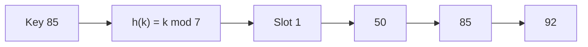
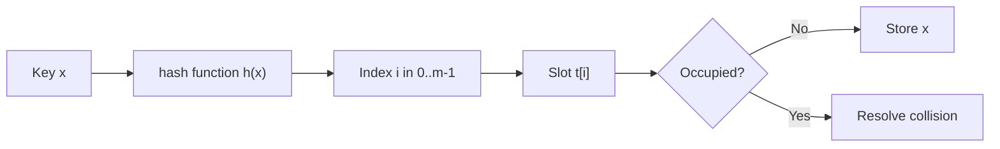
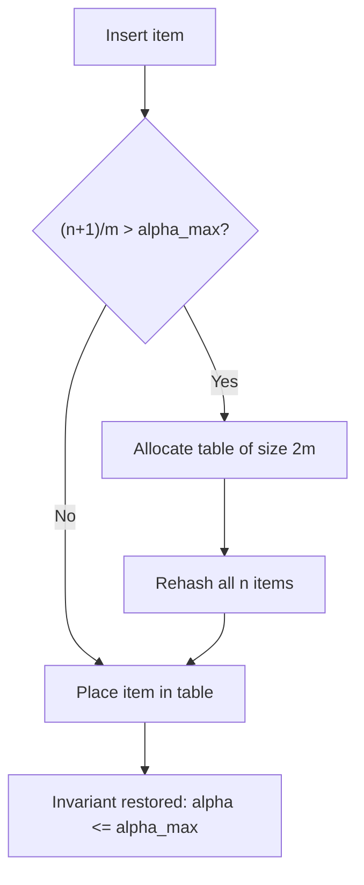
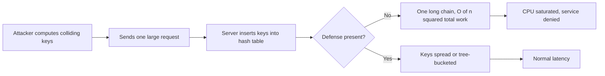

# Concept-Book Run

domain: /home/papagame/projects/digital-duck/cb-data-structure/public/domains/data_structure_ch05/input/graph.yaml
target: hash_collision_dos
started: 2026-11-25T04:34:38

## Teaching order (5 concepts)

- hash_table
- hash_function
- load_factor_invariant
- chained_hash_table
- hash_collision_dos

### hash_table (0.6s)

## Hash Table

### Definition

A **hash table** stores a small number $n$ of items drawn from a huge key universe $U$ (with $|U| \gg n$) using an array of $m$ slots, where $m$ is comparable to $n$. A **hash function** $h : U \to \{0, 1, \dots, m-1\}$ maps each key $k$ to a slot index, so the item is stored at position $h(k)$. Lookup, insertion, and deletion all begin by computing $h(k)$ rather than searching.

Because $|U| > m$, the pigeonhole principle guarantees that distinct keys sometimes share a slot. This is a **collision**. In **chaining**, each slot holds a linked list of all keys that hash there. The **load factor** is

$$\alpha = \frac{n}{m}.$$

### Worked example

Let $m = 7$ and $h(k) = k \bmod 7$. Insert the keys $50, 700, 76, 85, 92, 73$.

| Key | $h(k)$ |
|-----|--------|
| 50 | 1 |
| 700 | 0 |
| 76 | 6 |
| 85 | 1 |
| 92 | 1 |
| 73 | 3 |

Slot 1 now holds the chain $50 \to 85 \to 92$, and slots 0, 3, 6 each hold one key. To find $85$, compute $h(85) = 1$, then scan that chain. This takes 2 comparisons, not a scan of all 6 keys.

### Problem-solving application

**Cost analysis.** Assume *simple uniform hashing*: each key is equally likely to land in any slot, independently of the others. A chain then has expected length $\alpha = n/m$. An unsuccessful search computes $h(k)$ and scans a whole chain, so its expected cost is

$$\Theta(1 + \alpha).$$

A successful search has the same asymptotic cost. If we choose $m = \Theta(n)$, then $\alpha = O(1)$ and every operation takes expected $O(1)$ time. Compare this with $O(n)$ for an unsorted list or $O(\log n)$ for a balanced search tree.

**Design problem.** You must store $n = 2000$ student IDs and want an expected unsuccessful-search cost of at most about $3$ comparisons-worth of chain scanning ($\alpha \le 2$). Then

$$m \ge \frac{n}{\alpha} = \frac{2000}{2} = 1000.$$

A prime near this size, such as $m = 1009$, is a good choice. With $h(k) = k \bmod m$, a prime modulus helps spread keys that share common factors, for example IDs that are all multiples of 10.

**Caution.** The $O(1)$ bound depends on $h$ spreading keys evenly. A fixed $h$ can be defeated by an adversary who picks keys that all collide, which forces $\Theta(n)$ time. Practical systems therefore use a randomly chosen hash function from a *universal family*. For such a family, any two distinct keys collide with probability at most $1/m$, which recovers the expected $O(1 + \alpha)$ guarantee for every input set.

**Resizing.** When $\alpha$ exceeds a threshold, allocate a table with about twice as many slots and rehash every key. A single resize costs $O(n)$. Doubling makes the amortized cost per insertion $O(1)$.


*Key 85 hashes to slot 1, where a chain of three colliding keys is scanned until 85 is found.*

### hash_function (0.8s)

## Hash Function

### Definition

A **hash table** stores keys in an array $t$ of length $m = \text{length}(t)$. A **hash function** is a map

$$h : U \to \{0, 1, \dots, m-1\}$$

from the universe of possible keys $U$ to array indices. The key $x$ is stored in slot $t[h(x)]$, so both insertion and lookup start by computing $h(x)$. This takes $O(1)$ time, assuming $h$ itself is cheap to compute.

A good hash function has three properties:

1. **Deterministic:** the same $x$ always gives the same $h(x)$.
2. **Fast:** computing $h(x)$ takes time independent of the table size.
3. **Uniform:** keys spread evenly, so that $\Pr[h(x) = i] \approx 1/m$ for each slot $i$.

Since $|U| > m$ in nearly every application, the pigeonhole principle guarantees that distinct keys sometimes share a slot. This is a **collision**. A hash function cannot prevent collisions. Its job is to make them rare and evenly distributed.

### Worked example: the division method

For an integer key $k$, the division method is

$$h(k) = k \bmod m.$$

Let $m = 7$ and insert the keys $50, 700, 76, 85, 92$:

| $k$ | $k \bmod 7$ | slot |
|-----|-------------|------|
| 50 | $50 - 49 = 1$ | 1 |
| 700 | $700 - 700 = 0$ | 0 |
| 76 | $76 - 70 = 6$ | 6 |
| 85 | $85 - 84 = 1$ | 1 (collides with 50) |
| 92 | $92 - 91 = 1$ | 1 (collides again) |

Three of the five keys land in slot 1. The cause is partly bad luck and partly structure in the data. Choosing $m$ well helps. A prime $m$ not close to a power of 2 is the standard advice. If $m = 2^p$, then $k \bmod m$ keeps only the low $p$ bits of $k$ and ignores all the others.

For string keys, first convert the string to an integer. A common polynomial scheme is

$$h(s) = \left(\sum_{i=0}^{n-1} s_i \, b^{\,n-1-i}\right) \bmod m,$$

where $s_i$ is the character code of the $i$-th character and $b$ is a base such as 31.

### Problem-solving application

**Problem.** A table with $m = 11$ slots holds $n = 22$ keys. Estimate the expected cost of an unsuccessful search when collisions are resolved by chaining (one linked list per slot).

**Solution.** Assume *simple uniform hashing*: each key is equally likely to land in any slot, independently of the others. The **load factor** is

$$\alpha = \frac{n}{m} = \frac{22}{11} = 2.$$

Each list then has expected length $\alpha = 2$. An unsuccessful search computes $h(x)$ and scans the whole list, so its expected cost is

$$\Theta(1 + \alpha) = \Theta(3) \text{ steps}.$$

If $n = O(m)$, then $\alpha = O(1)$ and every operation takes expected $O(1)$ time.

**Why uniformity matters.** Suppose we hash 22 keys that are all multiples of 11 using $h(k) = k \bmod 11$. Every key maps to slot 0. One list then holds all 22 keys, and search degrades to $\Theta(n)$. The fix is to choose a $m$ and $h$ that do not share structure with the data. For example, use $m = 13$, which is prime and does not divide the key pattern.


*A key is passed through $h$ to get a slot index. If the slot is already occupied, a collision-resolution strategy takes over.*

### load_factor_invariant (0.6s)

## Load Factor Invariant

**Definition.** A hash table with $m$ slots storing $n$ items has *load factor*

$$\alpha = \frac{n}{m}.$$

The **load factor invariant** is the rule that an implementation enforces after every insertion: $\alpha \le \alpha_{\max}$ for a fixed threshold (for example, $0.75$ in many libraries). When an insertion would break the rule, the table *resizes*: it allocates a larger array, usually $m' = 2m$, and rehashes every item into it.

The invariant matters because expected cost depends on $\alpha$, not on $n$ alone. Under simple uniform hashing:

- **Chaining:** an unsuccessful search examines $\alpha$ items on average, so it costs $\Theta(1+\alpha)$.
- **Open addressing (linear probing):** an unsuccessful search needs about $\tfrac12\left(1+\frac{1}{(1-\alpha)^2}\right)$ probes. This grows without bound as $\alpha \to 1$, and $\alpha \le 1$ is required, since $n \le m$.

If $\alpha$ is bounded by a constant, every operation is expected $O(1)$.

**Worked example.** Take $m = 8$ and $\alpha_{\max}=0.75$. The table can hold $0.75\cdot 8 = 6$ items. Inserting a 7th item would give $\alpha = 7/8 = 0.875 > 0.75$, so the table first resizes to $m' = 16$ and rehashes the 6 existing items. After inserting the 7th, $\alpha = 7/16 \approx 0.44$, and the invariant holds again.

For open addressing at $\alpha = 0.75$, the expected unsuccessful probe count is
$$\tfrac12\left(1+\frac{1}{0.25^2}\right)=\tfrac12(1+16)=8.5.$$
At $\alpha=0.5$ it is $\tfrac12(1+4)=2.5$. Halving the load cuts the probe count by more than a factor of three.

**Problem-solving application.** *Why doesn't resizing make insertion $O(n)$?* A resize costs $O(n)$, but with doubling it happens rarely. Start with a table of size $m_0$. Resizes occur when $n$ reaches $\alpha_{\max}m_0,\ \alpha_{\max}\cdot 2m_0,\ \alpha_{\max}\cdot 4m_0,\dots$, and each rehashes that many items. For $N$ total insertions, the total rehash work is a geometric sum:

$$\sum_{k=0}^{\log_2(N/m_0)} \alpha_{\max}\,2^k m_0 \;<\; 2N.$$

So $N$ insertions cost $O(N)$ in total, which is $O(1)$ **amortized** per insertion.

*Choosing a threshold.* Suppose you need an average of at most $3$ probes for unsuccessful searches in linear probing. Solve
$\tfrac12\left(1+\frac{1}{(1-\alpha)^2}\right)\le 3$, which gives $(1-\alpha)^2 \ge \tfrac15$ and so $\alpha \le 1-\tfrac{1}{\sqrt5}\approx 0.55$. The invariant must be set at about $0.55$ or lower.

*What goes wrong without the invariant?* If $m$ stays fixed while $n$ grows, $\alpha = n/m$ grows linearly. Chaining degrades to $\Theta(n)$ per operation, and open addressing fails outright once $n = m$.


*Each insertion checks whether it would break the load factor bound. If so, the table doubles and rehashes before placing the item.*

### chained_hash_table (0.7s)

## Chained Hash Table

A **chained hash table** stores data in an array of $m$ buckets, where each bucket holds a list. A hash function $h(k)$ maps a key $k$ to an index in $\{0, 1, \dots, m-1\}$. To insert a key, compute $h(k)$ and append the item to the list at that index. When two keys have the same hash value (a *collision*), they simply share a list. This is called *separate chaining*.

Three operations define the structure:

- **Insert** $(k, v)$: append to `table[h(k)]`, which costs $O(1)$.
- **Search** $k$: scan the list at `table[h(k)]`, which costs $O(\text{length of that list})$.
- **Delete** $k$: search, then remove the item from the list.

### Worked example

Let $m = 5$ and $h(k) = k \bmod 5$. Insert the keys $12, 22, 7, 15, 32$.

| Key | $h(k)$ |
|-----|--------|
| 12 | 2 |
| 22 | 2 |
| 7 | 2 |
| 15 | 0 |
| 32 | 2 |

The final table is:

- index 0: `[15]`
- index 1: `[]`
- index 2: `[12, 22, 7, 32]`
- index 3: `[]`
- index 4: `[]`

Searching for $32$ computes $h(32)=2$ and scans four items, so it takes four comparisons. This hash function is a poor fit for this key set, because most keys land in one bucket.

```python
class ChainedHashTable:
    def __init__(self, m=8):
        self.m = m
        self.table = [[] for _ in range(m)]

    def _h(self, key):
        return hash(key) % self.m

    def insert(self, key, value):
        bucket = self.table[self._h(key)]
        for i, (k, _) in enumerate(bucket):
            if k == key:               # update existing key
                bucket[i] = (key, value)
                return
        bucket.append((key, value))

    def search(self, key):
        for k, v in self.table[self._h(key)]:
            if k == key:
                return v
        return None

    def delete(self, key):
        bucket = self.table[self._h(key)]
        for i, (k, _) in enumerate(bucket):
            if k == key:
                del bucket[i]
                return True
        return False
```

### Performance analysis

Define the **load factor** $\alpha = n/m$, where $n$ is the number of stored items. Under the *simple uniform hashing assumption* (each key is equally likely to hash to any bucket, independently of the others), the expected length of any list is $\alpha$. Therefore:

- An unsuccessful search examines $\alpha$ items on average, so it costs $\Theta(1+\alpha)$.
- A successful search costs $\Theta(1+\alpha)$ as well. A typical derivation gives about $1 + \alpha/2 - \alpha/(2n)$ comparisons.

If the table is resized to keep $m = \Theta(n)$, then $\alpha = O(1)$ and all operations run in expected $O(1)$ time. Without that guarantee, the worst case is $\Theta(n)$, which happens when every key lands in one bucket, as in the example above.

### Problem-solving application

**Problem.** A table with $m = 100$ buckets holds $n = 450$ items. Estimate the average cost of an unsuccessful search, then choose a new size that brings $\alpha$ to at most $0.75$.

**Solution.** The load factor is $\alpha = 450/100 = 4.5$, so an unsuccessful search scans about $4.5$ items, plus $1$ for the hash computation. To get $\alpha \le 0.75$, we need $m \ge 450/0.75 = 600$. Resizing to $m = 600$ (or a convenient larger size, such as the next prime) requires **rehashing** every item, because $h(k) = \text{hash}(k) \bmod m$ changes with $m$. The rehash costs $O(n)$ once. If the size doubles whenever $\alpha$ exceeds a threshold, the amortized cost per insertion remains $O(1)$.

**Takeaway.** Chaining handles collisions gracefully, since the table never "fills up". Its speed depends on keeping $\alpha$ small and on a hash function that spreads keys evenly.

### hash_collision_dos (0.7s)

## Hash Collision Dos

### Definition

A hash table stores a key $k$ in bucket $h(k) \bmod m$, where $h$ is a hash function and $m$ is the number of buckets. When keys are spread evenly, insert and lookup take expected $O(1)$ time. Two keys *collide* when they land in the same bucket, and colliding keys are kept in a chain (or probe sequence) that must be scanned linearly.

A **hash collision denial-of-service (DoS) attack** exploits the fact that $h$ is usually public and deterministic. An adversary precomputes many distinct keys that all map to one bucket. Every operation on those keys then scans a chain of length $n$, so the table's work degrades from $O(1)$ to $O(n)$ per operation.

### Worked example

Suppose a web server stores $n$ request parameters in a hash table. A server framework once used a weak hash, so attackers could produce colliding strings cheaply. Take a simple model with $m = 1024$ buckets and a chained table.

- **Normal input:** $n = 10{,}000$ keys spread evenly give about $n/m \approx 10$ keys per chain. Total insertion cost is about
$$\sum_{i=1}^{n} \frac{i}{m} \approx \frac{n^2}{2m} \approx 49{,}000 \text{ comparisons (plus } n \text{ for hashing)}.$$
- **Attack input:** all $n$ keys hit one bucket. The $i$-th insertion scans $i-1$ existing keys, so
$$\sum_{i=1}^{n} (i-1) = \frac{n(n-1)}{2} \approx 5\times 10^{7} \text{ comparisons}.$$

That is roughly a 1000-fold slowdown from one request of about 10,000 parameters. The cost grows as $\Theta(n^2)$, so doubling the payload quadruples the CPU time. A modest stream of such requests can saturate a server's CPU.

### Problem-solving application

**Problem:** A server handles $10^6$ comparisons per millisecond. How large a colliding payload ($n$ keys) ties up one core for 1 second?

Set $\frac{n^2}{2} = 10^9$ (1 second $=10^3$ ms $\times 10^6$). Then $n = \sqrt{2\times 10^9} \approx 44{,}700$ keys. A payload of only a few hundred kilobytes can therefore stall a core for a full second.

**Defenses.** Each defense removes a condition the attack needs:

1. **Keyed (randomized) hashing**, such as SipHash with a secret per-process key. The attacker cannot precompute collisions without the key. Many languages (Python, Rust, Ruby) now do this by default.
2. **Balanced-tree buckets.** Java's `HashMap` converts long chains into red-black trees, so a worst-case bucket costs $O(\log n)$, not $O(n)$.
3. **Input limits.** Cap the number of parameters, headers, or JSON keys per request, which bounds $n$ directly.


*A flow showing how colliding keys cause quadratic work, and how defenses divert the outcome.*

**Takeaway:** a hash table's $O(1)$ guarantee is an *average-case* claim that assumes keys are not chosen adversarially. When inputs come from untrusted users, design for the worst case.

## Run complete

total: 8.5s
