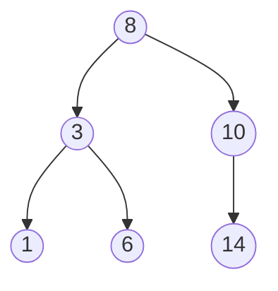

# Concept-Book Run

domain: /home/papagame/projects/digital-duck/cb-data-structure/public/domains/data_structure_ch08/input/graph.yaml
target: weight_balanced_tree
started: 2026-11-25T04:35:59

## Teaching order (5 concepts)

- binary_search_tree
- scapegoat_tree
- subtree_size
- rebuild_operation
- weight_balanced_tree

### binary_search_tree (0.5s)

## Binary Search Tree

**Definition.** A *binary search tree* (BST) is a binary tree whose nodes store keys from a total order, such that for every node $x$ with key $k(x)$:

$$
\forall\, y \in \text{left}(x):\; k(y) < k(x), \qquad \forall\, z \in \text{right}(x):\; k(z) > k(x).
$$

The property applies to *entire subtrees*, not just immediate children. Assuming distinct keys, an inorder traversal (left, node, right) visits keys in sorted order, which is the structure's central consequence.

**Search and insertion.** To find key $q$, start at the root. If $q$ equals the node's key, stop. If $q$ is smaller, go left. Otherwise go right. Reaching a null link means $q$ is absent. Insertion follows the same path and attaches a new leaf at the null link where the search ended. Each step discards a whole subtree, so the cost is $O(h)$, where $h$ is the tree's height.

**Worked example.** Insert the keys $8, 3, 10, 1, 6, 14$ into an empty BST, in that order.

- $8$ becomes the root.
- $3 < 8$, so it goes left of $8$.
- $10 > 8$, so it goes right of $8$.
- $1 < 8$, then $1 < 3$, so it goes left of $3$.
- $6 < 8$, then $6 > 3$, so it goes right of $3$.
- $14 > 8$, then $14 > 10$, so it goes right of $10$.


*The BST after inserting 8, 3, 10, 1, 6, 14. Every left subtree holds smaller keys and every right subtree holds larger ones.*

Now search for $6$. Compare with $8$ and go left. Compare with $3$ and go right. Compare with $6$, which matches. That took 3 comparisons, not 6.

**Problem-solving application.** The height $h$ decides performance, and it depends on insertion order. Inserting $1, 3, 6, 8, 10, 14$ in sorted order produces a chain of height $n-1 = 5$, so search degrades to $O(n)$. A balanced tree on $n$ keys has height $\lceil \log_2(n+1)\rceil - 1$, giving $O(\log n)$. For random insertion orders, the expected height is $O(\log n)$. To avoid the worst case, self-balancing variants such as AVL and red-black trees restructure the tree during updates.

**Deletion** has three cases for the node $x$ being removed:

1. *Leaf:* remove it.
2. *One child:* replace $x$ with that child.
3. *Two children:* replace $k(x)$ with its inorder successor, which is the minimum of the right subtree. Then delete that successor, which has at most one child.

For example, deleting the root $8$ above replaces it with $10$, the minimum of its right subtree. The old $10$ node has only a right child, $14$, so $14$ takes its place. The result is still a valid BST.

**Check yourself.** If a tree of $n = 1000$ keys is perfectly balanced, search needs at most about $\lceil\log_2 1001\rceil = 10$ comparisons. If the same keys were inserted in sorted order, search could need up to $1000$. This gap is why balance matters in practice.

### scapegoat_tree (0.5s)

## Scapegoat Tree

### Definition

A **scapegoat tree** is a binary search tree that keeps its height logarithmic without storing balance data in each node and without rotations. It stores only two counters:

- $n$: the current number of nodes.
- $q$: an upper bound on $n$. Insertions increment both $n$ and $q$. Deletions decrement only $n$.

The tree maintains two invariants, where $\alpha \in (\tfrac12, 1)$ is a fixed constant:

1. $q/2 \le n \le q$.
2. Every node $u$ has depth at most $\lceil \log_{1/\alpha} q \rceil$.

If an insertion creates a node deeper than $\lceil \log_{1/\alpha} q \rceil$, the tree walks up from the new node to find a **scapegoat**. This is the nearest ancestor $w$ with $\text{size}(\text{child}) > \alpha \cdot \text{size}(w)$ for the child on the search path. The subtree rooted at $w$ is then **rebuilt**: it is flattened into sorted order and reassembled as a perfectly balanced tree. For deletion, the node is removed as in an ordinary BST. If $n < \alpha q$ afterward, the whole tree is rebuilt and $q$ is set to $n$.

A scapegoat always exists. If every node on the path were $\alpha$-balanced, the new node's depth would be at most $\log_{1/\alpha} n \le \log_{1/\alpha} q$, which contradicts the depth violation.

### Worked example

Let $\alpha = 2/3$ and insert $1,2,3,4$ in increasing order. After the fourth insertion, $n = q = 4$ and the allowed depth is
$$\lceil \log_{3/2} 4 \rceil = \lceil 3.42 \rceil = 4.$$
Node 4 sits at depth 3, so no rebuild occurs. Insert 5: now $q = 5$, the limit is $\lceil \log_{3/2} 5 \rceil = 4$, and node 5 is at depth 4, so there is still no violation. Insert 6: the limit is $\lceil \log_{3/2} 6\rceil = 5$ and the depth is 5, so again no violation. Insert 7 at depth 6 with limit $\lceil \log_{3/2} 7 \rceil = 5$. This is a violation. Walking up from 7, the sizes are $1, 2, 3, \dots$. At node 6, the child 7 has size 1 and node 6 has size 2, giving ratio $1/2 \le 2/3$. At node 5, the child 6 has size 2 and node 5 has size 3, giving ratio $2/3$, which is still acceptable. At node 4, the child 5 has size 3 and node 4 has size 4, giving ratio $3/4 > 2/3$. So node 4 is the scapegoat, and its subtree $\{4,5,6,7\}$ is rebuilt with root 5 or 6, which brings the depth of every node in it down to at most 2 below node 4.

### Problem-solving application

**Cost.** Rebuilding a subtree of size $s$ costs $O(s)$. Search is $O(\log n)$ worst case. Insert and delete are $O(\log n)$ **amortized**. Between two rebuilds of a scapegoat $w$, the subtree must receive $\Omega(\text{size}(w))$ updates, because a perfectly balanced subtree is far from the $\alpha$ threshold. Charging the $O(\text{size}(w))$ rebuild cost to those updates adds only $O(\log n)$ per update, since each update affects at most $O(\log n)$ ancestors.

**Problem.** With $\alpha = 3/4$, a tree has $q = 100$. What is the maximum allowed depth, and how many deletions are needed to force a full rebuild?

*Solution.* The depth limit is $\lceil \log_{4/3} 100 \rceil = \lceil 16.01 \rceil = 17$. Since $\log_{4/3}100 = \ln 100/\ln(4/3) \approx 4.605/0.2877 \approx 16.008$, the ceiling is 17. Starting with $n = 100$, a full rebuild is triggered when $n < \alpha q = 75$, which first happens at $n = 74$. That takes 26 deletions. The rebuild then sets $q = 74$.

### subtree_size (0.6s)

## Subtree Size

### Definition

In a rooted tree, the **subtree size** of a node $v$, written $\operatorname{size}(v)$, is the number of nodes in the subtree rooted at $v$. That count includes $v$ itself and all of its descendants. For a binary tree it satisfies a simple recurrence:

$$
\operatorname{size}(v) =
\begin{cases}
0 & \text{if } v = \text{null},\\[2pt]
1 + \operatorname{size}(v.\text{left}) + \operatorname{size}(v.\text{right}) & \text{otherwise.}
\end{cases}
$$

A leaf has size $1$. The root's size equals the total number of nodes $n$.

### Worked Example

Consider this tree, with the root $A$ on top:

- $A$ has children $B$ and $C$.
- $B$ has children $D$ and $E$.
- $C$ has no children.
- $D$ and $E$ are leaves.

Working from the bottom up:

- $\operatorname{size}(D) = \operatorname{size}(E) = \operatorname{size}(C) = 1$.
- $\operatorname{size}(B) = 1 + 1 + 1 = 3$.
- $\operatorname{size}(A) = 1 + 3 + 1 = 5$.

The root's size is $5$, which matches the number of nodes.

```python
def size(v):
    if v is None:
        return 0
    return 1 + size(v.left) + size(v.right)
```

This computes the size of every node in $O(n)$ time if each node is visited once. Calling it separately at every node of a degenerate (list-like) tree costs $O(n^2)$. To avoid that, each node can store a `size` field. After every insertion or deletion, the field is updated along the affected path as `v.size = 1 + size(v.left) + size(v.right)`, which takes $O(1)$ per node touched. In the code below, `size(v)` reads the stored field and returns $0$ for `None`.

### Problem-Solving Application

**Problem.** Using stored sizes, find the $k$th smallest key ($1$-indexed) in a binary search tree.

**Solution.** Let $s = \operatorname{size}(v.\text{left})$. All keys in the left subtree are smaller than $v$'s key, so $v$'s key has rank $s + 1$ within $v$'s subtree.

- If $k = s + 1$, return $v$.
- If $k \le s$, recurse left with the same $k$.
- If $k > s + 1$, recurse right with $k - s - 1$. This skips the $s$ keys on the left and $v$ itself.

```python
def select(v, k):
    s = size(v.left)
    if k == s + 1: return v
    if k <= s:     return select(v.left, k)
    return select(v.right, k - s - 1)
```

In the example tree, suppose an in-order traversal gives $D, B, E, A, C$.

- For $k = 4$, at $A$ we have $s = \operatorname{size}(B) = 3$, so $k = s + 1$ and we return $A$.
- For $k = 2$, at $A$ we have $k \le 3$, so the search goes left to $B$. There $s = \operatorname{size}(D) = 1$, so $k = s + 1$ and it returns $B$.
- For $k = 5$, at $A$ we have $k > 4$, so the search goes right to $C$ with $k = 5 - 3 - 1 = 1$. There $s = 0$, so it returns $C$.

**Cost.** The search follows one root-to-leaf path and does $O(1)$ work per node. It therefore takes $O(h)$ time, where $h$ is the tree height. Without stored sizes, computing $s$ at each step would cost $O(n)$ and the search would be much slower. The stored field is what makes selection cheap.

### rebuild_operation (1.0s)

## Rebuild Operation

**Definition.** In a scapegoat-style binary search tree, a *rebuild* of node $u$ destroys the subtree rooted at $u$ and replaces it with a perfectly balanced BST holding exactly the same keys. "Perfectly balanced" means that for every node, the two child subtrees differ in size by at most 1. A tree of $n$ nodes then has height $\lfloor \log_2 n \rfloor$. The rebuild takes $O(\text{size}(u))$ time. It has two phases:

1. **Flatten.** An in-order traversal of the subtree writes its nodes into an array $A[0..n-1]$ in sorted order. This costs $O(n)$.
2. **build_balanced.** Choose the middle element $A[\lfloor n/2 \rfloor]$ as the root. Recursively build the left subtree from the elements before it and the right subtree from the elements after it.

```python
def pack(u, A):                 # in-order flatten
    if u is None: return
    pack(u.left, A); A.append(u); pack(u.right, A)

def build_balanced(A, lo, hi):  # builds from A[lo:hi]
    if lo >= hi: return None
    m = (lo + hi) // 2
    node = A[m]
    node.left  = build_balanced(A, lo, m)
    node.right = build_balanced(A, m + 1, hi)
    return node

def rebuild(u):
    A = []; pack(u, A)
    return build_balanced(A, 0, len(A))   # parent re-links to this root
```

**Why it is linear.** Each call to `build_balanced` does constant work besides its two recursive calls. Each node is placed exactly once, and each empty range returns immediately. So the running time satisfies
$$T(n) = T(\lfloor n/2 \rfloor) + T(n - \lfloor n/2 \rfloor - 1) + O(1) = O(n).$$
Adding the $O(n)$ flatten step, the total is $O(\text{size}(u))$. The array reuses the existing nodes, so no new nodes are allocated. Only the $O(n)$ temporary array is needed.

**Worked example.** Suppose $u$ is the root of a degenerate chain holding the keys $1,2,\dots,7$, so its height is 6. Flattening gives $A=[1,2,3,4,5,6,7]$.

- `build_balanced(0,7)`: $m=3$, so the root is 4.
- Left, `(0,3)`: $m=1$, so the node is 2, with children 1 and 3.
- Right, `(4,7)`: $m=5$, so the node is 6, with children 5 and 7.

The result is a complete tree of height $2 = \lfloor\log_2 7\rfloor$. Its cost was about $7$ node visits to flatten and $7$ node placements to build.

**Problem-solving application.** Rebuilding is expensive for one operation, but it is cheap when its cost is spread over many operations. Suppose a scapegoat tree rebuilds a subtree of size $n$ only after at least about $n/2$ insertions have gone into it since it was last perfectly balanced. Then the $O(n)$ rebuild cost can be charged to those insertions. Each insertion is charged $O(1)$ per ancestor that is later rebuilt. Since the tree has height $O(\log n)$, the amortized cost per insertion is $O(\log n)$.

*Check yourself:* If you rebuild a subtree of size 1023, what is the resulting height? Because $\lfloor\log_2 1023\rfloor = 9$, the height is 9. The tree is complete, with 10 full levels.

### weight_balanced_tree (0.7s)

## Weight Balanced Tree

### Definition

A **weight balanced tree** is a binary search tree in which every node's subtree is "not too lopsided" relative to its parent's. Write $\operatorname{size}(u)$ for the number of nodes in the subtree rooted at $u$. The tree maintains the invariant

$$\operatorname{size}(u) \le \tfrac{2}{3}\,\operatorname{size}(u.\text{parent}) \quad \text{for every non-root node } u.$$

Equivalently, no child holds more than two thirds of its parent's subtree. Like a ScapegoatTree, it keeps balance by rebuilding rather than rotating. When an insertion or deletion makes some node $w$ violate the invariant (one child has $\operatorname{size} > \tfrac{2}{3}\operatorname{size}(w)$), the subtree rooted at $w$ is rebuilt into a perfectly balanced tree. To rebuild, do an in-order traversal into an array, then recursively take the middle element as the root. This costs $O(\operatorname{size}(w))$.

### Why the invariant gives logarithmic height

Going from a node to its child multiplies the subtree size by at most $2/3$. A node at depth $d$ therefore has subtree size at most $n(2/3)^d$. Since a subtree has at least one node, $1 \le n(2/3)^d$. Solving for $d$ gives

$$d \le \log_{3/2} n = \frac{\ln n}{\ln 1.5} \approx 1.71\,\log_2 n.$$

So search, insert, and delete all take $O(\log n)$ time apart from rebuilds. Rebuilding is cheap on average. A rebuilt subtree is perfectly balanced, with children of size about $\operatorname{size}(w)/2$. To violate the invariant again, a child must grow from $\tfrac12 s$ to $\tfrac23 s$, which takes about $\tfrac16 s$ further updates below $w$. The $O(s)$ rebuild cost is spread over $\Omega(s)$ updates. Each update touches $O(\log n)$ ancestors, so the amortized cost is $O(\log n)$.

### Worked example

Suppose $w$ has $\operatorname{size}(w)=9$, with a left child of size 6 and a right child of size 2 (6 + 2 + 1 = 9). Then $6 \le \tfrac23 \cdot 9 = 6$, so the invariant holds. Insert one key into the left subtree. Now $\operatorname{size}(w)=10$ and the left child has size 7. Since $7 > \tfrac23\cdot 10 \approx 6.67$, the invariant is violated at $w$.

Rebuild: collect the 10 keys in sorted order, make the 5th (or 6th) the root, and recurse on each half. The new children have sizes 4 and 5, both at most $\tfrac23\cdot 10$. Cost: about 10 node visits.

### Problem-solving application

**Problem.** A weight balanced tree holds $n = 1000$ nodes. What is the maximum possible depth?

**Solution.** Use $d \le \log_{3/2} n$:

$$d \le \frac{\ln 1000}{\ln 1.5} = \frac{6.908}{0.405} \approx 17.04,$$

so the depth is at most 17. A perfectly balanced tree would have depth about $\lfloor\log_2 1000\rfloor = 9$. The weaker invariant costs at most about 1.7 times as many comparisons per search, and in return updates are cheap.

**Checking the invariant efficiently.** Store $\operatorname{size}$ at each node and update it along the insertion path. Walk back up and rebuild at the *highest* violating ancestor. Rebuilding the highest one also repairs any violations below it, because the whole subtree becomes perfectly balanced.

```python
def violates(w):
    limit = 2 * size(w) / 3
    return size(w.left) > limit or size(w.right) > limit
```

The same size-tracking idea underlies the ScapegoatTree. The difference is that the scapegoat is found only after an insertion lands too deep, whereas here the local $2/3$ test triggers the rebuild directly.

## Run complete

total: 8.3s
