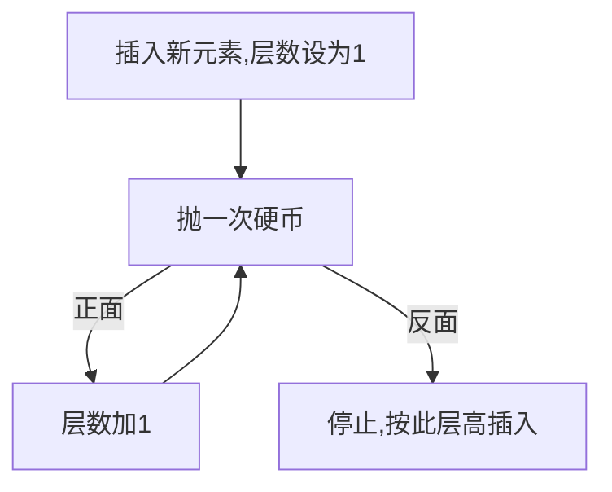
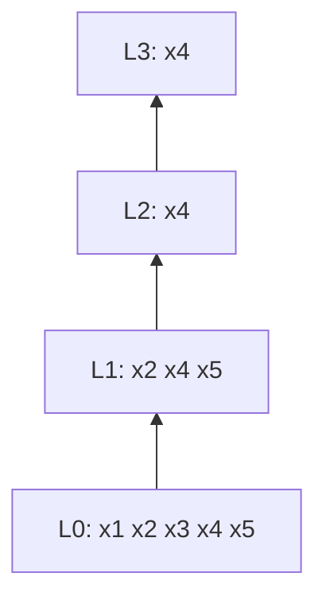
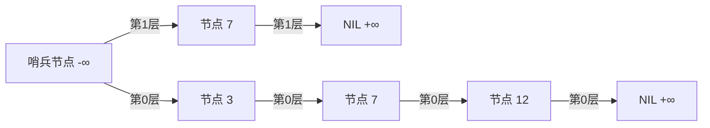
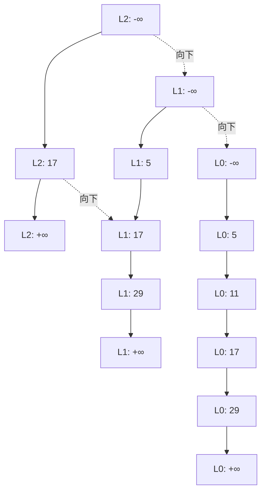
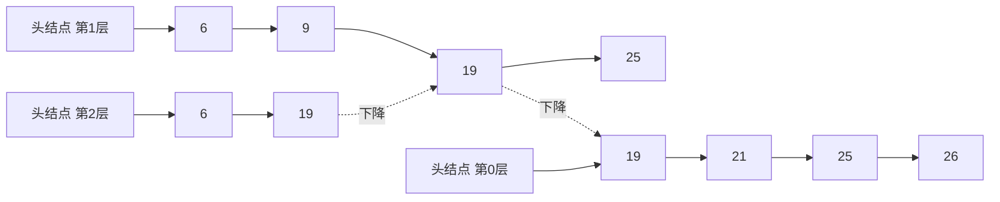
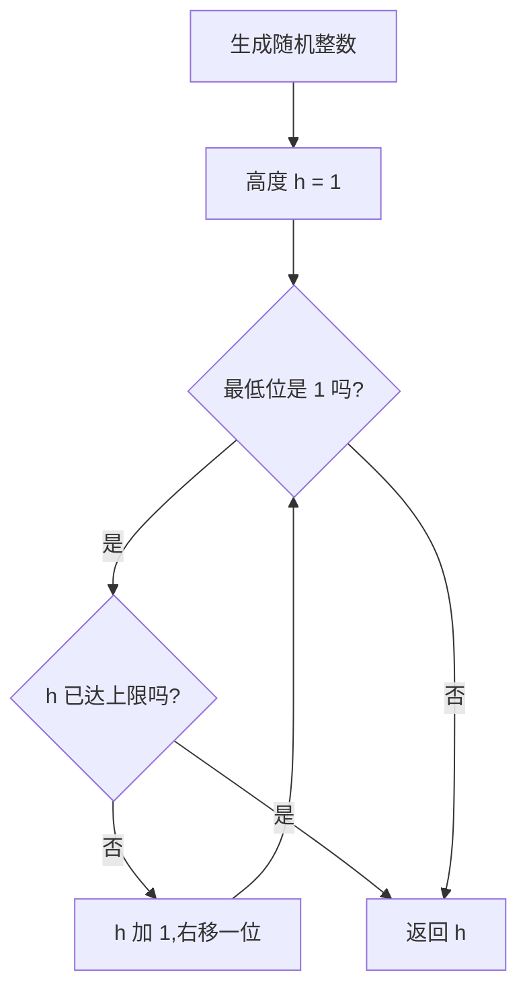
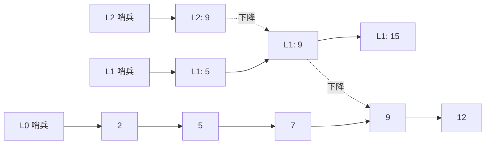

# Concept-Book Run

domain: /home/papagame/projects/digital-duck/cb-data-structure/public/domains/data_structure_ch04/input/graph.yaml
target: skiplist_sset
started: 2026-11-25T04:38:44

## Teaching order (9 concepts)

- coin_toss_randomization
- node_height
- sentinel_node
- singly_linked_list_hierarchy
- pseudo_random_generator
- skiplist
- pick_height_procedure
- search_path
- skiplist_sset

### coin_toss_randomization (0.7s)

## 抛硬币随机化

**定义。** 抛硬币随机化是指用一次公平的二元随机选择(正面/反面)来决定数据结构中的某个概率性操作。设 $X$ 为一次抛掷的结果,则
$$P(X=\text{正面})=P(X=\text{反面})=\tfrac12 .$$
各次抛掷相互独立。由于结构的形状依赖于随机结果,我们不再分析某一个具体输入的“最坏情形”,而是分析**期望**代价:对所有可能的抛掷序列取平均。

典型例子是**跳表(skip list)**:插入一个元素时,不断抛硬币,每得到一次正面就把该元素提升到上一层,直到出现第一次反面为止。

**核心计算。** 设 $H$ 为该元素的层高(从第 1 层开始计数)。它到达第 $k+1$ 层,当且仅当前 $k$ 次抛掷全为正面,所以
$$P(H\ge k+1)=\left(\tfrac12\right)^k .$$
利用 $E[H]=\sum_{k\ge 0}P(H\ge k+1)$,得
$$E[H]=\sum_{k=0}^{\infty}\left(\tfrac12\right)^k=\frac{1}{1-\tfrac12}=2 .$$
也就是说,平均每个元素只占 2 个指针,$n$ 个元素的总空间期望为 $2n$,即 $O(n)$。


*图:跳表插入时的抛硬币流程。连续出现正面才会继续升层,所以层高呈几何分布。*

**例题。** 一个跳表有 $n=1024$ 个元素。问:至少有一个元素的层高不小于 $k+1$ 的期望个数是多少?最高层大约是多少?

**解。** 层高 $\ge k+1$ 的元素期望个数为 $n\cdot 2^{-k}$。令 $n\cdot 2^{-k}=1$,得 $k=\log_2 n=10$。因此最高层大约在第 $\log_2 n+1\approx 11$ 层。更严格地,由联合界(union bound),存在元素层高超过 $c\log_2 n$ 的概率至多为
$$n\cdot 2^{-c\log_2 n}=n^{1-c},$$
取 $c=3$ 时小于 $1/n^2$,几乎不可能发生。

**问题求解应用。** 查找时从最高层出发向右、向下移动。若把搜索路径倒着看,每走一步“向上”的概率为 $\tfrac12$(对应一次正面),所以爬升 $\log_2 n$ 层平均需要约 $2\log_2 n$ 步(期望为“要得到 $L$ 个正面需抛 $2L$ 次”)。于是期望查找时间为
$$E[T(n)]=O(\log n),$$
与平衡二叉树同阶,但实现中无需旋转操作。

**要点。** (1) 期望是对*抛硬币的随机性*取平均,而非对输入分布取平均,因此任何输入都有同样的期望保证;(2) 期望低并不意味着不会出现坏情形,需用联合界等工具说明其概率极小;(3) 分析的关键步骤是把“层高”转化为一串独立抛掷的几何分布。

### node_height (0.7s)

## 节点高度

**定义。** 在跳表(skip list)中,设最底层链表为 $L_0$,它包含全部元素;更高的层 $L_1, L_2, \dots$ 依次是上一层的"抽样子集"。对元素 $x$,其**节点高度**(node height)$h(x)$ 定义为 $x$ 出现的最高层的下标:
$$h(x)=\max\{\,r : x\in L_r\,\}.$$
高度由**重复抛硬币**决定:每次抛一枚均匀硬币,若为正面,则 $x$ 再升一层;一旦出现反面就停止。因此 $x$ 至少出现在 $L_0$,即 $h(x)\ge 0$。

**分布。** 因为每次"升层"的概率都是 $\tfrac12$,且各次抛掷相互独立,所以
$$\Pr[h(x)\ge r]=2^{-r},\qquad \Pr[h(x)=r]=2^{-(r+1)}.$$
这是一个几何分布,期望高度为
$$\mathbb{E}[h(x)]=\sum_{r\ge1}\Pr[h(x)\ge r]=\sum_{r\ge1}2^{-r}=1.$$
也就是说,平均每个节点只比底层多出 1 层,总空间期望为 $O(n)$。

**例题。** 设依次为元素 $x_1,\dots,x_5$ 抛硬币,结果如下(H 为正面,T 为反面):

| 元素 | 抛掷序列 | $h(x)$ |
|---|---|---|
| $x_1$ | T | 0 |
| $x_2$ | H T | 1 |
| $x_3$ | T | 0 |
| $x_4$ | H H H T | 3 |
| $x_5$ | H T | 1 |

于是 $L_0=\{x_1,\dots,x_5\}$,$L_1=\{x_2,x_4,x_5\}$,$L_2=L_3=\{x_4\}$。注意 $x_4$ 的概率只有 $2^{-4}=\tfrac1{16}$,高节点稀少,但正是它们提供了"高速公路"。


*各层元素逐层减半:元素出现在 $L_r$ 的概率为 $2^{-r}$,$x_4$ 的高度为 3。*

**问题求解:最大高度有多大?** 对 $n$ 个元素,问至少有一个节点高度 $\ge r$ 的概率。由并集界(union bound):
$$\Pr[\max_x h(x)\ge r]\le n\cdot 2^{-r}.$$
取 $r=c\log_2 n$,则概率不超过 $n^{1-c}$。例如 $c=3$ 时,失败概率至多 $n^{-2}$。因此以高概率(w.h.p.)有
$$\max_x h(x)=O(\log n).$$
这说明跳表只需约 $\log n$ 层。实现时常把最大层数设为 $\lceil 2\log_2 n\rceil$ 或固定上限(如 32),并在插入新元素时用 `while random() < 0.5: h += 1` 生成其高度。

**小结。** 节点高度由独立抛硬币决定,服从参数为 $\tfrac12$ 的几何分布:$\mathbb{E}[h]=1$ 保证了线性空间,而 $\max h=O(\log n)$(高概率)保证了搜索、插入、删除的期望时间均为 $O(\log n)$。

### sentinel_node (0.7s)

## 哨兵节点

**定义。** 哨兵节点(sentinel node,也称头节点)是跳表中一个不存储真实数据的特殊"虚拟"节点。它位于每一层链表的最前端,键值被设为 $-\infty$,因此任何真实键都比它大。所有查找、插入和删除路径都从它出发,所以它是整个结构的统一入口。

一个高度为 $L$ 的跳表,其哨兵节点拥有 $L$ 个前向指针,第 $i$ 层的指针指向该层的第一个真实节点;若该层为空,则指向 `NIL`(可视为键为 $+\infty$ 的尾哨兵)。

**为什么需要它?** 没有哨兵时,必须单独处理"在表头插入"和"删除第一个元素"这类边界情况,因为表头的指针本身要被修改。有了哨兵,每个真实节点都有前驱,插入和删除的代码可以统一为同一段逻辑,不再出现特判。

**例题。** 设跳表有 3 层(第 0 层为最底层),键集合为 $\{3, 7, 12\}$,其中 7 同时出现在第 0、1 层,其余只在第 0 层。查找键 $12$:

1. 从哨兵的第 1 层出发,下一个节点是 $7$。因为 $7<12$,前进到 $7$。
2. 在 $7$ 的第 1 层,下一个是 `NIL`($+\infty>12$),下降到第 0 层。
3. 在第 0 层,$7$ 的下一个是 $12$,命中。

注意:第 2 层为空,哨兵的第 2 层指针直接指向 `NIL`,查找会在该层立即下降,不需要额外判断。


*图:哨兵节点作为各层链表的共同起点,每层各有一条从它发出的路径。*

**问题求解应用。** 在插入键 $k$ 时,需要记录每一层中"最后一个小于 $k$ 的节点",记为数组 `update[i]`。因为所有路径都从哨兵开始,即便 $k$ 小于所有现有键,`update[i]` 也恒为哨兵,不会为空。于是插入步骤固定为:

```python
new.next[i] = update[i].next[i]
update[i].next[i] = new
```

这两行适用于每一层,无需判断 `update[i]` 是否存在。

若新节点的随机高度超过当前层数,只需把哨兵多出的那些层的 `update[i]` 设为哨兵本身。因此哨兵的预分配高度应取 $L_{\max}=\lceil \log_{1/p} n\rceil$(常取 $p=\tfrac12$),保证期望查找代价为 $O(\log n)$。

**小结。** 哨兵节点不保存数据,但提供了统一的起点和前驱,消除了边界特判,让查找、插入、删除的逻辑保持一致。

### singly_linked_list_hierarchy (0.8s)

## 单向链表层次结构

### 定义

**单向链表**(singly linked list)中,每个节点只保存一个键值和一个指向后继节点的指针。**跳表**(skip list)把一组这样的链表叠成层次结构 $L_0, L_1, \dots, L_h$,并满足两条规则:

1. $L_0$ 包含全部 $n$ 个键,且按升序排列。
2. 对每个 $i \ge 1$,$L_i$ 是 $L_{i-1}$ 的**随机子集**:$L_{i-1}$ 中的每个键以概率 $p$(通常取 $p=\tfrac12$)独立地"晋升"到 $L_i$。

所有层都以哨兵节点 $-\infty$ 开头、以 $+\infty$ 结尾。同一个键在不同层的副本通过向下指针相连。

由于每个键晋升到第 $i$ 层的概率是 $p^i$,第 $i$ 层的期望长度为 $n p^i$。令 $np^h \approx 1$,得到期望层数

$$h \approx \log_{1/p} n .$$

### 图示


*每一层都是下一层的子集:键 17 出现在 $L_0$、$L_1$、$L_2$,键 5 和 29 只到 $L_1$,键 11 只在 $L_0$。*

### 例题:构造层次

对键 $\{3,7,9,12\}$ 依次抛硬币(正面 = 晋升)。结果:3 抛得"正、反";7 抛得"反";9 抛得"正、正、反";12 抛得"反"。

- $L_0 = \{3,7,9,12\}$
- $L_1 = \{3,9\}$(3 和 9 第一次为正)
- $L_2 = \{9\}$(只有 9 第二次仍为正)

确实有 $L_2 \subseteq L_1 \subseteq L_0$。

### 应用:在层次中查找

**问题**:在上面的结构中查找键 12。

从最高层 $L_2$ 的 $-\infty$ 出发,**在每层尽量向右走,直到下一个键大于目标,再下降一层**:

1. $L_2$:$-\infty \to 9$($9<12$),下一个是 $+\infty$,下降。
2. $L_1$:位于 9,下一个是 $+\infty$,下降。
3. $L_0$:$9 \to 12$,找到。

共走 3 步,而在纯 $L_0$ 上需要 4 步。

**为什么期望代价是 $O(\log n)$?** 把查找路径**倒着**看:从目标出发,每一步要么向上(该节点有更高层副本,概率 $p$),要么向左(概率 $1-p$)。向上总共需要 $h = O(\log n)$ 次,而到达每次"向上"之前的向左步数服从几何分布,期望为 $\frac{1-p}{p}$。因此期望总步数为

$$E[\text{步数}] \approx \frac{\log_{1/p} n}{p} = O(\log n).$$

对 $p=\tfrac12$,约为 $2\log_2 n$ 步。空间期望为 $n\sum_{i\ge0}p^i = \frac{n}{1-p} = 2n$,仍是 $O(n)$。

**要点**:层次结构用少量额外指针换取了"高速通道",把链表的 $O(n)$ 查找降为期望 $O(\log n)$,且无需像平衡树那样做复杂的旋转。

### pseudo_random_generator (0.7s)

## 伪随机数生成器

### 定义

**伪随机数生成器**(Pseudo-Random Number Generator,PRNG)是一种用确定性算法产生“看起来随机”的数列的机制。它从一个初始值——**种子**(seed)——出发,按固定的递推规则不断更新内部状态 $s_t$,并由状态输出数值:

$$s_{t+1} = f(s_t), \qquad x_t = g(s_t).$$

由于 $f$ 是确定的,**相同种子必然产生相同序列**。这既是它与真随机的区别,也是它的优点:实验可以复现。Python 的 `random` 模块采用梅森旋转算法(Mersenne Twister),周期长达 $2^{19937}-1$。

经典的简单例子是线性同余生成器(LCG):

$$s_{t+1} = (a\,s_t + c) \bmod m.$$

### 例题:用比特模拟抛硬币

`random.getrandbits(1)` 每次返回 0 或 1,各约占 $1/2$,正好模拟一次公平抛硬币。在跳表(skip list)中,新节点的层高就由连续抛硬币决定:一直抛到出现“反面”为止,正面次数加 1 即为层高。

```python
import random

def random_height(max_level=16):
    h = 1
    while h < max_level and random.getrandbits(1):
        h += 1
    return h

random.seed(42)          # 固定种子,结果可复现
print([random_height() for _ in range(8)])
```

层高为 $h$ 的概率为

$$P(H=h) = \left(\tfrac12\right)^{h},\qquad h\ge 1,$$

所以期望层高

$$E[H]=\sum_{h\ge1} h\cdot 2^{-h}=2.$$

即约一半节点只有 1 层,四分之一有 2 层……这正是跳表获得期望 $O(\log n)$ 查找时间的原因:第 $k$ 层的节点数约为 $n/2^{k}$,总层数约为 $\log_2 n$。

### 问题求解应用

**问题**:一个跳表含 $n=1024$ 个节点,层高由上述方法生成。估计至少有 1 个节点达到第 11 层的概率,并说明种子的作用。

**解**:单个节点层高 $\ge 11$ 的概率为 $2^{-10}=1/1024$。于是 1024 个节点中无一达到的概率为

$$\left(1-\tfrac{1}{1024}\right)^{1024}\approx e^{-1}\approx 0.37,$$

所以至少有一个节点达到第 11 层的概率约为 $1-0.37=0.63$。这说明合理的最大层数约取 $\log_2 n$ 左右(此处为 10 到 11 层)。

**种子的作用**:调试时设定 `random.seed(42)`,每次运行得到完全相同的跳表结构,便于复现错误;上线时则不固定种子(或用系统熵初始化),避免结构被攻击者预测。

**注意**:Mersenne Twister 不具备密码学安全性,观察足够多的输出即可推断其内部状态。跳表只需要统计上均匀的比特,PRNG 完全够用;若用于密钥、令牌等安全场景,应改用 `secrets` 模块。

### skiplist (0.7s)

## 跳表（Skiplist）

### 定义

**跳表**是一种随机化数据结构，由多层有序链表构成。第 $0$ 层包含全部元素；每个元素以概率 $p$（通常 $p=\tfrac12$）"晋升"到上一层，因此第 $i$ 层平均含有 $n p^i$ 个元素。每层都是下层的"快速通道"。

- **搜索**：从最高层的头结点出发，在当前层向右移动，直到下一个结点的键大于或等于目标；然后下降一层，重复此过程，直到第 $0$ 层。
- **插入**：先搜索定位，再反复抛硬币决定新结点的层数 $h$（连续正面的次数加 $1$），并把它接入第 $0$ 至 $h-1$ 层。
- **删除**：搜索定位后，在各层断开该结点的链接。

### 例题

在第 $0$ 层中有键 $3,6,7,9,12,19,21,25,26$。设第 $1$ 层为 $6,9,19,25$，第 $2$ 层为 $6,19$。搜索 $25$：

1. 第 $2$ 层：从头出发，$6<25$，$19<25$，后继为空，下降（停在 $19$）。
2. 第 $1$ 层：从 $19$ 出发，下一个是 $25$，不小于 $25$ 才停止，但此处 $25$ 即目标，下降前停在 $19$。
3. 第 $0$ 层：从 $19$ 出发，经过 $21$，下一个为 $25$，找到。

只访问了 $6,19,21,25$ 等少数结点，而不是扫描全部 $9$ 个元素。


*图：搜索 25 的路径：在高层大步前进，再逐层下降并精细定位。*

### 复杂度分析

**期望层数。** 元素到达第 $i$ 层的概率为 $p^i$，所以最高层数约为 $\log_{1/p} n$，即 $O(\log n)$。

**期望搜索代价。** 把搜索路径**反向**追溯：从目标出发，每一步要么"向上"（该结点有更高层，概率 $p$），要么"向左"（概率 $1-p$）。设 $C(k)$ 为向上爬 $k$ 层所需的期望步数，则
$$C(k)=1+p\,C(k-1)+(1-p)\,C(k)\;\Longrightarrow\; C(k)=\frac{k}{p}.$$
取 $k=\log_{1/p}n$，得期望搜索代价为 $\dfrac{\log_{1/p} n}{p}=O(\log n)$。插入与删除的主要开销也是一次搜索，故同为期望 $O(\log n)$；期望空间为 $\sum_i np^i=\dfrac{n}{1-p}=O(n)$。

注意：这是**期望**界，由随机抛硬币保证，与输入顺序无关，因此不会像普通二叉搜索树那样因有序输入而退化。

### 问题应用

**问题**：设 $n=10^6$，$p=\tfrac12$，估计搜索比较次数，并与线性扫描对比。

**解**：$\log_2 10^6\approx 20$，期望代价约 $20/\tfrac12=40$ 步，而链表平均需约 $5\times10^5$ 步，快约 $10^4$ 倍。

**调参**：取 $p=\tfrac14$ 时，每个结点平均指针数由 $2$ 降到 $\tfrac43$，节省内存，而搜索代价 $\log_4 n/\tfrac14\approx 40$ 步，几乎不变。这说明 $p$ 是时间与空间的权衡参数。

**实践意义**：跳表实现比平衡树（如红黑树）简单，且易于并发，Redis 的有序集合（sorted set）即采用跳表。

### pick_height_procedure (0.8s)

## 选取高度过程(Pick Height Procedure)

### 定义

在跳表(skip list)中,每个新插入的节点需要一个随机的"高度"(层数)。**选取高度过程**通过模拟抛硬币来决定这个高度:生成一个随机整数,数其二进制表示中**末尾连续 1 的个数**,再加 1 作为高度。

每个比特相当于一次公平抛硬币(1 表示"正面"),连续出现正面就继续向上升层,首次出现反面(0)时停止。因此,高度 $H$ 服从几何分布:

$$P(H = h) = \left(\tfrac{1}{2}\right)^{h}, \quad h = 1, 2, 3, \dots$$

由此得到期望高度

$$E[H] = \sum_{h=1}^{\infty} h \cdot 2^{-h} = 2.$$

这保证了第 $k$ 层的节点数大约是第 $k-1$ 层的一半,使跳表在期望意义下具有 $O(\log n)$ 的搜索时间。

### 例题

设最大层数为 `MAX_LEVEL`。伪代码如下:

```python
import random

def pick_height(max_level=16):
    r = random.getrandbits(max_level)
    h = 1
    while r & 1 and h < max_level:
        h += 1
        r >>= 1
    return h
```

假设随机数为 $r = 0b10110111$:

- 最低位为 1 → $h=2$,右移后为 `1011011`
- 最低位为 1 → $h=3$,右移后为 `101101`
- 最低位为 1 → $h=4$,右移后为 `10110`
- 最低位为 0 → 停止

结果 $h = 4$(末尾有 3 个连续的 1,加 1)。该事件的概率为 $2^{-4} = \tfrac{1}{16}$。

### 问题求解应用

**问题:** 向一个跳表插入 $n = 1024$ 个节点,期望有多少个节点的高度至少为 5?最高层大约在第几层?

**解:** 高度至少为 $h$ 的概率是

$$P(H \ge h) = \left(\tfrac{1}{2}\right)^{h-1}.$$

取 $h=5$ 得 $P = \tfrac{1}{16}$,所以期望节点数为 $1024 \times \tfrac{1}{16} = 64$。

最高层:当期望节点数降到约 1 时,即 $n \cdot 2^{-(h-1)} \approx 1$,得 $h \approx \log_2 n + 1 = 11$。所以最高层大约在第 11 层,与 $\log_2 n$ 同阶。

**为什么要设上限?** 若不设 `MAX_LEVEL`,极小概率下高度会过大,浪费空间。通常取 $\text{MAX\_LEVEL} \approx \log_2 N_{\max}$,其中 $N_{\max}$ 是预期的最大元素数。


*选取高度过程的流程:不断检查最低位,遇到 1 就升一层,遇到 0 或达到上限就停止。*

**小结:** 该过程用一次随机整数和若干位运算,代替了多次独立抛硬币,得到几何分布的高度,这是跳表期望对数性能的概率基础。

### search_path (0.7s)

## 搜索路径

**定义。** 在跳表(skip list)中,设最高层为 $h$,哨兵(sentinel)为最高层链表 $L_h$ 的头节点。**搜索路径**是从该哨兵出发、到达目标节点在 $L_0$ 中位置的一条路径,其构造规则只有两条:

1. 在当前层向右移动,直到下一个节点的键值**超过**目标键 $x$(即"越界")为止;
2. 在越界之前停下,**向下**一层,继续重复规则 1,直到到达 $L_0$。

最终停在 $L_0$ 中键值 $\le x$ 的最大节点上。若该节点的键等于 $x$,则查找成功;否则 $x$ 不在表中。

**例题。** 设一个跳表有三层($h=2$):

- $L_2$:$-\infty \to 20 \to +\infty$
- $L_1$:$-\infty \to 8 \to 20 \to 35 \to +\infty$
- $L_0$:$-\infty \to 3 \to 8 \to 14 \to 20 \to 27 \to 35 \to 41 \to +\infty$

查找 $x=27$:

1. 在 $L_2$,从哨兵出发:$20\le 27$,右移到 20;下一个是 $+\infty>27$,越界,下降。
2. 在 $L_1$,位于 20:下一个是 $35>27$,越界,下降。
3. 在 $L_0$,位于 20:下一个是 $27\le 27$,右移到 27;下一个是 35,越界,停止。

搜索路径为 $-\infty \to 20\,(L_2) \downarrow 20\,(L_1) \downarrow 20 \to 27\,(L_0)$,仅访问约 4 个节点,而在 $L_0$ 上线性扫描需访问 5 个。


*搜索路径示意:在高层大步右移,越界后下降,在底层精细定位目标 27。*

**问题求解:路径长度分析。** 设每个节点以概率 $p=\tfrac12$ 晋升到上一层,则层数 $h=O(\log n)$。**反向**追踪路径(从 $L_0$ 的目标节点回溯到哨兵)更便于分析:在每个节点处,

- 若该节点有"上层副本",则**向上**(概率 $p$);
- 否则**向左**(概率 $1-p$)。

回溯到第 $h$ 层需要恰好 $h$ 次"向上"。设 $C(k)$ 为向上爬 $k$ 层所需的期望步数,则

$$C(k)=1+p\,C(k-1)+(1-p)\,C(k),\quad C(0)=0,$$

解得 $C(k)=k/p$。取 $k=h=\log_{1/p} n$,得期望路径长度

$$E[\text{路径长度}]=\frac{\log_{1/p} n}{p}=O(\log n).$$

当 $p=\tfrac12$ 时约为 $2\log_2 n$。例如 $n=1024$,期望约 20 步,远小于线性扫描的约 512 步。

**要点。** 搜索路径"先右后下"的贪心结构保证了每一层只访问常数个期望节点,这正是跳表查找、插入与删除均为期望 $O(\log n)$ 的原因。插入和删除时记录的"每层最后一个越界前节点"也正是这条路径上的下降点。

### skiplist_sset (0.7s)

## 跳表实现的有序集合(Skiplist SSet)

**定义。** SSet(有序集合)接口支持 `add(x)`、`remove(x)` 和 `find(x)`,其中 `find(x)` 返回集合中**不小于** $x$ 的最小元素(后继查询)。跳表(skiplist)用多层链表实现该接口:

- 第 $L_0$ 层包含全部 $n$ 个元素,按升序排列;
- 第 $L_r$ 层的每个元素,以概率 $\tfrac12$ 出现在第 $L_{r+1}$ 层(相当于抛硬币);
- 每个节点的高度 $h$ 满足 $\Pr[h \ge k] = 2^{-k}$,因此期望高度为 $2$。

于是第 $L_r$ 层约有 $n/2^r$ 个节点,最高层约为 $\log_2 n$。

**查找过程。** 从最高层的哨兵节点出发,在当前层向右前进,直到下一个元素 $\ge x$,然后下降一层;到达 $L_0$ 时,下一个节点就是答案。

**示例。** 设 $L_0 = [2,\,5,\,7,\,9,\,12,\,15]$,$L_1 = [5,\,9,\,15]$,$L_2 = [9]$。执行 `find(10)`:

1. 在 $L_2$:右移到 $9$(因 $9<10$),后继为空,下降;
2. 在 $L_1$:从 $9$ 出发,下一个是 $15\ge 10$,下降;
3. 在 $L_0$:从 $9$ 出发,下一个是 $12\ge10$,停止。

返回 $12$。只访问了约 $4$ 个节点,而不是从头扫描 $L_0$ 的 $4$ 个节点以上——当 $n$ 很大时差距非常显著。

**期望时间分析。** 倒着看搜索路径:从 $L_0$ 的终点回溯,每一步以概率 $\tfrac12$ 向上、以概率 $\tfrac12$ 向左(对应"该节点高度是否更高")。设 $E(k)$ 为回溯到高度 $k$ 以上所需的期望步数,则向上需要的期望步数满足
$$
E[\text{步数}] \le 2\cdot(\text{层数}) = 2\log_2 n + O(1),
$$
因为每上升一层平均需要 $2$ 步(一次期望的"左移"加一次"上移")。因此 `find` 的期望时间为 $O(\log n)$。`add` 先用同样的路径定位,再抛硬币确定新节点高度 $h$,并在 $L_0,\dots,L_h$ 各层插入,期望额外代价为 $O(1)$;`remove` 同理。三种操作的期望时间均为 $O(\log n)$,空间期望为 $O(n)$(每个元素平均 $2$ 个指针层)。

**问题求解应用。** 要求返回区间 $[a,b]$ 内的所有元素:先调用 `find(a)` 定位($O(\log n)$),再沿 $L_0$ 向右遍历直到超过 $b$,总时间 $O(\log n + m)$,其中 $m$ 为输出个数。这正是 $L_0$ 保持有序的价值所在。


*图:`find(10)` 的搜索路径:自高层向右、遇到过大元素则下降,最终在 $L_0$ 层停在 $12$ 之前。*

**小结。** 跳表以随机化代替显式平衡:不需要旋转,却在期望意义下获得 $O(\log n)$ 的查找、插入与删除。

## Run complete

total: 14.6s
