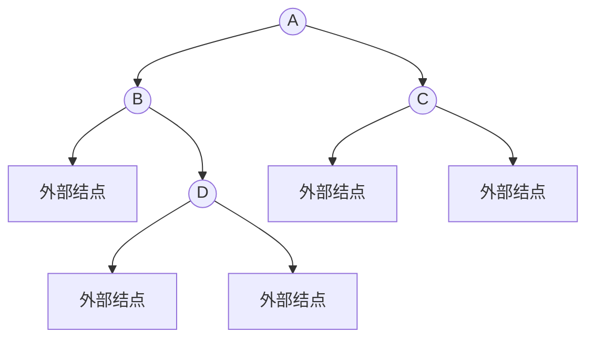
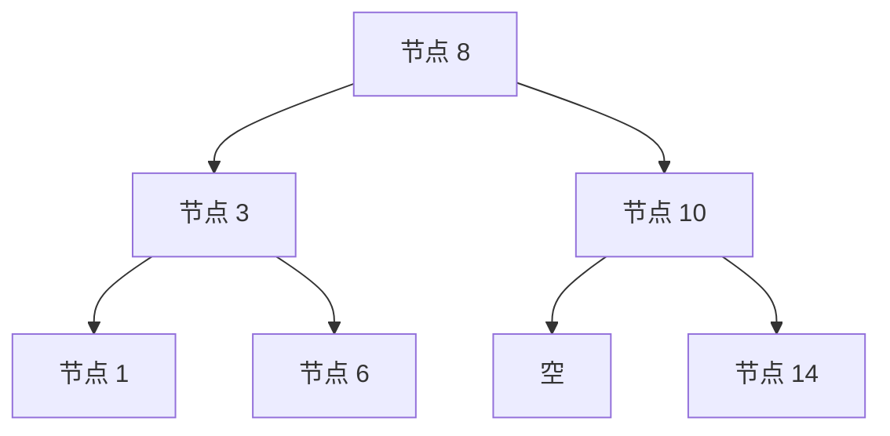
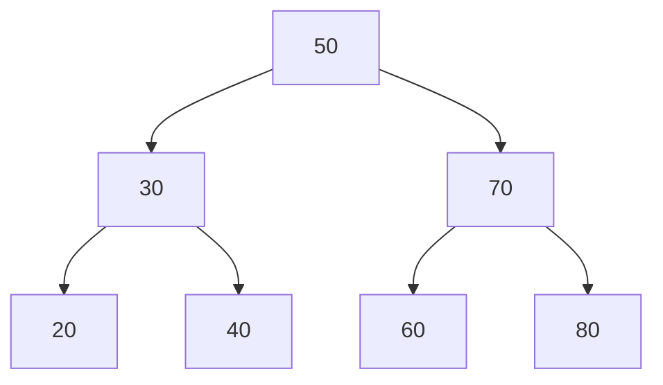
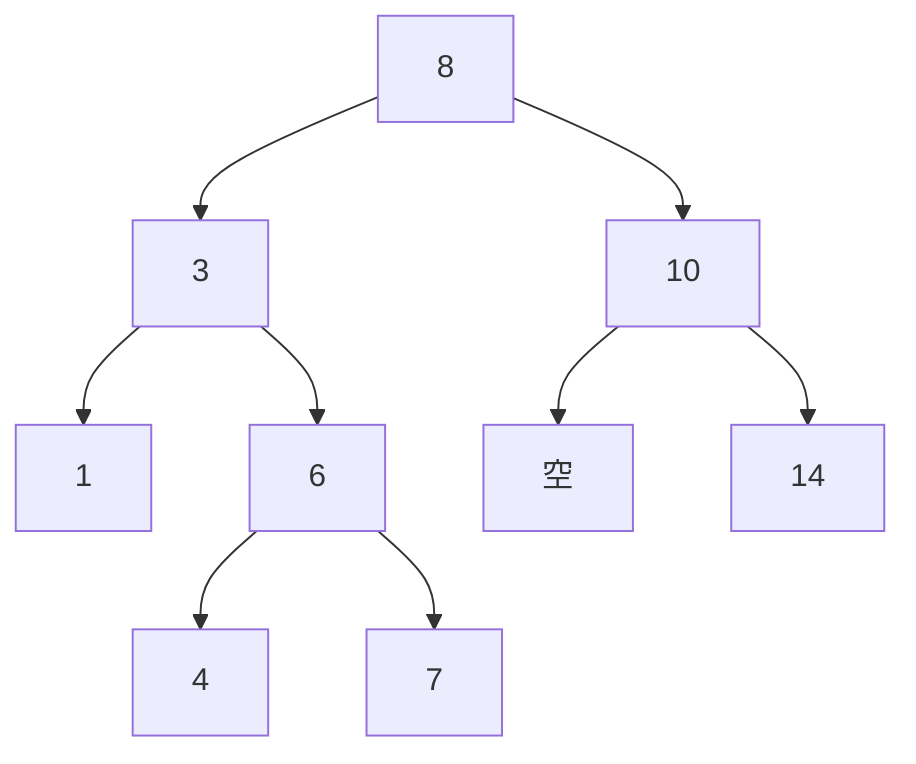
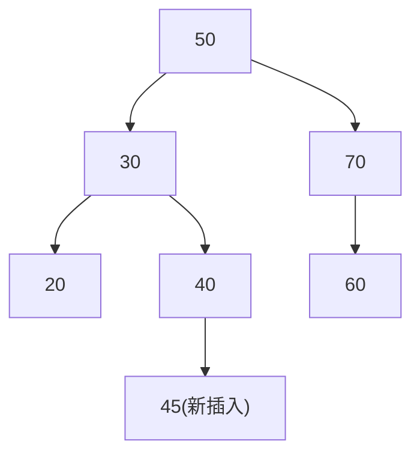
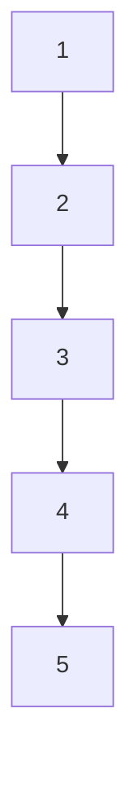

# Concept-Book Run

domain: /home/papagame/projects/digital-duck/cb-data-structure/public/domains/data_structure_ch06/input/graph.yaml
target: unbalanced_bst_performance
started: 2026-11-25T04:39:25

## Teaching order (7 concepts)

- binary_tree
- total_order
- binary_search_tree
- bst_search
- bst_addition
- bst_removal
- unbalanced_bst_performance

### binary_tree (0.7s)

## 二叉树

**定义。** 二叉树(binary tree)是一种有根树,其中每个结点至多有两个孩子,分别称为**左孩子**和**右孩子**。左、右位置是区分的:只有左孩子的结点与只有右孩子的结点是不同的树。若把每个缺失的孩子位置用**外部结点**(空位)补齐,则每个原有的**内部结点**恰好有两个孩子。

这带来一个重要的计数关系:设二叉树有 $n$ 个内部结点,则外部结点数为
$$
e = n + 1 .
$$
**证明(归纳法)。** $n=0$ 时只有一个外部结点,$e=1$。设结论对少于 $n$ 个内部结点的树成立。取根,左子树有 $a$ 个内部结点,右子树有 $b$ 个,且 $a+b=n-1$。由归纳假设,外部结点数为 $(a+1)+(b+1)=n+1$。$\blacksquare$

**常用术语。** 结点的**深度**是它到根的边数;树的**高度** $h$ 是最大深度。高度为 $h$ 的二叉树,第 $d$ 层至多有 $2^d$ 个结点,因此
$$
n \le 2^{h+1}-1,\qquad h \ge \lceil \log_2(n+1) \rceil - 1 .
$$

**例题。** 一棵二叉树的根为 $A$,$A$ 的左孩子为 $B$、右孩子为 $C$,$B$ 只有右孩子 $D$,其余结点均无孩子。求内部结点数、外部结点数和高度。

- 有孩子的结点为 $A, B$,另 $C, D$ 是叶子。若把叶子也算作内部结点(它们各有两个外部孩子),则 $n=4$,于是 $e=5$。
- 验证:$C$ 有 2 个外部孩子,$D$ 有 2 个,$B$ 的左位置有 1 个,共 $2+2+1=5$。✓
- 高度:$A\to B\to D$,所以 $h=2$。

**中序遍历。** 遍历顺序为"左子树、根、右子树"。上例得到 $B, D, A, C$ 吗?注意 $B$ 无左孩子,先访问 $B$,再访问其右子树 $D$,然后是 $A$,最后是 $C$。结果:$B, D, A, C$。

**问题求解应用。** 许多递归算法直接沿树的结构展开。例如计算高度:

```python
def height(node):
    if node is None:          # 外部结点
        return -1
    return 1 + max(height(node.left), height(node.right))
```

每个结点恰好被访问一次,外部结点被访问 $n+1$ 次,所以总时间为 $\Theta(n)$。递归深度等于树高 $h$:平衡时 $h=\Theta(\log n)$,最坏情形(所有结点排成一条链)$h=n-1$。这正是平衡二叉搜索树要保证 $h=O(\log n)$ 的原因:查找、插入的代价都与 $h$ 成正比。


*例题中的二叉树:圆形为内部结点,方形为补齐缺失孩子位置的外部结点,共 5 个,符合 $e=n+1$。*

### total_order (0.6s)

## 全序关系(Total Order)

### 定义

设 $S$ 是一个集合,$\le$ 是 $S$ 上的二元关系。若 $\le$ 满足以下四条性质,则称它是 $S$ 上的**全序**(total order):

1. **自反性**:对任意 $a\in S$,$a \le a$。
2. **反对称性**:若 $a\le b$ 且 $b\le a$,则 $a=b$。
3. **传递性**:若 $a\le b$ 且 $b\le c$,则 $a\le c$。
4. **全比较性(完全性)**:对任意 $a,b\in S$,$a\le b$ 与 $b\le a$ 至少有一个成立。

前三条合起来称为**偏序**。第四条把偏序升级为全序,它保证任意两个元素都可以比较。例如,实数在通常的 $\le$ 下是全序;而集合的包含关系 $\subseteq$ 只是偏序,因为 $\{1\}$ 与 $\{2\}$ 互不包含。

### 例题

**判断**:在平面点 $(x,y)$ 上定义 $(x_1,y_1)\preceq(x_2,y_2)$ 当且仅当 $x_1\le x_2$ 且 $y_1\le y_2$。它是全序吗?

取 $(1,2)$ 与 $(2,1)$。因为 $1\le 2$ 但 $2\not\le 1$,所以 $(1,2)\not\preceq(2,1)$。同理 $(2,1)\not\preceq(1,2)$。全比较性不成立,所以 $\preceq$ 不是全序。

**修正**:改用**字典序**:先比较 $x$,仅当 $x_1=x_2$ 时再比较 $y$。

$$(x_1,y_1)\preceq(x_2,y_2)\iff x_1<x_2\ \text{或}\ (x_1=x_2\ \text{且}\ y_1\le y_2)$$

此时 $(1,2)\preceq(2,1)$,任意两点都能比较。可以验证这四条性质均成立,所以字典序是全序。

### 问题求解应用:二叉搜索树

二叉搜索树(BST)把数据存放在节点中,并规定:每个节点 $v$ 的左子树中所有键都满足 $k<\text{key}(v)$,右子树中所有键都满足 $k>\text{key}(v)$。

这一规则能够成立,依赖全序的各条性质:

- **全比较性**保证插入任何新键时,与当前节点比较后必然能决定向左或向右,不会出现"无法比较"而卡住的情况。
- **传递性**保证只比较路径上的节点就足够了。若 $k<\text{key}(v)$,而 $v$ 的左子树中所有键都 $<\text{key}(v)$,则无需逐一检查整棵左子树。
- **反对称性**保证"既不小于也不大于"就意味着相等,从而可以判定键已存在。


*一棵二叉搜索树:每个节点左侧的键更小,右侧的键更大。*

**查找 6**:$6<8$,向左;$6>3$,向右;找到 $6$,共比较 3 次。若树高为 $h$,查找最多比较 $h+1$ 次,所以树较平衡时代价为 $O(\log n)$。

**实践提醒**:在程序中自定义比较函数时,必须确保它是全序。例如对浮点数,`NaN` 与任何数比较都为假,会破坏全比较性,使 BST 的查找和排序出错。因此处理含 `NaN` 的数据时,需要先约定它的位置,或先将其过滤掉。

### binary_search_tree (0.7s)

## 二叉搜索树

**定义。** 二叉搜索树(Binary Search Tree,BST)是一棵二叉树,其每个结点存储一个来自全序集的键值,并满足**搜索性质**:对任意结点 $x$,

$$
\forall\, y \in \text{left}(x):\ \text{key}(y) < \text{key}(x), \qquad \forall\, z \in \text{right}(x):\ \text{key}(z) > \text{key}(x).
$$

该性质对每个结点都成立,而不只是对根结点成立。由此可得:对 BST 做**中序遍历**(左 → 根 → 右),输出的键值严格递增。

**查找、插入与删除。** 查找键 $k$ 时,从根出发:若 $k$ 等于当前键则找到;若 $k$ 更小则进入左子树;否则进入右子树。每比较一次,就排除一整棵子树。

```python
def search(node, k):
    while node and node.key != k:
        node = node.left if k < node.key else node.right
    return node
```

插入沿用同样的路径,在遇到空位处挂上新结点。删除分三种情形:被删结点是叶子(直接移除);只有一个孩子(用孩子顶替);有两个孩子(用右子树中的最小结点,即中序后继,替换其键值,再删除该后继)。

**例题。** 依次插入 $50, 30, 70, 20, 40, 60, 80$,得到一棵完全平衡的树。查找 $60$:

1. $60 > 50$,走右子树;
2. $60 < 70$,走左子树;
3. $60 = 60$,找到,共比较 3 次。

七个结点只需最多 3 次比较。


*上例构成的二叉搜索树:每个结点左边的值更小,右边的值更大。*

**复杂度分析。** 查找、插入、删除的代价都与树高 $h$ 成正比,即 $O(h)$。树高取决于插入顺序:

- 平衡情形:$n$ 个结点的树高为 $h = \lfloor \log_2 n \rfloor$,操作为 $O(\log n)$。
- 退化情形:若按 $1,2,3,\dots,n$ 的升序插入,树退化为一条链,$h = n-1$,操作退化为 $O(n)$。
- 随机插入顺序下,期望树高为 $O(\log n)$。

**问题求解应用。**

*问题 1:验证 BST。* 一棵树是否是合法的 BST?只比较结点与其直接孩子是**不够的**。例如根为 $10$、右孩子为 $15$、而 $15$ 的左孩子为 $6$,每个局部看都合理,但 $6 < 10$ 却位于根的右子树中。正确做法是递归时携带取值区间 $(lo, hi)$,或检查中序遍历是否严格递增。

*问题 2:第 $k$ 小的元素。* 做中序遍历并计数,计到第 $k$ 个结点即停止,时间为 $O(h + k)$。

*问题 3:选择数据结构。* 需要频繁插入并保持有序,又要支持范围查询时,BST 比排序数组(插入需 $O(n)$ 移动)更合适;但若输入可能已有序,应使用 AVL 树或红黑树等自平衡变体,以保证 $h = O(\log n)$。

**小结。** BST 的核心是"每个结点把键空间一分为二",效率则完全取决于树的高度。

### bst_search (0.9s)

## 二叉搜索树的查找

**定义。** 二叉搜索树(BST)的每个结点 $v$ 满足:左子树中所有键值都小于 $v.\text{key}$,右子树中所有键值都大于 $v.\text{key}$。**BST 查找**是在这样的树中定位值 $x$ 的操作:从根出发,将 $x$ 与当前结点比较,若相等则查找成功;若 $x<v.\text{key}$ 则转向左孩子;若 $x>v.\text{key}$ 则转向右孩子;若走到空指针(`None`),则查找失败。

```python
def bst_search(node, x):
    while node is not None:
        if x == node.key:
            return node
        node = node.left if x < node.key else node.right
    return None
```

**正确性依据。** 每次比较后,BST 性质保证 $x$ 若存在,只可能位于被选中的那一棵子树中,另一棵可以整体排除。因此该算法的循环不变式是:"若 $x$ 在树中,则它在以当前结点为根的子树中"。

**例题。** 在下面的 BST 中查找 $x=6$。


*图:一棵 BST。查找 6 的路径为 8 → 3 → 6。*

- 比较 $6$ 与根 $8$:$6<8$,向左,到达 $3$。
- 比较 $6$ 与 $3$:$6>3$,向右,到达 $6$。
- 比较 $6$ 与 $6$:相等,查找成功,共比较 3 次。

若查找 $x=5$:路径为 $8\to3\to6\to4$,在 $4$ 处 $5>4$ 转向右孩子,而它为空,返回 `None`,共比较 4 次。

**复杂度分析。** 每次比较使当前结点下降一层,因此比较次数至多为树高 $h$ 加 1,即时间复杂度为 $O(h)$。树高取决于树的形状:

- 树平衡时,$h=\Theta(\log n)$,每次排除约一半的结点;
- 树退化为链(例如按递增顺序依次插入 $1,2,\dots,n$)时,$h=n-1$,查找退化为 $O(n)$ 的线性扫描。

这正是 AVL 树、红黑树等自平衡结构存在的原因:它们把 $h$ 控制在 $O(\log n)$。

**问题解决应用。** 题目:在一棵含 $n=1023$ 个结点的完全平衡 BST 中,最坏情况需要比较多少次?

解:完全平衡的树高为 $h=\lfloor\log_2 1023\rfloor=9$,共 10 层($2^{10}-1=1023$)。最坏情况需走到最深一层,即比较 $h+1=10$ 次。相比之下,在无序数组中最坏需要 1023 次比较。

**常见错误。** 不要只看根与 $x$ 的大小关系就断定位置:BST 性质要求逐层比较,每一层都重新判断。另外,BST 性质必须对整棵子树成立,而不仅仅是对父子结点成立,否则该排除推理就不再有效。

### bst_addition (0.7s)

## 二叉搜索树的插入(Bst Addition)

### 定义

**二叉搜索树(BST)** 满足:对任意结点 $x$,其左子树中所有键值 $<x.key$,右子树中所有键值 $>x.key$。

**插入**一个新值 $k$ 的做法是:像查找一样从根出发,若 $k<x.key$ 就向左走,若 $k>x.key$ 就向右走,直到遇到空位置(`None`)。此时最后访问的结点 $p$ 就是新结点的父结点,把值为 $k$ 的新结点作为 $p$ 的叶子孩子挂上去:$k<p.key$ 时作左孩子,否则作右孩子。已有的结点从不移动,所以 BST 性质自动得到保持。

### 例题

依次向空树插入 $50, 30, 70, 20, 40, 60$,再插入 $45$。

1. 比较 $45$ 与根 $50$:$45<50$,向左走到 $30$。
2. 比较 $45$ 与 $30$:$45>30$,向右走到 $40$。
3. 比较 $45$ 与 $40$:$45>40$,向右走,右孩子为空。
4. 最后访问的结点是 $40$,把 $45$ 作为 $40$ 的右孩子。


*图:插入 45 后的二叉搜索树,新结点作为叶子挂在 40 的右侧。*

### 问题求解中的应用

下面是递归实现(重复键值此处忽略):

```python
class Node:
    def __init__(self, key):
        self.key, self.left, self.right = key, None, None

def insert(root, k):
    if root is None:
        return Node(k)          # 找到空位,创建叶子
    if k < root.key:
        root.left = insert(root.left, k)
    elif k > root.key:
        root.right = insert(root.right, k)
    return root
```

**复杂度分析。** 插入沿一条从根到叶的路径前进,每层只做常数次工作,所以时间为 $O(h)$,其中 $h$ 为树高。

- 若树大致平衡,$h=\Theta(\log n)$,插入代价为 $O(\log n)$。
- 若按有序序列 $1,2,3,\dots,n$ 依次插入,每个新结点都挂在最右端,树退化为链,$h=n-1$。此时第 $i$ 次插入需要 $i-1$ 次比较,总代价为
$$\sum_{i=1}^{n}(i-1)=\frac{n(n-1)}{2}=\Theta(n^2).$$

**练习。** 把 $5,3,8,1,4,7,9$ 依次插入空树,画出结果并求树高。再把 $1,2,3,4,5,6,7$ 依次插入空树,比较两棵树的高度和总比较次数。

**提示。** 第一个序列得到一棵完全平衡的树,高度为 $2$,即 $\lfloor\log_2 7\rfloor$。第二个序列得到一条链,高度为 $6$。这说明 BST 的效率取决于插入顺序,也说明为什么需要 AVL 树、红黑树这类自平衡结构。

**要点:** 插入就是一次失败的查找加上一次挂叶子的操作。结果的形状由插入顺序决定,性能为 $O(h)$。

### bst_removal (0.7s)

## 二叉搜索树的删除(Bst Removal)

### 定义

在二叉搜索树(BST)中删除一个值 $k$,必须保持 BST 性质:对每个结点,左子树所有值 $<$ 该结点的值 $<$ 右子树所有值。先按搜索路径找到值为 $k$ 的结点 $x$,再按其孩子数分三种情形:

1. **叶子结点**(0 个孩子):直接摘除,父结点对应指针置空。
2. **只有一个孩子**:用该孩子"接替"$x$,即把父结点指向 $x$ 的指针改为指向 $x$ 的唯一孩子(拼接,splice)。
3. **有两个孩子**:找到 $x$ 右子树中的最小值(中序后继)$s$,把 $x$ 的值改为 $s$ 的值,然后在右子树中删除 $s$。因为 $s$ 是最小值,它不可能有左孩子,所以这一步归结为情形 1 或 2。

情形 3 之所以正确:$s$ 大于左子树所有值(它来自右子树),又不大于右子树其余值,因此放在 $x$ 的位置仍满足 BST 性质。

### 例题

考虑如下 BST(先序:50, 30, 20, 40, 70, 60, 80):


*初始的二叉搜索树。*

- **删除 20(叶子)**:把 30 的左指针置空。
- **删除 30(此时只剩右孩子 40)**:50 的左指针改指向 40。
- **删除 50(两个孩子)**:右子树 $\{70, 60, 80\}$ 的最小值是 60。把根的值改为 60,再从右子树删除原来的 60(叶子)。结果根为 60,右孩子 70 仍有孩子 80。

中序遍历结果始终保持升序:删除 20、30、50 后得到 40, 60, 70, 80。

### 问题求解应用

**代码实现:**

```python
def remove(node, k):
    if node is None:
        return None
    if k < node.val:
        node.left = remove(node.left, k)
    elif k > node.val:
        node.right = remove(node.right, k)
    else:
        if node.left is None:      # 情形 1、2
            return node.right
        if node.right is None:
            return node.left
        s = node.right             # 情形 3:找右子树最小值
        while s.left:
            s = s.left
        node.val = s.val
        node.right = remove(node.right, s.val)
    return node
```

**复杂度分析:** 设树高为 $h$。查找路径长 $O(h)$,寻找后继最多再走 $O(h)$,递归删除后继也至多 $O(h)$(后继所在路径总长不超过树高),所以总时间为 $O(h)$。树平衡时 $h = O(\log n)$;若按升序插入产生退化的链,则 $h = n$,删除变为 $O(n)$。

**练习:** 对上面的原始树依次删除 70、50,画出结果树并验证中序遍历。
*提示:* 删除 70 时它有两个孩子,后继为 80;删除 50 时后继为 60。最终中序序列应为 20, 30, 40, 60, 80 的升序子集(依次去掉被删值)。

**常见错误:** 情形 3 中若用左子树最大值替换也是正确的(对称做法),但必须在对应子树中继续删除该值;若忘记这一步,树中会出现重复值,破坏 BST 性质。

### unbalanced_bst_performance (0.7s)

## 非平衡二叉搜索树的性能

### 定义

在**非平衡**的二叉搜索树(BinarySearchTree)中,插入元素时不做任何旋转或重新平衡。设树中有 $n$ 个节点,树的高度为 $h$,则 `find(x)`、`add(x)`、`remove(x)` 都沿着一条从根出发的路径向下走,每层只做常数次比较,因此时间为 $O(h)$。

关键在于:$h$ 并不由 $n$ 决定,而是由**插入顺序**决定,其范围为

$$\lfloor \log_2 n \rfloor \le h \le n-1.$$

所以在最坏情况下,三种操作的时间都是 $O(n)$。

### 例题:退化成链

依次插入有序序列 $1,2,3,4,5$:

- 插入 1:成为根。
- 插入 2:$2>1$,成为 1 的右孩子。
- 插入 3:$3>1$、$3>2$,成为 2 的右孩子。
- 之后的 4、5 同理。

得到的树只有右孩子,形状是一条链,高度 $h=n-1=4$。


*有序插入使二叉搜索树退化为一条链:查找 5 必须依次经过全部 5 个节点。*

在这棵树上执行 `find(5)`,要比较 $1,2,3,4,5$,共 $n=5$ 次。若一般地插入 $1,2,\dots,n$,则 `find(n)` 需要 $n$ 次比较,所以 `find` 的最坏时间为 $\Omega(n)$。结合上界 $O(h)\le O(n)$,最坏时间为 $\Theta(n)$。

`add(x)` 必须先走到插入位置,`remove(x)` 必须先找到目标节点,两者都包含一次 `find` 式的下行过程,所以它们同样是 $O(n)$。

### 问题求解应用

**问题:** 向初始为空的树依次插入 $1,2,\dots,n$,总共要做多少次比较?

插入第 $k$ 个元素时,它要与链上已有的 $k-1$ 个节点逐一比较,因此总比较次数为

$$\sum_{k=1}^{n}(k-1)=\frac{n(n-1)}{2}=\Theta(n^2).$$

均摊到每次插入,约为 $\Theta(n)$ 次比较,与平衡树的 $O(\log n)$ 差距很大。当 $n=10^6$ 时,链需要约 $10^6$ 步,平衡树只需约 $20$ 步。

**如何应对:**

1. **随机插入顺序:** 对随机排列构造的树,期望高度为 $O(\log n)$。但这依赖于输入是随机的,对有序或接近有序的数据不成立。
2. **使用自平衡结构:** 红黑树、AVL 树等在每次修改后调整形状,保证 $h=O(\log n)$,从而使最坏情况也是 $O(\log n)$。

**小结:** 非平衡二叉搜索树的运行时间取决于树高 $h$,而不是节点数 $n$。分析时必须区分平均情况和最坏情况。要得到可靠的保证,就需要在结构上维持平衡。

## Run complete

total: 11.5s
