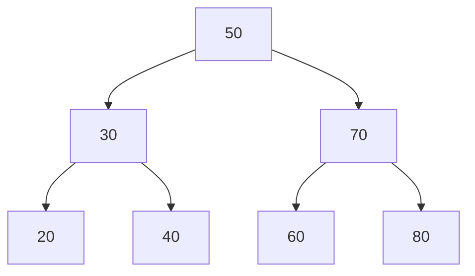
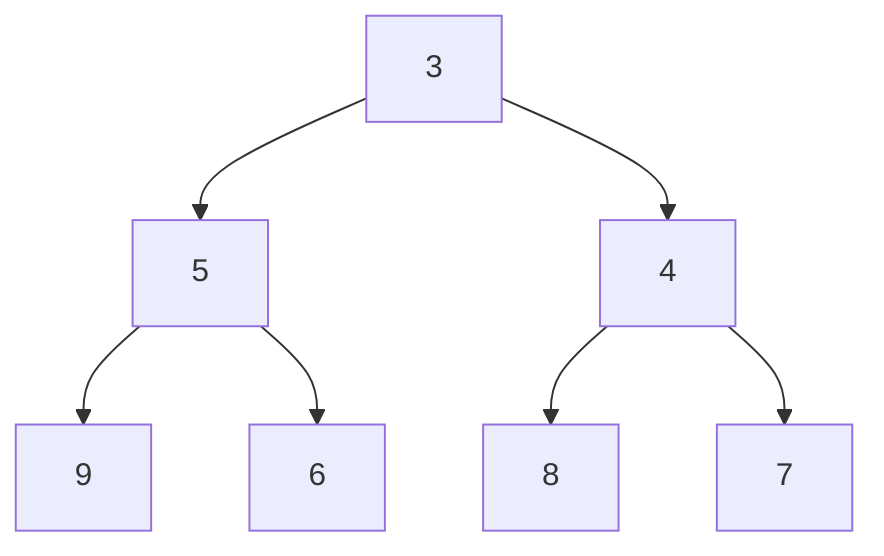
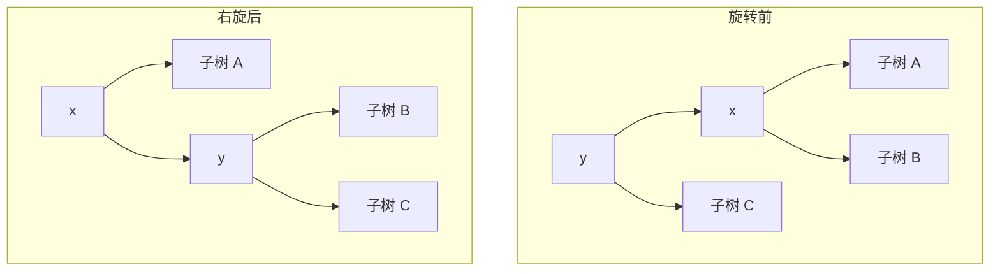
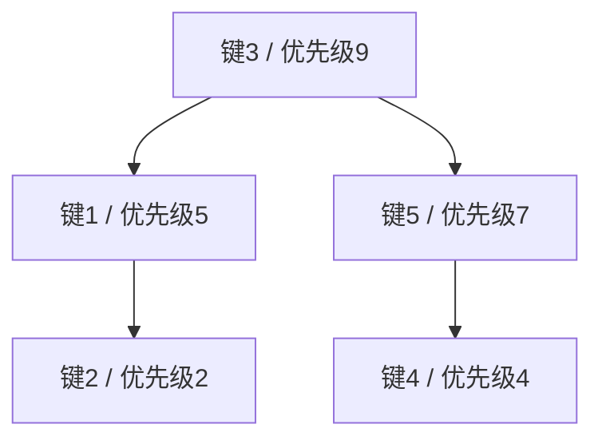
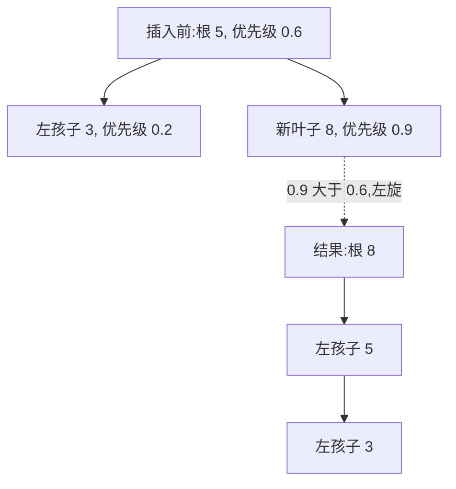

# Concept-Book Run

domain: /home/papagame/projects/digital-duck/cb-data-structure/public/domains/data_structure_ch07/input/graph.yaml
target: martinez_roura_rbst
started: 2026-11-25T04:39:50

## Teaching order (10 concepts)

- binary_search_tree
- random_permutation
- heap_property
- random_binary_search_tree
- sset_interface
- rotation
- treap
- treap_add
- treap_remove
- martinez_roura_rbst

### binary_search_tree (0.8s)

## 二叉搜索树

**定义。** 二叉搜索树(Binary Search Tree,BST)是一棵二叉树,其每个结点存储一个来自全序集的键值,并满足**搜索性质**:对任意结点 $x$,

$$
\forall\, y \in \text{left}(x):\ \text{key}(y) < \text{key}(x), \qquad \forall\, z \in \text{right}(x):\ \text{key}(z) > \text{key}(x).
$$

该性质对每个结点都成立,而不只是对根结点成立。由此可得:对 BST 做**中序遍历**(左 → 根 → 右),输出的键值严格递增。

**查找、插入与删除。** 查找键 $k$ 时,从根出发:若 $k$ 等于当前键则找到;若 $k$ 更小则进入左子树;否则进入右子树。每比较一次,就排除一整棵子树。

```python
def search(node, k):
    while node and node.key != k:
        node = node.left if k < node.key else node.right
    return node
```

插入沿用同样的路径,在遇到空位处挂上新结点。删除分三种情形:被删结点是叶子(直接移除);只有一个孩子(用孩子顶替);有两个孩子(用右子树中的最小结点,即中序后继,替换其键值,再删除该后继)。

**例题。** 依次插入 $50, 30, 70, 20, 40, 60, 80$,得到一棵完全平衡的树。查找 $60$:

1. $60 > 50$,走右子树;
2. $60 < 70$,走左子树;
3. $60 = 60$,找到,共比较 3 次。

七个结点只需最多 3 次比较。


*上例构成的二叉搜索树:每个结点左边的值更小,右边的值更大。*

**复杂度分析。** 查找、插入、删除的代价都与树高 $h$ 成正比,即 $O(h)$。树高取决于插入顺序:

- 平衡情形:$n$ 个结点的树高为 $h = \lfloor \log_2 n \rfloor$,操作为 $O(\log n)$。
- 退化情形:若按 $1,2,3,\dots,n$ 的升序插入,树退化为一条链,$h = n-1$,操作退化为 $O(n)$。
- 随机插入顺序下,期望树高为 $O(\log n)$。

**问题求解应用。**

*问题 1:验证 BST。* 一棵树是否是合法的 BST?只比较结点与其直接孩子是**不够的**。例如根为 $10$、右孩子为 $15$、而 $15$ 的左孩子为 $6$,每个局部看都合理,但 $6 < 10$ 却位于根的右子树中。正确做法是递归时携带取值区间 $(lo, hi)$,或检查中序遍历是否严格递增。

*问题 2:第 $k$ 小的元素。* 做中序遍历并计数,计到第 $k$ 个结点即停止,时间为 $O(h + k)$。

*问题 3:选择数据结构。* 需要频繁插入并保持有序,又要支持范围查询时,BST 比排序数组(插入需 $O(n)$ 移动)更合适;但若输入可能已有序,应使用 AVL 树或红黑树等自平衡变体,以保证 $h = O(\log n)$。

**小结。** BST 的核心是"每个结点把键空间一分为二",效率则完全取决于树的高度。

### random_permutation (0.8s)

## 随机排列

### 定义

**随机排列**(random permutation)是指对 $n$ 个不同元素所作的一种排列,其选取方式使得全部 $n!$ 种可能的排列**等可能**出现,即每一种排列 $\pi$ 的概率都是

$$P(\pi)=\frac{1}{n!}.$$

注意:"随机"指的是*选取过程*的性质,而不是某个排列本身"看起来乱不乱"。排列 $(1,2,3)$ 与 $(3,1,2)$ 被选中的概率完全相同。

### 例题:为什么逐位选取能做到均匀

构造随机排列的自然方法是:先从 $n$ 个元素中等概率选一个放在第 1 位,再从剩下 $n-1$ 个中等概率选一个放在第 2 位,依此类推。任意一个特定排列 $\pi$ 出现的概率为

$$\frac{1}{n}\cdot\frac{1}{n-1}\cdots\frac{1}{1}=\frac{1}{n!}.$$

这恰好满足定义。

以 $n=3$ 为例,排列 $(b,a,c)$ 的概率为 $\frac13\cdot\frac12\cdot 1=\frac16$,与另外 5 种排列相同。

### Fisher–Yates 洗牌算法

把上述思想原地实现,就得到 Fisher–Yates 算法:

```python
import random

def shuffle(a):
    for i in range(len(a) - 1, 0, -1):
        j = random.randint(0, i)   # 0 到 i 的闭区间
        a[i], a[j] = a[j], a[i]
    return a
```

第 $i$ 步从前 $i+1$ 个位置中等概率选一个换到位置 $i$,共有 $n\cdot(n-1)\cdots 2=n!$ 条等可能的执行路径,且不同路径给出不同的排列,因此结果均匀。时间复杂度为 $O(n)$。

### 问题求解应用

**问题 1(常见错误)。** 若把上面的 `random.randint(0, i)` 改为 `random.randint(0, n-1)`,结果还均匀吗?

解:此时共有 $n^n$ 条等可能路径。由于 $n!$ 不能整除 $n^n$(例如 $n=3$ 时 $27/6$ 不是整数),这些路径无法平均分配到 $n!$ 种排列上,所以**必有排列比其他排列更常见**,结果不均匀。这是一个著名的实现错误。

**问题 2(期望值)。** 随机排列中,位置 $i$ 恰好放着元素 $i$(称为不动点)的期望个数是多少?

解:令 $X_i=1$ 表示位置 $i$ 是不动点,则 $P(X_i=1)=\frac{(n-1)!}{n!}=\frac1n$。由期望的线性性,

$$E\!\left[\sum_{i=1}^n X_i\right]=n\cdot\frac1n=1.$$

也就是说,无论 $n$ 多大,平均恰有 1 个不动点。例如,把 100 封信随机装入 100 个信封,平均正好有 1 封装对。

### 小结

随机排列的核心是 $n!$ 种结果**等概率**。判断算法是否正确,只需数一数等可能路径的条数能否被 $n!$ 整除并均匀对应各排列。

### heap_property (0.8s)

## 堆性质

**定义。** 堆性质(heap property)是对树结构的一种局部约束:每个结点的优先级都必须小于其子结点的优先级。按本节的约定,数值越小优先级越高,因此根结点总是整棵树中的最小值,这样的堆称为**最小堆**。若把不等号反向,则得到最大堆。

设结点 $i$ 的键值为 $a_i$,其父结点为 $p(i)$,则堆性质可写成

$$a_{p(i)} \le a_i \quad \text{对所有非根结点 } i \text{ 成立。}$$

(严格按"小于"表述时用 $<$;允许键值相等时用 $\le$。)

需要注意,这一条件只约束**父子之间**的关系,并不要求同一层的兄弟结点有序,也不要求左子树的值都小于右子树的值。这正是堆与二叉搜索树的本质区别:堆只保证"最小值在根",换来的是更廉价的维护代价。

当堆用完全二叉树表示并存放在数组 $A[1..n]$ 中时,结点 $i$ 的父结点为 $\lfloor i/2 \rfloor$,子结点为 $2i$ 与 $2i+1$,于是堆性质等价于

$$A[\lfloor i/2 \rfloor] \le A[i], \quad 2 \le i \le n.$$

**例题。** 判断数组 $A = [3, 5, 4, 9, 6, 8, 7]$ 是否是最小堆。

逐一检查父子关系:

- $A[1]=3$:子结点 $A[2]=5$、$A[3]=4$,均大于 3 ✓
- $A[2]=5$:子结点 $A[4]=9$、$A[5]=6$,均大于 5 ✓
- $A[3]=4$:子结点 $A[6]=8$、$A[7]=7$,均大于 4 ✓

所有父子对都满足条件,因此这是一个合法的最小堆。注意 $A[2]=5 > A[3]=4$,兄弟之间无序,这并不违反堆性质。


*上述数组对应的完全二叉树:每条边上,上方结点的值都小于下方结点的值。*

**问题求解应用。** 现在把数组改为 $A = [3, 5, 4, 2, 6, 8, 7]$,即 $A[4]=2$。检查发现 $A[2]=5 > A[4]=2$,堆性质被破坏。修复方法称为**上浮**(sift-up):

1. 将 $A[4]=2$ 与其父结点 $A[2]=5$ 交换,得 $[3, 2, 4, 5, 6, 8, 7]$;
2. 此时 $A[2]=2$ 仍小于其父结点 $A[1]=3$,继续交换,得 $[2, 3, 4, 5, 6, 8, 7]$;
3. 到达根结点,停止。

此时所有父子对重新满足条件。

**复杂度。** 含 $n$ 个结点的完全二叉树高度为 $\lfloor \log_2 n \rfloor$,每次上浮至多沿一条根路径交换,所以插入一个元素并恢复堆性质的代价为 $O(\log n)$。同理,取出最小值(即根)只需 $O(1)$,再用下沉操作恢复性质需 $O(\log n)$。正是这种"根即最小值、局部维护、对数代价"的组合,使堆成为优先队列与堆排序的基础。

### random_binary_search_tree (1.0s)

## 随机二叉搜索树

### 定义

**二叉搜索树(BST)**满足:每个结点的左子树键值均小于它,右子树键值均大于它。**随机二叉搜索树**是将 $n$ 个互异键值的一个**均匀随机排列**依次插入空树(不做任何平衡操作)所得到的 BST。共有 $n!$ 种插入顺序,每种出现的概率均为 $1/n!$。注意:不同的树形出现的概率并不相等(例如 $n=3$ 时,"平衡"树形对应 2 种排列,概率为 $1/3$,而每种"链状"树形仅对应 1 种排列,概率为 $1/6$)。

最坏情况下(如按升序插入),树退化为链,高度为 $n-1$。随机性使这种情况极少出现。

### worked example:根的选择与递推

设键值为 $1,2,\dots,n$。第一个插入的元素成为根。由于排列是均匀随机的,根为第 $k$ 小元素的概率为 $1/n$。若根为 $k$,则左子树恰由 $\{1,\dots,k-1\}$ 构成,右子树由 $\{k+1,\dots,n\}$ 构成,且两棵子树各自仍是随机二叉搜索树。这与快速排序中"随机选主元"的结构完全一致。

令 $C_n$ 为随机 BST 中所有结点深度之和的期望(内部路径长度),则
$$
C_n = (n-1) + \frac{1}{n}\sum_{k=1}^{n}\bigl(C_{k-1} + C_{n-k}\bigr) = (n-1) + \frac{2}{n}\sum_{k=0}^{n-1} C_k .
$$
(每个非根结点因根的存在深度加 1,共 $n-1$ 项。)

用 $nC_n-(n-1)C_{n-1}$ 作差消去求和:
$$
nC_n = (n+1)C_{n-1} + 2(n-1)\;\Longrightarrow\;\frac{C_n}{n+1}=\frac{C_{n-1}}{n}+\frac{2(n-1)}{n(n+1)} .
$$
累加得 $C_n = 2(n+1)H_n - 4n \approx 2n\ln n$,其中 $H_n=\sum_{i=1}^n 1/i$ 为调和数。因此**平均结点深度**约为 $2\ln n\approx 1.39\log_2 n$,即一次查找的期望比较次数为 $O(\log n)$。

### 问题求解应用:期望高度

平均深度为对数级,而**高度**(最大深度)需要更强的结论。设 $H_n^{\text{tree}}$ 为高度,$Y_n=2^{H_n^{\text{tree}}}$。由根的分裂,$Y_n = 2\max(Y_{L},Y_{R})$,于是
$$
\mathbb{E}[Y_n] \le \frac{2}{n}\sum_{k=1}^{n}\bigl(\mathbb{E}[Y_{k-1}]+\mathbb{E}[Y_{n-k}]\bigr)=\frac{4}{n}\sum_{k=0}^{n-1}\mathbb{E}[Y_k].
$$
归纳可得 $\mathbb{E}[Y_n]\le \tfrac14\binom{n+3}{3}=O(n^3)$。由 Jensen 不等式($2^x$ 为凸函数):
$$
2^{\mathbb{E}[H_n^{\text{tree}}]}\le \mathbb{E}[Y_n]=O(n^3)\;\Longrightarrow\;\mathbb{E}[H_n^{\text{tree}}]\le 3\log_2 n+O(1).
$$
更精细的分析(Reed, 2003)表明 $\mathbb{E}[H_n^{\text{tree}}]\approx 4.311\ln n$,仍为 $O(\log n)$。

**练习**:对 $n=1000$ 的随机 BST,估计期望高度与平均查找比较次数。
**解**:$2\ln 1000\approx 13.8$(平均深度),$4.311\ln 1000\approx 29.8$(高度)。远小于最坏情况的 $999$。

**要点**:随机插入顺序使 BST 以高概率保持近似平衡,无需旋转;但若输入顺序由对手控制,则需使用 Treap、AVL 等结构来人为"制造"随机性或强制平衡。

### sset_interface (0.7s)

## Sset Interface(集合接口)

### 定义

**SSet(有序集合,Sorted Set)接口**是一种抽象数据类型,用于存储一组**可比较**的元素(即任意两个元素 $x,y$ 都能判断 $x<y$、$x=y$ 或 $x>y$)。它要求实现以下三种操作:

- `add(x)`:将 $x$ 加入集合;若 $x$ 已存在则不加入,返回是否成功。
- `remove(x)`:从集合中删除 $x$,返回是否成功。
- `find(x)`:返回集合中**不小于 $x$ 的最小元素** $y$(即后继),若不存在则返回空值。

注意:`find(x)` 不只是判断"是否存在",它还能在 $x$ 不在集合中时给出后继。这个设计使得 SSet 既能做成员查询,也能做范围查询。

数学上,若集合为 $S$,则
$$
\texttt{find}(x)=\min\{\,y\in S \mid y\ge x\,\}.
$$

SSet 只规定"做什么",不规定"怎么做";跳表、二叉搜索树、红黑树等都是它的具体实现。

### 例题

设 $S=\{3,7,12,20\}$,依次执行:

1. `find(8)`:大于等于 8 的元素有 12、20,最小者为 $12$,返回 $12$。
2. `find(7)`:7 本身在集合中,返回 $7$。
3. `find(25)`:没有不小于 25 的元素,返回空值。
4. `add(10)`:$S=\{3,7,10,12,20\}$。
5. `remove(7)`:$S=\{3,10,12,20\}$,之后 `find(7)` 返回 $10$。

### 问题求解应用

**问题**:给定一组已排序的预约时间点(分钟),判断能否在时刻 $t$ 之后至少空出 $d$ 分钟安排会议,即下一个已有预约是否不早于 $t+d$。

**思路**:用 SSet 存储所有预约开始时间,只需一次 `find`:

```python
def can_schedule(sset, t, d):
    nxt = sset.find(t)          # 不早于 t 的最近预约
    return nxt is None or nxt >= t + d
```

若 $S=\{540,600,720\}$,查询 $t=545,\ d=30$:`find(545)=600`,而 $600\ge 575$,故可以安排。若 $d=60$,则 $600<605$,不可以。

这里若用无序列表,`find` 需要扫描全部 $n$ 个元素,时间为 $O(n)$;而用平衡二叉搜索树或跳表实现 SSet,`add`、`remove`、`find` 均可在期望或最坏 $O(\log n)$ 时间内完成。因此:

$$
T_{\text{列表}}(n)=O(n)\quad\text{对比}\quad T_{\text{SSet}}(n)=O(\log n).
$$

当 $n=10^6$ 时,前者约需百万次比较,后者约 20 次($\log_2 10^6\approx 20$)。

### 小结

SSet 接口的核心在于:元素**可比较**,且 `find(x)` 返回**后继**而非仅返回"是否存在"。理解接口与实现的分离,是选择合适数据结构解决实际问题的第一步。

### rotation (0.8s)

## 旋转

**定义。** 在二叉搜索树(BST)中,**旋转**(rotation)是一种仅涉及两个相邻节点的局部修改:它交换这两个节点的父子关系,同时保持二叉搜索树性质——对任意节点 $x$,左子树所有键值 $\le x.\text{key}$,右子树所有键值 $\ge x.\text{key}$。旋转只改变常数个指针,时间复杂度为 $O(1)$,并且不改变中序遍历的顺序。

设节点 $y$ 的左孩子为 $x$。**右旋**(以 $y$ 为轴)使 $x$ 成为 $y$ 的父节点;**左旋**是其镜像操作。

**右旋的步骤**(子树 $A,B,C$ 满足 $A < x < B < y < C$):

1. $x$ 的右子树 $B$ 改为 $y$ 的左子树;
2. $y$ 成为 $x$ 的右孩子;
3. $x$ 取代 $y$ 原来在其父节点下的位置。


*右旋前后的结构对比:$x$ 上升、$y$ 下降,子树 $B$ 从 $x$ 的右侧转移到 $y$ 的左侧,中序顺序 $A, x, B, y, C$ 保持不变。*

**例题。** 在键值为 $10, 20, 30$ 依次插入的 BST 中,得到一条向右倾斜的链:$10 \to 20 \to 30$(每个节点是前一个的右孩子)。对根节点 $10$ 做左旋:

- 令 $y=10$,其右孩子 $x=20$;
- $20$ 的左子树(空)变为 $10$ 的右子树;
- $10$ 成为 $20$ 的左孩子,$20$ 成为新根。

结果是以 $20$ 为根、左孩子 $10$、右孩子 $30$ 的平衡树,高度从 $3$ 降为 $2$。中序遍历仍为 $10, 20, 30$,BST 性质得以保持。

**为什么性质不变?** 旋转前 $x$ 在 $y$ 的左侧,故 $x<y$。子树 $B$ 中的键满足 $x<b<y$。旋转后 $B$ 位于 $y$ 的左子树,仍小于 $y$;$y$ 位于 $x$ 的右子树,仍大于 $x$。$A$ 仍在 $x$ 左侧,$C$ 仍在 $y$ 右侧。所有大小关系均未被破坏。

**问题求解应用。** 普通 BST 在有序输入下退化为链,查找代价为 $O(n)$。AVL 树和红黑树利用旋转修复失衡:

- **左左情形**(节点 $z$ 的左子树过高,且新节点在其左孩子的左侧):对 $z$ 做一次右旋。
- **左右情形**:先对 $z$ 的左孩子做左旋,将其转为左左情形,再对 $z$ 右旋(双旋转)。

由于每次旋转代价为 $O(1)$,且一次插入最多需要常数次旋转(AVL 树中至多两次),树高可维持在 $O(\log n)$,因此查找、插入、删除的复杂度都是 $O(\log n)$。

**练习。** 对链 $5 \to 3 \to 1$(每个节点是上一个节点的左孩子)应该做哪种旋转?请画出结果并验证中序遍历。(答案:对根 $5$ 右旋,得到根为 $3$、左孩子 $1$、右孩子 $5$ 的树。)

### treap (0.8s)

## Treap(树堆)

**定义。** 树堆是一种同时满足两条性质的二叉树。每个节点存有一个键 $k$ 和一个随机分配的优先级 $p$:

- **二叉搜索树性质:** 左子树所有键 $<$ 当前节点的键 $<$ 右子树所有键;
- **堆性质(最大堆):** 每个节点的优先级 $\ge$ 其子节点的优先级。

**关键事实:** 若所有键互不相同,且优先级互不相同,则满足这两条性质的树**唯一**。构造方法是:优先级最大的节点作根,其余键按大小分到左右两侧,再递归构造。这等价于"按优先级从大到小的顺序依次向普通二叉搜索树中插入键",而随机优先级相当于随机的插入顺序。因此树堆的形状与随机二叉搜索树同分布,与键的插入顺序无关。

**插入与删除。**
1. 插入:先按二叉搜索树规则放到叶子位置,再对新节点反复做旋转,直到其优先级不大于父节点。
2. 删除:把目标节点不断向优先级较大的孩子方向旋转,直到成为叶子,再删去。

**例题。** 键 $1,2,3,4,5$ 依次插入,其优先级依次为 $(1,5),(2,2),(3,9),(4,4),(5,7)$,即(键,优先级)。

根是优先级最大的 $(3,9)$。左侧键 $\{1,2\}$ 中,$(1,5)$ 优先级更大,作为左子树的根,$(2,2)$ 是其右孩子。右侧键 $\{4,5\}$ 中,$(5,7)$ 作为根,$(4,4)$ 是其左孩子。树高为 $3$。

注意:如果没有随机优先级,按顺序 $1,\dots,5$ 插入普通二叉搜索树会退化成高度为 $5$ 的链。


*例题中的树堆:键满足搜索树性质,优先级自上而下递减。*

**问题求解:期望深度分析。** 要证明树堆的期望高度为 $O(\log n)$,先看节点 $x_j$ 的期望深度。节点 $x_i$ 是 $x_j$ 的祖先,当且仅当在键区间 $[\min(i,j),\max(i,j)]$ 内,$x_i$ 的优先级最大。该区间共有 $|i-j|+1$ 个节点,优先级随机,故

$$P(x_i \text{ 是 } x_j \text{ 的祖先}) = \frac{1}{|i-j|+1}\quad (i\ne j).$$

由期望的线性性,

$$E[\text{depth}(x_j)] = \sum_{i\ne j}\frac{1}{|i-j|+1} \le 2\sum_{m=2}^{n}\frac1m = 2(H_n-1) = O(\log n).$$

其中 $H_n$ 是调和数。所以查找、插入、删除的期望时间都是 $O(\log n)$,该结论对任何输入顺序都成立。再结合对数级的高概率上界,可得期望高度也是 $O(\log n)$。

**练习:** 在上例中,计算 $E[\text{depth}(x_3)]$(设 $n=5$,根深度为 $0$)。

*提示:* 代入 $j=3$,求 $\sum_{i\ne3}\frac{1}{|i-3|+1}=2\left(\frac12+\frac13\right)=\frac53$。

### treap_add (0.6s)

## 树堆插入(Treap Add)

### 定义

**树堆(treap)**是同时满足两种性质的二叉树:对键值 $key$ 是**二叉搜索树**(左子树键值更小,右子树键值更大),对随机**优先级** $pri$ 是**堆**(本文取最大堆:父节点优先级不小于子节点)。

**插入(add)**分两步:

1. 按二叉搜索树规则下降,把新节点作为**叶子**挂上,并为其赋一个独立的随机优先级(例如 $[0,1)$ 上的均匀随机数)。
2. 若新节点优先级大于父节点,就做一次**旋转**把它上移,重复直到堆性质恢复(称为"冒泡")。

旋转不改变中序顺序,所以搜索树性质始终保持。设 $x$ 是 $p$ 的左孩子,右旋后 $x$ 成为 $p$ 的父节点,$x$ 原来的右子树变为 $p$ 的左子树;右孩子的情形是镜像的左旋。

### 例题

向空树依次插入 (键, 优先级):$(5, 0.6)$、$(3, 0.2)$、$(8, 0.9)$。

- 插入 $(5,0.6)$:成为根。
- 插入 $(3,0.2)$:$3<5$,作为左孩子;$0.2<0.6$,无需旋转。
- 插入 $(8,0.9)$:$8>5$,作为右孩子;$0.9>0.6$,违反堆性质,对 $5$ 做**左旋**,$8$ 上升为根,$5$ 成为 $8$ 的左孩子,$3$ 仍是 $5$ 的左孩子。

最终:根 $(8,0.9)$,其左孩子 $(5,0.6)$,再左孩子 $(3,0.2)$。中序仍为 $3,5,8$,且每个父节点优先级都不小于子节点。


*新叶子 8 的优先级超过父节点,触发一次左旋并上升为根。*

### 问题求解:为什么期望是 $O(\log n)$

**定理的核心结论:** 优先级互不相同时,树堆的形状由优先级唯一确定——它与"按优先级从大到小依次插入的普通二叉搜索树"完全相同。由于优先级是独立随机的,这等价于**随机顺序插入**的二叉搜索树。

于是第 $k$ 小的节点深度可以这样计算:节点 $j$ 是节点 $k$ 的祖先,当且仅当 $j$ 在键值区间 $[\min(j,k),\max(j,k)]$ 内优先级最大,概率为 $\dfrac{1}{|j-k|+1}$。由期望的线性性,

$$
\mathbb{E}[\text{depth}(k)]=\sum_{j\ne k}\frac{1}{|j-k|+1}\le 2\sum_{i=2}^{n}\frac1i=2(H_n-1)=O(\log n).
$$

下降查找路径的代价与深度成正比;旋转次数等于新节点最终上升的层数,不超过其叶子深度,同样是期望 $O(\log n)$。(事实上期望旋转次数小于 $2$,因为它等于新节点在最终树中子树的"脊"长度,期望为常数。)

**应用提示:** 用有序键值批量构建数据结构时,若插入顺序恰好有序,普通二叉搜索树会退化为 $O(n)$ 的链表;树堆因为随机优先级,与输入顺序无关,仍保持期望 $O(\log n)$ 的深度。

### treap_remove (0.7s)

## 树堆删除(Treap Remove)

### 定义

树堆(treap)同时是关于键的**二叉搜索树**和关于随机优先级 $p(u)$ 的**堆**(这里取最小堆:父节点优先级小于子节点)。`remove(x)` 是 `add(x)` 的逆过程:`add` 先按搜索树规则把 $x$ 插为叶子,再通过旋转**上浮**到满足堆序的位置;`remove` 则先找到含 $x$ 的节点 $u$,再通过旋转让 $u$ **下沉**(trickle down)到叶子,最后直接摘除。

算法步骤:

1. 像二叉搜索树一样查找 $u$。
2. 当 $u$ 不是叶子时:若只有一个孩子,就旋转该孩子上来;若有两个孩子,就旋转**优先级更小**的那个孩子上来(这样新的父节点优先级仍小于另一个孩子,堆序得以保持)。
3. 当 $u$ 成为叶子后,把它从父节点处断开。

旋转不改变中序序列,所以每一步都保持二叉搜索树性质。

### 例题

设树堆节点以 键(优先级) 表示:根为 $5(1)$,其左孩子 $3(4)$,右孩子 $8(2)$;$8$ 的左孩子为 $6(7)$,右孩子为 $9(5)$。删除 $x=5$。

- 根 $5$ 有两个孩子,优先级 $2<4$,故右旋/左旋使 $8$ 上来(对 $5$ 做**左旋**)。此时 $8(2)$ 为根,左孩子 $5(1)$ ……注意:旋转要把 $5$ 降为 $8$ 的左孩子,而 $6(7)$ 转为 $5$ 的右孩子。现在 $5$ 的孩子是 $3(4)$ 与 $6(7)$。
- 仍有两个孩子,$4<7$,选 $3$:对 $5$ 做**右旋**,$3$ 成为 $8$ 的左孩子,$5$ 成为 $3$ 的右孩子,$5$ 只剩孩子 $6(7)$。
- 只有一个孩子,左旋使 $6$ 上来,$5$ 变为叶子。
- 摘除 $5$。

共 3 次旋转,最终树仍是合法的树堆。

### 问题求解与分析

**复杂度。** 删除所用旋转次数恰为 $u$ 在被删除前的**左子树右脊**长度与**右子树左脊**长度之和(每次旋转让其中一条脊减少 1)。这与 `add(x)` 中上浮所用的旋转次数相同(时间反演:`add` 的逆就是 `remove`)。由随机优先级的对称性,对大小为 $n$ 的树堆,节点 $u$ 的期望深度为 $O(\log n)$,而查找路径长度与旋转次数都被这类脊长度控制,具体地,秩为 $i$ 的节点,其两条脊的期望长度之和满足

$$
E[\text{旋转次数}] \le \left(1-\tfrac{1}{i+1}\right)+\left(1-\tfrac{1}{n-i}\right) < 2 .
$$

因此旋转部分期望只需**常数**次,总时间由查找主导,为期望 $O(\log n)$。

**应用要点。**
- 若不选优先级更小的孩子上旋,堆序会被破坏,这是常见错误。
- 删除后无需重新生成随机数;其余节点的优先级保持独立,树的形状分布与"直接插入剩余键"所得一致,因此期望性能不会随反复增删而退化。
- 练习:在上例中把 $9(5)$ 换成 $9(3)$,重新追踪旋转序列,并验证旋转次数。

### martinez_roura_rbst (1.0s)

## Martinez Roura Rbst

### 定义

**Martinez–Roura 随机化二叉搜索树(RBST)** 是 Treap 的一种变体:节点不再保存随机优先级,而是保存**子树大小** $s(v)$。随机性不在节点中存储,而在每次插入或删除时*现场*抽取,并且概率由子树大小决定。

其核心不变量是:**含 $n$ 个键的 RBST,其形状分布与"将 $n$ 个键按随机排列依次插入普通二叉搜索树"所得的分布完全相同。** 因此期望深度为 $O(\log n)$,并且与插入顺序无关。

### 插入规则

在大小为 $n$ 的树 $T$ 中插入新键 $x$:

1. 以概率 $\dfrac{1}{n+1}$,把 $x$ 作为**新的根**插入:按 $x$ 对 $T$ 做 split,得到 $L$ 和 $R$,分别作为左、右子树。
2. 否则(概率 $\dfrac{n}{n+1}$),按键的大小递归插入左子树或右子树,并更新 $s(\text{root})$。

原因:在 $n+1$ 个键的随机排列中,$x$ 恰好排在最前(成为根)的概率正是 $\frac{1}{n+1}$。

### 删除规则

删除根 $v$ 时,需要把左子树 $L$(大小 $m$)与右子树 $R$(大小 $k$)合并为一棵树,称为 **join**:

- 以概率 $\dfrac{m}{m+k}$,$L$ 的根成为新根,递归地将 $L$ 的右子树与 $R$ 合并;
- 以概率 $\dfrac{k}{m+k}$,$R$ 的根成为新根,递归地将 $L$ 与 $R$ 的左子树合并。

### 例题

向空树依次插入键 $1,2,3$(最坏情形:已排序的输入)。

- 插入 $1$:$n=0$,概率 $\frac{1}{1}=1$,成为根。
- 插入 $2$:$n=1$。以 $\frac12$ 成为新根(split 后 $1$ 在左);以 $\frac12$ 作为 $1$ 的右孩子。
- 插入 $3$:$n=2$。以 $\frac13$ 成为根,否则递归进入右侧。

检验长度为 $3$ 的链($1\to2\to3$)的概率:$\frac12\cdot\frac23=\frac13$。在 $3!=6$ 种插入排列中,只有排列 $(1,2,3)$ 产生这条链,概率应为 $\frac16$。这里需要小心:链 $1\to2\to3$ 对应的是 $2$ 在 $1$ 右侧、$3$ 在 $2$ 右侧——插入 $3$ 时必须不成为根(概率 $\frac23$),再进入右子树 $\{2\}$ 后不成为其根(概率 $\frac12$),合计 $\frac12\cdot\frac23\cdot\frac12=\frac16$。✓ 与随机排列一致。

### 问题求解应用

**证明期望深度。** 设 $D(n)$ 为大小为 $n$ 的 RBST 中随机节点的期望深度。根以均匀概率把其余 $n-1$ 个键分成大小 $(i,\,n-1-i)$,故

$$D(n)=\frac{1}{n}\sum_{i=0}^{n-1}\frac{i\,(D(i)+1)+(n-1-i)\,(D(n-1-i)+1)}{n}\;\Rightarrow\; D(n)=O(\log n).$$

这与随机快速排序的递推相同,解为 $D(n)\approx 2\ln n$。

**与 Treap 对比:** Treap 需要存储 $O(n)$ 个随机优先级,并要求优先级互不相同;RBST 用已维护的子树大小代替,同时天然支持按秩查询($k$ 小元素)。代价是每次更新都要抽取随机数并维护 $s(v)$。

**练习:** 在大小为 $7$ 的 RBST 中插入新键,它成为根的概率是多少?(答案:$\frac18$。)

## Run complete

total: 17.0s
