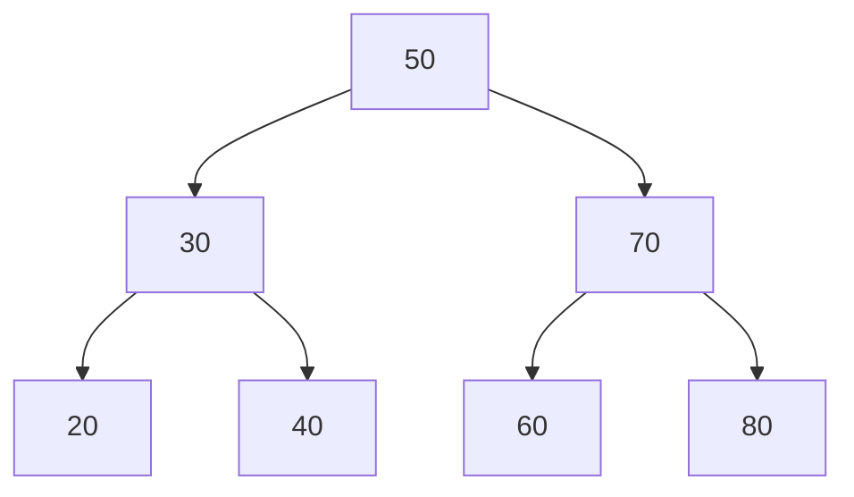
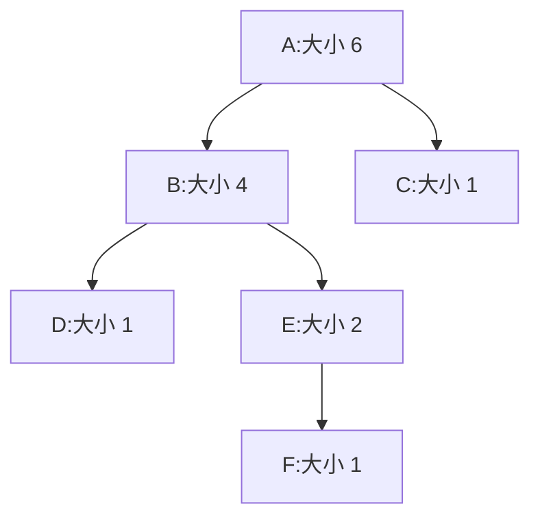
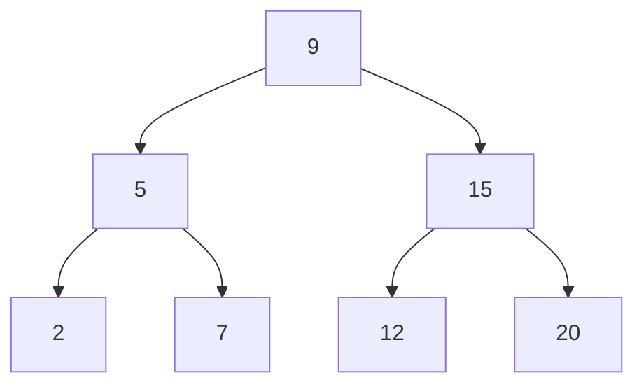
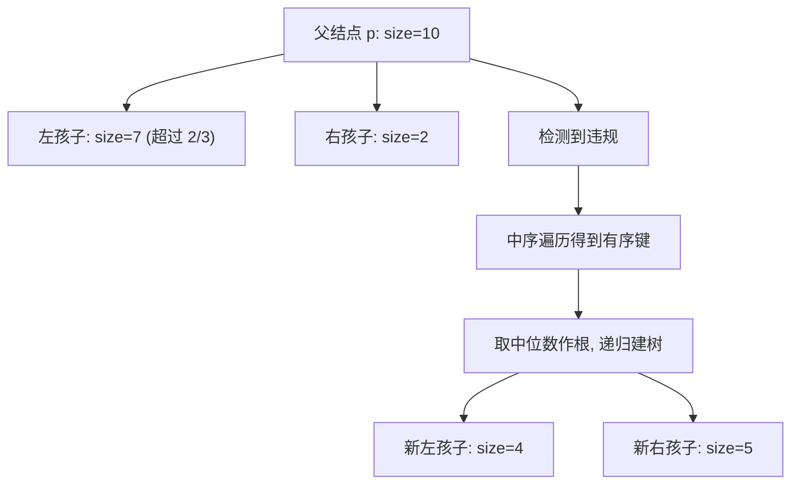

# Concept-Book Run

domain: /home/papagame/projects/digital-duck/cb-data-structure/public/domains/data_structure_ch08/input/graph.yaml
target: weight_balanced_tree
started: 2026-11-25T04:40:38

## Teaching order (5 concepts)

- binary_search_tree
- scapegoat_tree
- subtree_size
- rebuild_operation
- weight_balanced_tree

### binary_search_tree (0.5s)

## 二叉搜索树

**定义。** 二叉搜索树(Binary Search Tree,BST)是一棵二叉树,其每个结点存储一个来自全序集的键值,并满足**搜索性质**:对任意结点 $x$,

$$
\forall\, y \in \text{left}(x):\ \text{key}(y) < \text{key}(x), \qquad \forall\, z \in \text{right}(x):\ \text{key}(z) > \text{key}(x).
$$

该性质对每个结点都成立,而不只是对根结点成立。由此可得:对 BST 做**中序遍历**(左 → 根 → 右),输出的键值严格递增。

**查找、插入与删除。** 查找键 $k$ 时,从根出发:若 $k$ 等于当前键则找到;若 $k$ 更小则进入左子树;否则进入右子树。每比较一次,就排除一整棵子树。

```python
def search(node, k):
    while node and node.key != k:
        node = node.left if k < node.key else node.right
    return node
```

插入沿用同样的路径,在遇到空位处挂上新结点。删除分三种情形:被删结点是叶子(直接移除);只有一个孩子(用孩子顶替);有两个孩子(用右子树中的最小结点,即中序后继,替换其键值,再删除该后继)。

**例题。** 依次插入 $50, 30, 70, 20, 40, 60, 80$,得到一棵完全平衡的树。查找 $60$:

1. $60 > 50$,走右子树;
2. $60 < 70$,走左子树;
3. $60 = 60$,找到,共比较 3 次。

七个结点只需最多 3 次比较。


*上例构成的二叉搜索树:每个结点左边的值更小,右边的值更大。*

**复杂度分析。** 查找、插入、删除的代价都与树高 $h$ 成正比,即 $O(h)$。树高取决于插入顺序:

- 平衡情形:$n$ 个结点的树高为 $h = \lfloor \log_2 n \rfloor$,操作为 $O(\log n)$。
- 退化情形:若按 $1,2,3,\dots,n$ 的升序插入,树退化为一条链,$h = n-1$,操作退化为 $O(n)$。
- 随机插入顺序下,期望树高为 $O(\log n)$。

**问题求解应用。**

*问题 1:验证 BST。* 一棵树是否是合法的 BST?只比较结点与其直接孩子是**不够的**。例如根为 $10$、右孩子为 $15$、而 $15$ 的左孩子为 $6$,每个局部看都合理,但 $6 < 10$ 却位于根的右子树中。正确做法是递归时携带取值区间 $(lo, hi)$,或检查中序遍历是否严格递增。

*问题 2:第 $k$ 小的元素。* 做中序遍历并计数,计到第 $k$ 个结点即停止,时间为 $O(h + k)$。

*问题 3:选择数据结构。* 需要频繁插入并保持有序,又要支持范围查询时,BST 比排序数组(插入需 $O(n)$ 移动)更合适;但若输入可能已有序,应使用 AVL 树或红黑树等自平衡变体,以保证 $h = O(\log n)$。

**小结。** BST 的核心是"每个结点把键空间一分为二",效率则完全取决于树的高度。

### scapegoat_tree (0.9s)

## 替罪羊树

**定义。** 替罪羊树(scapegoat tree)是一种自平衡二叉搜索树,它不使用旋转,也不在节点中存储平衡因子或颜色,只额外维护两个计数器:$n$ 为当前节点数,$q$ 为自上次整体重建以来的"上界"计数(插入时增加,删除时 $n$ 减少,而 $q$ 保持不变,仅当 $n<\alpha q$ 时重建整棵树并令 $q=n$)。设平衡参数 $\alpha\in(\tfrac12,1)$。树被称为 **$\alpha$-高度平衡**,当且仅当其高度满足
$$h\le \lfloor\log_{1/\alpha} q\rfloor .$$
若插入后某节点深度超过 $\log_{1/\alpha} q$,就沿插入路径向上寻找一个"替罪羊":满足
$$\frac{\text{size}(\text{子节点})}{\text{size}(\text{该节点})}>\alpha$$
的最近祖先。随后将以替罪羊为根的子树拍平成有序序列,再重建为完全平衡的子树。这就是**部分重建**。

**例题。** 取 $\alpha=\tfrac23$,依次插入 $1,2,3,4$ 得到一条链:$1\to2\to3\to4$,此时 $n=q=4$。允许的最大深度为 $\lfloor\log_{3/2}4\rfloor=\lfloor 3.42\rfloor=3$。插入 $4$ 的深度恰为 $3$,未超限。再插入 $5$,此时 $n=q=5$,深度为 $4$,而 $\lfloor\log_{3/2}5\rfloor=\lfloor3.97\rfloor=3$,违反条件。从新节点 $5$ 向上检查:

- 节点 $4$:$\text{size}(5)/\text{size}(4)=1/2\le\tfrac23$,不是替罪羊;
- 节点 $3$:$2/3\le\tfrac23$,不是;
- 节点 $2$:$3/4>\tfrac23$,是替罪羊。

将以 $2$ 为根的子树 $\{2,3,4,5\}$ 中序拍平,取中位数重建,得到根为 $3$(或 $4$)的平衡子树。整棵树高度降为 $3$,条件恢复。

**问题求解应用。** 为什么重建代价是可接受的?关键是摊还分析:

1. **查找** 始终是 $O(\log n)$,因为高度 $\le\log_{1/\alpha}q$,且 $q\le n/\alpha$,故 $h=O(\log n)$。
2. **重建** 一棵含 $s$ 个节点的子树需要 $\Theta(s)$ 时间。替罪羊子树在重建后是完全平衡的,要再次变得失衡(某子节点占比超过 $\alpha$),必须在其中再做 $\Omega(s)$ 次插入或删除。因此重建代价可分摊到这些操作上,每次操作摊还 $O(\log n)$。
3. **删除** 只做普通 BST 删除,并令 $n$ 减 1;当 $n<\alpha q$ 时重建整棵树,代价 $\Theta(n)$ 可由此前至少 $(1-\alpha)q$ 次删除分摊。

**小结。** 替罪羊树用"偶尔大扫除"取代"每次小调整":查找最坏 $O(\log n)$,插入与删除摊还 $O(\log n)$,实现简单、节点无额外字段,代价是个别操作可能耗时 $O(n)$。$\alpha$ 越接近 $\tfrac12$,树越矮但重建越频繁;越接近 $1$,则相反。

### subtree_size (0.7s)

## 子树大小

### 定义

在一棵二叉树中,以节点 $v$ 为根的**子树大小**(subtree size)指这棵子树所包含的节点总数,包括 $v$ 本身,记作 $\operatorname{size}(v)$。它满足递推关系:

$$
\operatorname{size}(v)=
\begin{cases}
0, & v=\text{空},\\[4pt]
1+\operatorname{size}(v.\text{left})+\operatorname{size}(v.\text{right}), & \text{否则}.
\end{cases}
$$

叶节点的子树大小为 $1$,整棵树的大小就是根节点的子树大小。子树大小常用来衡量**平衡性**:若每个节点的左右子树大小相差不大,树的高度就接近 $\log_2 n$,查找、插入等操作的代价也就接近 $O(\log n)$。

### 例题

考虑如下二叉树:根节点 $A$ 的左孩子为 $B$,右孩子为 $C$;$B$ 的左孩子为 $D$,右孩子为 $E$;$E$ 的左孩子为 $F$。

自底向上计算:

- $\operatorname{size}(D)=\operatorname{size}(C)=\operatorname{size}(F)=1$;
- $\operatorname{size}(E)=1+\operatorname{size}(F)+0=2$;
- $\operatorname{size}(B)=1+\operatorname{size}(D)+\operatorname{size}(E)=1+1+2=4$;
- $\operatorname{size}(A)=1+\operatorname{size}(B)+\operatorname{size}(C)=1+4+1=6$。


*图中每个节点标注了以它为根的子树大小,数值由叶向根逐层累加得到。*

### 问题求解应用:判断平衡条件

**权重平衡**(weight-balanced)树要求:对每个节点 $v$,较大的一侧子树大小不超过整棵子树的某个比例,例如

$$
\max\big(\operatorname{size}(v.\text{left}),\ \operatorname{size}(v.\text{right})\big)\le \alpha\cdot \operatorname{size}(v),\quad \tfrac12<\alpha<1 .
$$

取 $\alpha=\tfrac23$ 检查上例的根 $A$:较大一侧为 $\operatorname{size}(B)=4$,而 $\alpha\cdot 6=4$,$4\le 4$,条件成立。再检查 $B$:$\max(1,2)=2$,$\alpha\cdot 4\approx 2.67$,成立。检查 $E$:较大一侧为 $1$,$\alpha\cdot 2\approx1.33$,成立。所以这棵树满足 $\alpha=\tfrac23$ 的权重平衡。

**为什么这能保证高度?** 每向下走一步,子树大小至多变为原来的 $\alpha$ 倍,所以走 $h$ 步后大小至多为 $n\alpha^h$。大小至少为 $1$,故 $n\alpha^h\ge 1$,即

$$
h\le \frac{\log n}{\log(1/\alpha)}=O(\log n).
$$

**实现要点:**在节点中缓存 $\operatorname{size}$ 字段,每次插入或删除后沿路径回溯更新:$v.\text{size}\leftarrow 1+\operatorname{size}(v.\text{left})+\operatorname{size}(v.\text{right})$。这样每次平衡检查只需 $O(1)$ 时间,而不必重新遍历整棵子树($O(n)$)。同一字段还能支持**顺序统计**:要找第 $k$ 小的元素,比较 $k$ 与 $\operatorname{size}(v.\text{left})+1$,即可决定向左、向右或就是当前节点,耗时 $O(h)$。

### rebuild_operation (0.6s)

## 重建操作(Rebuild Operation)

**定义。** 在平衡二叉搜索树(如替罪羊树)中,当以结点 $u$ 为根的子树失衡时,**重建操作**会销毁该子树,并用同样的 $\text{size}(u)$ 个键重新构造一棵**完美平衡**的二叉搜索树。整个过程耗时 $O(\text{size}(u))$,由辅助过程 `build_balanced` 完成。

重建分两步:

1. **压平(flatten)**:对 $u$ 的子树做中序遍历,按升序把所有键收集到数组 $A[0..m-1]$,其中 $m=\text{size}(u)$。
2. **建树(build_balanced)**:递归地取中点作根,左半段建左子树,右半段建右子树。

```python
def build_balanced(A, lo, hi):      # 区间 [lo, hi)
    if lo >= hi: return None
    mid = (lo + hi) // 2
    node = Node(A[mid])
    node.left  = build_balanced(A, lo, mid)
    node.right = build_balanced(A, mid + 1, hi)
    return node
```

**为什么是 $O(m)$?** 中序遍历访问每个结点一次,耗时 $O(m)$;`build_balanced` 为每个键恰好创建一个结点,其递归式为
$$T(m)=2T(m/2)+O(1),$$
由主定理(或直接计数:共 $m$ 个结点,每个 $O(1)$)得 $T(m)=O(m)$。因每次取中点,左右子树大小至多相差 1,故树高为 $\lceil \log_2(m+1)\rceil$。

**例题。** 设某子树中序遍历得 $A=[2,5,7,9,12,15,20]$($m=7$)。

- 区间 $[0,7)$:$\text{mid}=3$,根为 $9$。
- 左段 $[2,5,7]$:根 $5$,孩子 $2$、$7$。
- 右段 $[12,15,20]$:根 $15$,孩子 $12$、$20$。

结果是高度为 $2$ 的满二叉树,其中 $\lceil\log_2 8\rceil=3$ 层。原先若是一条退化的链(高度 $6$),重建后查询代价从 $O(m)$ 降到 $O(\log m)$。


*图:对有序数组 [2,5,7,9,12,15,20] 调用 build_balanced 得到的完美平衡树。*

**问题求解应用。** 替罪羊树规定:若某结点 $v$ 满足 $\text{size}(v.\text{child}) > \alpha\cdot \text{size}(v)$($\tfrac12<\alpha<1$),则称其失衡。插入后沿路径向上找到**最高**的失衡祖先 $u$,对其执行重建。

*摊还分析思路*:重建后 $u$ 的两棵子树大小几乎相等,要再次使 $u$ 失衡,至少需要 $\Omega\big((2\alpha-1)\,\text{size}(u)\big)$ 次插入。把重建的 $O(\text{size}(u))$ 代价均摊给这些插入,每次插入摊到 $O(1)$ 的重建费用;每个键又至多被其 $O(\log n)$ 个祖先"付费",故插入的摊还代价为 $O(\log n)$。

**练习。** 对 $A=[1,\dots,10]$ 调用 `build_balanced`(区间 $[0,10)$),写出根结点以及左、右子树的大小,并验证树高为 $\lceil\log_2 11\rceil=4$。(提示:$\text{mid}=5$,根为 $A[5]=6$,左子树 5 个键,右子树 4 个键。)

### weight_balanced_tree (0.7s)

## 权重平衡树(Weight Balanced Tree)

### 定义

**权重平衡树**是一种与替罪羊树(ScapegoatTree)相关的二叉搜索树变体。它用子树大小(权重)来保证平衡:对每个结点 $u$,要求

$$
\operatorname{size}(u) \le \tfrac{2}{3}\,\operatorname{size}(u.\text{parent}),
$$

其中 $\operatorname{size}(u)$ 表示以 $u$ 为根的子树中的结点数。也就是说,任何孩子所含的结点数都不超过其父结点子树的 $2/3$。一旦某次插入或删除破坏了这一不变式,就把违规处的父结点子树**整体重建**为完全平衡的树。

**为什么高度是对数级?** 沿着从根到某结点的路径每向下一层,子树大小至少乘以 $2/3$。因此深度 $d$ 处的子树大小至多为 $n\left(\tfrac23\right)^d$。该值至少为 1,所以

$$
d \le \log_{3/2} n = \frac{\ln n}{\ln 1.5} \approx 1.71\log_2 n = O(\log n).
$$

### 例题

设某子树的根 $p$ 有 $\operatorname{size}(p)=9$,其左孩子 $\ell$ 有 $\operatorname{size}(\ell)=6$。

- 检验:$6 \le \tfrac23\cdot 9 = 6$,不变式成立。
- 在 $\ell$ 一侧再插入一个键。此时 $\operatorname{size}(p)=10$,$\operatorname{size}(\ell)=7$。
- 检验:$7 > \tfrac23\cdot 10 \approx 6.67$,不变式被破坏。

于是对 $p$ 的子树重建:先中序遍历得到 10 个有序键,再取中位数作为根,递归构造左右子树。重建后,左右孩子的大小分别为 4 和 5,均不超过 $6.67$,不变式恢复。

重建的代价为 $O(\operatorname{size}(p))=O(10)$。

### 问题求解:均摊分析

**问题**:为什么偶尔一次昂贵的重建,不会拖慢整体性能?

**解答**:重建后,子树是完全平衡的,即两个孩子的大小都约为 $\tfrac12 s$($s$ 为该子树大小)。要再次违规,孩子的大小必须增长到超过 $\tfrac23 s$ 。

两者之差为

$$
\tfrac23 s-\tfrac12 s=\tfrac16 s .
$$

因此,对这个结点的下一次重建,至少还需要 $\Omega(s)$ 次插入或删除。把一次重建的代价 $O(s)$ 摊到这些操作上,每次操作只多承担 $O(1)$。

每次更新会经过 $O(\log n)$ 个祖先结点,每个祖先结点都按上述方式摊还,因此每次更新的**均摊**代价为 $O(\log n)$。查找则始终是最坏情况 $O(\log n)$,因为高度由上面的不等式严格限制。

**与替罪羊树的对比**:替罪羊树只在插入后检测到深度超标时才寻找"替罪羊"并重建。权重平衡树则在每个结点上直接维护比例条件,并在局部违规时重建。两者都依赖"重建后需要很多次更新才会再次失衡"这一均摊思想。


*图:违反 2/3 不变式后,对父结点子树执行重建,使左右孩子大小恢复为 4 和 5。*

## Run complete

total: 8.9s
