# Concept-Book Run

domain: /home/papagame/projects/digital-duck/cb-data-structure/public/domains/data_structure_ch09/input/graph.yaml
target: red_black_performance
started: 2026-11-25T04:40:48

## Teaching order (16 concepts)

- binary_search_tree
- black_height_property
- no_red_edge_property
- rooted_tree
- tree_height
- 2_4_tree
- red_black_tree
- colour_flip_push_pull
- left_leaning_property
- 2_4_tree_add_leaf
- 2_4_tree_remove_leaf
- amortized_potential_method
- red_black_2_4_correspondence
- red_black_add
- red_black_remove
- red_black_performance

### binary_search_tree (0.8s)

## 二叉搜索树

**定义。** 二叉搜索树(Binary Search Tree,BST)是一棵二叉树,其每个结点存储一个来自全序集的键值,并满足**搜索性质**:对任意结点 $x$,

$$
\forall\, y \in \text{left}(x):\ \text{key}(y) < \text{key}(x), \qquad \forall\, z \in \text{right}(x):\ \text{key}(z) > \text{key}(x).
$$

该性质对每个结点都成立,而不只是对根结点成立。由此可得:对 BST 做**中序遍历**(左 → 根 → 右),输出的键值严格递增。

**查找、插入与删除。** 查找键 $k$ 时,从根出发:若 $k$ 等于当前键则找到;若 $k$ 更小则进入左子树;否则进入右子树。每比较一次,就排除一整棵子树。

```python
def search(node, k):
    while node and node.key != k:
        node = node.left if k < node.key else node.right
    return node
```

插入沿用同样的路径,在遇到空位处挂上新结点。删除分三种情形:被删结点是叶子(直接移除);只有一个孩子(用孩子顶替);有两个孩子(用右子树中的最小结点,即中序后继,替换其键值,再删除该后继)。

**例题。** 依次插入 $50, 30, 70, 20, 40, 60, 80$,得到一棵完全平衡的树。查找 $60$:

1. $60 > 50$,走右子树;
2. $60 < 70$,走左子树;
3. $60 = 60$,找到,共比较 3 次。

七个结点只需最多 3 次比较。

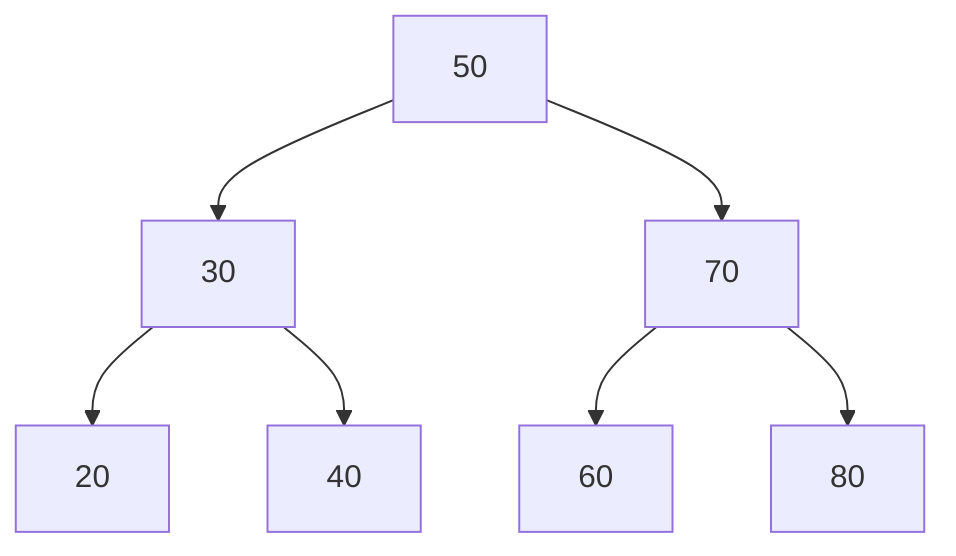
*上例构成的二叉搜索树:每个结点左边的值更小,右边的值更大。*

**复杂度分析。** 查找、插入、删除的代价都与树高 $h$ 成正比,即 $O(h)$。树高取决于插入顺序:

- 平衡情形:$n$ 个结点的树高为 $h = \lfloor \log_2 n \rfloor$,操作为 $O(\log n)$。
- 退化情形:若按 $1,2,3,\dots,n$ 的升序插入,树退化为一条链,$h = n-1$,操作退化为 $O(n)$。
- 随机插入顺序下,期望树高为 $O(\log n)$。

**问题求解应用。**

*问题 1:验证 BST。* 一棵树是否是合法的 BST?只比较结点与其直接孩子是**不够的**。例如根为 $10$、右孩子为 $15$、而 $15$ 的左孩子为 $6$,每个局部看都合理,但 $6 < 10$ 却位于根的右子树中。正确做法是递归时携带取值区间 $(lo, hi)$,或检查中序遍历是否严格递增。

*问题 2:第 $k$ 小的元素。* 做中序遍历并计数,计到第 $k$ 个结点即停止,时间为 $O(h + k)$。

*问题 3:选择数据结构。* 需要频繁插入并保持有序,又要支持范围查询时,BST 比排序数组(插入需 $O(n)$ 移动)更合适;但若输入可能已有序,应使用 AVL 树或红黑树等自平衡变体,以保证 $h = O(\log n)$。

**小结。** BST 的核心是"每个结点把键空间一分为二",效率则完全取决于树的高度。

### black_height_property (0.8s)

## 黑高性质

**定义。** 在红黑树中，从某节点 $x$ 出发（不含 $x$ 本身）向下到达任一叶子（空节点 NIL）的路径上，黑色节点的个数称为 $x$ 的**黑高**，记作 $bh(x)$。**黑高性质**（红黑树的第5条规则）规定：从任一节点到其所有后代叶子的每条简单路径，包含的黑色节点数目相同。因此 $bh(x)$ 是一个良定义的量。

这条性质与另外两条规则配合使用：根和叶子为黑色；红色节点的子节点必为黑色（不存在连续两个红节点）。

**例题。** 设一棵红黑树的根 $r$ 有 $bh(r)=3$。检验沿路径 $r\to a\to b\to \text{NIL}$：若 $a$ 为红、$b$ 为黑，则（不含根、含 NIL）黑节点为 $b$ 与 NIL，只有 2 个。这与黑高 3 矛盾，说明根必须是黑色，并且路径上还需再有一个黑节点，比如 $a$ 也是黑色。

再看每个子节点的黑高：若子节点 $c$ 为红色，则 $bh(c)=bh(x)$；若为黑色，则 $bh(c)=bh(x)-1$。这个递推关系是验证与维护黑高性质的基础。

**问题求解：高度上界。** 我们证明：含 $n$ 个内部节点的红黑树，高度 $h\le 2\log_2(n+1)$。

*引理：* 以 $x$ 为根的子树至少含有 $2^{bh(x)}-1$ 个内部节点。

*证明（对高度归纳）。* 若 $x$ 是叶子，$bh(x)=0$，子树含 $2^0-1=0$ 个内部节点，成立。若 $x$ 为内部节点，其每个子节点的黑高至少为 $bh(x)-1$，由归纳假设，每个子树至少含 $2^{bh(x)-1}-1$ 个内部节点。于是
$$
\text{节点数}\ \ge\ 1+2\left(2^{bh(x)-1}-1\right)=2^{bh(x)}-1. \qquad\blacksquare
$$

由于红节点不能相邻，任一根到叶路径上至少一半的节点是黑色，故 $bh(r)\ge h/2$。代入引理：
$$
n\ \ge\ 2^{h/2}-1\ \Longrightarrow\ h\le 2\log_2(n+1).
$$

**数值检验。** 当 $n=10^6$ 时，$h\le 2\log_2(10^6+1)\approx 40$。即使最坏情形，查找、插入、删除也只需约 40 步，保证了 $O(\log n)$ 的时间复杂度。

**应用提示。** 插入或删除后，红黑树通过**重新着色**与**旋转**恢复黑高性质：旋转不改变各路径的黑节点数，重新着色则需成对调整。调试实现时，一个实用做法是编写检查函数，递归计算左右子树的黑高，若二者不等，立即报告违反性质的节点。

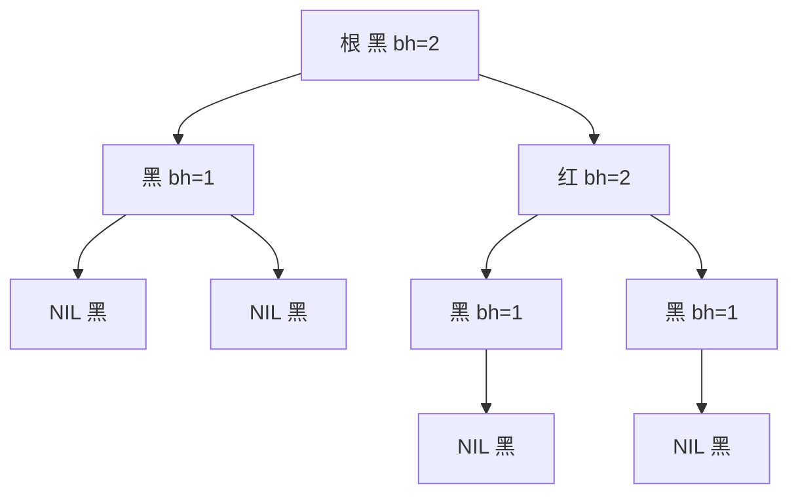
*图示：一棵小型红黑树，每个节点标注其黑高；从根到任一 NIL 的路径上，黑节点数量一致。*

### no_red_edge_property (0.7s)

## 无红边性质

**定义。** 红黑树是一棵二叉搜索树,其中每个结点被染成红色或黑色。**无红边性质**(No Red Edge Property,也称"无连续红结点"性质)规定:

> 若结点 $x$ 为红色,则它的两个孩子都必须是黑色(空指针 NIL 视为黑色)。

等价地说,树中不存在连接两个红结点的边,即不存在"红—红"的父子对。注意这条性质只限制红色:两个黑结点可以相邻,黑色结点的孩子可以是红色或黑色。

**与其他性质的配合。** 红黑树还要求:根为黑色;每条从某结点到其后代 NIL 叶子的路径上,黑结点数量相同(黑高度一致)。这两条性质共同决定了树的高度上界,无红边性质正是其中"限制红结点数量"的那一环。

**工作示例。** 考虑下面这棵树(R 表示红,B 表示黑):

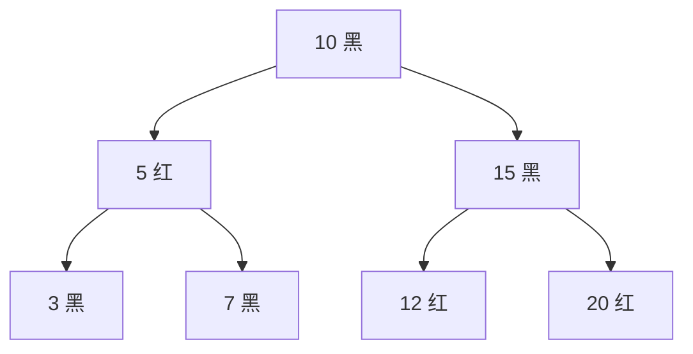

*图:一棵满足无红边性质的红黑树。每个红结点(5、12、20)的孩子或为黑结点,或为 NIL。*

逐个检查红结点:5 的孩子为 3、7(均为黑);12 和 20 的孩子均为 NIL(黑)。因此性质成立。

现在向树中插入键 $1$。按二叉搜索树规则,它成为结点 3 的左孩子,并先染成红色(这样不改变黑高度)。但 3 是黑色,所以仍然合法。若改为插入键 $6$,它成为 7 的左孩子,7 是黑色,同样合法。再看一个会违规的情形:若 3 是红色,插入红色的 1 就产生"红—红"边,必须通过**重新染色**或**旋转**修复。

**问题求解应用:高度上界。** 设红黑树有 $n$ 个内部结点,黑高度为 $b$(从根到 NIL 路径上的黑结点数,不含根自身时记为 $bh$)。

1. 由于红结点的孩子必为黑,任一条根到叶子的路径上,红结点不可能连续出现,所以红结点数至多等于黑结点数。因此树高 $h \le 2b$。
2. 黑高度为 $b$ 的树至少包含 $2^{b}-1$ 个内部结点(最少情形是全为黑的满二叉树),故 $n \ge 2^{b}-1$。
3. 联立得 $b \le \log_2(n+1)$,从而

$$h \le 2\log_2(n+1).$$

**结论。** 如果没有无红边性质,红结点可以连续堆叠,第 1 步的 $h\le 2b$ 就不成立,树可能退化为链。正是这一性质保证了查找、插入、删除的最坏时间复杂度均为 $O(\log n)$。在插入修复中,"出现红—红边"就是需要处理的唯一违规信号:若叔叔结点为红,则重新染色并向上继续检查;若叔叔为黑,则通过旋转加染色一次性消除违规。

### rooted_tree (0.8s)

## 有根树

**定义。** *有根树*(rooted tree)是一个连通且无环的图,其中指定了一个特殊结点 $r$,称为**根**。除根以外,每个结点 $v$ 都恰有一个**父结点**(从 $v$ 到根的唯一路径上的下一个结点)。有 $n$ 个结点的有根树恰有 $n-1$ 条边。

常用术语:

- **子结点**:以 $v$ 为父结点的结点。
- **叶子**:没有子结点的结点。
- **深度** $d(v)$:从根到 $v$ 的路径上的边数,所以 $d(r)=0$。
- **高度**:所有结点深度的最大值。
- **子树**:结点 $v$ 及其全部后代构成的有根树,以 $v$ 为根。

根的指定让边有了方向:从父结点指向子结点。没有指定根的树只是"自由树",它没有"上"和"下"之分。

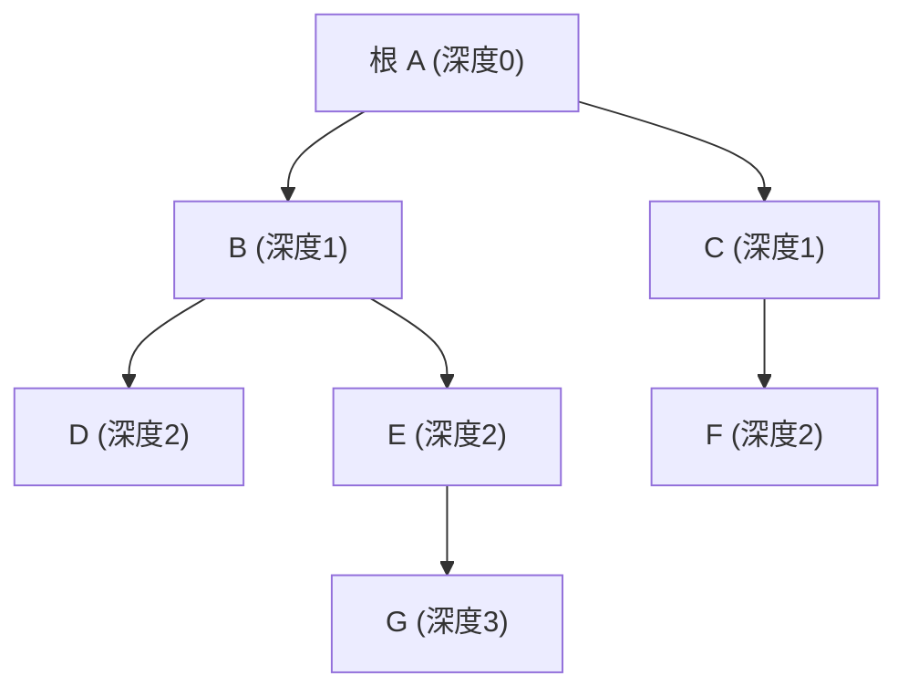
*一棵有 7 个结点的有根树:A 为根,D、F、G 为叶子,高度为 3。*

**例题。** 对上图,求结点 $E$ 的深度、子树大小和祖先。

1. 路径 $A\to B\to E$ 有 2 条边,所以 $d(E)=2$。
2. 以 $E$ 为根的子树含 $E$ 和 $G$,大小为 2。
3. $E$ 的祖先是它到根路径上的其他结点:$B$ 和 $A$。

**定理(边数)。** 含 $n$ 个结点的有根树恰有 $n-1$ 条边。

*证明。* 除根外,每个结点恰有一个父结点,因此每个非根结点对应唯一一条"连向父结点"的边。反过来,每条边也恰好连着一个子结点和它的父结点,所以边与 $n-1$ 个非根结点一一对应。$\blacksquare$

上图中 $n=7$,边数为 6,与图一致。

**问题求解应用。** 有根树的结构天然适合**递归**。因为每棵子树本身也是有根树,许多量都可以写成递推式。例如,设 $h(v)$ 为以 $v$ 为根的子树的高度,则

$$
h(v)=\begin{cases}0, & v\text{ 为叶子},\\[2pt] 1+\max_{c\in\text{children}(v)} h(c), & \text{否则。}\end{cases}
$$

代入上图:$h(G)=0$,$h(E)=1$,$h(D)=0$,$h(B)=1+\max(0,1)=2$,$h(F)=0$,$h(C)=1$,于是 $h(A)=1+\max(2,1)=3$,与前面得到的高度一致。

用 Python 实现同样的递推:

```python
def height(node):
    if not node.children:
        return 0
    return 1 + max(height(c) for c in node.children)
```

每个结点只访问一次,所以时间复杂度为 $O(n)$。

同样的思路可用于计算子树大小($s(v)=1+\sum_c s(c)$)、文件系统目录的总占用空间、表达式树的求值等。遇到"层级"问题(组织架构、文件目录、HTML 的 DOM、决策过程)时,先问:根是什么?每个结点的子问题是什么?这两个问题的答案通常就给出了递归解法。

### tree_height (0.8s)

## 树的高度

### 定义

在一棵树中,**高度**(height)是从根节点到任意叶节点的最长路径所包含的**边数**。记树 $T$ 的高度为 $h(T)$,则可递归定义为:

$$
h(T)=\begin{cases}
-1 & T \text{ 为空树},\\
0 & T \text{ 只有一个节点},\\
1+\max\limits_{c\,\in\,\text{根的子树}} h(c) & \text{其他情况}.
\end{cases}
$$

(有些教材按节点数计算,此时所有结果加 1;使用时务必先确认约定。本节统一按边数计算。)

高度之所以重要,是因为查找、插入、删除等操作都是沿着一条从根出发的路径向下走,**最坏情况的代价正比于 $h$**。

### 例题

对下面的二叉树计算高度:

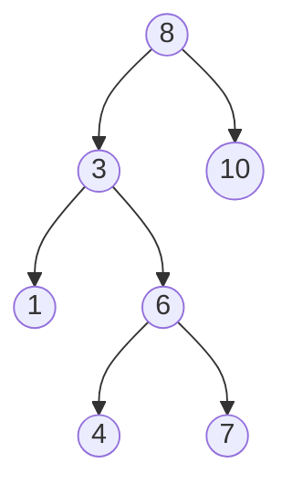

*根节点 8 的最长路径是 8→3→6→4(或 8→3→6→7),共 3 条边。*

按递归定义自底向上计算:

- 叶节点 1、4、7、10:$h=0$。
- 节点 6:$h = 1+\max(0,0)=1$。
- 节点 3:$h = 1+\max(h(1),h(6)) = 1+\max(0,1)=2$。
- 节点 10:$h=0$。
- 根节点 8:$h = 1+\max(2,0)=3$。

所以 $h(T)=3$。注意左右子树的高度不同,取的是**较大者**。

### 问题求解:高度如何决定查找代价

**问题**:一棵含 $n=1023$ 个节点的二叉搜索树,最坏情况下需要比较多少次?

**分析**:查找每下降一层最多比较一次,因此最坏比较次数为 $h+1$。关键在于 $h$ 的范围。

1. **最好情形(完全平衡)**:高度为 $h$ 的二叉树最多有 $2^{h+1}-1$ 个节点。令 $2^{h+1}-1\ge n$,得
$$
h \ge \lceil \log_2(n+1)\rceil - 1 .
$$
当 $n=1023$ 时,$h_{\min}=\log_2 1024-1=9$,最坏只需 10 次比较。

2. **最坏情形(退化为链)**:若按递增顺序依次插入 $1,2,\dots,n$,每个节点只有右孩子,则 $h=n-1=1022$,查找退化成线性扫描,需 1023 次比较。

因此对于 $n$ 个节点的二叉树,
$$
\lceil \log_2(n+1)\rceil-1 \;\le\; h \;\le\; n-1,
$$
即查找的最坏代价可以从 $O(\log n)$ 一直变化到 $O(n)$。

**结论**:树的高度,而不是节点总数,才是衡量查找效率的真正指标。这正是 AVL 树、红黑树等**自平衡树**存在的原因:它们在每次插入或删除后通过旋转把高度维持在 $O(\log n)$,从而保证最坏情况下的对数级查找。

**练习**:对一棵有 $n=100$ 个节点的二叉树,求高度的最小可能值与最大可能值。(答案:$\lceil\log_2 101\rceil-1=6$;$99$。)

### 2_4_tree (1.0s)

## 2 4 树

### 定义

**2-4 树**(2-4 tree,又称 2-3-4 树)是一种满足以下条件的有根树:

1. **结构性质**:每个内部节点有 2、3 或 4 个孩子,分别称为 2-节点、3-节点和 4-节点。一个有 $k$ 个孩子的节点存储 $k-1$ 个键(key)。
2. **有序性质**:节点内的键升序排列,第 $i$ 个孩子子树中的所有键,介于第 $i-1$ 个键与第 $i$ 个键之间(与二叉搜索树的推广一致)。
3. **深度性质**:所有叶子具有相同的深度。

**高度定理。** 设 2-4 树存有 $n$ 个键,高度为 $h$。则
$$
\log_4(n+1) \le h+1 \le \log_2(n+1).
$$

*证明。* 因为所有叶子同深度,第 $d$ 层($d=0,\dots,h$)至少有 $2^d$ 个节点,至多有 $4^d$ 个节点,每个节点含 1 至 3 个键。于是
$$
n \ge \sum_{d=0}^{h} 2^d = 2^{h+1}-1,\qquad n \le 3\sum_{d=0}^{h}4^d = 4^{h+1}-1.
$$
分别取对数即得结论。$\blacksquare$

因此查找、插入、删除的代价均为 $O(\log n)$。

### 例题:插入与分裂

向空树依次插入键 $1,2,3,4$。前三个键放入同一个节点 $[1,2,3]$(这是一个 4-节点)。

插入 $4$ 时,采用**自顶向下**的策略:沿路径下行时,遇到 4-节点就**预先分裂**。根 $[1,2,3]$ 是 4-节点,于是中间键 $2$ 上升成为新根,左右分别留下 $[1]$ 与 $[3]$:

```
     [2]
    /   \
  [1]   [3]
```

随后 $4$ 进入 $[3]$,得到 $[3,4]$。整棵树高度增加了 1,而且是**根分裂**才会使高度增加,因此所有叶子仍保持同深度。

### 问题求解应用

**问题**:一棵 2-4 树存有 $n=1000$ 个键,其高度(边数)至多是多少?至少是多少?

**解**:由高度定理,
- 至多:$h+1 \le \log_2(1001)\approx 9.97$,所以 $h+1\le 9$,即 $h\le 8$。
- 至少:$h+1 \ge \log_4(1001)\approx 4.98$,所以 $h+1\ge 5$,即 $h\ge 4$。

因此高度在 $4$ 到 $8$ 之间,一次查找至多访问 9 个节点。

**要点总结**:
- 分裂操作只在节点内部与父节点之间调整,代价为 $O(1)$;沿路径最多分裂 $O(h)=O(\log n)$ 次。
- 删除时则相反:遇到 2-节点就向兄弟借键或与兄弟合并,保证下行路径上不会出现需要回溯的情况。
- 2-4 树与**红黑树**一一对应:把 3-节点、4-节点按固定方式展开成红、黑二叉节点,即得红黑树。这解释了红黑树的 $O(\log n)$ 高度,也是实际中常以红黑树实现 2-4 树的原因。

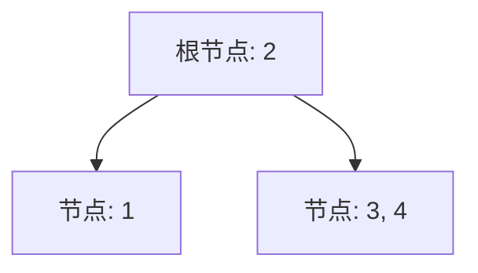
*插入 1、2、3、4 后的 2-4 树:根分裂使中间键 2 上升,两个叶子位于同一深度。*

### red_black_tree (1.0s)

## 红黑树

### 定义

**红黑树**(red-black tree)是一棵二叉搜索树,每个结点带有红色或黑色的标记,并满足以下性质:

1. 根结点为黑色;空叶子(NIL)视为黑色。
2. **无连续红边性质**:红结点的孩子必为黑色(不存在两个相邻的红结点)。
3. **黑高性质**:从任一结点出发到其后代 NIL 叶子的每条路径,所含黑结点数相同。该数称为该结点的**黑高** $bh(x)$。

它与 2-4 树一一对应:一个黑结点连同其红色孩子合并为一个结点,恰好是 2-4 树中含 1、2 或 3 个键的结点。

- 黑结点,无红孩子 $\leftrightarrow$ 2-结点
- 黑结点,一个红孩子 $\leftrightarrow$ 3-结点
- 黑结点,两个红孩子 $\leftrightarrow$ 4-结点

### 高度定理

**定理** 含 $n$ 个内部结点的红黑树,高度 $h \le 2\log_2(n+1)$。

**证明** 设根的黑高为 $b$。由无连续红边性质,任何路径上至少一半的结点为黑色,故 $h \le 2b$。以黑高为 $b$ 的结点为根的子树至少含 $2^{b}-1$ 个内部结点(每层都是满的黑结点时最少),所以 $n \ge 2^{b}-1$,即 $b \le \log_2(n+1)$。因此 $h \le 2b \le 2\log_2(n+1)$。$\blacksquare$

于是查找、插入、删除的时间复杂度均为 $O(\log n)$。

### 例题

依次插入键 $10, 20, 30$。

1. 插入 10:成为根,染黑。
2. 插入 20:新结点默认染**红**(不改变黑高),作为 10 的右孩子。合法。
3. 插入 30:红色的 30 成为红色 20 的孩子,违反无连续红边性质。其"叔叔"(10 的左孩子)为 NIL,视为黑色,于是做一次**左旋**,并交换颜色:20 成为黑色根,10 与 30 为红色孩子。

结果是一个黑结点带两个红孩子,对应 2-4 树中的一个 4-结点 $[10,20,30]$。

### 问题求解:插入后的修复规则

设新插入的红结点 $z$ 的父亲为红色(否则无需修复),看**叔叔**结点 $u$ 的颜色:

| 情形 | 叔叔 $u$ | 操作 | 对应 2-4 树 |
|---|---|---|---|
| 1 | 红 | 父、叔染黑,祖父染红,令 $z$ 上移到祖父继续检查 | 4-结点分裂,中间键上升 |
| 2 | 黑,$z$ 为"内侧"孩子 | 先对父旋转,化为情形 3 | 调整 3-结点内部的方向 |
| 3 | 黑,$z$ 为"外侧"孩子 | 对祖父反向旋转,父染黑、祖父染红 | 键并入 3-结点,形成 4-结点 |

**练习** 在上面得到的树(根 20 黑,10、30 红)中插入 5。判断应使用哪种情形,并画出结果。

**解答** 5 成为红结点 10 的左孩子,父亲 10 为红,叔叔 30 也为红,属情形 1:将 10、30 染黑,20 染红;再因 20 是根,将其染回黑色。结果根为黑、高度由 1 增至 2,黑高整体加 1,对应 2-4 树中 4-结点分裂、树增高一层。

情形 1 至多沿路径上移 $O(\log n)$ 次,情形 2、3 合计至多旋转 2 次,因此插入的旋转次数是 $O(1)$,这也是红黑树在频繁更新场景中(如标准库的有序映射)被广泛采用的原因。

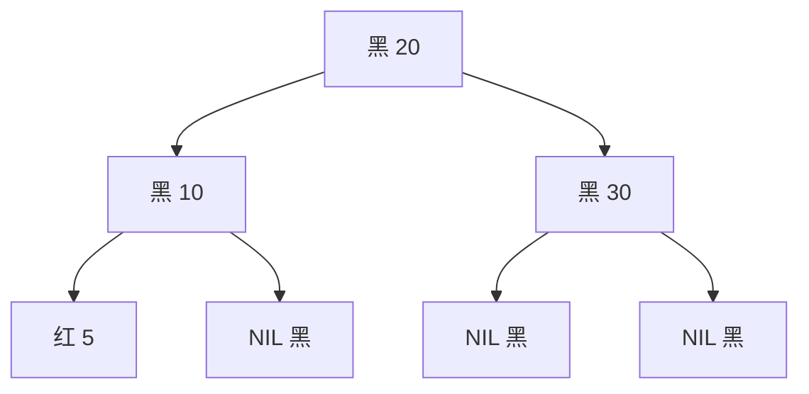
*插入 5 并修复后的红黑树:根为黑,所有从根到 NIL 的路径均含 2 个黑结点,且无相邻红结点。*

### colour_flip_push_pull (0.7s)

## 颜色翻转、推入与拉出

**定义。** 红黑树要求：根为黑；红结点的孩子必为黑；从任一结点到其后代空叶的每条路径含有相同数目的黑结点（黑高 $bh$ 相同）。四个子程序在不破坏黑高的前提下局部调整颜色与结构：

- **push_black($x$)**：当 $x$ 为黑、两个孩子均为红时，把 $x$ 变红，两个孩子变黑。经过 $x$ 的每条路径黑结点数不变，因此黑高保持不变。
- **pull_black($x$)**：push_black 的逆操作：$x$ 为红、两孩子均为黑时，$x$ 变黑，两孩子变红。
- **flip_left($u$)** / **flip_right($u$)**：先交换 $u$ 与其右（左）孩子 $w$ 的颜色，再对 $u$ 做左（右）旋转。旋转只改变结构，不改变中序，故路径上的黑结点数由颜色交换来补偿。

**例题。** 在左倾红黑树（LLRB）中插入后，设 $u$ 为黑，左孩子 $a$ 为红，右孩子 $w$ 为红，且 $w$ 的颜色需要调整。

1. 此时 $u$ 的两个孩子都是红色，调用 push_black($u$)：$u\to$ 红，$a,w\to$ 黑。
2. 若 $u$ 的父亲也是红，则出现“红-红”冲突，需向上继续处理。
3. 另一种情形：$u$ 黑、右孩子 $w$ 红、左孩子 $a$ 黑（违反左倾性）。调用 flip_left($u$)：先交换颜色，使 $w$ 变黑、$u$ 变红；再左旋，$w$ 升为子树根，$u$ 成为其左孩子，且为红色。

验证黑高：旋转前经过 $u$ 的路径含 $u$（黑）；旋转后经过 $w$（黑）而 $u$ 为红，每条路径仍恰有一个黑结点，故
$$bh_{\text{前}}(u)=bh_{\text{后}}(w).$$

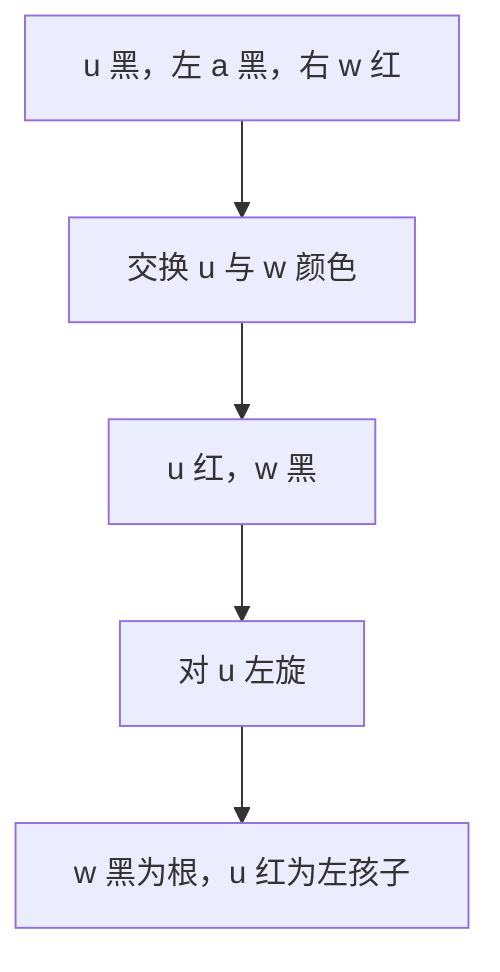
*图：flip_left 的执行流程，先换色再旋转，黑高保持不变。*

**问题求解应用。** 删除操作需要“借”黑色。设从某子树删去一个黑结点，该子树黑高少 1，称其带有“双重黑”。解决思路：

1. 若兄弟 $s$ 为红，先对父结点做 flip_left（或 flip_right），使兄弟变黑，问题化为兄弟为黑的情形。
2. 若兄弟为黑且其两个孩子均为黑，则对父结点 $p$ 调用 pull_black：$p$ 的黑色“下拉”给两个孩子（$p$ 变红或增黑，孩子相应变色）。左子树补回缺失的黑色，兄弟一侧则以变红的方式抵消，整体黑高平衡。若 $p$ 原为红，则变黑后终止；否则缺陷上移一层。
3. 每次循环要么终止，要么上移一层，至多 $O(\log n)$ 次；每个子程序耗时 $O(1)$，旋转至多常数次，故删除总代价为 $O(\log n)$。

**检验要点。** 对任一子程序，只需验证：(1) 每条经过受影响结点的路径黑结点数不变；(2) 红结点不产生新的红-红父子对，或将冲突明确上移。掌握这两条检验标准，就能自行推导各种情形的处理方式，而无需死记。

### left_leaning_property (1.0s)

## 左倾性质

**定义。** 红黑树的标准性质（根为黑、红节点的子节点为黑、每条路径黑高相同）允许某些红节点出现在右侧。**左倾性质**是一条附加约束：

> 若一个节点的左孩子是黑色，则它的右孩子也必须是黑色。

等价地说：**红色孩子只能是左孩子，且若存在红色右孩子，则左孩子也必须是红色。** 因此，一个节点要么有一个红色左孩子（与它合并成一个 3-节点），要么有两个红色孩子（合并成一个 4-节点），要么没有红色孩子（2-节点）。

这条性质使红黑树与 2-3-4 树（简称 2-4 树）之间形成**唯一**对应：把每个黑节点与其红色孩子合并，得到的 2-4 树节点是确定的。若没有它，一个 3-节点可以表示成"黑节点带红左孩子"或"黑节点带红右孩子"两种形式，对应关系不唯一。

**例题。** 判断下列结构是否满足左倾性质（$B$ 表示黑，$R$ 表示红）：

- 树 (a)：节点 $x$（黑），左孩子 $B$，右孩子 $R$。
- 树 (b)：节点 $x$（黑），左孩子 $R$，右孩子 $B$。
- 树 (c)：节点 $x$（黑），左孩子 $R$，右孩子 $R$。

**解：**
- (a) 左孩子为黑，但右孩子为红，**违反**性质。它本来想表示一个 3-节点，却把红边放在了右侧。
- (b) 左孩子为红，条件的前提不成立，**满足**。对应 3-节点。
- (c) 左孩子为红，**满足**。对应 4-节点。

**问题求解应用。** 给定一个 3-节点，内含键 $\{10, 20\}$，用红黑树表示。

由于必须满足左倾性质，只有一种合法写法：黑节点存较大的键 $20$，红色左孩子存 $10$。若写成黑节点 $10$ 带红色右孩子 $20$，则其左孩子（空，视为黑）为黑而右孩子为红，违反性质，必须通过**左旋**修复：

$$
\text{rotateLeft}: \quad 10_B \,\to\, 20_R \quad \Longrightarrow \quad 20_B \leftarrow 10_R
$$

旋转后黑高不变，且红色边转到左侧。这正是插入操作中"右红则左旋"这一修复步骤的来源。

**为什么重要。** 设 2-4 树中 3-节点和 4-节点的数目有限，则每个 2-4 树恰好对应一棵满足左倾性质的红黑树。因此红黑树的高度满足：设黑高为 $h_b$，则

$$
h_b \le h \le 2h_b,
$$

其中 $h$ 为树高（红节点不连续出现）。对 $n$ 个键有 $h = O(\log n)$。左倾性质并不改变这一对数界，它的价值在于**简化实现**：只需处理"红色左链"这一种情形，使插入、删除的分类讨论显著减少。

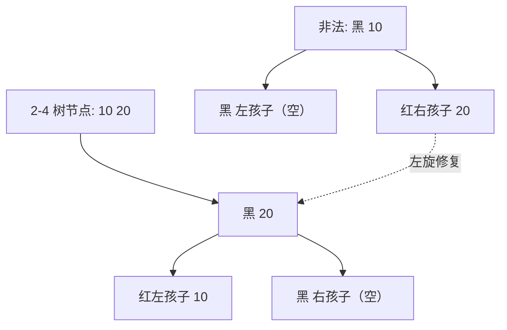
*图：3-节点的唯一合法表示（左红）与违反左倾性质的右红写法，后者经左旋转化为前者。*

### 2_4_tree_add_leaf (0.8s)

## 2 4 树添加叶子节点

### 定义

**2-4 树**(2-4 tree)是一种平衡的多路查找树,具有以下性质:

- 每个内部节点有 2、3 或 4 个孩子(分别称为 2-节点、3-节点、4-节点),对应存储 1、2、3 个键;
- 所有叶子位于同一深度。

这一性质称为**度数性质**(degree property)。

**添加叶子**的过程如下:

1. 沿查找路径找到应当容纳新键的位置,即倒数第二层的某个节点 $v$,把新键作为 $v$ 的新孩子(叶子)插入。
2. 若 $v$ 的孩子数变为 5(**上溢**,overflow),则**分裂**:5 个孩子拆成 3 个和 2 个,分别归入两个新节点;中间的键上移到父节点,作为父节点的一个新键,并增加一个孩子。
3. 父节点若也上溢,则重复第 2 步;若分裂到达根且根上溢,则新建一个根,树高增加 1。

每次分裂只涉及常数个节点,而路径长度为 $O(\log n)$,因此插入的时间复杂度为

$$T(n)=O(\log n).$$

由于所有叶子的深度只有在根分裂时才同时增加 1,所以叶子始终保持同一深度。

### 工作示例

设一个 2-4 树的根含键 $[10,\,20,\,30]$(4-节点),有 4 个叶子子节点。其中最左孩子含键 $[1,\,3,\,5]$,最右孩子含键 $[40,\,50]$。现在插入键 $4$。

- 查找路径:$4<10$,进入最左孩子 $[1,\,3,\,5]$。该节点原有 4 个孩子(叶区间),插入后变为 5 个孩子,**上溢**。
- 分裂:把键序列 $[1,3,4,5]$ 中的中间键 $3$ 上移,其余拆为 $[1]$ 与 $[4,5]$。
- 此时根得到新键 $3$,键变为 $[3,10,20,30]$,孩子数为 5,**根也上溢**。
- 分裂根:中间键 $10$ 上移,拆出左节点 $[3]$ 与右节点 $[20,30]$,新根为 $[10]$。树高增加 1,所有叶子仍在同一深度。

### 问题求解应用

**问题**:依次向空的 2-4 树插入 $1,2,3,4,5$,画出最终的树。

**解**:

- 插入 $1,2,3$:得到单个节点 $[1,2,3]$(4-节点,合法)。
- 插入 $4$:节点变为 $[1,2,3,4]$,共 4 个键、5 个孩子,上溢。取中间键 $2$(或 $3$,约定一致即可)上移,分裂为 $[1]$ 与 $[3,4]$,新根 $[2]$。
- 插入 $5$:查找得 $5>2$,进入 $[3,4]$,变为 $[3,4,5]$,仍合法,无需分裂。

最终:根 $[2]$,孩子 $[1]$ 与 $[3,4,5]$。

**分析**:设树的高度为 $h$,则 $n$ 个键满足

$$2^{h}-1\le n\le 4^{h}-1\;\Longrightarrow\;h=\Theta(\log n).$$

最坏情况下分裂会沿路径一直传到根,代价为 $O(h)=O(\log n)$;但摊还分析表明,分裂次数的平均值为 $O(1)$,因为每次分裂都会消耗掉一个"已满"节点,而产生的两个节点都有余量。

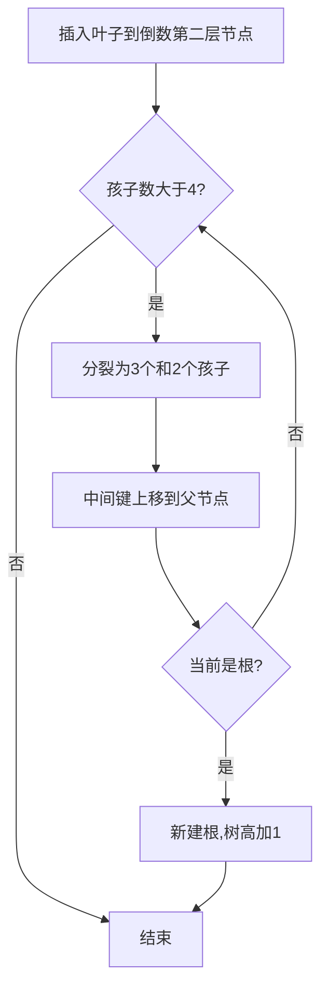
*图:2-4 树插入叶子后,自底向上递归分裂上溢节点的流程。*

**要点**:插入总是从底部开始,只有根分裂才增加树高,因此度数性质与等深叶子性质始终得以保持。

### 2_4_tree_remove_leaf (0.8s)

## 2 4 树删除叶节点

### 定义

**2-4 树**(也称 2-3-4 树)是一种多路平衡搜索树,满足两条性质:

- **度数性质**:每个内部节点有 2、3 或 4 个孩子(分别对应 1、2、3 个键);
- **深度性质**:所有叶子位于同一深度。

**删除叶节点中的键**,是指从最底层节点中移除一个键。若该节点原本有 2 个或 3 个键,直接删除即可。若它只剩 1 个键,删除后变为空,即"下溢"(underflow),此时必须修复度数性质。

修复分为三种情形(设下溢节点为 $x$,父节点为 $p$):

1. **借位(旋转)**:若 $x$ 的相邻兄弟至少有 2 个键,则父节点中分隔二者的键下移到 $x$,兄弟最近的键上移到 $p$。
2. **合并**:若相邻兄弟只有 1 个键,则把父节点中分隔的键下移,与兄弟及 $x$ 合并为一个节点。此时 $p$ 少了一个键和一个孩子,可能继而下溢。
3. **递归上推**:若 $p$ 下溢,对 $p$ 重复上述过程。若根节点变空,则删除根,树高减 1。

### 例题

考虑如下 2-4 树,删除键 $5$:

```
          [10]
         /    \
      [5]     [12, 15]
```

叶子 $[5]$ 删除后为空。其右兄弟 $[12,15]$ 有 2 个键,因此**借位**:父键 $10$ 下移到 $x$,兄弟最小键 $12$ 上移到父节点:

```
          [12]
         /    \
      [10]    [15]
```

若右兄弟只是 $[12]$,则无法借位,须**合并**:$10$ 下移,与 $[12]$ 合并成 $[10,12]$,根变空,于是删除根,树高减 1:

```
        [10, 12]
```

### 问题求解应用

**问题**:从下面的树中删除 $3$。

```
            [6]
          /     \
       [3]       [8]
```

**步骤**:

1. 删除 $3$,叶子变空;右兄弟 $[8]$ 只有 1 个键,不能借位。
2. **合并**:父键 $6$ 下移,得到 $[6,8]$。根变空,树高减 1。
3. 结果为单节点 $[6,8]$,满足两条性质。

**复杂度分析**:2-4 树含 $n$ 个键时,高度为 $h=\Theta(\log n)$。每一层最多做一次借位或合并,每次耗时 $O(1)$(节点至多 3 个键)。借位后修复立即终止,只有合并才会向上传播。因此删除的最坏时间为

$$T(n)=O(h)=O(\log n).$$

**解题要点**:

- 先判断兄弟的键数:$\ge 2$ 借位,$=1$ 合并。
- 合并会让父节点失去一个键,所以要检查父节点是否下溢。
- 只有根节点变空时,树高才会减小,这是所有叶子仍保持同深度的原因。
- 若要删除的键在内部节点中,则先与其中序后继(位于某个叶子)交换,再按本节方法删除叶子中的键。

**练习**:在 $[10]$ 为根、孩子为 $[5]$ 和 $[12]$ 的树中删除 $12$,写出结果并说明属于哪种情形。(答案:合并,得到 $[5,10]$,树高减 1。)

### amortized_potential_method (0.7s)

## 摊还分析的势能法

**定义。** 势能法(potential method)为数据结构的每个状态 $D$ 指定一个非负实数 $\Phi(D)$,称为**势能函数**,并要求 $\Phi(D_0)=0$。第 $i$ 次操作的**摊还代价**定义为

$$\hat c_i = c_i + \Phi(D_i) - \Phi(D_{i-1}),$$

其中 $c_i$ 是实际代价。对 $m$ 次操作求和,中间的势能项相互抵消(望远镜求和):

$$\sum_{i=1}^{m}\hat c_i=\sum_{i=1}^{m}c_i+\Phi(D_m)-\Phi(D_0)\ \ge\ \sum_{i=1}^{m}c_i .$$

因为 $\Phi(D_m)\ge 0=\Phi(D_0)$,总摊还代价是总实际代价的上界。直观上,势能是"预存的积蓄":便宜的操作多交一点"税",存入势能;昂贵的操作用积蓄支付。

**例题:二进制计数器。** 对计数器执行 $m$ 次 INCREMENT。一次操作若翻转 $t$ 个末尾的 1 并把一个 0 变为 1,则实际代价 $c_i=t+1$。取 $\Phi=$ 当前 1 的个数 $b_i$。则 $b_i=b_{i-1}-t+1$,所以

$$\hat c_i=(t+1)+(b_i-b_{i-1})=(t+1)+(1-t)=2 .$$

因此 $m$ 次操作总代价不超过 $2m=O(m)$,尽管单次操作最坏可达 $\Theta(\log m)$。

**应用:红黑树的修复工作。** 在红黑树中,插入新结点(染红)后可能出现"红-红"冲突,需要修复。修复分两类:

- **重新着色**(叔结点为红):父、叔变黑,祖父变红,冲突上移两层,代价 $O(1)$,可能连续发生;
- **旋转**(叔结点为黑):至多 2 次旋转后结束,总共只发生一次。

设 $\Phi(T)=$ 树中**红色结点的子结点为黑、且自身有两个红色... **——为避免复杂,采用更直接的选择:令 $\Phi(T)=$ 同时拥有两个黑色子结点的"黑结点"之外的**黑结点且两个子结点均为红**的个数,记作 $\Phi(T)=\#\{\text{两个子结点都是红色的黑结点}\}$。

- 每次重新着色把一个"两子为红的黑结点"(祖父)变成红结点,并使 $\Phi$ 减少 1(其父、叔变黑),实际代价为常数 $1$,所以摊还代价 $\hat c = 1+(-1)=0$ 或更小。
- 一次插入本身(含最终的旋转)实际代价 $O(1)$,至多使 $\Phi$ 增加 $O(1)$,摊还代价为 $O(1)$。

于是 $m$ 次更新的摊还总代价为 $O(m)$。由于 $\Phi\ge 0$ 且 $\Phi(T_0)=0$,**总修复工作为 $O(m)$**,即每次更新平均只做常数次结构调整,即使个别更新的重新着色会沿路径上溯 $O(\log n)$ 层。

**解题步骤小结。**
1. 找出"昂贵步骤"消耗的资源(如 1 的个数、冲突结点数)。
2. 选取 $\Phi$,使昂贵步骤令 $\Phi$ 下降,抵消其实际代价。
3. 验证 $\Phi\ge 0$、$\Phi(D_0)=0$,再逐类操作计算 $\hat c_i$。

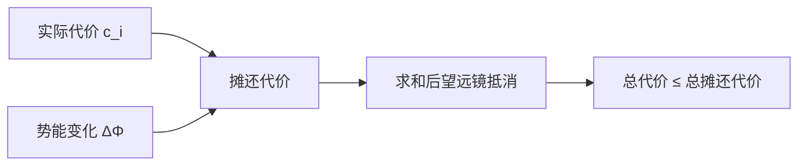
*摊还代价由实际代价与势能变化相加得到,求和时势能项抵消,从而给出总代价上界。*

### red_black_2_4_correspondence (0.7s)

## 红黑树与 2-4 树的对应关系

### 定义

**红黑树**是满足以下性质的二叉搜索树:

1. 每个结点非红即黑;根为黑。
2. 红结点的子结点必为黑(不存在连续两个红结点)。
3. 从任一结点到其所有后代空叶的路径上,黑结点数相同,称为**黑高** $bh$。

**2-4 树**是一种多路平衡搜索树:每个结点含 1、2 或 3 个键(即有 2、3 或 4 个子结点),且所有叶子在同一深度。

**对应变换**:把每个红结点"并入"其黑色父结点,形成一个多键结点。每个黑结点连同其红子结点构成一个结点,可能的形状为:

- 黑结点无红子结点 → 含 1 个键的 2-结点;
- 黑结点有 1 个红子结点 → 含 2 个键的 3-结点(红子结点在左或右均可);
- 黑结点有 2 个红子结点 → 含 3 个键的 4-结点。

由性质 2,红结点不会再有红子结点,所以合并后的结点最多含 3 个键。

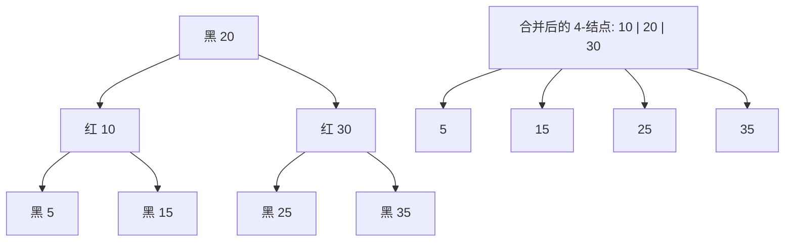
*左半部分为一棵红黑树,右半部分为其合并红结点后得到的 2-4 树:根的 4-结点 $[10,20,30]$ 拥有四个子结点。*

### 工作示例

考虑上图中的红黑树。黑结点 20 有两个红子结点 10 和 30,合并为 4-结点 $[10,20,30]$。红结点 10 的子结点 5、15 都是黑结点,各自成为独立结点,作为该 4-结点的第 1、2 个子结点;同理 25、35 是第 3、4 个子结点。所有叶子深度相同(都是 1),符合 2-4 树要求。

这一对应的关键原因是性质 3:每个 2-4 树结点恰好含一个黑结点,所以 2-4 树的深度等于黑高(不计空叶)。因此叶子等深,由黑高相等直接得到。

反方向也成立:2-结点对应一个黑结点;3-结点对应黑结点加一个红子结点;4-结点对应黑结点加两个红子结点。因此每棵 2-4 树至少对应一棵红黑树(3-结点有左倾、右倾两种选择),对应是双向的。

### 问题求解:高度上界 $2\log n$

**命题** 含 $n$ 个内部结点的红黑树,高度 $h \le 2\log_2(n+1)$。

**证明**:设黑高为 $b$。

1. 由对应关系,红黑树对应一棵深度为 $b$ 的 2-4 树。该 2-4 树每个内部结点至少有 2 个子结点,故它至少有 $2^b$ 个叶子;而叶子数等于 $n+1$。所以 $n+1 \ge 2^b$,即 $b \le \log_2(n+1)$。
2. 由性质 2,任一根到叶路径上红结点不会相邻,所以红结点数至多等于黑结点数,路径长度 $h \le 2b$。
3. 合并得 $h \le 2b \le 2\log_2(n+1)$。 $\blacksquare$

**应用**:若树中有 $n = 10^6$ 个键,则 $h \le 2\log_2(10^6+1) \approx 40$,因此查找、插入、删除在最坏情况下都是 $O(\log n)$,约 40 步以内。

另外,插入时的"变色"操作恰好对应 2-4 树中 4-结点的**分裂**,旋转对应 3-结点内部的重排。理解了 2-4 树,就能把红黑树复杂的情形分析转化为简单的结点分裂与合并。

### red_black_add (0.8s)

## 红黑树的插入(Red Black Add)

### 定义

在左倾红黑树(LLRB)中,每个结点的链接要么是红色,要么是黑色。红链接把一个结点与其父结点"粘合"在一起,对应 2-4 树中的一个多键结点。LLRB 需要满足三条性质:

1. **左倾**:红链接只能是左链接;
2. **无连续红边**:不存在两条相连的红链接;
3. **完美黑平衡**:从根到任意空链接的路径上,黑链接数目相同。

**插入(add)** 分两步:先按普通二叉搜索树(BST)的规则找到空位,把新键作为**红色叶结点**挂上去;再沿插入路径回溯,用 `add_fixup` 恢复上述性质。新结点取红色,是因为它相当于把一个键并入 2-4 树中已有的结点,不会改变黑高度。

### `add_fixup` 的三条规则

回溯时,对每个结点 $h$ 依次检查:

```python
def add_fixup(h):
    if is_red(h.right) and not is_red(h.left):   # 右倾红边
        h = rotate_left(h)
    if is_red(h.left) and is_red(h.left.left):   # 连续两条红边
        h = rotate_right(h)
    if is_red(h.left) and is_red(h.right):       # 4-结点
        flip_colors(h)                           # 分裂
    return h
```

- **左旋**:修正右倾红链接,使 3-结点符合左倾约定;
- **右旋**:把"左-左"连续红链接变成一个中间结点带两条红链接的临时 4-结点;
- **颜色翻转**:把两个子结点变黑、$h$ 变红,相当于 2-4 树中把 4-结点分裂,并将中间键上推给父结点。

### 例题

依次向空树插入 $10, 20, 30$。

1. 插入 $10$:根结点。根必须是黑色。
2. 插入 $20$:作为 $10$ 的右红子结点,出现右倾红边,**左旋**后 $20$ 为根,$10$ 为其红色左子。
3. 插入 $30$:作为 $20$ 的右红子。此时 $20$ 的左、右子结点均为红,形成 4-结点 $[10,20,30]$,执行**颜色翻转**:$10$、$30$ 变黑,$20$ 变红;再把根重新染黑。

结果是一棵高度为 2 的平衡树,黑高度为 2。

### 问题求解应用

**问题**:依次插入 $10,20,30,40$,说明最后一步会触发什么操作。

**解**:前三步得到根 $20$(黑),左右子 $10$、$30$ 均为黑。插入 $40$ 作为 $30$ 的红色右子,右倾红边,`add_fixup` 在 $30$ 处执行**左旋**,得到 $40$(黑)的红色左子 $30$。回溯到 $20$:左右子均不是红,无需处理。此时 $20$ 的右子 $40$ 与其左子 $30$ 构成 3-结点 $[30,40]$。

**复杂度**:LLRB 的高度不超过 $2\log_2 N$(对应 2-4 树高度 $\le \log_2 N$,每层最多多出一条红链接)。插入沿一条路径下行再回溯,每个结点最多做常数次旋转与翻转,因此

$$T_{\text{add}}(N)=O(\log N).$$

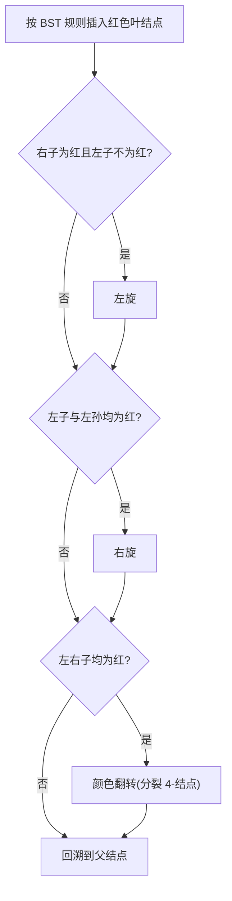
*add_fixup 在每个结点上的判断流程:依次修正右倾红边、连续红边,并分裂 4-结点。*

### red_black_remove (0.7s)

## 红黑树删除(Red Black Remove)

### 定义

红黑树删除分两步:**先摘除,再修复**。

1. **摘除**:若待删节点 $z$ 有两个孩子,用其中序后继 $y$ 的键值替换 $z$,转而删除 $y$。这样实际被摘除的节点至多有一个孩子,可直接用该孩子 $x$ 顶替它。
2. **修复**:若被摘除的节点是**红色**,则黑高不变,无需处理。若是**黑色**,则 $x$ 所在路径少了一个黑节点,称 $x$ 带有"**双重黑**"(double-black)。`remove_fixup` 的任务就是消除这个多余的黑色。

与 2-4 树的对应关系:黑节点加上它的红孩子,构成一个 2-、3- 或 4-节点。删除黑叶子,相当于从某个 2-节点中取走唯一的键,使它变空,只能向兄弟**借键**(旋转)或与兄弟**合并**(重新着色)。

### 修复的四种情形

设 $x$ 是双重黑节点,$w$ 是它的兄弟($x$ 为左孩子时的情形):

| 情形 | 条件 | 操作 | 2-4 树含义 |
|---|---|---|---|
| 1 | $w$ 为红 | 对父节点左旋,$w$ 与父节点换色,转入情形 2/3/4 | 换一个同层表示 |
| 2 | $w$ 黑,$w$ 的两个孩子都黑 | $w$ 染红,双重黑上移到父节点 | 与兄弟**合并**,向父层借 |
| 3 | $w$ 黑,$w$ 左红右黑 | 对 $w$ 右旋并换色,转入情形 4 | 调整兄弟内部 |
| 4 | $w$ 黑,$w$ 右孩子红 | 对父节点左旋,$w$ 取父节点的颜色,父节点与 $w$ 的右孩子染黑 | 从兄弟**借键**,结束 |

只有情形 2 会使问题上移,其余情形至多常数次旋转后终止。

### 例题

考虑一棵树:根 $B(10)$,左孩子 $B(5)$,右孩子 $B(15)$,$15$ 的右孩子为红节点 $R(20)$。删除黑叶子 $5$。

- 摘除 $5$ 后,$x$ 为空叶(双重黑),父节点为 $10$,兄弟 $w=15$ 为黑。
- $w$ 的右孩子 $20$ 为红,属于**情形 4**。
- 对 $10$ 左旋:$15$ 成为新根并继承 $10$ 原来的颜色(黑),$10$ 与 $20$ 染黑。

结果:根 $B(15)$,左孩子 $B(10)$,右孩子 $B(20)$,各路径黑高均为 2,红黑性质恢复。对应到 2-4 树,就是从 3-节点 $[15,20]$ 中借出键 $15$ 上移,$10$ 下移补空。

### 问题求解应用

**问题**:若例题中 $20$ 不存在($15$ 是黑叶子),会发生什么?

此时 $w=15$ 为黑且两个孩子皆黑,属于情形 2:把 $15$ 染红,双重黑上移到 $10$。若 $10$ 是根,则直接去掉多余的黑色,整棵树黑高减 1,结束;若 $10$ 为红,将其染黑即可终止;若 $10$ 为黑且非根,则继续在上一层处理。这对应 2-4 树中两个 2-节点合并,并从父节点"借"走一个键。

**复杂度**:情形 2 每次使 $x$ 上移一层,至多 $O(\log n)$ 次;情形 1、3、4 的旋转总计至多 3 次。故删除的总代价为

$$T(n)=O(\log n),\quad \text{旋转次数}\le 3.$$

**解题要领**:先判断被摘除节点的颜色,再看兄弟及其孩子的颜色,依次套用情形 1→4。

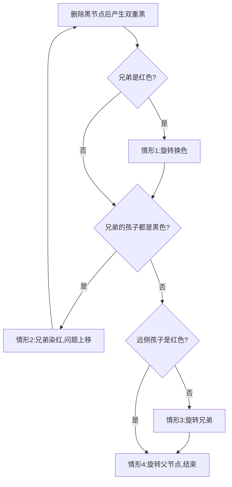
*图:`remove_fixup` 的决策流程。只有情形 2 会循环上移,情形 4 必定终止。*

### red_black_performance (0.9s)

## 红黑树的性能

**定义。** 红黑树（RedBlackTree）是满足下列性质的二叉搜索树：每个结点为红色或黑色；根为黑色；红结点的孩子必为黑色；从任一结点到其后代空叶结点的每条路径包含相同数目的黑结点（**黑高**相同）。本节的核心结论是：

- `find`、`add`、`remove` 的**最坏情况**时间均为 $O(\log n)$；
- 在任意 $m$ 次更新构成的序列中，每次更新所需的**结构调整**（重新着色与旋转）的**摊还**代价为 $O(1)$。

**为什么高度是 $O(\log n)$。** 设根的黑高为 $b$。由于红结点不能连续出现，任一路径上红结点数不超过黑结点数，因此树高 $h \le 2b$。另一方面，黑高为 $b$ 的子树至少含有 $2^{b}-1$ 个内部结点（去掉所有红结点后得到一棵高为 $b$ 的完全二叉树）。于是

$$
n \ge 2^{b}-1 \;\Longrightarrow\; b \le \log_2(n+1) \;\Longrightarrow\; h \le 2\log_2(n+1).
$$

`find` 沿一条根到叶路径下行，代价为 $O(h)=O(\log n)$。`add` 与 `remove` 先做同样的查找，再自底向上修复性质，修复最多沿路径回溯 $O(h)$ 层，故同为 $O(\log n)$。

**例题。** 一棵含 $n = 10^6$ 个结点的红黑树，其高度至多为多少？

解：$h \le 2\log_2(10^6+1) \approx 2 \times 19.93 \approx 39.9$，所以 $h \le 39$。在最坏情况下查找也只需比较约 40 次。相比之下，退化成链表的普通二叉搜索树可能需要 $10^6$ 次。

**摊还 $O(1)$ 的原因。** 插入修复中，若叔叔结点为红，则只做重新着色，并把问题上移两层；若叔叔为黑，则最多 2 次旋转即结束。取势函数 $\Phi$ = 树中"黑结点且两个孩子均为红"的结点数。每次"上移"型重新着色使 $\Phi$ 至少减 1，而一次终止型操作至多使 $\Phi$ 增加 $O(1)$。因此

$$
\hat c_i = c_i + \Phi_i - \Phi_{i-1} = O(1),
$$

即 $m$ 次插入的总调整代价为 $O(m)$（删除的分析类似，旋转次数最坏也仅为常数）。注意：这里的 $O(1)$ 只针对**修复调整**，查找位置仍需 $O(\log n)$，所以一次完整的更新依然是 $O(\log n)$。

**问题求解应用。** 假设需要维护一个动态有序集合，执行 $10^5$ 次混合的 `add`/`remove`/`find`。

1. 每次操作最坏 $O(\log n)$，总计 $O(m\log n)$，且**没有**坏输入能使其退化。
2. 若只关心旋转开销，总旋转次数为 $O(m)$，因此红黑树适合写入密集的场景（相比 AVL 树，其删除时旋转更少）。
3. 当需要可预测的延迟上界（如实时系统）时，应选用最坏情况有保证的红黑树，而非仅有期望保证的哈希表或随机化结构。

**小结。** 黑高约束迫使树高不超过 $2\log_2(n+1)$，由此得到最坏 $O(\log n)$ 的操作；势函数论证则说明结构调整的摊还代价为常数。

## Run complete

total: 25.4s
