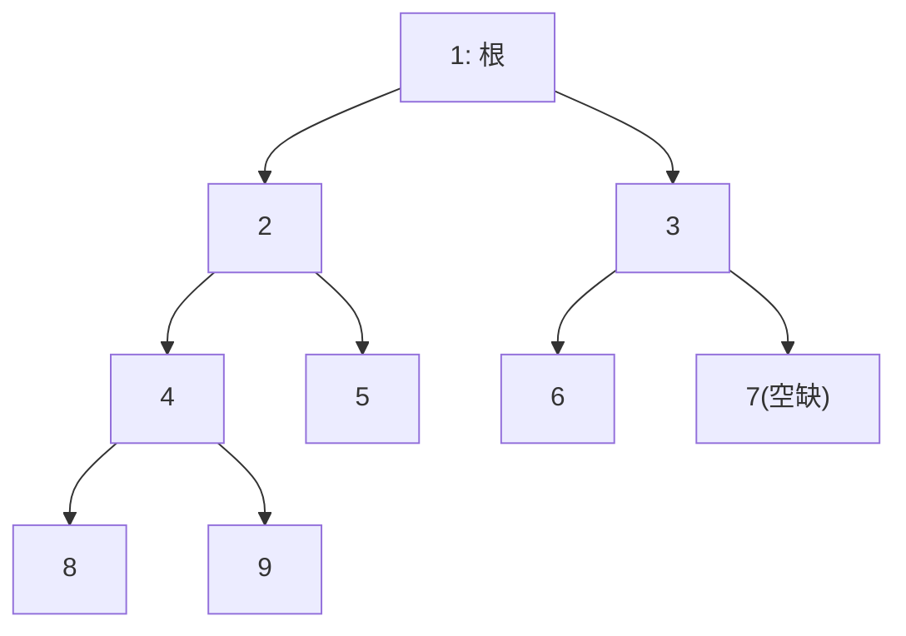
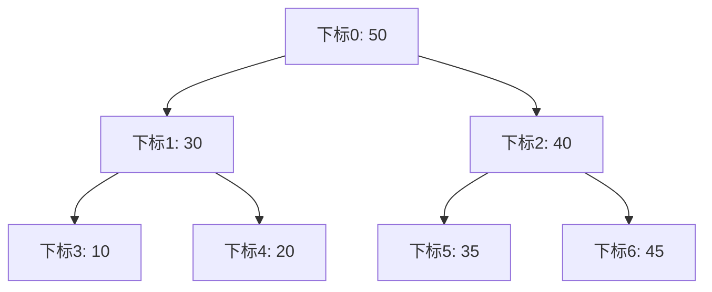
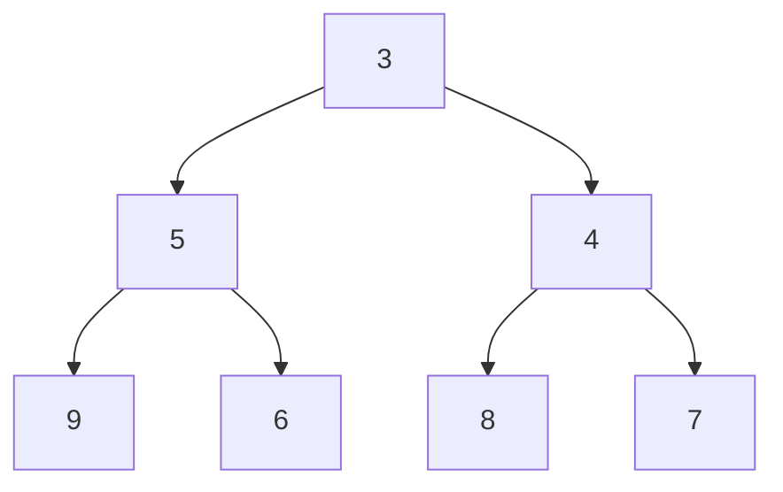
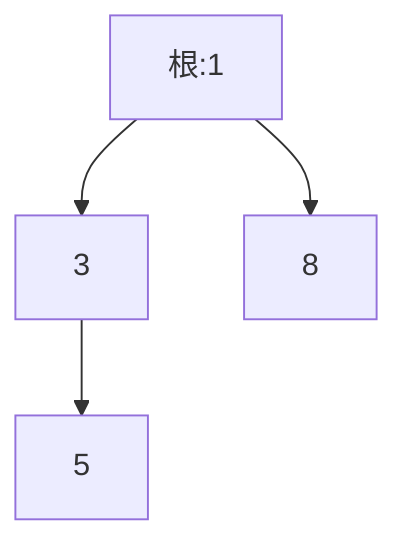
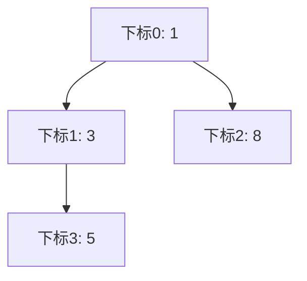
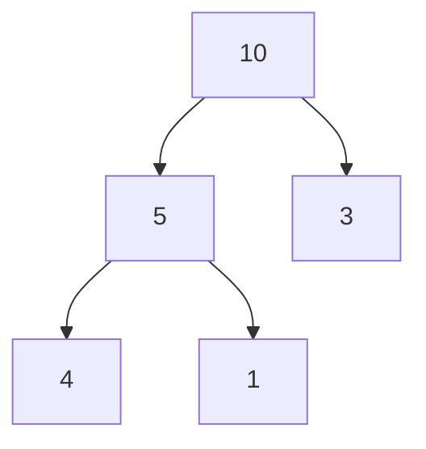

# Concept-Book Run

domain: /home/papagame/projects/digital-duck/cb-data-structure/public/domains/data_structure_ch10/input/graph.yaml
target: heapsort
started: 2026-11-25T04:41:21

## Teaching order (7 concepts)

- complete_binary_tree
- array_resizing_amortization
- eytzinger_method
- heap_order_property
- priority_queue
- binary_heap
- heapsort

### complete_binary_tree (0.5s)

## 完全二叉树

**定义。** 完全二叉树(complete binary tree)是一种二叉树:除最后一层外,每一层的结点都被填满;最后一层的结点全部靠左连续排列,中间没有空缺。

注意它与"满二叉树"的区别:满二叉树要求所有层都填满,而完全二叉树允许最后一层不满,但必须"从左到右"依次填入。

**数组存储。** 完全二叉树最重要的性质是可以无空洞地存入数组。若根结点下标为 $1$,则对下标为 $i$ 的结点:

- 左孩子:$2i$
- 右孩子:$2i+1$
- 父结点:$\lfloor i/2 \rfloor$

因此不需要指针,仅靠下标运算即可在树中移动。二叉堆(heap)正是基于这一结构实现的。

**高度与结点数。** 设完全二叉树有 $n$ 个结点、高度为 $h$(根为第 $0$ 层,最后一层为第 $h$ 层)。前 $h$ 层是满的,共 $2^h-1$ 个结点,最后一层有 $1$ 到 $2^h$ 个结点,所以

$$
2^h \le n \le 2^{h+1}-1 \quad\Longrightarrow\quad h=\lfloor \log_2 n \rfloor .
$$

于是沿着根到叶的路径,操作次数为 $O(\log n)$。


*图:一棵含 6 个结点的完全二叉树的前几层(结点 1–6 存在,编号 7 之后的位置为空缺,结点 8、9 仅示意编号规则,不属于该树)。*

**例题 1:判断。** 下列哪一棵树是完全二叉树?(a) 结点 1 有左孩子 2,但无右孩子,而 2 有左孩子 4;(b) 结点 1 有左孩子 2 和右孩子 3,2 无孩子,3 有左孩子 6。

(a)中第 2 层只有结点 2 一个孩子,但结点 3 缺失却出现了结点 4,最后一层前面存在空缺,不是完全二叉树。(b)中结点 2 无孩子,而结点 3 有孩子,最后一层的结点 6 前面有空位(编号 4、5),因此也不是。判定方法:按层序编号 $1,2,\dots$ 依次检查,一旦出现空位,其后不得再有结点。

**例题 2:求结点。** 一棵完全二叉树有 $n=12$ 个结点,求高度,以及结点 $7$ 的父结点和孩子。

$h=\lfloor\log_2 12\rfloor=3$。结点 $7$ 的父结点是 $\lfloor 7/2\rfloor=3$。左孩子下标 $14>12$,右孩子 $15>12$,所以结点 $7$ 是叶子。

**应用:最后一个非叶结点。** 对 $n$ 个结点的完全二叉树,叶子下标从 $\lfloor n/2\rfloor+1$ 到 $n$。当 $n=12$ 时,最后一个非叶结点是 $6$。建堆(heapify)算法正是从下标 $\lfloor n/2\rfloor$ 开始向前下沉,总时间为 $O(n)$,这也是完全二叉树结构带来的实际收益。

### array_resizing_amortization (0.6s)

## 数组扩容的摊还分析

### 定义

**动态数组**在底层维护一个固定容量 $c$ 的数组,当前存放 $n$ 个元素($n \le c$)。追加元素时,若 $n = c$,就必须**扩容**:分配一个更大的新数组,把旧元素逐个复制过去,再释放旧数组。一次扩容的代价是 $\Theta(n)$,看似很昂贵,但它很少发生。

**摊还分析**考察的是*一整个操作序列*的总代价,而不是单次最坏代价。若 $m$ 次操作的总代价为 $T(m)$,则每次操作的摊还代价为 $T(m)/m$。数组扩容的核心结论是:只要容量按**固定倍数**增长(例如翻倍),$m$ 次追加的总代价为 $O(m)$,即每次追加摊还 $O(1)$。

### 例题:翻倍策略

设初始容量为 1,每次装满就把容量翻倍。进行 $m$ 次追加(为简便设 $m = 2^k$)。

- 每次追加本身写入 1 个元素,共 $m$ 次,代价 $m$。
- 扩容发生在元素数为 $1, 2, 4, \dots, 2^{k-1}$ 时,每次复制的元素个数等于当时的元素数。

复制的总代价为等比级数:

$$
\sum_{i=0}^{k-1} 2^i = 2^k - 1 = m - 1 .
$$

因此

$$
T(m) \le m + (m-1) < 2m, \qquad \frac{T(m)}{m} < 2 = O(1).
$$

**直观解释(记账法)**:每次追加向"账户"存入 3 个单位:1 个用于写入自己,1 个用于将来复制自己,1 个用于将来帮一个旧元素复制。扩容时,账户里恰好有足够的钱支付全部复制。

### 问题求解应用

**问题 1**:若每次只扩容 $+10$(固定增量)而非翻倍,摊还代价是多少?

扩容发生在 $n = 10, 20, \dots$,复制总代价为

$$
\sum_{j=1}^{m/10} 10j \approx \frac{10}{2}\left(\frac{m}{10}\right)^2 = \Theta(m^2),
$$

摊还代价为 $\Theta(m)$,不是常数。**结论:必须按比例增长,而非固定增量。**

**问题 2**:增长因子取 $\alpha > 1$(如 1.5)时,总复制代价为

$$
\sum_{i} \frac{m}{\alpha^{i}} \le \frac{m}{1 - 1/\alpha} = \frac{\alpha}{\alpha - 1}\, m = O(m).
$$

$\alpha$ 越小,复制越多但浪费的空间越少,这是时间与空间的权衡。

**缩容**:若在 $n < c/2$ 时立刻减半,则在临界点反复"追加、删除"会使每次操作都触发 $\Theta(n)$ 的复制(抖动)。正确做法是**当 $n = c/4$ 时才将容量减半**:缩容后数组仍有一半空闲,至少再经过 $c/4$ 次操作才会触发下一次调整,复制代价同样可被摊还,所有操作的摊还代价仍为 $O(1)$。

**要点**:摊还分析给出的是*序列总代价*的保证($m$ 次操作共 $O(m)$),不依赖输入的概率分布,这与平均情形分析有本质区别。

### eytzinger_method (0.6s)

## Eytzinger 方法

**定义。** Eytzinger 方法是把一棵*完全二叉树*隐式存储在数组中的技术:按层序(广度优先)从上到下、从左到右依次放置结点,不需要任何指针。若根在下标 $0$,则下标为 $i$ 的结点满足:

$$
\text{左孩子}=2i+1,\qquad \text{右孩子}=2i+2,\qquad \text{父结点}=\left\lfloor \frac{i-1}{2}\right\rfloor\ (i\ge 1).
$$

这些公式成立,是因为第 $k$ 层($k=0,1,\dots$)恰有 $2^k$ 个结点,其起始下标为 $2^k-1$。结点 $i$ 在本层中的偏移量是 $j=i-(2^k-1)$。它的两个孩子在下一层,下标为 $(2^{k+1}-1)+2j=2i+1$ 和 $2i+2$。

**例题。** 把堆 $[50,30,40,10,20,35,45]$ 当作树来读:

- $i=0$:值 $50$,孩子在 $1,2$,即 $30$ 和 $40$。
- $i=1$:值 $30$,孩子在 $3,4$,即 $10$ 和 $20$。
- $i=5$:值 $35$,父结点是 $\lfloor(5-1)/2\rfloor=2$,即 $40$。


*同一个数组对应的完全二叉树:每个结点标出了它在数组中的下标。*

**问题求解应用。** 

*问题 1:* 一个含 $n$ 个元素的数组,哪些下标是叶子?结点 $i$ 有孩子当且仅当 $2i+1\le n-1$,即 $i\le \frac{n-2}{2}$。所以叶子的下标是 $\lfloor n/2\rfloor,\dots,n-1$。当 $n=7$ 时,叶子是下标 $3$ 到 $6$,和上图一致。

*问题 2:* 树的高度是多少?最后一个结点的下标是 $n-1$,它所在的层是 $\lfloor\log_2 n\rfloor$。因此从根走到任意叶子最多需要 $O(\log n)$ 步。堆的插入和删除正是沿着这条路径做"上浮"或"下沉",每一步只需做下标运算。

*问题 3:* 从下标 $11$ 向上走到根,路径是什么?依次计算 $\lfloor(i-1)/2\rfloor$:$11\to5\to2\to0$,共 $3$ 步,与 $\lfloor\log_2 12\rfloor=3$ 吻合。

```python
def parent(i): return (i - 1) // 2
def children(i): return 2*i + 1, 2*i + 2
```

**为什么重要。** 这种布局省去了指针的内存开销,也让相邻层的结点在内存中靠得更近,对缓存更友好。因此它被用于二叉堆、优先队列,以及缓存友好的有序数组搜索。需要注意:它只在树*完全*(或近似完全)时才不浪费空间。若树很稀疏,数组中会出现大量空位,这时就应改用指针结构。

### heap_order_property (0.6s)

## 堆序性质(Heap Order Property)

### 定义

**堆序性质**是二叉树上的一种局部约束:除根结点外,每个结点存储的值都**不小于**其父结点的值。设 $A[i]$ 表示结点 $i$ 的值,$\text{parent}(i)$ 表示其父结点,则

$$
A[\text{parent}(i)] \le A[i], \quad \text{对所有非根结点 } i .
$$

满足该性质的树称为**最小堆**(min-heap)。由于约束沿每条"根到叶"的路径连续传递,可推出:**根结点存储整棵树的最小值**。

> 证明:任取结点 $v$,设根到 $v$ 的路径为 $r=v_0, v_1,\dots,v_k=v$。由堆序性质,$A[v_0]\le A[v_1]\le\cdots\le A[v_k]$,故 $A[r]\le A[v]$。$\blacksquare$

注意:堆序性质只比较**父子**关系,**不**要求左右兄弟之间有大小顺序,这与二叉搜索树不同。

### 例题:判断是否满足堆序

下面这棵树是否满足堆序性质?



*一棵满足堆序性质的二叉树:每个结点的值都不小于其父结点的值。*

逐条检查父子关系:$3\le5$,$3\le4$,$5\le9$,$5\le6$,$4\le8$,$4\le7$。全部成立,所以满足堆序性质。注意左子树的结点 $6$ 小于右子树的结点 $7$ 与 $8$ 无关紧要,而 $5>4$ 这对兄弟的"逆序"同样允许。

若把结点 $9$ 改成 $2$,则 $5\le 2$ 不成立,堆序被破坏。

### 问题求解应用:插入后修复堆序

向上面的堆中插入值 $1$。步骤如下:

1. 把 $1$ 放在最后一层最左的空位,即结点 $8$ 的位置之后(作为 $4$ 的左孩子之下需先补满;此处作为 $7$ 的右侧空位,即 $4$ 的子树之外的下一空位——$6$ 的右侧也已满,故放在 $9$ 的左孩子位置)。
2. 此时 $1<$ 其父结点 $9$,违反堆序,交换。
3. 继续与父结点 $5$ 比较,$1<5$,交换。
4. 再与根 $3$ 比较,$1<3$,交换,$1$ 成为新根。

每次交换只修复一处局部违规,最多沿树高上行一次,因此修复代价为 $O(\log n)$,其中 $n$ 为结点数(完全二叉树高度为 $\lfloor\log_2 n\rfloor$)。

**要点**:

- 堆序是**局部**条件,却推出**全局**结论(根是最小值),因此可以 $O(1)$ 取得最小元。
- 插入和删除最小元都通过"交换到合适位置"恢复堆序,代价 $O(\log n)$。
- 若把不等号反向($A[\text{parent}(i)]\ge A[i]$),得到**最大堆**,根为最大值。

**练习**:序列 $[2,7,4,10,8,5]$ 按层序存放为完全二叉树(下标从 1 开始,$\text{parent}(i)=\lfloor i/2\rfloor$),它是否满足堆序性质?请逐对验证。

### priority_queue (0.6s)

## 优先队列

**定义。** 优先队列(priority queue)是一种抽象数据类型,支持两种基本操作:

- $\text{add}(x)$:将元素 $x$ 加入队列;
- $\text{remove}()$:删除并返回当前存储的**最小值**。

它与普通队列的区别在于:取出元素的顺序不取决于插入的先后,而取决于元素的大小(优先级)。"抽象数据类型"意味着我们只规定行为,不规定实现方式。

**常见实现:二叉堆。** 最小堆是一棵完全二叉树,满足:每个节点的值不大于其子节点的值。若用数组存储(下标从 1 开始),节点 $i$ 的父节点为 $\lfloor i/2 \rfloor$,子节点为 $2i$ 和 $2i+1$。

- `add`:把新元素放在数组末尾,再不断与父节点比较并上移("上浮");
- `remove`:取出根节点(最小值),把末尾元素移到根,再不断与较小的子节点交换("下沉")。

由于完全二叉树的高度为 $\lfloor \log_2 n \rfloor$,两种操作的时间复杂度均为 $O(\log n)$,而查看最小值只需 $O(1)$。

**worked example。** 依次执行 add(5)、add(3)、add(8)、add(1),再执行两次 remove()。

1. add(5):堆为 $[5]$。
2. add(3):放在末尾得 $[5,3]$,3 小于父节点 5,上浮,得 $[3,5]$。
3. add(8):得 $[3,5,8]$,无需调整。
4. add(1):得 $[3,5,8,1]$,1 的父节点是下标 2 的 5,交换得 $[3,1,8,5]$;再与根 3 比较,交换得 $[1,3,8,5]$。
5. remove():返回 1。把末尾的 5 移到根:$[5,3,8]$,与较小子节点 3 交换,得 $[3,5,8]$。
6. remove():返回 3。

两次返回值依次为 1、3,即始终是当前最小值。

**问题求解应用:合并 $k$ 个有序列表。** 设有 $k$ 个各自已排好序的列表,总共 $n$ 个元素,要合并成一个有序列表。

思路:先把每个列表的首元素加入优先队列。每次 remove() 得到当前全局最小值并输出,再把该元素所在列表的下一个元素 add 进去。

```python
import heapq

def merge(lists):
    heap = [(l[0], i, 0) for i, l in enumerate(lists) if l]
    heapq.heapify(heap)
    out = []
    while heap:
        v, i, j = heapq.heappop(heap)      # remove()
        out.append(v)
        if j + 1 < len(lists[i]):
            heapq.heappush(heap, (lists[i][j+1], i, j+1))  # add()
    return out
```

队列中始终最多只有 $k$ 个元素,每个元素各经历一次 add 和一次 remove,所以总时间为 $O(n \log k)$。相比之下,把所有元素拼起来再排序需要 $O(n \log n)$;当 $k \ll n$ 时,优先队列方法明显更快。

同样的模式也出现在 Dijkstra 最短路径算法、事件调度、Huffman 编码以及"求前 $K$ 大元素"等问题中:只要需要反复取出"当前最小(或最优)者",就应想到优先队列。


*图:执行 add(5)、add(3)、add(8)、add(1) 后得到的最小堆,每个父节点都不大于其子节点。*

### binary_heap (0.6s)

## 二叉堆

### 定义

**二叉堆(binary heap)**是一种实现**优先队列**的数据结构。它在逻辑上是一棵**完全二叉树**,并满足**堆序性质**。以最小堆为例,每个结点的值都不大于其子结点的值:

$$A[\lfloor (i-1)/2 \rfloor] \le A[i], \quad 1 \le i < n.$$

所以最小元素总在根部。

**Eytzinger 方法**让我们不需要指针。完全二叉树按层从左到右排列,正好可以放进一个数组。当下标从 $0$ 开始时:

$$\text{parent}(i)=\left\lfloor \frac{i-1}{2}\right\rfloor,\quad \text{left}(i)=2i+1,\quad \text{right}(i)=2i+2.$$

由于树是完全的,数组中间没有空洞。含 $n$ 个元素的堆,高度为 $\lfloor \log_2 n\rfloor$。

两个核心操作都建立在这个高度上:

- **上浮(sift-up)**:插入时把新元素放在末尾,再不断与父结点比较并交换。
- **下沉(sift-down)**:删除最小值时,把末尾元素移到根部,再不断与较小的子结点交换。

两者最多走一条根到叶的路径,所以时间复杂度都是 $O(\log n)$。

### 例题

向空最小堆依次插入 $5, 3, 8, 1$。

1. 插入 $5$:$[5]$。
2. 插入 $3$:放在下标 $1$,得 $[5,3]$。父结点是 $5>3$,交换,得 $[3,5]$。
3. 插入 $8$:放在下标 $2$,得 $[3,5,8]$。父结点是 $3\le 8$,无需交换。
4. 插入 $1$:放在下标 $3$,得 $[3,5,8,1]$。父结点是下标 $1$ 的 $5>1$,交换,得 $[3,1,8,5]$。新父结点是下标 $0$ 的 $3>1$,再交换,得 $[1,3,8,5]$。

现在执行一次删除最小值:取出 $1$,把末尾的 $5$ 移到根部,得 $[5,3,8]$。根的子结点是 $3$ 和 $8$,较小的是 $3$,交换,得 $[3,5,8]$。

### 问题求解应用

**问题**:从 $10^6$ 个数中找出最小的 $k=10$ 个。

排序需要 $O(n\log n)$。更好的做法是先用 $O(n)$ 的建堆算法,把全部元素建成最小堆,再弹出 $k$ 次。总代价为 $O(n + k\log n)$,约 $10^6 + 10\times 20$ 次操作,远小于排序的 $2\times10^7$。

```python
import heapq

def k_smallest(data, k):
    heapq.heapify(data)          # O(n) 建堆
    return [heapq.heappop(data) for _ in range(k)]   # k 次 O(log n)
```

**建堆为什么是 $O(n)$?** 从最后一个非叶结点开始,依次对每个结点做下沉。高度为 $h$ 的结点最多有 $\lceil n/2^{h+1}\rceil$ 个,每个最多下沉 $h$ 层,所以总代价为

$$\sum_{h=0}^{\lfloor\log_2 n\rfloor}\left\lceil\frac{n}{2^{h+1}}\right\rceil h = O\!\left(n\sum_{h\ge 0}\frac{h}{2^{h}}\right)=O(n),$$

因为 $\sum_{h\ge0} h/2^h = 2$ 收敛。

反过来,如果只要最小的 $k$ 个,且 $k \ll n$,可以用大小为 $k$ 的**最大堆**扫描一遍数据。这种做法只需 $O(k)$ 额外空间,时间为 $O(n\log k)$。


*例题中的堆 $[1,3,8,5]$:数组下标按层从左到右排列,子结点下标由 $2i+1$ 与 $2i+2$ 给出。*

### heapsort (0.6s)

## 堆排序(Heapsort)

### 定义

**堆排序**是基于二叉堆(BinaryHeap)的比较排序算法。我们使用**最大堆**:它是一棵完全二叉树,并且每个结点的值都不小于其孩子的值,即

$$A[\lfloor (i-1)/2 \rfloor] \ge A[i] \quad (i \ge 1).$$

数组下标从 $0$ 开始时,结点 $i$ 的左、右孩子分别为 $2i+1$ 和 $2i+2$。因此最大元素总在堆顶 $A[0]$。

算法分两个阶段:

1. **建堆**:把任意数组整理成最大堆。
2. **反复取最大值**:把堆顶与堆的最后一个元素交换,堆的大小减 $1$,再对新堆顶执行**下沉**(sift-down)以恢复堆性质。

```python
def sift_down(A, i, n):
    while True:
        l, r, m = 2*i + 1, 2*i + 2, i
        if l < n and A[l] > A[m]: m = l
        if r < n and A[r] > A[m]: m = r
        if m == i: return
        A[i], A[m] = A[m], A[i]
        i = m

def heapsort(A):
    n = len(A)
    for i in range(n//2 - 1, -1, -1):   # 阶段 1:建堆
        sift_down(A, i, n)
    for end in range(n - 1, 0, -1):     # 阶段 2:逐个取出最大值
        A[0], A[end] = A[end], A[0]
        sift_down(A, 0, end)
```

### 例题

对 $A=[4,10,3,5,1]$ 排序。

**建堆**:从最后一个非叶结点 $i=1$ 开始。$A[1]=10$ 大于其孩子 $5,1$,不动。再处理 $i=0$:$4$ 小于孩子 $10$,交换得 $[10,4,3,5,1]$;$4$ 继续下沉,其孩子为 $5,1$,与 $5$ 交换,得最大堆 $[10,5,3,4,1]$。

**取最大值**:

- 交换 $10$ 与 $1$,得 $[1,5,3,4\,|\,10]$,下沉后为 $[5,4,3,1\,|\,10]$。
- 交换 $5$ 与 $1$,得 $[1,4,3\,|\,5,10]$,下沉后为 $[4,1,3\,|\,5,10]$。
- 交换 $4$ 与 $3$,得 $[3,1\,|\,4,5,10]$,堆性质已满足。
- 交换 $3$ 与 $1$,得 $[1,3,4,5,10]$。

### 复杂度分析

含 $n$ 个结点的完全二叉树高度为 $\lfloor \log_2 n \rfloor$,所以一次下沉最多需要 $O(\log n)$ 步。

- 阶段 2 执行 $n-1$ 次下沉,总代价为 $O(n\log n)$。
- 阶段 1 看似也是 $O(n\log n)$,但可以算得更紧。高度为 $h$ 的结点至多有 $\lceil n/2^{h+1}\rceil$ 个,每个下沉代价为 $O(h)$,于是

$$\sum_{h=0}^{\lfloor\log n\rfloor} \left\lceil\frac{n}{2^{h+1}}\right\rceil O(h) = O\!\left(n\sum_{h\ge 0}\frac{h}{2^{h}}\right)=O(n),$$

因为 $\sum_{h\ge0} h/2^h = 2$。

因此,堆排序在**最坏、平均、最好**三种情况下都是 $\Theta(n\log n)$,且是**原地排序**(额外空间 $O(1)$)。它不是稳定排序。

### 应用:求前 $k$ 大的元素

**问题**:在 $n=10^6$ 个数中找出最大的 $k=10$ 个。

**解法**:不必完整排序。先用 $O(n)$ 时间建堆,再只执行 $k$ 次"取堆顶 + 下沉",总代价为 $O(n + k\log n)$。当 $k\ll n$ 时,这远优于 $O(n\log n)$ 的完整排序。

**与其他算法的比较**:快速排序平均更快(缓存局部性好),但最坏情况为 $O(n^2)$。堆排序用略大的常数换来了**有保证的** $O(n\log n)$ 上界和 $O(1)$ 空间,所以常被用作快速排序的退化保底方案(如 introsort)。


*例题中建堆后的最大堆 $[10,5,3,4,1]$:每个父结点都不小于其孩子,最大值位于根部。*

## Run complete

total: 11.6s
