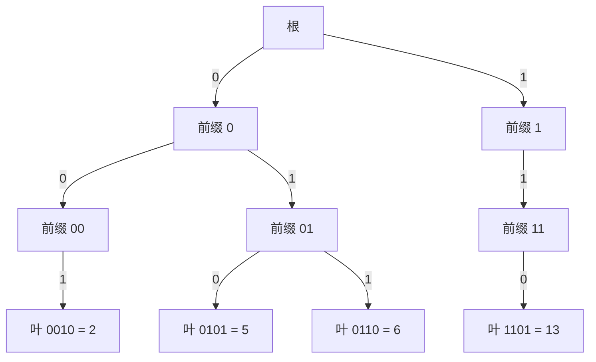
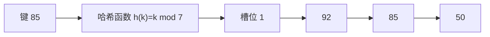
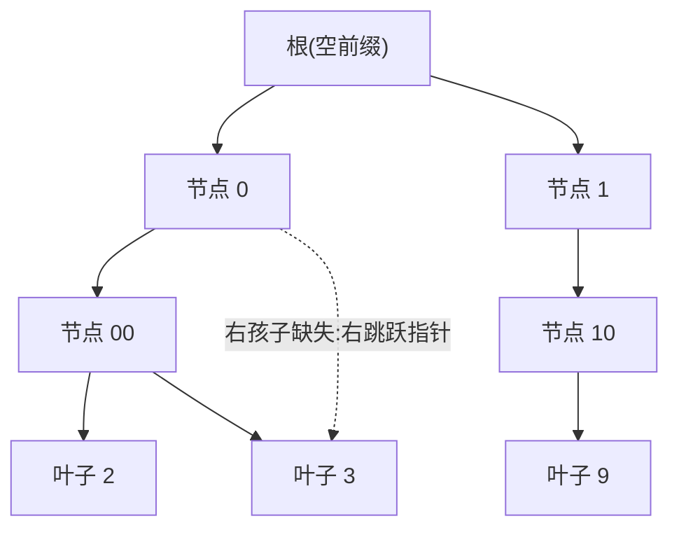
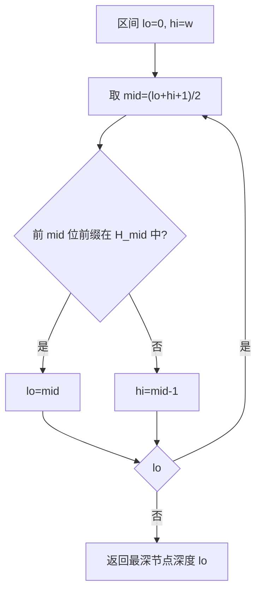
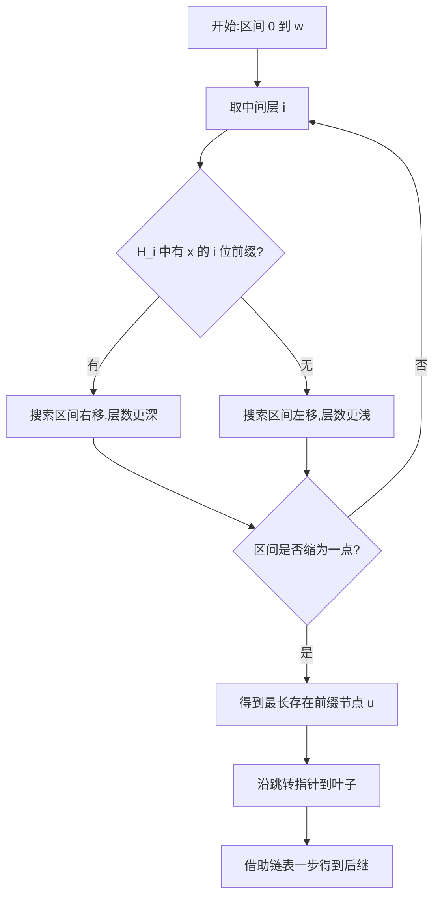
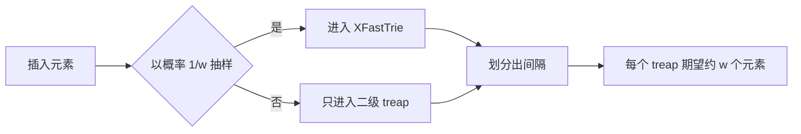
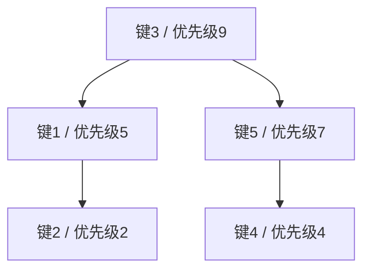

# Concept-Book Run

domain: /home/papagame/projects/digital-duck/cb-data-structure/public/domains/data_structure_ch13/input/graph.yaml
target: yfasttrie
started: 2026-11-25T04:42:43

## Teaching order (12 concepts)

- bit_representation
- sset_interface
- binary_trie
- hash_table
- jump_pointers
- leaf_linked_list
- binary_trie_operations
- level_based_binary_search
- xfasttrie
- probabilistic_sampling
- treap
- yfasttrie

### bit_representation (0.8s)

## 位表示

**定义。** 一个 $w$ 位整数可以用长度固定为 $w$ 的二进制串 $x = x_{w-1}x_{w-2}\cdots x_1x_0$ 来编码,其中每个 $x_i\in\{0,1\}$。对于无符号整数,其数值为

$$
B2U_w(x)=\sum_{i=0}^{w-1} x_i\,2^i .
$$

$x_{w-1}$ 称为最高有效位(MSB),$x_0$ 称为最低有效位(LSB)。由于共有 $2^w$ 种不同的位串,$w$ 位无符号数能表示的范围是 $0$ 到 $2^w-1$。

对于补码(二进制补码)表示的有符号整数,最高位带有负权重:

$$
B2T_w(x)=-x_{w-1}2^{w-1}+\sum_{i=0}^{w-2} x_i\,2^i ,
$$

表示范围为 $-2^{w-1}$ 到 $2^{w-1}-1$。

**例题。** 取 $w=8$,位串 $x=10110101$。

- 作为无符号数:$128+32+16+4+1=181$。
- 作为补码:$-128+32+16+4+1=-75$。

同一个位串,按不同规则解释,得到不同的数值。差值恰为 $2^w=256$($181-(-75)=256$),这是因为最高位的权重从 $+2^{w-1}$ 变成了 $-2^{w-1}$,差值为 $2\cdot 2^{w-1}=2^w$。

**问题求解应用。** 

*问题 1:* 用 8 位补码表示 $-37$。

解:先写出 $37=00100101$。补码取反加一:取反得 $11011010$,加 $1$ 得 $11011011$。验证:$-128+64+16+8+2+1=-37$ ✓。

*问题 2:* 需要多少位才能为 $n=1000$ 个不同的对象编号?

解:需要 $2^w\ge 1000$,即 $w\ge\lceil\log_2 1000\rceil=10$(因为 $2^{9}=512<1000\le 1024=2^{10}$)。

*问题 3(溢出):* 在 8 位补码中计算 $100+50$。

解:真实结果 $150$ 超出上限 $127$。二进制 $01100100+00110010=10010110$,按补码解释为 $-128+16+4+2=-106$。这正是 $150-256=-106$,即结果按模 $2^w$ 回绕。

用 Python 可以直接验证:

```python
w = 8
x = 0b10110101
print(x)                           # 181(无符号)
print(x - (1 << w) if x >> (w-1) else x)  # -75(补码)
print(((100 + 50) + 128) % 256 - 128)     # -106(溢出回绕)
```

**小结。** 位表示的核心是:固定宽度 $w$ 决定了有限的取值范围 $2^w$ 个,而"如何解释最高位"决定了这些位串对应哪些整数。理解这一点,就能预测溢出、类型转换和位运算的行为。

### sset_interface (0.8s)

## Sset Interface(集合接口)

### 定义

**SSet(有序集合,Sorted Set)接口**是一种抽象数据类型,用于存储一组**可比较**的元素(即任意两个元素 $x,y$ 都能判断 $x<y$、$x=y$ 或 $x>y$)。它要求实现以下三种操作:

- `add(x)`:将 $x$ 加入集合;若 $x$ 已存在则不加入,返回是否成功。
- `remove(x)`:从集合中删除 $x$,返回是否成功。
- `find(x)`:返回集合中**不小于 $x$ 的最小元素** $y$(即后继),若不存在则返回空值。

注意:`find(x)` 不只是判断"是否存在",它还能在 $x$ 不在集合中时给出后继。这个设计使得 SSet 既能做成员查询,也能做范围查询。

数学上,若集合为 $S$,则
$$
\texttt{find}(x)=\min\{\,y\in S \mid y\ge x\,\}.
$$

SSet 只规定"做什么",不规定"怎么做";跳表、二叉搜索树、红黑树等都是它的具体实现。

### 例题

设 $S=\{3,7,12,20\}$,依次执行:

1. `find(8)`:大于等于 8 的元素有 12、20,最小者为 $12$,返回 $12$。
2. `find(7)`:7 本身在集合中,返回 $7$。
3. `find(25)`:没有不小于 25 的元素,返回空值。
4. `add(10)`:$S=\{3,7,10,12,20\}$。
5. `remove(7)`:$S=\{3,10,12,20\}$,之后 `find(7)` 返回 $10$。

### 问题求解应用

**问题**:给定一组已排序的预约时间点(分钟),判断能否在时刻 $t$ 之后至少空出 $d$ 分钟安排会议,即下一个已有预约是否不早于 $t+d$。

**思路**:用 SSet 存储所有预约开始时间,只需一次 `find`:

```python
def can_schedule(sset, t, d):
    nxt = sset.find(t)          # 不早于 t 的最近预约
    return nxt is None or nxt >= t + d
```

若 $S=\{540,600,720\}$,查询 $t=545,\ d=30$:`find(545)=600`,而 $600\ge 575$,故可以安排。若 $d=60$,则 $600<605$,不可以。

这里若用无序列表,`find` 需要扫描全部 $n$ 个元素,时间为 $O(n)$;而用平衡二叉搜索树或跳表实现 SSet,`add`、`remove`、`find` 均可在期望或最坏 $O(\log n)$ 时间内完成。因此:

$$
T_{\text{列表}}(n)=O(n)\quad\text{对比}\quad T_{\text{SSet}}(n)=O(\log n).
$$

当 $n=10^6$ 时,前者约需百万次比较,后者约 20 次($\log_2 10^6\approx 20$)。

### 小结

SSet 接口的核心在于:元素**可比较**,且 `find(x)` 返回**后继**而非仅返回"是否存在"。理解接口与实现的分离,是选择合适数据结构解决实际问题的第一步。

### binary_trie (0.5s)

## 二叉字典树(Binary Trie)

### 定义

**二叉字典树**是一棵二叉树,用来把一组 $w$ 位整数 $S\subseteq\{0,1,\dots,2^w-1\}$ 编码为从根到叶的路径。设 $x$ 的二进制表示为 $b_1b_2\cdots b_w$($b_1$ 为最高位)。从根出发,在第 $i$ 层:若 $b_i=0$ 就走向左孩子,若 $b_i=1$ 就走向右孩子。因此,$x\in S$ 当且仅当存在一条深度为 $w$ 的根到叶路径,恰好读出 $x$ 的各位。

关键性质:

- 树高恒为 $w$,与集合大小 $n=|S|$ 无关;
- `insert`、`delete`、`contains` 都只需沿一条路径走 $w$ 步,时间为 $O(w)$;
- 空间最坏为 $O(nw)$,因为每个元素最多贡献 $w$ 个结点,但相邻元素会共享公共前缀;
- 叶子按从左到右的顺序恰好是 $S$ 的升序排列,所以也能支持前驱/后继查询。

### 例题

取 $w=4$,$S=\{2,5,6,13\}$。其二进制为 $0010,\ 0101,\ 0110,\ 1101$。

- 查找 $x=6=0110$:根 $\to$ 左(0)$\to$ 右(1)$\to$ 右(1)$\to$ 左(0),到达叶子,所以 $6\in S$。
- 查找 $x=7=0111$:前三步与 $6$ 共享路径,第 4 步需向右,但该孩子不存在,所以 $7\notin S$。
- 结点总数:根 1 个;第 1 层 2 个(前缀 $0$、$1$);第 2 层 3 个($00,01,11$);第 3 层 4 个($001,010,011,110$);第 4 层 4 个。共 $1+2+3+4+4=14$ 个,少于不共享时的 $1+4\cdot4=17$ 个。


*图中为 $S=\{2,5,6,13\}$ 的二叉字典树(省略了单链路径上的中间结点,边上标注该层读取的比特)。*

### 问题求解应用:求后继

**问题**:在上面的集合中,求大于等于 $7$ 的最小元素。

**方法**:先沿 $7=0111$ 的比特向下走,走到无法继续的位置(前缀 $011$,下一步需向右但不存在)。然后回溯:在路径上找到最深的一个"本可向右、而该右孩子存在"的结点,转入该右子树后,一路尽量向左走到叶子。

- 前缀 $011$ 处:右孩子不存在,继续回溯;
- 前缀 $01$ 处:我们走的是右边(比特 1),没有更大的分支;
- 前缀 $0$ 处:我们走的是右边的前缀 $01$,其右侧无更大分支……回到根:我们走的是左边(比特 0),而右孩子(前缀 $1$)存在。

转入前缀 $1$ 的子树,一路向左:$1\to 11\to 110\to 1101$,得到 $13$。所以后继为 $13$。

**复杂度**:下行至多 $w$ 步,回溯至多 $w$ 步,再下行至多 $w$ 步,总计 $O(w)$。

这说明二叉字典树的耗时取决于**位数 $w$**,而不是元素个数 $n$。当 $n\gg w$(例如 $w=32$、$n=10^6$)时,它比 $O(\log n)$ 的平衡搜索树更快;代价是空间可能达到 $O(nw)$。后续的 x-fast trie 与 y-fast trie 正是为了降低这一空间代价、并把查询加速到 $O(\log w)$ 而设计的。

### hash_table (0.7s)

## 哈希表

**定义。** 当我们只需要存储全域 $U$ 中的少量键（$n \ll |U|$）时，为每个可能的键都分配一个位置既浪费又不现实。*哈希表*（hash table）使用一个长度为 $m$ 的数组 $T[0..m-1]$，并通过**哈希函数** $h: U \to \{0,1,\dots,m-1\}$ 把键 $k$ 映射到槽位 $h(k)$。因为 $|U| > m$，不同的键可能映射到同一个槽位，这称为**冲突**（collision）。

最常用的冲突处理方法是**链地址法**：每个槽位保存一个链表，所有哈希值相同的键都放入同一条链中。

定义**装载因子** $\alpha = n/m$。在"简单均匀哈希"假设下（每个键等可能地落入任一槽位，且相互独立），一条链的期望长度就是 $\alpha$。因此：

- 不成功查找的期望时间为 $\Theta(1+\alpha)$；
- 成功查找的期望时间同样为 $\Theta(1+\alpha)$。

若保持 $m = \Theta(n)$，则 $\alpha = O(1)$，查找、插入、删除的期望时间均为 $O(1)$。

**例题。** 取 $m=7$，$h(k) = k \bmod 7$，依次插入键 $50, 700, 76, 85, 92, 73$：

| 键 | $k \bmod 7$ | 槽位 |
|---|---|---|
| 50 | 1 | 1 |
| 700 | 0 | 0 |
| 76 | 6 | 6 |
| 85 | 1 | 1（与 50 冲突） |
| 92 | 1 | 1（再次冲突） |
| 73 | 3 | 3 |

最终槽位 1 的链为 $92 \to 85 \to 50$（新元素插在链头），其余槽位各有 0 或 1 个元素。此时 $n=6,\ m=7$，$\alpha \approx 0.86$。查找 85 时，先计算 $h(85)=1$，再沿链比较，只需 2 次比较。


*图：键 85 经哈希函数定位到槽位 1，再沿链表查找。*

**问题求解应用。** 

*问题：* 给定整数数组 $a$ 和目标值 $t$，判断是否存在两个元素之和等于 $t$。

*思路：* 暴力枚举需要 $O(n^2)$。改用哈希表：遍历每个 $x$，先查询 $t-x$ 是否已在表中；若在，则找到答案；否则把 $x$ 插入表中。

```python
def two_sum(a, t):
    seen = set()          # 基于哈希表实现
    for x in a:
        if t - x in seen:
            return True
        seen.add(x)
    return False
```

每个元素只做一次期望 $O(1)$ 的查询和一次插入，总期望时间为 $O(n)$，空间为 $O(n)$。这正是用空间换时间的典型例子。

**注意事项。** 当 $\alpha$ 过大时，链会变长，性能退化，最坏情况下所有键落入同一槽位，操作退化为 $O(n)$。实际实现会在 $\alpha$ 超过阈值（如 $0.75$）时将 $m$ 加倍并重新哈希所有键，使均摊代价仍为 $O(1)$。此外，好的哈希函数应使键尽量均匀分布；例如取模时，$m$ 宜选为远离 2 的幂的素数。

### jump_pointers (0.7s)

## 跳跃指针(Jump Pointers)

### 定义

在 x-fast trie(以及 y-fast trie 的底层结构)中,键是 $w$ 位整数,存放在深度为 $w$ 的二叉 trie 的叶子上。**跳跃指针**是存储在每个内部节点上的辅助指针:若某个节点缺少左孩子,它的跳跃指针指向其子树中**最小的叶子**;若缺少右孩子,则指向其子树中**最大的叶子**。

这样,查询 $\text{find}(x)$ 走到"无路可走"的节点时,不必回溯,可以直接沿跳跃指针到达前驱或后继。叶子本身还串成一条双向链表,因此一次跳跃之后,另一侧的邻居只需再走一步。

### 例题

设 $w=4$,键集 $S=\{2,\,3,\,9\}$,二进制为 $0010,\,0011,\,1001$。查询 $x=6=0110$ 的后继。

1. 各层前缀存入哈希表。$x$ 的前缀依次是 $0,\,01,\,011,\,0110$。
2. 对前缀长度做二分查找,找最长出现在 trie 中的前缀。$0$ 存在,$01$ 不存在,所以最长公共前缀是 $0$,对应节点 $u$。
3. $u$ 的子树含键 $2,3$,只有左分支 $00$,缺少右孩子 $01$。$x$ 的下一位是 $1$,要走右边,但右孩子缺失,于是使用 $u$ 的**右跳跃指针**,它指向子树中最大的叶子 $3$。
4. $3<x$,所以 $3$ 是 $x$ 的**前驱**。沿叶子链表向右一步,得到后继 $9$。

整个过程只做了 $O(\log w)$ 次哈希查找,加上 $O(1)$ 次指针跳转。

### 问题求解应用

**规则**:设 $u$ 是与 $x$ 最长公共前缀对应的节点,$b$ 是 $x$ 在该节点之后的下一位。

- 若 $b=1$,则 $u$ 没有右孩子,取右跳跃指针得到最大叶子 $\ell$,即 $x$ 的前驱,后继是 $\ell$ 的链表下一项。
- 若 $b=0$,则 $u$ 没有左孩子,取左跳跃指针得到最小叶子 $\ell$,即 $x$ 的后继,前驱是 $\ell$ 的链表上一项。

**练习**:在上面的 $S$ 中查询 $x=5=0101$。最长公共前缀为 $0$,下一位 $b=1$,右孩子缺失。右跳跃指针指向 $3$,所以前驱是 $3$,后继是 $9$。

**为什么正确?** 若 $u$ 缺右孩子,则 $S$ 中所有以 $u$ 为前缀的键都以 $u0$ 开头,都小于 $x$。其中最大者就是这些键里最接近 $x$ 的,也就是前驱。对称情形同理。

**复杂度**:

$$T_{\text{find}}(w)=O(\log w)\ \text{(二分前缀)}+O(1)\ \text{(跳跃指针)}=O(\log w).$$

代价是空间。每个键最多使 $w$ 个前缀进入哈希表,所以空间为 $O(nw)$。y-fast trie 只对约每 $w$ 个键中的一个代表建 x-fast trie,把空间降到 $O(n)$。


*图:节点 0 缺少右孩子 01,其右跳跃指针直接指向子树中最大的叶子 3。*

### leaf_linked_list (0.8s)

## 叶子链表(Leaf Linked List)

### 定义

**叶子链表**是在二进制字典树(BinaryTrie)的所有叶子之间建立的一条**双向链表**,链表顺序与叶子所存键的大小顺序一致。其关键设计是**复用指针**:叶子节点没有子节点,其 `left` 与 `right` 两个子指针槽位本来就是空的,因此可以直接改作 `prev`(前驱叶子)和 `next`(后继叶子)。这样链表不需要额外内存,总空间仍为 $O(n)$。

它解决的问题是:在字典树中"跳"到某个位置后,如何快速找到相邻的键。若只有树结构,求后继可能需要沿树向上回溯再向下,最坏需 $O(w)$ 步($w$ 为键的位数);有了叶子链表,只要定位到一个叶子,前驱和后继就是一步指针跳转 $O(1)$。

### worked example

设 $w=4$,键集合 $S=\{2,5,9,12\}$,二进制为 $0010,0101,1001,1100$。叶子链表为:

$$2 \leftrightarrow 5 \leftrightarrow 9 \leftrightarrow 12$$

查询 $\text{succ}(6)$,即大于等于 6 的最小键:

1. 从根沿 6 的二进制 $0110$ 向下走:第一位 $0$ 到左子树,第二位 $1$ 到达键 5 所在的分支;下一位 $1$ 时该分支没有对应子节点,下行**停止**。
2. 停下时落在叶子 5(最长公共前缀对应的叶子)。比较 $5<6$,说明答案在其右侧。
3. 沿 `next` 指针一步到达 9,即 $\text{succ}(6)=9$。

若落点叶子本身已不小于查询值,则它就是后继,其前驱则由 `prev` 给出。

### 问题求解应用

**问题**:对有序集合 $S$ 做范围查询 $[a,b]$,输出其中所有键。

**解法**:

1. 用上述方法求 $\text{succ}(a)$,耗时 $O(w)$。
2. 从该叶子出发,沿 `next` 依次输出,直到键大于 $b$。

设输出 $k$ 个键,总时间为

$$T = O(w + k).$$

没有叶子链表时,每输出一个键都要在树中做一次后继查询,代价为 $O(k\cdot w)$。以 $S$ 查询 $[4,10]$ 为例:定位得到 5,然后依次输出 $5\to9$,遇到 12 超出范围即停,共 2 个键、1 次定位。

**维护插入**:插入新键 $x$ 时,先找到 $\text{pred}(x)$ 对应的叶子 $p$,再创建叶子 $x$ 并令

$$x.\text{prev}=p,\quad x.\text{next}=p.\text{next},$$

随后修正 $p.\text{next}$ 与原后继的 `prev` 指向 $x$。删除则是相反的两次指针改写。每次更新只额外耗费 $O(1)$。

**注意**:由于叶子的指针槽被复用,程序必须能区分"叶子"与"内部节点"(例如依据深度等于 $w$ 判断),否则会把链表指针误当作子节点继续下行。

### 小结

叶子链表以零额外空间,把"定位"与"相邻遍历"分离:树负责 $O(w)$ 的定位,链表负责 $O(1)$ 的前驱/后继移动。

### binary_trie_operations (0.5s)

## 二叉字典树的基本操作

**二叉字典树(BinaryTrie)** 把 $w$ 位整数按二进制位从高到低存储:每个节点的左、右孩子分别对应下一位是 $0$ 或 $1$,深度为 $w$ 的叶子代表一个具体的整数。所有叶子按数值顺序串成一条**双向链表**;每个缺少孩子的内部节点还有一个**跳转指针(jump pointer)**:缺左孩子时指向其子树中最小的叶子,缺右孩子时指向其子树中最大的叶子。这些指针使得"找前驱/后继"无需回溯。三种基本操作的时间复杂度均为 $O(w)$,与元素个数 $n$ 无关。

### 查找(find)

从根出发,依次读取 $x$ 的第 $i=1,\dots,w$ 位 $c_i$,走向孩子 $c_i$。

- 若走满 $w$ 步到达叶子,则 $x$ 在集合中。
- 若在第 $i$ 步遇到空孩子,当前节点 $u$ 的跳转指针指向一个叶子:若 $c_i=0$ 则指向 $u$ 子树中最小的叶子,否则指向最大的叶子。该叶子就是 $x$ 的后继(当 $c_i=0$)或前驱的相邻者(当 $c_i=1$ 时再取链表的 `next`),所以 `find` 可同时回答前驱/后继查询。

### 插入(add)

1. 沿路径下行,直到遇到空孩子(深度 $i$),此时得到 $x$ 的前驱或后继叶子,取其在链表中的位置。
2. 从深度 $i$ 起新建通向叶子的一条链,共 $w-i$ 个节点。
3. 把新叶子接入双向链表(位于前驱与后继之间)。
4. 沿原路径**回溯**,更新每个祖先的跳转指针:若某祖先缺左孩子且 $x$ 小于其当前指针所指叶子,则改指向 $x$;缺右孩子时同理取更大者。

### 删除(remove)

1. 沿路径找到叶子,从链表中摘除,记住其前驱和后继。
2. 自底向上删除只有该叶子的节点链,直到遇到一个另有孩子的祖先 $u$。
3. 继续向上,对每个缺孩子的祖先重设跳转指针:缺左孩子则指向其右子树最小叶(或链表中 $x$ 的后继),缺右孩子则指向最大叶(或 $x$ 的前驱)。

### 例题

设 $w=4$,集合 $S=\{2,\,5,\,13\}$,即 $0010,\,0101,\,1101$。执行 `add(4)`,$4=0100_2$:

- 路径:根 →(0)→(1)→(0)。节点"01"已存在(因 $5=0101$),其左孩子("010")空缺。
- 在深度 $i=3$ 遇到空孩子,新建节点 "010" 与叶子 "0100",共 $w-i=1$ 个新节点(叶子本身)。
- 链表中,$4$ 插入 $2$ 与 $5$ 之间:$2\leftrightarrow4\leftrightarrow5\leftrightarrow13$。
- 回溯更新:节点"01"原缺左孩子的跳转指针指向 $5$,现已有左孩子,指针作废;其他缺孩子的祖先若子树最值改变则更新。

### 复杂度与应用

每次操作:下行 $O(w)$,新建/删除至多 $w$ 个节点 $O(w)$,回溯更新 $O(w)$,链表接入 $O(1)$,因此
$$T(n)=O(w).$$
应用:要在 $w=32$ 的整数集合中处理 $10^6$ 次前驱查询,每次最多 $32$ 步,而平衡二叉搜索树需约 $\log_2 n\approx 20$ 步比较——当 $w$ 与 $\log n$ 同阶时二者相当,但 BinaryTrie 的优势在于它是后续 XFastTrie($O(\log w)$ 查询)的基础。

**练习:** 对上面的结果集 $\{2,4,5,13\}$ 执行 `remove(5)`,写出被删除的节点,以及哪些祖先的跳转指针需要修改。

### level_based_binary_search (0.6s)

## 基于层级的二分查找

**定义。** 设整数键取自 $w$ 位二进制全域 $\{0,1,\dots,2^w-1\}$,并存放在深度为 $w$ 的二叉字典树(trie)中:第 $\ell$ 层的节点对应键的长度为 $\ell$ 的前缀。对任意整数 $x$,其**搜索路径**是从根出发、沿着 $x$ 的各位向下走、直到无法继续为止所经过的节点序列。我们要找的是这条路径上**最深的节点**,即 $x$ 与已存键的**最长公共前缀**所对应的节点。

朴素做法逐层下降,耗时 $O(w)$。**基于层级的二分查找**的思路是:为每一层 $\ell$ 维护一张哈希表 $H_\ell$,存放该层所有节点的标签(即长度为 $\ell$ 的前缀)。于是判断"$x$ 的前 $\ell$ 位前缀是否是 trie 中的节点"只需一次期望 $O(1)$ 的哈希查询。

**为什么可以二分。** 路径具有**单调性**:若 $x$ 的长度为 $\ell$ 的前缀在 trie 中存在,则它所有更短的前缀也必然存在。因此谓词 $P(\ell)=[\,x$ 的前 $\ell$ 位 $\in H_\ell\,]$ 先为真、后为假,可以对 $\ell\in[0,w]$ 做二分,求最大的使 $P(\ell)$ 为真的 $\ell$。共需 $O(\log w)$ 次哈希查询。

**算法。**

```python
def deepest(x, H, w):
    lo, hi = 0, w            # 不变式:P(lo) 为真
    while lo < hi:
        mid = (lo + hi + 1) // 2
        if (x >> (w - mid)) in H[mid]:   # 取前 mid 位
            lo = mid
        else:
            hi = mid - 1
    return lo
```

**例题。** 取 $w=4$,键集 $\{0101,\,0110,\,1100\}$,查询 $x=0111$。各层节点标签为:$H_1=\{0,1\}$,$H_2=\{01,11\}$,$H_3=\{010,011,110\}$,$H_4=\{0101,0110,1100\}$。

- 初始 $lo=0,\ hi=4$。取 $mid=2$:前缀 $01\in H_2$,故 $lo=2$。
- 取 $mid=3$:前缀 $011\in H_3$,故 $lo=3$。
- 取 $mid=4$:前缀 $0111\notin H_4$,故 $hi=3$。此时 $lo=hi=3$,结束。

答案为深度 3,节点标签 $011$(对应 $0110$ 的前缀)。仅用 3 次查询,而逐层扫描需要 4 次。

**问题求解应用。** 该技术是 y-fast trie 与 van Emde Boas 类结构实现**前驱/后继查询**的核心:先用二分找到最深节点,再借助该节点上保存的子树最小值或最大值指针,在 $O(1)$ 内得到 $x$ 的前驱或后继。总时间
$$T(w)=O(\log w)$$
对 $w=64$ 的整数只需约 6 次哈希查询。

**正确性要点。** 循环不变式为:$P(lo)$ 为真,且对所有 $\ell>hi$,$P(\ell)$ 为假。每轮区间 $[lo,hi]$ 的长度至少减半,而由单调性,两种分支都不会丢掉答案。空间代价为 $O(nw)$,因为每个键在每一层各贡献一个前缀;y-fast trie 通过只存每 $w$ 个键中的一个代表来降到 $O(n)$。

**练习。** 对上面的键集查询 $x=1000$,写出每一步的 $lo,hi,mid$,并说明最终得到的是哪个节点。


*图:层级二分查找的流程。每次哈希查询把候选层数范围缩小一半。*

### xfasttrie (1.0s)

## X-fast Trie(X 快速前缀树)

**定义。** 设宇宙为 $U=\{0,1,\dots,2^w-1\}$,每个键是 $w$ 位二进制串。**BinaryTrie** 以根到叶的路径表示键,深度为 $w$,因此 `add`、`remove`、`find` 都需 $O(w)$ 时间。**X-fast trie** 在其上为每一层 $i\in\{0,\dots,w\}$ 增设一张哈希表 $H_i$,存放该层所有存在的节点(即所有键的长度为 $i$ 的前缀)。叶子再串成一条有序双向链表,每个内部节点在缺少某个孩子时,保存一条指向其子树中最小或最大叶子的"跳转指针"。

这样,"长度为 $i$ 的前缀 $p$ 是否在 trie 中"变成一次期望 $O(1)$ 的哈希查找。

**查找 $\text{find}(x)$(返回不小于 $x$ 的最小键)。** 关键事实:若 $x$ 的长度为 $i$ 的前缀在 trie 中,则所有更短的前缀也在。该性质关于 $i$ **单调**,故可对层数做二分搜索:

1. 在 $[0,w]$ 上二分,用 $H_i$ 判断 $x$ 的 $i$ 位前缀是否存在,找到最长存在的前缀,其所在节点为 $u$。
2. 该节点缺少 $x$ 所指方向的孩子,沿其跳转指针到达某个叶子,再借助链表前进或后退一步,即得后继。

共进行 $\lceil\log_2(w+1)\rceil$ 次哈希查找,因此
$$T_{\text{find}}=O(\log w)\ \text{(期望)}.$$

**更新代价。** `add`/`remove` 要沿整条路径修改 $w$ 个节点,同时更新每层哈希表与跳转指针,所以仍是 $O(w)$。空间为 $O(nw)$。

**例题。** 取 $w=4$,键集 $\{2,3,9\}=\{0010,0011,1001\}$。求 $\text{find}(6)$,$6=0110$。

- 二分第一步 $i=2$:前缀 `01` 不在 $H_2$ 中 ⇒ 最长前缀长度 $<2$。
- 第二步 $i=1$:前缀 `0` 在 $H_1$ 中 ⇒ 最长前缀长度 $\ge 1$。
- 因此最长前缀为 `0`,对应节点 $u$。$6$ 想走右孩子(`01`),但它不存在,故 $u$ 的跳转指针指向其子树的**最大**叶子 $3$。
- $3<6$,沿链表前进一步得到 $9$。

答案为 $9$,只用了 2 次哈希查找(而 $\lceil\log_2 5\rceil=3$),远少于 $w=4$ 层逐层下降。

**应用。** 当 $w=32$ 时,二分仅需约 $5$ 次哈希查找,而朴素 trie 需 $32$ 步。若以 $n$ 个键为界,典型取 $w=\Theta(\log n)$,则 `find` 为 $O(\log\log n)$,优于平衡树的 $O(\log n)$。代价是更新较慢、空间较大。这一不对称正是 **Y-fast trie** 的动机:它把键分块,每块用平衡树存储,仅将代表元放入 X-fast trie,使更新降到 $O(\log w)$ 且空间降为 $O(n)$。


*图:X-fast trie 的 `find` 流程。对层数做二分搜索,每次一次哈希查找,最后用跳转指针与链表定位后继。*

### probabilistic_sampling (0.7s)

## 概率采样

### 定义

在 x-快速字典树(XFastTrie)与其辅助平衡结构(treap)的组合中,设 $w$ 为机器字长(键的位数)。**概率采样**是指:每个被插入的元素以相互独立的概率 $\frac{1}{w}$ 进入 XFastTrie 的"样本集",其余元素只保存在下层的二级 treap 中。

设插入 $n$ 个元素,令指示变量 $X_i=1$ 表示第 $i$ 个元素被采样,则
$$
\Pr[X_i=1]=\frac{1}{w},\qquad S=\sum_{i=1}^{n}X_i .
$$
由期望的线性性(无需独立性即可成立),样本大小为
$$
\mathbb{E}[S]=\frac{n}{w}.
$$
XFastTrie 只存储 $S$ 个键,每个键占 $O(w)$ 空间(每层一个哈希项),所以总空间为
$$
O\!\left(w\cdot \frac{n}{w}\right)=O(n),
$$
达到线性空间。这正是 $1/w$ 这个概率的由来:它恰好抵消了每个键在 trie 中 $w$ 倍的存储开销。

### 例题

取 $w=64$、$n=6400$。

1. 期望样本数:$\mathbb{E}[S]=6400/64=100$,trie 约存 $100\times 64=6400$ 个哈希项,与 $n$ 同阶。
2. 相邻两个样本之间的元素构成一个二级 treap。第一个样本之前的元素个数是几何分布,每个间隔长度 $G$ 满足
$$
\Pr[G=k]=\left(1-\tfrac1w\right)^{k}\tfrac1w,\qquad \mathbb{E}[G]=w-1 .
$$
所以平均每个 treap 约含 $63$ 个元素。

### 问题求解应用:查询时间

对前驱查询,先在 XFastTrie 中用 $O(\log w)$ 时间找到样本中的前驱,再进入对应的 treap 完成查找。由于 treap 的期望深度是 $O(\log m)$($m$ 为其大小),需要估计 $m$ 的大小。

**命题**:某个间隔长度超过 $t$ 的概率为 $\left(1-\frac1w\right)^{t}\le e^{-t/w}$。
取 $t=cw\ln n$,则该概率不超过 $n^{-c}$。对全部至多 $n$ 个间隔做并集界,以至少 $1-n^{1-c}$ 的概率,所有 treap 的大小都是 $O(w\log n)$。

于是 treap 内部查找耗时
$$
O(\log(w\log n))=O(\log w+\log\log n),
$$
总查询时间为 $O(\log w+\log\log n)$。当 $w=\Theta(\log n)$ 时就是 $O(\log\log n)$。

**练习**:若改用概率 $p=\frac{1}{w^2}$ 采样,分别计算期望空间与期望 treap 大小,并判断哪一项变差。(提示:空间降为 $O(n/w)$,但 treap 期望大小增至 $\Theta(w^2)$,查询变慢,且空间已低于线性,收益并不值得。)


*图:每个元素独立抽样;被采样者成为 XFastTrie 的锚点,其余元素落入相邻锚点之间的 treap。*

### treap (0.7s)

## Treap(树堆)

**定义。** 树堆是一种同时满足两条性质的二叉树。每个节点存有一个键 $k$ 和一个随机分配的优先级 $p$:

- **二叉搜索树性质:** 左子树所有键 $<$ 当前节点的键 $<$ 右子树所有键;
- **堆性质(最大堆):** 每个节点的优先级 $\ge$ 其子节点的优先级。

**关键事实:** 若所有键互不相同,且优先级互不相同,则满足这两条性质的树**唯一**。构造方法是:优先级最大的节点作根,其余键按大小分到左右两侧,再递归构造。这等价于"按优先级从大到小的顺序依次向普通二叉搜索树中插入键",而随机优先级相当于随机的插入顺序。因此树堆的形状与随机二叉搜索树同分布,与键的插入顺序无关。

**插入与删除。**
1. 插入:先按二叉搜索树规则放到叶子位置,再对新节点反复做旋转,直到其优先级不大于父节点。
2. 删除:把目标节点不断向优先级较大的孩子方向旋转,直到成为叶子,再删去。

**例题。** 键 $1,2,3,4,5$ 依次插入,其优先级依次为 $(1,5),(2,2),(3,9),(4,4),(5,7)$,即(键,优先级)。

根是优先级最大的 $(3,9)$。左侧键 $\{1,2\}$ 中,$(1,5)$ 优先级更大,作为左子树的根,$(2,2)$ 是其右孩子。右侧键 $\{4,5\}$ 中,$(5,7)$ 作为根,$(4,4)$ 是其左孩子。树高为 $3$。

注意:如果没有随机优先级,按顺序 $1,\dots,5$ 插入普通二叉搜索树会退化成高度为 $5$ 的链。


*例题中的树堆:键满足搜索树性质,优先级自上而下递减。*

**问题求解:期望深度分析。** 要证明树堆的期望高度为 $O(\log n)$,先看节点 $x_j$ 的期望深度。节点 $x_i$ 是 $x_j$ 的祖先,当且仅当在键区间 $[\min(i,j),\max(i,j)]$ 内,$x_i$ 的优先级最大。该区间共有 $|i-j|+1$ 个节点,优先级随机,故

$$P(x_i \text{ 是 } x_j \text{ 的祖先}) = \frac{1}{|i-j|+1}\quad (i\ne j).$$

由期望的线性性,

$$E[\text{depth}(x_j)] = \sum_{i\ne j}\frac{1}{|i-j|+1} \le 2\sum_{m=2}^{n}\frac1m = 2(H_n-1) = O(\log n).$$

其中 $H_n$ 是调和数。所以查找、插入、删除的期望时间都是 $O(\log n)$,该结论对任何输入顺序都成立。再结合对数级的高概率上界,可得期望高度也是 $O(\log n)$。

**练习:** 在上例中,计算 $E[\text{depth}(x_3)]$(设 $n=5$,根深度为 $0$)。

*提示:* 代入 $j=3$,求 $\sum_{i\ne3}\frac{1}{|i-3|+1}=2\left(\frac12+\frac13\right)=\frac53$。

### yfasttrie (0.7s)

## Y-快速字典树(Y-Fast Trie)

### 定义

设全域为 $U=\{0,1,\dots,2^w-1\}$(字长为 $w$ 位的整数),集合中有 $n$ 个元素。**Y-快速字典树**要解决动态有序集合问题:支持 `add`、`remove`、`find`(以及前驱/后继查询),并且空间只用 $O(n)$。

它在 X-快速字典树(XFastTrie)的基础上改进。X-快速字典树对前驱查询只需 $O(\log w)$ 时间,但要为每一层存哈希表,空间为 $O(n\,w)$。Y-快速字典树的思路是**分块**:

1. 把有序元素切成大小约为 $\Theta(w)$ 的连续块,共 $O(n/w)$ 块。
2. 每块用一棵**平衡二叉搜索树(treap)** 存放块内元素,块内操作耗时 $O(\log w)$。
3. 每块选一个**代表元**,所有代表元放入一个 XFastTrie。

于是 XFastTrie 只存 $O(n/w)$ 个元素,占用空间 $O\!\left(\tfrac{n}{w}\cdot w\right)=O(n)$;所有 treap 合计占用 $O(n)$,总空间为 $O(n)$。

### 例题

取 $w=4$,$U=\{0,\dots,15\}$,集合 $S=\{1,3,4,6,9,10,12,15\}$。按块大小约 $w=4$ 切分:

- 块 A:$\{1,3,4,6\}$,代表元 $3$
- 块 B:$\{9,10,12,15\}$,代表元 $10$

XFastTrie 中只存 $\{3,10\}$。

**查询 `find(12)`:**

1. 在 XFastTrie 中求 $12$ 的前驱代表元。通过对二进制前缀做哈希表二分,只需 $O(\log w)=O(2)$ 步,得到代表元 $10$。
2. 进入代表元 $10$ 所在的块 B 的 treap,查找 $12$,耗时 $O(\log w)$,命中。

总时间为 $O(\log w)+O(\log w)=O(\log w)$。

### 问题求解应用:插入与删除如何保持块大小

块大小必须始终保持在 $\Theta(w)$,否则 treap 的 $O(\log w)$ 保证会失效。

- **`add(x)`**:先用 XFastTrie 定位目标块,再插入该块的 treap。若块大小超过 $2w$,则**分裂**为两个大小约 $w$ 的块,并把新代表元插入 XFastTrie。
- **`remove(x)`**:先在块的 treap 中删除。若块大小低于 $w/4$,则与相邻块**合并**,必要时再分裂,并相应更新 XFastTrie 中的代表元。

**摊还分析:** 分裂或合并涉及 $\Theta(w)$ 个元素,并对 XFastTrie 做一次 $O(w)$ 代价的更新(每层哈希表各改一次)。但一次分裂或合并之后,块大小回到 $\Theta(w)$ 附近,至少还需要 $\Omega(w)$ 次操作才会再次触发。因此每次操作分摊的额外代价为

$$
\frac{O(w)}{\Omega(w)}=O(1),
$$

整体期望时间仍为 $O(\log w)$。其中"期望"来自 treap 的随机优先级和 XFastTrie 的哈希表。

### 小结

| 结构 | 查询时间 | 空间 |
|---|---|---|
| 平衡二叉搜索树 | $O(\log n)$ | $O(n)$ |
| XFastTrie | $O(\log w)$ | $O(n\,w)$ |
| **Y-快速字典树** | $O(\log w)$ 期望 | $O(n)$ |

当 $w\ll\log n$ 不成立(即 $w$ 较大)时,收益有限;当全域是整数且 $w=O(\log n)$ 时,$\log w=O(\log\log n)$,它比平衡树快得多。

## Run complete

total: 17.7s
