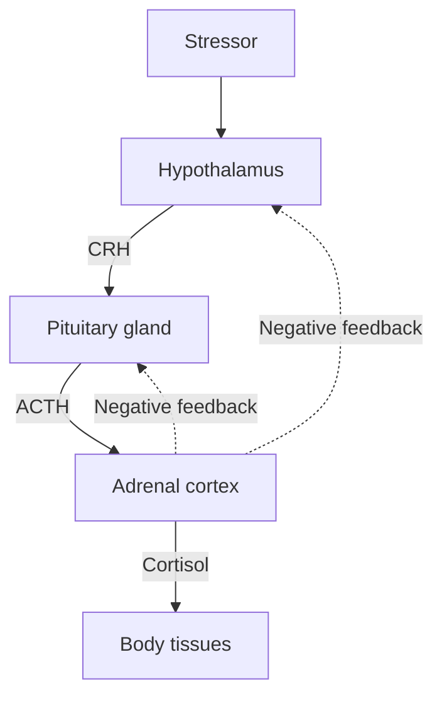
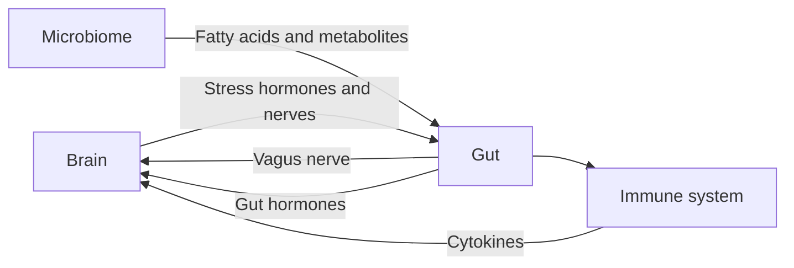
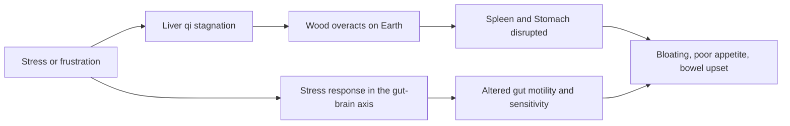

# Concept-Book Run

domain: /home/papagame/projects/digital-duck/cb-meta-health/public/domains/meta_health_ch07/input/graph.yaml
target: stress_resilience_routine
started: 2026-11-25T04:52:47

## Teaching order (24 concepts)

- five_phase_correspondences
- hpa_axis
- sympathetic_parasympathetic_balance
- acute_vs_chronic_stress
- seven_emotions_qiqing
- five_emotions_five_organs
- qi_stagnation_blood_stasis
- vagal_tone_and_hrv
- liver_free_flow_shuxie
- postprandial_hyperemia
- liver_qi_stagnation
- stress_and_digestion
- diaphragmatic_breathing
- liver_spleen_relationship
- allostatic_load
- breath_as_bridge
- gut_brain_axis
- liver_opening_movements
- wood_overacting_on_earth
- emotional_eating
- hrv_self_monitoring
- mind_regulation_tiaoxin
- releasing_liver_qi_through_movement
- stress_resilience_routine

### five_phase_correspondences (0.6s)

## Five-Phase Correspondences

**Definition.** In Traditional Chinese Medicine (TCM), the Five Phases (五行, *wǔ xíng*: Wood, Fire, Earth, Metal, Water) are a classification scheme. TCM groups many things that it considers related under each phase: an organ pair, a season, a climate, a taste, a tissue, a sense organ, and an emotion. These groupings are called *correspondences*. The table works as a lookup chart. It is not a measurement system, so nothing in it is calculated.

| Phase | Yin organ | Season | Climate | Tissue | Sense organ | Emotion |
|---|---|---|---|---|---|---|
| Wood | Liver | Spring | Wind | Sinews | Eyes | Anger |
| Fire | Heart | Summer | Heat | Vessels | Tongue | Joy |
| Earth | Spleen | Late summer | Dampness | Muscle | Mouth | Pensiveness (overthinking) |
| Metal | Lung | Autumn | Dryness | Skin | Nose | Grief |
| Water | Kidney | Winter | Cold | Bones | Ears | Fear |

**Worked example.** A patient reports red, dry, irritated eyes, muscle cramps, and frequent outbursts of anger, with symptoms worse in spring. A practitioner using the table notices that the eyes, sinews, anger, and spring all sit in the Wood row. TCM would therefore treat this as a pattern involving the Liver. Notice what the table did here: it did not diagnose anything by itself. It organized scattered complaints into one hypothesis, which the practitioner then tests with further questions, pulse, and tongue examination.

**Problem-solving application.** Use the table to turn a messy symptom list into a structured clinical question.

*Case:* A student during exam season has trouble with appetite, feels bloated after meals, and "can't stop ruminating."

1. **Sort each symptom by row.** Appetite and bloating point to the Spleen (Earth), and rumination matches pensiveness (Earth).
2. **Note the convergence.** Three complaints fall in one row, so the Earth phase is the working hypothesis.
3. **Check for confounders.** Exam stress, irregular meals, and caffeine intake could each explain the same symptoms without any Five-Phase framework.
4. **Choose a practical response.** Regular meal times, lower caffeine, and a scheduled break from studying are reasonable steps whichever framework you use.

**Evidence status.** The correspondences are traditional conventions, not experimentally established physiology. Emotions such as anger or grief do affect the body, for example through stress hormones and heart rate. However, no research shows that a specific emotion damages one specific organ in the way the table says. Treat the table as a memory aid and a way to organize a TCM case history. It is not a basis for deciding whether to seek or delay medical care. A symptom like persistent bloating or vision change needs conventional evaluation.

**Check your understanding.** A patient has dry skin, a dry cough, frequent sadness, and symptoms that worsen in autumn. Which phase do these point to, and which organ would TCM associate with it? (Answer: Metal, the Lung.)

### hpa_axis (0.7s)

## The HPA Axis

The **hypothalamus–pituitary–adrenal (HPA) axis** is the body's main hormonal stress system. It is a chain of three glands that pass a chemical signal along in sequence, ending with the release of **cortisol** from the adrenal glands. Cortisol raises blood glucose, sharpens the body's energy supply, and temporarily dampens functions that are not urgent, such as digestion and immune activity.

**The chain of command**

1. The **hypothalamus**, a brain region, detects a stressor (a threat, pain, low blood sugar, or an exam) and releases corticotropin-releasing hormone (CRH).
2. CRH travels a short distance to the **pituitary gland**, which releases adrenocorticotropic hormone (ACTH) into the blood.
3. ACTH reaches the **adrenal cortex**, the outer layer of the adrenal glands sitting above the kidneys, which releases cortisol.

Cortisol then acts on tissues throughout the body. It also signals back to the hypothalamus and pituitary to slow CRH and ACTH release. This is **negative feedback**, and it is how the system switches itself off once the stressor passes.

*The HPA axis: each gland triggers the next, and cortisol feeds back to shut the chain down.*

**Daily rhythm.** Cortisol is not constant. Levels peak about 30–45 minutes after waking, a rise called the cortisol awakening response, and fall through the day to their lowest point near midnight. A typical morning blood level is roughly 10–20 µg/dL, and an evening level is often below 5 µg/dL.

**Worked example.** A student has a saliva cortisol test at 8:00 a.m. (just after waking), at 4:00 p.m., and at 11:00 p.m. on a normal day. The results are 15, 6, and 2 nmol/L. This is a healthy pattern: high in the morning and low at night. Now suppose a second student, under weeks of poor sleep and exam pressure, gets 9, 8, and 7 nmol/L. The morning peak is blunted and the evening level stays elevated. The daily rhythm has flattened, which is commonly seen with chronic stress or disrupted sleep.

**Problem-solving application.** Suppose a person reports being "wired but tired" at night, waking at 3 a.m., and relying on caffeine in the morning. You can reason through this in steps:

1. **Identify the system.** Sleep problems and daytime fatigue can involve the HPA rhythm.
2. **Look for the pattern, not one number.** A single cortisol value is hard to interpret. A multi-point daily profile shows whether the rhythm is intact.
3. **Check the inputs.** Irregular sleep, late-night light exposure, overtraining, and under-eating all activate the HPA axis.
4. **Choose changes that reduce the load.** Examples are consistent sleep and wake times, morning daylight, adequate calories, and scheduled recovery days.

Short bursts of cortisol are useful, as in a race or a presentation. Problems arise when activation is prolonged and the feedback loop no longer resets the system. Persistently abnormal cortisol patterns, or symptoms such as rapid weight gain or unexplained weakness, need medical evaluation. Conditions such as Cushing syndrome (too much cortisol) and Addison disease (too little) are diagnosed with clinical testing.

### sympathetic_parasympathetic_balance (0.6s)

## Sympathetic–Parasympathetic Balance

The autonomic nervous system controls involuntary functions such as heart rate, digestion, and pupil size. It has two main branches that often act in opposite directions. The **sympathetic** branch prepares the body for exertion or threat ("fight or flight"): it raises heart rate, widens airways, and redirects blood to skeletal muscle. The **parasympathetic** branch supports rest and recovery ("rest and digest"): it slows the heart, stimulates digestion, and conserves energy. Both branches are active at all times. "Balance" means the net effect of their combined signals at a given moment, not a switch between two modes.

At rest, parasympathetic influence dominates the heart. The sinoatrial node, the heart's natural pacemaker, fires about 100 times per minute on its own. The vagus nerve (the main parasympathetic nerve to the heart) slows it to a typical resting rate of 60–80 beats per minute.

| Organ | Sympathetic effect | Parasympathetic effect |
|---|---|---|
| Heart rate | Increases | Decreases |
| Airways | Dilate | Constrict slightly |
| Digestion | Slows | Stimulates |
| Pupils | Dilate | Constrict |
| Blood flow to muscle | Increases | Little direct effect |

### Worked example

Cardiac output is the volume of blood the heart pumps per minute:

$$CO = HR \times SV$$

where $HR$ is heart rate (beats/min) and $SV$ is stroke volume (mL/beat). Suppose a student at rest has $HR = 65$ and $SV = 75$ mL:

$$CO = 65 \times 75 = 4875 \text{ mL/min} \approx 4.9 \text{ L/min}$$

During a hard sprint, vagal slowing is withdrawn and sympathetic drive rises, so $HR$ reaches 180 and $SV$ rises to 100 mL:

$$CO = 180 \times 100 = 18{,}000 \text{ mL/min} = 18 \text{ L/min}$$

Cardiac output increased almost fourfold. Most of the heart rate change comes from reduced parasympathetic activity at first, with increasing sympathetic activity taking over as intensity climbs.

### Problem-solving application

**Problem:** After exercise, a runner's heart rate falls from 170 to 140 beats/min in the first minute, then to 110 in the second. What does this tell you about autonomic balance?

**Solution:** A fast early drop is largely due to parasympathetic reactivation, as the vagus nerve resumes slowing the heart. Sympathetic activity declines more gradually. The 1-minute drop here is 30 beats/min, and the next minute's drop is also 30. Heart rate recovery, the fall in heart rate after exercise, is used as a simple indicator of autonomic health. A larger early drop generally reflects stronger vagal tone, which is common in trained athletes. A drop smaller than about 12 beats/min in the first minute has been associated with higher cardiovascular risk in clinical studies.

**Practical use:** Resting heart rate and heart rate recovery let you track fitness over time. Chronic stress, poor sleep, and overtraining can shift balance toward sympathetic dominance. This often appears as a rising resting heart rate and slower recovery. These measures are only indicators, since caffeine, illness, dehydration, and medications also affect them.

In TCM, a comparable idea is sometimes described in terms of yin and yang, but those concepts are not measurable physiological quantities. Autonomic balance, by contrast, can be quantified directly using heart rate, heart rate variability, and blood pressure.

### acute_vs_chronic_stress (1.2s)

## Acute vs. Chronic Stress

**Definition.** A stress response is the body's coordinated reaction to a demand. Two systems drive it. The sympathetic nervous system acts within seconds, raising heart rate and blood pressure. The hypothalamic-pituitary-adrenal (HPA) axis acts over minutes, releasing cortisol from the adrenal glands. An **acute** stress response is short and self-limiting. It mobilizes energy, then switches off through negative feedback: cortisol signals the brain to shut down further release. A **chronic** stress response is one that stays switched on. Cortisol and sympathetic tone remain elevated for weeks or months, and the recovery phase never fully arrives.

**Worked example.** Suppose a student is startled by a car horn while crossing the street.

1. Within seconds, sympathetic activation raises heart rate from 70 to about 120 beats per minute.
2. The liver releases glucose, so blood glucose rises a little above its resting range of roughly 70–100 mg/dL.
3. Cortisol peaks about 20–30 minutes later.
4. Once the danger passes, feedback lowers cortisol, and heart rate returns to baseline within minutes.

The energy mobilized was useful, and the system returned to rest.

Compare a student facing a semester of unrelenting pressure. Resting heart rate may stay near 85 rather than 65. Evening cortisol, normally the day's lowest, stays high. Fasting glucose drifts upward, and sleep becomes fragmented. No single day looks dramatic, but the baseline has shifted.

| Feature | Acute | Chronic |
|---|---|---|
| Duration | Minutes to hours | Weeks to years |
| Cortisol pattern | Rises, then falls | Persistently elevated or flattened daily rhythm |
| Energy effect | Mobilizes glucose and fat for use | Mobilizes energy that goes unused |
| Typical outcome | Resolution | Strain on cardiovascular, metabolic, immune, and sleep systems |

**Problem-solving application.** Consider a patient whose blood pressure is 142/92 mmHg and whose fasting glucose is 108 mg/dL, with no diagnosed disease. They report months of work deadlines, poor sleep, and late-night eating. How should you reason about this?

First, separate the signal from the cause. Prolonged sympathetic activation narrows blood vessels and raises cardiac output, which elevates blood pressure. Sustained cortisol raises glucose production and promotes abdominal fat storage. Both findings fit chronic stress, but they also fit diet, genetics, and inactivity, so stress is a hypothesis to test, not a conclusion.

Second, look for the missing recovery. Track resting heart rate each morning and sleep duration for two weeks. A resting rate that stays elevated, or that does not fall on rest days, suggests the system is not recovering.

Third, target the recovery side. Evidence-supported options include regular aerobic exercise, consistent sleep timing, and structured relaxation such as slow breathing. Each shortens or dampens the stress response. If values remain high, clinical evaluation is warranted, since persistent hypertension and elevated glucose need direct treatment regardless of their origin.

The key distinction is not whether stress occurs but whether it resolves. Acute stress is a spike with a return to baseline. Chronic stress is a baseline that has moved.

### seven_emotions_qiqing (0.7s)

## The Seven Emotions (Qiqing, 七情)

**Definition.** In Traditional Chinese Medicine (TCM), the seven emotions are joy (喜), anger (怒), worry (忧), pensiveness (思), grief (悲), fear (恐), and fright (惊). TCM treats them as normal responses to life events, not as diseases. It holds that they become *internal causes of illness* when they are unusually intense, sudden, or prolonged. Classical texts also link each emotion with a particular organ system. For example, anger is linked with the Liver and fear with the Kidney. These links are traditional, and modern physiology has not confirmed them as organ-specific effects.

| Emotion | TCM-associated organ | Pattern TCM describes |
|---|---|---|
| Joy | Heart | Scattered attention, restlessness |
| Anger | Liver | Rising tension, headache, flushed face |
| Worry | Lung | Tight chest, shallow breathing |
| Pensiveness | Spleen | Poor appetite, bloating |
| Grief | Lung | Fatigue, weak voice |
| Fear | Kidney | Sinking feeling, loss of bladder control |
| Fright | Heart/Kidney | Palpitations, disorientation |

**Worked example.** Consider a student during a three-week exam period. She sleeps five hours a night and re-reads notes late into the evening. She reports poor appetite, a bloated stomach after meals, and difficulty concentrating.

A TCM practitioner would label this as prolonged pensiveness, meaning excessive rumination. The pattern is a Spleen disorder, with digestion affected. The treatment would be to reduce the cause by setting study limits and regular meals, and to add calming activity such as walking.

A modern clinician would see the same facts differently: sustained stress, sleep loss, and irregular eating. These raise cortisol and alter gut motility. The gut-brain connection is real, and chronic psychological stress is a recognized contributor to functional digestive symptoms. The TCM explanation, however, is not a proven mechanism.

**Problem-solving application.** Use a three-step approach when you meet a case that involves emotions and symptoms.

1. **Separate the timeline.** Did the symptoms begin after a specific emotional event or period? Record when they began, how long they lasted, and how intense they were. A timeline is the main evidence that TCM uses to call an emotion causal.
2. **Rule out physical causes.** Poor appetite, palpitations, and fatigue can come from anemia, thyroid disease, infection, or heart rhythm disorders. Palpitations with chest pain need medical evaluation, not an emotional label.
3. **Choose measurable interventions.** Sleep, exercise, social support, and counseling or psychotherapy all have good evidence for stress and anxiety. Track the symptoms for two to four weeks to see whether they improve.

Try it: a man has a racing heart and a sense of dread for two days after a car accident. Which of the seven emotions would TCM name (fright), and what physical and psychological conditions should a clinician consider first? (Cardiac arrhythmia, hyperthyroidism, and acute stress reaction are all possibilities.)

The key point is that the seven emotions give a useful vocabulary for asking how emotional load relates to health. Treat their organ assignments as traditional descriptions, not as established physiology.

### five_emotions_five_organs (0.7s)

## The Five Emotions and the Five Organs

**Definition.** Traditional Chinese Medicine (TCM) pairs each of five emotions with one of five organ systems. It holds that sustained or extreme emotion injures its paired organ system: anger harms the Liver (怒伤肝), excess joy the Heart (喜伤心), overthinking the Spleen (思伤脾), grief the Lung (悲伤肺), and fear the Kidney (恐伤肾). In TCM, the capitalized "Liver," "Heart," and so on name functional systems, not just anatomical organs. The key word is *excess*: a brief or proportionate emotion is considered a normal response. TCM treats prolonged, intense, or inappropriate emotion as a cause of illness.

| Emotion | Organ system | Pattern TCM describes |
|---|---|---|
| Anger | Liver | Rising tension, headache, red face, irritability |
| Excess joy | Heart | Scattered attention, palpitations, insomnia |
| Overthinking | Spleen | Poor appetite, bloating, fatigue |
| Grief | Lung | Shortness of breath, weak voice, tiredness |
| Fear | Kidney | Weak knees, urinary urgency, a sense of "sinking" |

**Worked example.** A graduate student spends three weeks before a thesis defense ruminating over every possible question. She sleeps poorly, loses her appetite, feels bloated after meals, and is tired by mid-afternoon. A TCM practitioner would call this "overthinking harms the Spleen" (思伤脾). The Spleen is the system TCM links to digestion and energy.

Now look at the same case in modern terms. Chronic worry activates the stress response. Stress hormones such as cortisol change gut motility and appetite. Poor sleep adds fatigue. The two accounts describe the same observed pattern, but only the physiological one is supported by measurement. The TCM organ-emotion pairing is a traditional framework. It has not been validated as a mechanism, although the general link between stress and digestive symptoms is well documented.

**Problem-solving application.** Suppose a patient reports frequent irritability, tension headaches, and a flushed face during a stressful work period. Work through it in steps:

1. **Identify the dominant emotion.** Anger and frustration are the main complaints.
2. **Apply the TCM pairing.** TCM would associate this pattern with the Liver and suggest the emotion is both a symptom and a contributor.
3. **Translate to testable factors.** Check blood pressure, which can rise under chronic anger. Ask about sleep, caffeine, and alcohol. Measure resting heart rate, for example 85 beats per minute compared with a typical 60 to 80.
4. **Choose a practical response.** Regular exercise, a consistent sleep schedule, and stress-management skills such as paced breathing target the shared physiological pathways. If symptoms persist or blood pressure is elevated, seek medical evaluation.

Note what the framework offers and what it does not. It is a useful prompt to ask about emotional state alongside physical symptoms. It should not replace measurement or diagnosis. Persistent low mood, panic, or grief that disrupts daily life calls for professional mental health care, not an organ-based explanation alone.

### qi_stagnation_blood_stasis (0.9s)

## Qi Stagnation and Blood Stasis (气滞血瘀)

**Definition.** In Traditional Chinese Medicine (TCM), qi is the functional activity that moves substances and drives the body's processes, and blood is the fluid that nourishes tissues. TCM holds that qi "leads" blood, so when qi flow becomes blocked (气滞, qi stagnation), blood movement slows and pools (血瘀, blood stasis). The combined pattern, 气滞血瘀, is one of the most commonly diagnosed patterns in TCM clinics. Qi and blood stasis are not measured physiological quantities. They are diagnostic categories, and what follows describes how TCM uses them. Biomedical research has not validated these categories as distinct disease entities.

**Typical signs.** TCM practitioners look for a cluster of findings:

| Feature | Qi stagnation | Blood stasis |
|---|---|---|
| Pain | Distending, moves from place to place | Fixed, stabbing, worse at night |
| Mood | Irritability, frequent sighing | Little change on its own |
| Tongue | Normal or slightly dark | Purplish, with dark spots |
| Other | Chest or flank tightness, bloating | Dark complexion, clots, lumps |

TCM links the pattern to prolonged emotional strain, sedentary habits, injury, and cold exposure.

**Worked example.** A 38-year-old office worker has three months of tight, distending flank pain that shifts location and gets worse under deadline stress. She also reports sighing often and having irregular menstrual cycles. In recent weeks, she has noticed a fixed stabbing pain in the lower abdomen, along with dark menstrual clots. Her tongue is purplish.

A TCM practitioner would read the early, mobile, mood-linked symptoms as qi stagnation. The later fixed, stabbing pain and the clots would suggest that stagnation has progressed to blood stasis. The usual TCM treatment aims to "move qi and quicken blood." It may include acupuncture, herbal formulas, and lifestyle advice.

**Problem-solving application.** Suppose you are given a symptom list and asked which pattern fits best. Work through three steps:

1. **Classify the pain.** Moving and distending points to qi stagnation. Fixed and stabbing points to blood stasis.
2. **Check the triggers.** Pain that rises and falls with stress favors qi stagnation. Pain that follows injury or persists for a long time favors blood stasis.
3. **Look for confirming signs.** A purplish tongue or clots support blood stasis. Irritability and sighing support qi stagnation.

A case with both mobile and fixed pain fits the combined pattern.

**A necessary caution.** The same symptoms can come from conditions that need conventional evaluation: endometriosis, fibroids, gallbladder disease, angina, or deep vein thrombosis. Fixed, stabbing pain, lumps, abnormal bleeding, or chest pain should be assessed medically before any TCM approach is tried. Some "blood-moving" herbs also interact with anticoagulants such as warfarin and can raise bleeding risk.

Evidence supports some of the practical advice that comes with the pattern. Regular exercise, stress reduction, and avoiding long periods of sitting improve mood and circulation. Whether the TCM pattern framework itself adds anything beyond that advice remains unsettled.

### vagal_tone_and_hrv (0.6s)

## Vagal Tone and Heart-Rate Variability

**Definition.** The vagus nerve (cranial nerve X) carries parasympathetic signals to the heart's pacemaker, the sinoatrial (SA) node. Left alone, the SA node fires at an intrinsic rate of roughly 100 beats per minute (bpm). The vagus acts like a brake, which is why a typical resting heart rate is closer to 60–75 bpm. **Vagal tone** is the strength of this braking influence at rest. **Heart-rate variability (HRV)** is the beat-to-beat variation in the time between heartbeats, called R–R intervals, because they are measured between successive R peaks on an ECG. Vagal tone cannot be measured directly in everyday settings, so HRV serves as its practical, noninvasive index.

Heart rate rises slightly as you inhale, when vagal braking eases, and falls as you exhale, when it returns. This pattern is called respiratory sinus arrhythmia. A healthy, flexible nervous system shows more of this variation, not less. Higher resting HRV generally reflects stronger vagal influence and is associated with better cardiovascular fitness and stress recovery. Very low HRV is linked to higher cardiovascular risk, though HRV alone does not diagnose a condition.

**Common time-domain measures.**

| Measure | Meaning |
|---|---|
| SDNN | Standard deviation of all R–R intervals (overall variability) |
| RMSSD | Root mean square of successive differences (best reflects vagal activity) |

RMSSD is defined as:

$$\text{RMSSD} = \sqrt{\frac{1}{N-1}\sum_{i=1}^{N-1}\left(RR_{i+1}-RR_i\right)^2}$$

where $RR_i$ is the $i$-th interval in milliseconds and $N$ is the number of intervals.

**Worked example.** Five consecutive R–R intervals (ms) are 850, 900, 830, 910, 840.

1. Successive differences: $+50,\ -70,\ +80,\ -70$.
2. Squares: $2500,\ 4900,\ 6400,\ 4900$, which sum to $18{,}700$.
3. Divide by $N-1=4$: $4675$.
4. Take the square root: $\text{RMSSD} \approx 68\ \text{ms}$.

The mean interval is $(850+900+830+910+840)/5 = 866$ ms, so the average heart rate is $60{,}000/866 \approx 69$ bpm.

**Problem-solving application.** Suppose an athlete records a morning RMSSD of 70 ms on most days during a training block. One morning it drops to 40 ms, and their resting heart rate is 8 bpm higher than usual. The reasoning is:

1. A single day's drop is not meaningful on its own. Compare it with the person's own baseline, because HRV varies widely between individuals and depends on age.
2. A sharp fall in RMSSD together with a higher resting heart rate is consistent with reduced vagal activity. Common causes are accumulated training load, poor sleep, illness, alcohol, or psychological stress.
3. A sensible response is to reduce intensity that day and watch the trend over several days. If values stay low, look for the cause rather than training through it.

Practices that raise vagal activity in the short term include slow breathing at about 6 breaths per minute, regular aerobic exercise, and adequate sleep. Measure under consistent conditions, such as on waking and at the same posture, since posture, caffeine, and the time of day all shift the numbers.

### liver_free_flow_shuxie (0.8s)

## The Liver Governs Free Flow (肝主疏泄)

**Definition.** In Traditional Chinese Medicine (TCM), the Liver (肝) is said to govern free flow (疏泄, *shūxiè*): it keeps qi moving smoothly and without obstruction throughout the body. TCM holds that this smooth movement underlies three main functions: regulating emotion, supporting digestion, and keeping the menstrual cycle regular. "Liver" here names a functional system in TCM theory, not the anatomical organ studied in physiology. The idea is a clinical framework for organizing symptoms. It isn't an established mechanism of human biology, and some of the symptom patterns it describes overlap with stress physiology, which modern research does study.

| Function | Free flow is smooth | Free flow is impeded ("Liver qi stagnation") |
|---|---|---|
| Emotion | Even mood, calm under pressure | Irritability, frustration, sighing, feeling "stuck" |
| Digestion | Comfortable appetite, regular bowels | Bloating, flank or rib-side distension, belching, alternating loose and hard stools |
| Menstrual cycle | Regular timing, little discomfort | Irregular cycle, breast tenderness, cramping before menstruation |

TCM adds that the link runs both ways. Prolonged frustration is said to impede the Liver's free flow, and impeded free flow in turn makes a person more irritable.

**Worked example.** A 34-year-old project manager reports three months of deadline pressure. She says she is easily irritated, sighs often, and has bloating and tenderness in her breasts in the week before her period. Her cycle has varied from 26 to 34 days. A TCM practitioner would group these symptoms together as one pattern, Liver qi stagnation. The reasoning has three steps:

1. Sustained emotional strain is the likely trigger.
2. The emotional, digestive and menstrual symptoms all appear together, which TCM treats as a sign of one underlying disruption of flow.
3. The symptoms worsen with stress and ease when she rests, which fits a pattern of "stagnation" rather than "deficiency."

**Problem-solving application.** Suppose a student is asked to decide whether a set of symptoms fits this pattern. Use three questions:

1. **Is there a stress trigger, and do the symptoms track it?** Fluctuation with stress points toward free-flow disruption. Constant symptoms unrelated to stress do not.
2. **Do symptoms span at least two of the three domains** (emotion, digestion, menstrual cycle)? A single isolated symptom is weak evidence for the pattern.
3. **Have other causes been ruled out?** Irregular cycles can come from thyroid disease, polycystic ovary syndrome or pregnancy. Persistent bloating can signal celiac disease or an ulcer. Because these conditions need medical diagnosis, a TCM pattern should never replace that evaluation.

Applying the questions to the project manager: her symptoms track stress and span all three domains, so the pattern fits. Her cycle variation of 8 days (26 to 34) is large enough that a clinician should still check for medical causes first. The practical takeaway is to use the framework as a way to organize observations, and to treat the stress-related components with approaches that have evidence behind them, such as regular exercise, sleep, and stress management.

### postprandial_hyperemia (0.6s)

## Postprandial Hyperemia

**Postprandial hyperemia** is the increase in blood flow to the digestive organs after a meal. Hyperemia means "excess blood" in a tissue. Here, the excess is deliberate: the stomach, small intestine, pancreas, and liver need more blood to digest food and absorb nutrients, and the body supplies it.

Blood flow through the superior mesenteric artery, the main supply to the small intestine, can roughly double within 30 to 60 minutes of eating. It then stays elevated for a few hours. Several signals drive this:

- **Local chemical signals:** digested nutrients in the gut, especially fats and glucose, trigger the release of vasodilating substances and gut hormones.
- **Neural reflexes:** the parasympathetic nervous system promotes digestive activity, and the gut's own nerve network (the enteric nervous system) adjusts local flow.
- **Tissue metabolism:** active digestion consumes oxygen and produces metabolites, which widen nearby arterioles.

The heart can't create extra blood, so the added flow has to come from somewhere. Cardiac output rises modestly, and other vascular beds partly constrict to compensate. Together these changes keep arterial pressure steady.

### Worked example

Suppose resting cardiac output is 5.0 L/min, and the gut receives about 20% of it, or 1.0 L/min. After a large meal, gut flow rises to 2.0 L/min and cardiac output rises to 5.6 L/min.

- Gut share after eating: $\frac{2.0}{5.6} \approx 0.36$, or about 36%.
- Flow to everything else: $5.6 - 2.0 = 3.6$ L/min, down from $5.0 - 1.0 = 4.0$ L/min.

The gut's flow doubled, but flow to other organs fell by only 0.4 L/min, about 10%. The rise in cardiac output covered most of the demand.

### Problem-solving application

Postprandial hyperemia matters most when the circulation is already stressed.

1. **Exercise after a large meal.** Working muscle also demands more flow. Both beds compete for a limited supply, which may contribute to sluggishness or cramping. Many athletes eat lightly and wait before hard training.
2. **Older adults or people with autonomic dysfunction.** If blood vessels elsewhere can't constrict enough, arterial pressure falls after eating. This is called *postprandial hypotension*. It can cause dizziness or fainting 30 to 75 minutes after a meal. Smaller, lower-carbohydrate meals and rising slowly reduce the risk.
3. **Reduced mesenteric blood supply.** In people with narrowed mesenteric arteries, the gut cannot get the extra flow it needs. The result can be abdominal pain after eating, which is a recognized warning sign of intestinal ischemia.

**Check your understanding:** If a meal raises gut flow from 1.0 to 1.8 L/min while cardiac output rises from 5.0 to 5.4 L/min, how much flow remains for non-gut organs? (Answer: $5.4 - 1.8 = 3.6$ L/min, down from 4.0.)

### liver_qi_stagnation (0.6s)

## Liver Qi Stagnation (肝气郁结)

**Definition.** In Traditional Chinese Medicine (TCM), the Liver is responsible for the smooth, free flow of qi through the body. Liver qi stagnation (肝气郁结) is the TCM pattern in which frustration, resentment, or suppressed emotion is said to obstruct that flow. TCM practitioners recognize it by a cluster of signs:

| Sign | How it is described |
|---|---|
| Frequent sighing | Involuntary, often relieves a feeling of chest tightness |
| Tight or distending flanks | Fullness or pain along the sides of the ribs |
| Irritability | Short temper, mood swings |
| "Plum-pit" sensation | A feeling of a lump in the throat that cannot be swallowed or coughed up (梅核气) |

In women, TCM also links the pattern to breast tenderness and irregular or painful periods. Symptoms typically worsen with stress and ease when the person is relaxed or active.

**Worked example.** Consider a 34-year-old project manager who has spent three months absorbing conflict at work without voicing it. She reports the following:

- She sighs often during the day.
- Her ribs feel tight on both sides.
- She snaps at family members over small things.
- She feels a lump in her throat, although a physician has found nothing structurally wrong.
- Her symptoms flare on deadline weeks and fade on holidays.

A TCM practitioner would label this Liver qi stagnation, because the symptoms follow her emotional state and come in the characteristic cluster. Notice that the diagnosis is a pattern of signs, not a single measurement.

**Problem-solving application.** The Western-medicine reading of the same picture is also useful, and a careful student should work through both.

1. **Rule out organic causes first.** A persistent throat lump needs evaluation for reflux, thyroid disease, or a structural problem. Flank pain can come from gallbladder, kidney, or musculoskeletal disorders. Chest tightness always warrants a cardiac check. TCM pattern labels never replace this step.
2. **Connect the pattern to known physiology.** Chronic psychological stress raises sympathetic activity and muscle tension, which can plausibly account for sighing, rib-cage tightness, and the globus sensation (the medical term for a throat lump with no structural cause). There is no evidence that a "Liver qi" substance exists or that it flows. The label works as a descriptive shorthand for a stress-related symptom cluster, not as an anatomical finding.
3. **Choose interventions by what is supported.** In TCM, treatment aims to "soothe the Liver" through acupuncture, herbal formulas, and exercise. Evidence for the specific TCM treatments is limited and of mixed quality. Regular aerobic exercise, sleep, stress-management training, and cognitive behavioral therapy have much stronger support for stress-related symptoms. If the stress is rooted in a workplace situation, addressing that situation matters more than any remedy.

**Check your understanding.** A patient reports sighing, irritability, and flank tightness, plus unexplained weight loss and night sweats. Should this be treated simply as Liver qi stagnation? No. Weight loss and night sweats are warning signs that require medical investigation before any stress-related explanation is accepted.

### stress_and_digestion (1.1s)

## Stress and Digestion

**Definition.** Stress triggers the sympathetic "fight-or-flight" response. Adrenaline and noradrenaline redirect blood toward skeletal muscle, the heart, and the brain, and away from the gut. Three digestive effects follow:

- **Gut blood vessels constrict**, so less blood reaches the stomach and intestines.
- **Motility slows.** The rhythmic contractions that mix and move food become weaker and less coordinated.
- **Secretions fall.** The stomach, pancreas, and salivary glands release less acid, enzyme, and saliva.

The opposite state, "rest and digest," is driven by the parasympathetic nervous system (largely the vagus nerve). It is the state in which digestion works best.

**Worked example.** Suppose you eat a 700 kcal lunch at your desk ten minutes before a stressful presentation. Your heart rate rises from about 70 to 100 beats per minute, and sympathetic activity pulls blood flow away from your gut. Compare this with the same meal eaten calmly:

| Feature | Calm meal | Stressed meal |
|---|---|---|
| Gut blood flow | Rises after eating | Reduced |
| Stomach emptying | Normal pace | Often delayed |
| Enzyme and acid release | Full | Reduced |
| Typical sensation | Comfortable | Heaviness, nausea, cramping, or urgency |

Food sits in the stomach longer and is broken down less efficiently. Nutrient absorption is also less well supported. Stress affects people differently. Some feel nausea or a "knot" in the stomach. Others get diarrhea, because motility speeds up in parts of the colon.

This also matters if you plan to exercise soon after eating. A hard workout after a stressed meal starts with a gut that is under-supplied. Muscles and gut then compete for the same blood.

**Problem-solving application.** Imagine a student with an afternoon training session who reliably feels sick after eating between exams. Three adjustments follow from the physiology:

1. **Add a calming buffer.** Spend 5 minutes on slow breathing, for example 4 seconds in and 6 seconds out. Slow breathing engages parasympathetic activity and lowers heart rate.
2. **Adjust meal size and timing.** Choose a smaller, lower-fat, lower-fiber meal when stressed. These foods leave the stomach faster. Leave 2–3 hours before intense exercise.
3. **Eat away from the stressor.** Step away from the screen or study materials, and chew thoroughly. Chewing increases saliva and signals the gut to prepare.

Test the plan by keeping a simple log of meal size, stress level (1–10), and symptoms for two weeks. If symptoms persist even when you are calm, the cause may not be stress, and a clinician should check for other digestive conditions.

**Key idea:** Digestion depends on the body being in a state that supports it. Stress shifts resources elsewhere, so the same meal can be handled very differently depending on your state when you eat it.

### diaphragmatic_breathing (0.8s)

## Diaphragmatic Breathing

**Definition.** Diaphragmatic breathing (also called abdominal or belly breathing) is a pattern in which the diaphragm, the dome-shaped muscle beneath the lungs, does most of the work of inhalation. On inhalation the diaphragm contracts and flattens, moving downward. This enlarges the chest cavity, lowers the pressure inside the lungs below atmospheric pressure, and draws air in. The abdominal contents are pushed down and outward, so the belly rises. On exhalation the diaphragm relaxes and recoils upward, and the belly falls. In contrast, shallow chest breathing relies more on the rib muscles and the neck and shoulder muscles, and it often moves less air per breath.

**Worked example.** Compare two people at rest, each breathing 12 times per minute. Person A takes shallow breaths of about 350 mL. Person B breathes diaphragmatically at about 500 mL. About 150 mL of each breath fills the anatomical dead space (the airways where no gas exchange occurs). Alveolar ventilation is

$$\dot V_A = (V_T - V_D)\times f$$

where $V_T$ is tidal volume, $V_D$ is dead-space volume, and $f$ is breathing rate.

- Person A: $(350-150)\times 12 = 2400$ mL/min
- Person B: $(500-150)\times 12 = 4200$ mL/min

Person B moves 75% more fresh air to the alveoli at the same rate. Deeper breaths therefore ventilate the lungs more efficiently, because the fixed dead space takes up a smaller share of each breath.

**Problem-solving application.** Suppose you want to practice the technique before an exam or a race, when your heart is pounding and your breathing is quick and shallow.

1. **Position.** Lie on your back with knees bent, or sit upright. Put one hand on your chest and the other on your belly.
2. **Inhale.** Breathe in slowly through the nose for about 4 seconds. The belly hand should rise while the chest hand stays mostly still.
3. **Exhale.** Breathe out through pursed lips for about 6 seconds. Longer exhalations are commonly used to slow the breathing rate.
4. **Repeat.** Do 5 to 10 minutes of this, then check your pulse for 15 seconds and multiply by 4.

If your resting heart rate was 90 beats per minute before and the 15-second count is 18 afterward, your rate is now $18\times 4 = 72$ beats per minute. Slow breathing tends to increase vagal (parasympathetic) activity, which lowers heart rate. In TCM, a similar practice is described as sinking the breath to the dantian (丹田, the lower abdomen). That is a traditional description, and the physiological account above stands on its own.

**Check your understanding.** A patient breathes at 15 breaths per minute with a 400 mL tidal volume and 150 mL of dead space. Their alveolar ventilation is $(400-150)\times 15 = 3750$ mL/min. If training raises the tidal volume to 550 mL and lowers the rate to 10 breaths per minute, the new value is $(550-150)\times 10 = 4000$ mL/min. Ventilation rises slightly even though the person breathes less often. This is why slow, deep breathing can be both calming and efficient.

**Caution.** People with certain lung or heart conditions should ask a clinician before practicing prolonged breathing exercises. If you feel dizzy, return to normal breathing.

### liver_spleen_relationship (0.7s)

## The Liver–Spleen Relationship

**Definition.** In Traditional Chinese Medicine (TCM), the Liver and Spleen are functional systems, not just the anatomical organs of the same names. TCM holds that the Liver governs the smooth, free movement of qi (the body's functional activity) and the regulation of mood. The Spleen governs digestion and the transformation of food into usable nutrients. The classical Five Phases framework describes the Liver–Spleen link as *Wood overcomes Earth* (木克土). In this link, the Liver normally exerts a regulating influence on the Spleen. When the Liver's function is disturbed, it is said to "overact" on the Spleen and impair digestion. This is a traditional explanatory model. Some of its clinical observations overlap with modern findings, but the model itself is not an established physiological mechanism.

**Worked example.** A university student is preparing for final exams. For three weeks they sleep poorly and feel tense and irritable. They also notice a pattern:

- Their stomach feels bloated after meals.
- Their stools are loose, and their appetite is erratic.
- Symptoms ease on relaxed weekends.

A TCM practitioner would describe this as Liver qi stagnation overacting on the Spleen (肝郁脾虚). The Liver is "constrained" by stress, so the Spleen cannot transform food well. The observation that emotional stress and digestive symptoms occur together is real. Modern research links it to the gut–brain axis. The stress response alters gut motility, secretion, and sensitivity, and it is well documented in irritable bowel syndrome.

**Problem-solving application.** Suppose you are advising a classmate with the same pattern. Use a stepwise approach:

1. **Identify the trigger.** Does the digestive problem track stress and sleep, or does it follow particular foods?
2. **Rule out red flags.** Blood in stool, unintended weight loss, fever, or persistent symptoms need medical evaluation. Do not attribute them to "Liver–Spleen disharmony."
3. **Address the stress side.** Regular sleep, exercise, and relaxation practices have evidence for easing stress-related digestive symptoms.
4. **Address the digestion side.** Smaller, regular meals and fewer irritants such as heavy caffeine or very greasy food are reasonable steps.

TCM treatment for this pattern would typically combine stress-easing approaches with digestive support, using herbs or acupuncture. Evidence for these treatments is mixed and of variable quality. If your classmate tries them, they should use a licensed practitioner and tell their physician about any herbs, which can interact with medications.

| Feature | TCM description | Modern parallel |
|---|---|---|
| Trigger | Constrained Liver qi | Psychological stress |
| Digestive effect | Spleen fails to transform food | Altered gut motility and sensitivity |
| Typical symptoms | Bloating, loose stool, irritability | Functional gut symptoms |

The practical lesson is that stress and digestion influence each other. That holds whether you describe it in TCM terms or in terms of the gut–brain axis.

### allostatic_load (0.7s)

## Allostatic Load

**Definition.** The body keeps itself stable by adjusting to demands, a process called *allostasis*. When a stressor appears, such as a deadline, an infection, or a night of lost sleep, the body responds. Heart rate and blood pressure rise, cortisol and adrenaline are released, glucose is mobilized, and immune activity shifts. These responses are useful in the short term, and they normally switch off when the stressor passes. **Allostatic load** is the cumulative "wear and tear" that builds up when this response is triggered too often, fails to shut off, or is never given time to recover. The cost shows up in four main systems: blood pressure, metabolism, sleep, and immunity.

Researchers usually find allostatic load through a panel of measurements, each compared against a risk threshold. A person scores one point for each marker in the risky range. Typical markers include:

| System | Example marker | Common risk threshold |
|---|---|---|
| Cardiovascular | Resting systolic blood pressure | ≥ 140 mmHg |
| Metabolic | Fasting glucose | ≥ 100 mg/dL |
| Metabolic | Waist-to-hip ratio | > 0.90 (men), > 0.85 (women) |
| Lipids | HDL cholesterol | < 40 mg/dL |
| Stress hormone | Morning cortisol | Outside the lab's reference range |
| Inflammation | C-reactive protein | > 3 mg/L |

Cutoffs differ between studies, so treat these as illustrative.

**Worked example.** Consider a nursing student during a semester of night shifts, exams, and about five hours of sleep a night. At a checkup, four markers are in the risky range: blood pressure 142/90 mmHg, fasting glucose 104 mg/dL, C-reactive protein 4.1 mg/L, and HDL 38 mg/dL. Waist-to-hip ratio and cortisol are normal. Counting the flagged markers gives a score of 4 out of 6.

The score is a snapshot, so it should not be read as a diagnosis. Its value is that it shows a pattern across several systems. A single mildly raised marker may mean little. Several raised markers together suggest that the body's stress response has been running without enough recovery.

**Problem-solving application.** Allostatic load is a useful way to decide where to intervene, because each driver of load has a specific countermeasure:

1. **Sleep loss.** Sleep is when blood pressure dips and the stress response resets. Moving from five to seven hours, with a consistent schedule, targets several markers at once.
2. **Physical activity.** Moderate aerobic exercise, such as 150 minutes a week, lowers resting blood pressure and improves glucose handling. It also helps burn off stress hormones.
3. **Recovery time.** Scheduled breaks, relaxation techniques, and social support shorten how long the stress response stays active.
4. **Monitoring.** Repeating the panel every few months tests whether the changes are lowering the score.

For the student above, a reasonable plan is to fix sleep first, add walking or cycling, and recheck in three months. If blood pressure or glucose stays high despite these changes, the next step is a clinical evaluation, not more lifestyle adjustment.

The main idea is that stress harms health through accumulation. One hard week is manageable. Months without recovery are what raise the load.

### breath_as_bridge (0.7s)

## Breath as the Bridge

**Definition.** Most autonomic functions, such as heart rate, digestion and blood vessel tone, run without conscious control. Breathing is the exception. It is automatic, but you can also override it at will. That dual control makes it a *bridge*: a voluntary action that reaches into the autonomic nervous system. The sympathetic branch speeds the heart and prepares the body for action. The parasympathetic branch, carried largely by the vagus nerve, slows the heart and favors rest and digestion. Slow breathing at about 6 breaths per minute is among the fastest ways to shift this balance toward parasympathetic activity.

**Why it works.** During inhalation, vagal outflow to the heart briefly drops and heart rate rises. During exhalation, vagal outflow returns and heart rate falls. This normal rise and fall is called respiratory sinus arrhythmia. At about 6 breaths per minute, one breath cycle lasts 10 seconds. That rhythm is close to the natural resonance of the baroreflex, the blood-pressure feedback loop. At that rate the heart-rate swings are largest, and vagal activity is strongly engaged. Heart rate variability (HRV), the beat-to-beat variation in timing, usually increases.

**Worked example.** A resting adult normally breathes about 12 to 16 times per minute. To reach 6 breaths per minute, each cycle must last

$$\frac{60\ \text{s}}{6\ \text{breaths}} = 10\ \text{s per breath}.$$

A common split is a 4-second inhale and a 6-second exhale. Making the exhale longer than the inhale emphasizes the vagal phase. Suppose a student's heart rate is 88 beats per minute before an exam. After 5 minutes of this pattern, it might fall to the low 70s. Individual results vary, so measure your own. Place two fingers on your wrist, count beats for 30 seconds and double the count, once before and once after.

**Problem-solving application.** Match the technique to the situation:

| Situation | Approach |
|---|---|
| Pre-exam or pre-presentation nerves | 5 minutes at 6 breaths per minute, with the exhale longer than the inhale |
| Difficulty falling asleep | Same pattern in bed, lengthening the exhale to 6 to 8 seconds |
| Mid-workout recovery | Breathe through the nose, slowing gradually as heart rate falls |
| Panic or dizziness | Slow breathing may help, but do not force very deep breaths, since over-breathing lowers blood carbon dioxide and can cause lightheadedness |

To check whether it is working, compare resting heart rate before and after. Wearable devices that report HRV can show the change over time. Slow breathing is a useful self-regulation skill with good physiological support. It is not a treatment for anxiety disorders or heart disease. Persistent symptoms call for medical evaluation.

**Practice problem.** A person wants a 5-second inhale and a 7-second exhale. What breathing rate is that? Each cycle lasts 12 seconds, so the rate is $\frac{60}{12} = 5$ breaths per minute. That is slightly slower than 6 and still in the range often used for this purpose.

### gut_brain_axis (0.7s)

## The Gut–Brain Axis

The **gut–brain axis** is the two-way communication network linking the digestive tract with the central nervous system. Signals travel in both directions through four main channels:

- **The vagus nerve**, a long cranial nerve. About 80% of its fibers carry information *from* the gut *to* the brain.
- **Hormones**, such as ghrelin (rising before meals) and cholecystokinin and GLP-1 (released after eating). These signal hunger and fullness.
- **Immune signals**, including cytokines released by gut immune cells, which can influence brain inflammation and mood.
- **The microbiome**, the trillions of microbes in the gut. They ferment fiber into short-chain fatty acids and help produce neurotransmitter precursors. In fact, roughly 90% of the body's serotonin is made in the gut, though that serotonin does not cross into the brain.

The brain talks back too. Stress alters gut motility, secretion and permeability, which is why nervousness can cause nausea or diarrhea.

### Worked example: a stressful exam

A student eats breakfast and then sits a high-stakes exam. Trace the signals:

1. **Brain → gut:** Anxiety activates the stress response (cortisol, sympathetic nerves). Stomach emptying slows and gut motility changes, so the student feels "butterflies" or nausea.
2. **Gut → brain:** The discomfort travels up the vagus nerve and is read by the brain as more threat, which raises anxiety further.
3. **Hormones:** Ghrelin is suppressed by stress, so hunger fades, and the student skips lunch.

The result is a feedback loop. The brain affects the gut, and the gut's signals feed back to the brain.

### Problem-solving application

**Problem:** A person has irritable bowel syndrome (IBS) with symptoms that worsen during stressful weeks. Using the axis, which interventions could work, and at which channel?

| Channel | Intervention | Reasoning |
|---|---|---|
| Brain → gut | Cognitive behavioral therapy, gut-directed hypnotherapy, regular sleep | Lowers the stress signal sent to the gut. Clinical trials support these for IBS. |
| Vagus nerve | Slow breathing (about 6 breaths per minute) | Increases parasympathetic activity. |
| Microbiome | Fiber-rich diet, fermented foods | Increases the production of short-chain fatty acids. |
| Immune | Identifying food triggers, treating inflammation | Reduces the immune signals that sensitize the gut. |

A good approach is to change one variable at a time and track symptoms for 2–4 weeks. That shows which channel is responsible for the person's symptoms.

**Evidence note:** The axis itself is well established. Many popular claims go further than the data do, however. For example, most human evidence linking specific probiotics to depression or anxiety is still preliminary, and mouse results often fail to carry over to people. Treat product claims such as "a probiotic that fixes your mood" with skepticism.

*The gut–brain axis: the brain and gut exchange signals through nerves, hormones and immune messengers, with the microbiome shaping the gut's side of the conversation.*

### liver_opening_movements (0.7s)

## Liver-Opening Movements

In Traditional Chinese Medicine (TCM), the liver is associated with the smooth flow of qi and with the flanks, the sides of the torso along the lower ribs. TCM holds that stagnation there shows up as tightness, irritability, and a feeling of being "stuck." **Liver-opening movements** are exercises that stretch and mobilize the lateral chest wall while the practitioner breathes slowly. Two examples are rib fanning (扇肋, *shān lèi*) and Baduanjin form 7, "clenched fists and glaring eyes" (攒拳怒目, *cuán quán nù mù*). In physiological terms, both lengthen the intercostal muscles and obliques, mobilize the rib joints, and pair that with slow diaphragmatic breathing. Evidence that they affect the liver itself is lacking. Their documented benefits are better posture, breathing mechanics, and relaxation.

### Worked example: rib fanning

1. Stand or sit tall, with your feet shoulder-width apart.
2. Place your right hand on your right lower ribs and raise your left arm overhead.
3. Inhale slowly through the nose for about 4 seconds, directing the breath sideways into the ribs under your hand. You should feel the ribs widen like a fan opening.
4. Side-bend gently to the right so that the left flank lengthens, and hold for 2 to 3 seconds.
5. Exhale for about 6 seconds as you return to upright.
6. Repeat 6 times per side, then switch.

Baduanjin form 7 uses a different mechanism. From a horse stance, you slowly punch forward with one fist while keeping your gaze wide and intense, then draw the fist back as you exhale. The twist through the trunk and the controlled effort load the obliques and the serratus muscles along the ribs.

### Problem-solving application

**Scenario:** A student who sits at a desk for 8 hours a day reports tight sides and shallow breathing. Plan a 5-minute routine.

At 4 seconds in and 6 seconds out, one breath takes 10 seconds, which is 6 breaths per minute. Resting adults typically breathe 12 to 20 times per minute, so this is a deliberately slowed pace. A plan:

| Block | Movement | Duration |
|---|---|---|
| 1 | Rib fanning, left side (6 breaths) | 60 s |
| 2 | Rib fanning, right side (6 breaths) | 60 s |
| 3 | Baduanjin form 7, slow punches (about 10 per side) | 120 s |
| 4 | Standing quiet breathing | 60 s |
| **Total** | | **300 s** |

**Safety adjustments:**
- Stop any movement that causes sharp pain, dizziness, or numbness.
- Reduce the side-bend range if you have a recent rib injury, osteoporosis, or a back problem, and ask a clinician before starting.
- Keep your shoulders relaxed. Lifting them shifts the work to the neck instead of the ribs.

**Check your result:** After one week, compare how far each flank expands when you inhale. Place your hands on your lower ribs and note the difference. Also note whether the tightness eases and breathing feels easier. Those are measurable, practical outcomes. Any claim beyond them about "liver qi" cannot be tested with these exercises.

### wood_overacting_on_earth (1.0s)

## Wood Overacting on Earth (肝木克脾土)

**Definition.** In Traditional Chinese Medicine (TCM), the Liver is associated with the smooth, free movement of qi throughout the body, and the Spleen and Stomach with digesting food and distributing nutrients. TCM holds that stress, frustration, or suppressed anger can leave Liver qi "stuck," and that this stagnation then "attacks" the digestive organs. This pattern is called Wood overacting on Earth (肝木克脾土, also 肝脾不调, "Liver–Spleen disharmony"). In the Five Phases scheme, Wood stands for the Liver and Earth for the Spleen and Stomach. Normally Wood helps keep Earth moving, but when Wood is too tense it overpowers Earth. Typical signs are bloating, poor appetite, abdominal pain that eases after a bowel movement, and alternating loose stool and constipation, all worse during stressful periods.

**Modern counterpart.** The pattern resembles a well-documented physiological process. Stress activates the sympathetic nervous system and the stress hormone axis. Blood flow shifts away from the gut, motility changes, and gut sensitivity rises. This is the "gut–brain axis," and it is part of why stress is linked with functional bowel complaints such as irritable bowel syndrome (IBS). The TCM framework is a traditional description of this stress-digestion link. Its organ model and its proposed mechanism are not anatomical claims. Clinical trials of acupuncture and herbal formulas for IBS have been mixed and often small, so treat them as unproven.

**Worked example.** A university student, Maya, notices that during exam weeks she skips meals because she isn't hungry, then feels bloated after eating. She has cramping that clears after using the toilet. She feels irritable and tense, and over winter break all symptoms disappear. A practitioner using TCM would say her Liver qi is stagnating and overacting on the Spleen and Stomach. A physiologist would say stress is altering her gut motility and sensitivity. Both readings agree on the pattern: symptoms track stress, not diet.

**Problem-solving application.** Use the pattern as a checklist for sorting digestive complaints:

| Clue | Points toward stress-linked pattern | Points elsewhere |
|---|---|---|
| Timing | Flares with deadlines, conflict | Follows specific foods (e.g., dairy) |
| Mood | Irritability, tension, sighing | None |
| Bowel | Alternating loose and hard stool, relief after passing | Constant diarrhea, blood |
| Red flags | None | Weight loss, blood in stool, night symptoms, fever |

Suppose a patient's symptoms appear only on workdays. The sensible steps are: (1) keep a two-week log of meals, stress level, and symptoms; (2) look for correlation with stress rather than particular foods; (3) try stress-reduction measures with good physiological support, such as regular exercise, sleep, slow breathing, and regular small meals; (4) see a clinician promptly if any red flag appears, since persistent digestive symptoms can have serious causes that need testing, not reinterpretation as "stuck qi."

*Two descriptions of one pattern: the TCM account (top path) and the physiological stress response (bottom path) both lead from stress to digestive symptoms.*

### emotional_eating (0.8s)

## Emotional Eating

**Emotional eating** is eating in response to feelings, such as stress, boredom, sadness, or loneliness, rather than in response to physical hunger. The meal is chosen for its comfort, not for its energy, so the usual stop signals (stomach stretch, rising satiety hormones, falling hunger) are overridden. In modern terms, this is reward-driven eating: sugary, fatty, and salty foods trigger dopamine release in the brain's reward circuits, and the brain learns to reach for them when stressed. Chronic stress also raises cortisol, which is linked to stronger cravings for energy-dense food. In Traditional Chinese Medicine (TCM), a related idea is that "overthinking harms the Spleen" (思伤脾). TCM holds that worry and rumination weaken digestion, producing bloating, poor appetite, or erratic eating. This is a traditional framework, not a measured mechanism. The modern observation that stress disrupts digestion and appetite overlaps with it, but the two explanations differ.

**Physical hunger vs. emotional hunger**

| Feature | Physical hunger | Emotional hunger |
|---|---|---|
| Onset | Gradual | Sudden, urgent |
| Food wanted | Many foods acceptable | One specific comfort food |
| Stops when | Full | Food is gone, or after guilt |
| Aftermath | Satisfied | Often shame or regret |

**Worked example.** A student studying for finals eats a 250 g pint of ice cream at 11 p.m., after dinner at 6 p.m. A typical pint contains about 1,000 kcal. Suppose the student's daily need is 2,200 kcal and dinner and earlier meals already supplied 2,000 kcal. Then:

- Planned intake: 2,000 kcal, a deficit of 200 kcal
- Actual intake: 2,000 + 1,000 = 3,000 kcal
- Surplus: 3,000 − 2,200 = 800 kcal

An 800 kcal surplus is about 0.1 kg of body fat if stored (roughly 7,700 kcal per kg). One episode is trivial. The same episode on 5 nights a week adds about 4,000 kcal weekly, or roughly 0.5 kg of fat gained per week if nothing else changes.

**Problem-solving application.** Suppose you notice a pattern of late-night snacking. Work through these steps:

1. **Log the trigger, not just the food.** For one week, note the time, your mood, and your hunger on a 1–10 scale. If hunger is below 4 but the urge is strong, suspect an emotional cause.
2. **Delay 10 minutes.** Urges driven by emotion often fade or change within that time; real hunger does not.
3. **Substitute a matching need.** Stress calls for a walk or breathing exercise, boredom for a task, and loneliness for a call to a friend.
4. **Use structure.** Regular meals with protein and fiber reduce true hunger, which removes one driver of late-night eating. If you do choose to eat, put a portion on a plate rather than eating from the container.

If eating feels out of control, or follows a cycle of bingeing and guilt, speak with a physician or counselor, since that pattern can indicate a clinical eating disorder rather than a habit.

### hrv_self_monitoring (1.1s)

## Monitoring Stress with HRV

**Definition.** Heart rate variability (HRV) is the natural beat-to-beat variation in the time between heartbeats. A resting heart rate of 60 beats per minute does not mean one beat every 1000 ms. The gaps might be 940, 1050, 980, and 1030 ms. The most common wearable metric is RMSSD, the root mean square of successive differences between beats, reported in milliseconds:

$$\text{RMSSD} = \sqrt{\frac{1}{N-1}\sum_{i=1}^{N-1}\left(RR_{i+1}-RR_i\right)^2}$$

Here $RR_i$ is the interval between beats $i$ and $i+1$. Higher RMSSD generally reflects stronger parasympathetic ("rest and recover") activity. Resting heart rate (RHR) usually moves the opposite way: when you are under strain, RHR tends to rise and HRV tends to fall.

The key idea is that HRV is a personal trend signal, not a score to compare with other people. Baselines vary widely with age, genetics, and fitness, and a single night's reading is noisy. Wearables also estimate HRV from optical sensors, so absolute values differ between devices. Use one device consistently, measure under the same conditions (for example, overnight or on waking), and compare against your own rolling average.

**Worked example.** Suppose your 14-day average overnight RMSSD is 62 ms and your average RHR is 56 bpm. This week:

| Day | RMSSD (ms) | RHR (bpm) | Sleep (h) | Mood (1–5) |
|---|---|---|---|---|
| Mon | 60 | 56 | 7.5 | 4 |
| Tue | 55 | 58 | 6.5 | 3 |
| Wed | 48 | 61 | 5.5 | 3 |
| Thu | 45 | 62 | 6.0 | 2 |

By Thursday, HRV is about $\frac{62-45}{62}\approx 27\%$ below baseline, and RHR is 6 bpm above it. Sleep has been short and mood has dropped. Each signal alone could be noise, but all four moving together over several days suggest accumulated load, such as exams, heavy training, or illness onset.

**Problem-solving application.** Use a simple decision routine:

1. **Establish a baseline.** Collect 2–4 weeks of data and note your typical range.
2. **Look for multi-day patterns.** Act on trends of 3 or more days, not a single dip.
3. **Check for explanations.** Alcohol, late meals, fever, travel, and caffeine all lower HRV without meaning chronic stress.
4. **Respond proportionally.** If signals converge, reduce the load. Swap a hard workout for an easy walk, protect sleep, and add recovery time. If only HRV dips while you feel fine, keep your plan and keep watching.
5. **Confirm recovery.** Return to normal intensity when HRV and RHR are back near baseline for a couple of days.

In the example above, a sensible response on Thursday is to skip the interval session, aim for 8 hours of sleep, and re-check over the next three nights.

**Limits.** HRV monitoring is feedback, not diagnosis. It cannot identify the cause of stress or detect disease. Persistent changes with symptoms such as chest pain, fainting, or palpitations warrant a clinician's evaluation, not further tracking.

### mind_regulation_tiaoxin (0.7s)

## Regulating the Mind (Tiaoxin, 调心)

**Definition.** In Traditional Chinese Medicine (TCM), regulating the mind (调心, *tiaoxin*) is the mental half of qigong practice, alongside regulating the body (posture) and the breath. It means training single-pointed attention: holding awareness on one chosen object, usually the breath or the lower dantian (丹田, 意守丹田), a spot about three finger-widths below the navel. When attention wanders, you notice it and return. Modern research describes the same skill as focused-attention meditation. Mindful eating applies it to a meal: attention rests on taste, texture, chewing, and fullness instead of a screen.

**Worked example: a counted-breath session.**

1. Sit upright and relaxed. Breathe normally through the nose.
2. Count each exhalation from 1 to 10, then restart at 1.
3. Each time you lose count or find yourself planning dinner, note "wandering" and restart at 1.

Suppose you sit for 5 minutes and breathe about 12 times per minute. That gives roughly 60 breaths, so 6 full cycles of 10 if you never lost focus. In practice, a beginner might complete only 2 full cycles and restart 9 times. This is not failure. Each noticed lapse is a repetition of the skill, much like each lift in a strength set. Over weeks, the number of full cycles tends to rise, and that count gives you a simple record of progress.

To use the dantian instead, rest one hand below the navel and follow the gentle rise and fall of the abdomen as you breathe. The object changes, but the method stays the same.

**Problem-solving application: slowing down a meal.**

*Problem:* You tend to finish lunch in 8 minutes and feel hungry again within an hour. Fullness signals from the gut take roughly 15 to 20 minutes to build, so a fast meal can end before they register.

*Plan:*
- Put down the fork between bites and chew each bite until the food is soft, often 15 to 20 chews.
- Place attention on one feature per bite: first aroma, then texture, then flavor.
- Midway, pause and rate hunger from 0 (starving) to 10 (stuffed).
- When the rating reaches about 6 or 7, decide whether to continue.

If this stretches the meal to 20 minutes, your body has time to report fullness. Small studies of mindful eating suggest it can reduce overeating and binge episodes. The evidence is modest, and the effect sizes are small to moderate. As a stress-reduction and attention-training tool, focused breathing is low-risk for most people.

**Practical cautions.** If sitting in silence brings on distress, panic, or intrusive memories, shorten the sessions, keep your eyes open, or work with a qualified clinician. TCM texts describe dramatic effects from concentration on the dantian, but you do not need those claims for the practice to be useful. Treat it as skill training: choose one object, notice wandering, return gently, and record how many cycles you complete.

### releasing_liver_qi_through_movement (0.7s)

## Releasing Liver Qi Through Movement

**Definition.** In Traditional Chinese Medicine (TCM), the Liver is said to govern the smooth flow of qi. TCM holds that when stress or frustration blocks this flow, "Liver qi stagnation" results, with signs such as a tight chest, flank distension, irritability and sighing. Movement-based practices aim to give that stagnant qi an outlet. Three common ones are:

- **Flank stretching:** reaching one arm overhead and bending sideways to lengthen the side of the trunk.
- **Rib fanning:** slowly opening and closing the lower ribs with the arms and breath.
- **The glaring-fist form:** a qigong move from the Eight Pieces of Brocade (Ba Duan Jin). In it you sink into a horse stance, punch slowly forward and glare. In TCM the eyes are linked to the Liver.

"Qi stagnation" is a TCM concept with no direct physiological measurement. The physical effects below are what you can actually observe. The Liver-qi explanation itself has not been established by modern research.

**Worked example.** Take the flank stretch.

1. Stand with feet shoulder-width apart.
2. Raise your right arm overhead and lean left, keeping both hips level.
3. Inhale into the stretched right ribs for 4 seconds, then exhale for 6 seconds.
4. Hold for 5 breaths, then switch sides.

Physically, this lengthens the intercostal muscles (between the ribs), the obliques and the quadratus lumborum. It also expands the lower ribcage during inhalation. Slow breathing at about 6 breaths per minute, compared with a resting 12 to 16, is associated with a lower heart rate and a calmer state. The glaring-fist form adds the opposite: a brief, controlled burst of effort. You tense the arm and thigh muscles, then release them. That gives a safe outlet for the muscle tension that accompanies anger or stress.

**Problem-solving application.** Suppose a student has been seated for 3 hours before an exam. They report a tight trunk, shallow breathing and a short temper. Here is how to build a 5-minute break:

| Step | Practice | Time | Purpose |
|---|---|---|---|
| 1 | Flank stretch, both sides | 1.5 min | Release trunk and rib tightness |
| 2 | Rib fanning with slow breathing | 1.5 min | Deepen breathing, lower arousal |
| 3 | Glaring fist, about 6 repetitions each side | 2 min | Discharge tension with controlled effort |

Check the result in measurable terms. Count your breaths per minute before and after, and note your resting pulse and a 0–10 tension rating. If your breathing rate drops and your tension rating falls, the routine is doing useful physical work, whatever the interpretation.

**Safety notes.** Keep movements within a comfortable range and never force a stretch. Anyone with a rib injury, recent abdominal or chest surgery, or persistent chest pain should get medical advice first. Chronic irritability or low mood that continues despite self-care calls for evaluation by a clinician. Movement can complement that care but should not replace it.

### stress_resilience_routine (0.7s)

## A Daily Stress-Resilience Routine

A **stress-resilience routine** is a small set of repeatable habits that lower the physiological load of stress before it disrupts digestion and sleep. It has four parts: three slow breaths before each meal, a movement break when tension builds, a calm evening wind-down, and a feedback measure (heart rate variability or a journal).

In Traditional Chinese Medicine (TCM), chronic tension is described as the Liver "overacting on" the Spleen and Stomach, or "Wood overacting on Earth". The picture is of stress showing up as bloating, poor appetite, or irregular bowels. Physiology offers a parallel account. Stress raises sympathetic nervous system activity, and that reduces gut motility and digestive secretions. Slow breathing shifts the balance toward the parasympathetic ("rest and digest") state. The routine is supported by the physiology, even though the TCM framing itself is not tested.

**The four parts**

| Part | Action | Purpose |
|---|---|---|
| Before meals | 3 slow breaths, about 6 seconds each | Shift toward parasympathetic activity before eating |
| Tension break | 2–5 minutes of side stretches, gentle twists, or a brisk walk | Release muscular tension; in TCM, "move Liver qi" |
| Evening wind-down | Dim lights, no screens for 30–60 minutes, light stretching | Support sleep onset |
| Feedback | Morning HRV reading or a 3-line journal | See whether the routine is working |

**Worked example**

Slow breathing at 6 seconds per breath is the same as breathing at a given rate. One full breath cycle takes 6 seconds in and out together if you use 3 seconds each way, or 12 seconds if you use 6 each way. Take the 12-second version, in 6 and out 6:

$$\text{breaths per minute} = \frac{60\ \text{s}}{12\ \text{s}} = 5$$

A typical resting adult breathes 12–18 times per minute, so 5 per minute is a slow pace. Slow breathing near this range is known to increase heart rate variability. Three such breaths take $3 \times 12 = 36$ seconds, which is short enough to do before every meal.

**Problem-solving application**

Suppose a student notices stomach tightness during exams and tracks two weeks of data.

1. **Baseline (days 1–7):** Morning HRV (RMSSD) averages 38 ms. The journal notes bloating on 5 of 7 days.
2. **Intervention (days 8–14):** The student adds pre-meal breaths, a 3-minute walk when tense, and a screen-free hour before bed.
3. **Result:** HRV averages 45 ms, and bloating appears on 2 of 7 days.

$$\text{change in HRV} = \frac{45 - 38}{38} \times 100\% \approx 18\%$$

Treat this as a hint rather than proof. HRV varies day to day with sleep, caffeine, illness, and alcohol, and two weeks from one person cannot show cause. The useful habit is to change one thing at a time and keep recording. If digestive symptoms persist, include weight loss, blood in the stool, or pain that wakes you at night. Those signs call for medical evaluation and should not be managed with a routine.

## Run complete

total: 32.8s
