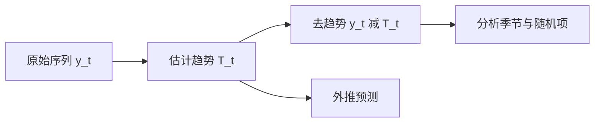
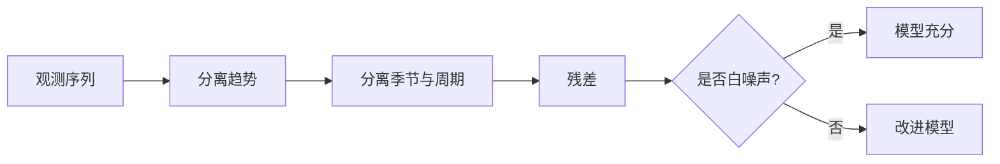

# Concept-Book Run

domain: /home/papagame/projects/digital-duck/cb-data-science/public/domains/data_science_ch05/input/graph.yaml
target: seasonal_trend_decomposition_loess
started: 2026-11-24T00:54:43

## Teaching order (8 concepts)

- cyclic_component
- sequence
- trend
- noise
- seasonal_component
- time_series
- trend_cycle_component
- seasonal_trend_decomposition_loess

### cyclic_component (14.8s)

## 周期成分

### 定义

**周期成分**(cyclic component,记作 $C_t$)是时间序列中持续时间长于一个季节、且没有固定频率的大幅波动。典型例子是经济的繁荣与衰退:它们可能持续 2 年,也可能持续 10 年,因此无法提前精确预测。

它与相近概念的区别如下:

| 成分 | 周期长度 | 是否固定 |
|---|---|---|
| 季节成分 $S_t$ | 一年以内(如 12 个月) | 固定 |
| 周期成分 $C_t$ | 通常多年 | **不固定** |
| 趋势成分 $T_t$ | 长期单向变化 | 无周期 |

在经典乘法分解模型中:
$$Y_t = T_t \times S_t \times C_t \times I_t,$$
其中 $I_t$ 为不规则(随机)成分。

### 例题:提取周期成分

某地区年度房屋销量(单位:千套)的趋势值 $T_t$ 与实际值 $Y_t$ 如下(年度数据无季节成分,取 $S_t=1$):

| 年份 | $Y_t$ | $T_t$ |
|---|---|---|
| 1 | 90 | 100 |
| 2 | 104 | 104 |
| 3 | 117 | 108 |
| 4 | 118 | 112 |
| 5 | 105 | 116 |
| 6 | 96 | 120 |

**步骤 1:** 用 $Y_t/T_t$ 得到"周期—不规则相对值":
$$\frac{90}{100}=0.90,\ \frac{104}{104}=1.00,\ \frac{117}{108}\approx1.08,\ \frac{118}{112}\approx1.05,\ \frac{105}{116}\approx0.91,\ \frac{96}{120}=0.80.$$

**步骤 2:** 用 3 年移动平均削弱不规则成分 $I_t$,例如第 3 年:
$$C_3 \approx \frac{1.00+1.08+1.05}{3}\approx 1.04.$$

同理 $C_2\approx1.00$,$C_4\approx1.01$,$C_5\approx0.92$。

**解读:** $C_t>1$ 表示高于趋势(扩张期),$C_t<1$ 表示低于趋势(收缩期)。数据显示销量在第 3—4 年达到峰值,之后进入收缩。

### 问题求解应用

**问题:** 判断某序列的起伏是季节成分还是周期成分。

1. **检查周期长度:** 若峰值间隔稳定(如每 12 个月),属于季节成分;若间隔在 3 到 9 年之间变化,则属于周期成分。
2. **检查可预测性:** 周期成分无固定频率,故不能像季节指数那样直接套用。预测时常借助领先指标(如利率、消费者信心指数)或回归模型,并给出较宽的预测区间。
3. **去除趋势后分析:** 先估计 $T_t$,再计算 $Y_t/T_t$ 并平滑,避免把长期增长误判为周期上升。

```python
import pandas as pd
y = pd.Series([90,104,117,118,105,96])
t = pd.Series([100,104,108,112,116,120])
ratio = y / t                                  # 周期-不规则相对值
cyc = ratio.rolling(3, center=True).mean()     # 3 年移动平均得到 C_t
print(cyc.round(2).tolist())
```

**常见误区:** 数据只有 2—3 个周期时,很难区分真正的周期和随机漂移。因此应结合经济背景判断,而不是只凭曲线形状下结论。

### sequence (13.5s)

## 数列

**定义。** 数列是按一定顺序排列的一列数(或其他数据),其中每个数称为数列的**项**。记作 $\{a_n\}$,其中 $a_1$ 为首项,$a_n$ 为第 $n$ 项,$n$ 称为项的**序号**。从函数角度看,数列就是定义域为正整数集 $\mathbb{N}^*$ 的函数 $n \mapsto a_n$。

数列有两种常见的描述方式:

- **通项公式**:直接给出 $a_n$ 关于 $n$ 的表达式,例如 $a_n = 2n+1$。
- **递推关系**:给出首项及由前面各项计算后一项的规则,例如 $a_1 = 1,\; a_{n+1} = 2a_n + 1$。

两种特殊且重要的数列:

- **等差数列**:相邻两项之差为常数 $d$,通项 $a_n = a_1 + (n-1)d$,前 $n$ 项和 $S_n = \dfrac{n(a_1+a_n)}{2}$。
- **等比数列**:相邻两项之比为常数 $q$,通项 $a_n = a_1 q^{\,n-1}$,当 $q\neq 1$ 时 $S_n = \dfrac{a_1(1-q^n)}{1-q}$。

**例题。** 已知数列 $\{a_n\}$ 满足 $a_1 = 3$,$a_{n+1} = a_n + 4$。求通项公式及 $a_{20}$。

*解:* 相邻两项之差恒为 $4$,所以这是公差 $d=4$ 的等差数列:
$$a_n = 3 + (n-1)\cdot 4 = 4n - 1,$$
于是 $a_{20} = 4\times 20 - 1 = 79$。前 20 项之和为
$$S_{20} = \frac{20(3+79)}{2} = 820.$$

**问题求解应用。** 某人第一年存入 1000 元,此后每年存款比上一年多 200 元(等差);另有一笔 1000 元存款,年利率 5%,不再追加(等比)。比较第 10 年末两者的数额。

- 第一种:第 10 年的存款额 $a_{10} = 1000 + 9\times 200 = 2800$ 元;累计存入 $S_{10} = \dfrac{10(1000+2800)}{2} = 19000$ 元。
- 第二种:$b_n = 1000\times 1.05^{\,n-1}$(第 $n$ 年初的本息),故 $b_{10} = 1000\times 1.05^{9}\approx 1551$ 元。

这说明等差数列每期增加固定的**量**,等比数列每期增加固定的**比例**。起初等差增长更快,但当 $n$ 足够大时,只要 $q>1$,等比数列终将超过任何等差数列。判断一个数据列属于哪种类型,可以先计算相邻项的差与比:差为常数则为等差,比为常数则为等比;若都不是,则尝试寻找递推关系或通项公式。

**解题步骤小结:**

1. 列出前几项,观察差或比的规律;
2. 判断类型(等差、等比或其他递推);
3. 写出通项 $a_n$,再代入所求的 $n$;
4. 需要求和时,选用对应的求和公式。

### trend (13.8s)

## 趋势(Trend)

**定义。** 趋势是时间序列在剔除季节波动、周期波动和随机噪声之后,所呈现的长期走向。它回答的问题是:"如果没有其他干扰,这个量长期来看是在上升、下降,还是基本不变?"

最常见的模型是加法分解:

$$y_t = T_t + S_t + \varepsilon_t$$

其中 $T_t$ 为趋势项,$S_t$ 为季节项,$\varepsilon_t$ 为随机误差。最简单的趋势是**线性趋势**:

$$T_t = \beta_0 + \beta_1 t$$

斜率 $\beta_1$ 表示每个时间单位的平均变化量。若增长按比例进行(如人口、复利),则用**指数趋势** $T_t = \beta_0 e^{\beta_1 t}$,取对数后化为线性:$\ln T_t = \ln\beta_0 + \beta_1 t$。

**最小二乘估计。** 对 $t=1,\dots,n$ 的数据,斜率与截距为

$$\hat\beta_1=\frac{\sum_{t}(t-\bar t)(y_t-\bar y)}{\sum_{t}(t-\bar t)^2},\qquad \hat\beta_0=\bar y-\hat\beta_1\bar t.$$

**例题。** 某网店前 5 个月的销量(单位:百件)为 $y=(10,\,12,\,15,\,15,\,18)$,$t=1,\dots,5$。

1. $\bar t=3,\ \bar y=14$。
2. 分子:$(-2)(-4)+(-1)(-2)+0\cdot1+1\cdot1+2\cdot4=8+2+0+1+8=19$。
3. 分母:$4+1+0+1+4=10$。
4. $\hat\beta_1=1.9,\ \hat\beta_0=14-1.9\times3=8.3$。

所以趋势线为 $\hat T_t=8.3+1.9t$,即销量平均每月增长约 190 件。

**问题求解应用。** 预测第 6 个月:$\hat T_6=8.3+1.9\times6=19.7$,约 1970 件。

实际分析中通常分三步:

- **画图观察**:看增长是近似线性还是按比例增长(后者先取对数)。
- **去趋势**:计算 $y_t-\hat T_t$,得到残差。残差若仍有明显规律,说明模型不够好,或还存在季节项。
- **检验显著性**:检验 $\beta_1$ 是否显著不为零,以区分真实趋势与随机波动。

另一种不依赖具体函数形式的方法是**移动平均**。例如对月度数据取 12 个月的平均,可以抵消一个完整季节周期的影响,留下平滑的趋势曲线。

**注意事项。** 趋势外推只在"未来的驱动机制与过去相同"时才可靠。例如将上述线性趋势外推到 5 年后,会忽略市场饱和,预测可能严重偏高。因此,预测范围越远,结论越应谨慎。


*图:先从原始序列中估计趋势,再分别用于去趋势分析和短期预测。*

### noise (14.4s)

## 噪声

**定义。** 在时间序列中,**噪声**(noise,又称随机分量或不规则分量)是指无法归因于趋势、周期或季节成分的随机、不可预测的波动。经典加法分解模型写作

$$
y_t = T_t + C_t + S_t + \varepsilon_t,
$$

其中 $\varepsilon_t$ 即噪声。最常用的假设是**白噪声**:

$$
E[\varepsilon_t]=0,\qquad \operatorname{Var}(\varepsilon_t)=\sigma^2,\qquad \operatorname{Cov}(\varepsilon_s,\varepsilon_t)=0\ (s\neq t).
$$

这三条的含义是:噪声围绕零上下波动,波动幅度恒定,而且今天的噪声对预测明天的噪声没有任何帮助。若还假设 $\varepsilon_t\sim N(0,\sigma^2)$,则称为高斯白噪声。

**工作示例。** 某咖啡店连续 6 天的销量为 $52, 48, 55, 50, 47, 54$。设已知趋势与季节成分之和为常数 $\mu=51$,则各日残差(噪声估计)为

$$
\hat\varepsilon_t = y_t-\mu:\ 1,\,-3,\,4,\,-1,\,-4,\,3.
$$

残差之和为 $0$,样本方差为

$$
\hat\sigma^2=\frac{1^2+(-3)^2+4^2+(-1)^2+(-4)^2+3^2}{6-1}=\frac{52}{5}=10.4,
$$

所以 $\hat\sigma\approx 3.2$ 杯。这意味着即使模型完全正确,单日销量仍会有约 $\pm3$ 杯的不可预测偏差。

**问题求解应用。** 噪声的实际意义体现在三个问题上:

1. **预测区间。** 若 $\sigma=3.2$,下一日点预测为 $51$,则约 95% 的预测区间为 $51\pm1.96\times3.2\approx[44.7,\,57.3]$。噪声设定了预测精度的下限,再好的模型也无法消除它。

2. **平滑去噪。** 对 $k$ 个独立观测取平均,噪声方差降为 $\sigma^2/k$。用 $k=4$ 的移动平均,标准差由 $3.2$ 降到 $1.6$,代价是对快速变化的响应变慢。

3. **检验模型是否充分。** 拟合后检查残差:若残差的自相关系数 $r_k$ 在多个滞后阶 $k$ 上超出 $\pm 2/\sqrt{n}$,说明残差中仍有结构(漏掉了趋势或季节性),不是纯噪声,需要改进模型。反之,残差像白噪声,就说明可预测的信息已被提取完毕。


*图:通过检验残差是否为白噪声来判断时间序列模型是否充分。*

**要点。** 噪声不是"错误",而是系统中固有的不可预测部分。建模的目标不是消除噪声,而是把所有可预测的结构提取出来,使剩下的部分只是噪声。

### seasonal_component (14.4s)

## 季节性成分

**定义。** 季节性成分(seasonal component)是时间序列中按固定周期重复出现的变化,例如每年同一月份的销量高峰,或每周同一天的客流低谷。它的关键特征是**周期长度 $m$ 固定且已知**(月度数据 $m=12$,按周的日数据 $m=7$)。这一点使它区别于周期不固定的商业周期,也区别于长期趋势。

经典的加法分解模型把观测值写成:

$$y_t = T_t + S_t + R_t,\qquad S_{t+m}=S_t,\qquad \sum_{j=1}^{m} S_j = 0$$

其中 $T_t$ 是趋势,$S_t$ 是季节性成分,$R_t$ 是随机残差。约束 $\sum S_j=0$ 保证季节效应只表示"相对于平均水平的上下波动"。若季节波动幅度随水平增大而增大,则改用乘法模型 $y_t=T_t\cdot S_t\cdot R_t$,此时约束为 $\sum S_j = m$。

**例题。** 某咖啡店连续两周的日销量(杯)如下:

| 日 | 一 | 二 | 三 | 四 | 五 | 六 | 日 |
|---|---|---|---|---|---|---|---|
| 第1周 | 80 | 84 | 88 | 90 | 110 | 130 | 108 |
| 第2周 | 84 | 88 | 90 | 94 | 114 | 134 | 112 |

估计"周六"的季节指数(加法模型,$m=7$)。

1. 估计趋势:第1周均值为 $\frac{690}{7}\approx 98.6$,第2周均值为 $\frac{716}{7}\approx 102.3$,总均值约 $100.4$。
2. 去趋势:周六的两个观测值与各周均值之差为 $130-98.6=31.4$ 和 $134-102.3=31.7$。
3. 取平均:$\hat S_{\text{六}}\approx 31.6$。

即周六平均比当周水平高约 32 杯。用同样方法可得周一约 $-17.6$,周五约 $+12.5$。

**问题求解应用。** 季节性成分有两个核心用途:

- **季节调整。** 计算 $y_t - \hat S_t$ 可去掉周期性影响,从而判断变化是"真实增长"还是"正常的季节波动"。例如,12 月零售额上升 20% 并不说明业务好转,因为往年 12 月本来就比平均水平高约 20%。
- **预测。** 若趋势预测为 $\hat T_{15}=104$(下周一),则预测值为 $\hat y_{15}=104+(-17.6)\approx 86.4$ 杯。

在 Python 中可用 `statsmodels` 一步完成分解:

```python
from statsmodels.tsa.seasonal import seasonal_decompose
result = seasonal_decompose(series, model="additive", period=7)
print(result.seasonal[:7])   # 7 个季节指数
```

**检验要点。** 判断一个序列是否有季节性,可画季节子序列图,或检查自相关函数(ACF)在滞后 $m, 2m, \dots$ 处是否出现明显峰值。若峰值存在,在建模时就必须显式处理季节性成分。

### time_series (15.0s)

## 时间序列

**定义。** 时间序列(time series)是对同一变量按照规则的时间间隔(如每日、每月、每年)依次采集并排列而成的一组数值测量,记作 $\{y_t\}_{t=1}^{n}$。由于观测值按时间排序,相邻数据点通常**不相互独立**,这正是时间序列分析区别于一般统计分析的根本原因。

经典分解模型把序列拆成四个成分:

- 趋势 $T_t$:长期上升或下降的走向;
- 季节性 $S_t$:以固定周期 $m$ 重复的波动;
- 周期性 $C_t$:无固定周期的长期起伏;
- 随机噪声 $\varepsilon_t$:不可预测的残差。

加法模型为
$$y_t = T_t + S_t + \varepsilon_t,$$
当季节波动幅度随水平增大时,改用乘法模型 $y_t = T_t \cdot S_t \cdot \varepsilon_t$。

**常用工具:移动平均。** 取窗口长度 $k$,平滑后的序列为
$$\hat{T}_t = \frac{1}{k}\sum_{i=0}^{k-1} y_{t-i}.$$
它可以抑制噪声,凸显趋势。

**例题。** 某小店连续 6 个月的销售额(单位:千元)为:
$$12,\ 14,\ 13,\ 17,\ 18,\ 20.$$
求窗口 $k=3$ 的移动平均,并预测第 7 个月。

*解:*

$$\hat{T}_3=\frac{12+14+13}{3}=13,\quad \hat{T}_4=\frac{14+13+17}{3}=14.67,$$
$$\hat{T}_5=\frac{13+17+18}{3}=16,\quad \hat{T}_6=\frac{17+18+20}{3}=18.33.$$

平滑值从 13 稳步升到 18.33,说明存在上升趋势。最简单的预测是用最近一个移动平均值:$\hat{y}_7\approx 18.33$。若考虑趋势,平均每步增长 $(18.33-13)/3\approx 1.78$,则可把预测修正为约 $20.1$。

**问题求解应用。** 面对一个实际的时间序列,可按以下步骤处理:

1. **作图**:先画出序列图,观察趋势、季节性与异常点。
2. **去趋势/去季节**:用差分 $\nabla y_t = y_t - y_{t-1}$ 消除趋势,用 $y_t - y_{t-m}$ 消除周期为 $m$ 的季节性。
3. **检验相关性**:计算自相关系数
$$r_h=\frac{\sum_{t=h+1}^{n}(y_t-\bar y)(y_{t-h}-\bar y)}{\sum_{t=1}^{n}(y_t-\bar y)^2},$$
它衡量序列与其滞后 $h$ 期的自身的相关程度。若 $r_h$ 很大,说明过去的值对预测未来有价值。
4. **建模与检验**:建立预测模型(如移动平均、指数平滑、自回归模型 AR),并用**按时间划分**的数据检验:用前面的数据训练,用后面的数据评估,切勿随机打乱顺序,否则会泄露未来信息。

对上例做一阶差分,得 $2,-1,4,1,2$,均值为 $1.6>0$,同样印证了上升趋势,也与前面算出的每步约 1.78 的增长相吻合。

**要点。** 时间序列的核心是"顺序有意义":先分解出趋势、季节与噪声,再利用自相关做预测,并始终用时间顺序检验模型。

### trend_cycle_component (15.3s)

## 趋势-循环成分

**定义。** 时间序列通常可分解为三类成分:趋势、季节和随机波动。**趋势-循环成分**(trend-cycle component,记作 $T_t$)把*长期趋势*与*循环波动*合并为一项。趋势指序列的长期上升或下降方向;循环指围绕趋势、持续时间不固定(通常多于一年)的起伏,例如经济的扩张与衰退。季节性的周期长度固定(如 12 个月),可以直接建模预测;而循环的周期长短和幅度都不规则,难以与趋势可靠分离,因此实践中把二者合并估计。

常用的加法分解模型为
$$y_t = T_t + S_t + R_t,$$
其中 $S_t$ 为季节成分,$R_t$ 为余项。若先去除季节成分,则 $T_t \approx y_t - S_t - R_t$,而估计 $T_t$ 的经典方法是**移动平均**。

**例题。** 某店铺的季度销售额(万元)为:

| 季度 | 1 | 2 | 3 | 4 | 5 | 6 | 7 |
|---|---|---|---|---|---|---|---|
| $y_t$ | 20 | 30 | 26 | 24 | 24 | 34 | 30 |

由于季节周期为 $m=4$(偶数),使用 $2\times4$ 移动平均:
$$\hat T_t = \frac{1}{4}\left(\tfrac12 y_{t-2} + y_{t-1} + y_t + y_{t+1} + \tfrac12 y_{t+2}\right).$$

计算 $t=3$:
$$\hat T_3 = \frac{1}{4}\left(\tfrac12\cdot 20 + 30 + 26 + 24 + \tfrac12\cdot 24\right) = \frac{102}{4} = 25.5.$$

计算 $t=4$:
$$\hat T_4 = \frac{1}{4}\left(\tfrac12\cdot 30 + 26 + 24 + 24 + \tfrac12\cdot 34\right) = \frac{106}{4} = 26.5.$$

计算 $t=5$:
$$\hat T_5 = \frac{1}{4}\left(\tfrac12\cdot 26 + 24 + 24 + 34 + \tfrac12\cdot 30\right) = \frac{110}{4} = 27.5.$$

可见趋势-循环成分每季度约增加 1 万元。移动平均恰好覆盖一个完整季节周期,因此季节波动在平均中相互抵消,留下的就是平滑的趋势-循环。注意首尾各 $m/2=2$ 个时点无法估计。

**问题求解应用。** 

1. **去趋势并提取季节项。** 计算 $y_t - \hat T_t$:$t=3$ 时为 $26-25.5=0.5$,$t=4$ 时为 $24-26.5=-2.5$,$t=5$ 时为 $24-27.5=-3.5$。对同一季度的多个年份取平均,即可得到季节指数 $S_t$。
2. **判断预测难度。** 季节项可按固定周期外推;但 $T_t$ 含循环,拐点时间无法预知。因此预测时通常只对趋势-循环作短期外推(如沿最近斜率 $+1$ 万元/季度延伸),并给出随预测期增长而变宽的预测区间。
3. **选择窗口。** 窗口越宽,曲线越平滑,但对拐点反应越迟钝;窗口过窄,则会把随机噪声 $R_t$ 误当作循环。

**要点。** 趋势-循环 $=$ 去除季节与噪声后剩下的“慢变化部分”。它回答“序列大致在往哪里走”,而不回答“下一次衰退何时到来”。

### seasonal_trend_decomposition_loess (17.0s)

## 季节-趋势分解(基于 Loess)

### 定义

**STL**(Seasonal-Trend decomposition using Loess)把一个时间序列分解为三个分量的加法模型:

$$
Y_t = T_t + S_t + R_t,\quad t = 1,\dots,N
$$

其中 $T_t$ 是**趋势-周期分量**(缓慢变化的整体走向),$S_t$ 是**季节分量**(周期为 $n_p$ 的重复模式,如月度数据中 $n_p=12$),$R_t$ 是**余项**(噪声)。

STL 的核心工具是 **Loess(局部加权回归)**:为了估计点 $x_0$ 处的值,取其邻近的若干点,赋予三次权重函数

$$
w(u) = (1-|u|^3)^3,\quad |u|<1,
$$

距离越近权重越大,然后在该邻域内做加权最小二乘的低阶多项式(常用一次)拟合,取拟合值作为 $x_0$ 处的平滑结果。

### STL 的迭代流程

STL 由**内循环**与**外循环**组成。内循环每轮包含:

1. **去趋势**:$Y_t - T_t^{(k)}$。
2. **周期子序列平滑**:把去趋势序列按季节位置分组(如所有 1 月、所有 2 月……),对每组做 Loess,再拼接并扩展两端。
3. **低通滤波**:对结果依次做长度为 $n_p$、$n_p$、3 的滑动平均,再做一次 Loess,去掉其中混入的低频成分,得到 $L_t$。
4. **季节分量**:$S_t^{(k+1)} = C_t^{(k+1)} - L_t$。
5. **去季节与趋势平滑**:对 $Y_t - S_t^{(k+1)}$ 做 Loess,得到 $T_t^{(k+1)}$。

**外循环**根据余项大小计算**稳健权重** $\rho_t$(如双平方函数,离群点权重接近 0),在下一轮内循环中与 Loess 权重相乘,使异常值不会扭曲趋势和季节。

### 示例

设某商店 4 年的月度销量,平均每月约 100 件,年增长约 12 件,12 月出现约 $+30$ 的促销高峰,另有一个月因系统故障销量异常偏低。

- 周期子序列平滑:12 月分组的 4 个值经 Loess 平滑后,得到稳定的 $S_{12}\approx +30$。
- 趋势平滑:去季节后的序列呈上升走势,$T_t$ 每年约增加 12。
- 故障月的 $R_t$ 很大,外循环给它的稳健权重 $\rho_t\approx 0$,因此它几乎不影响 $T_t$ 与 $S_t$。

### 问题求解应用

以下 Python 代码使用 `statsmodels` 完成分解,并据此做季节调整:

```python
from statsmodels.tsa.seasonal import STL

res = STL(y, period=12, robust=True).fit()
trend, seasonal, resid = res.trend, res.seasonal, res.resid
adjusted = y - seasonal          # 季节调整后的序列
```

**如何判断结果是否合理?** 可用**季节强度**

$$
F_S = \max\!\left(0,\ 1-\frac{\operatorname{Var}(R_t)}{\operatorname{Var}(S_t+R_t)}\right).
$$

$F_S$ 接近 1 表示季节性很强;接近 0 则说明该序列几乎没有季节性。趋势强度 $F_T$ 的定义类似,把 $S_t$ 换成 $T_t$ 即可。

**参数选择要点**:

- 季节平滑窗口(`seasonal`)越大,季节模式越稳定,随年份变化越小;越小则越能捕捉季节形状的演变。
- 趋势窗口(`trend`)越大,趋势越平滑。
- 数据含离群点时应开启 `robust=True`。
- 若季节波动幅度随水平上升,可先取对数,再用加法模型:$\log Y_t = T_t + S_t + R_t$,这等价于原序列上的乘法分解。

### 小结

STL 用 Loess 在"季节位置"与"时间"两个方向上交替平滑,并借助稳健权重抵御离群点。它能处理任意周期长度、允许季节形状随时间缓慢变化,因此成为现代时间序列分析中的标准分解工具。

## Run complete

total: 142.4s
