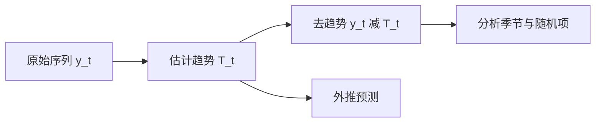
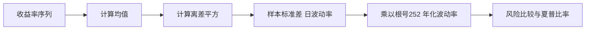

# Concept-Book Run

domain: /home/papagame/projects/digital-duck/cb-data-science/public/domains/data_science_ch05/input/graph.yaml
target: augmented_dickey_fuller_test
started: 2026-11-24T00:57:07

## Teaching order (7 concepts)

- sequence
- seasonal_component
- time_series
- trend
- volatility
- stationary
- augmented_dickey_fuller_test

### sequence (1.0s)

## 数列

**定义。** 数列是按一定顺序排列的一列数(或其他数据),其中每个数称为数列的**项**。记作 $\{a_n\}$,其中 $a_1$ 为首项,$a_n$ 为第 $n$ 项,$n$ 称为项的**序号**。从函数角度看,数列就是定义域为正整数集 $\mathbb{N}^*$ 的函数 $n \mapsto a_n$。

数列有两种常见的描述方式:

- **通项公式**:直接给出 $a_n$ 关于 $n$ 的表达式,例如 $a_n = 2n+1$。
- **递推关系**:给出首项及由前面各项计算后一项的规则,例如 $a_1 = 1,\; a_{n+1} = 2a_n + 1$。

两种特殊且重要的数列:

- **等差数列**:相邻两项之差为常数 $d$,通项 $a_n = a_1 + (n-1)d$,前 $n$ 项和 $S_n = \dfrac{n(a_1+a_n)}{2}$。
- **等比数列**:相邻两项之比为常数 $q$,通项 $a_n = a_1 q^{\,n-1}$,当 $q\neq 1$ 时 $S_n = \dfrac{a_1(1-q^n)}{1-q}$。

**例题。** 已知数列 $\{a_n\}$ 满足 $a_1 = 3$,$a_{n+1} = a_n + 4$。求通项公式及 $a_{20}$。

*解:* 相邻两项之差恒为 $4$,所以这是公差 $d=4$ 的等差数列:
$$a_n = 3 + (n-1)\cdot 4 = 4n - 1,$$
于是 $a_{20} = 4\times 20 - 1 = 79$。前 20 项之和为
$$S_{20} = \frac{20(3+79)}{2} = 820.$$

**问题求解应用。** 某人第一年存入 1000 元,此后每年存款比上一年多 200 元(等差);另有一笔 1000 元存款,年利率 5%,不再追加(等比)。比较第 10 年末两者的数额。

- 第一种:第 10 年的存款额 $a_{10} = 1000 + 9\times 200 = 2800$ 元;累计存入 $S_{10} = \dfrac{10(1000+2800)}{2} = 19000$ 元。
- 第二种:$b_n = 1000\times 1.05^{\,n-1}$(第 $n$ 年初的本息),故 $b_{10} = 1000\times 1.05^{9}\approx 1551$ 元。

这说明等差数列每期增加固定的**量**,等比数列每期增加固定的**比例**。起初等差增长更快,但当 $n$ 足够大时,只要 $q>1$,等比数列终将超过任何等差数列。判断一个数据列属于哪种类型,可以先计算相邻项的差与比:差为常数则为等差,比为常数则为等比;若都不是,则尝试寻找递推关系或通项公式。

**解题步骤小结:**

1. 列出前几项,观察差或比的规律;
2. 判断类型(等差、等比或其他递推);
3. 写出通项 $a_n$,再代入所求的 $n$;
4. 需要求和时,选用对应的求和公式。

### seasonal_component (1.0s)

## 季节性成分

**定义。** 季节性成分(seasonal component)是时间序列中按固定周期重复出现的变化,例如每年同一月份的销量高峰,或每周同一天的客流低谷。它的关键特征是**周期长度 $m$ 固定且已知**(月度数据 $m=12$,按周的日数据 $m=7$)。这一点使它区别于周期不固定的商业周期,也区别于长期趋势。

经典的加法分解模型把观测值写成:

$$y_t = T_t + S_t + R_t,\qquad S_{t+m}=S_t,\qquad \sum_{j=1}^{m} S_j = 0$$

其中 $T_t$ 是趋势,$S_t$ 是季节性成分,$R_t$ 是随机残差。约束 $\sum S_j=0$ 保证季节效应只表示"相对于平均水平的上下波动"。若季节波动幅度随水平增大而增大,则改用乘法模型 $y_t=T_t\cdot S_t\cdot R_t$,此时约束为 $\sum S_j = m$。

**例题。** 某咖啡店连续两周的日销量(杯)如下:

| 日 | 一 | 二 | 三 | 四 | 五 | 六 | 日 |
|---|---|---|---|---|---|---|---|
| 第1周 | 80 | 84 | 88 | 90 | 110 | 130 | 108 |
| 第2周 | 84 | 88 | 90 | 94 | 114 | 134 | 112 |

估计"周六"的季节指数(加法模型,$m=7$)。

1. 估计趋势:第1周均值为 $\frac{690}{7}\approx 98.6$,第2周均值为 $\frac{716}{7}\approx 102.3$,总均值约 $100.4$。
2. 去趋势:周六的两个观测值与各周均值之差为 $130-98.6=31.4$ 和 $134-102.3=31.7$。
3. 取平均:$\hat S_{\text{六}}\approx 31.6$。

即周六平均比当周水平高约 32 杯。用同样方法可得周一约 $-17.6$,周五约 $+12.5$。

**问题求解应用。** 季节性成分有两个核心用途:

- **季节调整。** 计算 $y_t - \hat S_t$ 可去掉周期性影响,从而判断变化是"真实增长"还是"正常的季节波动"。例如,12 月零售额上升 20% 并不说明业务好转,因为往年 12 月本来就比平均水平高约 20%。
- **预测。** 若趋势预测为 $\hat T_{15}=104$(下周一),则预测值为 $\hat y_{15}=104+(-17.6)\approx 86.4$ 杯。

在 Python 中可用 `statsmodels` 一步完成分解:

```python
from statsmodels.tsa.seasonal import seasonal_decompose
result = seasonal_decompose(series, model="additive", period=7)
print(result.seasonal[:7])   # 7 个季节指数
```

**检验要点。** 判断一个序列是否有季节性,可画季节子序列图,或检查自相关函数(ACF)在滞后 $m, 2m, \dots$ 处是否出现明显峰值。若峰值存在,在建模时就必须显式处理季节性成分。

### time_series (1.0s)

## 时间序列

**定义。** 时间序列(time series)是对同一变量按照规则的时间间隔(如每日、每月、每年)依次采集并排列而成的一组数值测量,记作 $\{y_t\}_{t=1}^{n}$。由于观测值按时间排序,相邻数据点通常**不相互独立**,这正是时间序列分析区别于一般统计分析的根本原因。

经典分解模型把序列拆成四个成分:

- 趋势 $T_t$:长期上升或下降的走向;
- 季节性 $S_t$:以固定周期 $m$ 重复的波动;
- 周期性 $C_t$:无固定周期的长期起伏;
- 随机噪声 $\varepsilon_t$:不可预测的残差。

加法模型为
$$y_t = T_t + S_t + \varepsilon_t,$$
当季节波动幅度随水平增大时,改用乘法模型 $y_t = T_t \cdot S_t \cdot \varepsilon_t$。

**常用工具:移动平均。** 取窗口长度 $k$,平滑后的序列为
$$\hat{T}_t = \frac{1}{k}\sum_{i=0}^{k-1} y_{t-i}.$$
它可以抑制噪声,凸显趋势。

**例题。** 某小店连续 6 个月的销售额(单位:千元)为:
$$12,\ 14,\ 13,\ 17,\ 18,\ 20.$$
求窗口 $k=3$ 的移动平均,并预测第 7 个月。

*解:*

$$\hat{T}_3=\frac{12+14+13}{3}=13,\quad \hat{T}_4=\frac{14+13+17}{3}=14.67,$$
$$\hat{T}_5=\frac{13+17+18}{3}=16,\quad \hat{T}_6=\frac{17+18+20}{3}=18.33.$$

平滑值从 13 稳步升到 18.33,说明存在上升趋势。最简单的预测是用最近一个移动平均值:$\hat{y}_7\approx 18.33$。若考虑趋势,平均每步增长 $(18.33-13)/3\approx 1.78$,则可把预测修正为约 $20.1$。

**问题求解应用。** 面对一个实际的时间序列,可按以下步骤处理:

1. **作图**:先画出序列图,观察趋势、季节性与异常点。
2. **去趋势/去季节**:用差分 $\nabla y_t = y_t - y_{t-1}$ 消除趋势,用 $y_t - y_{t-m}$ 消除周期为 $m$ 的季节性。
3. **检验相关性**:计算自相关系数
$$r_h=\frac{\sum_{t=h+1}^{n}(y_t-\bar y)(y_{t-h}-\bar y)}{\sum_{t=1}^{n}(y_t-\bar y)^2},$$
它衡量序列与其滞后 $h$ 期的自身的相关程度。若 $r_h$ 很大,说明过去的值对预测未来有价值。
4. **建模与检验**:建立预测模型(如移动平均、指数平滑、自回归模型 AR),并用**按时间划分**的数据检验:用前面的数据训练,用后面的数据评估,切勿随机打乱顺序,否则会泄露未来信息。

对上例做一阶差分,得 $2,-1,4,1,2$,均值为 $1.6>0$,同样印证了上升趋势,也与前面算出的每步约 1.78 的增长相吻合。

**要点。** 时间序列的核心是"顺序有意义":先分解出趋势、季节与噪声,再利用自相关做预测,并始终用时间顺序检验模型。

### trend (1.0s)

## 趋势(Trend)

**定义。** 趋势是时间序列在剔除季节波动、周期波动和随机噪声之后,所呈现的长期走向。它回答的问题是:"如果没有其他干扰,这个量长期来看是在上升、下降,还是基本不变?"

最常见的模型是加法分解:

$$y_t = T_t + S_t + \varepsilon_t$$

其中 $T_t$ 为趋势项,$S_t$ 为季节项,$\varepsilon_t$ 为随机误差。最简单的趋势是**线性趋势**:

$$T_t = \beta_0 + \beta_1 t$$

斜率 $\beta_1$ 表示每个时间单位的平均变化量。若增长按比例进行(如人口、复利),则用**指数趋势** $T_t = \beta_0 e^{\beta_1 t}$,取对数后化为线性:$\ln T_t = \ln\beta_0 + \beta_1 t$。

**最小二乘估计。** 对 $t=1,\dots,n$ 的数据,斜率与截距为

$$\hat\beta_1=\frac{\sum_{t}(t-\bar t)(y_t-\bar y)}{\sum_{t}(t-\bar t)^2},\qquad \hat\beta_0=\bar y-\hat\beta_1\bar t.$$

**例题。** 某网店前 5 个月的销量(单位:百件)为 $y=(10,\,12,\,15,\,15,\,18)$,$t=1,\dots,5$。

1. $\bar t=3,\ \bar y=14$。
2. 分子:$(-2)(-4)+(-1)(-2)+0\cdot1+1\cdot1+2\cdot4=8+2+0+1+8=19$。
3. 分母:$4+1+0+1+4=10$。
4. $\hat\beta_1=1.9,\ \hat\beta_0=14-1.9\times3=8.3$。

所以趋势线为 $\hat T_t=8.3+1.9t$,即销量平均每月增长约 190 件。

**问题求解应用。** 预测第 6 个月:$\hat T_6=8.3+1.9\times6=19.7$,约 1970 件。

实际分析中通常分三步:

- **画图观察**:看增长是近似线性还是按比例增长(后者先取对数)。
- **去趋势**:计算 $y_t-\hat T_t$,得到残差。残差若仍有明显规律,说明模型不够好,或还存在季节项。
- **检验显著性**:检验 $\beta_1$ 是否显著不为零,以区分真实趋势与随机波动。

另一种不依赖具体函数形式的方法是**移动平均**。例如对月度数据取 12 个月的平均,可以抵消一个完整季节周期的影响,留下平滑的趋势曲线。

**注意事项。** 趋势外推只在"未来的驱动机制与过去相同"时才可靠。例如将上述线性趋势外推到 5 年后,会忽略市场饱和,预测可能严重偏高。因此,预测范围越远,结论越应谨慎。


*图:先从原始序列中估计趋势,再分别用于去趋势分析和短期预测。*

### volatility (15.4s)

## 波动率

**定义。** 波动率(volatility)衡量数据点围绕均值波动的剧烈程度,通常源于难以分析或预测的因素。在金融中,它最常用收益率的样本标准差来度量:

$$\sigma = \sqrt{\frac{1}{n-1}\sum_{i=1}^{n}(r_i-\bar r)^2}$$

其中 $r_i$ 是第 $i$ 期收益率,$\bar r$ 是样本均值。$\sigma$ 越大,数据偏离均值越远,结果越难预测。需要注意:波动率衡量的是波动幅度,不是方向,上涨和下跌都会使它增大。

**年化。** 若 $\sigma_{\text{日}}$ 为日波动率,一年约有 252 个交易日。假设各日收益相互独立,方差随时间线性累加,因此

$$\sigma_{\text{年}} = \sigma_{\text{日}}\sqrt{252}$$

**例题。** 某股票连续 5 日的收益率(%)为:$1,\ -2,\ 3,\ 0,\ -2$。求日波动率与年化波动率。

1. 均值:$\bar r = \dfrac{1-2+3+0-2}{5} = 0$。
2. 离差平方和:$1^2+(-2)^2+3^2+0^2+(-2)^2 = 1+4+9+0+4 = 18$。
3. 样本方差:$\dfrac{18}{5-1} = 4.5$,所以 $\sigma_{\text{日}} = \sqrt{4.5}\approx 2.12\%$。
4. 年化:$2.12\% \times \sqrt{252} \approx 2.12\% \times 15.87 \approx 33.7\%$。

这说明该股票的日波动约为 2%,折算成一年则相当于约 34% 的波动水平。

**问题求解应用。** 比较两项资产时,不能只看平均收益。设资产 A、B 的平均年收益都是 8%,但 $\sigma_A = 10\%$,$\sigma_B = 30\%$。若收益近似服从正态分布,则约 68% 的年份中收益落在 $\bar r \pm \sigma$ 内:

- A:约 $[-2\%,\ 18\%]$
- B:约 $[-22\%,\ 38\%]$

两者平均收益相同,但 B 的结果区间宽得多,不确定性更大。一种常用的综合指标是夏普比率:

$$S = \frac{\bar r - r_f}{\sigma}$$

其中 $r_f$ 是无风险利率。取 $r_f = 2\%$,则 $S_A = \dfrac{8-2}{10} = 0.6$,$S_B = \dfrac{8-2}{30} = 0.2$。A 每承担一单位波动所获得的超额收益更高,在这个意义上更有效率。

**常见误区。**

- 波动率不等于亏损风险。它同时包含向上和向下的偏离。
- 波动率会随时间变化,称为"波动率聚集":剧烈波动之后往往还会出现剧烈波动。因此用历史数据估计未来波动率时,窗口长度的选择会影响结果。
- 正态假设在极端行情下常常失效,真实市场的"厚尾"事件比正态分布预测的更频繁。


*图:从收益率数据到年化波动率及风险比较的计算流程。*

### stationary (12.9s)

## 平稳性(Stationary)

**定义。** 若一个时间序列 $\{X_t\}$ 的统计性质不随时间推移而改变,则称其为**平稳**序列。本节采用实用的"弱平稳"(二阶平稳)定义,需同时满足三个条件:

1. 均值恒定:$E[X_t]=\mu$,不随 $t$ 变化(无整体趋势);
2. 方差恒定:$\mathrm{Var}(X_t)=\sigma^2<\infty$;
3. 自协方差只依赖时间间隔(滞后)$h$,而与具体时刻无关:
$$\gamma(h)=\mathrm{Cov}(X_t,\,X_{t+h}).$$

直观地说,平稳序列围绕一条水平线波动,波动幅度大致不变,也没有周期性的季节模式。若存在趋势或季节性,均值就会随 $t$ 变化,序列便不平稳。

**例题。** 判断下面两个序列是否平稳,其中 $\varepsilon_t$ 是均值为 0、方差为 $\sigma^2$ 的独立同分布白噪声:

- (a) $X_t=5+\varepsilon_t$
- (b) $Y_t=2t+\varepsilon_t$

对 (a):$E[X_t]=5$,$\mathrm{Var}(X_t)=\sigma^2$,且当 $h\neq0$ 时 $\gamma(h)=0$。三个条件都成立,所以 $X_t$ 平稳。

对 (b):$E[Y_t]=2t$,它随时间线性增长,违反条件 1,所以 $Y_t$ **不平稳**。

**问题求解应用。** 平稳性之所以重要,是因为 ARMA 等经典预测模型都以它为前提。实际建模的步骤如下:

1. **画图观察**:看序列是否有明显趋势、季节波动,或方差随时间变大。
2. **检验**:用 ADF(增广 Dickey–Fuller)检验,原假设为"存在单位根(不平稳)"。若 $p<0.05$,则拒绝原假设,可认为序列平稳。
3. **变换**:若不平稳,则做差分或取对数。

对 (b) 做一阶差分:
$$\Delta Y_t=Y_t-Y_{t-1}=2+\varepsilon_t-\varepsilon_{t-1}.$$
此时均值恒为 2,方差为 $2\sigma^2$,自协方差只依赖滞后 $h$,差分后的序列是平稳的。

代码示例:

```python
from statsmodels.tsa.stattools import adfuller
import numpy as np

t = np.arange(200)
y = 2 * t + np.random.randn(200)

print(adfuller(y)[1])            # p 值较大 → 不平稳
print(adfuller(np.diff(y))[1])   # p 值接近 0 → 差分后平稳
```

**小结。** 平稳序列的均值、方差和自协方差结构都不随时间改变。遇到趋势用差分,遇到方差增长用取对数,遇到季节性用季节差分。先把序列变为平稳,再建模和预测。

### augmented_dickey_fuller_test (14.1s)

## 增广迪基-富勒检验

**定义。** 许多时间序列方法(如 ARIMA)都要求序列平稳,即均值、方差和自协方差不随时间改变。增广迪基-富勒检验(ADF 检验)用来检验序列是否含有**单位根**,也就是它是否像随机游走那样不平稳。

考虑回归模型:

$$\Delta y_t = \alpha + \beta t + \gamma\, y_{t-1} + \sum_{i=1}^{p} \delta_i\, \Delta y_{t-i} + \varepsilon_t$$

其中 $\Delta y_t = y_t - y_{t-1}$。右端的滞后差分项 $\Delta y_{t-i}$ 用来吸收残差的自相关,这就是"增广"的含义。假设为:

- 原假设 $H_0:\ \gamma = 0$(存在单位根,序列不平稳)
- 备择假设 $H_1:\ \gamma < 0$(序列平稳)

检验统计量为 $\tau = \hat\gamma / \mathrm{SE}(\hat\gamma)$。注意 $\tau$ **不服从**普通 t 分布,必须使用迪基-富勒临界值表(或 MacKinnon 近似 p 值)。$\tau$ 越负,越有理由拒绝原假设。

**例题。** 对某序列做常数项版本的 ADF 检验,得到 $\tau = -3.85$。5% 显著性水平下的临界值约为 $-2.86$。因为 $-3.85 < -2.86$,所以拒绝 $H_0$。对应 p 值约为 $0.002$,小于 $0.05$,结论是序列平稳。

反之,若 $\tau = -1.20$,则 $-1.20 > -2.86$,p 值约为 $0.67$,无法拒绝 $H_0$,序列很可能含有单位根。

**问题求解应用。** 在实际建模中,可以按下列流程使用:

```python
from statsmodels.tsa.stattools import adfuller

def make_stationary(y, alpha=0.05, max_d=2):
    d = 0
    while d <= max_d:
        stat, pvalue, *_ = adfuller(y, autolag="AIC")
        print(f"d={d}, tau={stat:.2f}, p={pvalue:.3f}")
        if pvalue < alpha:
            return d, y
        y = y.diff().dropna()
        d += 1
    raise ValueError("差分后仍不平稳")
```

这段代码对序列反复检验并差分,直到 p 值低于 $\alpha$。返回的 $d$ 就是 ARIMA$(p,d,q)$ 中的差分阶数。其中 `autolag="AIC"` 通过信息准则自动选择滞后阶数 $p$。

**常见陷阱。**

1. **原假设方向。** ADF 的原假设是"不平稳"。p 值大只表示证据不足,不能证明序列有单位根。
2. **确定性项设定错误。** 序列有明显趋势时,应在回归中加入 $\beta t$。若遗漏,检验会失去效力。
3. **功效较低。** 当序列接近单位根(如 $\gamma = -0.01$)或样本很短时,检验常常无法拒绝 $H_0$。可以配合 KPSS 检验(其原假设是"平稳")交叉验证。
4. **结构突变。** 序列有突变时,ADF 容易误判为不平稳。

**小结。** ADF 检验通过判断 $\gamma$ 是否显著小于 0 来检验单位根。使用时先选好确定性项和滞后阶数,再用 Dickey-Fuller 分布的临界值判断。若 p 值很小,可视为平稳;否则就差分后重新检验。

## Run complete

total: 69.2s
