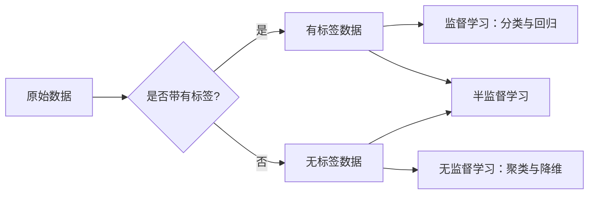
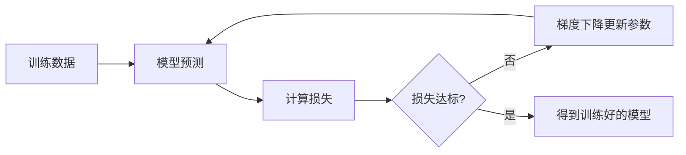
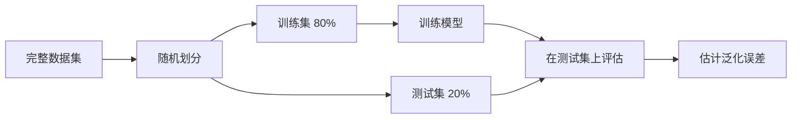
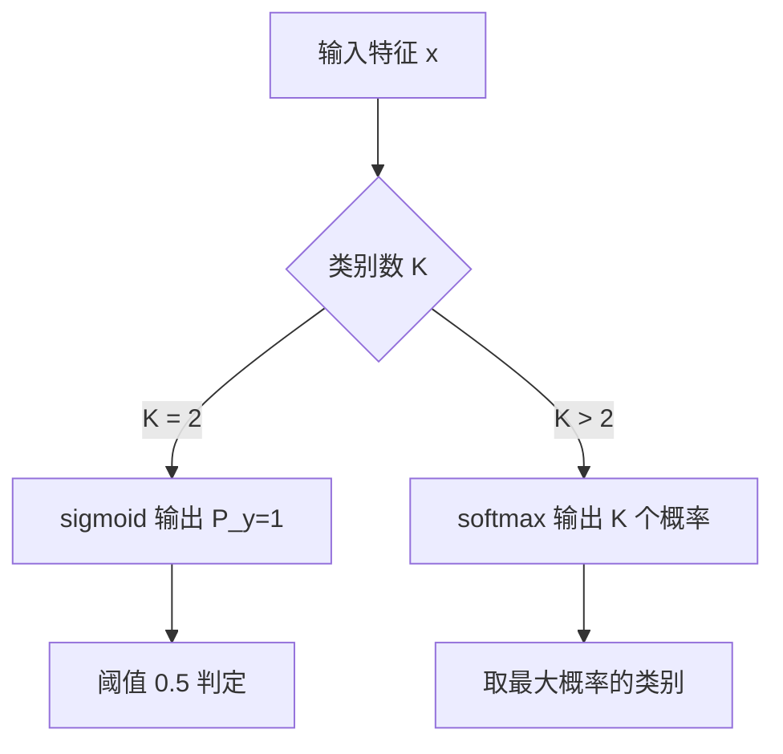
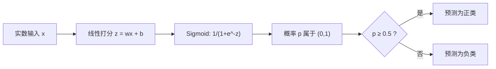
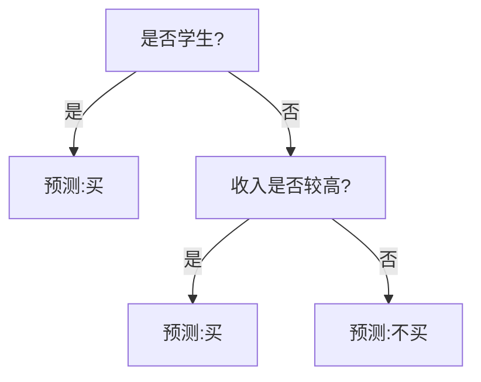
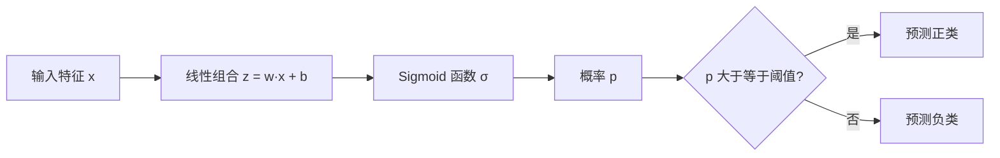
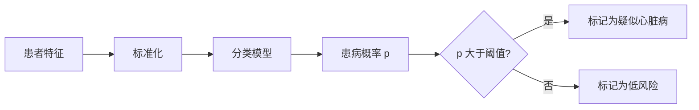

# Concept-Book Run

domain: /home/papagame/projects/digital-duck/cb-data-science/public/domains/data_science_ch06/input/graph.yaml
target: heart_disease_classification
started: 2026-11-24T00:59:06

## Teaching order (10 concepts)

- labeled_unlabeled_data
- machine_learning_model
- training_testing_set
- supervised_learning
- binary_multiclass_classification
- information_entropy
- sigmoid_function
- decision_tree
- logistic_regression
- heart_disease_classification

### labeled_unlabeled_data (13.9s)

## 有标签数据与无标签数据

**定义。** 设数据集中每个样本由特征向量 $\mathbf{x}_i$ 描述。

- **有标签数据**（labeled data）：每个样本都配有一个已知的标签 $y_i$（类别或数值），形成数据对 $\{(\mathbf{x}_i, y_i)\}_{i=1}^{n}$。
- **无标签数据**（unlabeled data）：只有特征，没有标签，即 $\{\mathbf{x}_i\}_{i=1}^{m}$。

标签通常需要人工标注或实验测量，成本高、速度慢；而无标签数据（如网络图片、传感器记录）往往唾手可得。这一差别决定了学习方式：

- **监督学习**使用有标签数据，学习映射 $f:\mathbf{x}\mapsto y$，目标是使预测误差 $\frac{1}{n}\sum_{i=1}^{n}\ell\big(f(\mathbf{x}_i),y_i\big)$ 尽量小（$\ell$ 为损失函数）。
- **无监督学习**使用无标签数据，发现内部结构，如聚类、降维。
- **半监督学习**同时利用少量有标签数据和大量无标签数据。


*图：数据是否带标签，决定了可采用的学习范式。*

**例题。** 一份邮件数据集有 1000 封邮件，每封提取"感叹号个数"和"是否含链接"两个特征。其中 200 封被人工标记为"垃圾"或"正常"，其余 800 封未标记。

- 这 200 封是有标签数据：$n=200$，$y_i\in\{\text{垃圾},\text{正常}\}$。
- 其余 800 封是无标签数据：$m=800$。
- 有标签比例为 $\frac{200}{1000}=20\%$。

**问题求解应用。** 对上述数据，可以这样选择方法：

1. **用有标签部分训练分类器。** 若 200 封中垃圾邮件占 60 封，则先验 $P(\text{垃圾})=\frac{60}{200}=0.3$。用这些数据训练逻辑回归或决策树，得到初始模型。
2. **用无标签部分提升性能。** 先对 800 封做聚类，若某簇中的邮件几乎都含链接且感叹号很多，而簇内已标记样本大多为垃圾，则可把该簇其余邮件的**伪标签**（pseudo-label）设为"垃圾"，再加入训练集重新训练。这就是自训练（self-training）的基本思路。
3. **注意风险。** 伪标签可能出错并被模型反复强化，因此通常只接受置信度高（如 $P(y\mid\mathbf{x})>0.95$）的预测，并保留一部分有标签数据作验证集，检查性能是否真的提升。

**判断准则。** 标注便宜、数据量够，直接用监督学习；没有标签、只想探索结构，用无监督学习；标注昂贵而原始数据充足，优先考虑半监督学习。

### machine_learning_model (0.9s)

## 机器学习模型

### 定义

**机器学习模型**是一个带有可调参数的数学函数 $f_{\theta}$。它从数据集中学习输入 $x$ 与输出 $y$ 之间的关系。这里的 $\theta$ 表示模型的内部参数，例如权重和偏置。"学习"就是在训练数据上不断调整 $\theta$，使预测值 $\hat{y}=f_{\theta}(x)$ 与真实值 $y$ 的差距（损失）降到可接受的水平。

常用的损失函数是均方误差：

$$L(\theta)=\frac{1}{n}\sum_{i=1}^{n}\bigl(y_i-f_{\theta}(x_i)\bigr)^2$$

调整参数最常用的方法是梯度下降：

$$\theta \leftarrow \theta-\eta\,\nabla_{\theta}L(\theta)$$

其中 $\eta>0$ 是学习率，它决定每一步更新的幅度。

### worked example：一元线性回归

设模型为 $f_{w,b}(x)=wx+b$，训练数据为 $(1,3),\,(2,5),\,(3,7)$。初始参数取 $w=0,\ b=0$，学习率取 $\eta=0.1$。

1. 预测值全为 $0$，误差 $e_i=\hat y_i-y_i$ 分别为 $-3,-5,-7$。
2. 梯度为
$$\frac{\partial L}{\partial w}=\frac{2}{n}\sum e_i x_i=\frac{2}{3}(-3-10-21)\approx-22.67,$$
$$\frac{\partial L}{\partial b}=\frac{2}{n}\sum e_i=\frac{2}{3}(-15)=-10.$$
3. 更新参数：$w\leftarrow 0-0.1\times(-22.67)\approx 2.27$，$b\leftarrow 0-0.1\times(-10)=1.0$。

只更新一步，$w$ 和 $b$ 就明显向真实关系 $y=2x+1$ 靠近。重复迭代后，损失会趋近于 $0$，参数收敛到 $w=2,\ b=1$。


*图：模型训练循环。预测、计算损失、更新参数，直到精度满足要求为止。*

### 问题求解应用

训练好的模型要用在**没见过的数据**上，所以不能只看训练损失。标准做法是把数据分成训练集和测试集。

**问题**：某模型训练集 MSE 为 $0.01$，测试集 MSE 为 $4.2$。该怎么判断？

**解答**：两者差距很大，说明模型出现了**过拟合**。它记住了训练数据的噪声，没有学到真正的规律。可以采取以下对策：

- 增加训练数据；
- 降低模型复杂度，例如减少多项式次数；
- 加入正则化项，把损失改为 $L(\theta)+\lambda\|\theta\|^2$；
- 用交叉验证来选择超参数 $\eta$ 和 $\lambda$。

相反，如果训练和测试误差都很高，就是**欠拟合**。这时应该增加模型表达能力，例如加入更多特征。

**小结**：机器学习模型 = 函数形式 + 可调参数 + 损失函数 + 优化方法。建模时要在拟合能力和泛化能力之间取得平衡。

### training_testing_set (14.5s)

## 训练集与测试集

**定义。** 训练集(training set)是用来让模型"学习"参数的那部分数据;测试集(testing set)是在训练结束后、从未参与学习的数据,用来估计模型在新数据上的表现。核心原则:**评估必须使用模型没见过的数据**。若用训练数据评估,模型只需"死记硬背"就能得高分,这种现象称为过拟合(overfitting),它会让我们高估模型的真实能力。

常见做法是随机划分,例如 80% 训练、20% 测试。设数据集共有 $N$ 个样本,则训练集大小为 $N_{\text{train}}=0.8N$,测试集大小为 $N_{\text{test}}=0.2N$。模型在测试集上的误差为

$$
E_{\text{test}}=\frac{1}{N_{\text{test}}}\sum_{i\in\text{测试集}} L\big(y_i,\hat y_i\big),
$$

其中 $L$ 是损失函数(分类中常用 0-1 损失:预测错为 1,对为 0),$y_i$ 为真实值,$\hat y_i$ 为预测值。


*图:数据集被一次性划分,训练集只用于学习,测试集只用于最终评估。*

**例题。** 共有 1000 张邮件样本(垃圾/正常)。随机取 800 封训练分类器,剩余 200 封测试。结果:训练集上错 8 封,测试集上错 24 封。

- 训练误差:$8/800=1\%$
- 测试误差:$24/200=12\%$

两者相差悬殊,说明模型过拟合:它记住了训练邮件的特征,却没学到可推广的规律。对新邮件应以 **12%** 作为误差的估计,而不是 1%。

**问题求解应用。** 实践中要注意以下几点:

1. **先打乱再划分。** 若数据按时间或类别排序,直接截取会使两个集合分布不同。分类问题宜用分层抽样(stratified sampling),保持各类别比例一致。
2. **杜绝数据泄漏(data leakage)。** 标准化的均值与方差只能由训练集计算,再应用到测试集;否则测试集信息已"渗入"训练。
3. **测试集只用一次。** 若反复根据测试误差调参,测试集实际上变成了训练的一部分。调参应使用从训练集中再划出的验证集(validation set),或交叉验证。
4. **测试集要足够大。** 测试误差本身有随机性。对 0-1 损失,其标准误约为 $\sqrt{p(1-p)/N_{\text{test}}}$。上例中 $p=0.12$,$N_{\text{test}}=200$,标准误约 $\sqrt{0.12\times0.88/200}\approx 2.3\%$,所以真实误差大致在 $12\%\pm 4.6\%$(约两倍标准误)范围内。

```python
from sklearn.model_selection import train_test_split
X_tr, X_te, y_tr, y_te = train_test_split(
    X, y, test_size=0.2, stratify=y, random_state=42)
model.fit(X_tr, y_tr)
print("测试准确率:", model.score(X_te, y_te))
```

**小结。** 训练集用来学习,测试集用来诚实地检验;两者严格分离,才能得到对模型泛化能力的可靠估计。

### supervised_learning (14.1s)

## 监督学习

**定义。** 监督学习(supervised learning)是一类机器学习方法:训练数据中每个样本都带有已知的**标签**,模型通过比较自身预测与真实标签之间的差距,不断调整参数。设训练集为
$$D=\{(x_i,y_i)\}_{i=1}^{n},$$
其中 $x_i$ 是特征,$y_i$ 是标签。我们要学习一个函数 $f_\theta(x)$,使预测 $\hat y_i=f_\theta(x_i)$ 尽量接近 $y_i$。"接近"的程度由**损失函数** $L$ 衡量,训练就是最小化平均损失:
$$J(\theta)=\frac1n\sum_{i=1}^{n}L\big(f_\theta(x_i),y_i\big),\qquad \theta^*=\arg\min_\theta J(\theta).$$
标签为连续数值时称为**回归**,为离散类别时称为**分类**。

**求解方法。** 最常用的是梯度下降:每一步沿损失下降最快的方向更新参数,
$$\theta \leftarrow \theta-\eta\,\nabla_\theta J(\theta),$$
其中 $\eta$ 为学习率。

**例题。** 用一元线性模型 $f(x)=wx$ 拟合三个样本 $(1,2),(2,4),(3,6)$,取平方损失 $L=(\hat y-y)^2$,初始 $w=0$,学习率 $\eta=0.05$。

损失的梯度为
$$\frac{dJ}{dw}=\frac{2}{n}\sum_i (wx_i-y_i)x_i.$$
当 $w=0$ 时:
$$\frac{dJ}{dw}=\frac{2}{3}\big(-2\cdot1-4\cdot2-6\cdot3\big)=\frac{2}{3}(-28)\approx-18.67.$$
更新得 $w=0-0.05\times(-18.67)\approx0.93$。继续迭代,$w$ 会逐步逼近 $2$,此时损失为 $0$。这说明模型从标签的"对错"中学到了数据背后的规律 $y=2x$。


*图:监督学习的训练循环——预测、比较标签、计算损失、更新参数,反复迭代直至收敛。*

**问题求解中的应用。** 实际应用必须把数据分成**训练集**与**测试集**。训练集用于调整参数;测试集在训练中完全不使用,仅用来评估模型在新数据上的**泛化**能力。

假设一个垃圾邮件分类器在训练集上准确率为 $99\%$,在测试集上只有 $70\%$。训练误差很低而测试误差很高,这是**过拟合**:模型记住了训练样本的细节,而非一般规律。常见的对策有:

1. 增加训练数据;
2. 降低模型复杂度;
3. 加入正则化项,例如 $J(\theta)+\lambda\lVert\theta\rVert^2$;
4. 使用交叉验证选择超参数。

反过来,如果训练误差和测试误差都很高,则是**欠拟合**,应当换用表达能力更强的模型或增加特征。

**小结。** 解决监督学习问题的一般步骤是:确定任务类型(回归或分类)→选择模型与损失函数→在训练集上优化参数→在测试集上检验泛化→根据训练误差与测试误差的差距诊断并改进模型。

### binary_multiclass_classification (15.2s)

## 二元与多类分类

**定义。** 分类是预测离散标签的监督学习任务。给定特征向量 $\mathbf{x}\in\mathbb{R}^d$，模型输出类别 $y$。

- **二元分类（binary）**：$y\in\{0,1\}$，例如邮件是否为垃圾邮件。
- **多类分类（multiclass）**：$y\in\{1,2,\dots,K\}$，$K>2$，例如手写数字识别（$K=10$）。

注意，多类分类中每个样本只属于**一个**类别。如果一个样本可同时带有多个标签，那是多标签分类，不属于本节讨论范围。

**二元情形：逻辑回归。** 模型先计算得分 $z=\mathbf{w}^\top\mathbf{x}+b$，再用 sigmoid 函数转换为概率：

$$P(y=1\mid\mathbf{x})=\sigma(z)=\frac{1}{1+e^{-z}},\qquad P(y=0\mid\mathbf{x})=1-\sigma(z).$$

当 $\sigma(z)\ge 0.5$（即 $z\ge0$）时预测为 1。决策边界 $\mathbf{w}^\top\mathbf{x}+b=0$ 是一条直线（或超平面）。

**多类情形：softmax。** 对每个类别 $k$ 设一个得分 $z_k=\mathbf{w}_k^\top\mathbf{x}+b_k$，然后归一化：

$$P(y=k\mid\mathbf{x})=\frac{e^{z_k}}{\sum_{j=1}^{K}e^{z_j}}.$$

各类概率非负且总和为 1。预测取概率最大的类别。当 $K=2$ 时，softmax 退化为 sigmoid，所以二元分类是多类分类的特例。

**训练目标：交叉熵损失。** 对真实类别 $y$，

$$L=-\log P(y\mid\mathbf{x}).$$

二元时即 $-[y\log p+(1-y)\log(1-p)]$。

**例题。** 某三类问题（猫、狗、鸟）中，模型对一张图片给出得分 $\mathbf{z}=(2.0,\,1.0,\,0.1)$。求各类概率和损失（真实类别为猫）。

先算指数：$e^{2.0}\approx7.39$，$e^{1.0}\approx2.72$，$e^{0.1}\approx1.11$，和为 $11.22$。于是

$$P=(0.659,\;0.242,\;0.099).$$

预测为"猫"，正确。损失 $L=-\ln 0.659\approx0.417$。若得分变为 $(0.1,1.0,2.0)$，同一张图会被判为"鸟"，此时 $P(\text{猫})\approx0.099$，$L=-\ln0.099\approx2.31$，损失明显变大。

**问题求解应用。** 面对实际问题，可以按以下步骤处理：

1. **确定 $K$**：数一数互斥的类别数。$K=2$ 用 sigmoid，$K>2$ 用 softmax。
2. **选择评价指标**：类别不平衡时（如欺诈检测中 99% 为正常），准确率会误导人。此时应看精确率 $\frac{TP}{TP+FP}$ 和召回率 $\frac{TP}{TP+FN}$。多类问题还要看混淆矩阵，找出哪些类别容易混淆。
3. **没有原生多类支持时**：可用 *一对多*（one-vs-rest，训练 $K$ 个二元分类器）或 *一对一*（one-vs-one，训练 $\binom{K}{2}$ 个分类器）。


*图：按类别数选择输出层。二元用 sigmoid 加阈值，多类用 softmax 取最大值。*

### information_entropy (13.3s)

## 信息熵

**定义。** 一个概率为 $p$ 的事件发生时,所携带的**信息量**(自信息,即“意外程度”)定义为

$$I(x) = -\log_2 p(x)\quad(\text{单位:比特})$$

事件越罕见,信息量越大;必然事件($p=1$)的信息量为 $0$。对离散随机变量 $X$,其**信息熵**是信息量的期望,衡量分布的平均不确定性:

$$H(X) = \sum_{x} p(x)\,I(x) = -\sum_{x} p(x)\log_2 p(x)$$

约定 $0\log_2 0 = 0$。信息熵满足 $0 \le H(X) \le \log_2 n$,其中 $n$ 为取值个数:分布越集中熵越小,分布越均匀熵越大,均匀分布时取到最大值 $\log_2 n$。

**例题:公平硬币与偏心硬币。**

(1) 公平硬币:$p(\text{正})=p(\text{反})=\tfrac12$,

$$H = -\tfrac12\log_2\tfrac12-\tfrac12\log_2\tfrac12 = 1\text{ 比特}.$$

(2) 偏心硬币:$p(\text{正})=0.9$,$p(\text{反})=0.1$。

- 正面的信息量:$-\log_2 0.9\approx 0.152$ 比特
- 反面的信息量:$-\log_2 0.1\approx 3.322$ 比特

$$H = 0.9\times0.152+0.1\times3.322\approx 0.469\text{ 比特}.$$

偏心硬币的结果更容易预测,所以平均信息量更少。反面虽然很“意外”,但它很少出现,对平均值贡献有限。

**应用:二十个问题与最优编码。** 熵给出了描述结果所需的平均最少比特数。设一个信源产生四个符号 A、B、C、D,概率分别为 $\tfrac12,\tfrac14,\tfrac18,\tfrac18$。

先算熵:

$$H=\tfrac12\cdot1+\tfrac14\cdot2+\tfrac18\cdot3+\tfrac18\cdot3=1.75\text{ 比特}.$$

如果用等长编码,每个符号需要 $2$ 比特。改用变长编码 A=`0`,B=`10`,C=`110`,D=`111`,让常见符号用短码,平均码长为

$$\tfrac12\cdot1+\tfrac14\cdot2+\tfrac18\cdot3+\tfrac18\cdot3=1.75\text{ 比特},$$

恰好等于熵。这是因为每个概率都是 $2^{-k}$ 的形式,码长正好等于信息量 $-\log_2 p$。香农信源编码定理指出:任何无损压缩的平均码长都不可能低于 $H(X)$,熵就是压缩的理论极限。

同样的思路也适用于“猜数游戏”:从 $n$ 个等可能的选项中猜出答案,至少需要 $\log_2 n$ 个是非问题。例如从 $1$ 到 $1000$ 中猜一个数,需要 $\lceil\log_2 1000\rceil = 10$ 个问题。

**小结。** 信息量刻画单个事件的“意外程度”,熵是它在整个分布上的平均。熵越大,不确定性越高,压缩空间越小。机器学习中的交叉熵损失、决策树的信息增益,都建立在这一概念之上。

### sigmoid_function (13.7s)

## Sigmoid Function(Sigmoid 函数)

**定义。** Sigmoid 函数(也称逻辑函数)把任意实数映射到区间 $(0,1)$:

$$\sigma(x)=\frac{1}{1+e^{-x}}$$

它的图像呈 S 形,有以下关键性质:

- 当 $x\to+\infty$ 时,$\sigma(x)\to 1$;当 $x\to-\infty$ 时,$\sigma(x)\to 0$。
- $\sigma(0)=\tfrac12$,且关于点 $(0,\tfrac12)$ 中心对称:$\sigma(-x)=1-\sigma(x)$。
- 严格单调递增,导数形式简洁:

$$\sigma'(x)=\sigma(x)\bigl(1-\sigma(x)\bigr)$$

**推导导数。** 令 $\sigma=(1+e^{-x})^{-1}$,由链式法则,
$$\sigma'=\frac{e^{-x}}{(1+e^{-x})^2}=\frac{1}{1+e^{-x}}\cdot\frac{e^{-x}}{1+e^{-x}}=\sigma(x)\bigl(1-\sigma(x)\bigr).$$
可见导数最大值出现在 $x=0$,为 $\tfrac14$;当 $|x|$ 很大时导数趋近于 0(称为"饱和")。


*图:Sigmoid 在二分类中的作用——把线性打分转换为概率,再按阈值做决策。*

**例题。** 计算 $\sigma(2)$ 与 $\sigma(-2)$。

$$\sigma(2)=\frac{1}{1+e^{-2}}\approx\frac{1}{1+0.1353}\approx 0.881$$
$$\sigma(-2)=\frac{1}{1+e^{2}}\approx\frac{1}{1+7.389}\approx 0.119$$

验证对称性:$0.881+0.119=1$,与 $\sigma(-x)=1-\sigma(x)$ 一致。

**应用:逻辑回归。** 某学生学习时间为 $x$ 小时,模型给出线性打分 $z=1.5x-4$。问学习 3 小时通过考试的概率是多少?

1. 计算打分:$z=1.5\times 3-4=0.5$。
2. 代入 Sigmoid:$p=\sigma(0.5)=\dfrac{1}{1+e^{-0.5}}\approx\dfrac{1}{1.6065}\approx 0.622$。

所以通过概率约为 $62\%$。若以 $0.5$ 为阈值,则预测"通过"。注意 $p=0.5$ 恰好对应 $z=0$,即 $x=\tfrac{4}{1.5}\approx 2.67$ 小时,这就是决策边界。

**反向问题(logit)。** Sigmoid 的反函数是
$$\sigma^{-1}(p)=\ln\frac{p}{1-p},$$
即对数几率。若已知 $p=0.8$,则 $z=\ln 4\approx 1.386$。这说明逻辑回归本质上是在假设"对数几率是特征的线性函数"。

**注意事项。** 由于 $\sigma'(x)$ 在 $|x|$ 较大时接近 0,深层神经网络中使用 Sigmoid 容易造成梯度消失;因此隐藏层常改用 ReLU,而 Sigmoid 主要保留在输出层,用于表示概率。

### decision_tree (14.1s)

## 决策树

**定义。** 决策树(decision tree)是一种监督学习算法,它把数据递归地划分为越来越“纯”的子集,从而形成一个层次化的树状结构:每个**内部节点**对某个特征做一次判断(如“年龄 $\le 30$?”),每条**分支**对应判断结果,每个**叶节点**给出最终的类别标签或预测值。预测时,样本从根节点出发,沿着判断结果一路走到叶节点。

**如何选择划分?** 关键是度量节点的“不纯度”。设节点中第 $k$ 类样本所占比例为 $p_k$,则

$$
H(S) = -\sum_{k} p_k \log_2 p_k \quad(\text{熵}),\qquad
G(S) = 1-\sum_{k} p_k^2 \quad(\text{基尼指数}).
$$

按特征 $A$ 划分后,**信息增益**为

$$
\mathrm{Gain}(S,A)=H(S)-\sum_{v}\frac{|S_v|}{|S|}H(S_v),
$$

其中 $S_v$ 是特征 $A$ 取值为 $v$ 的子集。算法(如 ID3、CART)在每个节点贪心地选择增益最大的划分,直到节点足够纯或达到深度上限为止。

**例题。** 某数据集有 10 个样本:6 个“买”、4 个“不买”。特征“是否学生”把它分成两组:

- 学生:5 个样本,其中 4 个“买”、1 个“不买”;
- 非学生:5 个样本,其中 2 个“买”、3 个“不买”。

父节点熵:
$$
H(S) = -0.6\log_2 0.6 - 0.4\log_2 0.4 \approx 0.971.
$$

两个子节点的熵:
$$
H(S_{\text{学生}}) = -0.8\log_2 0.8 - 0.2\log_2 0.2 \approx 0.722,
$$
$$
H(S_{\text{非学生}}) = -0.4\log_2 0.4 - 0.6\log_2 0.6 \approx 0.971.
$$

加权平均后:
$$
\mathrm{Gain}=0.971-\left(0.5\times0.722+0.5\times0.971\right)\approx 0.971-0.847=0.124.
$$

如果另一个特征的增益是 $0.05$,那么“是否学生”更适合作为根节点的判断条件。


*一棵简单的决策树:内部节点是特征判断,叶节点是最终预测。*

**问题求解应用。** 用 scikit-learn 训练并查看一棵树:

```python
from sklearn.tree import DecisionTreeClassifier, export_text
clf = DecisionTreeClassifier(criterion="entropy", max_depth=3)
clf.fit(X_train, y_train)
print(export_text(clf, feature_names=feature_names))
print(clf.score(X_test, y_test))
```

实践中需注意三点:

1. **过拟合**:不加限制的树会把训练数据“背下来”,训练准确率接近 100%,测试准确率却很低。可通过限制 `max_depth`、设置最小叶节点样本数,或**剪枝**来控制。
2. **贪心的局限**:每步只选局部最优划分,不保证全局最优树。
3. **可解释性**:每个预测都对应一条“若……且……则……”的规则路径,这是决策树相比许多黑箱模型的突出优点;若想提升精度,可进一步使用随机森林等集成方法。

### logistic_regression (15.6s)

## 逻辑回归(Logistic Regression)

### 定义

逻辑回归是一种用于**二分类**的预测模型。它不直接预测类别,而是预测样本属于正类($y=1$)的概率。核心思想是:假设**对数几率(log-odds)是特征的线性函数**:

$$\ln\frac{p}{1-p} = z = \mathbf{w}^\top \mathbf{x} + b$$

解出 $p$,得到 Sigmoid 函数:

$$p = P(y=1\mid \mathbf{x}) = \sigma(z) = \frac{1}{1+e^{-z}}$$

Sigmoid 把任意实数压缩到 $(0,1)$ 之间。当 $z=0$ 时 $p=0.5$,这就是决策边界;通常取 $p\ge 0.5$ 预测为正类。

参数通过**极大似然估计**获得,等价于最小化交叉熵损失:

$$J(\mathbf{w},b) = -\frac{1}{m}\sum_{i=1}^{m}\Big[y_i\ln p_i + (1-y_i)\ln(1-p_i)\Big]$$

该损失是凸函数,可用梯度下降求解,其梯度形式简洁:

$$\frac{\partial J}{\partial \mathbf{w}} = \frac{1}{m}\sum_{i=1}^{m}(p_i - y_i)\,\mathbf{x}_i$$

### 例题

某学生每周学习时长 $x$(小时)与是否通过考试 $y$ 之间,拟合得到:$z = -4 + 0.8x$。

1. 学习 $x=5$ 小时:$z = -4+4 = 0$,所以 $p = 0.5$,恰在决策边界上。
2. 学习 $x=8$ 小时:$z = 2.4$,$p = \dfrac{1}{1+e^{-2.4}} \approx 0.917$,预测通过。
3. 解释系数:$w=0.8$ 表示每多学 1 小时,对数几率增加 $0.8$,即几率(odds)乘以 $e^{0.8}\approx 2.23$。

注意:概率并不是随 $x$ 线性增长的,而几率的**对数**才是线性的。

### 问题求解应用

**问题:** 一封邮件有两个特征:可疑词数量 $x_1$ 和链接数 $x_2$。模型为 $z = -3 + 0.5x_1 + 1.0x_2$。若邮件含 4 个可疑词、1 个链接,它是垃圾邮件的概率是多少?若要求概率超过 $0.9$ 才拦截,应如何判断?

**解:**

- 计算 $z = -3 + 0.5(4) + 1.0(1) = 0$,得 $p=0.5$,不满足拦截阈值。
- 概率超过 $0.9$ 等价于 $z > \ln\frac{0.9}{0.1} = \ln 9 \approx 2.20$。因此只需检验 $z$,无需每次计算 Sigmoid。
- 若该邮件改为 6 个可疑词、2 个链接:$z = -3+3+2 = 2$,$p\approx 0.881<0.9$,仍不拦截。

**要点:**

- 阈值可根据代价调整:误拦正常邮件代价高时,应提高阈值。
- 决策边界 $\mathbf{w}^\top\mathbf{x}+b=0$ 是特征空间中的超平面,因此逻辑回归只能处理**线性可分**(或近似线性可分)的问题;非线性边界需要构造多项式特征等。
- 若数据完全线性可分,最大似然会使权重趋于无穷,实践中需加入 $L_2$ 正则项 $\frac{\lambda}{2}\|\mathbf{w}\|^2$。


*图:逻辑回归的预测流程:特征经线性组合得到对数几率,经 Sigmoid 转为概率,再与阈值比较得到类别。*

### heart_disease_classification (14.4s)

## 心脏病分类

**定义。** 心脏病分类是一个二分类监督学习问题:给定患者的特征向量 $\mathbf{x}=(x_1,\dots,x_d)$(如年龄、静息血压、血清胆固醇、最大心率),预测标签 $y\in\{0,1\}$,其中 $y=1$ 表示患有心脏病。常用模型有两类:

- **逻辑回归**:用 sigmoid 函数把线性得分变成概率,
$$P(y=1\mid\mathbf{x})=\sigma(\mathbf{w}^\top\mathbf{x}+b)=\frac{1}{1+e^{-(\mathbf{w}^\top\mathbf{x}+b)}}.$$
通过最小化交叉熵损失 $-\sum_i\big[y_i\ln p_i+(1-y_i)\ln(1-p_i)\big]$ 来训练。
- **决策树**:每个节点选择一个特征阈值(如"胆固醇 $>240$"),使基尼不纯度 $G=1-\sum_k p_k^2$ 下降最多,逐层划分直到叶节点。

**工作示例。** 假设已训练好的逻辑回归模型为
$$z=-8+0.04\,\text{bp}+0.02\,\text{chol}$$
(bp 为收缩压,chol 为胆固醇,单位 mg/dL)。某患者 bp $=150$,chol $=260$:

$$z=-8+0.04\times150+0.02\times260=-8+6+5.2=3.2,$$
$$p=\frac{1}{1+e^{-3.2}}\approx\frac{1}{1+0.0408}\approx0.96.$$

模型预测该患者患病概率约为 $96\%$。系数 $0.02$ 的含义是:胆固醇每升高 $1$ mg/dL,对数几率(log-odds)增加 $0.02$,即几率乘以 $e^{0.02}\approx1.02$。

**问题求解应用。** 医学诊断中,两类错误的代价不对等:漏诊(假阴性)比误诊(假阳性)危险得多。因此不能只看准确率,而要用混淆矩阵计算:

$$\text{灵敏度(召回率)}=\frac{TP}{TP+FN},\qquad \text{精确率}=\frac{TP}{TP+FP}.$$

例:在 $200$ 名患者中,$80$ 人真正患病。模型检出 $68$ 人($TP=68$,$FN=12$),并把 $20$ 名健康者误判为患病($FP=20$)。则灵敏度 $=68/80=0.85$,精确率 $=68/88\approx0.77$,准确率 $=(68+100)/200=0.84$。

若医院希望灵敏度达到 $95\%$,可把判定阈值从默认的 $0.5$ 降低到如 $0.3$:更多患者被标为"疑似",灵敏度上升,代价是误诊增多。这条权衡曲线就是 ROC 曲线,曲线下面积 AUC 用来比较不同模型。

**模型选择与注意事项。**
1. 逻辑回归系数可解释,便于向医生说明各风险因素的影响;决策树规则直观,但深树容易过拟合。
2. 必须把数据分为训练集与测试集(或使用交叉验证),只在未见过的数据上评估性能。
3. 特征量纲差异大(血压约 $10^2$,胆固醇约 $10^2$–$10^3$)时,逻辑回归训练前应做标准化。


*图:从患者特征到诊断标签的流程;阈值的选择决定灵敏度与误诊率的权衡。*

## Run complete

total: 153.4s
