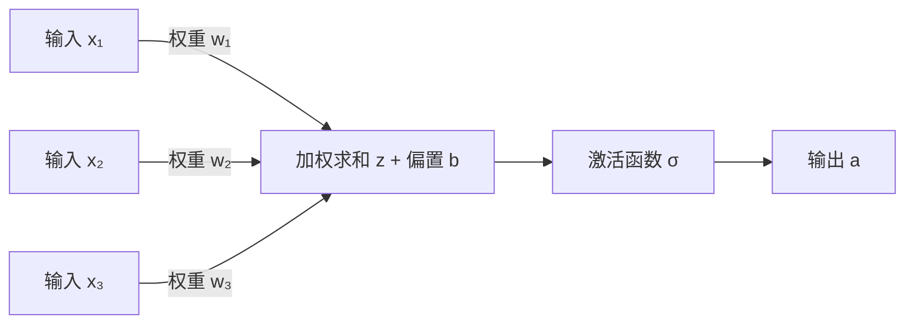
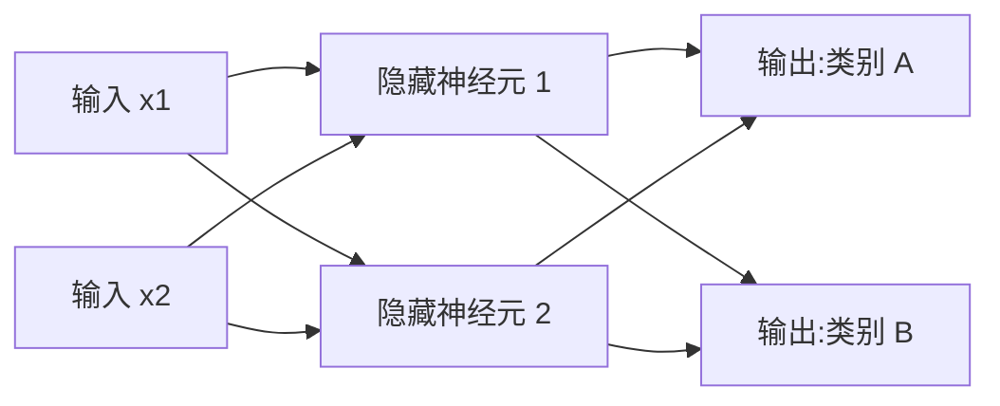
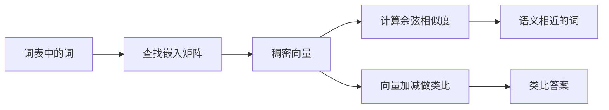
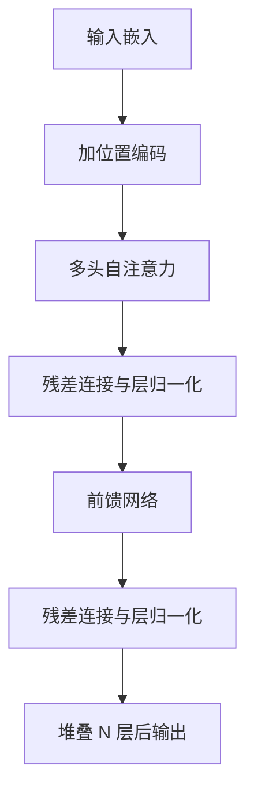

# Concept-Book Run

domain: /home/papagame/projects/digital-duck/cb-data-science/public/domains/data_science_ch07/input/graph.yaml
target: large_language_model
started: 2026-11-24T01:05:23

## Teaching order (16 concepts)

- neuron
- bias
- weight
- activation_function
- layers
- neural_network
- perceptron
- depth
- multilayer_perceptron
- artificial_intelligence
- deep_learning
- natural_language_processing
- vector
- word_embedding
- transformer_model
- large_language_model

### neuron (0.8s)

## 神经元

**定义。** 神经元(neuron)是神经网络中最小的决策单元:它接收若干输入 $x_1,\dots,x_n$,先做加权求和并加上偏置,再经过一个非线性的激活函数,输出一个数。

$$
z=\sum_{i=1}^{n} w_i x_i + b=\mathbf{w}^\top\mathbf{x}+b,\qquad a=\sigma(z)
$$

其中 $w_i$ 是权重,表示第 $i$ 个输入的重要程度(符号决定促进还是抑制);$b$ 是偏置,决定神经元"多容易被激活";$\sigma$ 是激活函数。常见的选择有:

- Sigmoid:$\sigma(z)=\dfrac{1}{1+e^{-z}}$,输出在 $(0,1)$ 之间,可解释为概率;
- ReLU:$\sigma(z)=\max(0,z)$,计算简单,深层网络中最常用。

没有 $\sigma$,多个神经元叠加后仍只是线性函数,无法表达复杂模式。

**例题。** 设一个 sigmoid 神经元有两个输入,权重 $\mathbf{w}=(2,-1)$,偏置 $b=-0.5$。输入 $\mathbf{x}=(1,3)$,求输出。

1. 加权求和:$z=2\cdot1+(-1)\cdot3-0.5=-1.5$。
2. 激活:$a=\dfrac{1}{1+e^{1.5}}\approx\dfrac{1}{1+4.482}\approx0.182$。

输出约为 $0.18$,接近 0,说明神经元"倾向于不激活"。第二个输入权重为负,把总和拉低了。

**问题求解应用:设计一个逻辑与(AND)神经元。** 要求只有当 $x_1=x_2=1$ 时输出接近 1。取 $w_1=w_2=10$,$b=-15$,激活函数用 sigmoid:

| $x_1$ | $x_2$ | $z$ | $a=\sigma(z)$ |
|---|---|---|---|
| 0 | 0 | $-15$ | $\approx0$ |
| 0 | 1 | $-5$ | $\approx0.007$ |
| 1 | 0 | $-5$ | $\approx0.007$ |
| 1 | 1 | $5$ | $\approx0.993$ |

思路是:偏置 $b$ 设置了"门槛",只有两个输入同时为 1,加权和 $20$ 才能超过 $15$。把 $b$ 改为 $-5$,同样的权重就实现了逻辑或(OR)。

这也说明了训练的本质:学习就是通过梯度下降调整 $\mathbf{w}$ 和 $b$,使神经元的输出逼近目标。单个神经元只能划出一条线性分界($\mathbf{w}^\top\mathbf{x}+b=0$),像异或(XOR)这样线性不可分的问题,必须把多个神经元分层连接才能解决。


*图:单个神经元的计算流程。多个输入经权重加权后求和并加上偏置,再通过激活函数得到输出。*

### bias (1.1s)

## 偏置(Bias)

### 定义

在单个神经元中,输入先经过加权求和,再通过激活函数输出。**偏置** $b$ 是加在加权和上的一个可学习常数:

$$z = \sum_{i=1}^{n} w_i x_i + b, \qquad a = \sigma(z)$$

权重 $w_i$ 决定"每个输入有多重要",而偏置 $b$ 决定"在没有任何输入刺激时,神经元本身有多容易被激活"。$b$ 越大,神经元越容易激活;$b$ 越小(越负),神经元越"迟钝",需要更强的输入才会被激活。

从几何上看,偏置让决策边界不必经过原点。没有偏置时,$w_1x_1 + w_2x_2 = 0$ 必然是一条过原点的直线;加入偏置后,边界 $w_1x_1 + w_2x_2 + b = 0$ 可以平移到任意位置。

### 例题

设一个神经元使用阶跃激活函数:$z \ge 0$ 时输出 1,否则输出 0。它有两个二值输入 $x_1, x_2 \in \{0,1\}$,权重 $w_1 = w_2 = 1$。

**情形 A:$b = -1.5$。** 计算 $z = x_1 + x_2 - 1.5$:

| $x_1$ | $x_2$ | $z$ | 输出 |
|---|---|---|---|
| 0 | 0 | $-1.5$ | 0 |
| 0 | 1 | $-0.5$ | 0 |
| 1 | 0 | $-0.5$ | 0 |
| 1 | 1 | $0.5$ | 1 |

这正是逻辑**与(AND)**。

**情形 B:$b = -0.5$。** 此时 $z = x_1 + x_2 - 0.5$,只要有一个输入为 1,就有 $z \ge 0.5 > 0$,输出 1;仅当两个输入都为 0 时输出 0。这是逻辑**或(OR)**。

权重完全相同,仅仅改变 $b$,神经元就实现了不同的功能。

### 问题求解应用

**问题:** 一个神经元用来判断"是否带伞"。输入 $x_1$ 为降雨概率(0 到 1),权重 $w_1 = 4$。要求:降雨概率超过 0.5 时才输出 1。求 $b$。

**解:** 临界点处 $z = 0$,即
$$4 \times 0.5 + b = 0 \;\Rightarrow\; b = -2.$$

验证:$x_1 = 0.7$ 时 $z = 2.8 - 2 = 0.8 > 0$,输出 1;$x_1 = 0.3$ 时 $z = 1.2 - 2 = -0.8 < 0$,输出 0。

**一般方法:** 若希望单输入神经元在 $x = x_0$ 处翻转,则令 $b = -w_1 x_0$。即偏置等于"阈值乘以权重"的相反数,这也说明偏置可以理解为**可学习的阈值**。

**训练中的偏置:** 梯度下降同样会更新偏置。因为 $\partial z / \partial b = 1$,所以
$$\frac{\partial L}{\partial b} = \frac{\partial L}{\partial a}\,\sigma'(z),$$
更新规则为 $b \leftarrow b - \eta \,\dfrac{\partial L}{\partial b}$。实践中常把偏置视为一个恒为 1 的额外输入 $x_0 = 1$ 所对应的权重 $w_0 = b$,这样可以统一处理所有参数。

**小结:** 权重控制边界的**方向**(斜率),偏置控制边界的**位置**(平移)。

### weight (1.0s)

## Weight

**定义**

重量（weight）是物体所受的重力大小，其方向指向地心。根据牛顿第二定律，重力是质量与重力加速度的乘积：

$$W = mg$$

其中 $m$ 是物体的质量（单位：$\text{kg}$），$g$ 是当地的重力加速度（在地球表面附近约为 $9.8 \ \text{m/s}^2$），$W$ 的单位是牛顿（$\text{N}$）。需要特别区分**质量**与**重量**：质量是物体所含物质多少的量度，是标量、不随位置改变；重量是一种力，是向量，其大小随所在位置的 $g$ 值变化——同一物体在地球和月球上质量相同，但重量不同，因为月球表面的 $g$ 约为地球的 $1/6$。

**例题**

一名航天员在地球上的质量为 $75 \ \text{kg}$。求：(a) 他在地球表面的重量；(b) 他在月球表面（$g_{\text{月}} = 1.6 \ \text{m/s}^2$）的重量。

解：

(a) $W_{\text{地}} = mg_{\text{地}} = 75 \times 9.8 = 735 \ \text{N}$

(b) $W_{\text{月}} = mg_{\text{月}} = 75 \times 1.6 = 120 \ \text{N}$

可以看到，质量 $m = 75 \ \text{kg}$ 在两地保持不变，而重量随 $g$ 的减小而按比例减小。

**问题解决应用**

重量公式在实际问题中常与其他力平衡分析结合使用。例如，电梯中的人受到的视重（apparent weight）等于地板对人的支持力 $N$，由牛顿第二定律：

$$N - mg = ma \quad \Rightarrow \quad N = m(g + a)$$

其中 $a$ 为电梯的加速度（向上为正）。若电梯以 $a = 2 \ \text{m/s}^2$ 加速上升，质量 $m = 60 \ \text{kg}$ 的人所感受到的视重为：

$$N = 60 \times (9.8 + 2) = 708 \ \text{N}$$

大于其静止时的重量 $588 \ \text{N}$，这正是电梯启动时人感到"变重"的原因。掌握 $W = mg$ 及其在牛顿第二定律框架下的推广，是分析支持力、张力、自由落体和失重等一系列力学问题的基础工具。

### activation_function (1.0s)

## 激活函数(Activation Function)

**定义。** 单个神经元先计算加权输入与偏置之和(预激活值):

$$z = \sum_{i=1}^{n} w_i x_i + b = \mathbf{w}^\top \mathbf{x} + b,$$

再通过激活函数 $\phi$ 得到输出 $a = \phi(z)$。激活函数通常是**非递减**的:$z_1 \le z_2 \Rightarrow \phi(z_1) \le \phi(z_2)$。输入越强,神经元"激活"得越强,而不会反过来变弱。

**为什么必须是非线性的?** 若 $\phi$ 为线性函数,则两层网络 $W_2(W_1\mathbf{x}+\mathbf{b}_1)+\mathbf{b}_2$ 仍可化简为 $W'\mathbf{x}+\mathbf{b}'$,多层与单层等价。非线性激活函数使深层网络能够逼近复杂函数。

**常见激活函数:**

| 名称 | 公式 | 输出范围 |
|---|---|---|
| 阶跃函数 | $\phi(z)=\begin{cases}1,&z\ge 0\\0,&z<0\end{cases}$ | $\{0,1\}$ |
| Sigmoid | $\sigma(z)=\dfrac{1}{1+e^{-z}}$ | $(0,1)$ |
| tanh | $\tanh z=\dfrac{e^z-e^{-z}}{e^z+e^{-z}}$ | $(-1,1)$ |
| ReLU | $\max(0,z)$ | $[0,\infty)$ |

其中 Sigmoid 的导数为 $\sigma'(z)=\sigma(z)\bigl(1-\sigma(z)\bigr)\le \tfrac14$,这一性质在训练中很重要。

**例题。** 设 $\mathbf{w}=(2,-1)$,$b=-1$,输入 $\mathbf{x}=(1.5,\,1)$。

1. 预激活值:$z = 2(1.5) + (-1)(1) - 1 = 1$。
2. 阶跃函数:输出 $1$。
3. ReLU:输出 $\max(0,1)=1$。
4. Sigmoid:输出 $\dfrac{1}{1+e^{-1}}\approx 0.731$。

若改为 $\mathbf{x}=(0,1)$,则 $z=-2$。阶跃与 ReLU 输出 $0$(未激活),Sigmoid 输出 $\approx 0.119$(微弱激活)。可见,不同激活函数对"是否激活、激活多强"的刻画不同。

**问题求解应用:梯度与函数选择。** 反向传播要求对 $\phi$ 求导。链式法则给出

$$\frac{\partial L}{\partial w_i} = \frac{\partial L}{\partial a}\,\phi'(z)\,x_i .$$

- **梯度消失:** 因 $\sigma'(z)\le 0.25$,若网络有 $10$ 层都使用 Sigmoid,梯度最多被压缩为 $0.25^{10}\approx 10^{-6}$ 倍,浅层几乎无法学习。
- **ReLU 的优势:** 当 $z>0$ 时 $\phi'(z)=1$,梯度可无衰减地传递,因此成为隐藏层的默认选择。其缺点是 $z<0$ 时梯度为 $0$("神经元死亡"),可改用 Leaky ReLU:$\max(0.01z,\,z)$。
- **输出层的选择:** 二分类用 Sigmoid(输出可解释为概率);多分类用 Softmax;回归用线性输出。

**小结:** 激活函数 = 非线性 + (通常)单调非递减。选择时要考虑输出范围、梯度行为和任务类型。


*图:单个神经元的计算流程——输入经加权求和与偏置得到 $z$,再由激活函数产生输出。*

### layers (0.7s)

## 层(Layers)

**定义。** 神经网络中的**层**是一组并行工作的神经元:它们接收来自前一组神经元的*同一份输入*,各自独立计算,再把输出共同传给下一组。网络通常包含三类层:

- **输入层**:接收原始数据 $\mathbf{x}\in\mathbb{R}^{n_0}$,通常不做计算;
- **隐藏层**:位于中间,逐层提取越来越抽象的特征;
- **输出层**:给出最终预测。

设第 $l$ 层有 $n_l$ 个神经元,上一层输出为 $\mathbf{a}^{(l-1)}\in\mathbb{R}^{n_{l-1}}$,则整层的计算可写成一个矩阵运算:

$$
\mathbf{a}^{(l)}=\sigma\!\left(W^{(l)}\mathbf{a}^{(l-1)}+\mathbf{b}^{(l)}\right),
$$

其中 $W^{(l)}\in\mathbb{R}^{n_l\times n_{l-1}}$ 的第 $i$ 行是第 $i$ 个神经元的权重,$\mathbf{b}^{(l)}$ 是偏置,$\sigma$ 是激活函数(逐元素作用)。"同一份输入"体现在:$\mathbf{a}^{(l-1)}$ 被该层所有神经元共享。


*数据逐层前向传播:每一层的输出是下一层的输入。*

**例题。** 一个网络结构为 $2\to3\to1$(2 个输入、1 个含 3 个神经元的隐藏层、1 个输出)。设 $\sigma=\mathrm{ReLU}$,即 $\sigma(z)=\max(0,z)$,输入 $\mathbf{x}=(1,2)^\top$,

$$
W^{(1)}=\begin{pmatrix}1&0\\ -1&1\\ 2&-1\end{pmatrix},\quad
\mathbf{b}^{(1)}=\begin{pmatrix}0\\ 0\\ 1\end{pmatrix}.
$$

则
$$
W^{(1)}\mathbf{x}+\mathbf{b}^{(1)}=\begin{pmatrix}1\\ 1\\ 1\end{pmatrix},\qquad
\mathbf{a}^{(1)}=\mathrm{ReLU}(1,1,1)^\top=(1,1,1)^\top.
$$

若输出层 $W^{(2)}=(1,\,-2,\,1)$,$b^{(2)}=0.5$(输出层用恒等激活),则 $y=1-2+1+0.5=0.5$。

**问题求解应用。** 

1. **统计参数量。** 第 $l$ 层有 $n_l n_{l-1}+n_l$ 个参数。上例:$3\cdot2+3=9$,$1\cdot3+1=4$,共 13 个。若结构改为 $784\to128\to10$(手写数字识别),参数为 $784\cdot128+128+128\cdot10+10=101{,}770$。
2. **确定输入输出维度。** 输入层宽度由特征数决定,输出层宽度由任务决定:10 类分类取 10 个神经元(配 softmax),回归取 1 个。隐藏层的宽度与层数则是需要调节的设计选择。
3. **为什么需要非线性。** 若去掉 $\sigma$,两层合并为 $W^{(2)}(W^{(1)}\mathbf{x}+\mathbf{b}^{(1)})+\mathbf{b}^{(2)}$,仍是线性函数,多层毫无意义。激活函数使得堆叠隐藏层能表示更复杂的函数。

**小结。** 层是网络的基本组织单位:同层神经元共享输入、并行计算,可压缩成一次矩阵乘法。层数(深度)与每层宽度共同决定模型的表达能力和参数规模。

### neural_network (0.9s)

## 神经网络

**定义。** 神经网络(neural network)是由相互连接的“神经元”组成的计算结构,按层组织:**输入层**接收特征,一个或多个**隐藏层**逐层提取更抽象的表示,**输出层**给出分类结果。每个神经元先对输入做加权求和,再经非线性**激活函数**变换:

$$a = \sigma\!\left(\mathbf{w}^{\top}\mathbf{x} + b\right)$$

其中 $\mathbf{w}$ 是权重,$b$ 是偏置,$\sigma$ 常取 ReLU $\sigma(z)=\max(0,z)$ 或 sigmoid $\sigma(z)=\dfrac{1}{1+e^{-z}}$。若没有非线性激活,多层网络会退化成单个线性变换,无法表示复杂的决策边界。

整个网络的前向传播可写成逐层复合:

$$\mathbf{h}=\sigma(W_1\mathbf{x}+\mathbf{b}_1),\qquad \hat{\mathbf{y}}=\mathrm{softmax}(W_2\mathbf{h}+\mathbf{b}_2)$$

softmax 把输出变为概率:$\hat y_k=\dfrac{e^{z_k}}{\sum_j e^{z_j}}$。


*图:含两个输入、两个隐藏神经元和两个输出类别的最小神经网络。*

**例题。** 设输入 $\mathbf{x}=(1,\,2)$,隐藏层有两个 ReLU 神经元:
$W_1=\begin{pmatrix}1&-1\\ 0.5&1\end{pmatrix}$,$\mathbf{b}_1=\mathbf{0}$;输出层 $W_2=\begin{pmatrix}1&0\\ 0&2\end{pmatrix}$,$\mathbf{b}_2=\mathbf{0}$。

1. 隐藏层预激活:$W_1\mathbf{x}=(1-2,\;0.5+2)=(-1,\;2.5)$。
2. ReLU 后:$\mathbf{h}=(0,\;2.5)$。
3. 输出层:$\mathbf{z}=W_2\mathbf{h}=(0,\;5)$。
4. softmax:$\hat y_A=\dfrac{e^0}{e^0+e^5}\approx 0.007$,$\hat y_B\approx 0.993$。

网络判定该样本属于类别 B。

**问题求解应用。** 网络“学习”就是选择参数 $\theta=\{W,\mathbf{b}\}$ 使损失最小。分类常用交叉熵损失:

$$L=-\sum_k y_k\log \hat y_k$$

其中 $\mathbf{y}$ 是真实类别的独热向量。若上例真实类别为 A,则 $L=-\log 0.007\approx 4.96$,损失很大,说明预测错误。训练时用**反向传播**依链式法则计算梯度 $\partial L/\partial\theta$,再做梯度下降:

$$\theta \leftarrow \theta - \eta\,\frac{\partial L}{\partial \theta}$$

$\eta$ 为学习率。对 softmax 加交叉熵,输出层梯度形式很简洁:$\partial L/\partial z_k=\hat y_k-y_k$。本例中为 $(0.007-1,\;0.993-0)=(-0.993,\;0.993)$,它推动类别 A 的得分上升、类别 B 的得分下降。

实际应用步骤:(1)把数据标准化后输入;(2)选择层数与宽度,小数据集先用一到两个隐藏层;(3)监控训练集与验证集损失,若训练损失下降而验证损失上升,则说明**过拟合**,可减小网络、加正则化或提前停止。

### perceptron (1.0s)

## 感知机

**定义。** 感知机(perceptron)是最简单的单层神经网络:先对输入做加权求和,再用阶跃函数(step function)输出类别。设输入 $\mathbf{x}\in\mathbb{R}^n$,权重 $\mathbf{w}$,偏置 $b$,则

$$
\hat y = \begin{cases} +1, & \mathbf{w}^\top\mathbf{x}+b \ge 0 \\ -1, & \mathbf{w}^\top\mathbf{x}+b < 0 \end{cases}
$$

几何上,$\mathbf{w}^\top\mathbf{x}+b=0$ 是一条分界超平面(二维时是一条直线),感知机把平面分成两个半空间,分别对应两个类别。

**感知机学习规则。** 对每个训练样本 $(\mathbf{x}_i, y_i)$($y_i\in\{+1,-1\}$),若预测错误,则更新:

$$
\mathbf{w}\leftarrow \mathbf{w}+\eta\, y_i\,\mathbf{x}_i,\qquad b\leftarrow b+\eta\, y_i
$$

其中 $\eta>0$ 是学习率。预测正确时不做任何改动。直观上:被误判的正样本会把 $\mathbf{w}$ 拉向自己,被误判的负样本则把 $\mathbf{w}$ 推离自己。

**收敛性。** 若数据线性可分,且存在间隔 $\gamma$ 使 $y_i(\mathbf{w}^{*\top}\mathbf{x}_i)\ge\gamma$($\|\mathbf{w}^*\|=1$),所有样本满足 $\|\mathbf{x}_i\|\le R$,则感知机最多犯 $(R/\gamma)^2$ 次错误后收敛(Novikoff 定理)。若数据不可分(如异或问题),算法永不收敛。

**例题。** 学习逻辑与(AND)。样本:$(0,0)\to-1$,$(0,1)\to-1$,$(1,0)\to-1$,$(1,1)\to+1$。取 $\mathbf{w}=(0,0)$,$b=0$,$\eta=1$。

1. 样本 $(0,0)$:$\mathbf{w}^\top\mathbf{x}+b=0\ge0$,预测 $+1$,错误。更新:$\mathbf{w}=(0,0)$,$b=-1$。
2. 样本 $(0,1)$:值为 $-1$,预测 $-1$,正确。$(1,0)$ 同理正确。
3. 样本 $(1,1)$:值为 $-1$,预测 $-1$,错误(应为 $+1$)。更新:$\mathbf{w}=(1,1)$,$b=0$。
4. 再扫一遍:$(0,0)$ 得 $0$,预测 $+1$,错误,更新为 $\mathbf{w}=(1,1)$,$b=-1$。此时 $(0,1)$ 得 $0$,预测 $+1$,错误,更新为 $\mathbf{w}=(1,0)$,$b=-2$。继续迭代,最终可得到如 $\mathbf{w}=(2,1)$,$b=-3$ 的解,四个样本全部分类正确。

**问题求解应用。** 判断一个任务能否用感知机解决,关键是问:两类数据能否被一条直线(超平面)分开?

- 与、或、非:可以。
- 异或(XOR):$(0,0),(1,1)\to-1$,$(0,1),(1,0)\to+1$,四点无法被一条直线分开,单个感知机无能为力。

实践中的做法:先画散点图或检查线性可分性;可分则直接训练,并用 $(R/\gamma)^2$ 估计迭代上界;不可分则增加隐藏层(多层感知机)或做特征变换,例如为异或加入特征 $x_1x_2$,数据即在三维特征空间中变得线性可分。

```python
import numpy as np
def train(X, y, eta=1, epochs=100):
    w, b = np.zeros(X.shape[1]), 0
    for _ in range(epochs):
        errors = 0
        for xi, yi in zip(X, y):
            if yi * (w @ xi + b) <= 0:   # 误分类
                w += eta * yi * xi; b += eta * yi; errors += 1
        if errors == 0: break            # 已收敛
    return w, b
```

**小结。** 感知机用"错了就修正"的规则学习线性分界面;它在线性可分数据上保证收敛,但无法表示异或,这一局限直接推动了多层网络的发展。

### depth (1.1s)

## 深度(Depth)

**定义。** 神经网络的**深度**是指从输入到输出所经过的可学习变换的层数,通常以隐藏层的数量(或带参数的层总数)来衡量。若网络计算 $f(\mathbf{x}) = f_L \circ f_{L-1} \circ \cdots \circ f_1(\mathbf{x})$,其中每一层为

$$
\mathbf{h}_\ell = \sigma\left(W_\ell \mathbf{h}_{\ell-1} + \mathbf{b}_\ell\right),\quad \mathbf{h}_0=\mathbf{x},
$$

则深度就是复合的层数 $L$。通常隐藏层数较多(例如超过几层)的网络被称为**深度**网络,这也是"深度学习"一词的由来。深度不同于**宽度**(每层的神经元个数)。

**为什么深度重要。** 每增加一层,网络就能在前一层特征的基础上构造更抽象的特征。例如在图像识别中,浅层学习边缘,中层组合成纹理与局部形状,深层识别整体物体。对某些函数,深度带来指数级的效率:用浅层网络表示它们,所需神经元数量可能随输入规模指数增长,而深层网络只需多项式规模。

**例题。** 一个网络输入为 100 维,隐藏层大小依次为 64、32、16,输出为 10 维。求其深度与参数总数。

*解:* 有 3 个隐藏层,加上输出层,共 4 个带参数的变换,因此 $L=4$。各层参数(权重 + 偏置):

- 第 1 层:$100\times 64 + 64 = 6464$
- 第 2 层:$64\times 32 + 32 = 2080$
- 第 3 层:$32\times 16 + 16 = 528$
- 输出层:$16\times 10 + 10 = 170$

总参数为 $6464+2080+528+170 = 9242$。

**问题求解应用。** 比较两种设计:(A) 单隐藏层,宽 1000;(B) 三个隐藏层,每层宽 50。输入 100 维,输出 10 维。

- A:$100\times1000+1000 + 1000\times10+10 = 111{,}010$ 个参数。
- B:$(100\times50+50) + 2\times(50\times50+50) + (50\times10+10) = 5050+5100+5100+510 = 15{,}760$ 个参数。

B 的参数仅约为 A 的 $14\%$,却具有更强的层次化表达能力。这说明在参数预算相同时,**增加深度往往比一味增加宽度更有效**。

**代价与注意事项。** 深度并非越大越好:

1. **梯度消失/爆炸。** 反向传播时梯度是 $L$ 个雅可比矩阵的连乘,若各因子范数小于 1,则梯度随 $L$ 指数衰减,约为 $\prod_{\ell}\|J_\ell\|$。
2. **优化与过拟合难度上升。** 深层网络更难训练,也需要更多数据。
3. **对策。** 使用 ReLU 激活函数、批归一化,以及残差连接 $\mathbf{h}_\ell = \mathbf{h}_{\ell-1} + F(\mathbf{h}_{\ell-1})$,使得网络可以稳定地训练上百层。

**小结。** 深度 $L$ 是网络复合结构的层数;它让模型逐层构建抽象特征,常以更少的参数获得更强的表达力,但需要借助合适的技术来克服训练困难。

### multilayer_perceptron (0.9s)

## 多层感知机

### 定义

**多层感知机**(Multilayer Perceptron,MLP)是由输入层、一个或多个**隐藏层**和输出层依次全连接而成的前馈神经网络。单层感知机只能产生线性决策边界,因此无法解决异或(XOR)这类线性不可分问题。MLP 在层与层之间加入**非线性激活函数**,从而突破了这一限制。

第 $l$ 层的计算为

$$
\mathbf{h}^{(l)} = \sigma\!\left(W^{(l)}\mathbf{h}^{(l-1)} + \mathbf{b}^{(l)}\right),\qquad \mathbf{h}^{(0)}=\mathbf{x}
$$

其中 $W^{(l)}$ 是权重矩阵,$\mathbf{b}^{(l)}$ 是偏置,$\sigma$ 是激活函数,常用 $\sigma(z)=\max(0,z)$(ReLU)或 $\sigma(z)=\dfrac{1}{1+e^{-z}}$(sigmoid)。

关键点:若去掉 $\sigma$,多层只是矩阵连乘,$W^{(2)}W^{(1)}$ 仍是一个线性变换,深度就没有意义。非线性才是 MLP 表达能力的来源。

### 例题:用两层网络解决 XOR

XOR 的输入输出为 $(0,0)\to0,\ (0,1)\to1,\ (1,0)\to1,\ (1,1)\to0$。没有任何一条直线能把两类点分开。

取一个含 2 个隐藏单元的 ReLU 网络:

$$
h_1=\max(0,\,x_1+x_2),\quad h_2=\max(0,\,x_1+x_2-1),\quad y=h_1-2h_2
$$

逐点验证:

| $(x_1,x_2)$ | $h_1$ | $h_2$ | $y$ |
|---|---|---|---|
| (0,0) | 0 | 0 | 0 |
| (0,1) | 1 | 0 | 1 |
| (1,0) | 1 | 0 | 1 |
| (1,1) | 2 | 1 | 0 |

四个点全部分类正确。隐藏层把原本线性不可分的数据映射到新的表示空间,在那里一个线性输出层就够用了。

### 问题求解应用:训练与参数计数

**训练**。MLP 通过最小化损失函数(如均方误差 $L=\frac12\|\hat{\mathbf{y}}-\mathbf{y}\|^2$)来学习,用**反向传播**结合链式法则计算梯度。设 $\mathbf{z}^{(l)}=W^{(l)}\mathbf{h}^{(l-1)}+\mathbf{b}^{(l)}$,误差信号为 $\boldsymbol{\delta}^{(l)}=\partial L/\partial\mathbf{z}^{(l)}$,则

$$
\boldsymbol{\delta}^{(l)}=\left(W^{(l+1)\top}\boldsymbol{\delta}^{(l+1)}\right)\odot\sigma'(\mathbf{z}^{(l)}),\qquad
\frac{\partial L}{\partial W^{(l)}}=\boldsymbol{\delta}^{(l)}\,\mathbf{h}^{(l-1)\top}
$$

再用梯度下降更新:$W^{(l)}\leftarrow W^{(l)}-\eta\,\partial L/\partial W^{(l)}$。

**参数计数**。设网络结构为 784–128–64–10(如手写数字识别),各层参数量为

$$
784\times128+128 = 100480,\quad 128\times64+64=8256,\quad 64\times10+10=650
$$

共 $109386$ 个参数。这类估算帮助你在设计模型时权衡容量、内存和过拟合风险。

**理论保证**。万能逼近定理指出:含足够多隐藏单元的单隐藏层 MLP,可以在紧致集上以任意精度逼近任意连续函数。但它没有说明所需单元数,也没有说明梯度下降能否找到这组权重。因此实践中常用更深的网络,以更少的参数获得更好的表达效率。


*图:MLP 的前向传播(实线)与反向传播(虚线)。*

### artificial_intelligence (13.7s)

## 人工智能

**定义。** 人工智能(Artificial Intelligence, AI)是计算机科学的一个分支,目标是构建能够模拟人类认知能力的系统,这些能力包括学习、推理、感知和决策。在现代教材中,常把 AI 系统看作**智能体(agent)**:它通过传感器感知环境状态 $s$,依据某种策略 $\pi$ 选择动作 $a$,并以最大化某个目标(如期望累计奖励)为准则:

$$
\pi^* = \arg\max_{\pi}\; \mathbb{E}\left[\sum_{t=0}^{\infty} \gamma^t\, r_t \,\middle|\, \pi\right],\qquad 0<\gamma<1
$$

其中 $r_t$ 是第 $t$ 步获得的奖励,$\gamma$ 是折扣因子,表示近期回报比远期回报更重要。

AI 的主要方法大致分为三类:

- **符号推理**:用逻辑规则和搜索表示知识(如专家系统、A* 搜索);
- **机器学习**:从数据中学习参数,而不是手写规则(如回归、神经网络);
- **强化学习**:通过与环境交互试错,学习策略。

**例题。** 一个垃圾邮件过滤器是典型的"学习 + 决策"系统。设先验 $P(\text{垃圾})=0.4$,某邮件含有"免费"一词。已知 $P(\text{免费}\mid\text{垃圾})=0.5$,$P(\text{免费}\mid\text{正常})=0.05$。求该邮件是垃圾邮件的概率。

由贝叶斯公式:

$$
P(\text{垃圾}\mid\text{免费})=\frac{0.5\times0.4}{0.5\times0.4+0.05\times0.6}=\frac{0.20}{0.20+0.03}\approx 0.87
$$

系统由此"感知"证据、"推理"出后验概率,再"决策":若设阈值为 $0.5$,则将邮件归入垃圾箱。

**问题求解应用。** 决策并非只看概率,还要看错误代价。设误判正常邮件为垃圾的损失为 $10$,漏判垃圾邮件的损失为 $1$。若判为垃圾,期望损失为 $10\times(1-0.87)=1.3$;若放行,期望损失为 $1\times0.87=0.87$。此时最优决策反而是**放行**。这说明:

1. 智能行为 = 概率推断 + 代价敏感的决策;
2. 同一模型,不同的损失函数会导致不同的最优策略;
3. 实际工程中,应根据应用场景(医疗诊断、金融风控、内容审核)设计损失,而不是机械地采用 $0.5$ 阈值。

**小结。** 判断一个系统是否属于 AI,关键不在于它使用了哪种技术,而在于它能否在不确定的环境中,通过感知、学习与推理,选择使目标函数最优的行动。

### deep_learning (1.2s)

## 深度学习

**定义。** 深度学习是指训练含有多个隐藏层的神经网络,使其从原始数据中逐层学习**层次化的结构表示**。设网络有 $L$ 层,第 $l$ 层的计算为

$$
\mathbf{h}^{(l)} = \sigma\!\left(W^{(l)}\mathbf{h}^{(l-1)} + \mathbf{b}^{(l)}\right),\quad \mathbf{h}^{(0)}=\mathbf{x},
$$

其中 $\sigma$ 是非线性激活函数(如 ReLU:$\sigma(z)=\max(0,z)$)。浅层学到简单特征(如图像中的边缘),中层组合成局部结构(如眼睛、轮廓),深层则表示整体概念(如"人脸")。若没有非线性 $\sigma$,多层只会合并成一个线性映射 $W^{(L)}\cdots W^{(1)}$,"深度"也就失去意义。

**训练。** 给定损失函数 $\mathcal{L}(\theta)$(参数 $\theta=\{W^{(l)},\mathbf{b}^{(l)}\}$),用**反向传播**依链式法则逐层求梯度:

$$
\frac{\partial \mathcal{L}}{\partial W^{(l)}} = \boldsymbol{\delta}^{(l)}\,\mathbf{h}^{(l-1)\top},\qquad
\boldsymbol{\delta}^{(l)} = \left(W^{(l+1)\top}\boldsymbol{\delta}^{(l+1)}\right)\odot \sigma'\!\left(\mathbf{z}^{(l)}\right),
$$

再用梯度下降更新:$\theta \leftarrow \theta - \eta\,\nabla_\theta \mathcal{L}$,$\eta$ 为学习率。

**例题:XOR 问题。** 数据点 $(0,0),(1,1)\mapsto 0$,$(0,1),(1,0)\mapsto 1$ 无法被任何线性分类器分开。取一个含两个 ReLU 隐藏单元的网络:

$$
h_1=\max(0,\,x_1+x_2),\quad h_2=\max(0,\,x_1+x_2-1),\quad y=h_1-2h_2.
$$

逐点验证:$(0,0)$ 得 $y=0$;$(1,0)$ 得 $h_1=1,h_2=0$,$y=1$;$(1,1)$ 得 $h_1=2,h_2=1$,$y=0$。隐藏层把输入"折叠"到一个线性可分的新空间,这正是深度表示的核心思想。

**问题求解应用:梯度消失。** 反向传播中 $\boldsymbol{\delta}^{(1)}$ 含有 $L-1$ 个因子的连乘。若使用 sigmoid,则 $\sigma'(z)\le \tfrac14$,假设每层权重范数约为 1,则梯度量级约为

$$
\left(\tfrac14\right)^{10}\approx 10^{-6}\quad(L=11).
$$

前几层几乎学不到东西。常见对策:

1. 换用 ReLU(正区间导数为 1);
2. 采用合适的初始化(如 He 初始化,令 $\mathrm{Var}(W)=2/n_{\text{in}}$);
3. 加入残差连接 $\mathbf{h}^{(l)}=\mathbf{h}^{(l-1)}+F(\mathbf{h}^{(l-1)})$,使梯度有一条恒等捷径;
4. 使用批归一化稳定各层输入分布。

**诊断思路。** 若训练损失下降缓慢,先检查梯度范数是否逐层衰减;若训练损失低而验证损失高,则是过拟合,可用权重衰减、Dropout、数据增强或提前停止来缓解。


*图:深度网络前向逐层提取由简到繁的特征,损失产生的梯度沿相反方向逐层传回,用于更新各层参数。*

### natural_language_processing (15.2s)

## 自然语言处理

**定义。** 自然语言处理(Natural Language Processing,NLP)是人工智能的一个分支,研究如何让计算机识别(理解)书面或口头语言,并生成新的语言内容。它包含两大类任务:**理解**(分类、实体识别、翻译、问答)与**生成**(摘要、对话、写作)。

**核心思想:把语言变成可计算的对象。** 计算机只能处理数字,所以第一步是**分词**(tokenization),第二步是把每个词元映射为向量(词嵌入)。语义相近的词,向量方向也相近,常用余弦相似度衡量:

$$\cos\theta=\frac{\mathbf{u}\cdot\mathbf{v}}{\|\mathbf{u}\|\,\|\mathbf{v}\|}$$

现代语言模型的目标是预测下一个词元。给定前文 $w_1,\dots,w_{t-1}$,模型估计条件概率,整句的概率则是各项的连乘:

$$P(w_1,\dots,w_n)=\prod_{t=1}^{n}P(w_t\mid w_1,\dots,w_{t-1})$$

生成文本,就是不断从这个分布中取词(取概率最大者,或按概率采样)。

**例题 1:词向量相似度。** 设二维嵌入 $\mathbf{u}_{\text{猫}}=(2,1)$,$\mathbf{u}_{\text{狗}}=(3,1)$,$\mathbf{u}_{\text{税}}=(-1,3)$。判断哪个词与"猫"更相近。

- 猫与狗:点积 $=6+1=7$,模长 $\sqrt5\cdot\sqrt{10}=\sqrt{50}\approx7.07$,所以 $\cos\theta\approx0.99$。
- 猫与税:点积 $=-2+3=1$,模长 $\sqrt5\cdot\sqrt{10}\approx7.07$,所以 $\cos\theta\approx0.14$。

"狗"远比"税"更接近"猫",这与我们的语义直觉一致。

**例题 2:用二元模型计算句子概率。** 简化假设:每个词只依赖前一个词(二元模型)。已知语料统计:$P(\text{我})=0.2$,$P(\text{爱}\mid\text{我})=0.3$,$P(\text{学习}\mid\text{爱})=0.4$。求"我 爱 学习"的概率:

$$P=0.2\times0.3\times0.4=0.024$$

若另一句"我 学习 爱"中 $P(\text{学习}\mid\text{我})=0.05$,$P(\text{爱}\mid\text{学习})=0.01$,则概率为 $0.2\times0.05\times0.01=0.0001$。模型因此偏好更通顺的语序,这就是它"生成"通顺语言的依据。

**问题求解应用。** 设要用 NLP 构建一个评论情感分类器,可按以下步骤:

1. **预处理:** 分词,去除噪声。
2. **表示:** 将每条评论转换为向量(词嵌入平均或 Transformer 编码)。
3. **建模:** 用带标签数据训练分类器,输出 $P(\text{正面}\mid\text{评论})$。
4. **评估:** 在测试集上计算准确率、精确率和召回率。若正面评论占 90%,"全部预测为正面"也有 90% 准确率,所以此时必须同时看召回率与 F1。

**常见误区。** 模型输出流畅,不等于内容正确。语言模型优化的是"概率高",而不是"事实真";因此应用于关键场景时,需要检索验证与人工审核。

**小结。** NLP 的主线是:文本 $\rightarrow$ 数字表示 $\rightarrow$ 概率模型 $\rightarrow$ 理解或生成。掌握向量相似度与条件概率连乘,就掌握了其数学骨架。

### vector (0.9s)

## Vector（向量）

**定义**

向量（vector）是同时具有**大小（magnitude）**与**方向（direction）**的量，用图形表示时为一条箭头：箭头的长度正比于大小，箭头的指向即为方向。这与标量（scalar，只有大小无方向的量，如质量、温度）形成鲜明对比。在平面直角坐标系中，向量 $\vec{v}$ 可用分量形式表示为 $\vec{v} = (v_x, v_y)$，其大小由勾股定理给出：

$$|\vec{v}| = \sqrt{v_x^2 + v_y^2}$$

方向则可用与 $x$ 轴的夹角 $\theta = \tan^{-1}(v_y / v_x)$ 描述。向量的核心运算规则是：加法遵循平行四边形法则（或首尾相接法），标量乘法只改变长度不改变方向（除非乘以负数，此时方向反转）。

**范例**

设一架飞机以相对空气 $200\text{ km/h}$ 向正北方向飞行，同时遭遇一股向东吹的风，风速为 $50\text{ km/h}$。飞机相对地面的实际速度即为两个速度向量之和：

$$\vec{v}_{\text{飞机}} = (0, 200), \quad \vec{v}_{\text{风}} = (50, 0)$$
$$\vec{v}_{\text{合}} = (50, 200)$$

合速度大小为 $|\vec{v}_{\text{合}}| = \sqrt{50^2 + 200^2} \approx 206.2\text{ km/h}$，方向偏东 $\theta = \tan^{-1}(50/200) \approx 14.0°$。这说明即使各分力独立作用，最终效果必须通过向量合成才能正确求得——直接相加大小（如 $200+50=250$）是错误的，因为方向未对齐。

**解题应用**

向量思维广泛用于力学（力的合成与分解）、导航（位移与速度）以及计算机图形学（物体位移与朝向）。解题的标准流程是：①将每个向量分解为正交分量；②对分量分别求和；③用勾股定理求合向量大小，用反正切求方向角。例如，物体同时受到 $30\text{ N}$（沿 $0°$）和 $40\text{ N}$（沿 $90°$）两个力，合力大小为 $\sqrt{30^2+40^2}=50\text{ N}$，方向角 $\tan^{-1}(40/30)\approx 53.1°$。掌握向量分解与合成，是后续学习力矩、动量守恒乃至线性代数中向量空间概念的基础。

### word_embedding (15.8s)

## 词嵌入(Word Embedding)

### 定义

**词嵌入**是把词表 $V$ 中的每个词映射为一个稠密的实数向量的方法:

$$
f: V \to \mathbb{R}^d,\qquad w \mapsto \mathbf{v}_w
$$

其中维度 $d$ 通常取 $50$ 到 $1000$,远小于词表大小 $|V|$。与独热编码(one-hot)相比,独热向量的维度等于 $|V|$,且任意两个不同词的向量互相正交,无法表达"相似"。词嵌入则要求**语义相近的词在空间中距离相近**。

衡量相近程度常用余弦相似度:

$$
\cos(\mathbf{u},\mathbf{v})=\frac{\mathbf{u}\cdot\mathbf{v}}{\|\mathbf{u}\|\,\|\mathbf{v}\|}
$$

其理论基础是分布假说:**一个词的含义由其上下文决定**。Word2Vec 的 Skip-gram 模型据此训练:给定中心词 $w_c$,最大化其上下文词 $w_o$ 的概率

$$
P(w_o\mid w_c)=\frac{\exp(\mathbf{u}_{o}^{\top}\mathbf{v}_{c})}{\sum_{w\in V}\exp(\mathbf{u}_{w}^{\top}\mathbf{v}_{c})}
$$

训练完成后,出现在相似上下文中的词会得到相似的向量。

### worked example(例题)

设三个词的二维嵌入为:

$$
\mathbf{v}_{\text{猫}}=(0.9,\,0.8),\quad \mathbf{v}_{\text{狗}}=(0.8,\,0.9),\quad \mathbf{v}_{\text{汽车}}=(-0.7,\,0.6)
$$

计算"猫"与"狗"的余弦相似度:

$$
\cos=\frac{0.9\times0.8+0.8\times0.9}{\sqrt{0.81+0.64}\cdot\sqrt{0.64+0.81}}=\frac{1.44}{1.45}\approx 0.993
$$

"猫"与"汽车":

$$
\cos=\frac{0.9\times(-0.7)+0.8\times0.6}{\sqrt{1.45}\cdot\sqrt{0.85}}=\frac{-0.15}{1.110}\approx -0.135
$$

结果符合直觉:猫和狗几乎同向,而汽车与猫几乎无关。

### 问题求解应用:类比推理

嵌入空间的一个著名性质是,语义关系近似对应**向量差**:

$$
\mathbf{v}_{\text{国王}}-\mathbf{v}_{\text{男人}}+\mathbf{v}_{\text{女人}}\approx\mathbf{v}_{\text{王后}}
$$

**问题**:已知 $\mathbf{v}_{\text{巴黎}}=(2,1)$,$\mathbf{v}_{\text{法国}}=(1,1)$,$\mathbf{v}_{\text{日本}}=(3,2)$,求"巴黎之于法国,相当于哪个城市之于日本"。

**解**:计算目标向量

$$
\mathbf{q}=\mathbf{v}_{\text{巴黎}}-\mathbf{v}_{\text{法国}}+\mathbf{v}_{\text{日本}}=(2-1+3,\;1-1+2)=(4,\,2)
$$

然后在词表中找与 $\mathbf{q}$ 余弦相似度最大的词(排除问题中已出现的词)。若 $\mathbf{v}_{\text{东京}}=(4,2.1)$,则 $\cos\approx 1.000$,答案即"东京"。


*图:词被映射为稠密向量后,可用于相似度检索与类比推理两类任务。*

### 小结

词嵌入把离散符号变成可计算的几何对象:相似度对应夹角,语义关系对应向量差。需要注意,嵌入反映的是训练语料中的统计规律,因此也会继承语料中的偏见;类比推理只是近似成立,应通过检验而非默认接受结果。

### transformer_model (16.0s)

## Transformer 模型

**定义。** Transformer 是一种完全基于**自注意力(self-attention)**机制的神经网络架构。它不依赖循环或卷积,而是让序列中任意两个位置直接交互,因此能够高效捕获长程依赖。

设输入序列的嵌入矩阵为 $X \in \mathbb{R}^{n \times d_{\text{model}}}$,其中 $n$ 为序列长度。通过可学习的矩阵 $W^Q, W^K \in \mathbb{R}^{d_{\text{model}} \times d_k}$ 与 $W^V \in \mathbb{R}^{d_{\text{model}} \times d_v}$,得到查询、键、值:

$$Q = XW^Q,\quad K = XW^K,\quad V = XW^V.$$

**缩放点积注意力**定义为

$$\text{Attention}(Q,K,V) = \text{softmax}\!\left(\frac{QK^\top}{\sqrt{d_k}}\right)V.$$

除以 $\sqrt{d_k}$ 的原因:若 $q,k$ 的各分量独立、均值为 0、方差为 1,则 $q\cdot k$ 的方差为 $d_k$。不缩放时,点积数值过大会使 softmax 进入饱和区,梯度趋近于零。

**多头注意力**并行运行 $h$ 组不同的投影,再拼接:

$$\text{MultiHead}(X) = \text{Concat}(\text{head}_1,\dots,\text{head}_h)\,W^O.$$

每个编码器层由"多头自注意力 + 前馈网络(FFN)"组成,二者外加残差连接与层归一化。由于自注意力本身对位置不敏感,还需加入**位置编码**,例如

$$PE_{(pos,2i)}=\sin\!\left(\frac{pos}{10000^{2i/d_{\text{model}}}}\right),\quad PE_{(pos,2i+1)}=\cos\!\left(\frac{pos}{10000^{2i/d_{\text{model}}}}\right).$$

**worked example。** 取 $n=2$、$d_k=2$,
$$Q=\begin{pmatrix}1&0\\0&1\end{pmatrix},\quad K=\begin{pmatrix}1&0\\1&1\end{pmatrix},\quad V=\begin{pmatrix}1&2\\3&4\end{pmatrix}.$$

1. 计算 $QK^\top=\begin{pmatrix}1&1\\0&1\end{pmatrix}$,除以 $\sqrt{2}\approx1.414$ 得 $\begin{pmatrix}0.707&0.707\\0&0.707\end{pmatrix}$。
2. 逐行 softmax:第一行为 $(0.5,\,0.5)$;第二行为 $\left(\tfrac{1}{1+e^{0.707}},\tfrac{e^{0.707}}{1+e^{0.707}}\right)\approx(0.33,\,0.67)$。
3. 与 $V$ 相乘:第一行输出 $0.5(1,2)+0.5(3,4)=(2,3)$;第二行输出 $0.33(1,2)+0.67(3,4)\approx(2.34,\,3.34)$。

第二个位置更关注第二个词(权重 0.67),输出因此更接近 $V$ 的第二行。

**问题求解应用。** 估算计算成本:自注意力需计算 $n\times n$ 的得分矩阵,时间复杂度为 $O(n^2 d)$,而循环网络为 $O(n d^2)$,但后者需 $O(n)$ 个顺序步骤。自注意力任意两个位置间的路径长度为 $O(1)$,循环网络则为 $O(n)$。

*练习:* 若 $n=4096$、$d=512$,比较一层自注意力与一层 RNN 的乘加次数。
解:自注意力约 $n^2 d = 4096^2\times512\approx8.6\times10^9$;RNN 约 $nd^2=4096\times512^2\approx1.07\times10^9$。可见当 $n>d$ 时,注意力更昂贵,这正是长上下文模型要研究稀疏注意力、FlashAttention 等改进的原因。但注意力可完全并行,在 GPU 上的实际速度往往更快。


*图:Transformer 编码器层的数据流:位置编码、自注意力与前馈网络依次处理,并在每个子层后使用残差连接与归一化。*

### large_language_model (14.2s)

## 大语言模型

### 定义

**大语言模型**(Large Language Model,LLM)是一种在海量文本上训练的神经网络,其核心任务是**预测下一个词元(token)**。文本被切分为词元序列 $x_1, x_2, \dots, x_T$,模型学习条件概率分布:

$$
P(x_1,\dots,x_T)=\prod_{t=1}^{T} P_\theta(x_t \mid x_1,\dots,x_{t-1})
$$

其中 $\theta$ 是模型参数(现代模型通常有数十亿到数万亿个)。训练目标是最小化交叉熵损失:

$$
\mathcal{L}(\theta)=-\frac{1}{T}\sum_{t=1}^{T}\log P_\theta(x_t \mid x_{<t})
$$

主流架构是 **Transformer**,其核心是自注意力机制:

$$
\text{Attention}(Q,K,V)=\text{softmax}\!\left(\frac{QK^\top}{\sqrt{d_k}}\right)V
$$

它让每个词元根据相关程度"关注"上下文中的其他词元。生成文本时,模型反复采样下一个词元并追加到输入末尾(自回归生成)。

### 例题

设词表只有 4 个词元,模型对上下文"今天天气"给出 logits(未归一化分数)$z=(2.0,\,1.0,\,0.5,\,-1.0)$,分别对应"很好""不错""糟糕""苹果"。求各词元的概率。

用 softmax:$P_i = e^{z_i}/\sum_j e^{z_j}$。

- $e^{2.0}\approx 7.39,\ e^{1.0}\approx 2.72,\ e^{0.5}\approx 1.65,\ e^{-1.0}\approx 0.37$
- 总和 $\approx 12.13$

所以 $P\approx(0.609,\,0.224,\,0.136,\,0.030)$。贪心解码选"很好"。若真实下一词是"不错",则该步损失为 $-\ln 0.224\approx 1.50$。

### 问题求解应用

**温度参数**控制随机性:将 logits 除以温度 $\tau$ 再做 softmax。

**问题:** 取 $\tau=0.5$,重新计算上例概率,并说明变化。

logits 变为 $(4.0,\,2.0,\,1.0,\,-2.0)$:

- $e^{4}\approx 54.60,\ e^{2}\approx 7.39,\ e^{1}\approx 2.72,\ e^{-2}\approx 0.14$,总和 $\approx 64.85$
- $P\approx(0.842,\,0.114,\,0.042,\,0.002)$

最高概率词元从 0.609 升到 0.842,分布更"尖锐",输出更确定;$\tau$ 越大分布越平坦,输出越多样,也更易出错。这正是实际调用 ChatGPT 类模型时,"需要事实准确则调低温度,需要创意则调高温度"的数学依据。

**另一个常见问题:** 为何模型会"一本正经地胡说"(幻觉)?因为训练目标只是让文本**概率高**,而不是让内容**为真**。当训练数据中缺少相关信息时,模型仍会输出概率最高的流畅续写。因此,对事实性任务应结合检索或外部验证。


*图:大语言模型的自回归生成流程。每生成一个词元,就将其追加到输入中,重复循环直到结束。*

## Run complete

total: 113.5s
