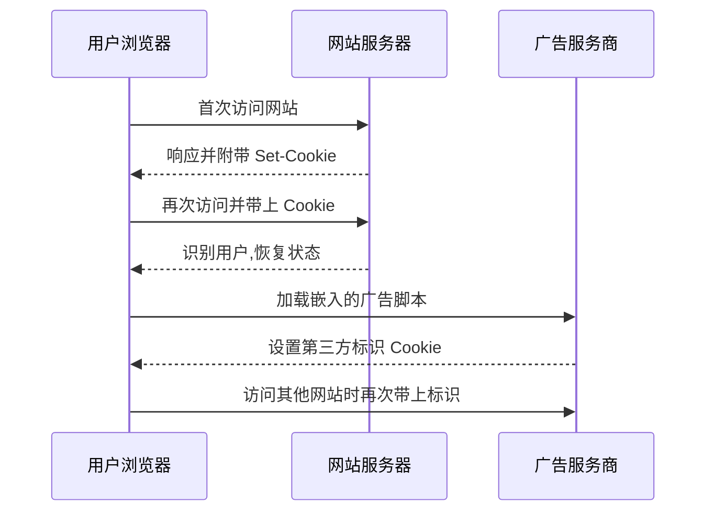

# Concept-Book Run

domain: /home/papagame/projects/digital-duck/cb-data-science/public/domains/data_science_ch08/input/graph.yaml
target: cookies
started: 2026-11-24T01:07:18

## Teaching order (3 concepts)

- data_privacy
- personally_identifiable_information
- cookies

### data_privacy (16.9s)

## 数据隐私

**定义。** 数据隐私(data privacy)是指:个人数据在被收集、处理和存储的全过程中,既受到安全保护,又尊重数据主体的权利与偏好。它包含三个层面:**安全性**(防止未经授权的访问)、**合规性**(遵守 GDPR、CCPA 等法规)和**自主性**(个人可以知情、同意、查询、更正和删除自己的数据)。需要注意:安全不等于隐私。一家公司可以把数据保管得很安全,却仍然在用户不知情的情况下滥用这些数据。

**核心原则。** 实践中通常遵循以下原则:

- **数据最小化**:只收集完成目的所必需的数据。
- **目的限定**:数据只能用于收集时声明的目的。
- **知情同意**:用户明确同意后才能处理其数据。
- **存储限制**:超过必要期限就删除数据。

**量化隐私:$k$-匿名。** 隐私也可以度量。若一个发布的数据表中,每条记录在其"准标识符"(如邮编、年龄、性别)上,都与至少另外 $k-1$ 条记录完全相同,则称该表满足 $k$-匿名。此时攻击者仅凭准标识符,重识别某个人的概率至多为

$$P(\text{重识别}) \le \frac{1}{k}.$$

**例题。** 某医院发布如下数据(邮编、年龄、疾病):

| 邮编 | 年龄 | 疾病 |
|---|---|---|
| 13053 | 28 | 心脏病 |
| 13068 | 29 | 病毒感染 |
| 13068 | 21 | 病毒感染 |
| 13053 | 23 | 心脏病 |

问:该表满足几-匿名?如何改进?

*解:* 准标识符组合(邮编, 年龄)的四条记录各不相同,每组大小为 1,所以只满足 $k=1$,即没有任何匿名保护。若知道邻居住在 13053 且 28 岁,就能确定其患有心脏病。

**泛化处理。** 把邮编改为前三位加星号,把年龄改为区间:

| 邮编 | 年龄 | 疾病 |
|---|---|---|
| 130\*\* | 20–29 | 心脏病 |
| 130\*\* | 20–29 | 病毒感染 |
| 130\*\* | 20–29 | 病毒感染 |
| 130\*\* | 20–29 | 心脏病 |

现在四条记录属于同一个等价类,$k=4$,重识别概率至多为 $\frac{1}{4}=25\%$。代价是信息精度下降,这就是**隐私与数据效用之间的权衡**。

**问题求解应用。** 一个更强的数学框架是**差分隐私**。若随机算法 $\mathcal{M}$ 对任意仅相差一条记录的两个数据集 $D, D'$ 以及任意输出集合 $S$,都满足

$$\Pr[\mathcal{M}(D)\in S] \le e^{\varepsilon}\,\Pr[\mathcal{M}(D')\in S],$$

则称它满足 $\varepsilon$-差分隐私。$\varepsilon$ 越小,隐私保护越强。

例如发布"患心脏病人数"这个计数查询。它的敏感度为 $\Delta f = 1$(增删一人最多使结果变化 1)。加入拉普拉斯噪声 $\text{Lap}(\Delta f/\varepsilon)$ 即可满足 $\varepsilon$-差分隐私。取 $\varepsilon = 0.5$ 时,噪声尺度为 $1/0.5 = 2$。真实值为 2,发布值可能是 1.3 或 3.8,但无法据此判断某个具体的人是否在数据集中。

**小结。** 数据隐私既是技术问题,也是权利问题。解决它需要做到:先最小化收集,再用泛化或噪声等手段保护,最后用 $k$ 或 $\varepsilon$ 等指标量化检验。

### personally_identifiable_information (14.1s)

## 个人身份信息

**定义。** 个人身份信息(Personally Identifiable Information,PII)是指能够直接且明确地识别某一特定个人的信息。典型例子包括:姓名全称、身份证号、护照号、社会保障号、指纹与人脸等生物特征、家庭住址、手机号码和电子邮箱。判断标准很简单:仅凭这条信息,不借助其他数据,能否锁定"这是谁"?如果能,它就是直接标识符。

与之相对的是**准标识符**,例如年龄、邮编、性别、职业。它们单独使用时不能确定个人,但组合起来可能做到。这一区别是后面应用部分的关键。

**一个具体场景。** 下面是某诊所数据表中的一条记录:

| 姓名 | 身份证号 | 年龄 | 邮编 | 诊断 |
|---|---|---|---|---|
| 李明 | 110101199003071234 | 34 | 100080 | 高血压 |

- "李明"和"身份证号"是直接标识符。身份证号在全国唯一,所以它是最强的 PII。
- "年龄"和"邮编"是准标识符。
- "诊断"是敏感信息,但它本身不指向任何人。

**问题求解:发布数据前如何去标识化?**

第一步,删除全部直接标识符(姓名、身份证号)。

第二步,检查准标识符的组合风险。设某邮编区内 34 岁的居民只有 1 人,那么即使没有姓名,任何人只要知道"住在 100080、34 岁"就能定位到这条记录。这叫**重识别攻击**。

第三步,泛化处理:把年龄改为区间"30–39",把邮编改为前三位"100\*\*\*"。这样同一组合下至少有 $k$ 人,称为 **$k$-匿名**。若要求 $k=5$,则每种(年龄段,邮编前缀)组合至少出现 5 次,攻击者最多只能把目标缩小到 5 条记录中,命中概率不超过

$$P_{\text{重识别}} \le \frac{1}{k} = \frac{1}{5} = 20\%.$$

**代码示例(检查最小组大小):**

```python
import pandas as pd

df = pd.read_csv("clinic.csv")
df = df.drop(columns=["姓名", "身份证号"])          # 删除直接标识符
df["年龄段"] = (df["年龄"] // 10 * 10).astype(str) + "s"
df["邮编前缀"] = df["邮编"].astype(str).str[:3]

k = df.groupby(["年龄段", "邮编前缀"]).size().min()
print("当前 k =", k)    # 若 k < 5,继续泛化或剔除小组
```

**要点总结。**
1. 直接标识符(PII)一经删除,不等于数据已匿名,准标识符的组合同样会泄露身份。
2. 实践中先识别直接标识符,再用 $k$ 值量化残余的重识别风险。
3. 处理 PII 时应遵循数据最小化原则:不需要的字段就不收集。同时应遵守适用的法规,例如中国的《个人信息保护法》和欧盟的 GDPR。

### cookies (15.4s)

## 网络 Cookie

## Cookies

**定义。** Cookie 是网站通过浏览器存放在用户设备上的小型文本数据,通常由“名称=值”的键值对加上属性(作用域、有效期等)组成。它依托 HTTP 协议工作:服务器在响应头中用 `Set-Cookie` 下发,浏览器此后访问同一站点时,自动在请求头 `Cookie` 中带回。HTTP 本身是无状态的,Cookie 就是给它“补上记忆”的机制。

Cookie 分为两类:

- **第一方 Cookie**:由用户正在访问的网站设置,用于登录状态、购物车、语言偏好等。
- **第三方 Cookie**:由页面中嵌入的其他域名(如广告、统计服务)设置。同一个广告服务商出现在许多网站上,就能用同一个标识符把你在不同网站的访问串联起来,这就是“跟踪浏览历史、定向投放广告”的原理。

**例题。** 你访问购物网站 `shop.example`,服务器返回:

```
Set-Cookie: session=abc123; Max-Age=3600; Secure; HttpOnly; SameSite=Lax
```

解读各属性:

- `session=abc123`:服务器给你的会话标识。
- `Max-Age=3600`:有效期 3600 秒,即 1 小时。
- `Secure`:只通过 HTTPS 发送。
- `HttpOnly`:页面脚本无法读取,可降低被 XSS 窃取的风险。
- `SameSite=Lax`:大多数跨站请求不携带它,可降低 CSRF 风险。

之后每次请求,浏览器都会带上 `Cookie: session=abc123`,服务器据此认出“还是同一个人”,购物车才不会清空。

**问题解决应用。** 假设一个广告商 `ads.example` 的脚本嵌入了 3 个网站 A、B、C,并在你的浏览器中设置了第三方 Cookie `uid=77`。

1. 访问 A 时,浏览器向 `ads.example` 发出请求,带上 `uid=77`,广告商记录“77 看了运动鞋”。
2. 访问 B、C 时同样带上 `uid=77`,广告商记录“77 看了机票”“77 看了酒店”。
3. 广告商把这些记录合并到同一个 `uid` 下,得到跨站画像,并据此推送“旅行装备”广告。

防御思路因此很明确,可以在不同层面各自切断这条链:

- **浏览器设置**:阻止第三方 Cookie(Safari、Firefox 已默认限制)。
- **属性约束**:设置 `SameSite=Strict`,使 Cookie 不随跨站请求发送。
- **用户操作**:定期清除 Cookie,或使用隐私模式,使 `uid` 失效或重置。
- **法律合规**:欧盟 GDPR 与 ePrivacy 要求网站在设置非必要 Cookie 前取得用户同意,所以你会看到“接受 Cookie”横幅。

**小结思考。** 判断一个 Cookie 是否涉及隐私风险,可以问两个问题:它是谁设置的(第一方还是第三方)?它存储的是功能性状态还是可跨站关联的唯一标识?


*图:第一方 Cookie 用于维持网站会话;第三方 Cookie 让广告服务商在不同网站间识别同一浏览器。*

## Run complete

total: 67.3s
