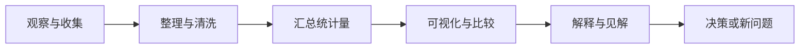
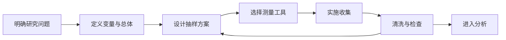
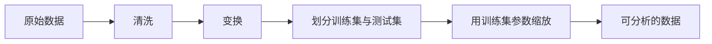
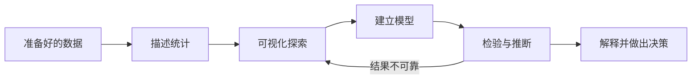
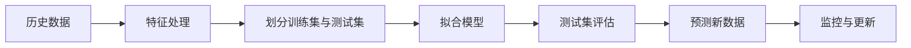

# Concept-Book Run

domain: /home/papagame/projects/digital-duck/cb-data-science/public/domains/data_science_ch01/input/graph.yaml
target: predictive_analytics
started: 2026-11-25T04:31:18

## Teaching order (5 concepts)

- data
- data_collection
- data_preparation
- data_analysis
- predictive_analytics

### data (0.5s)

## 数据

### 定义

**数据**(data)是可以被记录、存储并加以分析的观察结果或证据,是我们从中提炼高层见解(insight)的原材料。单个数据点本身意义有限;只有经过整理、比较与分析之后,数据才会变成可以支持决策的信息。

按取值类型,数据通常分为两类:

- **定量数据**:可以做算术运算的数值,如身高、温度、反应时间。
- **定性(分类)数据**:表示类别或标签,如血型、专业、评价等级。

从数据到见解的基本流程是:**收集 → 整理 → 汇总 → 解释**。

### 例题

某班 8 名学生一周的自习时长(小时)为:

$$4,\ 5,\ 5,\ 6,\ 7,\ 7,\ 7,\ 15$$

**第一步:汇总。**均值为

$$\bar{x}=\frac{1}{n}\sum_{i=1}^{n}x_i=\frac{4+5+5+6+7+7+7+15}{8}=\frac{56}{8}=7.$$

中位数是排序后中间两个数的平均:$\dfrac{6+7}{2}=6.5$;众数为 $7$。

**第二步:衡量离散程度。**样本标准差为

$$s=\sqrt{\frac{1}{n-1}\sum_{i=1}^{n}(x_i-\bar{x})^2}=\sqrt{\frac{64}{7}}\approx 3.02.$$

其中 $\sum (x_i-\bar{x})^2 = 9+4+4+1+0+0+0+64=82$,所以更准确地写作 $s=\sqrt{82/7}\approx 3.42$。

**第三步:解释。**均值(7)高于中位数(6.5),说明分布被右侧的大值 $15$ 拉高。这个数据点是否为**异常值**?用 $1.5\times\mathrm{IQR}$ 规则检验:$Q_1=5,\ Q_3=7,\ \mathrm{IQR}=2$,上界为 $7+1.5\times 2=10$。因为 $15>10$,它被判定为异常值。

### 问题求解应用

**问题:**假设你想知道"学生自习越久,考试成绩越高"是否成立。你收集了 5 名学生的数据 $(x,y)$,其中 $x$ 为自习时长,$y$ 为成绩:

$$(2,60),\ (4,70),\ (6,75),\ (8,85),\ (10,90)$$

**分析:**计算相关系数 $r$。已知 $\bar{x}=6,\ \bar{y}=76$,则

$$r=\frac{\sum (x_i-\bar{x})(y_i-\bar{y})}{\sqrt{\sum (x_i-\bar{x})^2}\sqrt{\sum (y_i-\bar{y})^2}}=\frac{150}{\sqrt{40}\,\sqrt{570}}\approx 0.993.$$

$r$ 接近 $1$,说明二者存在很强的正线性关系。

**但要谨慎解释:**

1. **相关不等于因果。**也许基础好的学生既自习更久、成绩也更高。
2. **样本量太小。**$n=5$ 无法支持普遍结论。
3. **抽样偏差。**数据若只来自愿意填写问卷的学生,结论未必适用于全体。

**要点:**分析数据时,先问数据**从哪里来**(收集方式),再问**如何汇总**(统计量),最后问**能推出什么**(结论的边界)。好的见解来自这三步的结合,而不是单个漂亮的数字。

*图:从原始观察到高层见解的数据分析流程。*

### data_collection (0.5s)

## 数据收集

**定义。** 数据收集(data collection)是针对研究问题,按照预先设计的方案,系统地获取关于目标变量的观测值的过程。"系统"意味着三点:明确要测量什么(变量及其单位)、明确从谁或什么中获取(总体与抽样方式)、明确怎样获取(测量工具与记录规则)。数据质量决定了后续一切分析的上限:再复杂的模型也无法修复有偏的数据。

常见的收集方式有四类:

- **实验**:研究者主动控制自变量,如随机分配处理组与对照组。
- **观察性研究**:不干预,只记录,如天气站记录。
- **调查**:通过问卷或访谈获取回答。
- **二次数据**:使用他人已收集的数据库或日志。

**核心要求。** 样本应能代表总体。简单随机抽样中,每个个体被抽中的概率相同。对样本均值 $\bar{x}$,标准误为

$$
SE = \frac{s}{\sqrt{n}},
$$

其中 $s$ 为样本标准差,$n$ 为样本量。样本量增大可以减小随机误差,但**不能**消除系统性偏差(如抽样偏差、测量偏差)。

**例题。** 某校想估计 2000 名学生每天的平均睡眠时间。

*方案 A*:在图书馆门口调查 50 名学生。*方案 B*:用学号随机抽取 50 名学生。

方案 A 会过度抽到熬夜学习的学生,属于抽样偏差。选方案 B,得到样本均值 $\bar{x}=7.2$ 小时,标准差 $s=1.0$ 小时,则

$$
SE=\frac{1.0}{\sqrt{50}}\approx 0.14 \text{ 小时}.
$$

近似 95% 置信区间为

$$
7.2 \pm 2\times 0.14 = (6.92,\ 7.48)\ \text{小时}.
$$

**问题求解应用。** 若希望把误差范围(2 倍标准误)缩小到 $\pm 0.1$ 小时,需要

$$
2\cdot\frac{s}{\sqrt{n}} \le 0.1 \;\Rightarrow\; n \ge \left(\frac{2\times 1.0}{0.1}\right)^2 = 400.
$$

因此需要约 400 名学生。注意:精度提高到原来的 1.4 倍(0.14 到 0.1),样本量却增加到原来的 8 倍,这体现了边际收益递减。

收集数据前的检查清单:

1. 研究问题是否明确,变量是否可测量?
2. 总体是谁?抽样框是否完整?
3. 是否用随机化来避免选择偏差?
4. 测量工具是否可靠(重复测量结果一致)且有效(测的确是目标变量)?
5. 是否考虑了缺失值与无应答,并记录了收集过程以便复现?

*图:数据收集的基本流程。检查发现问题时,需要回到抽样设计环节修正。*

**小结。** 好的数据收集先于分析:先定义问题,再用随机化控制偏差,最后用样本量控制随机误差。

### data_preparation (0.6s)

## 数据准备

**定义。** 数据准备(也称数据处理)是把收集到的原始数据转换为适合分析的最优形式的步骤。原始数据往往含有缺失值、异常值、重复记录、不一致的格式和不同的量纲。如果直接分析,结果会被这些问题扭曲。数据准备通常包括四项工作:

1. **清洗**:处理缺失值、重复值和明显错误。
2. **变换**:统一格式和单位,对类别变量编码。
3. **缩放**:把数值特征放到可比较的尺度上。
4. **划分**:把数据分成训练集和测试集。

常用的缩放方法是标准化(z 分数):

$$z_i = \frac{x_i - \bar{x}}{s}$$

其中 $\bar{x}$ 是样本均值,$s$ 是样本标准差。变换后,数据的均值为 0,标准差为 1。

**例题。** 一份数据记录了 5 名学生的每周学习时长(小时):$8,\ 10,\ \text{缺失},\ 12,\ 40$。其中 40 很可能是录入错误,应为 14。

*第一步:修正异常值。* 核对原始记录后,把 40 改为 14。数据变为 $8, 10, \text{缺失}, 12, 14$。

*第二步:填补缺失值。* 用其余 4 个值的均值填补:

$$\bar{x} = \frac{8+10+12+14}{4} = 11$$

此时数据为 $8, 10, 11, 12, 14$,总均值仍为 $11$。

*第三步:标准化。* 偏差平方和为 $9+1+0+1+9=20$。样本标准差为

$$s=\sqrt{\frac{20}{4}}=\sqrt{5}\approx 2.24$$

于是 $8$ 对应 $z=\frac{8-11}{2.24}\approx -1.34$,$14$ 对应 $z\approx 1.34$。

**问题求解应用。** 假设要预测学生成绩,特征包括每周学习时长(范围 $0\text{–}20$)和家庭年收入(范围 $0\text{–}10^6$)。如果不缩放,基于距离的算法(如 k 近邻)几乎只看收入,因为收入的数值差异比学习时长大几个数量级。标准化后,两个特征的影响才处于同一水平。

数据准备中有一个常见陷阱:**数据泄漏**。正确的顺序是:

1. 先划分训练集和测试集。
2. 只用训练集计算 $\bar{x}$ 和 $s$。
3. 用这组参数变换测试集。

如果先对全部数据标准化,测试集的信息就会混入训练过程,评估结果会偏乐观。

*图:数据准备的典型流程。先划分数据,再用训练集的统计量进行缩放,以避免数据泄漏。*

**小结。** 数据准备决定了分析的质量上限。它的顺序也要注意:划分必须先于任何依赖整体统计量的步骤。

### data_analysis (0.8s)

## 数据分析

### 定义

**数据分析**(data analysis)是对已经准备好的数据(已清洗、格式统一、缺失值已处理)进行检查、变换和解释,从中发现规律、检验假设并支持决策的过程。它通常包含三个层次:

1. **描述**:用统计量概括数据"是什么样";
2. **探索**:用图表和分组比较寻找关系;
3. **推断**:判断观察到的规律是否可能只是随机波动。

常用的描述量包括样本均值与样本标准差:

$$\bar{x}=\frac{1}{n}\sum_{i=1}^{n}x_i,\qquad s=\sqrt{\frac{1}{n-1}\sum_{i=1}^{n}(x_i-\bar{x})^2}$$

衡量两个变量线性关系的**皮尔逊相关系数**为:

$$r=\frac{\sum_{i=1}^{n}(x_i-\bar{x})(y_i-\bar{y})}{\sqrt{\sum_{i=1}^{n}(x_i-\bar{x})^2}\sqrt{\sum_{i=1}^{n}(y_i-\bar{y})^2}},\qquad -1\le r\le 1$$

### 例题

某班 5 名学生的每周学习时间 $x$(小时)与测验成绩 $y$(分)如下:

| $x$ | 2 | 4 | 6 | 8 | 10 |
|---|---|---|---|---|---|
| $y$ | 55 | 65 | 70 | 80 | 90 |

**第一步:描述。** $\bar{x}=6$,$\bar{y}=72$。

**第二步:计算偏差。**

- $\sum(x_i-\bar{x})^2=16+4+0+4+16=40$
- $\sum(y_i-\bar{y})^2=289+49+4+64+324=730$
- $\sum(x_i-\bar{x})(y_i-\bar{y})=(-4)(-17)+(-2)(-7)+0+(2)(8)+(4)(18)=68+14+0+16+72=170$

**第三步:求相关系数。**

$$r=\frac{170}{\sqrt{40}\sqrt{730}}=\frac{170}{\sqrt{29200}}\approx\frac{170}{170.88}\approx 0.995$$

学习时间与成绩呈很强的正线性相关。

### 问题求解应用

**问题:** 若某同学每周学习 7 小时,预计成绩是多少?

用最小二乘回归直线 $\hat{y}=a+bx$,其中

$$b=\frac{\sum(x_i-\bar{x})(y_i-\bar{y})}{\sum(x_i-\bar{x})^2}=\frac{170}{40}=4.25,\qquad a=\bar{y}-b\bar{x}=72-4.25\times 6=46.5$$

所以 $\hat{y}=46.5+4.25x$。代入 $x=7$:

$$\hat{y}=46.5+4.25\times 7=76.25\ \text{分}$$

**分析时的三个检查点:**

- **只在数据范围内预测。** $x=7$ 位于 2 到 10 之间(内插)是合理的。若预测 $x=40$,得到 216.5 分,显然荒谬。外推不可靠。
- **相关不等于因果。** 高成绩的学生可能本来就更自律,学习时间只是其中一个表现。
- **样本太小。** 只有 $n=5$ 时,$r$ 很高也可能出于偶然,需要更多数据或显著性检验来确认。

### 流程图

*数据分析的典型流程:从描述到探索、建模、检验,若结论不可靠则回到探索阶段重新分析。*

### predictive_analytics (0.5s)

## 预测分析

**定义。** 预测分析(predictive analytics)是利用历史数据建立统计或机器学习模型,并用模型对未来或未知事件做出预测的方法。其核心思想是:假设过去数据中的规律在未来仍大体成立,于是学习一个函数 $f$,使得

$$\hat{y} = f(x_1, x_2, \dots, x_p),$$

其中 $x_i$ 是特征(已知信息),$\hat{y}$ 是对目标 $y$ 的预测。目标为连续数值时称为回归问题,为类别时称为分类问题。

**标准流程。** 收集历史数据 → 划分训练集与测试集 → 拟合模型 → 在测试集上评估 → 部署并持续监控。

*预测分析的基本流程:从历史数据出发,经训练、评估后用于预测新数据,并持续监控。*

**例题。** 某咖啡店记录了 5 天的气温 $x$(°C)与热饮销量 $y$(杯):

| $x$ | 0 | 5 | 10 | 15 | 20 |
|---|---|---|---|---|---|
| $y$ | 90 | 80 | 62 | 50 | 38 |

用最小二乘法拟合 $\hat{y}=\beta_0+\beta_1 x$。先算均值:$\bar{x}=10$,$\bar{y}=64$。则

$$\beta_1=\frac{\sum (x_i-\bar{x})(y_i-\bar{y})}{\sum (x_i-\bar{x})^2}=\frac{(-10)(26)+(-5)(16)+0+(5)(-14)+(10)(-26)}{250}=\frac{-670}{250}=-2.68,$$

$$\beta_0=\bar{y}-\beta_1\bar{x}=64+26.8=90.8.$$

模型为 $\hat{y}=90.8-2.68x$。预测气温 12°C 时:$\hat{y}=90.8-32.16=58.64$,约 59 杯。

**问题解决应用。** 仅有预测还不够,必须评估其可靠性。

1. **误差度量。** 回归常用均方根误差 $\text{RMSE}=\sqrt{\frac{1}{n}\sum (y_i-\hat{y}_i)^2}$。本例拟合值依次为 90.8、77.4、64.0、50.6、37.2,残差为 $-0.8,\,2.6,\,-2.0,\,-0.6,\,0.8$,残差平方和为 $0.64+6.76+4+0.36+0.64=12.4$,故 $\text{RMSE}=\sqrt{12.4/5}\approx1.57$ 杯。
2. **过拟合。** 模型在训练数据上误差很小,不代表对新数据同样准确。过于复杂的模型会把噪声也"记住"。因此必须用**未参与训练**的测试数据评估,或使用交叉验证。
3. **外推风险。** 若预测 40°C 时销量为 $90.8-107.2<0$,结果显然不合理——模型只在训练数据覆盖的范围内可信。
4. **选择指标。** 分类问题(如预测客户是否流失)应根据代价选择精确率、召回率或 AUC,而不仅是准确率;当正例很少时,"全部预测为负"也能得到很高的准确率。

**小结。** 预测分析 = 历史数据 + 模型 + 严格的out-of-sample 评估。好的预测不仅给出数值,还要说明其误差范围与适用条件。

## Run complete

total: 8.4s
