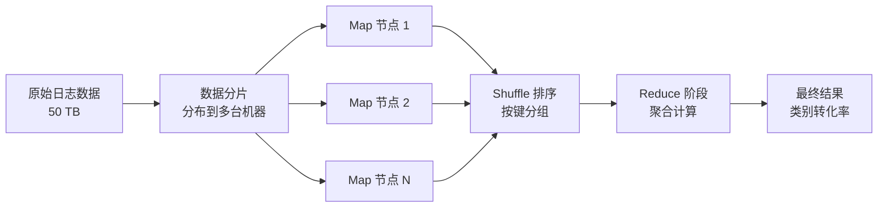

# Concept-Book Run

domain: /home/papagame/projects/digital-duck/cb-data-science/public/domains/data_science_ch02/input/graph.yaml
target: cloud_computing
started: 2026-11-25T04:31:28

## Teaching order (2 concepts)

- big_data
- cloud_computing

### big_data (0.5s)

## Big Data

**定义**：大数据是指规模庞大、结构复杂、增长速度极快，以至于传统数据库和处理工具（如单机关系型数据库、Excel）无法在合理时间内存储、管理或分析的数据集合。业界常用"5V"来刻画其本质特征：Volume（体量，通常指 TB 至 PB 级别）、Velocity（速度，数据实时或近实时产生）、Variety（多样性，包含结构化表格、非结构化文本、图像、日志等）、Veracity（真实性，数据存在噪声与不确定性）、Value（价值，需从海量原始数据中提炼出有用信息）。判断一个数据集"是不是大数据"的关键不在于绝对字节数，而在于：单台机器的内存和计算能力是否足以在可接受时间内完成处理。

**应用场景**：以某电商平台为例，其每天产生的用户点击流日志约 50 TB，包含用户 ID、时间戳、商品 ID、页面停留时长等字段。若要计算"过去 30 天内每个商品类别的平均转化率"，传统做法是把所有数据读入内存后用一个 SQL 查询完成——但 50 TB × 30 天远超任何单机内存容量。工程团队采用的解决方案是 **MapReduce 范式**：将任务拆分为 Map 阶段（在数千台机器上并行读取本地数据分片，输出 `(商品类别, (点击, 转化)) ` 键值对）和 Reduce 阶段（按类别聚合所有 Map 输出，计算最终转化率）。这种"分而治之"的思路使得处理时间从理论上单机需要的数周，缩短到数百台机器并行后的几十分钟。

**解决问题的关键判断**：面对一个新的数据分析任务，判断是否需要"大数据"方案，可以用一个简单的经验法则——若数据集大小超过可用内存的 10 倍以上，或查询延迟要求（如实时推荐）无法容忍全量扫描，就应考虑分布式存储（如 HDFS）与分布式计算框架（如 Spark、Hadoop）。反之，若数据集在数 GB 量级、可一次性载入 Pandas DataFrame 完成分析，则引入大数据基础设施反而增加不必要的运维复杂度与延迟开销。这种"先估算规模、再选工具"的思维方式，是解决实际数据问题的第一步。

*该图展示了 MapReduce 处理大规模数据的整体流程：数据先被拆分并行处理（Map），再按键归并聚合（Reduce），最终得到统计结果。*

### cloud_computing (0.5s)

## Cloud Computing（云计算）

云计算是指通过互联网按需交付计算资源——包括存储、处理能力、数据库和软件应用——而无需用户自行采购和维护物理硬件的模式。其核心特征可以归纳为三点：按需自助服务（用户可自行申请资源，无需人工审批）、弹性伸缩（资源可根据负载自动增减）、按使用量计费（用户只为实际消耗的资源付费，而非固定资产投入）。云计算通常分为三种服务模型：IaaS（基础设施即服务，如虚拟机、网络）、PaaS（平台即服务，提供开发运行环境）、SaaS（软件即服务，如在线邮箱、协同文档）。

**实例分析**：设想一家初创电商公司在“双十一”促销期间，网站访问量可能是平时的50倍。如果采用自建服务器的传统模式，公司必须提前采购足以应对峰值流量的硬件，但这些设备在平日会大量闲置，造成资源浪费。而采用云计算（如AWS、阿里云或Azure），公司可以配置自动伸缩规则：当每秒请求数超过某阈值时，系统自动增加虚拟服务器实例；促销结束后，多余实例自动释放，公司只需为实际使用的计算时长付费。这正是云计算相较于本地部署的关键优势——将固定资本支出（CapEx）转化为可变运营支出（OpEx）。

**问题解决应用**：在实际架构设计中，工程师需要根据业务场景选择合适的服务模型与部署策略。例如，一个中小企业若只想快速上线一套客户关系管理系统而不涉及底层运维，应选择SaaS（如Salesforce）；若企业需要自主部署定制化机器学习训练环境，则更适合IaaS，以获得对操作系统和计算资源的完全控制权。此外，云计算还引入了新的工程权衡：延迟与成本的平衡（数据中心地理位置的选择）、单一云厂商锁定风险（vendor lock-in，可通过多云或混合云策略缓解）、以及数据安全与合规性问题（如医疗、金融行业需满足特定地域的数据存储法规）。理解这些权衡，是将云计算从抽象概念转化为可落地系统设计能力的关键一步。

## Run complete

total: 5.2s
