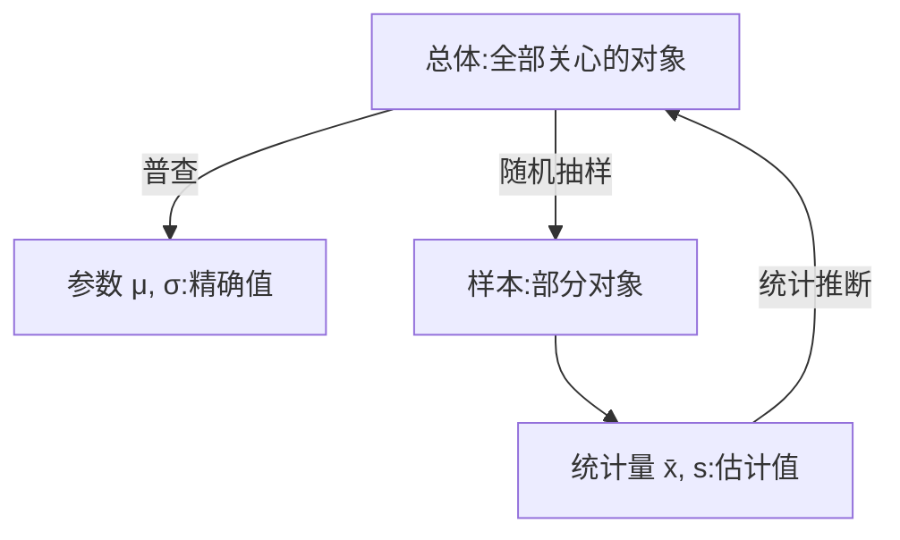
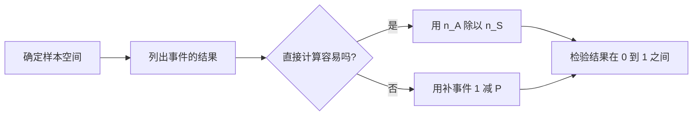
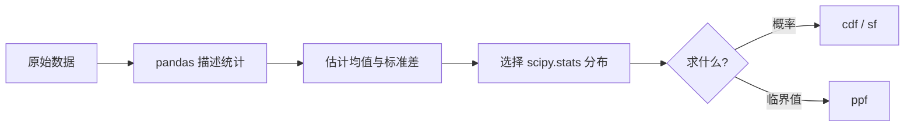

# Concept-Book Run

domain: /home/papagame/projects/digital-duck/cb-data-science/public/domains/data_science_ch03/input/graph.yaml
target: python_data_analysis
started: 2026-11-25T04:31:34

## Teaching order (12 concepts)

- sample_data
- population_data
- mean
- median
- percentiles
- probability
- random_variable
- variance
- probability_distribution
- quartiles
- standard_deviation
- python_data_analysis

### sample_data (0.5s)

## 样本数据

### 定义

**样本数据**(sample data)是从研究对象的**总体**(population)中抽取一部分个体,对其进行观测或测量所得到的结果。我们很少能测量整个总体,例如全国所有高中生的身高,所以用样本来推断总体。

常用记号如下:

- 总体均值 $\mu$、总体标准差 $\sigma$,是固定但通常未知的**参数**;
- 样本容量 $n$,样本观测值 $x_1, x_2, \dots, x_n$;
- 样本均值 $\bar{x}=\dfrac{1}{n}\sum_{i=1}^{n}x_i$,样本标准差 $s=\sqrt{\dfrac{1}{n-1}\sum_{i=1}^{n}(x_i-\bar{x})^2}$,是由样本算出的**统计量**,用来估计参数。

样本能否代表总体,关键在于抽样方式。**简单随机抽样**让总体中每个个体被抽到的机会相同,可以避免系统性偏差。如果只在篮球队里测身高,样本就有**选择偏差**,无论 $n$ 多大都无法修正。

### worked example(例题)

某校有 2000 名学生。随机抽取 $n=5$ 名学生,测得每周运动时长(小时)为:

$$3,\ 5,\ 4,\ 8,\ 5$$

样本均值:

$$\bar{x}=\frac{3+5+4+8+5}{5}=5$$

离差平方和:

$$(3-5)^2+(5-5)^2+(4-5)^2+(8-5)^2+(5-5)^2=4+0+1+9+0=14$$

样本标准差:

$$s=\sqrt{\frac{14}{5-1}}=\sqrt{3.5}\approx 1.87$$

这里除以 $n-1$ 而不是 $n$,是因为样本数据比总体更集中:样本点到 $\bar{x}$ 的距离平方和,总是小于它们到真实 $\mu$ 的距离平方和。除以 $n-1$ 可以修正这种低估,使 $s^2$ 成为 $\sigma^2$ 的无偏估计。

### 问题解决应用

**问题**:根据上面的样本,估计全校学生平均每周运动时长,并说明估计的可靠程度。

**步骤 1:点估计。** 用 $\bar{x}=5$ 小时估计 $\mu$。

**步骤 2:量化抽样误差。** 样本均值的标准误为

$$SE=\frac{s}{\sqrt{n}}=\frac{1.87}{\sqrt{5}}\approx 0.84$$

它表示不同样本得到的 $\bar{x}$ 大致会在 $\mu$ 附近波动多少。$n$ 越大,$SE$ 越小,估计越稳定,但它以 $\dfrac{1}{\sqrt{n}}$ 的速度缩小,要把误差减半,样本量需要变成原来的 4 倍。

**步骤 3:区间估计。** 因为 $n$ 很小,使用 $t$ 分布,自由度 $n-1=4$,查表得 $t^*\approx 2.776$(95% 置信水平):

$$\bar{x}\pm t^*\cdot SE = 5\pm 2.776\times 0.84\approx 5\pm 2.33$$

即 $\mu$ 的 95% 置信区间约为 $(2.67,\ 7.33)$ 小时。

**结论与反思**:这个区间很宽,说明 5 个样本的信息有限。若想把误差缩小到约 $\pm 0.5$ 小时,按 $n \approx \left(\dfrac{t^* s}{0.5}\right)^2$ 估算,需要的样本量大约是 $n\approx(2.0\times1.87/0.5)^2\approx 56$,这里 $t^*$ 取大样本时的近似值 2.0。可以看出,只有在抽样方式合理且样本量足够时,样本数据才能给出对总体可靠的推断。

### population_data (0.6s)

## 总体数据(Population Data)

### 定义

**总体数据**(population data)是指研究者所关心的**全部**结果或测量值的集合。这里的"全部"并不是指"很多",而是指"没有遗漏":只要某个个体属于研究对象,它的测量值就必须包含在总体之中。

描述总体的数值称为**参数**(parameter),通常用希腊字母表示。若总体含有 $N$ 个数据 $x_1, x_2, \dots, x_N$,则:

$$\mu = \frac{1}{N}\sum_{i=1}^{N} x_i, \qquad \sigma^2 = \frac{1}{N}\sum_{i=1}^{N} (x_i-\mu)^2, \qquad \sigma=\sqrt{\sigma^2}$$

其中 $\mu$ 是总体均值,$\sigma^2$ 是总体方差,$\sigma$ 是总体标准差。注意方差的分母是 $N$,而不是样本方差中的 $n-1$。这是因为总体数据已经包含了全部信息,不需要对"用样本估计总体"带来的偏差做修正。

总体由研究问题决定,而不是由数据量决定。"某班 5 名学生的数学成绩"若只关心这个班,它就是总体;若想借此推断全校,它就只是样本。

### 例题

某小组共有 5 名学生,是我们唯一关心的对象。他们的测验成绩为:

$$70,\ 80,\ 85,\ 90,\ 95$$

**第一步:求均值。**

$$\mu = \frac{70+80+85+90+95}{5} = \frac{420}{5} = 84$$

**第二步:求偏差平方和。**

$$(-14)^2+(-4)^2+1^2+6^2+11^2 = 196+16+1+36+121 = 370$$

**第三步:求方差与标准差。**

$$\sigma^2 = \frac{370}{5} = 74, \qquad \sigma = \sqrt{74} \approx 8.60$$

因为这 5 人就是全部对象,所以 $\mu = 84$ 与 $\sigma \approx 8.60$ 是**精确值**,没有任何抽样误差。

### 问题求解应用

**问题:** 一家工厂某天恰好生产了 $N=1000$ 个零件,质检员逐个测量了直径,算得 $\mu = 10.00$ mm,$\sigma = 0.05$ mm。第二天,质检员只随机测量了 $n=25$ 个零件,得到样本均值 $\bar{x}=10.02$ mm。问:能否说这一天的总体均值是 $10.02$ mm?

**分析:**

1. 第一天是**普查**,得到的是参数,$\mu=10.00$ 即为真值。
2. 第二天是**抽样**,$\bar{x}$ 是统计量,会随样本而波动,只是对未知 $\mu$ 的估计。
3. 样本均值的标准误为
$$\frac{\sigma}{\sqrt{n}}=\frac{0.05}{\sqrt{25}}=0.01\text{ mm}$$
4. 因此 $\bar{x}=10.02$ 与 $10.00$ 相差 2 个标准误,偏差不算小,值得进一步检查生产线是否漂移,但不能直接断言总体均值就是 $10.02$。

**要点:** 判断数据属于总体还是样本,是选择公式和结论措辞的第一步。


*图示:总体参数可由普查直接得到,也可由样本统计量通过推断来估计。*

### mean (0.6s)

## 平均数

**定义。** 平均数(算术平均数)是把数据集中所有数值相加,再除以数据的个数所得到的值。对 $n$ 个数据 $x_1, x_2, \dots, x_n$,样本均值记作 $\bar{x}$:

$$\bar{x} = \frac{1}{n}\sum_{i=1}^{n} x_i = \frac{x_1 + x_2 + \cdots + x_n}{n}$$

若数据代表整个总体,则总体均值记作 $\mu$,公式形式相同。直观上,平均数是数据的"平衡点":把每个数据看作数轴上等重的小球,平均数就是使数轴恰好保持平衡的支点。这一点可由性质 $\sum_{i=1}^{n}(x_i-\bar{x})=0$ 严格表达:所有数据与平均数的偏差之和恒为零。

**例题。** 某同学五次数学测验的成绩为 $78,\ 85,\ 90,\ 92,\ 95$。则

$$\bar{x} = \frac{78+85+90+92+95}{5} = \frac{440}{5} = 88$$

验证偏差之和:$(-10)+(-3)+2+4+7=0$,与上述性质一致。

**加权平均。** 当各数据重要性不同时,使用权重 $w_i$:

$$\bar{x}_w = \frac{\sum_{i=1}^{n} w_i x_i}{\sum_{i=1}^{n} w_i}$$

例如,某课程的期中占 $30\%$、期末占 $50\%$、作业占 $20\%$,某生三项得分分别为 $80,\ 90,\ 100$,则总评为 $0.3\times80+0.5\times90+0.2\times100=89$。

**问题求解应用。**

*问题 1(反推缺失数据)。* 前四次测验的平均分是 $84$,希望第五次后平均分达到 $86$,第五次需要考多少分?

解:五次总分需为 $5\times86=430$;前四次总分为 $4\times84=336$。因此第五次需要 $430-336=94$ 分。关键思路:**平均数 × 个数 = 总和**。

*问题 2(合并分组)。* 甲班 $20$ 人平均 $75$ 分,乙班 $30$ 人平均 $80$ 分,两班合并的平均分是多少?

解:不能直接取 $(75+80)/2$,因为两班人数不同,必须用加权平均:

$$\frac{20\times75+30\times80}{20+30}=\frac{3900}{50}=78$$

**注意事项。** 平均数对极端值很敏感。数据 $1,\ 2,\ 3,\ 4,\ 100$ 的平均数是 $22$,但其中四个数据都远小于 $22$,此时平均数不能很好地代表"典型值"。在收入、房价等右偏分布中,应同时考察中位数。若数据中有明显异常值,先检查其是否为录入错误,再决定使用平均数还是更稳健的统计量。

### median (0.6s)

## 中位数

**定义。** 将 $n$ 个数据按从小到大排序为 $x_{(1)}\le x_{(2)}\le\cdots\le x_{(n)}$。**中位数**(median)是排在正中间的值:

$$
\text{median}=
\begin{cases}
x_{\left(\frac{n+1}{2}\right)}, & n \text{ 为奇数},\\[6pt]
\dfrac{x_{\left(\frac{n}{2}\right)}+x_{\left(\frac{n}{2}+1\right)}}{2}, & n \text{ 为偶数}.
\end{cases}
$$

也就是说,至少有一半数据不大于它,至少有一半数据不小于它。中位数只依赖数据的**位置(排名)**,而不依赖极端值的大小,因此对异常值不敏感,这称为**稳健性**。

**求解步骤。**
1. 将数据排序。
2. 确定 $n$ 是奇数还是偶数。
3. 奇数取正中间的一个值;偶数取中间两个值的平均。

**例题 1(奇数个数据)。** 某班 7 名学生的周学习时间(小时)为:$5,\ 8,\ 3,\ 6,\ 9,\ 4,\ 7$。

排序得 $3,4,5,6,7,8,9$。$n=7$,中位数为第 $\frac{7+1}{2}=4$ 个数,即 $6$ 小时。

**例题 2(偶数个数据)。** 数据为 $2,\ 4,\ 4,\ 10,\ 12,\ 30$。

$n=6$,中间两个数是第 3、4 个,即 $4$ 和 $10$,所以中位数为 $\dfrac{4+10}{2}=7$。

**问题求解应用:抵抗异常值。** 某小城市 5 户家庭的年收入(万元)为:$8,\ 9,\ 10,\ 11,\ 12$。

- 平均数:$\bar{x}=\dfrac{8+9+10+11+12}{5}=10$
- 中位数:$10$

现在一位亿万富翁搬来,第 6 户的年收入为 $1000$ 万元:

- 平均数:$\bar{x}=\dfrac{8+9+10+11+12+1000}{6}=\dfrac{1050}{6}=175$
- 中位数:排序后中间两个数为 $10$ 和 $11$,得 $\dfrac{10+11}{2}=10.5$

平均数从 $10$ 飙升到 $175$,远不能代表普通家庭的收入;而中位数只从 $10$ 变为 $10.5$,依然反映了"典型"家庭的水平。这就是房价、工资、家庭收入等**右偏分布**的数据通常报告中位数的原因。

**用代码验证。**

```python
import statistics

data = [8, 9, 10, 11, 12, 1000]
print(statistics.mean(data))    # 175.0
print(statistics.median(data))  # 10.5
```

**如何选择?** 
- 数据大致对称、没有明显异常值时,平均数和中位数相近,平均数利用了全部信息,更有效。
- 数据严重偏斜或含有异常值时,优先使用中位数。
- 若平均数明显大于中位数,通常说明分布**右偏**(有少数极大值把平均数"拉高")。

**小结。** 中位数是排序后位于正中间的值,计算简单、对异常值稳健。在描述偏斜数据的"典型水平"时,它往往比平均数更可靠。

### percentiles (0.6s)

## 百分位数

**定义。** 将一组数据从小到大排序后,第 $p$ 百分位数(记作 $P_p$)是这样一个值:大约有 $p\%$ 的数据点小于或等于它。例如,若某次考试成绩为第 90 百分位数,意味着约 90% 的考生成绩不高于该分数。注意:百分位数描述的是**相对位置**,而不是得分的百分比。中位数就是第 50 百分位数,四分位数 $Q_1,Q_3$ 分别是第 25、75 百分位数。

**计算方法(线性插值法)。** 设数据已排序为 $x_1\le x_2\le\cdots\le x_n$。计算位置
$$
k=\frac{p}{100}\,(n-1)+1 .
$$
令 $i=\lfloor k\rfloor$,$f=k-i$,则
$$
P_p = x_i + f\,(x_{i+1}-x_i).
$$
若 $k$ 恰为整数,则直接取 $x_k$。(不同软件和教材的约定略有差异,例如 NumPy 默认采用上述公式,结果可能与手算有微小出入,但思想一致。)

**例题。** 已知 10 名学生的测验成绩(已排序):
$$
52,\ 58,\ 61,\ 67,\ 70,\ 74,\ 79,\ 85,\ 90,\ 96 .
$$
求第 75 百分位数。

这里 $n=10$,$p=75$,所以
$$
k=0.75\times 9+1=7.75,\quad i=7,\quad f=0.75 .
$$
因此
$$
P_{75}=x_7+0.75\,(x_8-x_7)=79+0.75\times(85-79)=83.5 .
$$
即约四分之三的学生成绩不高于 83.5 分。

**问题求解应用。**

*(1) 反向求百分位排名。* 某学生得 74 分,在上述数据中有 6 个成绩不高于 74(52, 58, 61, 67, 70, 74),所以其百分位排名约为
$$
\frac{6}{10}\times 100\% = 60\% .
$$
也就是说,该学生超过或持平了约 60% 的同学。

*(2) 识别异常值。* 先求 $Q_1=P_{25}$ 与 $Q_3=P_{75}$,令四分位距 $\mathrm{IQR}=Q_3-Q_1$。对本数据,$k_{25}=0.25\times9+1=3.25$,故 $Q_1=61+0.25\times(67-61)=62.5$,而 $Q_3=83.5$,所以 $\mathrm{IQR}=21$。常用判别准则是:小于 $Q_1-1.5\,\mathrm{IQR}$ 或大于 $Q_3+1.5\,\mathrm{IQR}$ 的数据视为潜在异常值。此处界限为 $62.5-31.5=31$ 与 $83.5+31.5=115$,所有成绩都在范围内,没有异常值。

*(3) 代码验证。*
```python
import numpy as np
scores = [52,58,61,67,70,74,79,85,90,96]
print(np.percentile(scores, [25, 75]))  # [62.5  83.5]
```

**要点。** 百分位数对极端值不敏感,因此常用于描述收入、身高体重、标准化考试成绩等偏态分布的数据。使用时务必说明所采用的计算约定,并牢记:第 $p$ 百分位数是一个**数据值**,而百分位排名是一个**比例**,二者互为反问。

### probability (0.6s)

## 概率

**定义。** 概率是一个介于 $0$ 和 $1$ 之间的数,用来衡量某个事件发生的可能性。$P(A)=0$ 表示事件 $A$ 不可能发生,$P(A)=1$ 表示 $A$ 必然发生。

在**等可能**的样本空间 $S$ 中(例如均匀的骰子、洗匀的扑克牌),事件 $A$ 的概率为

$$P(A)=\frac{n(A)}{n(S)},$$

其中 $n(A)$ 是 $A$ 包含的结果数,$n(S)$ 是全部可能的结果数。更一般地,概率满足三条基本规则:

1. 对任意事件,$0\le P(A)\le 1$;
2. $P(S)=1$;
3. 若 $A$、$B$ 互斥,则 $P(A\cup B)=P(A)+P(B)$。

由此可推出**补事件公式**:$P(A^c)=1-P(A)$;以及一般的加法公式:$P(A\cup B)=P(A)+P(B)-P(A\cap B)$。

概率也可以从**频率**的角度理解:重复试验次数 $N$ 很大时,事件发生的频率 $\dfrac{N_A}{N}$ 会趋近于 $P(A)$(大数定律)。

**例题。** 同时掷两枚均匀的骰子,求点数之和为 $7$ 的概率。

样本空间共有 $6\times 6=36$ 个等可能结果。和为 $7$ 的结果有 $(1,6),(2,5),(3,4),(4,3),(5,2),(6,1)$,共 $6$ 个。因此

$$P(\text{和为 }7)=\frac{6}{36}=\frac{1}{6}.$$

**问题求解应用。** 某班有 $30$ 名学生,问:至少有两人生日相同的概率是多少?(忽略闰年,假设生日等可能。)

直接计算"至少两人相同"较复杂,于是改用补事件:先求"所有人生日都不同"的概率。

$$P(\text{全不同})=\frac{365}{365}\cdot\frac{364}{365}\cdot\frac{363}{365}\cdots\frac{336}{365}\approx 0.294.$$

所以

$$P(\text{至少两人相同})=1-0.294\approx 0.706.$$

约有 $70\%$ 的可能,这一结果往往出乎直觉。

**解题策略小结:**

- 先明确样本空间,并检查结果是否真的等可能;
- 若直接计算困难,考虑用补事件 $1-P(A^c)$;
- 判断事件是否互斥,再决定使用哪种加法公式;
- 最后检验答案是否落在 $[0,1]$ 内——这是最简单也最有效的自查方法。


*图:求解概率问题的基本流程,从确定样本空间到检验结果的合理性。*

### random_variable (0.6s)

## 随机变量

**定义。** 设一次随机试验的样本空间为 $\Omega$。**随机变量**(random variable)是一个函数 $X:\Omega\to\mathbb{R}$,它给试验的每一个结果 $\omega\in\Omega$ 指定唯一一个实数 $X(\omega)$。

要点有两个:

1. 随机变量本身不"随机",随机性来自试验结果 $\omega$ 的不确定性;
2. 它把"文字描述的结果"转化为"可计算的数",从而可以求平均、算方差、画分布。

若 $X$ 只取有限个或可数个值,称为**离散型**;若取值充满某个区间,称为**连续型**。

随机变量的**分布**由事件概率描述,例如
$$P(X=x)=P(\{\omega\in\Omega: X(\omega)=x\}).$$

**例题。** 掷两枚均匀骰子,令 $X$ 为两枚点数之和。样本空间有 $36$ 个等可能结果,例如 $X((2,3))=5$,$X((6,6))=12$。

求 $X$ 的分布:和为 $5$ 的结果为 $(1,4),(2,3),(3,2),(4,1)$,共 $4$ 个,故
$$P(X=5)=\frac{4}{36}=\frac19.$$
同理 $P(X=7)=\frac{6}{36}=\frac16$ 最大,$P(X=2)=P(X=12)=\frac1{36}$ 最小。

期望为
$$E[X]=\sum_x x\,P(X=x)=2\cdot\tfrac1{36}+3\cdot\tfrac2{36}+\cdots+12\cdot\tfrac1{36}=7.$$

**问题求解应用。** 某游戏规则:掷两枚骰子,若和为 $7$ 你赢 $10$ 元,若和为 $2$ 或 $12$ 你赢 $30$ 元,其余情况你付 $4$ 元。每局收益是否划算?

**第一步:定义随机变量。** 令 $Y$ 为你的净收益,它是结果的函数:
$$Y=\begin{cases}10, & X=7\\ 30, & X\in\{2,12\}\\ -4, & \text{其他}\end{cases}$$

**第二步:求分布。**
$P(Y=10)=\frac{6}{36}$,$P(Y=30)=\frac{2}{36}$,$P(Y=-4)=1-\frac{8}{36}=\frac{28}{36}$。

**第三步:求期望。**
$$E[Y]=10\cdot\frac{6}{36}+30\cdot\frac{2}{36}-4\cdot\frac{28}{36}=\frac{60+60-112}{36}=\frac{8}{36}\approx 0.22\text{(元)}.$$

平均每局小赚约 $0.22$ 元,游戏略有利于玩家。

**小结。** 解题的通用套路是:先明确样本空间,再写出随机变量(结果 $\to$ 数值),然后求分布,最后计算期望等数字特征。把"结果"变成"数",是概率从描述走向计算的关键一步。

### variance (0.6s)

## 方差

**定义。** 方差(variance)衡量数据围绕均值的离散程度。设一组数据 $x_1, x_2, \dots, x_n$,均值为 $\bar{x}$,则

$$
\sigma^2 = \frac{1}{n}\sum_{i=1}^{n}(x_i-\bar{x})^2 \quad(\text{总体方差})
$$

当数据是来自总体的样本时,通常使用

$$
s^2 = \frac{1}{n-1}\sum_{i=1}^{n}(x_i-\bar{x})^2 \quad(\text{样本方差})
$$

为什么要平方?若直接把偏差 $x_i-\bar{x}$ 相加,正负偏差会相互抵消,结果恒为 $0$。平方既消除了符号,又使远离均值的点贡献更大。方差的单位是原数据单位的平方,其算术平方根 $\sigma$ 称为**标准差**,单位与原数据一致。

分母取 $n-1$ 的原因是:用样本均值 $\bar{x}$ 代替未知的总体均值后,偏差平方和会系统性偏小。除以 $n-1$ 可以修正这一偏差,使 $s^2$ 成为总体方差的无偏估计。

**例题。** 某同学五次测验成绩为 $70, 80, 80, 90, 100$。把它看作样本,求方差。

1. 均值:$\bar{x} = \dfrac{70+80+80+90+100}{5} = 84$。
2. 偏差平方:$(-14)^2=196,\ (-4)^2=16,\ 16,\ 6^2=36,\ 16^2=256$。
3. 求和:$196+16+16+36+256 = 520$。
4. 样本方差:$s^2 = \dfrac{520}{5-1} = 130$,标准差 $s \approx 11.4$ 分。

这说明成绩平均偏离均值约 $11$ 分。

**解题应用。** 方差常用于比较稳定性。甲、乙两名射手各射击五次,环数如下:

- 甲:$8, 9, 9, 9, 10$,均值 $9$
- 乙:$6, 8, 9, 10, 12$,均值 $9$

两人平均环数相同。甲的偏差平方和为 $1+0+0+0+1=2$,乙为 $9+1+0+1+9=20$。按总体方差计算,$\sigma_{\text{甲}}^2 = 0.4$,$\sigma_{\text{乙}}^2 = 4$。甲的方差更小,所以发挥更稳定。

方差还有两条常用性质,可简化计算:

$$
\sigma^2 = \frac{1}{n}\sum x_i^2 - \bar{x}^2, \qquad \operatorname{Var}(aX+b) = a^2\operatorname{Var}(X)
$$

第一式表示“平方的均值减去均值的平方”,免去了逐项求偏差。第二式表明:所有数据加上常数 $b$ 不改变离散程度,而乘以 $a$ 会使方差变为 $a^2$ 倍。例如把百分制成绩换算成满分 $50$ 的成绩($a=0.5$),方差变为原来的 $0.25$ 倍。

**小结。** 方差用“偏差平方的平均”刻画离散程度。计算时要先判断数据是总体还是样本,以决定分母取 $n$ 还是 $n-1$。

### probability_distribution (0.5s)

## 概率分布

**定义。** 设 $X$ 是一个随机变量,它的**概率分布**(probability distribution)描述了 $X$ 取各个可能值的概率如何分配。分布必须满足两条公理性要求:

- 非负性:对任意取值,概率 $\ge 0$;
- 归一性:全部概率之和(或积分)等于 $1$。

**离散型**随机变量用概率质量函数(PMF)$p(x)=P(X=x)$ 描述,要求
$$\sum_x p(x)=1.$$

**连续型**随机变量用概率密度函数(PDF)$f(x)$ 描述,单点概率为 $0$,区间概率由积分给出:
$$P(a\le X\le b)=\int_a^b f(x)\,dx,\qquad \int_{-\infty}^{\infty} f(x)\,dx=1.$$

两类变量都可用**累积分布函数**(CDF)统一表示:$F(x)=P(X\le x)$,它单调不减,且 $F(-\infty)=0$,$F(+\infty)=1$。

分布的两个核心特征量是期望与方差:
$$E[X]=\sum_x x\,p(x),\qquad \mathrm{Var}(X)=E\big[(X-E[X])^2\big].$$
连续情形把求和换成积分。

**例题。** 掷一枚公平骰子两次,令 $X$ 为两次点数之和。$X$ 取 $2,3,\dots,12$,其 PMF 为
$$p(k)=\frac{6-|k-7|}{36},\quad k=2,\dots,12.$$
检验归一性:各值的分子依次为 $1,2,3,4,5,6,5,4,3,2,1$,总和 $36$,故 $\sum p(k)=36/36=1$。由对称性,$E[X]=7$。

求 $P(X\ge 10)$:
$$P(X\ge 10)=p(10)+p(11)+p(12)=\frac{3+2+1}{36}=\frac{1}{6}.$$

**问题求解应用。** 某工厂零件长度近似服从正态分布 $X\sim N(\mu=50,\ \sigma^2=4)$(单位:mm),规格要求为 $48\le X\le 54$。求合格率。

先标准化,令 $Z=\dfrac{X-\mu}{\sigma}$,则 $Z\sim N(0,1)$:
$$P(48\le X\le 54)=P\!\left(\frac{48-50}{2}\le Z\le\frac{54-50}{2}\right)=P(-1\le Z\le 2)=\Phi(2)-\Phi(-1).$$
查标准正态表:$\Phi(2)\approx 0.9772$,$\Phi(-1)\approx 0.1587$,所以合格率约为
$$0.9772-0.1587=0.8185,$$
即约 $81.9\%$。

**解题套路。** (1)判断变量是离散还是连续,选择 PMF 或 PDF;(2)用归一性检验或确定未知参数;(3)把所求事件写成求和、积分或 CDF 之差;(4)需要时用期望与方差概括分布的"中心"与"离散程度"。

**常见误区。** 连续分布中 $f(x)$ 的值不是概率,可以大于 $1$;只有它在区间上的积分才是概率。

### quartiles (0.5s)

## 四分位数

**定义。** 将一组数据按从小到大排序后,**四分位数**是把数据分成四个大致相等部分的三个分位点:

- 第一四分位数 $Q_1$:约有 25% 的数据不超过它;
- 第二四分位数 $Q_2$:约有 50% 的数据不超过它,恰好就是**中位数**;
- 第三四分位数 $Q_3$:约有 75% 的数据不超过它。

常用计算方法(中位数分半法):先求整个数据集的中位数 $Q_2$;再取 $Q_2$ 以下的下半部分数据,求其中位数得 $Q_1$;取上半部分数据,求其中位数得 $Q_3$。若数据个数 $n$ 为奇数,通常在分半时不包含 $Q_2$ 本身。四分位距定义为

$$\text{IQR} = Q_3 - Q_1,$$

它衡量中间 50% 数据的离散程度,不受极端值影响。

**例题。** 某班 11 名学生的测验成绩(已排序):

$$52,\ 58,\ 61,\ 65,\ 70,\ 72,\ 75,\ 80,\ 84,\ 90,\ 98$$

1. $n=11$,中位数是第 6 个数:$Q_2 = 72$。
2. 下半部分(不含 72):$52, 58, 61, 65, 70$,中位数为 $Q_1 = 61$。
3. 上半部分(不含 72):$75, 80, 84, 90, 98$,中位数为 $Q_3 = 84$。
4. $\text{IQR} = 84 - 61 = 23$。

若 $n$ 为偶数,例如 $n=8$,则直接把前 4 个和后 4 个分为两半,各自取中位数即可。

**问题求解应用:识别异常值。** 统计中常用 **1.5 倍 IQR 准则**判断异常值:凡是落在区间

$$\left[\,Q_1 - 1.5\,\text{IQR},\ Q_3 + 1.5\,\text{IQR}\,\right]$$

之外的数据,都视为潜在异常值。

沿用上例的数据:

$$Q_1 - 1.5\times 23 = 61 - 34.5 = 26.5,\qquad Q_3 + 1.5\times 23 = 84 + 34.5 = 118.5.$$

所有成绩都在 $[26.5,\ 118.5]$ 内,因此没有异常值。

再假设有一名学生的成绩被误录为 $150$。此时上界仍约为 $118.5$(因为 $Q_1,Q_3$ 几乎不受影响),$150$ 超出上界,会被标记为异常值。相比之下,平均数和标准差会被这个错误值大幅拉偏,这正是四分位数在**稳健统计**中受重视的原因。

**与箱线图的联系。** 箱线图用五个数概括数据:最小值、$Q_1$、$Q_2$、$Q_3$、最大值。箱体的宽度就是 IQR,箱内的线是中位数;若中位数偏向箱体一侧,说明分布不对称。

**注意。** 不同软件(如 Excel、NumPy、R)采用不同的插值约定,对同一数据可能给出略有差异的 $Q_1,Q_3$。做题时应先确认所用的方法,并在报告中注明。

### standard_deviation (0.5s)

## 标准差

**定义。** 标准差(standard deviation)衡量数据围绕平均值的离散程度,单位与原始数据相同。它是方差的算术平方根。对总体 $x_1,\dots,x_N$,均值为 $\mu$,则

$$\sigma=\sqrt{\frac{1}{N}\sum_{i=1}^{N}(x_i-\mu)^2}.$$

对样本 $x_1,\dots,x_n$,均值为 $\bar{x}$,通常使用

$$s=\sqrt{\frac{1}{n-1}\sum_{i=1}^{n}(x_i-\bar{x})^2}.$$

分母取 $n-1$(贝塞尔修正)是因为样本均值 $\bar{x}$ 本身由数据算出,偏差平方和会被系统性低估。除以 $n-1$ 可使样本方差成为总体方差的无偏估计。

取平方根的原因是:方差的单位是原单位的平方(如"分²"),不便解释。开方之后,标准差又回到"分"这样的原单位。

**例题。** 某小组 5 名同学的测验成绩为 $70,\ 75,\ 80,\ 85,\ 90$,把它们视为一个样本。

1. 均值:$\bar{x}=\dfrac{70+75+80+85+90}{5}=80$。
2. 各偏差:$-10,\,-5,\,0,\,5,\,10$。
3. 偏差平方和:$100+25+0+25+100=250$。
4. 样本方差:$s^2=\dfrac{250}{5-1}=62.5$。
5. 标准差:$s=\sqrt{62.5}\approx 7.9$(分)。

可见,典型成绩与平均分相差约 8 分。

**问题解决应用。** 标准差常用于比较不同数据集的波动,也用于判断某个数值是否"异常"。

*比较稳定性。* 甲、乙两名运动员的平均成绩都是 80 分。甲的 $s=3$,乙的 $s=9$。甲的发挥更稳定。

*判断异常值(经验法则)。* 若数据近似服从正态分布,则约 68% 的数据落在 $\bar{x}\pm s$ 内,约 95% 落在 $\bar{x}\pm 2s$ 内,约 99.7% 落在 $\bar{x}\pm 3s$ 内。

设某班成绩 $\bar{x}=80,\ s=8$。一名学生得 $98$ 分,其 $z$ 分数为

$$z=\frac{x-\bar{x}}{s}=\frac{98-80}{8}=2.25.$$

该成绩高于平均值 2.25 个标准差,超出 $\bar{x}+2s=96$,属于约前 2% 的优秀水平。

*用代码计算。*

```python
import statistics as st
data = [70, 75, 80, 85, 90]
print(st.stdev(data))   # 样本标准差 ≈ 7.91
print(st.pstdev(data))  # 总体标准差 ≈ 7.07
```

**常见误区。**
- 标准差对极端值敏感,因为偏差先平方再求和。
- 标准差不能为负,只有所有数据相同时才为 0。
- 先判断数据是样本还是总体,再选择分母 $n-1$ 还是 $N$。

### python_data_analysis (0.5s)

## Python 数据分析

### 定义

**Python 数据分析**是指用 Python 的科学计算库，把原始数据转化为统计结论的过程。两个核心工具如下：

- `pandas`：提供 `DataFrame` 表格结构，用 `.mean()`、`.var()`、`.describe()` 等方法计算**描述统计量**。
- `scipy.stats`：提供概率分布对象，如 `norm`、`binom`、`t`，可计算概率质量/密度（`pdf`/`pmf`）、累积概率（`cdf`）和分位数（`ppf`）。

两者对应的数学量如下。样本均值与样本方差为

$$\bar{x}=\frac{1}{n}\sum_{i=1}^{n}x_i,\qquad s^2=\frac{1}{n-1}\sum_{i=1}^{n}(x_i-\bar{x})^2 .$$

要特别注意：`pandas` 的 `.var()` 和 `.std()` 默认使用分母 $n-1$（无偏估计，即 `ddof=1`），而 `numpy` 的 `np.var` 默认使用分母 $n$（`ddof=0`）。混用二者是常见错误。

### 例题

某班 8 名学生的测验成绩为 $62,70,75,78,80,84,88,93$。求均值、样本标准差，并在成绩服从正态分布的假设下，估计成绩超过 90 分的概率。

```python
import pandas as pd
from scipy import stats

scores = pd.Series([62, 70, 75, 78, 80, 84, 88, 93])
mean = scores.mean()          # 78.75
sd = scores.std()             # 默认 ddof=1，约 9.80
print(scores.describe())      # 一次给出计数、均值、四分位数等

p = 1 - stats.norm.cdf(90, loc=mean, scale=sd)
print(p)                      # 约 0.126
```

**手工验证**：均值为 $\bar{x}=630/8=78.75$。离差平方和约为 $672.5$，所以 $s=\sqrt{672.5/7}\approx 9.80$。标准化得

$$z=\frac{90-78.75}{9.80}\approx 1.15,\qquad P(X>90)=1-\Phi(1.15)\approx 0.126 .$$

代码结果与手算一致。`stats.norm.sf(90, mean, sd)`（生存函数）与 `1 - cdf` 等价，而且在尾部概率很小时数值更稳定。

### 问题求解应用

**问题**：某工厂零件长度近似服从 $N(50,\,0.4^2)$（单位 mm）。合格范围是 $[49.2,\,50.8]$。求合格率，并求出长度最短的 5% 零件所对应的临界值。

```python
from scipy.stats import norm
X = norm(loc=50, scale=0.4)
pass_rate = X.cdf(50.8) - X.cdf(49.2)   # 约 0.9545
cutoff = X.ppf(0.05)                     # 约 49.34
```

**分析**：合格范围恰好是 $\mu\pm 2\sigma$，所以合格率为 $\Phi(2)-\Phi(-2)\approx 0.9545$，与经验法则（68–95–99.7）一致。第二问是反问题：已知概率，求分位数，用 `ppf`（$\Phi^{-1}$）。因为 $z_{0.05}\approx-1.645$，所以临界值为 $50-1.645\times0.4\approx 49.34$ mm。

**解题套路**：

1. 用 `pandas` 汇总数据，得到 $\bar{x}$ 和 $s$。
2. 判断适用的分布，如连续数据用正态，计数数据用二项或泊松。
3. 正向问题（求概率）用 `cdf`/`sf`，反向问题（求临界值）用 `ppf`。
4. 用手算或经验法则做数量级检验，确认 `ddof` 等参数设置无误。


*图:从原始数据到概率结论的分析流程。*

## Run complete

total: 15.8s
