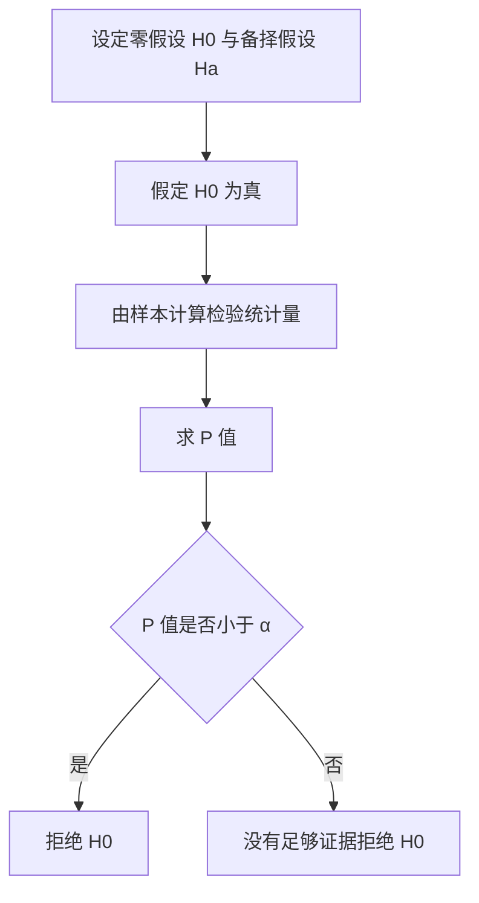
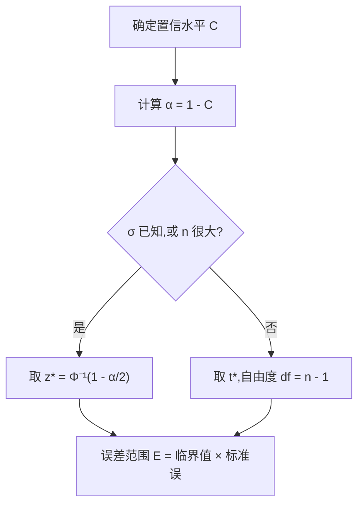
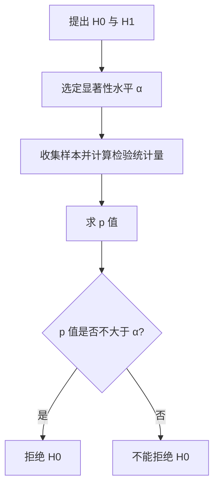

# Concept-Book Run

domain: /home/papagame/projects/digital-duck/cb-data-science/public/domains/data_science_ch04/input/graph.yaml
target: python_statistical_computing
started: 2026-11-25T04:31:51

## Teaching order (15 concepts)

- point_estimate
- null_hypothesis
- alternative_hypothesis
- critical_value
- level_of_significance
- scatterplot
- test_statistic
- correlation_coefficient
- f_distribution
- hypothesis_testing
- margin_of_error
- anova
- confidence_interval
- linear_regression
- python_statistical_computing

### point_estimate (0.5s)

## 点估计

**定义。** 设 $\theta$ 是总体中未知的参数(如总体均值 $\mu$、总体比例 $p$)。从总体中抽取样本 $X_1,\dots,X_n$,**点估计**(point estimate)是用样本算出的**单个数值** $\hat\theta=g(x_1,\dots,x_n)$,作为 $\theta$ 的最佳猜测。产生该数值的公式或规则 $g(X_1,\dots,X_n)$ 称为**估计量**(estimator),它是随机变量;代入具体数据后得到的数才是**估计值**。

常见的点估计:

| 参数 | 估计量 | 记号 |
|---|---|---|
| 总体均值 $\mu$ | 样本均值 | $\bar x=\dfrac1n\sum x_i$ |
| 总体比例 $p$ | 样本比例 | $\hat p=\dfrac{x}{n}$ |
| 总体方差 $\sigma^2$ | 样本方差 | $s^2=\dfrac{1}{n-1}\sum (x_i-\bar x)^2$ |

**好估计量的标准。** 若 $E[\hat\theta]=\theta$,则称 $\hat\theta$ 是**无偏**的。$\bar X$ 和 $\hat p$ 都是无偏估计量。方差公式中用 $n-1$ 而不是 $n$,正是为了使 $s^2$ 无偏。在无偏估计量中,标准误 $\mathrm{SE}=\sqrt{\mathrm{Var}(\hat\theta)}$ 越小越好。

**例题。** 某校随机抽取 $n=50$ 名学生,记录每周睡眠时间(小时),得 $\sum x_i=340$,$\sum (x_i-\bar x)^2=147$。估计全校学生的平均睡眠时间及其波动。

1. 均值的点估计:$\bar x=\dfrac{340}{50}=6.8$ 小时。
2. 方差的点估计:$s^2=\dfrac{147}{49}=3$,所以 $s\approx1.73$ 小时。
3. 估计的精度:$\mathrm{SE}(\bar X)=\dfrac{\sigma}{\sqrt n}$,用 $s$ 代替 $\sigma$ 得 $\widehat{\mathrm{SE}}=\dfrac{1.73}{\sqrt{50}}\approx0.245$ 小时。

**问题求解应用。** 民调中随机访问 $n=400$ 人,有 $x=232$ 人支持某政策。

- 点估计:$\hat p=\dfrac{232}{400}=0.58$。
- 标准误:$\widehat{\mathrm{SE}}=\sqrt{\dfrac{\hat p(1-\hat p)}{n}}=\sqrt{\dfrac{0.58\times0.42}{400}}\approx0.0247$。
- 解读:真实支持率大约在 $0.58$ 附近,偏差通常在 2.5 个百分点左右。

**局限与要点。** 点估计只给出一个数,本身不说明它离真值有多远。换一个样本,$\bar x$ 或 $\hat p$ 就会变。因此在实际报告中,应同时给出标准误,并进一步构造**置信区间**,例如 $\hat p\pm1.96\,\widehat{\mathrm{SE}}$。还要注意:点估计只能纠正随机误差,不能纠正抽样偏差。若样本不是随机抽取的,即使 $n$ 很大,估计也会系统性地偏离真值。

### null_hypothesis (0.5s)

## 零假设(Null Hypothesis)

**定义。** 零假设记作 $H_0$,是关于总体的一个"无效应、无变化"的陈述,它断言某个总体参数恰好等于一个特定值:

$$H_0:\ \theta = \theta_0$$

其中 $\theta$ 可以是总体均值 $\mu$、比例 $p$ 等。与之相对的是备择假设 $H_a$,它表示"确有效应"(如 $\theta \neq \theta_0$、$\theta > \theta_0$ 或 $\theta < \theta_0$)。

假设检验的逻辑类似于"无罪推定":先假定 $H_0$ 成立,再检验样本数据与这一假定是否严重矛盾。若矛盾足够大,我们**拒绝** $H_0$;若不够大,我们只能说**没有足够证据拒绝** $H_0$,而不能说"证明了 $H_0$ 为真"。

**为什么设成"等于"?** 因为只有给定一个具体的参数值,我们才能算出检验统计量的抽样分布,从而计算"如果 $H_0$ 为真,得到当前这样极端的数据的概率",即 $P$ 值。

**例题。** 某饮料厂声称每瓶净含量为 $500$ mL。质检员怀疑装填不足,随机抽取 $n=36$ 瓶,测得样本均值 $\bar{x}=497$ mL,已知 $\sigma=9$ mL。

1. 建立假设:
$$H_0:\ \mu = 500,\qquad H_a:\ \mu < 500$$

2. 在 $H_0$ 成立时,计算检验统计量:
$$z=\frac{\bar{x}-\mu_0}{\sigma/\sqrt{n}}=\frac{497-500}{9/\sqrt{36}}=\frac{-3}{1.5}=-2$$

3. 单侧 $P$ 值:$P(Z\le -2)\approx 0.0228$。

4. 取显著性水平 $\alpha=0.05$,因为 $0.0228<0.05$,拒绝 $H_0$。结论:有足够证据表明平均净含量低于 $500$ mL。

**问题解决应用。** 如何正确设定 $H_0$?可按以下步骤:

- **找出"现状"或"声称值"**:它通常成为 $H_0$(如"药物无效""均值不变""硬币公平 $p=0.5$")。
- **把研究者想要证明的结论放进 $H_a$**:因为拒绝 $H_0$ 才算"有证据支持"。
- **$H_0$ 中必须含等号**($=$、$\le$ 或 $\ge$)。

**练习:** 某老师想检验新教学法是否提高平均成绩(原平均分为 $75$)。正确设定为 $H_0:\mu=75$,$H_a:\mu>75$。若误将"$\mu>75$"设为 $H_0$,就无法在 $\mu=75$ 这一具体值下计算分布。

**常见误区。** (1)"未拒绝 $H_0$"不等于"接受 $H_0$",只是证据不足;(2)$P$ 值**不是** $H_0$ 为真的概率,而是在 $H_0$ 为真的前提下观察到如此极端数据的概率;(3)拒绝 $H_0$ 可能犯第一类错误,其概率恰为 $\alpha$。


*图:假设检验的基本流程——以零假设为出发点,根据 $P$ 值与显著性水平 $\alpha$ 的比较作出决策。*

### alternative_hypothesis (0.6s)

## 备择假设

**定义。** 在假设检验中,**备择假设**(alternative hypothesis,记作 $H_a$ 或 $H_1$)是与原假设 $H_0$ 互补的陈述:它断言总体参数不等于(或大于、小于)原假设所设定的值。原假设代表"没有效应、没有差异"的现状;备择假设则代表研究者希望用数据加以支持的结论。只有当样本证据足够强,以致在 $H_0$ 成立时极不可能出现,我们才拒绝 $H_0$,转而接受 $H_a$。

以总体均值 $\mu$ 和原假设值 $\mu_0$ 为例,备择假设有三种形式:

$$
\begin{aligned}
&\text{双侧:} && H_a:\ \mu \neq \mu_0 \\
&\text{右侧:} && H_a:\ \mu > \mu_0 \\
&\text{左侧:} && H_a:\ \mu < \mu_0
\end{aligned}
$$

选择哪一种,取决于**研究问题本身**,而且必须在看到数据**之前**确定。若只关心"是否有变化",用双侧;若只关心"是否提高"或"是否降低",用单侧。

**例题。** 某饮料厂声称每瓶容量均值为 $500$ mL。消费者协会怀疑瓶装量不足,随机抽取 $n=36$ 瓶,测得样本均值 $\bar{x}=497$ mL,已知总体标准差 $\sigma=9$ mL。检验显著性水平 $\alpha=0.05$。

1. 建立假设。怀疑"不足",所以是左侧检验:
$$H_0:\ \mu = 500,\qquad H_a:\ \mu < 500$$
2. 计算检验统计量:
$$z=\frac{\bar{x}-\mu_0}{\sigma/\sqrt{n}}=\frac{497-500}{9/\sqrt{36}}=\frac{-3}{1.5}=-2$$
3. 求 $p$ 值。因为 $H_a$ 指向左侧,只看左尾:
$$p=P(Z\le -2)\approx 0.0228$$
4. 决策:$p<0.05$,拒绝 $H_0$。有充分证据表明平均容量低于 $500$ mL。

**问题求解应用。** 如果同样的数据改用双侧检验($H_a:\mu\neq 500$),则 $p=2\times0.0228=0.0456$。此时 $p$ 仍小于 $0.05$,但已非常接近临界值;若 $\alpha=0.04$,结论就会翻转。这说明**备择假设的方向直接改变 $p$ 值与结论**。

解题时可按下列步骤识别 $H_a$:

- 找关键词:"不同于""有变化"→ $\neq$;"高于""提高""超过"→ $>$;"低于""减少""不足"→ $<$。
- 等号($=$、$\le$、$\ge$)永远属于 $H_0$;$H_a$ 只使用 $\neq,>,<$。
- 不要在看到 $\bar{x}$ 后再挑选方向,否则等于偷偷把 $\alpha$ 放大,使结论失去可信度。

**常见误区。** 未能拒绝 $H_0$ 并不等于"证明 $H_0$ 为真",只是证据不足以支持 $H_a$;反之,拒绝 $H_0$ 也不意味着 $H_a$ 的效应一定很大,仅表示它在统计上可被检测到。

### critical_value (0.6s)

## 临界值

**定义。** 临界值(critical value)是分布曲线上的一个分界点:它把曲线下的面积按指定的置信水平 $C$ 切开,使中间面积为 $C$,两侧尾部面积共为 $\alpha = 1-C$。临界值记作 $z^*$(标准正态分布)或 $t^*$(自由度为 $df$ 的 $t$ 分布),在置信区间中用来确定误差范围:

$$
\text{误差范围 } E = \text{临界值} \times \text{标准误}
$$

例如,总体均值的置信区间为 $\bar{x} \pm z^* \dfrac{\sigma}{\sqrt{n}}$(已知 $\sigma$),或 $\bar{x} \pm t^* \dfrac{s}{\sqrt{n}}$(未知 $\sigma$,用样本标准差 $s$ 代替)。

**如何确定。** 每侧尾部面积为 $\alpha/2$,所以 $z^*$ 满足 $P(-z^* < Z < z^*) = C$,即 $z^* = \Phi^{-1}(1-\alpha/2)$。常用值如下:

| 置信水平 | $z^*$ |
|---|---|
| 90% | 1.645 |
| 95% | 1.960 |
| 99% | 2.576 |

$t^*$ 的尾部更厚,所以同一置信水平下 $t^* > z^*$;自由度 $df = n-1$ 越大,$t^*$ 越接近 $z^*$。

**例题。** 某校随机抽取 $n=25$ 名学生,测得每日睡眠时间的样本均值 $\bar{x}=7.2$ 小时,样本标准差 $s=0.9$ 小时。求总体均值的 95% 置信区间。

1. $\sigma$ 未知,使用 $t$ 分布,$df = 24$。
2. $\alpha/2 = 0.025$,查表得 $t^* = 2.064$。
3. 标准误 $= \dfrac{0.9}{\sqrt{25}} = 0.18$。
4. 误差范围 $E = 2.064 \times 0.18 \approx 0.372$。
5. 置信区间为 $7.2 \pm 0.372$,即 $(6.83,\ 7.57)$ 小时。

若误用 $z^* = 1.960$,则 $E \approx 0.353$,区间偏窄,会高估估计的精确程度。

**问题求解应用。** 临界值也能反过来用于确定样本量。要使误差范围不超过 $E$,由 $E = z^*\dfrac{\sigma}{\sqrt{n}}$ 解得

$$
n \ge \left(\frac{z^* \sigma}{E}\right)^2 .
$$

设 $\sigma = 15$,希望 99% 置信水平下 $E \le 3$:

$$
n \ge \left(\frac{2.576 \times 15}{3}\right)^2 = (12.88)^2 \approx 165.9,
$$

向上取整,需要 $n = 166$。若改用 95% 置信水平,则 $n \ge (1.960\times 15/3)^2 = 96.04$,取 97。可见置信水平越高,临界值越大,所需样本量也越大。

**选择流程。**


*该图展示了由置信水平出发,选择 $z^*$ 还是 $t^*$,再计算误差范围的流程。*

**小结。** 临界值把"我们有多大把握"这一置信水平转换成一个乘数:要求越高,临界值越大,区间越宽。选对分布(是 $z$ 还是 $t$)与自由度,是避免低估误差的关键。

### level_of_significance (0.5s)

## 显著性水平

**定义。** 显著性水平(level of significance)记作 $\alpha$,是我们事先规定的、可以容忍的**犯第一类错误的最大概率**。第一类错误指:原假设 $H_0$ 实际为真,却被我们拒绝了。即

$$
\alpha \ge P(\text{拒绝 } H_0 \mid H_0 \text{ 为真}).
$$

常用取值为 $0.05$、$0.01$、$0.10$。$\alpha$ 必须在看到数据**之前**选定,它是决策规则的一部分,而不是由数据得出的结果。

**与 $p$ 值的关系。** $p$ 值是在 $H_0$ 为真的前提下,得到至少与观测结果一样极端的结果的概率。判断规则为:

$$
p \le \alpha \;\Rightarrow\; \text{拒绝 } H_0;\qquad p > \alpha \;\Rightarrow\; \text{不拒绝 } H_0.
$$

$\alpha$ 越小,拒绝 $H_0$ 越困难,第一类错误越少,但第二类错误(漏掉真实效应)的概率 $\beta$ 通常会增大。

**例题。** 某饮料瓶标称容量 $\mu_0 = 500$ mL,已知标准差 $\sigma = 6$ mL。抽取 $n=36$ 瓶,样本均值 $\bar x = 497.5$ mL。在 $\alpha = 0.05$ 下,检验容量是否偏低。

建立假设:$H_0:\mu = 500$,$H_1:\mu<500$(左侧检验)。

检验统计量:

$$
z=\frac{\bar x-\mu_0}{\sigma/\sqrt n}=\frac{497.5-500}{6/\sqrt{36}}=\frac{-2.5}{1}=-2.5.
$$

临界值:左侧检验在 $\alpha=0.05$ 时,$z_{0.05}=-1.645$,拒绝域为 $z\le -1.645$。因为 $-2.5<-1.645$,所以拒绝 $H_0$。

用 $p$ 值核对:$p=P(Z\le -2.5)\approx 0.0062<0.05$,结论一致。

**问题求解应用。** 同样的数据,换一个 $\alpha$,结论可能不同,这说明 $\alpha$ 的选择本身就是一种决策。

1. 若 $\alpha=0.001$:临界值为 $-3.090$,而 $-2.5>-3.090$,**不能**拒绝 $H_0$。($p=0.0062>0.001$,同样得出此结论。)
2. 若把检验改为双侧,$\alpha=0.05$ 时临界值为 $\pm1.96$,$|-2.5|>1.96$,仍然拒绝;此时 $p=2\times0.0062=0.0124$。

**如何选择 $\alpha$。** 先问:犯第一类错误的代价有多大?
- 新药审批:错误地宣称无效药有效后果严重,取 $\alpha=0.01$ 或更小。
- 探索性的初步筛查:漏掉真实效应的代价更高,可取 $\alpha=0.10$。

**常见误区。**
- $\alpha$ 不是"$H_0$ 为真的概率",而是在 $H_0$ 为真的条件下,犯第一类错误的概率。
- "不拒绝 $H_0$"不等于"证明了 $H_0$",只说明证据不足。
- 检验 $m$ 个独立假设时,至少出现一次第一类错误的概率为 $1-(1-\alpha)^m$。例如 $m=20$、$\alpha=0.05$ 时约为 $0.64$,需要用 Bonferroni 校正(使用 $\alpha/m$)加以控制。

### scatterplot (0.6s)

## 散点图(Scatterplot)

### 定义

**散点图**是把成对数据 $(x_i, y_i)$, $i=1,\dots,n$ 画在直角坐标系中的图形。每一对观测值对应平面上的一个点,横轴通常表示解释变量(自变量) $x$,纵轴表示响应变量(因变量) $y$。

读散点图时,重点看四个特征:

- **方向**:点云整体上升为正相关,下降为负相关;
- **形状**:近似直线(线性)还是弯曲(非线性);
- **强度**:点围绕趋势线的紧密程度;
- **异常点**:明显偏离整体模式的点,以及可能的聚类。

散点图只显示"关联",不能证明因果关系。

### 例题

某班 6 名学生的每周学习时间 $x$(小时)与测验成绩 $y$(分)如下:

| $x$ | 2 | 4 | 5 | 7 | 8 | 10 |
|---|---|---|---|---|---|---|
| $y$ | 55 | 62 | 70 | 78 | 83 | 92 |

描点后,点从左下向右上排列,基本落在一条直线附近:方向为正,形状为线性,强度较强,没有明显异常点。

为了量化,计算样本相关系数 $r$。先求均值:$\bar{x}=6$,$\bar{y}=73.33$。则

$$
r=\frac{\sum (x_i-\bar{x})(y_i-\bar{y})}{\sqrt{\sum (x_i-\bar{x})^2\,\sum (y_i-\bar{y})^2}}\approx 0.997 .
$$

$r$ 接近 $1$,与图形的直观判断一致。最小二乘回归直线约为 $\hat{y}\approx 4.1x+48.7$,意思是:每多学 1 小时,平均成绩大约提高 4.1 分。

### 问题求解应用

**问题**:用上面的直线预测学习 6 小时的成绩,并判断能否预测学习 20 小时的成绩。

**解**:

1. 代入 $x=6$:$\hat{y}\approx 4.1\times 6+48.7=73.3$ 分。这在数据范围(2~10 小时)之内,属于**内插**,可信度较高。
2. 代入 $x=20$:得 $\hat{y}\approx 130.7$ 分,超过满分,显然不合理。这是**外推**,超出了观测范围,线性关系未必继续成立,结论不可靠。

**常见陷阱**:

- **只看 $r$、不画图**:著名的安斯库姆四重奏(Anscombe's quartet)中,四组形状完全不同的数据有几乎相同的 $r$ 和回归直线。只有画出散点图,才能发现曲线关系或离群点。
- **离群点的影响**:一个远离其余点的观测值可以显著改变 $r$ 和回归直线,应先检查它是数据错误还是真实现象。
- **混淆关联与因果**:学习时间与成绩正相关,但散点图本身不能排除其他因素(如基础水平、睡眠)的影响。

**小结**:分析双变量数据时,先画散点图,判断方向、形状、强度和异常点;确认关系大致线性后,再计算 $r$ 并建立回归模型,最后只在数据范围内做预测。

### test_statistic (0.5s)

## 检验统计量

**定义。** 检验统计量(test statistic)是由样本数据计算出的一个标准化数值,用来衡量样本结果偏离原假设 $H_0$ 的程度。它把“样本均值与假设值差多少”换算成“差了多少个标准误”,因此不同量纲的问题可以用同一把尺子比较。

当总体标准差 $\sigma$ 已知时,检验总体均值用 $z$ 统计量:

$$z=\frac{\bar x-\mu_0}{\sigma/\sqrt{n}}$$

当 $\sigma$ 未知、用样本标准差 $s$ 代替时,用 $t$ 统计量:

$$t=\frac{\bar x-\mu_0}{s/\sqrt{n}},\qquad \text{自由度 } df=n-1$$

通用形式是:

$$\text{检验统计量}=\frac{\text{样本估计值}-\text{原假设值}}{\text{估计值的标准误}}$$

在 $H_0$ 成立的前提下,$z$ 近似服从标准正态分布,$t$ 服从自由度为 $n-1$ 的 $t$ 分布。统计量的绝对值越大,说明样本结果在 $H_0$ 下越“罕见”,反对 $H_0$ 的证据越强。

**例题。** 某品牌电池标称平均寿命为 $\mu_0=500$ 小时。质检员随机抽取 $n=25$ 块电池,测得 $\bar x=488$ 小时,$s=30$ 小时。问:在 $\alpha=0.05$ 水平下,能否认为平均寿命低于标称值?

1. 假设:$H_0:\mu=500$,$H_a:\mu<500$(左尾检验)。
2. 标准误:$\dfrac{s}{\sqrt n}=\dfrac{30}{5}=6$。
3. 检验统计量:

$$t=\frac{488-500}{6}=-2$$

4. 自由度 $df=24$,查表得左尾临界值 $t_{0.05}\approx-1.711$。因为 $-2<-1.711$,统计量落入拒绝域;对应的 $p$ 值约为 $0.028<0.05$。
5. 结论:拒绝 $H_0$,有证据表明平均寿命低于 500 小时。

**问题求解应用。** 做检验时可按固定流程操作:

- **选对统计量。** 均值检验中,$\sigma$ 已知用 $z$,未知用 $t$;比例检验用 $z=\dfrac{\hat p-p_0}{\sqrt{p_0(1-p_0)/n}}$。
- **注意方向。** 统计量的符号要与 $H_a$ 一致,双尾检验看 $|t|$。
- **理解样本量的作用。** 若上例中 $n=100$,其余不变,标准误变为 $3$,则 $t=-4$,证据明显更强。样本量越大,同样的差距越容易被判为显著。
- **区分统计显著与实际重要。** 检验统计量大,只说明差异不太可能由抽样波动造成,并不说明差异本身很大。上例中 12 小时的差距是否有实际意义,要由具体情境判断。

**常见误区。** $p$ 值不是 $H_0$ 为真的概率,而是在 $H_0$ 为真时,出现至少与当前统计量一样极端的结果的概率。

### correlation_coefficient (0.6s)

## 相关系数

**定义。** 相关系数(皮尔逊相关系数)衡量两个变量之间*线性*关系的强度与方向。对数据对 $(x_i, y_i)$,$i=1,\dots,n$,定义为

$$
r=\frac{\sum_{i=1}^{n}(x_i-\bar x)(y_i-\bar y)}{\sqrt{\sum_{i=1}^{n}(x_i-\bar x)^2}\;\sqrt{\sum_{i=1}^{n}(y_i-\bar y)^2}}=\frac{s_{xy}}{s_x s_y}
$$

其中 $s_{xy}$ 是协方差,$s_x,s_y$ 是标准差。除以两个标准差使 $r$ 不再依赖单位,并由柯西—施瓦茨不等式保证 $-1\le r\le 1$。

- $r>0$:正相关;$r<0$:负相关;
- $|r|$ 越接近 1,点越贴近一条直线;
- $r=\pm1$:所有点恰好落在一条直线上;$r\approx0$:没有*线性*关系。

**例题。** 五名学生的每周学习时间 $x$(小时)与测验成绩 $y$:

| $x$ | 1 | 2 | 3 | 4 | 5 |
|---|---|---|---|---|---|
| $y$ | 55 | 60 | 70 | 75 | 90 |

步骤如下:

1. 均值:$\bar x=3$,$\bar y=70$。
2. 离差:$x_i-\bar x=-2,-1,0,1,2$;$y_i-\bar y=-15,-10,0,5,20$。
3. 乘积之和:$30+10+0+5+40=85$。
4. 平方和:$\sum(x_i-\bar x)^2=10$,$\sum(y_i-\bar y)^2=225+100+0+25+400=750$。
5. 代入公式:
$$
r=\frac{85}{\sqrt{10}\sqrt{750}}=\frac{85}{\sqrt{7500}}\approx\frac{85}{86.6}\approx0.98
$$

这表明学习时间与成绩之间存在很强的正线性关系。

**问题求解应用。** 

*(1)线性变换不改变 $|r|$。* 若把成绩换算为百分制以外的分数,如 $y'=2y+10$,则 $r$ 不变(若乘以负数,则只改变符号)。因此 $r$ 可以跨单位比较。

*(2)与回归的联系。* 最小二乘回归直线的斜率为 $b=r\,\dfrac{s_y}{s_x}$。本例中 $s_y/s_x=\sqrt{750/10}\approx8.66$,所以 $b\approx0.98\times8.66\approx8.5$:每多学一小时,预测成绩约提高 8.5 分。决定系数 $r^2\approx0.96$,意味着成绩变化的约 96% 可由线性关系解释。

*(3)常见陷阱。*
- **非线性关系**:取 $y=x^2$,$x=-2,-1,0,1,2$,则 $r=0$,但 $y$ 完全由 $x$ 决定。$r=0$ 只说明没有线性关系。
- **异常值**:一个极端点可以大幅拉高或拉低 $r$,应先画散点图再计算。
- **相关不等于因果**:冰淇淋销量与溺水人数正相关,是因为两者都受气温影响(混杂变量),而不是一个导致另一个。

**小结。** 计算 $r$ 前先画散点图,确认关系大致呈直线;再用 $r$ 的符号判断方向、用 $|r|$ 或 $r^2$ 判断强度,并始终避免把相关解读为因果。

### f_distribution (0.5s)

## F 分布

**定义。** 设 $U \sim \chi^2_{d_1}$,$V \sim \chi^2_{d_2}$,且二者相互独立,则比值

$$F = \frac{U/d_1}{V/d_2} \sim F(d_1, d_2)$$

服从自由度为 $d_1$(分子自由度)和 $d_2$(分母自由度)的 **F 分布**。它的直观含义是:两个"方差估计量"之比。若两者估计的是同一个总体方差,比值应接近 1。

主要性质:

- $F \ge 0$,密度曲线**右偏**;$d_1, d_2$ 增大时,分布逐渐向 1 附近集中、趋于对称。
- 当 $d_2 > 2$ 时,$E[F] = \dfrac{d_2}{d_2-2}$,略大于 1。
- 分子、分母自由度不可互换:$F(d_1,d_2)$ 与 $F(d_2,d_1)$ 不同,且 $F_{1-\alpha}(d_1,d_2) = 1/F_{\alpha}(d_2,d_1)$。
- 若 $T \sim t_{d}$,则 $T^2 \sim F(1, d)$。

**与 ANOVA 的联系。** 单因素方差分析中有 $k$ 个组、共 $N$ 个观测。若各组总体均值相等(原假设 $H_0$),则

$$F = \frac{MS_B}{MS_W} = \frac{SS_B/(k-1)}{SS_W/(N-k)} \sim F(k-1,\; N-k).$$

组间均方 $MS_B$ 反映组均值的差异,组内均方 $MS_W$ 反映随机噪声。若 $H_0$ 不成立,$MS_B$ 偏大,$F$ 落在右尾,所以 ANOVA 采用**右尾检验**。

**例题。** 三种教学方法(各 5 名学生,$k=3$,$N=15$)的成绩得到 $SS_B = 84$,$SS_W = 108$。

1. 自由度:$d_1 = k-1 = 2$,$d_2 = N-k = 12$。
2. 均方:$MS_B = 84/2 = 42$,$MS_W = 108/12 = 9$。
3. 统计量:$F = 42/9 \approx 4.67$。
4. 显著性水平 $\alpha = 0.05$ 时,查表得临界值 $F_{0.05}(2,12) \approx 3.89$。

因为 $4.67 > 3.89$,落入拒绝域,所以拒绝 $H_0$:三种教学方法的平均成绩并不全相同。

**问题求解应用。** 用软件可直接求 $p$ 值:

```python
from scipy import stats
F, df1, df2 = 4.67, 2, 12
p = stats.f.sf(F, df1, df2)   # 右尾概率
crit = stats.f.ppf(0.95, df1, df2)
print(p, crit)   # p ≈ 0.032, crit ≈ 3.89
```

$p \approx 0.032 < 0.05$,与查表结论一致。

**注意事项。**

- F 检验只说明"至少有一对均值不同",不指出具体哪一对,需要事后检验(如 Tukey HSD)。
- 使用前应检查前提:各组近似正态、方差齐性、观测相互独立。
- 若只比较两个总体的方差,可用 $F = s_1^2/s_2^2 \sim F(n_1-1, n_2-1)$,习惯上把较大的方差放在分子。

**小结。** F 分布是两个独立卡方变量(各除以自由度)之比的分布。它右偏且由 $(d_1,d_2)$ 决定,是 ANOVA 判断"组间差异是否大于随机噪声"的基础。

### hypothesis_testing (0.6s)

## 假设检验

**定义。** 假设检验是利用样本数据判断关于总体参数的某个声明是否可信的方法。我们先设立**原假设** $H_0$(默认"没有变化/没有差异",含等号)和**备择假设** $H_1$(我们怀疑成立的结论)。再选定**显著性水平** $\alpha$(常取 $0.05$),它是"$H_0$ 实际为真却被我们拒绝"(第一类错误)所能容忍的最大概率。

**检验统计量与 $p$ 值。** 检验统计量衡量样本结果偏离 $H_0$ 的程度。以总体标准差 $\sigma$ 已知的均值检验为例:

$$z=\frac{\bar{x}-\mu_0}{\sigma/\sqrt{n}}$$

$p$ 值是"假设 $H_0$ 为真时,得到至少与当前样本一样极端的结果的概率"。判断规则:

- 若 $p\le\alpha$,拒绝 $H_0$(数据提供了足够证据支持 $H_1$);
- 若 $p>\alpha$,不能拒绝 $H_0$(证据不足,但这并不等于证明 $H_0$ 为真)。

**例题。** 某工厂声称灯泡平均寿命为 $\mu_0=1000$ 小时,已知 $\sigma=60$ 小时。质检员随机抽取 $n=36$ 个灯泡,测得 $\bar{x}=980$ 小时。问在 $\alpha=0.05$ 下,能否认为平均寿命低于声称值?

1. 设立假设:$H_0:\mu=1000$,$H_1:\mu<1000$(左尾检验)。
2. 计算统计量:
$$z=\frac{980-1000}{60/\sqrt{36}}=\frac{-20}{10}=-2$$
3. 计算 $p$ 值:$p=P(Z\le -2)\approx 0.0228$。
4. 作出决策:因为 $0.0228<0.05$,拒绝 $H_0$。

结论:在 $5\%$ 显著性水平下,样本提供了足够证据表明灯泡平均寿命低于 $1000$ 小时。

**问题求解应用。** 解题时可按固定流程:(1)判断检验类型(单尾还是双尾,由 $H_1$ 的方向决定);(2)选择统计量($\sigma$ 已知用 $z$,未知用 $t$);(3)求 $p$ 值;(4)与 $\alpha$ 比较并用问题的语境陈述结论。

若上例改为双尾检验($H_1:\mu\ne1000$),则 $p=2\times0.0228=0.0456$,仍小于 $0.05$,依然拒绝;但若取 $\alpha=0.01$,则两种检验都不能拒绝 $H_0$。可见结论依赖于 $\alpha$,而 $\alpha$ 必须在看数据**之前**确定,否则会人为"挑选"结论。

**常见误区。**
- $p$ 值**不是** $H_0$ 为真的概率,而是在 $H_0$ 成立的前提下数据出现的概率。
- "不能拒绝 $H_0$"不等于"接受 $H_0$"。
- 统计显著不等于实际重要:样本很大时,微小的差异也可能得到很小的 $p$ 值,应同时考察效应大小。


*图:假设检验的决策流程——先设定 $H_0$、$H_1$ 与 $\alpha$,再由样本计算统计量和 $p$ 值,最后比较 $p$ 与 $\alpha$ 作出决策。*

### margin_of_error (0.5s)

## 误差范围(Margin Of Error)

### 定义

用样本估计总体参数时,点估计值 $\hat{\theta}$ 几乎不可能恰好等于真实参数 $\theta$。**误差范围**(margin of error,记作 $E$)是在给定置信水平下,点估计与真实参数之间"预期的最大距离"。置信区间就是

$$
\hat{\theta} \pm E .
$$

对总体均值(总体标准差 $\sigma$ 已知,或样本量较大),

$$
E = z^{*}\,\frac{\sigma}{\sqrt{n}},
$$

其中 $z^{*}$ 是置信水平对应的临界值(90% 取 1.645,95% 取 1.96,99% 取 2.576),$\sigma/\sqrt{n}$ 是样本均值的标准误。对总体比例,

$$
E = z^{*}\sqrt{\frac{\hat{p}(1-\hat{p})}{n}} .
$$

由公式可见三个规律:

- 样本量 $n$ 越大,$E$ 越小,但只按 $1/\sqrt{n}$ 的速度缩小;
- 置信水平越高,$z^{*}$ 越大,$E$ 越大;
- 总体波动 $\sigma$ 越大,$E$ 越大。

### 例题

某校随机抽取 $n=64$ 名学生,测得每天平均睡眠时间 $\bar{x}=7.2$ 小时,已知 $\sigma=1.6$ 小时。求 95% 置信区间。

$$
E = 1.96\times\frac{1.6}{\sqrt{64}} = 1.96\times 0.2 = 0.392 \approx 0.39 \text{ 小时}.
$$

置信区间为 $7.2 \pm 0.39$,即 $(6.81,\ 7.59)$ 小时。

注意正确的解释:这并不表示"真实均值有 95% 的概率落在这个区间内"。它的含义是:如果重复抽样很多次并用同样方法构造区间,约 95% 的区间会覆盖真实均值。

### 问题求解:反推所需样本量

民调机构想估计某政策的支持率,要求 95% 置信水平下误差范围不超过 $E=0.03$(即 3 个百分点)。需要多大样本?

解 $E$ 的公式得

$$
n = \left(\frac{z^{*}}{E}\right)^{2}\hat{p}(1-\hat{p}).
$$

事先没有 $\hat{p}$ 的信息时,取最保守的 $\hat{p}=0.5$(此时 $\hat{p}(1-\hat{p})$ 最大,为 0.25):

$$
n = \left(\frac{1.96}{0.03}\right)^{2}\times 0.25 \approx 1067.1 .
$$

样本量必须取整数,且**向上取整**,所以 $n=1068$。

再思考一下:若想把误差范围减半到 1.5%,样本量需要变为原来的 $2^2=4$ 倍,约 4268 人。这就是"精度翻倍、成本翻四倍"的代价。

### 常见误区

1. 误差范围只反映**随机抽样误差**,不包含抽样偏差(如问卷设计不当、无应答)。样本有偏时,再大的 $n$ 也无法修正。
2. 比较两组结果时,需要看差异是否超出各自的误差范围,而不能只看数字大小。

### anova (0.6s)

## 方差分析（ANOVA）

### 定义

当需要比较三个或更多总体的均值时，若对每两组分别做 $t$ 检验，会使犯第一类错误的总概率迅速膨胀。例如 $k=4$ 组需做 6 次检验，整体犯错概率约为 $1-0.95^6\approx 26\%$。**方差分析**（Analysis of Variance，ANOVA）用一次检验解决这个问题：

$$H_0:\ \mu_1=\mu_2=\cdots=\mu_k \qquad H_1:\ \text{至少有一个 }\mu_i\text{ 不同}$$

其核心思想是分解总变异：

$$SST = SSB + SSW$$

其中 $SST=\sum_{i}\sum_{j}(x_{ij}-\bar{x})^2$ 为总平方和，$SSB=\sum_i n_i(\bar{x}_i-\bar{x})^2$ 为**组间平方和**（各组均值之间的差异），$SSW=\sum_i\sum_j(x_{ij}-\bar{x}_i)^2$ 为**组内平方和**（随机误差）。设总样本量为 $N$，则检验统计量为

$$F=\frac{MSB}{MSW}=\frac{SSB/(k-1)}{SSW/(N-k)}$$

在 $H_0$ 成立且满足假设（各组独立、近似正态、方差相等）时，$F\sim F(k-1,\,N-k)$。直观地说：组间差异相对于组内噪声越大，$F$ 越大，越有理由拒绝 $H_0$。

### 例题

三种肥料各种植 4 块地，亩产数据如下：

- A：$20,\,22,\,21,\,21$，均值 $\bar{x}_A=21$
- B：$24,\,25,\,23,\,24$，均值 $\bar{x}_B=24$
- C：$22,\,23,\,22,\,21$，均值 $\bar{x}_C=22$

总均值 $\bar{x}=\dfrac{21+24+22}{3}=\dfrac{67}{3}\approx 22.33$。

**组间：** $SSB=4\left[(21-22.33)^2+(24-22.33)^2+(22-22.33)^2\right]=4(1.78+2.78+0.11)\approx 18.67$

**组内：** A 组 $SS=0+1+0+0=2$；B 组 $SS=0+1+1+0=2$；C 组 $SS=0+1+0+1=2$，故 $SSW=6$。

**自由度：** $k-1=2$，$N-k=12-3=9$。

$$F=\frac{18.67/2}{6/9}=\frac{9.33}{0.667}=14.0$$

查表得 $F_{0.05}(2,9)=4.26$。因为 $14.0>4.26$，在 $\alpha=0.05$ 下拒绝 $H_0$，说明三种肥料的平均产量不全相同。

### 问题解决应用

ANOVA 的使用流程：

1. **检查假设**：各组样本独立；残差近似正态；各组方差大致相等（最大样本标准差不超过最小的 2 倍可作粗略判断）。
2. **计算 $F$ 并与临界值比较**，或比较 $p$ 值与 $\alpha$。
3. **若拒绝 $H_0$，做事后检验**（如 Tukey HSD）确定*哪些*组之间有差异。ANOVA 本身只回答"是否有差异"，不回答"谁与谁不同"。

在 Python 中可直接计算：

```python
from scipy import stats
A = [20, 22, 21, 21]
B = [24, 25, 23, 24]
C = [22, 23, 22, 21]
F, p = stats.f_oneway(A, B, C)
print(F, p)   # F = 14.0, p ≈ 0.0017
```

**常见误区：** 拒绝 $H_0$ 不等于所有均值都不同；不拒绝 $H_0$ 也不证明均值相等，只是证据不足。若数据明显偏态或方差悬殊，应考虑 Kruskal–Wallis 检验等非参数方法。

### confidence_interval (0.5s)

## 置信区间

**定义。** 置信区间(confidence interval)是以点估计量为中心构造的一个区间,用来估计总体参数。若置信水平为 $1-\alpha$(常取 95%),则意味着:在相同条件下反复抽样并各自构造区间,长期来看约有 $100(1-\alpha)\%$ 的区间会包含真实参数。需要注意,这是对*方法*的陈述,而不是说"某一个已算出的区间有 95% 的概率包含参数"——参数是固定的,随机的是区间。

当总体标准差 $\sigma$ 已知(或样本量较大)时,总体均值 $\mu$ 的置信区间为

$$
\bar{x} \pm z_{\alpha/2}\,\frac{\sigma}{\sqrt{n}}
$$

其中 $\bar{x}$ 是样本均值,$z_{\alpha/2}$ 是标准正态分布的临界值(95% 时为 $1.96$),$\sigma/\sqrt{n}$ 是标准误,$z_{\alpha/2}\,\sigma/\sqrt{n}$ 称为误差限。若 $\sigma$ 未知且样本较小,则用样本标准差 $s$ 和自由度为 $n-1$ 的 $t$ 分布临界值 $t_{\alpha/2,\,n-1}$ 代替。

**例题。** 某班随机抽取 $n=36$ 名学生,测得每周平均学习时间 $\bar{x}=12.5$ 小时,已知 $\sigma=3$ 小时。求 $\mu$ 的 95% 置信区间。

1. 标准误:$\dfrac{3}{\sqrt{36}}=0.5$。
2. 误差限:$1.96\times 0.5=0.98$。
3. 区间:$12.5\pm 0.98$,即 $(11.52,\ 13.48)$。

解释:我们有 95% 的信心认为,全班真实平均学习时间在 11.52 到 13.48 小时之间。

**问题求解应用。** 置信区间的宽度由三个因素决定:置信水平(越高,$z$ 越大,区间越宽)、数据波动 $\sigma$(越大越宽)、样本量 $n$(越大越窄,但按 $\sqrt{n}$ 的速度缩小)。这使我们能反过来*设计*调查。

*问题:* 若希望误差限不超过 $0.3$ 小时(仍取 95%,$\sigma=3$),至少需要多大样本?

由 $z_{\alpha/2}\dfrac{\sigma}{\sqrt{n}}\le E$ 得

$$
n \ge \left(\frac{z_{\alpha/2}\,\sigma}{E}\right)^2=\left(\frac{1.96\times 3}{0.3}\right)^2=19.6^2=384.16
$$

向上取整,至少需要 $n=385$。注意:要把误差限缩小为原来的一半,样本量必须变为原来的 4 倍。

**常见误区。**
- 误以为"95% 的数据落在区间内":置信区间描述的是*均值*的不确定性,而不是个体数据的分布范围。
- 把"95% 置信"理解为参数有 95% 的概率落在这个具体区间内。
- 忽略前提:样本应当随机,且样本量较小时总体应近似正态。

**小结。** 置信区间 = 点估计 ± 临界值 × 标准误。它同时给出估计值和估计的精确程度,是从样本推断总体时最常用的工具之一。

### linear_regression (0.5s)

## 线性回归

**定义。** 线性回归用一条直线来描述自变量 $x$ 与因变量 $y$ 之间的关系：

$$\hat{y} = \beta_0 + \beta_1 x$$

其中 $\beta_0$ 是截距，$\beta_1$ 是斜率，$\hat{y}$ 是模型的预测值。第 $i$ 个样本的**残差**为 $e_i = y_i - \hat{y}_i$。**最小二乘法**选取使残差平方和最小的参数：

$$\min_{\beta_0,\beta_1} \; \sum_{i=1}^{n}\left(y_i-\beta_0-\beta_1 x_i\right)^2$$

令偏导数为零，可得闭式解：

$$\beta_1=\frac{\sum_{i=1}^{n}(x_i-\bar{x})(y_i-\bar{y})}{\sum_{i=1}^{n}(x_i-\bar{x})^2},\qquad \beta_0=\bar{y}-\beta_1\bar{x}$$

由此可见，回归直线一定经过样本均值点 $(\bar{x},\bar{y})$。

**例题。** 某学生记录每周学习时长 $x$（小时）与考试成绩 $y$（分）：

| $x$ | 1 | 2 | 3 | 4 | 5 |
|---|---|---|---|---|---|
| $y$ | 55 | 65 | 70 | 80 | 90 |

第一步，求均值：$\bar{x}=3$，$\bar{y}=72$。

第二步，计算分子与分母：

$$\sum (x_i-\bar{x})(y_i-\bar{y}) = (-2)(-17)+(-1)(-7)+0\cdot(-2)+(1)(8)+(2)(18)=85$$

$$\sum (x_i-\bar{x})^2 = 4+1+0+1+4=10$$

第三步，$\beta_1 = 85/10 = 8.5$，$\beta_0 = 72 - 8.5\times 3 = 46.5$。

所以回归方程为 $\hat{y}=46.5+8.5x$。含义是：每多学习 1 小时，平均成绩约提高 8.5 分。

**问题求解应用。**

*(1) 预测。* 若学习 6 小时，则 $\hat{y}=46.5+8.5\times 6=97.5$ 分。注意 6 已超出数据范围 $[1,5]$，这属于**外推**，可靠性较低；成绩还有 100 分的上限，直线在此处很可能失效。

*(2) 评估拟合优度。* 各点的预测值为 $55,\,63.5,\,72,\,80.5,\,89$，残差为 $0,\,1.5,\,-2,\,-0.5,\,1$。于是

$$SS_{res}=0+2.25+4+0.25+1=7.5,\qquad SS_{tot}=\sum(y_i-\bar{y})^2=289+49+4+64+324=730$$

$$R^2 = 1-\frac{SS_{res}}{SS_{tot}} = 1-\frac{7.5}{730}\approx 0.990$$

即学习时长解释了成绩约 99% 的变异，说明线性模型拟合很好。

*(3) 检验前提。* 使用线性回归前，应画出残差图并检查：关系是否大致线性、残差是否无明显规律且方差大致恒定、是否存在对斜率影响过大的离群点。相关不等于因果：即使斜率显著，也不能仅凭此断定“多学习必然导致高分”，因为基础水平、睡眠等混杂因素可能同时影响两者。


*图：线性回归建模的基本流程，从数据检查、参数估计到残差诊断与预测。*

### python_statistical_computing (0.6s)

## Python 统计计算

### 定义

**Python 统计计算**是指利用 `NumPy`、`SciPy`（`scipy.stats`）、`statsmodels` 等库，把统计推断中的公式计算交给程序完成。我们负责三件事：选对方法、检查前提条件、解释输出。

常用函数对应关系如下：

| 任务 | 函数 |
|---|---|
| 单样本/双样本 $t$ 检验 | `stats.ttest_1samp`, `stats.ttest_ind` |
| 置信区间 | `stats.t.interval` |
| 相关系数 | `stats.pearsonr` |
| 简单线性回归 | `stats.linregress` |
| 单因素方差分析 | `stats.f_oneway` |

均值的 $(1-\alpha)$ 置信区间为

$$\bar{x} \pm t_{\alpha/2,\,n-1}\cdot \frac{s}{\sqrt{n}}$$

$t$ 统计量为

$$t=\frac{\bar{x}-\mu_0}{s/\sqrt{n}}$$

$p$ 值是在原假设成立时，出现至少与观测结果一样极端的结果的概率。它不是“原假设为真的概率”。

### worked example：置信区间与假设检验

某班 8 名学生的每日学习时长（小时）为 `[2.1, 2.8, 3.0, 2.5, 3.4, 2.9, 3.1, 2.7]`。检验平均学习时长是否不同于 $\mu_0=2.5$。

```python
import numpy as np
from scipy import stats

x = np.array([2.1, 2.8, 3.0, 2.5, 3.4, 2.9, 3.1, 2.7])
n, xbar, s = len(x), x.mean(), x.std(ddof=1)   # ddof=1：样本标准差

ci = stats.t.interval(0.95, df=n-1, loc=xbar, scale=s/np.sqrt(n))
t, p = stats.ttest_1samp(x, popmean=2.5)
print(xbar, ci, t, p)
```

结果：$\bar{x}=2.8125$，$s\approx0.396$，95% 置信区间约为 $(2.48,\,3.14)$，$t\approx2.23$，$p\approx0.061$。

解释：$p>0.05$，所以在 5% 显著性水平下不拒绝 $H_0$。置信区间包含 2.5，这与检验结论一致。注意 `ddof=1` 很关键，`np.std` 默认使用总体公式（`ddof=0`），会低估 $s$。

### 问题求解应用：相关、回归与 ANOVA

**相关与回归。** 研究学习时长 $x$ 与成绩 $y$ 的关系：

```python
hours = [1, 2, 3, 4, 5, 6]
score = [55, 62, 68, 75, 79, 88]
r, p_r = stats.pearsonr(hours, score)
res = stats.linregress(hours, score)
print(r, res.slope, res.intercept, res.rvalue**2, res.pvalue)
```

回归模型为 $\hat{y}=\beta_0+\beta_1 x$。输出的 `slope` 约为 6.5，表示每多学 1 小时，成绩平均约提高 6.5 分。$R^2=$ `rvalue**2` 接近 1，说明线性关系解释了绝大部分变异。`pvalue` 检验的是 $H_0:\beta_1=0$。

**单因素 ANOVA。** 比较三种教学方法的成绩均值：

```python
a = [78, 82, 85, 80]; b = [72, 75, 70, 74]; c = [88, 90, 85, 91]
F, p = stats.f_oneway(a, b, c)
```

检验统计量为

$$F=\frac{\text{组间均方}}{\text{组内均方}}=\frac{SS_B/(k-1)}{SS_W/(N-k)}$$

若 $p<0.05$，说明至少有一组均值不同。ANOVA 本身不会指出是哪一组，需要再做事后检验，例如 `scipy.stats.tukey_hsd`。

**实践检查清单：**

1. 先画图，再检验。
2. 检查前提：近似正态、方差齐性、观测独立。小样本时可用 `stats.shapiro` 和 `stats.levene`。
3. 同时报告效应大小（斜率、均值差、$R^2$）和 $p$ 值，不要只看显著与否。
4. 相关不等于因果。

## Run complete

total: 18.2s
