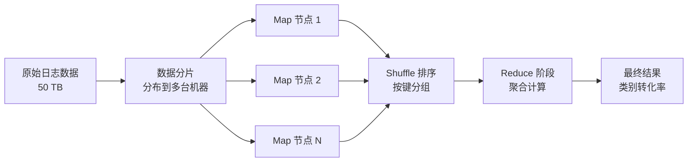
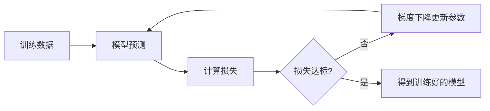
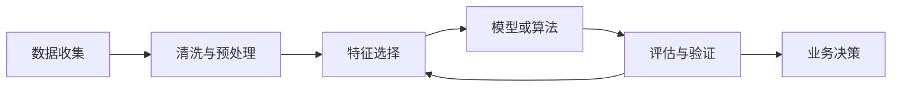

# Concept-Book Run

domain: /home/papagame/projects/digital-duck/cb-data-science/public/domains/data_science_ch06/input/graph.yaml
target: data_mining
started: 2026-11-25T04:32:35

## Teaching order (3 concepts)

- big_data
- machine_learning_model
- data_mining

### big_data (0.5s)

## Big Data

**定义**：大数据是指规模庞大、结构复杂、增长速度极快，以至于传统数据库和处理工具（如单机关系型数据库、Excel）无法在合理时间内存储、管理或分析的数据集合。业界常用"5V"来刻画其本质特征：Volume（体量，通常指 TB 至 PB 级别）、Velocity（速度，数据实时或近实时产生）、Variety（多样性，包含结构化表格、非结构化文本、图像、日志等）、Veracity（真实性，数据存在噪声与不确定性）、Value（价值，需从海量原始数据中提炼出有用信息）。判断一个数据集"是不是大数据"的关键不在于绝对字节数，而在于：单台机器的内存和计算能力是否足以在可接受时间内完成处理。

**应用场景**：以某电商平台为例，其每天产生的用户点击流日志约 50 TB，包含用户 ID、时间戳、商品 ID、页面停留时长等字段。若要计算"过去 30 天内每个商品类别的平均转化率"，传统做法是把所有数据读入内存后用一个 SQL 查询完成——但 50 TB × 30 天远超任何单机内存容量。工程团队采用的解决方案是 **MapReduce 范式**：将任务拆分为 Map 阶段（在数千台机器上并行读取本地数据分片，输出 `(商品类别, (点击, 转化)) ` 键值对）和 Reduce 阶段（按类别聚合所有 Map 输出，计算最终转化率）。这种"分而治之"的思路使得处理时间从理论上单机需要的数周，缩短到数百台机器并行后的几十分钟。

**解决问题的关键判断**：面对一个新的数据分析任务，判断是否需要"大数据"方案，可以用一个简单的经验法则——若数据集大小超过可用内存的 10 倍以上，或查询延迟要求（如实时推荐）无法容忍全量扫描，就应考虑分布式存储（如 HDFS）与分布式计算框架（如 Spark、Hadoop）。反之，若数据集在数 GB 量级、可一次性载入 Pandas DataFrame 完成分析，则引入大数据基础设施反而增加不必要的运维复杂度与延迟开销。这种"先估算规模、再选工具"的思维方式，是解决实际数据问题的第一步。

*该图展示了 MapReduce 处理大规模数据的整体流程：数据先被拆分并行处理（Map），再按键归并聚合（Reduce），最终得到统计结果。*

### machine_learning_model (0.6s)

## 机器学习模型

### 定义

**机器学习模型**是一个带有可调参数的数学函数 $f_{\theta}$。它从数据集中学习输入 $x$ 与输出 $y$ 之间的关系。这里的 $\theta$ 表示模型的内部参数，例如权重和偏置。"学习"就是在训练数据上不断调整 $\theta$，使预测值 $\hat{y}=f_{\theta}(x)$ 与真实值 $y$ 的差距（损失）降到可接受的水平。

常用的损失函数是均方误差：

$$L(\theta)=\frac{1}{n}\sum_{i=1}^{n}\bigl(y_i-f_{\theta}(x_i)\bigr)^2$$

调整参数最常用的方法是梯度下降：

$$\theta \leftarrow \theta-\eta\,\nabla_{\theta}L(\theta)$$

其中 $\eta>0$ 是学习率，它决定每一步更新的幅度。

### worked example：一元线性回归

设模型为 $f_{w,b}(x)=wx+b$，训练数据为 $(1,3),\,(2,5),\,(3,7)$。初始参数取 $w=0,\ b=0$，学习率取 $\eta=0.1$。

1. 预测值全为 $0$，误差 $e_i=\hat y_i-y_i$ 分别为 $-3,-5,-7$。
2. 梯度为
$$\frac{\partial L}{\partial w}=\frac{2}{n}\sum e_i x_i=\frac{2}{3}(-3-10-21)\approx-22.67,$$
$$\frac{\partial L}{\partial b}=\frac{2}{n}\sum e_i=\frac{2}{3}(-15)=-10.$$
3. 更新参数：$w\leftarrow 0-0.1\times(-22.67)\approx 2.27$，$b\leftarrow 0-0.1\times(-10)=1.0$。

只更新一步，$w$ 和 $b$ 就明显向真实关系 $y=2x+1$ 靠近。重复迭代后，损失会趋近于 $0$，参数收敛到 $w=2,\ b=1$。

*图：模型训练循环。预测、计算损失、更新参数，直到精度满足要求为止。*

### 问题求解应用

训练好的模型要用在**没见过的数据**上，所以不能只看训练损失。标准做法是把数据分成训练集和测试集。

**问题**：某模型训练集 MSE 为 $0.01$，测试集 MSE 为 $4.2$。该怎么判断？

**解答**：两者差距很大，说明模型出现了**过拟合**。它记住了训练数据的噪声，没有学到真正的规律。可以采取以下对策：

- 增加训练数据；
- 降低模型复杂度，例如减少多项式次数；
- 加入正则化项，把损失改为 $L(\theta)+\lambda\|\theta\|^2$；
- 用交叉验证来选择超参数 $\eta$ 和 $\lambda$。

相反，如果训练和测试误差都很高，就是**欠拟合**。这时应该增加模型表达能力，例如加入更多特征。

**小结**：机器学习模型 = 函数形式 + 可调参数 + 损失函数 + 优化方法。建模时要在拟合能力和泛化能力之间取得平衡。

### data_mining (0.5s)

## 数据挖掘

**定义。** 数据挖掘(data mining)是从大规模数据集中自动发现有用模式、趋势和关联的过程,综合运用机器学习、统计学与数据库技术。常见任务包括:关联规则挖掘、聚类、分类和异常检测。

以关联规则为例,设事务集合为 $T$,项集 $X$ 与 $Y$ 互不相交,规则 $X \Rightarrow Y$ 用三个指标衡量:

$$
\text{支持度}(X\Rightarrow Y)=\frac{|\{t\in T: X\cup Y\subseteq t\}|}{|T|},\qquad
\text{置信度}=\frac{\text{支持度}(X\cup Y)}{\text{支持度}(X)},
$$

$$
\text{提升度}=\frac{\text{置信度}(X\Rightarrow Y)}{\text{支持度}(Y)}.
$$

提升度大于 $1$,说明 $X$ 的出现确实提高了 $Y$ 出现的可能性。

**例题。** 某超市有 $100$ 笔交易:其中 $40$ 笔含面包,$30$ 笔含牛奶,$24$ 笔两者都含。求规则"面包 $\Rightarrow$ 牛奶"的各项指标。

- 支持度 $=24/100=0.24$
- 置信度 $=0.24/0.40=0.6$
- 牛奶的支持度为 $0.30$,故提升度 $=0.6/0.30=2$

结论:买面包的顾客购买牛奶的概率是一般顾客的 $2$ 倍,这条规则有实际价值。

**问题求解应用。** 数据挖掘通常遵循如下流程,先看图再讨论各步骤的要点。

*数据挖掘的典型流程:评估结果不理想时,需要回到特征选择阶段迭代改进。*

假设要找出信用卡盗刷交易,可以这样处理:

1. **清洗与预处理**:处理缺失值,对金额等特征标准化。
2. **选择方法**:盗刷占比极小,适合用异常检测或类别加权的分类模型。
3. **评估**:不能只看准确率。若盗刷仅占 $0.1\%$,"全部判为正常"的准确率高达 $99.9\%$,却毫无用处。应改用精确率 $P=\frac{TP}{TP+FP}$ 和召回率 $R=\frac{TP}{TP+FN}$,并计算 $F_1=\frac{2PR}{P+R}$。
4. **验证**:用交叉验证或留出集,避免模型只是记住了训练数据(过拟合)。

另一个常见陷阱是把相关性当作因果。冰淇淋销量与溺水人数同步上升,是因为共同的原因(高温),而不是冰淇淋导致溺水。挖掘出的模式只是假设,需要结合领域知识或实验来检验。

**小结。** 数据挖掘的核心是:用合适的指标量化模式(如支持度、置信度、提升度),用恰当的评估方法检验模型,并谨慎解释结果。

## Run complete

total: 5.7s
