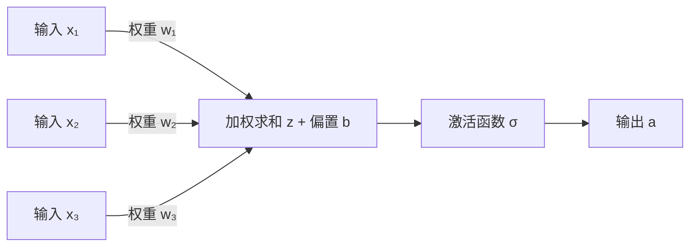
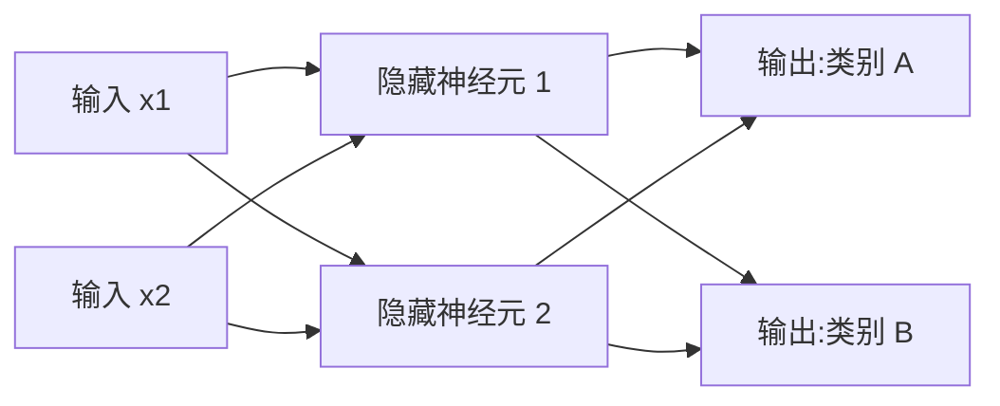
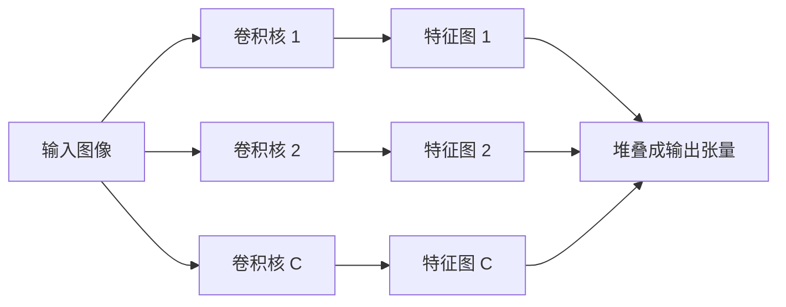
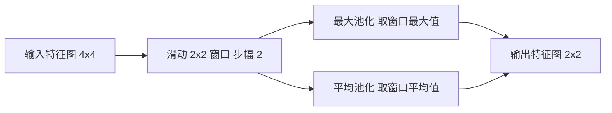

# Concept-Book Run

domain: /home/papagame/projects/digital-duck/cb-data-science/public/domains/data_science_ch07/input/graph.yaml
target: semantic_segmentation
started: 2026-11-25T04:32:57

## Teaching order (14 concepts)

- neuron
- bias
- weight
- activation_function
- layers
- neural_network
- perceptron
- depth
- multilayer_perceptron
- deep_learning
- convolutional_neural_network
- feature_map
- pooling_layer
- semantic_segmentation

### neuron (0.5s)

## 神经元

**定义。** 神经元(neuron)是神经网络中最小的决策单元:它接收若干输入 $x_1,\dots,x_n$,先做加权求和并加上偏置,再经过一个非线性的激活函数,输出一个数。

$$
z=\sum_{i=1}^{n} w_i x_i + b=\mathbf{w}^\top\mathbf{x}+b,\qquad a=\sigma(z)
$$

其中 $w_i$ 是权重,表示第 $i$ 个输入的重要程度(符号决定促进还是抑制);$b$ 是偏置,决定神经元"多容易被激活";$\sigma$ 是激活函数。常见的选择有:

- Sigmoid:$\sigma(z)=\dfrac{1}{1+e^{-z}}$,输出在 $(0,1)$ 之间,可解释为概率;
- ReLU:$\sigma(z)=\max(0,z)$,计算简单,深层网络中最常用。

没有 $\sigma$,多个神经元叠加后仍只是线性函数,无法表达复杂模式。

**例题。** 设一个 sigmoid 神经元有两个输入,权重 $\mathbf{w}=(2,-1)$,偏置 $b=-0.5$。输入 $\mathbf{x}=(1,3)$,求输出。

1. 加权求和:$z=2\cdot1+(-1)\cdot3-0.5=-1.5$。
2. 激活:$a=\dfrac{1}{1+e^{1.5}}\approx\dfrac{1}{1+4.482}\approx0.182$。

输出约为 $0.18$,接近 0,说明神经元"倾向于不激活"。第二个输入权重为负,把总和拉低了。

**问题求解应用:设计一个逻辑与(AND)神经元。** 要求只有当 $x_1=x_2=1$ 时输出接近 1。取 $w_1=w_2=10$,$b=-15$,激活函数用 sigmoid:

| $x_1$ | $x_2$ | $z$ | $a=\sigma(z)$ |
|---|---|---|---|
| 0 | 0 | $-15$ | $\approx0$ |
| 0 | 1 | $-5$ | $\approx0.007$ |
| 1 | 0 | $-5$ | $\approx0.007$ |
| 1 | 1 | $5$ | $\approx0.993$ |

思路是:偏置 $b$ 设置了"门槛",只有两个输入同时为 1,加权和 $20$ 才能超过 $15$。把 $b$ 改为 $-5$,同样的权重就实现了逻辑或(OR)。

这也说明了训练的本质:学习就是通过梯度下降调整 $\mathbf{w}$ 和 $b$,使神经元的输出逼近目标。单个神经元只能划出一条线性分界($\mathbf{w}^\top\mathbf{x}+b=0$),像异或(XOR)这样线性不可分的问题,必须把多个神经元分层连接才能解决。


*图:单个神经元的计算流程。多个输入经权重加权后求和并加上偏置,再通过激活函数得到输出。*

### bias (0.6s)

## 偏置(Bias)

### 定义

在单个神经元中,输入先经过加权求和,再通过激活函数输出。**偏置** $b$ 是加在加权和上的一个可学习常数:

$$z = \sum_{i=1}^{n} w_i x_i + b, \qquad a = \sigma(z)$$

权重 $w_i$ 决定"每个输入有多重要",而偏置 $b$ 决定"在没有任何输入刺激时,神经元本身有多容易被激活"。$b$ 越大,神经元越容易激活;$b$ 越小(越负),神经元越"迟钝",需要更强的输入才会被激活。

从几何上看,偏置让决策边界不必经过原点。没有偏置时,$w_1x_1 + w_2x_2 = 0$ 必然是一条过原点的直线;加入偏置后,边界 $w_1x_1 + w_2x_2 + b = 0$ 可以平移到任意位置。

### 例题

设一个神经元使用阶跃激活函数:$z \ge 0$ 时输出 1,否则输出 0。它有两个二值输入 $x_1, x_2 \in \{0,1\}$,权重 $w_1 = w_2 = 1$。

**情形 A:$b = -1.5$。** 计算 $z = x_1 + x_2 - 1.5$:

| $x_1$ | $x_2$ | $z$ | 输出 |
|---|---|---|---|
| 0 | 0 | $-1.5$ | 0 |
| 0 | 1 | $-0.5$ | 0 |
| 1 | 0 | $-0.5$ | 0 |
| 1 | 1 | $0.5$ | 1 |

这正是逻辑**与(AND)**。

**情形 B:$b = -0.5$。** 此时 $z = x_1 + x_2 - 0.5$,只要有一个输入为 1,就有 $z \ge 0.5 > 0$,输出 1;仅当两个输入都为 0 时输出 0。这是逻辑**或(OR)**。

权重完全相同,仅仅改变 $b$,神经元就实现了不同的功能。

### 问题求解应用

**问题:** 一个神经元用来判断"是否带伞"。输入 $x_1$ 为降雨概率(0 到 1),权重 $w_1 = 4$。要求:降雨概率超过 0.5 时才输出 1。求 $b$。

**解:** 临界点处 $z = 0$,即
$$4 \times 0.5 + b = 0 \;\Rightarrow\; b = -2.$$

验证:$x_1 = 0.7$ 时 $z = 2.8 - 2 = 0.8 > 0$,输出 1;$x_1 = 0.3$ 时 $z = 1.2 - 2 = -0.8 < 0$,输出 0。

**一般方法:** 若希望单输入神经元在 $x = x_0$ 处翻转,则令 $b = -w_1 x_0$。即偏置等于"阈值乘以权重"的相反数,这也说明偏置可以理解为**可学习的阈值**。

**训练中的偏置:** 梯度下降同样会更新偏置。因为 $\partial z / \partial b = 1$,所以
$$\frac{\partial L}{\partial b} = \frac{\partial L}{\partial a}\,\sigma'(z),$$
更新规则为 $b \leftarrow b - \eta \,\dfrac{\partial L}{\partial b}$。实践中常把偏置视为一个恒为 1 的额外输入 $x_0 = 1$ 所对应的权重 $w_0 = b$,这样可以统一处理所有参数。

**小结:** 权重控制边界的**方向**(斜率),偏置控制边界的**位置**(平移)。

### weight (0.6s)

## Weight

**定义**

重量（weight）是物体所受的重力大小，其方向指向地心。根据牛顿第二定律，重力是质量与重力加速度的乘积：

$$W = mg$$

其中 $m$ 是物体的质量（单位：$\text{kg}$），$g$ 是当地的重力加速度（在地球表面附近约为 $9.8 \ \text{m/s}^2$），$W$ 的单位是牛顿（$\text{N}$）。需要特别区分**质量**与**重量**：质量是物体所含物质多少的量度，是标量、不随位置改变；重量是一种力，是向量，其大小随所在位置的 $g$ 值变化——同一物体在地球和月球上质量相同，但重量不同，因为月球表面的 $g$ 约为地球的 $1/6$。

**例题**

一名航天员在地球上的质量为 $75 \ \text{kg}$。求：(a) 他在地球表面的重量；(b) 他在月球表面（$g_{\text{月}} = 1.6 \ \text{m/s}^2$）的重量。

解：

(a) $W_{\text{地}} = mg_{\text{地}} = 75 \times 9.8 = 735 \ \text{N}$

(b) $W_{\text{月}} = mg_{\text{月}} = 75 \times 1.6 = 120 \ \text{N}$

可以看到，质量 $m = 75 \ \text{kg}$ 在两地保持不变，而重量随 $g$ 的减小而按比例减小。

**问题解决应用**

重量公式在实际问题中常与其他力平衡分析结合使用。例如，电梯中的人受到的视重（apparent weight）等于地板对人的支持力 $N$，由牛顿第二定律：

$$N - mg = ma \quad \Rightarrow \quad N = m(g + a)$$

其中 $a$ 为电梯的加速度（向上为正）。若电梯以 $a = 2 \ \text{m/s}^2$ 加速上升，质量 $m = 60 \ \text{kg}$ 的人所感受到的视重为：

$$N = 60 \times (9.8 + 2) = 708 \ \text{N}$$

大于其静止时的重量 $588 \ \text{N}$，这正是电梯启动时人感到"变重"的原因。掌握 $W = mg$ 及其在牛顿第二定律框架下的推广，是分析支持力、张力、自由落体和失重等一系列力学问题的基础工具。

### activation_function (0.8s)

## 激活函数(Activation Function)

**定义。** 单个神经元先计算加权输入与偏置之和(预激活值):

$$z = \sum_{i=1}^{n} w_i x_i + b = \mathbf{w}^\top \mathbf{x} + b,$$

再通过激活函数 $\phi$ 得到输出 $a = \phi(z)$。激活函数通常是**非递减**的:$z_1 \le z_2 \Rightarrow \phi(z_1) \le \phi(z_2)$。输入越强,神经元"激活"得越强,而不会反过来变弱。

**为什么必须是非线性的?** 若 $\phi$ 为线性函数,则两层网络 $W_2(W_1\mathbf{x}+\mathbf{b}_1)+\mathbf{b}_2$ 仍可化简为 $W'\mathbf{x}+\mathbf{b}'$,多层与单层等价。非线性激活函数使深层网络能够逼近复杂函数。

**常见激活函数:**

| 名称 | 公式 | 输出范围 |
|---|---|---|
| 阶跃函数 | $\phi(z)=\begin{cases}1,&z\ge 0\\0,&z<0\end{cases}$ | $\{0,1\}$ |
| Sigmoid | $\sigma(z)=\dfrac{1}{1+e^{-z}}$ | $(0,1)$ |
| tanh | $\tanh z=\dfrac{e^z-e^{-z}}{e^z+e^{-z}}$ | $(-1,1)$ |
| ReLU | $\max(0,z)$ | $[0,\infty)$ |

其中 Sigmoid 的导数为 $\sigma'(z)=\sigma(z)\bigl(1-\sigma(z)\bigr)\le \tfrac14$,这一性质在训练中很重要。

**例题。** 设 $\mathbf{w}=(2,-1)$,$b=-1$,输入 $\mathbf{x}=(1.5,\,1)$。

1. 预激活值:$z = 2(1.5) + (-1)(1) - 1 = 1$。
2. 阶跃函数:输出 $1$。
3. ReLU:输出 $\max(0,1)=1$。
4. Sigmoid:输出 $\dfrac{1}{1+e^{-1}}\approx 0.731$。

若改为 $\mathbf{x}=(0,1)$,则 $z=-2$。阶跃与 ReLU 输出 $0$(未激活),Sigmoid 输出 $\approx 0.119$(微弱激活)。可见,不同激活函数对"是否激活、激活多强"的刻画不同。

**问题求解应用:梯度与函数选择。** 反向传播要求对 $\phi$ 求导。链式法则给出

$$\frac{\partial L}{\partial w_i} = \frac{\partial L}{\partial a}\,\phi'(z)\,x_i .$$

- **梯度消失:** 因 $\sigma'(z)\le 0.25$,若网络有 $10$ 层都使用 Sigmoid,梯度最多被压缩为 $0.25^{10}\approx 10^{-6}$ 倍,浅层几乎无法学习。
- **ReLU 的优势:** 当 $z>0$ 时 $\phi'(z)=1$,梯度可无衰减地传递,因此成为隐藏层的默认选择。其缺点是 $z<0$ 时梯度为 $0$("神经元死亡"),可改用 Leaky ReLU:$\max(0.01z,\,z)$。
- **输出层的选择:** 二分类用 Sigmoid(输出可解释为概率);多分类用 Softmax;回归用线性输出。

**小结:** 激活函数 = 非线性 + (通常)单调非递减。选择时要考虑输出范围、梯度行为和任务类型。


*图:单个神经元的计算流程——输入经加权求和与偏置得到 $z$,再由激活函数产生输出。*

### layers (0.5s)

## 层(Layers)

**定义。** 神经网络中的**层**是一组并行工作的神经元:它们接收来自前一组神经元的*同一份输入*,各自独立计算,再把输出共同传给下一组。网络通常包含三类层:

- **输入层**:接收原始数据 $\mathbf{x}\in\mathbb{R}^{n_0}$,通常不做计算;
- **隐藏层**:位于中间,逐层提取越来越抽象的特征;
- **输出层**:给出最终预测。

设第 $l$ 层有 $n_l$ 个神经元,上一层输出为 $\mathbf{a}^{(l-1)}\in\mathbb{R}^{n_{l-1}}$,则整层的计算可写成一个矩阵运算:

$$
\mathbf{a}^{(l)}=\sigma\!\left(W^{(l)}\mathbf{a}^{(l-1)}+\mathbf{b}^{(l)}\right),
$$

其中 $W^{(l)}\in\mathbb{R}^{n_l\times n_{l-1}}$ 的第 $i$ 行是第 $i$ 个神经元的权重,$\mathbf{b}^{(l)}$ 是偏置,$\sigma$ 是激活函数(逐元素作用)。"同一份输入"体现在:$\mathbf{a}^{(l-1)}$ 被该层所有神经元共享。


*数据逐层前向传播:每一层的输出是下一层的输入。*

**例题。** 一个网络结构为 $2\to3\to1$(2 个输入、1 个含 3 个神经元的隐藏层、1 个输出)。设 $\sigma=\mathrm{ReLU}$,即 $\sigma(z)=\max(0,z)$,输入 $\mathbf{x}=(1,2)^\top$,

$$
W^{(1)}=\begin{pmatrix}1&0\\ -1&1\\ 2&-1\end{pmatrix},\quad
\mathbf{b}^{(1)}=\begin{pmatrix}0\\ 0\\ 1\end{pmatrix}.
$$

则
$$
W^{(1)}\mathbf{x}+\mathbf{b}^{(1)}=\begin{pmatrix}1\\ 1\\ 1\end{pmatrix},\qquad
\mathbf{a}^{(1)}=\mathrm{ReLU}(1,1,1)^\top=(1,1,1)^\top.
$$

若输出层 $W^{(2)}=(1,\,-2,\,1)$,$b^{(2)}=0.5$(输出层用恒等激活),则 $y=1-2+1+0.5=0.5$。

**问题求解应用。** 

1. **统计参数量。** 第 $l$ 层有 $n_l n_{l-1}+n_l$ 个参数。上例:$3\cdot2+3=9$,$1\cdot3+1=4$,共 13 个。若结构改为 $784\to128\to10$(手写数字识别),参数为 $784\cdot128+128+128\cdot10+10=101{,}770$。
2. **确定输入输出维度。** 输入层宽度由特征数决定,输出层宽度由任务决定:10 类分类取 10 个神经元(配 softmax),回归取 1 个。隐藏层的宽度与层数则是需要调节的设计选择。
3. **为什么需要非线性。** 若去掉 $\sigma$,两层合并为 $W^{(2)}(W^{(1)}\mathbf{x}+\mathbf{b}^{(1)})+\mathbf{b}^{(2)}$,仍是线性函数,多层毫无意义。激活函数使得堆叠隐藏层能表示更复杂的函数。

**小结。** 层是网络的基本组织单位:同层神经元共享输入、并行计算,可压缩成一次矩阵乘法。层数(深度)与每层宽度共同决定模型的表达能力和参数规模。

### neural_network (0.6s)

## 神经网络

**定义。** 神经网络(neural network)是由相互连接的“神经元”组成的计算结构,按层组织:**输入层**接收特征,一个或多个**隐藏层**逐层提取更抽象的表示,**输出层**给出分类结果。每个神经元先对输入做加权求和,再经非线性**激活函数**变换:

$$a = \sigma\!\left(\mathbf{w}^{\top}\mathbf{x} + b\right)$$

其中 $\mathbf{w}$ 是权重,$b$ 是偏置,$\sigma$ 常取 ReLU $\sigma(z)=\max(0,z)$ 或 sigmoid $\sigma(z)=\dfrac{1}{1+e^{-z}}$。若没有非线性激活,多层网络会退化成单个线性变换,无法表示复杂的决策边界。

整个网络的前向传播可写成逐层复合:

$$\mathbf{h}=\sigma(W_1\mathbf{x}+\mathbf{b}_1),\qquad \hat{\mathbf{y}}=\mathrm{softmax}(W_2\mathbf{h}+\mathbf{b}_2)$$

softmax 把输出变为概率:$\hat y_k=\dfrac{e^{z_k}}{\sum_j e^{z_j}}$。


*图:含两个输入、两个隐藏神经元和两个输出类别的最小神经网络。*

**例题。** 设输入 $\mathbf{x}=(1,\,2)$,隐藏层有两个 ReLU 神经元:
$W_1=\begin{pmatrix}1&-1\\ 0.5&1\end{pmatrix}$,$\mathbf{b}_1=\mathbf{0}$;输出层 $W_2=\begin{pmatrix}1&0\\ 0&2\end{pmatrix}$,$\mathbf{b}_2=\mathbf{0}$。

1. 隐藏层预激活:$W_1\mathbf{x}=(1-2,\;0.5+2)=(-1,\;2.5)$。
2. ReLU 后:$\mathbf{h}=(0,\;2.5)$。
3. 输出层:$\mathbf{z}=W_2\mathbf{h}=(0,\;5)$。
4. softmax:$\hat y_A=\dfrac{e^0}{e^0+e^5}\approx 0.007$,$\hat y_B\approx 0.993$。

网络判定该样本属于类别 B。

**问题求解应用。** 网络“学习”就是选择参数 $\theta=\{W,\mathbf{b}\}$ 使损失最小。分类常用交叉熵损失:

$$L=-\sum_k y_k\log \hat y_k$$

其中 $\mathbf{y}$ 是真实类别的独热向量。若上例真实类别为 A,则 $L=-\log 0.007\approx 4.96$,损失很大,说明预测错误。训练时用**反向传播**依链式法则计算梯度 $\partial L/\partial\theta$,再做梯度下降:

$$\theta \leftarrow \theta - \eta\,\frac{\partial L}{\partial \theta}$$

$\eta$ 为学习率。对 softmax 加交叉熵,输出层梯度形式很简洁:$\partial L/\partial z_k=\hat y_k-y_k$。本例中为 $(0.007-1,\;0.993-0)=(-0.993,\;0.993)$,它推动类别 A 的得分上升、类别 B 的得分下降。

实际应用步骤:(1)把数据标准化后输入;(2)选择层数与宽度,小数据集先用一到两个隐藏层;(3)监控训练集与验证集损失,若训练损失下降而验证损失上升,则说明**过拟合**,可减小网络、加正则化或提前停止。

### perceptron (0.6s)

## 感知机

**定义。** 感知机(perceptron)是最简单的单层神经网络:先对输入做加权求和,再用阶跃函数(step function)输出类别。设输入 $\mathbf{x}\in\mathbb{R}^n$,权重 $\mathbf{w}$,偏置 $b$,则

$$
\hat y = \begin{cases} +1, & \mathbf{w}^\top\mathbf{x}+b \ge 0 \\ -1, & \mathbf{w}^\top\mathbf{x}+b < 0 \end{cases}
$$

几何上,$\mathbf{w}^\top\mathbf{x}+b=0$ 是一条分界超平面(二维时是一条直线),感知机把平面分成两个半空间,分别对应两个类别。

**感知机学习规则。** 对每个训练样本 $(\mathbf{x}_i, y_i)$($y_i\in\{+1,-1\}$),若预测错误,则更新:

$$
\mathbf{w}\leftarrow \mathbf{w}+\eta\, y_i\,\mathbf{x}_i,\qquad b\leftarrow b+\eta\, y_i
$$

其中 $\eta>0$ 是学习率。预测正确时不做任何改动。直观上:被误判的正样本会把 $\mathbf{w}$ 拉向自己,被误判的负样本则把 $\mathbf{w}$ 推离自己。

**收敛性。** 若数据线性可分,且存在间隔 $\gamma$ 使 $y_i(\mathbf{w}^{*\top}\mathbf{x}_i)\ge\gamma$($\|\mathbf{w}^*\|=1$),所有样本满足 $\|\mathbf{x}_i\|\le R$,则感知机最多犯 $(R/\gamma)^2$ 次错误后收敛(Novikoff 定理)。若数据不可分(如异或问题),算法永不收敛。

**例题。** 学习逻辑与(AND)。样本:$(0,0)\to-1$,$(0,1)\to-1$,$(1,0)\to-1$,$(1,1)\to+1$。取 $\mathbf{w}=(0,0)$,$b=0$,$\eta=1$。

1. 样本 $(0,0)$:$\mathbf{w}^\top\mathbf{x}+b=0\ge0$,预测 $+1$,错误。更新:$\mathbf{w}=(0,0)$,$b=-1$。
2. 样本 $(0,1)$:值为 $-1$,预测 $-1$,正确。$(1,0)$ 同理正确。
3. 样本 $(1,1)$:值为 $-1$,预测 $-1$,错误(应为 $+1$)。更新:$\mathbf{w}=(1,1)$,$b=0$。
4. 再扫一遍:$(0,0)$ 得 $0$,预测 $+1$,错误,更新为 $\mathbf{w}=(1,1)$,$b=-1$。此时 $(0,1)$ 得 $0$,预测 $+1$,错误,更新为 $\mathbf{w}=(1,0)$,$b=-2$。继续迭代,最终可得到如 $\mathbf{w}=(2,1)$,$b=-3$ 的解,四个样本全部分类正确。

**问题求解应用。** 判断一个任务能否用感知机解决,关键是问:两类数据能否被一条直线(超平面)分开?

- 与、或、非:可以。
- 异或(XOR):$(0,0),(1,1)\to-1$,$(0,1),(1,0)\to+1$,四点无法被一条直线分开,单个感知机无能为力。

实践中的做法:先画散点图或检查线性可分性;可分则直接训练,并用 $(R/\gamma)^2$ 估计迭代上界;不可分则增加隐藏层(多层感知机)或做特征变换,例如为异或加入特征 $x_1x_2$,数据即在三维特征空间中变得线性可分。

```python
import numpy as np
def train(X, y, eta=1, epochs=100):
    w, b = np.zeros(X.shape[1]), 0
    for _ in range(epochs):
        errors = 0
        for xi, yi in zip(X, y):
            if yi * (w @ xi + b) <= 0:   # 误分类
                w += eta * yi * xi; b += eta * yi; errors += 1
        if errors == 0: break            # 已收敛
    return w, b
```

**小结。** 感知机用"错了就修正"的规则学习线性分界面;它在线性可分数据上保证收敛,但无法表示异或,这一局限直接推动了多层网络的发展。

### depth (0.6s)

## 深度(Depth)

**定义。** 神经网络的**深度**是指从输入到输出所经过的可学习变换的层数,通常以隐藏层的数量(或带参数的层总数)来衡量。若网络计算 $f(\mathbf{x}) = f_L \circ f_{L-1} \circ \cdots \circ f_1(\mathbf{x})$,其中每一层为

$$
\mathbf{h}_\ell = \sigma\left(W_\ell \mathbf{h}_{\ell-1} + \mathbf{b}_\ell\right),\quad \mathbf{h}_0=\mathbf{x},
$$

则深度就是复合的层数 $L$。通常隐藏层数较多(例如超过几层)的网络被称为**深度**网络,这也是"深度学习"一词的由来。深度不同于**宽度**(每层的神经元个数)。

**为什么深度重要。** 每增加一层,网络就能在前一层特征的基础上构造更抽象的特征。例如在图像识别中,浅层学习边缘,中层组合成纹理与局部形状,深层识别整体物体。对某些函数,深度带来指数级的效率:用浅层网络表示它们,所需神经元数量可能随输入规模指数增长,而深层网络只需多项式规模。

**例题。** 一个网络输入为 100 维,隐藏层大小依次为 64、32、16,输出为 10 维。求其深度与参数总数。

*解:* 有 3 个隐藏层,加上输出层,共 4 个带参数的变换,因此 $L=4$。各层参数(权重 + 偏置):

- 第 1 层:$100\times 64 + 64 = 6464$
- 第 2 层:$64\times 32 + 32 = 2080$
- 第 3 层:$32\times 16 + 16 = 528$
- 输出层:$16\times 10 + 10 = 170$

总参数为 $6464+2080+528+170 = 9242$。

**问题求解应用。** 比较两种设计:(A) 单隐藏层,宽 1000;(B) 三个隐藏层,每层宽 50。输入 100 维,输出 10 维。

- A:$100\times1000+1000 + 1000\times10+10 = 111{,}010$ 个参数。
- B:$(100\times50+50) + 2\times(50\times50+50) + (50\times10+10) = 5050+5100+5100+510 = 15{,}760$ 个参数。

B 的参数仅约为 A 的 $14\%$,却具有更强的层次化表达能力。这说明在参数预算相同时,**增加深度往往比一味增加宽度更有效**。

**代价与注意事项。** 深度并非越大越好:

1. **梯度消失/爆炸。** 反向传播时梯度是 $L$ 个雅可比矩阵的连乘,若各因子范数小于 1,则梯度随 $L$ 指数衰减,约为 $\prod_{\ell}\|J_\ell\|$。
2. **优化与过拟合难度上升。** 深层网络更难训练,也需要更多数据。
3. **对策。** 使用 ReLU 激活函数、批归一化,以及残差连接 $\mathbf{h}_\ell = \mathbf{h}_{\ell-1} + F(\mathbf{h}_{\ell-1})$,使得网络可以稳定地训练上百层。

**小结。** 深度 $L$ 是网络复合结构的层数;它让模型逐层构建抽象特征,常以更少的参数获得更强的表达力,但需要借助合适的技术来克服训练困难。

### multilayer_perceptron (0.5s)

## 多层感知机

### 定义

**多层感知机**(Multilayer Perceptron,MLP)是由输入层、一个或多个**隐藏层**和输出层依次全连接而成的前馈神经网络。单层感知机只能产生线性决策边界,因此无法解决异或(XOR)这类线性不可分问题。MLP 在层与层之间加入**非线性激活函数**,从而突破了这一限制。

第 $l$ 层的计算为

$$
\mathbf{h}^{(l)} = \sigma\!\left(W^{(l)}\mathbf{h}^{(l-1)} + \mathbf{b}^{(l)}\right),\qquad \mathbf{h}^{(0)}=\mathbf{x}
$$

其中 $W^{(l)}$ 是权重矩阵,$\mathbf{b}^{(l)}$ 是偏置,$\sigma$ 是激活函数,常用 $\sigma(z)=\max(0,z)$(ReLU)或 $\sigma(z)=\dfrac{1}{1+e^{-z}}$(sigmoid)。

关键点:若去掉 $\sigma$,多层只是矩阵连乘,$W^{(2)}W^{(1)}$ 仍是一个线性变换,深度就没有意义。非线性才是 MLP 表达能力的来源。

### 例题:用两层网络解决 XOR

XOR 的输入输出为 $(0,0)\to0,\ (0,1)\to1,\ (1,0)\to1,\ (1,1)\to0$。没有任何一条直线能把两类点分开。

取一个含 2 个隐藏单元的 ReLU 网络:

$$
h_1=\max(0,\,x_1+x_2),\quad h_2=\max(0,\,x_1+x_2-1),\quad y=h_1-2h_2
$$

逐点验证:

| $(x_1,x_2)$ | $h_1$ | $h_2$ | $y$ |
|---|---|---|---|
| (0,0) | 0 | 0 | 0 |
| (0,1) | 1 | 0 | 1 |
| (1,0) | 1 | 0 | 1 |
| (1,1) | 2 | 1 | 0 |

四个点全部分类正确。隐藏层把原本线性不可分的数据映射到新的表示空间,在那里一个线性输出层就够用了。

### 问题求解应用:训练与参数计数

**训练**。MLP 通过最小化损失函数(如均方误差 $L=\frac12\|\hat{\mathbf{y}}-\mathbf{y}\|^2$)来学习,用**反向传播**结合链式法则计算梯度。设 $\mathbf{z}^{(l)}=W^{(l)}\mathbf{h}^{(l-1)}+\mathbf{b}^{(l)}$,误差信号为 $\boldsymbol{\delta}^{(l)}=\partial L/\partial\mathbf{z}^{(l)}$,则

$$
\boldsymbol{\delta}^{(l)}=\left(W^{(l+1)\top}\boldsymbol{\delta}^{(l+1)}\right)\odot\sigma'(\mathbf{z}^{(l)}),\qquad
\frac{\partial L}{\partial W^{(l)}}=\boldsymbol{\delta}^{(l)}\,\mathbf{h}^{(l-1)\top}
$$

再用梯度下降更新:$W^{(l)}\leftarrow W^{(l)}-\eta\,\partial L/\partial W^{(l)}$。

**参数计数**。设网络结构为 784–128–64–10(如手写数字识别),各层参数量为

$$
784\times128+128 = 100480,\quad 128\times64+64=8256,\quad 64\times10+10=650
$$

共 $109386$ 个参数。这类估算帮助你在设计模型时权衡容量、内存和过拟合风险。

**理论保证**。万能逼近定理指出:含足够多隐藏单元的单隐藏层 MLP,可以在紧致集上以任意精度逼近任意连续函数。但它没有说明所需单元数,也没有说明梯度下降能否找到这组权重。因此实践中常用更深的网络,以更少的参数获得更好的表达效率。


*图:MLP 的前向传播(实线)与反向传播(虚线)。*

### deep_learning (0.6s)

## 深度学习

**定义。** 深度学习是指训练含有多个隐藏层的神经网络,使其从原始数据中逐层学习**层次化的结构表示**。设网络有 $L$ 层,第 $l$ 层的计算为

$$
\mathbf{h}^{(l)} = \sigma\!\left(W^{(l)}\mathbf{h}^{(l-1)} + \mathbf{b}^{(l)}\right),\quad \mathbf{h}^{(0)}=\mathbf{x},
$$

其中 $\sigma$ 是非线性激活函数(如 ReLU:$\sigma(z)=\max(0,z)$)。浅层学到简单特征(如图像中的边缘),中层组合成局部结构(如眼睛、轮廓),深层则表示整体概念(如"人脸")。若没有非线性 $\sigma$,多层只会合并成一个线性映射 $W^{(L)}\cdots W^{(1)}$,"深度"也就失去意义。

**训练。** 给定损失函数 $\mathcal{L}(\theta)$(参数 $\theta=\{W^{(l)},\mathbf{b}^{(l)}\}$),用**反向传播**依链式法则逐层求梯度:

$$
\frac{\partial \mathcal{L}}{\partial W^{(l)}} = \boldsymbol{\delta}^{(l)}\,\mathbf{h}^{(l-1)\top},\qquad
\boldsymbol{\delta}^{(l)} = \left(W^{(l+1)\top}\boldsymbol{\delta}^{(l+1)}\right)\odot \sigma'\!\left(\mathbf{z}^{(l)}\right),
$$

再用梯度下降更新:$\theta \leftarrow \theta - \eta\,\nabla_\theta \mathcal{L}$,$\eta$ 为学习率。

**例题:XOR 问题。** 数据点 $(0,0),(1,1)\mapsto 0$,$(0,1),(1,0)\mapsto 1$ 无法被任何线性分类器分开。取一个含两个 ReLU 隐藏单元的网络:

$$
h_1=\max(0,\,x_1+x_2),\quad h_2=\max(0,\,x_1+x_2-1),\quad y=h_1-2h_2.
$$

逐点验证:$(0,0)$ 得 $y=0$;$(1,0)$ 得 $h_1=1,h_2=0$,$y=1$;$(1,1)$ 得 $h_1=2,h_2=1$,$y=0$。隐藏层把输入"折叠"到一个线性可分的新空间,这正是深度表示的核心思想。

**问题求解应用:梯度消失。** 反向传播中 $\boldsymbol{\delta}^{(1)}$ 含有 $L-1$ 个因子的连乘。若使用 sigmoid,则 $\sigma'(z)\le \tfrac14$,假设每层权重范数约为 1,则梯度量级约为

$$
\left(\tfrac14\right)^{10}\approx 10^{-6}\quad(L=11).
$$

前几层几乎学不到东西。常见对策:

1. 换用 ReLU(正区间导数为 1);
2. 采用合适的初始化(如 He 初始化,令 $\mathrm{Var}(W)=2/n_{\text{in}}$);
3. 加入残差连接 $\mathbf{h}^{(l)}=\mathbf{h}^{(l-1)}+F(\mathbf{h}^{(l-1)})$,使梯度有一条恒等捷径;
4. 使用批归一化稳定各层输入分布。

**诊断思路。** 若训练损失下降缓慢,先检查梯度范数是否逐层衰减;若训练损失低而验证损失高,则是过拟合,可用权重衰减、Dropout、数据增强或提前停止来缓解。


*图:深度网络前向逐层提取由简到繁的特征,损失产生的梯度沿相反方向逐层传回,用于更新各层参数。*

### convolutional_neural_network (0.6s)

## 卷积神经网络

**定义。** 卷积神经网络(Convolutional Neural Network,CNN)是专门处理网格状数据(如图像)的神经网络。它的核心是用一个小的可学习**卷积核**(滤波器)在输入上滑动,每个位置做加权求和。对输入 $X$ 和核 $K$(大小 $k\times k$),输出特征图为

$$
Y_{i,j}=\sum_{u=0}^{k-1}\sum_{v=0}^{k-1}K_{u,v}\,X_{i+u,\,j+v}+b .
$$

(深度学习中实际计算的是互相关,与翻转核后的数学卷积只差一个符号约定,不影响学习。)

CNN 有两个关键性质:

- **局部连接**:每个输出只依赖一小块邻域。
- **权重共享**:同一个核用于所有位置,因此检测到的模式具有**平移等变性**。

一个典型的 CNN 依次堆叠:卷积层 → 非线性激活(如 ReLU)→ 池化层(下采样)→ 全连接分类层。

**输出尺寸。** 输入边长 $n$,核大小 $k$,填充 $p$,步幅 $s$,则输出边长为

$$
m=\left\lfloor \frac{n+2p-k}{s}\right\rfloor+1 .
$$

**例题。** 设输入为 $4\times4$ 矩阵,核为 $2\times2$,

$$
X=\begin{pmatrix}1&2&0&1\\0&1&3&1\\2&1&0&0\\1&0&1&2\end{pmatrix},\quad
K=\begin{pmatrix}1&0\\0&-1\end{pmatrix},\quad b=0,\ p=0,\ s=1 .
$$

由公式得 $m=4-2+1=3$,输出为 $3\times3$。计算左上角:

$$
Y_{0,0}=1\cdot1+0\cdot2+0\cdot0+(-1)\cdot1=0 .
$$

再算 $Y_{0,1}=1\cdot2+(-1)\cdot3=-1$。这个核计算"左上元素减右下元素",因此是一个对角方向的边缘检测器。

**问题求解应用:参数量比较。** 设输入为 $32\times32\times3$ 的彩色图像,要产生 $16$ 个特征图。

1. 若用全连接层输出 $30\times30\times16$ 个单元,参数约为 $32\cdot32\cdot3\cdot(30\cdot30\cdot16)\approx 4.4\times10^{7}$。
2. 若用 $16$ 个 $3\times3$ 卷积核,每个核形状为 $3\times3\times3$,参数为 $(3\cdot3\cdot3+1)\cdot16=448$。

两者的输出尺寸相同,但卷积层的参数少了约五个数量级。这就是 CNN 在图像任务上训练高效、不易过拟合的原因。

**感受野。** 堆叠 $L$ 层 $3\times3$ 卷积(步幅 1),感受野为 $(2L+1)\times(2L+1)$。因此深层神经元能"看到"更大区域:浅层学边缘,中层学纹理和部件,深层学整体物体。设计网络时,可以先根据目标物体的尺寸算出所需感受野,再确定层数。


*典型 CNN 的数据流:卷积与池化交替提取由低到高的特征,最后由全连接层完成分类。*

### feature_map (0.5s)

## 特征图(Feature Map)

### 定义

**特征图**是卷积层的输出:一个卷积核(滤波器)在输入上滑动,对每个空间位置计算加权和,所得到的二维数组就是一张特征图。它记录了"某种特定模式在输入的哪些位置出现、强度多大"。

设输入为 $X \in \mathbb{R}^{H\times W}$,卷积核为 $K \in \mathbb{R}^{k\times k}$,偏置为 $b$,激活函数为 $\sigma$,则特征图 $F$ 的元素为

$$
F_{i,j}=\sigma\!\left(\sum_{u=0}^{k-1}\sum_{v=0}^{k-1}K_{u,v}\,X_{i+u,\,j+v}+b\right).
$$

(严格地说,这是深度学习中通用的"互相关"形式。)若一层有 $C_{out}$ 个卷积核,就得到 $C_{out}$ 张特征图,堆叠成张量 $F\in\mathbb{R}^{H'\times W'\times C_{out}}$。输出的空间尺寸为

$$
H'=\left\lfloor \frac{H+2p-k}{s}\right\rfloor+1,
$$

其中 $p$ 为填充,$s$ 为步幅($W'$ 同理)。

### 例题

输入为 $4\times4$ 图像,左半部分像素为 0,右半部分为 1:

$$
X=\begin{bmatrix}0&0&1&1\\0&0&1&1\\0&0&1&1\\0&0&1&1\end{bmatrix},\quad
K=\begin{bmatrix}-1&1\\-1&1\end{bmatrix},\quad b=0,\ \sigma=\text{ReLU}.
$$

取 $p=0,\ s=1$,则 $H'=W'=4-2+1=3$。

- 位置 $(0,0)$:$-0+0-0+0=0$
- 位置 $(0,1)$:$-0+1-0+1=2$
- 位置 $(0,2)$:$-1+1-1+1=0$

每一行结果相同,故

$$
F=\begin{bmatrix}0&2&0\\0&2&0\\0&2&0\end{bmatrix}.
$$

这个卷积核是"竖直边缘检测器":只有在亮暗交界处,特征图才出现高响应。

### 问题求解应用

**问题:** 输入为 $32\times32\times3$ 的彩色图,使用 16 个 $5\times5$ 卷积核,$p=2,\ s=1$。求输出特征图的形状与该层参数量。

**解:**

1. 空间尺寸:$H'=\lfloor(32+4-5)/1\rfloor+1=32$,所以输出为 $32\times32\times16$,即 16 张特征图。
2. 每个卷积核需覆盖全部 3 个输入通道,参数为 $5\times5\times3+1=76$(含偏置)。
3. 总参数量:$16\times76=1216$。

**关键观察:** 同一张特征图共享同一组卷积核权重(权重共享),因此参数量与图像大小无关,只取决于核大小和通道数。若改用全连接层映射到同样大小的输出,需要约 $3072\times16384\approx5\times10^{7}$ 个参数。

**解读:** 浅层特征图通常对应边缘、纹理;随着网络加深并经过池化,特征图空间尺寸缩小而通道数增多,响应的模式也从局部线条逐步变为部件乃至物体。可视化特征图是调试 CNN 的常用手段:若某些特征图全为 0("死通道"),往往说明学习率过大或初始化不当。


*图:每个卷积核在输入上滑动并生成一张特征图,所有特征图沿通道维度堆叠,构成该层的输出张量。*

### pooling_layer (0.9s)

## 池化层

**定义。** 池化层(pooling layer)是卷积神经网络中的一种下采样层。它在特征图上滑动一个固定大小的窗口,把窗口内的若干个数用一个统计量代替,从而缩小特征图的空间尺寸,同时保留最显著的信息。池化层**没有可学习参数**。

设窗口大小为 $k\times k$,步幅为 $s$,输入特征图边长为 $n$,填充为 $p$,则输出边长为

$$
n_{\text{out}}=\left\lfloor \frac{n+2p-k}{s}\right\rfloor+1 .
$$

两种最常用的池化方式:

$$
y_{i,j}^{\max}=\max_{(u,v)\in R_{i,j}} x_{u,v},\qquad
y_{i,j}^{\text{avg}}=\frac{1}{k^2}\sum_{(u,v)\in R_{i,j}} x_{u,v},
$$

其中 $R_{i,j}$ 是第 $(i,j)$ 个输出所对应的窗口区域。最大池化保留最强的响应(如某处是否出现边缘),平均池化保留区域的整体强度。

**例题。** 对下面 $4\times4$ 特征图做 $2\times2$、步幅 $2$ 的最大池化:

$$
X=\begin{bmatrix}1&3&2&1\\4&6&5&0\\7&2&1&8\\3&4&9&2\end{bmatrix}
$$

四个不重叠的窗口分别取最大值:左上 $\max(1,3,4,6)=6$,右上 $\max(2,1,5,0)=5$,左下 $\max(7,2,3,4)=7$,右下 $\max(1,8,9,2)=9$。因此

$$
Y=\begin{bmatrix}6&5\\7&9\end{bmatrix}.
$$

尺寸检验:$n_{\text{out}}=\lfloor (4-2)/2\rfloor+1=2$。若改用平均池化,左上为 $(1+3+4+6)/4=3.5$。

**问题求解应用。** 设某层输出为 $32\times32\times64$ 的特征图,接 $2\times2$、步幅 $2$ 的池化层。

1. 空间尺寸:$n_{\text{out}}=\lfloor(32-2)/2\rfloor+1=16$。
2. 通道数不变,因为池化对每个通道独立进行,输出为 $16\times16\times64$。
3. 激活值数量从 $65536$ 降到 $16384$,减少为原来的 $1/4$,后续层的计算量与参数量也随之下降。
4. 感受野扩大:后续 $3\times3$ 卷积在原图上"看到"的范围近似翻倍,有助于捕获更大尺度的结构。

**平移不变性。** 若输入中的某个强响应在窗口内移动一个像素,只要它仍落在同一窗口内,最大池化的输出就不变。所以池化带来对小幅平移的鲁棒性。但这种不变性只是局部的:位置信息被刻意丢弃,这正是下采样的代价。

**反向传播。** 因为池化无参数,只需向前一层传递梯度:最大池化把梯度全部交给窗口内取得最大值的那个位置,其余位置梯度为 $0$;平均池化把梯度平均分给窗口内 $k^2$ 个位置,每个得 $\tfrac{1}{k^2}$。

**常见选择。** 实践中 $k=2,\ s=2$ 最常见。现代网络末端常用**全局平均池化**($k=n$),把每个通道压缩成一个数,再接分类层。


*图:池化层的流程:窗口滑过特征图,以最大值或平均值代替窗口内的数,使空间尺寸减半。*

### semantic_segmentation (0.6s)

## 语义分割

### 定义

**语义分割**(semantic segmentation)是一种计算机视觉任务:为图像中的**每一个像素**分配一个语义类别标签(如"道路""行人""天空"),从而把图像划分为有意义的区域。与图像分类(整幅图一个标签)和目标检测(用方框框出物体)不同,语义分割给出像素级的输出。

形式上,设输入图像为 $x\in\mathbb{R}^{H\times W\times 3}$,类别数为 $C$。模型输出每个像素的类别概率:

$$
P\in[0,1]^{H\times W\times C},\qquad \sum_{c=1}^{C}P_{i,j,c}=1,
$$

预测标签为 $\hat y_{i,j}=\arg\max_c P_{i,j,c}$。注意:语义分割**不区分同一类别的不同个体**,两个相邻的行人都被标为"人"。

典型的网络是**编码器–解码器**结构(如 FCN、U-Net):编码器用卷积和下采样提取语义特征,解码器用上采样(转置卷积或插值)恢复分辨率,并常通过**跳跃连接**把浅层的细节信息传给解码器,以获得清晰的边界。


*编码器–解码器结构:下采样提取语义,上采样恢复分辨率,跳跃连接补充边界细节。*

### 训练与评价

训练时对每个像素使用交叉熵损失:

$$
\mathcal{L}=-\frac{1}{HW}\sum_{i,j}\sum_{c}y_{i,j,c}\log P_{i,j,c}.
$$

评价常用某一类别的**交并比**(IoU):

$$
\text{IoU}=\frac{|A\cap B|}{|A\cup B|}=\frac{TP}{TP+FP+FN},
$$

其中 $A$ 为预测区域,$B$ 为真实区域;对所有类别取平均即得 **mIoU**。

### 例题

一幅图像中,"道路"类的真实像素有 1000 个。模型预测了 900 个道路像素,其中 800 个正确。求该类 IoU 与像素准确率。

- $TP=800$
- $FP=900-800=100$
- $FN=1000-800=200$

$$
\text{IoU}=\frac{800}{800+100+200}=\frac{800}{1100}\approx 0.727.
$$

道路类的召回率为 $800/1000=0.8$,精确率为 $800/900\approx0.889$。

### 问题求解应用

**场景:自动驾驶可行驶区域识别。** 假设"道路"只占图像 5%,其余 95% 是背景。一个把所有像素都预测为背景的模型,像素准确率高达 95%,但道路 IoU 为 $0$。这说明:

1. 类别不平衡时,**像素准确率会误导**,应优先报告 IoU / mIoU;
2. 可以改用**加权交叉熵**或 **Dice 损失** $\;1-\dfrac{2|A\cap B|}{|A|+|B|}$,提高对小类别的关注;
3. 若需区分"每一辆车",语义分割不够,应转向**实例分割**。

**要点:** 语义分割 = 逐像素分类;网络靠编码器–解码器兼顾"是什么"与"在哪里";评价看 IoU,而不是简单的准确率。

## Run complete

total: 17.7s
