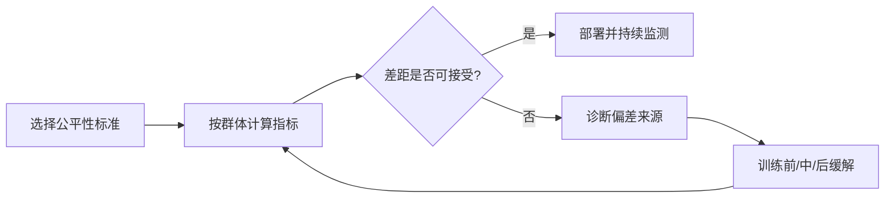
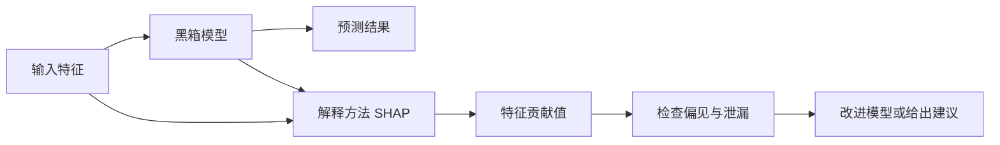

# Concept-Book Run

domain: /home/papagame/projects/digital-duck/cb-data-science/public/domains/data_science_ch08/input/graph.yaml
target: explainable_ai
started: 2026-11-25T04:33:44

## Teaching order (3 concepts)

- bias
- fairness
- explainable_ai

### bias (0.6s)

## 偏置(Bias)

### 定义

在单个神经元中,输入先经过加权求和,再通过激活函数输出。**偏置** $b$ 是加在加权和上的一个可学习常数:

$$z = \sum_{i=1}^{n} w_i x_i + b, \qquad a = \sigma(z)$$

权重 $w_i$ 决定"每个输入有多重要",而偏置 $b$ 决定"在没有任何输入刺激时,神经元本身有多容易被激活"。$b$ 越大,神经元越容易激活;$b$ 越小(越负),神经元越"迟钝",需要更强的输入才会被激活。

从几何上看,偏置让决策边界不必经过原点。没有偏置时,$w_1x_1 + w_2x_2 = 0$ 必然是一条过原点的直线;加入偏置后,边界 $w_1x_1 + w_2x_2 + b = 0$ 可以平移到任意位置。

### 例题

设一个神经元使用阶跃激活函数:$z \ge 0$ 时输出 1,否则输出 0。它有两个二值输入 $x_1, x_2 \in \{0,1\}$,权重 $w_1 = w_2 = 1$。

**情形 A:$b = -1.5$。** 计算 $z = x_1 + x_2 - 1.5$:

| $x_1$ | $x_2$ | $z$ | 输出 |
|---|---|---|---|
| 0 | 0 | $-1.5$ | 0 |
| 0 | 1 | $-0.5$ | 0 |
| 1 | 0 | $-0.5$ | 0 |
| 1 | 1 | $0.5$ | 1 |

这正是逻辑**与(AND)**。

**情形 B:$b = -0.5$。** 此时 $z = x_1 + x_2 - 0.5$,只要有一个输入为 1,就有 $z \ge 0.5 > 0$,输出 1;仅当两个输入都为 0 时输出 0。这是逻辑**或(OR)**。

权重完全相同,仅仅改变 $b$,神经元就实现了不同的功能。

### 问题求解应用

**问题:** 一个神经元用来判断"是否带伞"。输入 $x_1$ 为降雨概率(0 到 1),权重 $w_1 = 4$。要求:降雨概率超过 0.5 时才输出 1。求 $b$。

**解:** 临界点处 $z = 0$,即
$$4 \times 0.5 + b = 0 \;\Rightarrow\; b = -2.$$

验证:$x_1 = 0.7$ 时 $z = 2.8 - 2 = 0.8 > 0$,输出 1;$x_1 = 0.3$ 时 $z = 1.2 - 2 = -0.8 < 0$,输出 0。

**一般方法:** 若希望单输入神经元在 $x = x_0$ 处翻转,则令 $b = -w_1 x_0$。即偏置等于"阈值乘以权重"的相反数,这也说明偏置可以理解为**可学习的阈值**。

**训练中的偏置:** 梯度下降同样会更新偏置。因为 $\partial z / \partial b = 1$,所以
$$\frac{\partial L}{\partial b} = \frac{\partial L}{\partial a}\,\sigma'(z),$$
更新规则为 $b \leftarrow b - \eta \,\dfrac{\partial L}{\partial b}$。实践中常把偏置视为一个恒为 1 的额外输入 $x_0 = 1$ 所对应的权重 $w_0 = b$,这样可以统一处理所有参数。

**小结:** 权重控制边界的**方向**(斜率),偏置控制边界的**位置**(平移)。

### fairness (0.6s)

## 公平性

**定义。** 在数据处理中,*公平性*(fairness)指模型或算法的决策不因受保护属性(如性别、种族、年龄)而对某些群体产生系统性的不利偏差。"没有偏差"并不是单一标准,而是有多种可形式化的度量。设 $\hat{Y}$ 为模型预测,$Y$ 为真实标签,$A$ 为受保护属性。三种常用标准如下:

- **人口统计均等**(demographic parity):$P(\hat{Y}=1\mid A=a)=P(\hat{Y}=1\mid A=b)$,即各群体获得正向结果的比例相同。
- **机会均等**(equal opportunity):$P(\hat{Y}=1\mid Y=1,A=a)=P(\hat{Y}=1\mid Y=1,A=b)$,即真正合格者被选中的概率相同(真正例率相等)。
- **均等化赔率**(equalized odds):在机会均等的基础上,再要求假正例率也相等。

**例题。** 某贷款模型对两个群体的测试结果如下:

| 群体 | 人数 | 实际会还款 | 模型批准数 | 其中实际会还款者被批准数 |
|---|---|---|---|---|
| $A$ | 100 | 60 | 50 | 42 |
| $B$ | 100 | 50 | 30 | 20 |

先算批准率:$P(\hat{Y}=1\mid A)=50/100=0.50$,$P(\hat{Y}=1\mid B)=30/100=0.30$。人口统计均等差为 $|0.50-0.30|=0.20$。

再算真正例率:$\mathrm{TPR}_A=42/60=0.70$,$\mathrm{TPR}_B=20/50=0.40$。机会均等差为 $0.30$。

这说明:有能力还款的 $B$ 组申请人被错误拒绝的比例明显更高。

**问题求解应用。** 实践中的流程分为三步:

1. **度量**:选定与场景相符的公平性标准,按群体分别计算指标。
2. **诊断**:检查偏差的来源,例如训练数据的代表性不足、标签本身带有历史偏见,或某个特征是受保护属性的代理变量(如邮政编码)。
3. **缓解**:可在训练前重新采样或加权,在训练中加入公平性约束,或在训练后为各群体设置不同的决策阈值。

以上例为例,若对 $B$ 组降低阈值,使 $\mathrm{TPR}_B$ 从 $0.40$ 提高到 $0.70$,机会均等差就会缩小到 $0$。但这通常会改变假正例率和整体准确率,需要权衡。

**一个重要结论。** 当两个群体的基础比率不同(此处为 $0.60$ 与 $0.50$)且分类器不完美时,人口统计均等、均等化赔率与预测值均等(各群体的精确率相等)一般无法同时满足。因此公平性不是一个可以"一键达成"的技术指标,而需要结合具体场景的后果与价值取向,明确选择并说明所采用的标准。

*图:公平性评估与改进的循环流程:度量、诊断、缓解,再度量,直至差距可接受。*

### explainable_ai (0.5s)

## 可解释人工智能(Explainable AI)

**定义。** 可解释人工智能(XAI)是一类方法的总称,目的是让复杂模型(如深度网络、梯度提升树)的预测能被人理解、检验和质疑。XAI 通常分两类:**内在可解释**模型(线性回归、决策树,结构本身透明)和**事后解释**方法(对已训练好的黑箱模型做归因)。常用的一种事后解释是**特征归因**:给每个输入特征 $x_i$ 分配一个贡献值 $\phi_i$,使其满足"可加性":

$$f(x) \approx \phi_0 + \sum_{i=1}^{n} \phi_i$$

其中 $\phi_0$ 是模型在全体数据上的平均输出(基线)。SHAP 方法用博弈论中的 Shapley 值来定义 $\phi_i$:

$$\phi_i = \sum_{S \subseteq F\setminus\{i\}} \frac{|S|!\,(n-|S|-1)!}{n!}\Big[f(S\cup\{i\}) - f(S)\Big]$$

它表示特征 $i$ 在所有可能的特征加入顺序下的平均边际贡献。

**例题。** 某银行模型预测一位申请人的违约概率为 $0.40$,全体申请人的平均违约概率为 $\phi_0=0.15$。模型只用两个特征:收入 $A$ 和负债率 $B$。已知:

- $f(\varnothing)=0.15$,$f(\{A\})=0.20$,$f(\{B\})=0.35$,$f(\{A,B\})=0.40$。

计算 $\phi_A$。$n=2$,子集 $S$ 只有 $\varnothing$ 和 $\{B\}$,权重均为 $\frac{1}{2}$:

$$\phi_A=\tfrac12\,(0.20-0.15)+\tfrac12\,(0.40-0.35)=0.05$$

同理 $\phi_B=\tfrac12(0.35-0.15)+\tfrac12(0.40-0.20)=0.20$。验证:$0.15+0.05+0.20=0.40=f(x)$,可加性成立。结论:负债率是推高违约风险的主要原因(贡献 $+0.20$),收入的影响较小($+0.05$)。

**问题求解应用。** 假设申请人被拒贷,要求你判断"拒贷是否合理"。步骤如下:

1. 计算每个特征的 $\phi_i$,找出贡献最大的特征。
2. 检查该特征是否合法、合理。如果最大贡献来自邮政编码这类可能代理种族或地域的变量,说明模型存在**偏见风险**。
3. 做**反事实**检验:若负债率从 $0.6$ 降到 $0.3$,预测会降到多少?这给申请人一个可操作的建议。
4. 用解释**调试**模型:若某特征贡献异常大(如"申请编号"),往往意味着数据泄漏。

**注意。** 事后解释只是对模型行为的近似,不等于模型的真实机理。特征相关时,Shapley 值的计算依赖于如何"移除"特征,结果可能不同。在医疗、金融、司法等高风险场景,若精度相近,应优先选择内在可解释的模型。

*图:事后解释流程。解释方法同时读取输入与模型,输出各特征的贡献,用于审查与改进。*

## Run complete

total: 6.1s
