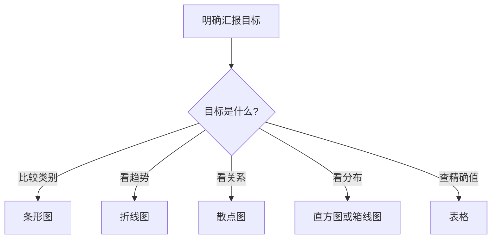
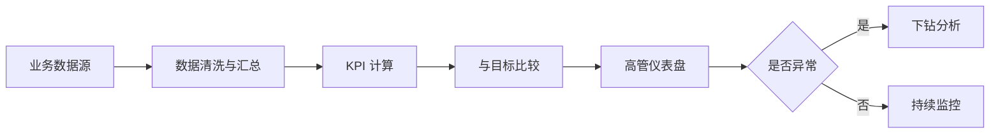

# Concept-Book Run

domain: /home/papagame/projects/digital-duck/cb-data-science/public/domains/data_science_ch10/input/graph.yaml
target: executive_dashboard
started: 2026-11-25T04:34:04

## Teaching order (3 concepts)

- audience
- data_visualization_choice
- executive_dashboard

### audience (0.5s)

## 受众

### 定义

技术报告的**受众**是实际阅读报告并据此理解、判断或行动的人或群体。受众不同，他们已有的知识、关心的问题、可支配的时间都不同。因此，同一项研究成果常常需要用不同方式表达。按沟通需求，通常把受众分为四类：

| 受众 | 背景 | 最关心的问题 | 适合的写法 |
|---|---|---|---|
| 专家 | 同领域研究者 | 方法是否严谨、结果能否复现 | 完整推导、误差分析、参考文献 |
| 技术人员 | 工程师、实施者 | 如何操作、参数是多少 | 步骤、规格、接口、示例代码 |
| 管理者 | 决策者 | 成本、风险、收益 | 结论先行、数据摘要、建议 |
| 非专业读者 | 公众、跨领域读者 | 这与我有什么关系 | 类比、日常语言、少用术语 |

### 工作示例

假设某团队测得新型电池的容量衰减率为每循环 $0.02\%$，需要为四类读者各写一句核心陈述：

- **专家**：“在 $1\,\text{C}$ 倍率下循环 $500$ 次后，容量保持率为 $\approx 90\%$，衰减率为 $0.02\%/\text{循环}$（$n=5$，标准差 $0.003\%$）。”
- **技术人员**：“按 $1\,\text{C}$ 充放电，循环 $500$ 次后容量约剩 $90\%$；请在电池管理系统中把报警阈值设为 $80\%$。”
- **管理者**：“该电池可使用约 $1000$ 次循环，寿命比现有方案长约 $30\%$，预计每年节省更换成本。建议批准试点。”
- **非专业读者**：“这种电池每天充一次，大约能用近三年，性能仍然良好。”

四句话的事实相同，但详略、术语和结论的位置不同。

### 问题解决应用

撰写报告时，按下列步骤分析受众：

1. **识别读者**：列出谁会读，并判断主要读者是哪一类。
2. **确定需求**：这位读者读完要做什么决定或动作？
3. **选择内容与顺序**：管理者和非专业读者适合“结论—依据—细节”；专家和技术人员则需要完整的方法与数据。
4. **调整语言**：不熟悉的术语要给出解释，或换成日常说法。
5. **分层组织**：用摘要照顾决策者，用正文照顾技术人员，用附录照顾专家。

**验证**：把初稿交给目标读者的代表，请对方用一句话复述要点，并说出下一步该做什么。如果复述与你的意图不符，就说明报告需要修改。

当读者混合时，不要把报告写成一份“折中”的文本。更有效的做法是分层：摘要面向管理者，引言和图示面向非专业读者，方法与数据面向专家和技术人员。

### data_visualization_choice (0.5s)

## 数据可视化的选择

**定义。** 数据可视化的选择,是指根据**数据类型**、**受众**和**汇报目标**,从图或表中挑出最合适的一种来呈现数据。同一组数据换一种图形,传达的结论可能完全不同。判断的核心不是"哪个好看",而是"读者能否在最短时间内得到正确的结论"。

**常用匹配规则。**

| 汇报目标 | 数据类型 | 推荐形式 |
|---|---|---|
| 比较类别大小 | 分类变量 + 数值 | 条形图 |
| 展示随时间的趋势 | 时间序列 | 折线图 |
| 展示两变量关系 | 两个连续变量 | 散点图 |
| 展示分布形状 | 单个连续变量 | 直方图、箱线图 |
| 展示构成比例 | 部分占整体(类别少) | 堆叠条形图(或类别 $\le 4$ 时的饼图) |
| 查找精确数值 | 少量数据 | 表格 |


*图:根据汇报目标选择图形的决策流程。*

**例题。** 某班 30 名学生的期末成绩,平均分 $\bar{x}=76$,但有少数学生成绩极低。老师想让家长了解"成绩整体情况"。

- 只报告平均分:会掩盖两极分化。
- 用直方图:能显示分布是否偏斜、是否有两个峰。
- 用箱线图:能同时显示中位数、四分位距 $IQR = Q_3 - Q_1$ 和离群点。

对家长,直方图更直观;对教研组比较多个班级,并排箱线图更高效。结论:**目标(看分布)决定图形类型,受众决定复杂程度。**

**问题解决应用。** 请为下列情形选择图形并说明理由:

1. *某公司 2015–2024 年每年的销售额。* 数据是时间序列,目标是趋势,选**折线图**。用条形图也可行,但折线更强调"变化的连续性"。
2. *学生每周学习时长与成绩的关系。* 两个连续变量,目标是相关性,选**散点图**,还可加回归线 $\hat{y}=a+bx$。
3. *向管理层汇报 5 个部门的预算。* 目标是比较大小,选**条形图**并按数值排序;不要用饼图,因为人眼难以准确比较 5 个角度的差异。
4. *审计员需要核对每笔费用的确切金额。* 目标是精确查找,选**表格**。

**常见错误检查清单。**
- 条形图的纵轴必须从 $0$ 开始,否则会夸大差异。
- 类别过多时不要用饼图。
- 避免不必要的三维效果和过多颜色。
- 每张图都应有标题、坐标轴标签和单位。

**小结。** 选择可视化的三步法:先问"我想让读者得出什么结论"(目标),再看"数据是什么类型"(数据),最后考虑"读者是谁"(受众)。图形只是手段,清晰、准确地传达结论才是目的。

### executive_dashboard (0.6s)

## 高管仪表盘

### 定义

**高管仪表盘(Executive Dashboard)**是一种可视化工具。它把组织最重要的关键绩效指标(KPI)集中显示在一个页面上,并随数据更新,供高层管理者快速掌握整体状况。它与详细报表的区别在于:报表回答"发生了什么细节",仪表盘回答"现在是否正常,哪里需要关注"。

好的仪表盘遵循三条原则:

1. **少而精**:通常只展示 5–9 个与战略目标直接相关的 KPI。
2. **有对照**:每个数字都与目标值、上期值或阈值比较,否则单个数字没有意义。
3. **可下钻**:发现异常后,能够继续查看更细的数据。

一个常用的比较量是**目标达成率**:

$$
\text{达成率} = \frac{\text{实际值}}{\text{目标值}} \times 100\%
$$

对于"越低越好"的指标(如客户流失率),应使用目标值除以实际值,或直接比较差值。

### worked example(例题)

某电商公司本季度的数据如下:

| KPI | 实际值 | 目标值 |
|---|---|---|
| 营收(百万元) | 46 | 50 |
| 毛利率 | 38% | 35% |
| 客户流失率 | 6% | 5% |
| 订单准时交付率 | 97% | 95% |

约定:达成率 $\ge 100\%$ 为绿色,$90\%\text{–}100\%$ 为黄色,低于 $90\%$ 为红色。

- 营收:$46/50 = 92\%$ → 黄色。
- 毛利率:$38/35 \approx 108.6\%$ → 绿色。
- 客户流失率(越低越好):$5/6 \approx 83.3\%$ → 红色。
- 准时交付率:$97/95 \approx 102.1\%$ → 绿色。

仪表盘一眼就能显示:客户流失是最紧迫的问题,营收略有不足,其余指标良好。

### 问题解决应用

下面这段代码把上述规则自动化,用来生成仪表盘的状态灯:

```python
def status(actual, target, lower_better=False):
    rate = target / actual if lower_better else actual / target
    if rate >= 1.0:
        return "绿"
    return "黄" if rate >= 0.9 else "红"

kpis = [("营收", 46, 50, False), ("流失率", 6, 5, True)]
for name, a, t, lb in kpis:
    print(name, status(a, t, lb))
```

**分析思路**:红灯出现后,按"指标 → 原因 → 行动"逐层下钻。例如流失率偏高,可继续按客户群、地区、产品线拆分,找出流失集中的部分,再决定是改进服务还是调整定价。

**常见陷阱**:

- 指标过多,重点被淹没。
- 只显示当前值,不显示趋势,无法判断变化方向。
- 数据口径不一致,导致不同部门的数字互相矛盾。
- 数据延迟,使"实时"失去意义。


*图:从数据源到高管仪表盘的流程。KPI 与目标比较后,异常指标触发下钻分析,正常指标继续监控。*

## Run complete

total: 5.9s
